<!-- source: DeepWiki mcp.deepwiki.com · repo NVIDIA/DALI · page 2.2 Data Structures · fetched 2026-10-26 -->

# Data Structures

<details>
<summary>Relevant source files</summary>

The following files were used as context for generating this wiki page:

- [dali/c_api/c_api.cc](dali/c_api/c_api.cc)
- [dali/c_api/c_api_test.cc](dali/c_api/c_api_test.cc)
- [dali/pipeline/data/buffer.cc](dali/pipeline/data/buffer.cc)
- [dali/pipeline/data/buffer.h](dali/pipeline/data/buffer.h)
- [dali/pipeline/data/tensor.h](dali/pipeline/data/tensor.h)
- [dali/pipeline/data/tensor_list.cc](dali/pipeline/data/tensor_list.cc)
- [dali/pipeline/data/tensor_list.h](dali/pipeline/data/tensor_list.h)
- [dali/pipeline/data/tensor_list_test.cc](dali/pipeline/data/tensor_list_test.cc)
- [dali/pipeline/data/tensor_test.cc](dali/pipeline/data/tensor_test.cc)
- [dali/pipeline/data/tensor_vector.h](dali/pipeline/data/tensor_vector.h)
- [dali/pipeline/operator/builtin/make_contiguous.cc](dali/pipeline/operator/builtin/make_contiguous.cc)
- [dali/pipeline/operator/builtin/make_contiguous.cu](dali/pipeline/operator/builtin/make_contiguous.cu)
- [dali/pipeline/pipeline.cc](dali/pipeline/pipeline.cc)
- [dali/pipeline/pipeline.h](dali/pipeline/pipeline.h)
- [dali/pipeline/pipeline_test.cc](dali/pipeline/pipeline_test.cc)
- [dali/python/backend_impl.cc](dali/python/backend_impl.cc)
- [dali/python/nvidia/dali/pipeline.py](dali/python/nvidia/dali/pipeline.py)
- [dali/python/nvidia/dali/types.py](dali/python/nvidia/dali/types.py)
- [dali/test/python/test_functional_api.py](dali/test/python/test_functional_api.py)
- [dali/test/python/test_pipeline.py](dali/test/python/test_pipeline.py)
- [docs/supported_ops.rst](docs/supported_ops.rst)
- [include/dali/c_api.h](include/dali/c_api.h)

</details>


## Purpose and Scope

This document describes the core data structures used throughout DALI for storing and managing tensor data. These structures provide the foundation for data flow through the pipeline, supporting both CPU and GPU backends with flexible memory management strategies.

For information about how these structures are used in pipeline execution, see [Pipeline System](#2.1). For details on operators that process these structures, see [Operator System](#2.3). For Python API access to these structures, see [Pipeline API (fn and ops)](#3.1).

---

## Overview

DALI's data structures are organized in a three-level hierarchy designed for efficient batch processing:

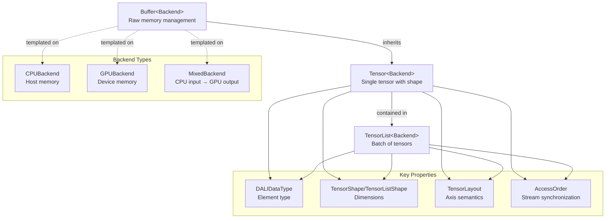

**Sources:** [dali/pipeline/data/buffer.h:164-242](), [dali/pipeline/data/tensor.h:42-46](), [dali/pipeline/data/tensor_list.h:72-74]()

---

## Buffer: Base Memory Management

The `Buffer<Backend>` template class provides low-level memory allocation and management. It is untyped on construction and receives a type when data is allocated.

### Key Responsibilities

| Aspect | Description |
|--------|-------------|
| **Memory Allocation** | Allocates raw memory on CPU or GPU |
| **Type Management** | Tracks element type (`DALIDataType`) |
| **Size Tracking** | Maintains size in elements and bytes |
| **Sharing** | Supports zero-copy data sharing via `shared_ptr` |
| **Pinned Memory** | Manages page-locked host memory for faster transfers |

### Core Interface

```cpp
template <typename Backend>
class Buffer {
  // Type and size
  void set_type(DALIDataType type);
  DALIDataType type() const;
  Index size() const;  // elements
  size_t nbytes() const;  // bytes
  
  // Data access
  template <typename T> T* mutable_data();
  template <typename T> const T* data() const;
  void* raw_mutable_data();
  const void* raw_data() const;
  
  // Allocation
  void Resize(Index new_size);
  void reserve(size_t bytes);
  
  // Sharing
  void ShareData(shared_ptr<void> ptr, size_t bytes, ...);
  bool shares_data() const;
  
  // Backend properties
  int device_id() const;
  bool is_pinned() const;
  AccessOrder order() const;
  void set_order(AccessOrder order, bool sync = true);
};
```

### Memory Allocation Strategy

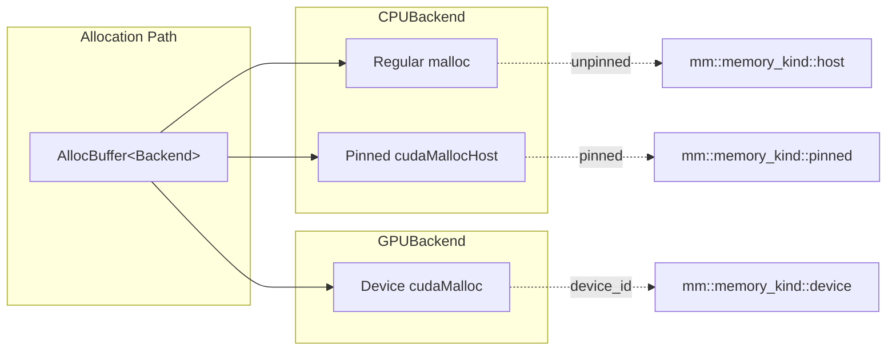

**Sources:** [dali/pipeline/data/buffer.h:164-290](), [dali/pipeline/data/buffer.cc:1-89]()

---

## Tensor: Single Multi-Dimensional Array

The `Tensor<Backend>` class extends `Buffer<Backend>` with shape and layout information, representing a single dense tensor.

### Structure

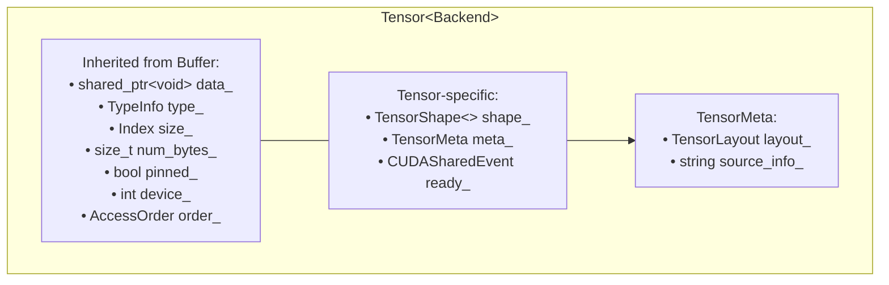

### Key Operations

| Operation | Description | Behavior |
|-----------|-------------|----------|
| **`Resize(shape)`** | Allocate to fit shape | Only reallocates if needed |
| **`Resize(shape, type)`** | Resize with new type | Can change type if size matches |
| **`Copy(src)`** | Deep copy from source | Supports cross-backend copies |
| **`ShareData(src)`** | Zero-copy share | Points to same memory |
| **`SubspaceTensor(x)`** | Slice first dimension | Returns view into data |
| **`Reinterpret(type)`** | Change type interpretation | Element size must match |

### Shape and Layout

```cpp
// Shape access
const TensorShape<>& shape() const;
int ndim() const;  // number of dimensions
Index dim(int d) const;  // size of dimension d
Index num_elements() const;  // total elements

// Layout access (semantic meaning of dimensions)
const TensorLayout& GetLayout() const;
void SetLayout(const TensorLayout& layout);

// Example layouts: "HWC" (height, width, channels)
//                  "NHWC" (batch, height, width, channels)
//                  "FHWC" (frames, height, width, channels)
```

**Sources:** [dali/pipeline/data/tensor.h:42-300](), [dali/pipeline/data/tensor_test.cc:34-500]()

---

## TensorList: Batch Container

The `TensorList<Backend>` class manages a batch of tensors, supporting both uniform and non-uniform shapes within a batch.

### Memory Modes

TensorList can operate in two distinct memory modes:

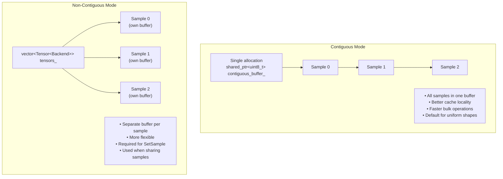

### Core Structure

```cpp
template <typename Backend>
class TensorList {
private:
  // Shape and type (uniform across batch)
  TensorListShape<> shape_;  // per-sample shapes
  TypeInfo type_;
  int sample_dim_;
  
  // Sample storage
  vector<Tensor<Backend>> tensors_;  // individual samples
  shared_ptr<uint8_t> contiguous_buffer_;  // optional shared buffer
  BatchContiguity contiguity_state_;
  
  // Batch metadata
  int curr_num_tensors_;  // current batch size
  TensorLayout layout_;
  bool pinned_;
  int device_;
  AccessOrder order_;
  
  // State tracking
  bool shares_data_;
  size_t num_bytes_;
};
```

### Batch Shape Representation

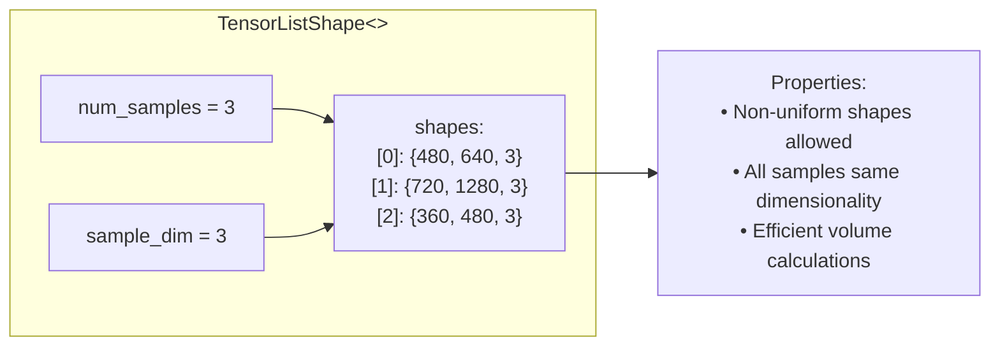

### Key Operations

| Category | Methods | Description |
|----------|---------|-------------|
| **Size Management** | `SetSize(n)`, `Resize(shape)`, `reserve()` | Control batch size and allocation |
| **Sample Access** | `operator[](i)`, `tensor(i)`, `tensor_shape(i)` | Access individual samples |
| **Sample Setting** | `SetSample(i, src)` | Share data from another tensor (→ non-contiguous) |
| **Sample Copying** | `CopySample(i, src)` | Copy data into sample |
| **Batch Operations** | `Copy(src)`, `ShareData(src)` | Operate on entire batch |
| **Mode Control** | `SetContiguity(mode)`, `IsContiguous()` | Manage memory layout |

### Contiguity State Machine

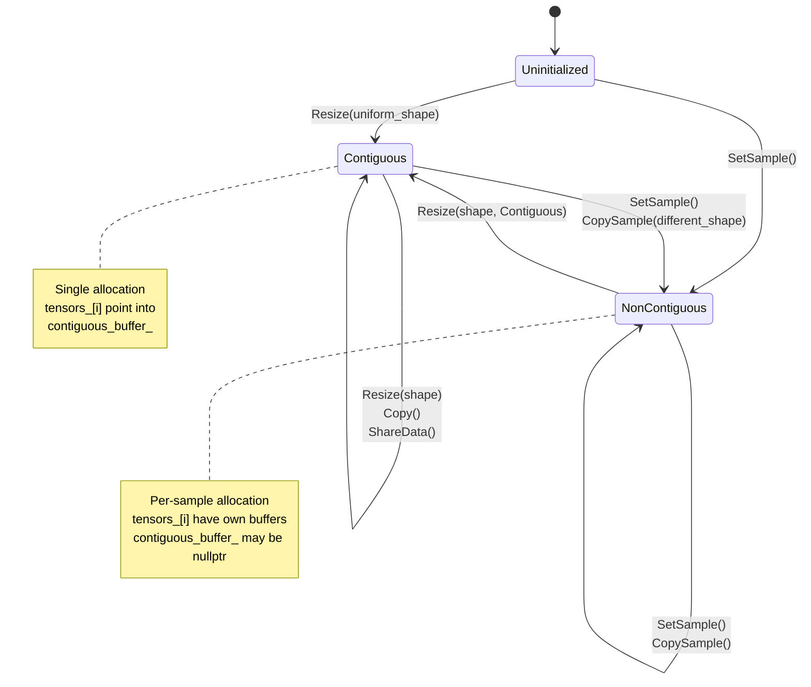

**Sources:** [dali/pipeline/data/tensor_list.h:72-750](), [dali/pipeline/data/tensor_list.cc:1-800](), [dali/pipeline/data/tensor_list_test.cc:42-2000]()

---

## Backend Types

DALI supports three backend types that determine where data resides and how it's processed:

### Backend Characteristics

```mermaid
graph TB
    subgraph "CPUBackend"
        CPUMem["Memory: Host RAM"]
        CPUAlloc["Allocator: malloc or cudaMallocHost"]
        CPUOps["Operations: CPU threads"]
        CPUCopy["Copy: memcpy or cudaMemcpyAsync"]
    end
    
    subgraph "GPUBackend"
        GPUMem["Memory: Device VRAM"]
        GPUAlloc["Allocator: cudaMalloc"]
        GPUOps["Operations: CUDA kernels"]
        GPUCopy["Copy: cudaMemcpyAsync"]
    end
    
    subgraph "MixedBackend"
        MixedIn["Input: CPUBackend"]
        MixedOut["Output: GPUBackend"]
        MixedOps["Operations: CPU setup + GPU execution"]
    end
    
    CPUMem --> CPUAlloc --> CPUOps --> CPUCopy
    GPUMem --> GPUAlloc --> GPUOps --> GPUCopy
    MixedIn --> MixedOps --> MixedOut
```

### Backend Selection

| Backend | Use Case | Memory Location | Execution |
|---------|----------|-----------------|-----------|
| **CPUBackend** | Data loading, preprocessing | Host RAM | CPU threads |
| **GPUBackend** | Heavy computation, augmentation | Device VRAM | CUDA kernels |
| **MixedBackend** | Decode operations | Input: CPU, Output: GPU | Decode on CPU, output to GPU |

### Cross-Backend Operations

```cpp
// Copy from CPU to GPU
TensorList<CPUBackend> cpu_data;
TensorList<GPUBackend> gpu_data;
gpu_data.Copy(cpu_data, cuda_stream);

// Copy from GPU to CPU
cpu_data.Copy(gpu_data, cuda_stream);

// Share data (same backend only)
TensorList<CPUBackend> shared;
shared.ShareData(cpu_data);  // zero-copy
```

**Sources:** [dali/pipeline/data/backend.h:1-50](), [dali/pipeline/data/tensor_list.cc:28-100]()

---

## Type System

DALI uses a runtime type system to support dynamic typing with compile-time safety checks.

### Type Hierarchy

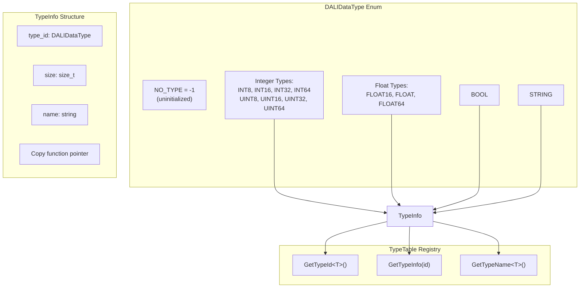

### Type Operations

```cpp
// Setting type
tensor.set_type<float>();  // template version
tensor.set_type(DALI_FLOAT);  // enum version
tensor_list.set_type(DALI_UINT8);

// Querying type
DALIDataType type = tensor.type();
const TypeInfo& info = tensor.type_info();
size_t element_size = info.size();
string name = info.name();

// Type checking
DALI_ENFORCE(IsValidType(type), "Invalid type");
DALI_ENFORCE(tensor.type() == TypeTable::GetTypeId<float>(),
             "Type mismatch");

// Reinterpretation (same size required)
tensor.Reinterpret(DALI_INT32);  // float → int32 (both 4 bytes)
```

### Type Conversion Table

| C++ Type | DALIDataType | Size | Common Use |
|----------|--------------|------|------------|
| `uint8_t` | `UINT8` | 1 | Images, encoded data |
| `int32_t` | `INT32` | 4 | Labels, indices |
| `float` | `FLOAT` | 4 | Normalized images, features |
| `float16` | `FLOAT16` | 2 | Mixed-precision training |

**Sources:** [dali/pipeline/data/types.h:1-200](), [dali/python/nvidia/dali/types.py:52-135]()

---

## Interoperability Protocols

DALI tensors support multiple zero-copy protocols for integration with other frameworks:

### Supported Protocols

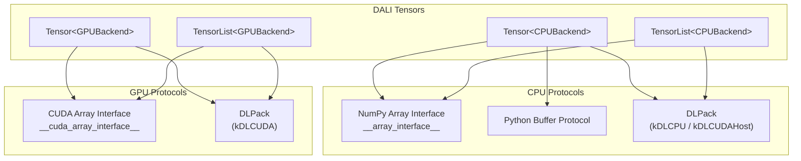

### NumPy Array Interface (CPU)

Exposed via `__array_interface__` property for zero-copy NumPy integration:

```python
# DALI Tensor → NumPy (zero-copy)
tensor_cpu = outputs[0].as_cpu()
numpy_array = np.array(tensor_cpu, copy=False)

# Array interface structure
tensor.__array_interface__ = {
    'version': 3,
    'typestr': '<f4',  # dtype format
    'shape': (224, 224, 3),
    'data': (ptr, False),  # (address, readonly)
    'strides': None  # C-contiguous
}
```

### CUDA Array Interface (GPU)

Exposed via `__cuda_array_interface__` for CuPy, Numba, PyTorch integration:

```python
# DALI Tensor → CuPy (zero-copy)
tensor_gpu = outputs[0].as_gpu()
cupy_array = cp.asarray(tensor_gpu)

# CUDA array interface structure
tensor.__cuda_array_interface__ = {
    'version': 2,
    'typestr': '<f4',
    'shape': (224, 224, 3),
    'data': (ptr, False),
    'stream': stream_ptr,  # synchronization
    'strides': None
}
```

### DLPack Protocol

Standard for tensor exchange across frameworks:

```python
# Export to DLPack
capsule = tensor.__dlpack__(stream=cuda_stream)

# Import from DLPack
tensor = TensorGPU(dlpack_capsule, layout="HWC")

# Framework integration
pytorch_tensor = torch.from_dlpack(dali_tensor)
tf_tensor = tf.experimental.dlpack.from_dlpack(dali_tensor)
```

### DLPack Implementation Details

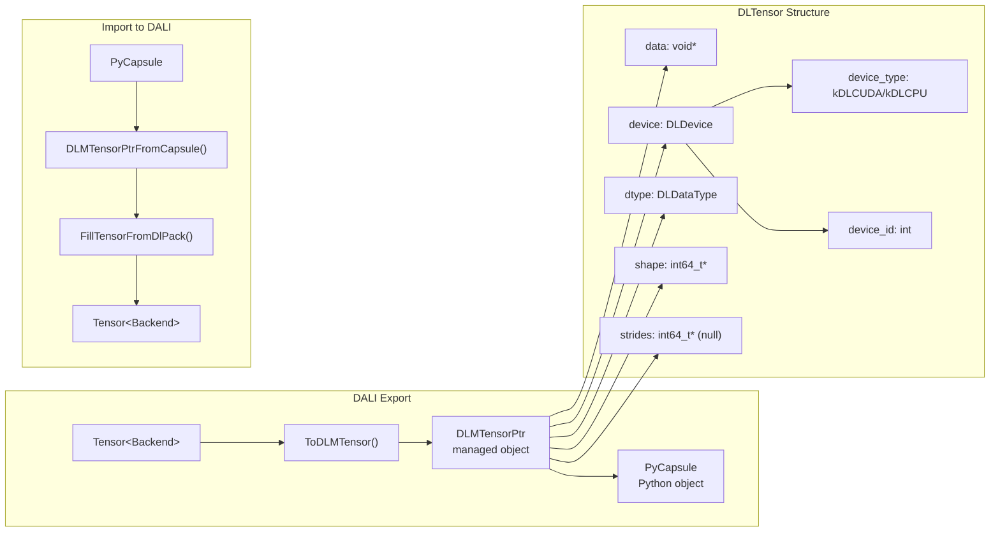

**Sources:** [dali/python/backend_impl.cc:243-593](), [dali/pipeline/data/dltensor.h:1-200]()

---

## AccessOrder and Synchronization

`AccessOrder` manages CUDA stream synchronization for proper GPU operation ordering.

### AccessOrder Concept

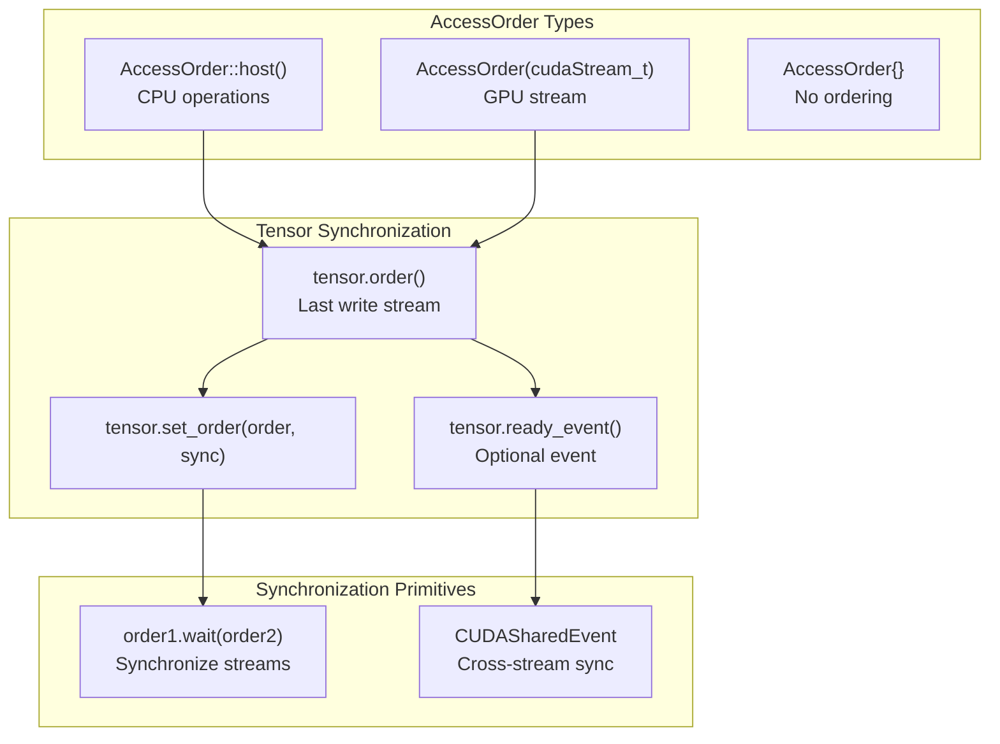

### Usage Patterns

```cpp
// Set stream order for GPU tensor
cudaStream_t stream = ...;
tensor.set_order(AccessOrder(stream));

// Wait before accessing on different stream
cudaStream_t other_stream = ...;
AccessOrder other_order(other_stream);
other_order.wait(tensor.order());

// Copy with explicit ordering
tensor_gpu.Copy(tensor_cpu, AccessOrder(stream));

// Host synchronization for CPU access
if (tensor.is_pinned() && tensor.ready_event()) {
    AccessOrder::host().wait(tensor.ready_event());
}
```

### Stream Ordering in Pipeline

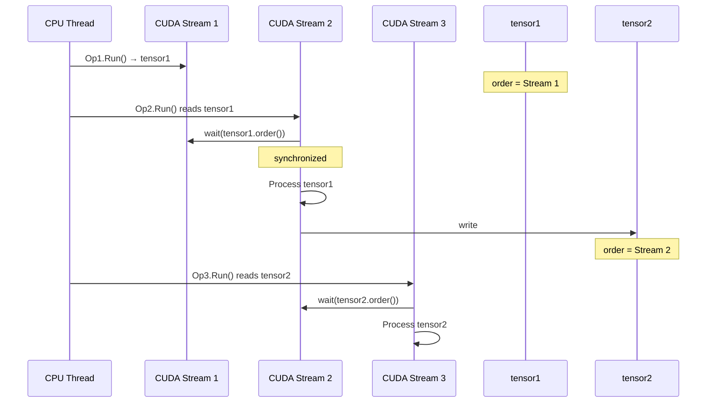

**Sources:** [dali/core/access_order.h:1-200](), [dali/pipeline/data/buffer.h:102-119](), [dali/python/backend_impl.cc:595-613]()

---

## Python Bindings

DALI's C++ data structures are exposed to Python through pybind11 bindings:

### TensorCPU Bindings

```python
# Creation from buffer protocol
import numpy as np
arr = np.array([[1, 2], [3, 4]], dtype=np.float32)
tensor = TensorCPU(arr, layout="HW")

# Creation from DLPack
dlpack_capsule = other_framework.to_dlpack()
tensor = TensorCPU(dlpack_capsule, layout="HWC")

# Properties
shape = tensor.shape()  # list of dimensions
ndim = tensor.ndim()
dtype = tensor.dtype  # DALIDataType
layout = tensor.layout()

# Array protocols
array_interface = tensor.__array_interface__
numpy_view = np.array(tensor, copy=False)

# Copy operations
tensor.copy_to_external(ctypes.c_void_p(ptr))
data_ptr = tensor.data_ptr()  # raw pointer
```

### TensorGPU Bindings

```python
# Creation from CUDA array interface
import cupy as cp
arr = cp.array([[1, 2], [3, 4]], dtype=cp.float32)
tensor = TensorGPU(arr, layout="HW")

# Stream association
tensor._set_stream(cuda_stream)

# Array protocols
cuda_interface = tensor.__cuda_array_interface__
cupy_view = cp.asarray(tensor)

# DLPack export
device_type, device_id = tensor.__dlpack_device__()
capsule = tensor.__dlpack__(stream=stream_ptr)

# Copy between CPU and GPU
tensor_gpu = tensor_cpu._as_gpu()  # copy to GPU
tensor_cpu = tensor_gpu.as_cpu()   # copy to CPU
```

### TensorListCPU / TensorListGPU

```python
# Accessing batch
batch = pipeline.run()
tensor_list = batch[0]  # TensorListGPU or TensorListCPU

# Batch properties
num_samples = len(tensor_list)
shapes = [tensor_list[i].shape() for i in range(num_samples)]

# Convert to dense array (if uniform shape)
dense = tensor_list.as_array()  # numpy or cupy array

# Access individual samples
sample_0 = tensor_list.at(0)  # returns Tensor
sample_tensor = tensor_list[0]  # also returns Tensor

# Iteration
for sample in tensor_list:
    process(sample)
```

### Binding Implementation

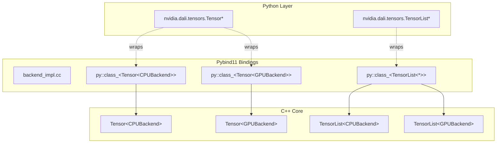

**Sources:** [dali/python/backend_impl.cc:624-1500](), [dali/python/nvidia/dali/pipeline.py:1-100]()

---

## Memory Management and Lifecycle

### Allocation Strategies

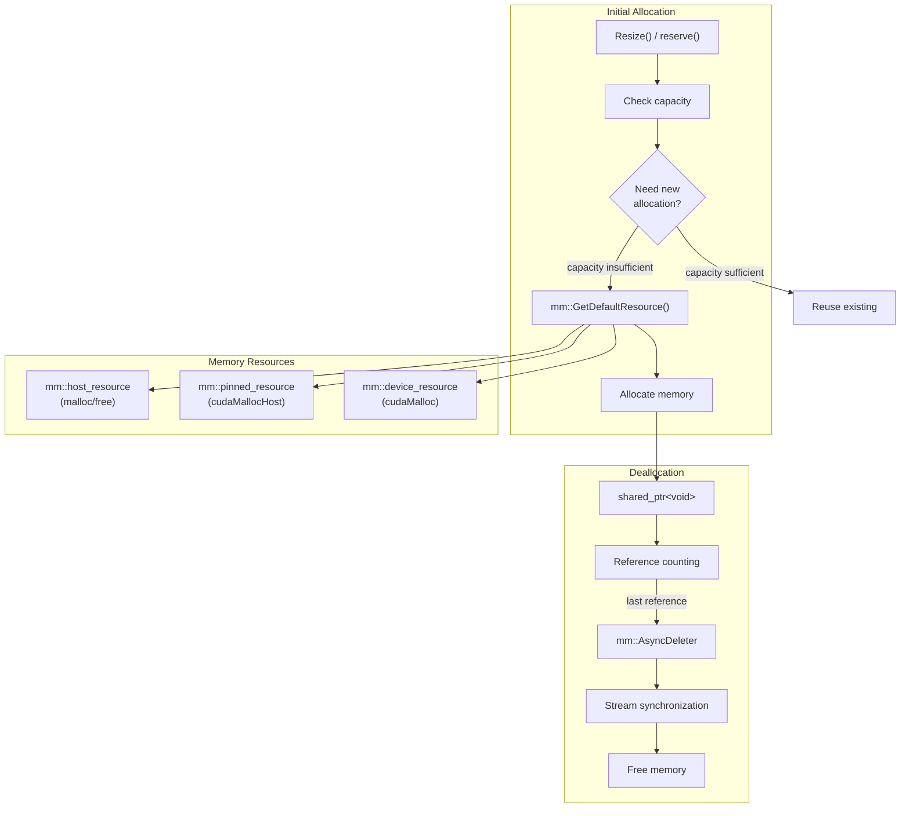

### Zero-Copy Sharing

```cpp
// Share data between tensors (same backend)
Tensor<GPUBackend> tensor1;
tensor1.Resize({1920, 1080, 3}, DALI_UINT8);

Tensor<GPUBackend> tensor2;
tensor2.ShareData(tensor1);  // zero-copy

// Both point to same memory
assert(tensor1.raw_data() == tensor2.raw_data());
assert(tensor1.shares_data() && tensor2.shares_data());

// Share external memory
shared_ptr<void> external_ptr = ...;
tensor.ShareData(external_ptr, num_bytes, is_pinned, 
                 shape, type, device_id, order);
```

### Lifetime Management

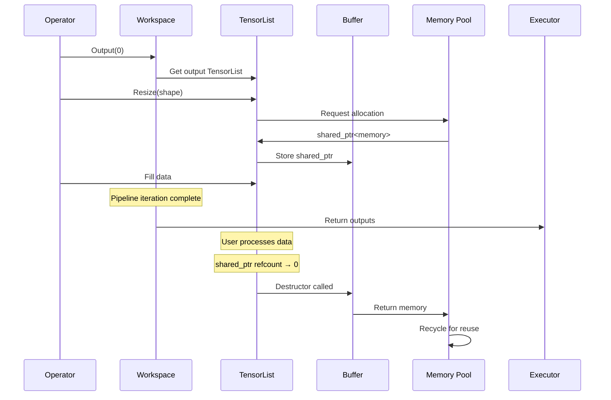

**Sources:** [dali/pipeline/data/buffer.h:242-400](), [dali/pipeline/data/buffer.cc:21-89](), [dali/core/mm/default_resources.h:1-100]()

---

## Summary

DALI's data structures form a cohesive hierarchy designed for efficient batch processing:

| Structure | Purpose | Key Features |
|-----------|---------|--------------|
| **Buffer** | Raw memory management | Type-agnostic allocation, sharing, device placement |
| **Tensor** | Single tensor | Shape, layout, always contiguous |
| **TensorList** | Batch of tensors | Flexible shapes, contiguous/non-contiguous modes |

These structures support:
- **Multiple backends** (CPU, GPU, Mixed)
- **Flexible memory modes** (contiguous for performance, non-contiguous for flexibility)
- **Zero-copy interoperability** (DLPack, NumPy, CUDA Array Interface)
- **Stream-ordered execution** (AccessOrder for proper GPU synchronization)
- **Efficient memory reuse** (pooling, reference counting)

For usage in pipelines, see [Pipeline System](#2.1). For operator implementations that process these structures, see [Operator System](#2.3).

---

