<!-- source: DeepWiki mcp.deepwiki.com · repo NVIDIA/DALI · page 2.3 Operator System · fetched 2026-10-26 -->

# Operator System

<details>
<summary>Relevant source files</summary>

The following files were used as context for generating this wiki page:

- [.gitignore](.gitignore)
- [README.rst](README.rst)
- [dali/c_api/c_api.cc](dali/c_api/c_api.cc)
- [dali/c_api/c_api_test.cc](dali/c_api/c_api_test.cc)
- [dali/pipeline/pipeline.cc](dali/pipeline/pipeline.cc)
- [dali/pipeline/pipeline.h](dali/pipeline/pipeline.h)
- [dali/pipeline/pipeline_test.cc](dali/pipeline/pipeline_test.cc)
- [dali/python/backend_impl.cc](dali/python/backend_impl.cc)
- [dali/python/nvidia/dali/_typing.py](dali/python/nvidia/dali/_typing.py)
- [dali/python/nvidia/dali/experimental/dynamic/__init__.py](dali/python/nvidia/dali/experimental/dynamic/__init__.py)
- [dali/python/nvidia/dali/experimental/dynamic/_ops.py](dali/python/nvidia/dali/experimental/dynamic/_ops.py)
- [dali/python/nvidia/dali/experimental/dynamic/random.py](dali/python/nvidia/dali/experimental/dynamic/random.py)
- [dali/python/nvidia/dali/fn/__init__.py](dali/python/nvidia/dali/fn/__init__.py)
- [dali/python/nvidia/dali/ops/__init__.py](dali/python/nvidia/dali/ops/__init__.py)
- [dali/python/nvidia/dali/ops/_docs.py](dali/python/nvidia/dali/ops/_docs.py)
- [dali/python/nvidia/dali/ops/_names.py](dali/python/nvidia/dali/ops/_names.py)
- [dali/python/nvidia/dali/ops/_signatures.py](dali/python/nvidia/dali/ops/_signatures.py)
- [dali/python/nvidia/dali/pipeline.py](dali/python/nvidia/dali/pipeline.py)
- [dali/python/nvidia/dali/types.py](dali/python/nvidia/dali/types.py)
- [dali/test/python/experimental_mode/test_arg_conversion.py](dali/test/python/experimental_mode/test_arg_conversion.py)
- [dali/test/python/experimental_mode/test_docs.py](dali/test/python/experimental_mode/test_docs.py)
- [dali/test/python/experimental_mode/test_public_api.py](dali/test/python/experimental_mode/test_public_api.py)
- [dali/test/python/experimental_mode/test_random.py](dali/test/python/experimental_mode/test_random.py)
- [dali/test/python/operator_1/test_operator_exception.py](dali/test/python/operator_1/test_operator_exception.py)
- [dali/test/python/test_functional_api.py](dali/test/python/test_functional_api.py)
- [dali/test/python/test_pipeline.py](dali/test/python/test_pipeline.py)
- [docs/autodoc_submodules.py](docs/autodoc_submodules.py)
- [docs/conf.py](docs/conf.py)
- [docs/dali_dynamic/api_reference.rst](docs/dali_dynamic/api_reference.rst)
- [docs/dali_dynamic/index.rst](docs/dali_dynamic/index.rst)
- [docs/dali_dynamic/ops_reference.rst](docs/dali_dynamic/ops_reference.rst)
- [docs/index.rst](docs/index.rst)
- [docs/operations_table.py](docs/operations_table.py)
- [docs/supported_ops.rst](docs/supported_ops.rst)
- [include/dali/c_api.h](include/dali/c_api.h)
- [internal_tools/python_stub_generator.py](internal_tools/python_stub_generator.py)

</details>


## Purpose and Scope

The Operator System is the foundation of DALI's data processing capabilities. This document describes how operators are defined, registered, instantiated, and executed within DALI pipelines. An operator in DALI is a processing unit that transforms data (e.g., image decoding, resizing, augmentation) and can run on CPU, GPU, or as a mixed operation.

For information about how operators are invoked within pipelines and how the execution graph is built, see [Pipeline System](#2.1). For the data structures operators process, see [Data Structures](#2.2).

---

## Operator Architecture Overview

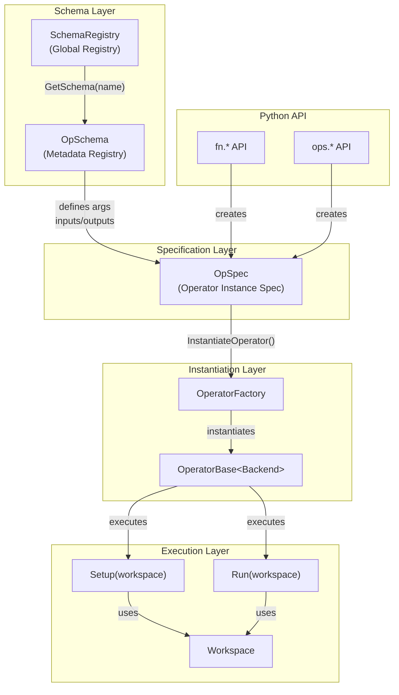

**Diagram: Operator System Architecture**

The operator system consists of four primary layers:
1. **Schema Layer**: Defines operator metadata and maintains a global registry
2. **Specification Layer**: Captures instance-specific configuration via `OpSpec`
3. **Instantiation Layer**: Creates actual operator instances from specifications
4. **Execution Layer**: Runs operators on data through `Setup()` and `Run()` methods

Sources: [dali/pipeline/operator/operator.h](), [dali/pipeline/operator/op_spec.h](), [dali/pipeline/operator/op_schema.h]()

---

## OpSchema: Operator Metadata Registry

`OpSchema` is the metadata description for an operator type. Each operator (e.g., "Resize", "ImageDecoder") has exactly one schema that describes:
- Valid arguments and their types
- Number and types of inputs
- Number and types of outputs  
- Documentation
- Backend support (CPU/GPU/Mixed)

### Schema Registration

Schemas are registered globally in the `SchemaRegistry` singleton. Operators register themselves using the `DALI_SCHEMA` macro or programmatically via `SchemaRegistry::Register()`.

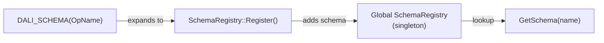

**Diagram: Schema Registration Flow**

Key operations:
- `SchemaRegistry::GetSchema(name)` - Retrieves schema by operator name
- `SchemaRegistry::TryGetSchema(name)` - Safe lookup that doesn't throw
- `OpSchema::AddArg()` - Defines an argument with type and documentation
- `OpSchema::NumInput()` / `NumOutput()` - Specifies input/output cardinality

Sources: [dali/pipeline/operator/op_schema.h](), [dali/pipeline/operator/op_schema.cc]()

### Schema Components

| Component | Description | Example |
|-----------|-------------|---------|
| `name_` | Operator name | "Resize" |
| `dox_` | Documentation string | "Resizes images..." |
| `arguments_` | Map of argument definitions | `{{"resize_x", ArgDef{...}}}` |
| `num_input_` | Input cardinality | 1 |
| `num_output_` | Output cardinality | 1 |
| `allow_sequences_` | Whether operator supports sequences | true/false |
| `support_volumetric_` | Whether operator supports 3D data | true/false |
| `is_internal_` | Internal-only operator flag | true/false |

Sources: [dali/pipeline/operator/op_schema.h:30-200]()

---

## OpSpec: Operator Specification

`OpSpec` represents a specific instance configuration for an operator. While `OpSchema` defines what *can* be specified, `OpSpec` defines what *is* specified for a particular operator instance in a pipeline.

### Creating an OpSpec

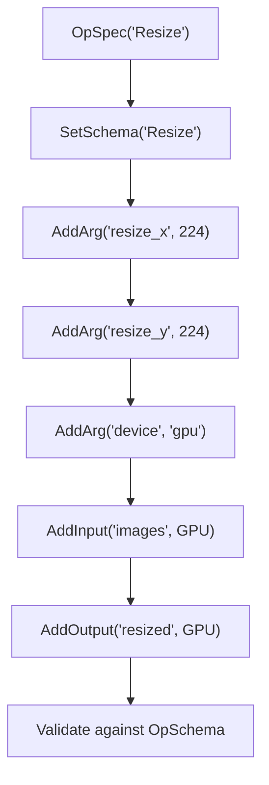

**Diagram: OpSpec Construction**

An `OpSpec` is built through a fluent interface:

```python
# Python example
spec = OpSpec("Resize")
    .AddArg("device", "gpu")
    .AddArg("resize_x", 224)
    .AddArg("resize_y", 224)
    .AddInput("images", StorageDevice.GPU)
    .AddOutput("resized", StorageDevice.GPU)
```

Sources: [dali/pipeline/operator/op_spec.h](), [dali/pipeline/operator/op_spec.cc]()

### OpSpec Components

| Method | Purpose |
|--------|---------|
| `SetSchema(name)` | Associates with an operator schema |
| `AddArg(name, value)` | Adds a named argument |
| `AddArgumentInput(arg_name, input_name)` | Specifies tensor argument input |
| `AddInput(name, device)` | Adds a regular input |
| `AddOutput(name, device)` | Adds an output |
| `GetArgument<T>(name)` | Retrieves a typed argument value |
| `NumInput()` / `NumOutput()` | Query input/output counts |

Sources: [dali/pipeline/operator/op_spec.h:50-300]()

---

## Operator Categories and Backends

DALI operators are categorized by where they execute:

```mermaid
graph TB
    subgraph "CPU Operators"
        CPUOp["Operator&lt;CPUBackend&gt;"]
        CPUInput["CPU Inputs"]
        CPUOutput["CPU Outputs"]
        CPUInput --> CPUOp
        CPUOp --> CPUOutput
    end
    
    subgraph "GPU Operators"
        GPUOp["Operator&lt;GPUBackend&gt;"]
        GPUInput["GPU Inputs"]
        GPUOutput["GPU Outputs"]
        GPUInput --> GPUOp
        GPUOp --> GPUOutput
    end
    
    subgraph "Mixed Operators"
        MixedOp["Operator&lt;MixedBackend&gt;"]
        MixedCPUInput["CPU Inputs"]
        MixedGPUOutput["GPU Outputs"]
        MixedCPUInput --> MixedOp
        MixedOp --> MixedGPUOutput
    end
```

**Diagram: Operator Backend Categories**

### Backend Types

| Backend | Template | Input Device | Output Device | Use Case |
|---------|----------|--------------|---------------|----------|
| **CPU** | `Operator<CPUBackend>` | CPU | CPU | Pre-processing, decoding |
| **GPU** | `Operator<GPUBackend>` | GPU | GPU | Augmentation, color conversion |
| **Mixed** | `Operator<MixedBackend>` | CPU | GPU | Image decoding with GPU output |

The device is specified in the OpSpec via the `"device"` argument:
- `"device": "cpu"` → CPU operator
- `"device": "gpu"` → GPU operator  
- `"device": "mixed"` → Mixed operator

Sources: [dali/pipeline/operator/operator.h](), [dali/pipeline/pipeline.cc:342-398]()

### Backend Validation

During pipeline construction, DALI validates device compatibility:

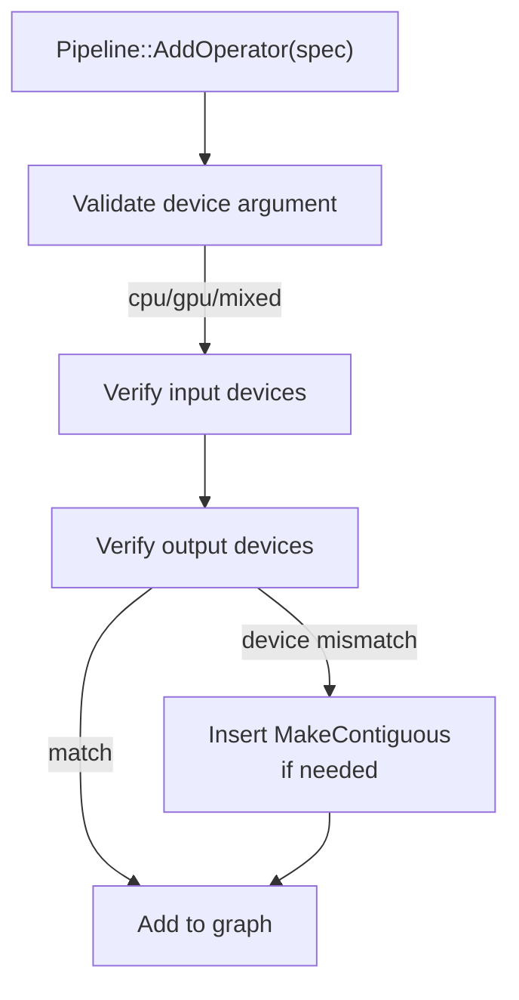

**Diagram: Device Validation During Operator Addition**

Sources: [dali/pipeline/pipeline.cc:337-481]()

---

## Operator Lifecycle

### Instantiation Process

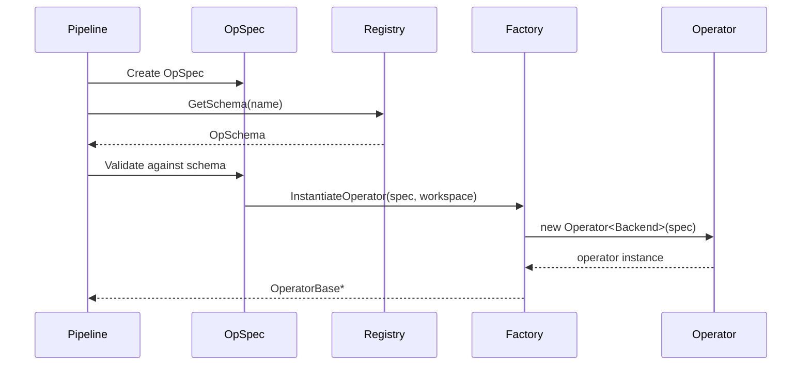

**Diagram: Operator Instantiation Sequence**

The instantiation follows these steps:
1. **Specification**: Create `OpSpec` with arguments
2. **Validation**: Check against `OpSchema` for correctness
3. **Factory Creation**: `InstantiateOperator()` creates the concrete operator
4. **Backend Selection**: Template specialization selects CPU/GPU/Mixed implementation

Sources: [dali/pipeline/operator/operator_factory.h](), [dali/pipeline/operator/operator_factory.cc]()

### Execution Lifecycle

Each operator implements two key methods:

| Method | Purpose | When Called |
|--------|---------|-------------|
| `Setup(workspace)` | Computes output shapes and metadata | Before each batch |
| `Run(workspace)` | Performs actual computation | After Setup |

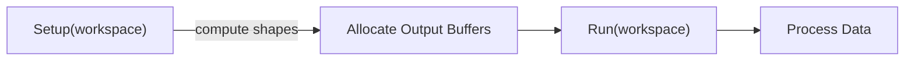

**Diagram: Operator Execution Flow**

Sources: [dali/pipeline/operator/operator.h:200-400]()

---

## Argument System

Operators accept three types of arguments:

### Argument Types

| Type | Description | Specified In |
|------|-------------|--------------|
| **Regular Arguments** | Scalar or vector constants | OpSpec at construction |
| **Tensor Arguments** | Per-sample values from other operators | OpSpec via `AddArgumentInput()` |
| **Inputs** | Regular data inputs | OpSpec via `AddInput()` |

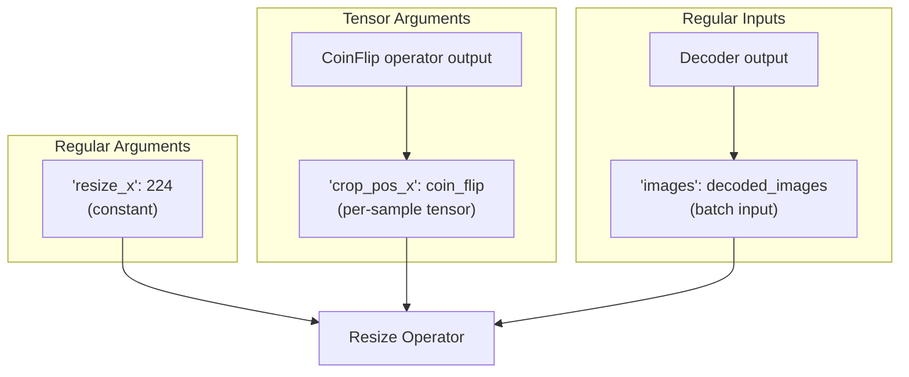

**Diagram: Operator Argument Types**

### Accessing Arguments in Operator Implementation

```cpp
// C++ operator implementation
template <typename Backend>
class ResizeOp : public Operator<Backend> {
  void Setup(...) {
    // Get regular argument
    int resize_x = spec_.GetArgument<int>("resize_x");
    
    // Get tensor argument (per-sample values)
    auto &crop_pos = workspace.ArgumentInput("crop_pos_x");
  }
};
```

Sources: [dali/pipeline/operator/argument.h](), [dali/pipeline/operator/op_spec.h:150-250]()

---

## Python Operator Interface

### Functional API (fn.*)

The functional API provides a convenient way to invoke operators:

```python
import nvidia.dali.fn as fn

# Functional API - returns DataNode
images = fn.resize(input_images, resize_x=224, resize_y=224, device="gpu")
```

Implementation: `fn.<operator_name>()` creates an `OpSpec`, adds it to the current pipeline, and returns a `DataNode` representing the output.

Sources: [dali/python/nvidia/dali/fn/__init__.py](), [dali/python/nvidia/dali/ops/__init__.py:400-600]()

### Object-Oriented API (ops.*)

The object-oriented API creates operator instances explicitly:

```python
import nvidia.dali.ops as ops

# Create operator instance
resize_op = ops.Resize(device="gpu", resize_x=224, resize_y=224)

# Call operator (in define_graph)
images = resize_op(input_images)
```

Sources: [dali/python/nvidia/dali/ops/__init__.py:200-400]()

### API Comparison

| Aspect | fn.* (Functional) | ops.* (Object-Oriented) |
|--------|-------------------|-------------------------|
| **Style** | Functional call | Object instantiation + call |
| **Reuse** | One-time use | Reusable operator instance |
| **Verbosity** | More concise | More explicit |
| **Use Case** | Quick prototyping | Operator reuse across pipeline |

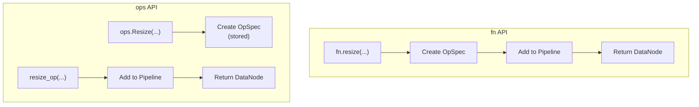

**Diagram: fn.* vs ops.* API Flow**

Sources: [dali/python/nvidia/dali/fn/__init__.py:1-100](), [dali/python/nvidia/dali/ops/__init__.py:1-200]()

---

## Operator Registration

### Automatic Registration via Macros

C++ operators register themselves using the `DALI_REGISTER_OPERATOR` macro:

```cpp
// Define schema
DALI_SCHEMA(Resize)
  .DocStr("Resize images")
  .NumInput(1)
  .NumOutput(1)
  .AddOptionalArg("resize_x", "Target width", 0)
  .AddOptionalArg("resize_y", "Target height", 0);

// Register CPU implementation
DALI_REGISTER_OPERATOR(Resize, ResizeOp<CPUBackend>, CPU);

// Register GPU implementation  
DALI_REGISTER_OPERATOR(Resize, ResizeOp<GPUBackend>, GPU);
```

This registration happens at static initialization time and populates:
1. `SchemaRegistry` with the operator schema
2. Operator factory with backend-specific implementations

Sources: [dali/pipeline/operator/op_schema.h:500-600](), [dali/pipeline/operator/operator.h:600-700]()

### Python Operator Discovery

Python operators are discovered through:

| Mechanism | Location | Purpose |
|-----------|----------|---------|
| `cpu_ops()` | `dali/python/nvidia/dali/ops/_registry.py` | Lists CPU operators |
| `gpu_ops()` | `dali/python/nvidia/dali/ops/_registry.py` | Lists GPU operators |
| `mixed_ops()` | `dali/python/nvidia/dali/ops/_registry.py` | Lists Mixed operators |

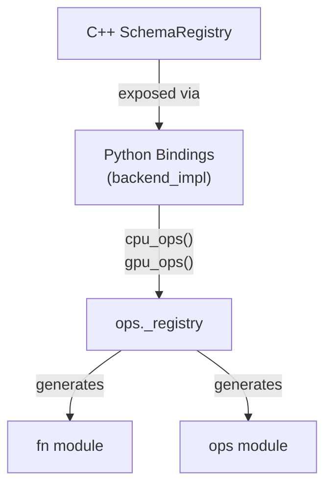

**Diagram: Python Operator Discovery**

Sources: [dali/python/nvidia/dali/ops/_registry.py](), [dali/python/backend_impl.cc:1-100]()

---

## Integration with Pipeline

When an operator is added to a pipeline:

1. **Specification Creation**: `OpSpec` is constructed with arguments
2. **Schema Validation**: Arguments are validated against `OpSchema`
3. **Device Validation**: Input/output devices are checked for compatibility
4. **Graph Addition**: Operator node is added to the operator graph
5. **Edge Creation**: Input/output edges are registered in `edge_names_` map

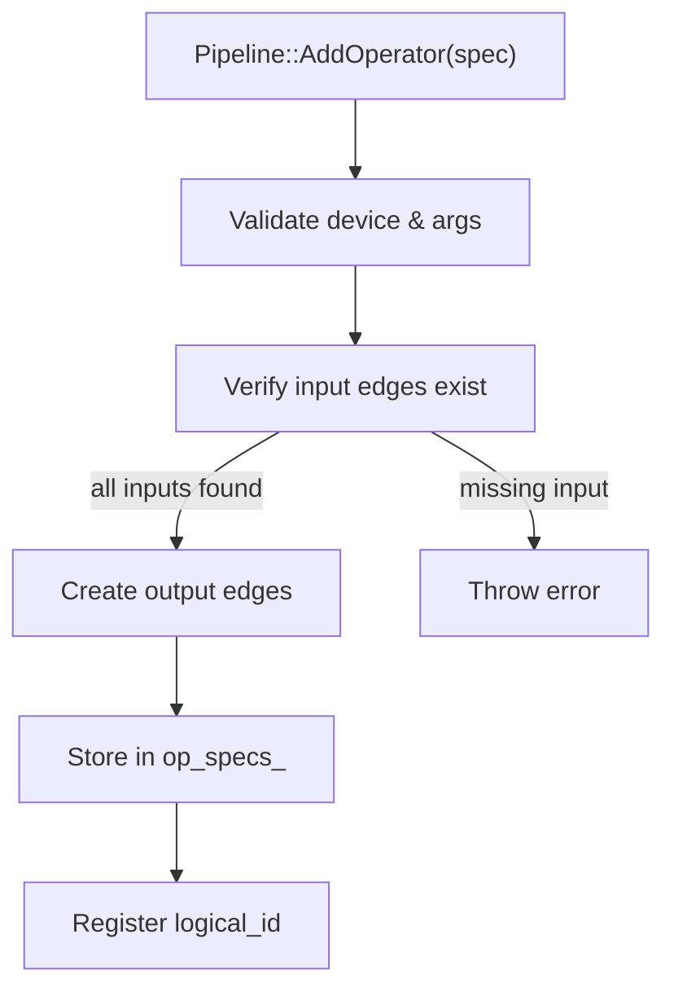

**Diagram: Operator Addition to Pipeline**

Key data structures in Pipeline:
- `op_specs_`: Vector of `(instance_name, OpSpec, logical_id)` tuples
- `edge_names_`: Map from edge name to `EdgeMeta` (device info)
- `logical_ids_`: Map from logical_id to operator indices (for seed sharing)

Sources: [dali/pipeline/pipeline.cc:316-501](), [dali/pipeline/pipeline.h:220-280]()

---

## Operator Metadata and Introspection

### Querying Operator Information

| Function | Purpose | Returns |
|----------|---------|---------|
| `GetSchema(name)` | Get operator schema | `OpSchema&` |
| `HasArgument(name)` | Check if argument defined | `bool` |
| `GetArgument<T>(name)` | Get typed argument value | `T` |
| `NumInput()` / `NumOutput()` | Get input/output count | `int` |
| `InputDevice(i)` / `OutputDevice(i)` | Get device of input/output | `StorageDevice` |

### Runtime Operator Metadata

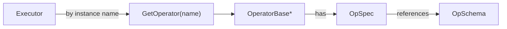

**Diagram: Runtime Operator Metadata Access**

The `OperatorBase` pointer provides access to:
- The operator's `OpSpec` via `spec_` member
- Type information (CPU/GPU/Mixed)
- Execution statistics (when enabled)

Sources: [dali/pipeline/operator/operator.h:50-150](), [dali/pipeline/pipeline.h:240-270]()

---

## Special Operator Types

### InputOperator

`InputOperator<Backend>` is a special base class for operators that feed external data:

- **ExternalSource**: Accepts data from Python callbacks or direct feeding
- **Readers**: File system readers, database readers, etc.

Key features:
- Queue-based buffering via `CachingList`
- Support for both synchronous and asynchronous data feeding
- Batch size provider functionality

Sources: [dali/pipeline/operator/builtin/input_operator.h]()

### Make Contiguous

`MakeContiguous<Backend>` is automatically inserted to ensure data layout compatibility:

- Converts non-contiguous `TensorList` to contiguous layout
- Inserted by graph builder when needed
- Transparent to the user

Sources: [dali/pipeline/graph/op_graph_builder.cc]()

---

## Summary

The Operator System provides:

1. **Schema-based Definition**: Operators self-describe via `OpSchema`
2. **Flexible Specification**: `OpSpec` captures instance configuration
3. **Multi-backend Support**: CPU, GPU, and Mixed execution modes
4. **Type-safe Arguments**: Compile-time type checking for operator arguments
5. **Multiple API Styles**: Both functional (`fn.*`) and object-oriented (`ops.*`) interfaces
6. **Automatic Registration**: Static registration of operators at startup
7. **Integration with Pipeline**: Seamless incorporation into execution graphs

Key classes:
- `OpSchema`: Operator metadata and validation rules
- `OpSpec`: Instance-specific configuration
- `Operator<Backend>`: Base template for operator implementations
- `OperatorBase`: Type-erased runtime interface

Sources: [dali/pipeline/operator/operator.h](), [dali/pipeline/operator/op_schema.h](), [dali/pipeline/operator/op_spec.h](), [dali/python/nvidia/dali/ops/__init__.py]()

---

