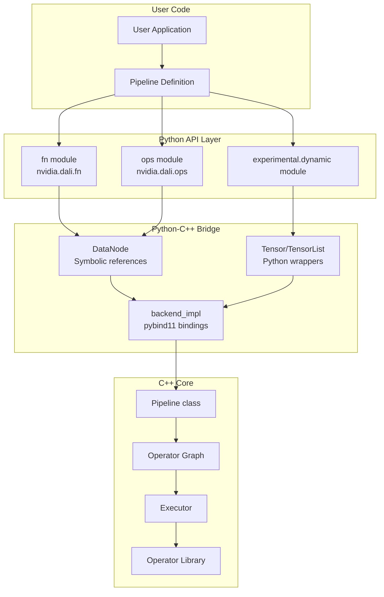
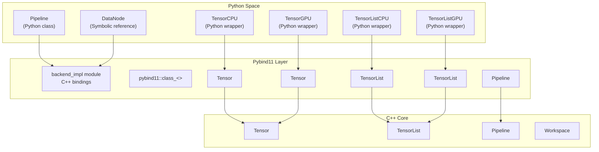
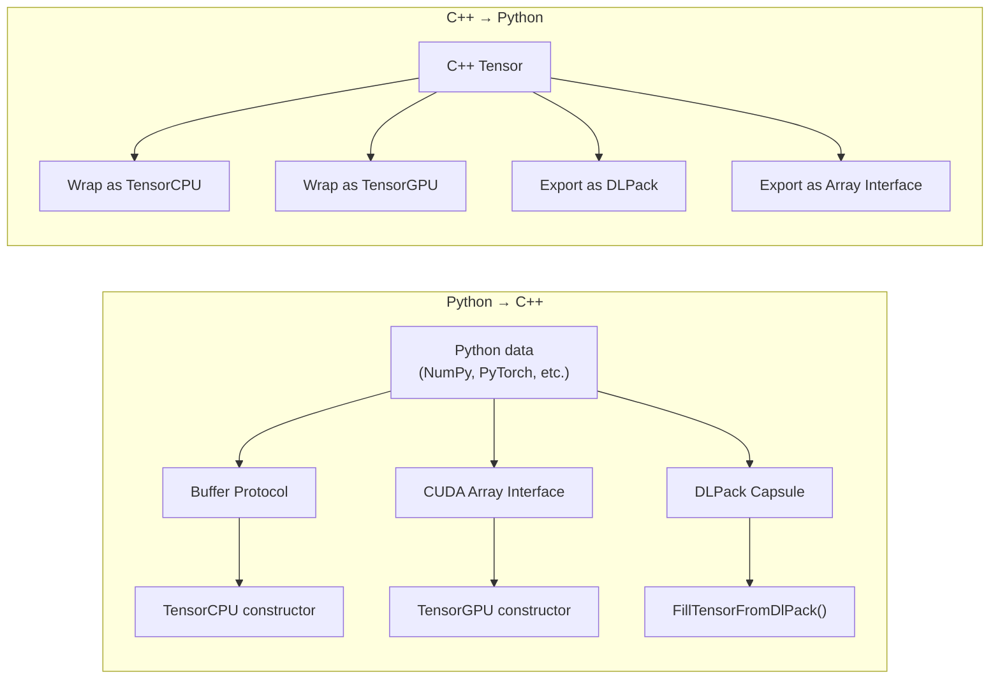
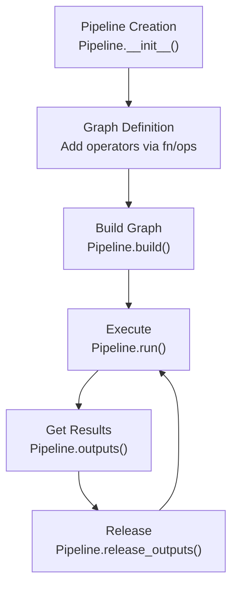

<!-- source: DeepWiki mcp.deepwiki.com · repo NVIDIA/DALI · page 3 Python API · fetched 2026-10-26 -->

# Python API

<details>
<summary>Relevant source files</summary>

The following files were used as context for generating this wiki page:

- [.gitignore](.gitignore)
- [README.rst](README.rst)
- [dali/c_api/c_api.cc](dali/c_api/c_api.cc)
- [dali/c_api/c_api_test.cc](dali/c_api/c_api_test.cc)
- [dali/pipeline/pipeline.cc](dali/pipeline/pipeline.cc)
- [dali/pipeline/pipeline.h](dali/pipeline/pipeline.h)
- [dali/pipeline/pipeline_test.cc](dali/pipeline/pipeline_test.cc)
- [dali/python/backend_impl.cc](dali/python/backend_impl.cc)
- [dali/python/nvidia/dali/_typing.py](dali/python/nvidia/dali/_typing.py)
- [dali/python/nvidia/dali/experimental/dynamic/__init__.py](dali/python/nvidia/dali/experimental/dynamic/__init__.py)
- [dali/python/nvidia/dali/experimental/dynamic/_ops.py](dali/python/nvidia/dali/experimental/dynamic/_ops.py)
- [dali/python/nvidia/dali/experimental/dynamic/random.py](dali/python/nvidia/dali/experimental/dynamic/random.py)
- [dali/python/nvidia/dali/fn/__init__.py](dali/python/nvidia/dali/fn/__init__.py)
- [dali/python/nvidia/dali/ops/__init__.py](dali/python/nvidia/dali/ops/__init__.py)
- [dali/python/nvidia/dali/ops/_docs.py](dali/python/nvidia/dali/ops/_docs.py)
- [dali/python/nvidia/dali/ops/_names.py](dali/python/nvidia/dali/ops/_names.py)
- [dali/python/nvidia/dali/ops/_signatures.py](dali/python/nvidia/dali/ops/_signatures.py)
- [dali/python/nvidia/dali/pipeline.py](dali/python/nvidia/dali/pipeline.py)
- [dali/python/nvidia/dali/types.py](dali/python/nvidia/dali/types.py)
- [dali/test/python/experimental_mode/test_arg_conversion.py](dali/test/python/experimental_mode/test_arg_conversion.py)
- [dali/test/python/experimental_mode/test_docs.py](dali/test/python/experimental_mode/test_docs.py)
- [dali/test/python/experimental_mode/test_public_api.py](dali/test/python/experimental_mode/test_public_api.py)
- [dali/test/python/experimental_mode/test_random.py](dali/test/python/experimental_mode/test_random.py)
- [dali/test/python/operator_1/test_operator_exception.py](dali/test/python/operator_1/test_operator_exception.py)
- [dali/test/python/test_functional_api.py](dali/test/python/test_functional_api.py)
- [dali/test/python/test_pipeline.py](dali/test/python/test_pipeline.py)
- [docs/autodoc_submodules.py](docs/autodoc_submodules.py)
- [docs/conf.py](docs/conf.py)
- [docs/dali_dynamic/api_reference.rst](docs/dali_dynamic/api_reference.rst)
- [docs/dali_dynamic/index.rst](docs/dali_dynamic/index.rst)
- [docs/dali_dynamic/ops_reference.rst](docs/dali_dynamic/ops_reference.rst)
- [docs/index.rst](docs/index.rst)
- [docs/operations_table.py](docs/operations_table.py)
- [docs/supported_ops.rst](docs/supported_ops.rst)
- [include/dali/c_api.h](include/dali/c_api.h)
- [internal_tools/python_stub_generator.py](internal_tools/python_stub_generator.py)

</details>


## Purpose and Scope

This document provides an overview of the Python APIs that DALI exposes for defining and executing data processing pipelines. It covers the architecture of the Python layer, the different API styles available, and how Python interfaces with the underlying C++ execution engine.

For detailed information about specific API components:
- Pipeline definition and execution patterns: see [Pipeline API (fn and ops)](#3.1)
- Imperative execution mode: see [Dynamic API](#3.2)
- External data feeding: see [External Source](#3.3)
- Step-by-step debugging: see [Debug Mode](#3.4)

For framework-specific integration details, see [Framework Integration](#4).

## Python API Architecture

DALI provides multiple Python API styles that serve different use cases while sharing the same underlying C++ execution engine. The Python layer acts as a bridge between user code and the optimized C++ pipeline implementation.

### High-Level Architecture



Sources: [dali/python/backend_impl.cc:1-100](), [dali/python/nvidia/dali/pipeline.py:1-100](), [README.rst:35-92]()

### Python API Modules

DALI exposes three primary API styles, each implemented as a separate Python module:

| API Style | Module Path | Primary Use Case | Execution Mode |
|-----------|-------------|------------------|----------------|
| Functional | `nvidia.dali.fn` | Most common, Pythonic syntax | Graph (deferred) |
| Object-Oriented | `nvidia.dali.ops` | Legacy, explicit control | Graph (deferred) |
| Dynamic | `nvidia.dali.experimental.dynamic` | Eager execution, debugging | Eager (immediate) |

Sources: [dali/python/nvidia/dali/fn/__init__.py:1-20](), [dali/python/nvidia/dali/ops/__init__.py:1-50](), [dali/python/nvidia/dali/experimental/dynamic/__init__.py:1-32]()

## API Styles

### Functional API (fn)

The functional API provides a Pythonic interface where operators are called as functions that return `DataNode` objects. This is the recommended API for most users.

**Key Characteristics:**
- Operators accessed as `fn.operator_name()`
- Returns `DataNode` objects (symbolic tensor references)
- Used with `@pipeline_def` decorator
- Execution is deferred until pipeline runs

**Example Structure:**
```python
from nvidia.dali import pipeline_def
import nvidia.dali.fn as fn

@pipeline_def
def my_pipeline():
    images = fn.readers.file(file_root=path)
    images = fn.decoders.image(images, device="mixed")
    images = fn.resize(images, resize_x=224, resize_y=224)
    return images
```

**Implementation Details:**
- Functions are auto-generated from operator schemas
- Located in `dali/python/nvidia/dali/fn/__init__.py`
- Internally creates `DataNode` objects via the ops API
- Operator signatures generated in `dali/python/nvidia/dali/ops/_signatures.py`

Sources: [README.rst:61-78](), [dali/python/nvidia/dali/fn/__init__.py:1-100](), [dali/python/nvidia/dali/ops/_signatures.py:31-150]()

### Object-Oriented API (ops)

The object-oriented API provides explicit control through operator instances. Each operator is instantiated as an object and then called to produce outputs.

**Key Characteristics:**
- Operators accessed as `ops.OperatorName()`
- Create operator instances, then call them
- Returns `DataNode` objects
- Allows operator instance reuse

**Example Structure:**
```python
from nvidia.dali import Pipeline
import nvidia.dali.ops as ops

class MyPipeline(Pipeline):
    def __init__(self, **kwargs):
        super().__init__(**kwargs)
        self.reader = ops.readers.File(file_root=path)
        self.decoder = ops.decoders.Image(device="mixed")
    
    def define_graph(self):
        images = self.reader()
        images = self.decoder(images)
        return images
```

**Implementation Details:**
- Operator classes inherit from `_OperatorInstance`
- Located in `dali/python/nvidia/dali/ops/__init__.py`
- Each instance maintains state (e.g., seed, device assignment)
- Operator schemas define available operators and arguments

Sources: [dali/python/nvidia/dali/ops/__init__.py:150-500](), [dali/test/python/test_pipeline.py:55-94]()

### Dynamic API (experimental)

The dynamic API provides eager execution where operations are executed immediately, returning concrete data rather than symbolic references.

**Key Characteristics:**
- Operators in `nvidia.dali.experimental.dynamic`
- Returns `Tensor` or `Batch` objects (concrete data)
- Execution happens immediately
- Allows interleaving Python code with DALI operations

**Implementation Details:**
- Experimental and subject to change
- Uses `EagerOperator` for immediate execution
- Located in `dali/python/nvidia/dali/experimental/dynamic/`
- See [Dynamic API](#3.2) for detailed documentation

Sources: [dali/python/nvidia/dali/experimental/dynamic/__init__.py:1-32](), [docs/dali_dynamic/api_reference.rst:1-50]()

## Python-C++ Bridge (backend_impl)

The bridge between Python and C++ is implemented through pybind11 bindings in the `backend_impl` module. This provides Python access to C++ classes and functions with minimal overhead.

### Core Bridge Components



Sources: [dali/python/backend_impl.cc:1-100]()

### Key Exported Classes and Functions

The `backend_impl` module exports the following main components:

**Tensor Classes:**
- `TensorCPU`: Wrapper for CPU tensors, supports Python Buffer Protocol and NumPy Array Interface
- `TensorGPU`: Wrapper for GPU tensors, supports CUDA Array Interface
- `TensorListCPU`: Batch of CPU tensors
- `TensorListGPU`: Batch of GPU tensors

**Pipeline Operations:**
- Pipeline construction and serialization
- `AddOperator()`, `Build()`, `Run()`, `Outputs()`
- External input management
- Checkpoint operations

**Interoperability Protocols:**
- DLPack export/import via `__dlpack__()` and `__dlpack_device__()`
- CUDA Array Interface via `__cuda_array_interface__`
- NumPy Array Interface via `__array_interface__`

Sources: [dali/python/backend_impl.cc:624-1500]()

### Type Conversions and Wrapping



**Key Functions:**
- `FillTensorFromDlPack()`: Import data from DLPack capsule [dali/python/backend_impl.cc:243-290]()
- `FillTensorFromCudaArray()`: Import data from CUDA Array Interface [dali/python/backend_impl.cc:292-369]()
- `ToDLPack()`: Export tensor as DLPack capsule [dali/python/backend_impl.cc:585-593]()
- `ArrayInterfaceRepr()`: Export as NumPy/CUDA array interface [dali/python/backend_impl.cc:129-158]()

Sources: [dali/python/backend_impl.cc:80-400]()

## Common Data Types

### DataNode (Symbolic)

`DataNode` represents a symbolic reference to data in a pipeline graph. It does not contain actual data but describes how data will flow through operators.

**Purpose:**
- Represent operator outputs in pipeline definition
- Enable graph construction before execution
- Support operator chaining with `.gpu()`, `.cpu()` methods

**Key Methods:**
- `.gpu()`: Create a GPU copy of the data
- `.cpu()`: Create a CPU copy of the data
- Arithmetic operators for element-wise operations

**Location:** [dali/python/nvidia/dali/data_node.py]()

### Tensor and TensorList (Concrete)

These classes hold actual data after pipeline execution.

| Class | Description | Backend | Protocols Supported |
|-------|-------------|---------|---------------------|
| `TensorCPU` | Single sample on CPU | `CPUBackend` | Buffer, Array Interface, DLPack |
| `TensorGPU` | Single sample on GPU | `GPUBackend` | CUDA Array Interface, DLPack |
| `TensorListCPU` | Batch on CPU | `CPUBackend` | Array Interface |
| `TensorListGPU` | Batch on GPU | `GPUBackend` | CUDA Array Interface |

**Key Properties:**
- `shape()`: Returns tensor shape
- `dtype()`: Returns data type
- `layout()`: Returns tensor layout string
- `device_id()`: Returns GPU device ID (GPU tensors only)

**Key Methods:**
- `as_cpu()`: Convert to CPU tensor
- `_as_gpu()`: Convert to GPU tensor
- `as_array()`: Convert to NumPy array (blocking)
- `copy_to_external()`: Copy data to external buffer

Sources: [dali/python/backend_impl.cc:651-1400]()

## Pipeline Class

The `Pipeline` class is the central Python object for defining and running data processing pipelines.

### Pipeline Lifecycle



**Key Methods:**

| Method | Purpose | Phase |
|--------|---------|-------|
| `__init__()` | Create pipeline with configuration parameters | Construction |
| `add_operator()` | Add operator to graph (internal) | Definition |
| `build()` | Finalize graph and initialize executor | Compilation |
| `run()` | Execute one iteration | Execution |
| `outputs()` | Retrieve results from last iteration | Retrieval |
| `release_outputs()` | Free output buffers for reuse | Cleanup |
| `feed_input()` | Provide external input data | Data Feeding |

**Configuration Parameters:**
- `batch_size`: Maximum batch size
- `num_threads`: CPU thread count
- `device_id`: GPU device ID (or `None` for CPU-only)
- `seed`: Random seed for reproducibility
- `exec_async`: Enable asynchronous execution
- `exec_pipelined`: Enable pipelined execution
- `exec_dynamic`: Enable dynamic executor (default)
- `prefetch_queue_depth`: Pipeline depth for prefetching

Sources: [dali/python/nvidia/dali/pipeline.py:97-460]()

### Pipeline Definition Patterns

**Functional API with @pipeline_def:**
```python
from nvidia.dali import pipeline_def
import nvidia.dali.fn as fn

@pipeline_def(batch_size=32, num_threads=4, device_id=0)
def my_pipeline():
    images = fn.external_source(name="images")
    images = fn.resize(images, resize_x=224, resize_y=224)
    return images

pipe = my_pipeline()
pipe.build()
```

**Object-Oriented API with define_graph:**
```python
from nvidia.dali import Pipeline
import nvidia.dali.ops as ops

class MyPipeline(Pipeline):
    def __init__(self, **kwargs):
        super().__init__(**kwargs)
        self.source = ops.ExternalSource()
        self.resize = ops.Resize(resize_x=224, resize_y=224)
    
    def define_graph(self):
        images = self.source()
        images = self.resize(images)
        return images

pipe = MyPipeline(batch_size=32, num_threads=4, device_id=0)
pipe.build()
```

Sources: [README.rst:61-92](), [dali/test/python/test_pipeline.py:55-95]()

## Type System and Conversions

### DALI Data Types

DALI defines its own type system that maps to common numerical types:

**Scalar Types:**
- Integer types: `INT8`, `INT16`, `INT32`, `INT64`, `UINT8`, `UINT16`, `UINT32`, `UINT64`
- Floating point: `FLOAT16`, `FLOAT`, `FLOAT64`
- Boolean: `BOOL`
- String: `STRING`

**Enum Types:**
- `DALIDataType`: Data type enum
- `DALIImageType`: Image format enum (RGB, BGR, GRAY, etc.)
- `DALIInterpType`: Interpolation type enum

**Type Conversion Functions:**
- `to_numpy_type()`: Convert DALI type to NumPy dtype
- Type inference from array protocols

Sources: [dali/python/nvidia/dali/types.py:52-177]()

## C API Integration

DALI also provides a C API for language-agnostic integration. The Python API can interoperate with the C API through serialization.

**C API Functions** (subset):
- `daliCreatePipeline()`: Create pipeline from serialized definition
- `daliPrefetch()`: Prefetch batches
- `daliRun()`: Execute iteration
- `daliOutput()`: Get output data
- `daliSetExternalInput()`: Feed external data

**Python ↔ C API:**
- `Pipeline.serialize()`: Export pipeline as string
- `Pipeline.deserialize_and_build()`: Import serialized pipeline

Sources: [dali/c_api/c_api.cc:230-350](), [include/dali/c_api.h:1-150]()

## Error Handling

DALI propagates C++ exceptions to Python with context information:

**Error Context:**
- Operator name and instance
- Input/output names and devices
- Parameter values

**Exception Types:**
- `RuntimeError`: General execution errors
- `ValueError`: Invalid parameter values
- `TypeError`: Type mismatches

**Example Error Message:**
```
Error when executing operator `resize` [instance: '__Resize_0']:
  Input 'images' must be a DataNode or convertible to a constant.
  Got: <class 'list'>
```

Sources: [dali/pipeline/operator/error_reporting.h](), [dali/python/nvidia/dali/ops/__init__.py:100-150]()

---

