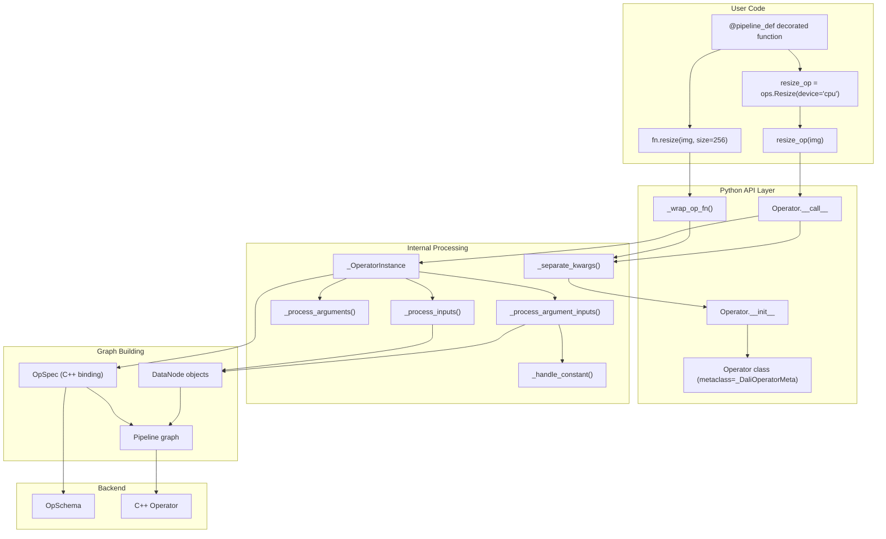
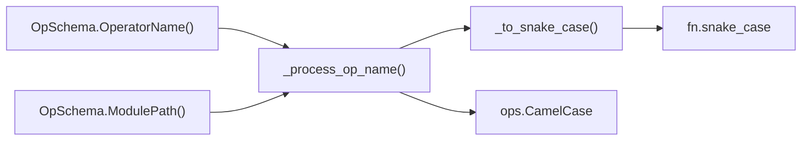
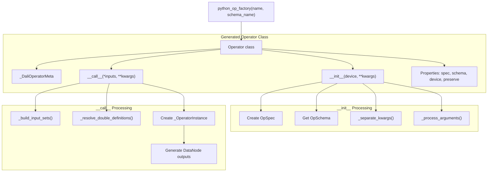
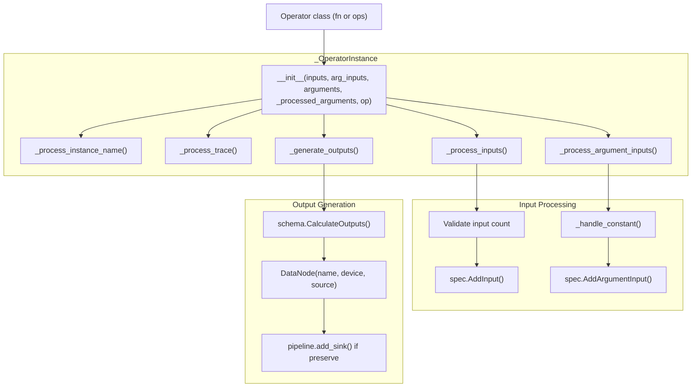
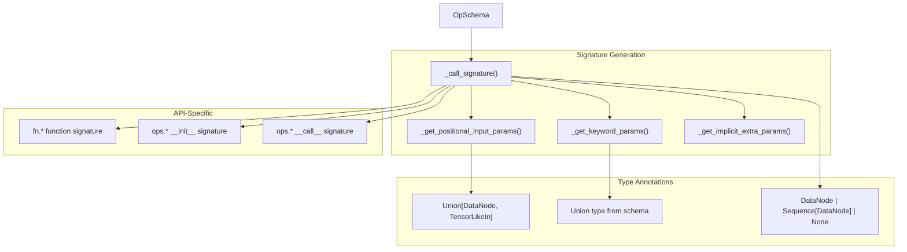
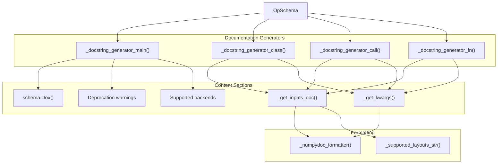
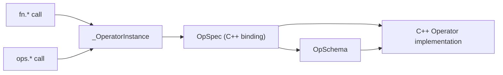

<!-- source: DeepWiki mcp.deepwiki.com · repo NVIDIA/DALI · page 3.1 Pipeline API (fn and ops) · fetched 2026-10-26 -->

# Pipeline API (fn and ops)

<details>
<summary>Relevant source files</summary>

The following files were used as context for generating this wiki page:

- [.gitignore](.gitignore)
- [README.rst](README.rst)
- [dali/python/nvidia/dali/_typing.py](dali/python/nvidia/dali/_typing.py)
- [dali/python/nvidia/dali/experimental/dynamic/__init__.py](dali/python/nvidia/dali/experimental/dynamic/__init__.py)
- [dali/python/nvidia/dali/experimental/dynamic/_ops.py](dali/python/nvidia/dali/experimental/dynamic/_ops.py)
- [dali/python/nvidia/dali/experimental/dynamic/random.py](dali/python/nvidia/dali/experimental/dynamic/random.py)
- [dali/python/nvidia/dali/fn/__init__.py](dali/python/nvidia/dali/fn/__init__.py)
- [dali/python/nvidia/dali/ops/__init__.py](dali/python/nvidia/dali/ops/__init__.py)
- [dali/python/nvidia/dali/ops/_docs.py](dali/python/nvidia/dali/ops/_docs.py)
- [dali/python/nvidia/dali/ops/_names.py](dali/python/nvidia/dali/ops/_names.py)
- [dali/python/nvidia/dali/ops/_signatures.py](dali/python/nvidia/dali/ops/_signatures.py)
- [dali/test/python/experimental_mode/test_arg_conversion.py](dali/test/python/experimental_mode/test_arg_conversion.py)
- [dali/test/python/experimental_mode/test_docs.py](dali/test/python/experimental_mode/test_docs.py)
- [dali/test/python/experimental_mode/test_public_api.py](dali/test/python/experimental_mode/test_public_api.py)
- [dali/test/python/experimental_mode/test_random.py](dali/test/python/experimental_mode/test_random.py)
- [dali/test/python/operator_1/test_operator_exception.py](dali/test/python/operator_1/test_operator_exception.py)
- [docs/autodoc_submodules.py](docs/autodoc_submodules.py)
- [docs/conf.py](docs/conf.py)
- [docs/dali_dynamic/api_reference.rst](docs/dali_dynamic/api_reference.rst)
- [docs/dali_dynamic/index.rst](docs/dali_dynamic/index.rst)
- [docs/dali_dynamic/ops_reference.rst](docs/dali_dynamic/ops_reference.rst)
- [docs/index.rst](docs/index.rst)
- [docs/operations_table.py](docs/operations_table.py)
- [internal_tools/python_stub_generator.py](internal_tools/python_stub_generator.py)

</details>


## Purpose and Scope

This document describes DALI's two primary Python APIs for defining data processing operators within pipelines in graph mode: the **functional API** (`fn.*`) and the **object-oriented API** (`ops.*`). Both APIs enable users to construct computational graphs that are executed efficiently by DALI's backend, but they differ in syntax, usage patterns, and level of control.

For information about the experimental imperative execution mode, see the Dynamic API documentation [3.2](#3.2). For details about External Source operators that feed external data into pipelines, see [3.3](#3.3). For information about debug mode that enables step-by-step pipeline inspection, see [3.4](#3.4).

---

## API Overview and Key Differences

### Functional API (fn.*)

The functional API provides a convenient, pythonic way to define operators using snake_case functions. It is the recommended API for most users due to its simplicity and automatic device placement.

**Key characteristics:**
- Functions use `snake_case` naming convention (e.g., `fn.resize`, `fn.crop_mirror_normalize`)
- Automatic device selection based on input placement
- Typically used with the `@pipeline_def` decorator
- One-shot invocation: operator instance created and executed in a single call
- Located in `nvidia.dali.fn` module

**Example:**
```python
from nvidia.dali.pipeline import pipeline_def
import nvidia.dali.fn as fn

@pipeline_def(num_threads=4, device_id=0)
def get_dali_pipeline():
    images, labels = fn.readers.file(file_root=images_dir, random_shuffle=True)
    images = fn.decoders.image_random_crop(images, device="mixed")
    images = fn.resize(images, resize_x=256, resize_y=256)
    return images, labels
```

Sources: [README.rst:36-78](), [dali/python/nvidia/dali/fn/__init__.py:1-149]()

### Object-Oriented API (ops.*)

The object-oriented API provides explicit control over operator lifecycle by separating instantiation from invocation. This is useful when you need to reuse the same operator configuration multiple times or require fine-grained control.

**Key characteristics:**
- Classes use `CamelCase` naming convention (e.g., `ops.Resize`, `ops.CropMirrorNormalize`)
- Explicit device specification in `__init__`
- Two-stage usage: instantiate with `__init__`, invoke with `__call__`
- Operator instances can be reused across multiple invocations
- Located in `nvidia.dali.ops` module

**Example:**
```python
import nvidia.dali.ops as ops

# Instantiate operator
resize_op = ops.Resize(device="cpu", resize_x=256, resize_y=256)

# Later, invoke multiple times within pipeline definition
@pipeline_def(num_threads=4, device_id=0)
def pipeline():
    image1 = ...
    image2 = ...
    resized1 = resize_op(image1)
    resized2 = resize_op(image2)
    return resized1, resized2
```

Sources: [dali/python/nvidia/dali/ops/__init__.py:553-692]()

---

## Architecture Diagram: API Layers



**Diagram: Pipeline API Architecture**

This diagram shows how user code flows through the fn and ops APIs to create DataNode objects and OpSpec instances that define the computational graph.

Sources: [dali/python/nvidia/dali/fn/__init__.py:66-112](), [dali/python/nvidia/dali/ops/__init__.py:347-536]()

---

## Operator Name Transformations

DALI operators have schema names (typically `CamelCase`) that are transformed into API-specific names:

| Schema Name | ops.* Name | fn.* Name |
|-------------|------------|-----------|
| `Resize` | `ops.Resize` | `fn.resize` |
| `CropMirrorNormalize` | `ops.CropMirrorNormalize` | `fn.crop_mirror_normalize` |
| `ExternalSource` | `ops.ExternalSource` | `fn.external_source` |
| `experimental__readers__Video` | `ops.experimental.readers.Video` | `fn.experimental.readers.video` |

The transformation is handled by `_to_snake_case()` for fn API and `_process_op_name()` for both APIs.

Sources: [dali/python/nvidia/dali/fn/__init__.py:31-63](), [dali/python/nvidia/dali/ops/_names.py:24-92]()

### Name Transformation Flow



**Diagram: Operator Name Transformation**

Sources: [dali/python/nvidia/dali/ops/_names.py:24-92](), [dali/python/nvidia/dali/fn/__init__.py:31-63]()

---

## Functional API Implementation

### Operator Wrapping Process

The functional API wraps operator classes to create convenient function-like interfaces. The wrapping process is handled by `_wrap_op()` and `_wrap_op_fn()`:

1. **Schema lookup**: Retrieve operator schema using `_b.TryGetSchema(op_class.schema_name)`
2. **Name transformation**: Convert CamelCase to snake_case via `_to_snake_case()`
3. **Function creation**: Generate wrapper function with appropriate signature
4. **Module placement**: Insert into correct module/submodule hierarchy
5. **Documentation**: Attach docstrings and signatures

The wrapper function created by `_wrap_op_fn()` performs:
- Argument separation via `_separate_kwargs()` into init args and call args
- Automatic device selection via `_choose_device(inputs)` if not specified
- Operator instantiation and immediate invocation

Sources: [dali/python/nvidia/dali/fn/__init__.py:66-145]()

### Device Selection

The fn API automatically selects the device for operators based on input placement:

- If all inputs are on CPU → operator runs on CPU
- If any input is on GPU → operator runs on GPU (if supported)
- Can be overridden with explicit `device` parameter

The device selection logic is in `_choose_device()` function in the ops module.

Sources: [dali/python/nvidia/dali/fn/__init__.py:66-78]()

---

## Object-Oriented API Implementation

### Operator Class Structure

Operator classes are generated by `python_op_factory()` which creates classes with a custom metaclass `_DaliOperatorMeta`:



**Diagram: ops.* Class Structure**

Sources: [dali/python/nvidia/dali/ops/__init__.py:553-692]()

### Two-Stage Execution

The ops API separates configuration from execution:

**Stage 1: `__init__` (Configuration)**
- Creates `OpSpec` with schema name
- Stores device parameter
- Processes and validates scalar arguments
- Stores operator state in instance variables

**Stage 2: `__call__` (Invocation)**
- Accepts inputs (DataNode objects) and additional arguments
- Resolves conflicts between `__init__` and `__call__` arguments
- Creates `_OperatorInstance` for each input set (supporting Multiple Input Sets)
- Generates and returns DataNode outputs

Sources: [dali/python/nvidia/dali/ops/__init__.py:571-677]()

---

## Operator Instance and Graph Building

Both APIs ultimately create `_OperatorInstance` objects that handle the actual graph building:



**Diagram: Operator Instance Creation Flow**

Sources: [dali/python/nvidia/dali/ops/__init__.py:347-536]()

### Key Processing Steps

**Input Processing** (`_process_inputs`):
- Validates input count against schema min/max
- Type-checks that all inputs are DataNode objects
- Adds inputs to OpSpec with `spec.AddInput(name, device)`

**Argument Input Processing** (`_process_argument_inputs`):
- Handles DataNode keyword arguments (tensor arguments)
- Promotes constants to DataNode objects via `_handle_constant()`
- Validates argument inputs must be on CPU
- Adds to OpSpec with `spec.AddArgumentInput(name, node_name)`

**Output Generation** (`_generate_outputs`):
- Calculates number of outputs via `schema.CalculateOutputs(spec)`
- Creates DataNode objects for each output
- Automatically adds to pipeline sinks if `preserve=True`

Sources: [dali/python/nvidia/dali/ops/__init__.py:265-304](), [dali/python/nvidia/dali/ops/__init__.py:307-329](), [dali/python/nvidia/dali/ops/__init__.py:456-484]()

---

## DataNode: The Common Output Type

Both APIs produce `DataNode` objects, which are symbolic references to operator outputs in the computational graph:

| Property | Description |
|----------|-------------|
| `name` | Unique identifier for this tensor in the graph |
| `device` | Placement: "cpu" or "gpu" |
| `source` | Reference to the `_OperatorInstance` that produces this output |

DataNodes are placeholders that represent data edges in the graph. They don't hold actual data until pipeline execution. They can be used as inputs to subsequent operators, creating the graph structure.

Sources: [dali/python/nvidia/dali/ops/__init__.py:456-484]()

---

## Multiple Input Sets (MIS)

Both APIs support Multiple Input Sets, allowing a single operator invocation to process multiple independent batches:

```python
# Process two separate batches with one call
batch1 = [image1, image2]
batch2 = [image3, image4]
outputs = fn.resize([batch1, batch2], size=256)
# outputs = [[resized1, resized2], [resized3, resized4]]
```

The MIS processing:
1. `_build_input_sets()` groups inputs into sets
2. Creates one `_OperatorInstance` per input set
3. Links instances with same `relation_id`
4. `_repack_output_sets()` restructures outputs to match input structure

Sources: [dali/python/nvidia/dali/ops/__init__.py:634-677](), [dali/python/nvidia/dali/ops/_operator_utils.py]()

---

## Signature Generation and Type Annotations

DALI automatically generates type signatures for both APIs to enable IDE autocomplete and type checking:

### Signature Components



**Diagram: Signature Generation Process**

Sources: [dali/python/nvidia/dali/ops/_signatures.py:422-510]()

### Signature Generation Functions

Key functions in `_signatures.py`:

- **`_call_signature()`**: Master function that generates complete signature
- **`_get_positional_input_params()`**: Creates parameters for operator inputs
- **`_get_keyword_params()`**: Creates parameters from schema arguments
- **`_get_implicit_extra_params()`**: Adds device, name, max_batch_size parameters
- **`_gen_fn_signature()`**: Generates complete fn API function signature with MIS overloads
- **`_gen_ops_signature()`**: Generates ops API class with `__init__` and `__call__` signatures

For operators with inputs, both APIs generate two overloads:
1. Primary overload: accepts regular DataNode inputs
2. MIS overload: accepts List[DataNode] for Multiple Input Sets

Sources: [dali/python/nvidia/dali/ops/_signatures.py:422-647]()

### Type Annotation Placeholders

DALI uses special placeholder classes for type annotations that render cleanly in documentation:

| Placeholder | Represents | Usage |
|-------------|------------|-------|
| `_DataNode` | DataNode class | Input/output type for pipeline mode |
| `_TensorLikeIn` | Convertible to constant | Scalar/array that becomes DataNode |
| `_TensorLikeArg` | Tensor argument | Named tensor input |
| `_DALIDataType` | DALI data type enum | Type specifications |
| `_DALIImageType` | Image type enum | Image format specifications |
| `_DALIInterpType` | Interpolation type enum | Interpolation methods |

These are created via `_create_annotation_placeholder()` which generates classes that format nicely in type hints.

Sources: [dali/python/nvidia/dali/ops/_signatures.py:34-86]()

---

## Documentation Generation

Both APIs auto-generate documentation from operator schemas:

### Documentation Components



**Diagram: Documentation Generation Flow**

Sources: [dali/python/nvidia/dali/ops/_docs.py:1-373]()

### Documentation Sections

**For ops.* classes** (`_docstring_generator_class`):
- Operator description from `schema.Dox()`
- Deprecation warnings if applicable
- Supported backends (cpu/gpu/mixed)
- Keyword arguments with types and defaults
- Input documentation (attached to `__call__`)

**For fn.* functions** (`_docstring_generator_fn`):
- Combined documentation including inputs and keyword arguments
- All information in single docstring
- Formatted in numpydoc style

**Key features:**
- Type information from `schema.GetArgumentType()`
- Default values from `schema.GetArgumentDefaultValueString()`
- Optional parameters marked with "optional"
- Tensor arguments shown with type annotations
- Layout support indicated with supported layout strings

Sources: [dali/python/nvidia/dali/ops/_docs.py:201-277](), [dali/python/nvidia/dali/ops/_docs.py:333-359](), [dali/python/nvidia/dali/ops/_docs.py:361-373]()

---

## Argument and Input Processing

### Argument Separation

The `_separate_kwargs()` function divides keyword arguments into two categories:

**Init Args (Scalar Arguments):**
- Simple types: int, float, str, bool
- Lists/tuples of scalars
- ScalarConstant objects
- Passed to `__init__` in ops API

**Call Args (Argument Inputs):**
- DataNode objects
- TensorList objects (for eager mode)
- Represent data dependencies in graph
- Passed to `__call__` in ops API

In fn API, this separation happens automatically within the wrapper, but users don't see it.

Sources: [dali/python/nvidia/dali/ops/__init__.py:122-162]()

### Argument Deprecation Handling

`_handle_arg_deprecations()` processes deprecated arguments:
- Renames arguments if schema specifies `renamed_to`
- Removes arguments if marked as `removed`
- Issues DeprecationWarning to user
- Prevents conflicts when both old and new names are provided

Sources: [dali/python/nvidia/dali/ops/__init__.py:165-210]()

### Constant Promotion

`_handle_constant()` promotes Python values to DataNode objects:
- Accepts scalars, arrays, or ScalarConstant objects
- Creates Constant operator to represent the value
- Ensures proper device placement (typically CPU for argument inputs)
- Type-checks that value is convertible to DALI constant

Sources: [dali/python/nvidia/dali/ops/__init__.py:72-120]()

---

## Comparison Table: fn vs ops

| Feature | fn.* API | ops.* API |
|---------|----------|-----------|
| **Naming** | snake_case | CamelCase |
| **Instantiation** | Implicit (one-shot) | Explicit (`__init__`) |
| **Device selection** | Automatic from inputs | Manual specification |
| **Reusability** | Create new instance per call | Reuse instance |
| **Argument passing** | All in single call | Split between `__init__` and `__call__` |
| **Syntax** | `fn.resize(img, size=256)` | `op = ops.Resize(size=256); op(img)` |
| **Use case** | Quick prototyping, clean pipelines | Fine control, reusable configs |
| **Backend** | Same (both create `_OperatorInstance`) | Same |
| **Output** | DataNode(s) | DataNode(s) |

---

## Common Backend: OpSpec and Schema

Both APIs converge on the same backend representation:



**Diagram: Common Backend Path**

**OpSpec** (from `backend_impl`):
- C++ binding object created via `_b.OpSpec(schema_name)`
- Stores operator arguments via `AddArg()`, `AddArgEmptyList()`
- Stores input references via `AddInput(name, device)`
- Stores argument input references via `AddArgumentInput(name, node_name)`
- Stores output definitions via `AddOutput(name, device)`

**OpSchema** (from backend):
- Metadata about operator: name, arguments, input/output counts
- Validation rules for arguments and inputs
- Documentation strings
- Device support information
- Retrieved via `_b.GetSchema(schema_name)`

Sources: [dali/python/nvidia/dali/ops/__init__.py:576-578](), [dali/python/nvidia/dali/ops/__init__.py:265-271]()

---

## Module Structure and Auto-Generation

### Module Hierarchy

Both APIs organize operators into submodules based on `OpSchema.ModulePath()`:

```
nvidia.dali.fn/
├── readers/
│   ├── file()
│   ├── caffe()
│   └── tfrecord()
├── decoders/
│   ├── image()
│   └── image_random_crop()
├── experimental/
│   └── readers/
│       └── video()
└── resize()
    crop()
    ...
```

The submodule structure is created dynamically by `_get_submodule()` in internal module.

Sources: [dali/python/nvidia/dali/fn/__init__.py:115-145]()

### Registration Process

Operators are registered and wrapped during module initialization:

1. **Discovery**: Scan `cpu_ops()`, `gpu_ops()`, `mixed_ops()` registries
2. **Factory**: Create operator class with `python_op_factory()`
3. **Wrapping**: Wrap in fn API with `_wrap_op()`
4. **Placement**: Insert into correct module/submodule
5. **Documentation**: Attach generated docs and signatures

This happens automatically when importing `nvidia.dali.ops` or `nvidia.dali.fn`.

Sources: [dali/python/nvidia/dali/ops/__init__.py:553-692](), [dali/python/nvidia/dali/fn/__init__.py:115-145]()

---

## Special Operators

### ExternalSource

Both APIs expose the `external_source` operator, but it's handled specially:
- Pre-defined function in `nvidia.dali.external_source` module
- Manually assigned schema name: `external_source._schema_name = "ExternalSource"`
- Module adjusted to appear in fn namespace
- See [3.3](#3.3) for complete ExternalSource documentation

Sources: [dali/python/nvidia/dali/fn/__init__.py:147-148]()

### Hidden Operators

Some operators are marked as "hidden" in schema:
- Not directly exposed in main namespace
- Accessible via `.hidden` submodule
- Used for internal/advanced functionality
- Example: conditional operators for if/else support

Sources: [dali/python/nvidia/dali/fn/__init__.py:126-145]()

---

## Stub Generation for IDE Support

DALI generates `.pyi` stub files for type checking and IDE autocomplete:

**Process:**
1. `_signatures.gen_all_signatures()` generates stubs for each API
2. Creates `.pyi` files in wheel before packaging
3. Stubs contain function signatures with full type annotations
4. Includes overloads for MIS support

**Stub formats:**

For fn API:
```python
@overload
def resize(__input: Union[DataNode, TensorLikeIn], /, *, 
           size: Union[Sequence[float], float], 
           device: Optional[Literal['cpu', 'gpu']] = None) -> DataNode: ...

@overload  # MIS overload
def resize(__input: Union[List[DataNode], DataNode, TensorLikeIn], /, *, 
           size: Union[Sequence[float], float], 
           device: Optional[Literal['cpu', 'gpu']] = None) -> Union[DataNode, List[DataNode]]: ...
```

For ops API:
```python
class Resize:
    def __init__(self, *, device: Union[Device, Literal['cpu', 'gpu']] = 'cpu',
                 size: Union[Sequence[float], float], ...) -> None: ...
    
    @overload
    def __call__(self, __input: Union[DataNode, TensorLikeIn], /, ...) -> DataNode: ...
    
    @overload  # MIS overload
    def __call__(self, __input: Union[List[DataNode], DataNode, TensorLikeIn], /, ...) -> Union[DataNode, List[DataNode]]: ...
```

Sources: [dali/python/nvidia/dali/ops/_signatures.py:527-647](), [internal_tools/python_stub_generator.py:1-41]()

---

## Error Handling and Validation

Both APIs perform extensive validation:

### Input Validation
- Count validation: `len(inputs) >= schema.MinNumInput()` and `<= schema.MaxNumInput()`
- Type validation: All inputs must be DataNode objects
- Device validation: Argument inputs must be on CPU
- Raises `ValueError` or `TypeError` with descriptive messages

### Argument Validation
- Schema-based validation via `schema.CheckArgs(spec)`
- Type checking against expected types from schema
- Deprecation handling with warnings
- Conflict detection (same argument in `__init__` and `__call__`)

### Error Context
When operators fail, DALI provides rich error messages including:
- Operator name and module
- Stack trace to pipeline definition line
- Specific error from C++ backend
- Clear indication that pipeline is invalid

Sources: [dali/python/nvidia/dali/ops/__init__.py:316-329](), [dali/python/nvidia/dali/ops/__init__.py:414-416](), [dali/test/python/operator_1/test_operator_exception.py:29-201]()

---

## Summary

The fn and ops APIs provide two equivalent ways to define DALI pipelines:
- **fn API**: Convenient, automatic, recommended for most users
- **ops API**: Explicit, reusable, useful for advanced control

Both APIs:
- Create DataNode objects representing graph edges
- Use OpSpec to specify operator configuration
- Leverage OpSchema for validation and documentation
- Generate the same computational graph structure
- Execute with identical performance

The choice between them is primarily stylistic, depending on whether you prefer functional or object-oriented style, and whether you need to reuse operator configurations.

Sources: [README.rst:36-92](), [dali/python/nvidia/dali/fn/__init__.py:1-149](), [dali/python/nvidia/dali/ops/__init__.py:1-692]()

---

