<!-- source: DeepWiki mcp.deepwiki.com · repo NVIDIA/DALI · page 3.2 Dynamic API · fetched 2026-10-26 -->

# Dynamic API

<details>
<summary>Relevant source files</summary>

The following files were used as context for generating this wiki page:

- [.gitignore](.gitignore)
- [README.rst](README.rst)
- [dali/python/nvidia/dali/_typing.py](dali/python/nvidia/dali/_typing.py)
- [dali/python/nvidia/dali/experimental/dynamic/__init__.py](dali/python/nvidia/dali/experimental/dynamic/__init__.py)
- [dali/python/nvidia/dali/experimental/dynamic/_batch.py](dali/python/nvidia/dali/experimental/dynamic/_batch.py)
- [dali/python/nvidia/dali/experimental/dynamic/_device.py](dali/python/nvidia/dali/experimental/dynamic/_device.py)
- [dali/python/nvidia/dali/experimental/dynamic/_eval_context.py](dali/python/nvidia/dali/experimental/dynamic/_eval_context.py)
- [dali/python/nvidia/dali/experimental/dynamic/_eval_mode.py](dali/python/nvidia/dali/experimental/dynamic/_eval_mode.py)
- [dali/python/nvidia/dali/experimental/dynamic/_invocation.py](dali/python/nvidia/dali/experimental/dynamic/_invocation.py)
- [dali/python/nvidia/dali/experimental/dynamic/_op_builder.py](dali/python/nvidia/dali/experimental/dynamic/_op_builder.py)
- [dali/python/nvidia/dali/experimental/dynamic/_ops.py](dali/python/nvidia/dali/experimental/dynamic/_ops.py)
- [dali/python/nvidia/dali/experimental/dynamic/_tensor.py](dali/python/nvidia/dali/experimental/dynamic/_tensor.py)
- [dali/python/nvidia/dali/experimental/dynamic/random.py](dali/python/nvidia/dali/experimental/dynamic/random.py)
- [dali/python/nvidia/dali/fn/__init__.py](dali/python/nvidia/dali/fn/__init__.py)
- [dali/python/nvidia/dali/ops/__init__.py](dali/python/nvidia/dali/ops/__init__.py)
- [dali/python/nvidia/dali/ops/_docs.py](dali/python/nvidia/dali/ops/_docs.py)
- [dali/python/nvidia/dali/ops/_names.py](dali/python/nvidia/dali/ops/_names.py)
- [dali/python/nvidia/dali/ops/_signatures.py](dali/python/nvidia/dali/ops/_signatures.py)
- [dali/test/python/experimental_mode/test_arg_conversion.py](dali/test/python/experimental_mode/test_arg_conversion.py)
- [dali/test/python/experimental_mode/test_batch.py](dali/test/python/experimental_mode/test_batch.py)
- [dali/test/python/experimental_mode/test_docs.py](dali/test/python/experimental_mode/test_docs.py)
- [dali/test/python/experimental_mode/test_eval_context.py](dali/test/python/experimental_mode/test_eval_context.py)
- [dali/test/python/experimental_mode/test_invocation.py](dali/test/python/experimental_mode/test_invocation.py)
- [dali/test/python/experimental_mode/test_public_api.py](dali/test/python/experimental_mode/test_public_api.py)
- [dali/test/python/experimental_mode/test_random.py](dali/test/python/experimental_mode/test_random.py)
- [dali/test/python/experimental_mode/test_rn50_pipeline.py](dali/test/python/experimental_mode/test_rn50_pipeline.py)
- [dali/test/python/experimental_mode/test_tensor.py](dali/test/python/experimental_mode/test_tensor.py)
- [dali/test/python/operator_1/test_operator_exception.py](dali/test/python/operator_1/test_operator_exception.py)
- [docs/autodoc_submodules.py](docs/autodoc_submodules.py)
- [docs/conf.py](docs/conf.py)
- [docs/dali_dynamic/api_reference.rst](docs/dali_dynamic/api_reference.rst)
- [docs/dali_dynamic/index.rst](docs/dali_dynamic/index.rst)
- [docs/dali_dynamic/ops_reference.rst](docs/dali_dynamic/ops_reference.rst)
- [docs/index.rst](docs/index.rst)
- [docs/operations_table.py](docs/operations_table.py)
- [internal_tools/python_stub_generator.py](internal_tools/python_stub_generator.py)

</details>


## Purpose and Scope

The Dynamic API is an experimental imperative execution interface for DALI that allows operators to be invoked directly on data, similar to how NumPy or PyTorch operations work. Unlike the traditional Pipeline API (see [Pipeline API (fn and ops)](#3.1)) which uses deferred graph execution, the Dynamic API enables immediate or lazy evaluation of operators without requiring explicit pipeline construction.

This page covers:
- Core data structures: `Tensor` and `Batch` objects
- Execution model: `EvalContext`, `EvalMode`, and `Invocation`
- Operator invocation and evaluation strategies
- Key architectural differences from the Pipeline API

For information about the traditional graph-based pipeline system, see [Pipeline System](#2.1). For operator internals, see [Operator System](#2.3).

## Core Concepts

### Imperative Execution Model

The Dynamic API operates in an imperative fashion where operators can be called directly:

```python
import nvidia.dali.experimental.dynamic as ndd

# Create a tensor from data
img = ndd.tensor(image_data, device="cpu")

# Apply operations directly
decoded = ndd.decoders.image(img, device="mixed")
resized = ndd.resize(decoded, size=[224, 224])

# Evaluate to get results
output = resized.cpu().evaluate()
```

The API supports two primary execution strategies:
- **Eager evaluation**: Operations execute immediately, producing concrete results
- **Lazy evaluation**: Operations return lightweight proxy objects that defer computation until results are needed

**Evaluation Trigger Diagram**

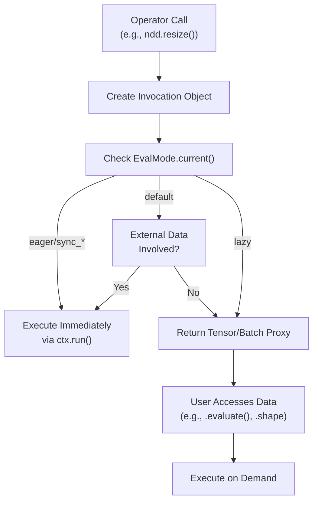

Sources: [dali/python/nvidia/dali/experimental/dynamic/_op_builder.py:407-423](), [dali/python/nvidia/dali/experimental/dynamic/_eval_mode.py]()

## Data Structures

### Tensor Class

The `Tensor` class represents a single sample with consistent shape, dtype, and layout. A `Tensor` can wrap:
- DALI-owned data (`TensorCPU`/`TensorGPU` backend storage)
- External data (via DLPack, `__cuda_array_interface__`, or NumPy arrays)
- A lazy operator result (`InvocationResult`)
- A sample extracted from a `Batch` object

**Tensor Internal State Diagram**

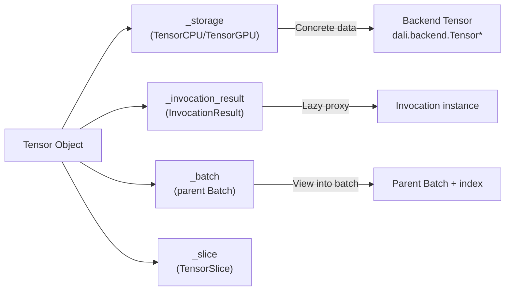

Sources: [dali/python/nvidia/dali/experimental/dynamic/_tensor.py:70-130]()

**Key Tensor Properties and Methods**

| Member | Type | Description |
|--------|------|-------------|
| `_storage` | `TensorCPU`/`TensorGPU` | Backend storage when data is materialized |
| `_invocation_result` | `InvocationResult` | Lazy evaluation proxy |
| `_batch` | `Batch` | Parent batch if this is a sample view |
| `_index_in_batch` | `int` | Sample index in parent batch |
| `_wraps_external_data` | `bool` | True if wrapping external memory |
| `device` | `Device` | Device placement (cpu/gpu) |
| `dtype` | `DType` | Element data type |
| `shape` | `tuple[int]` | Tensor dimensions |
| `ndim` | `int` | Number of dimensions |
| `layout` | `str` | Layout string (e.g., "HWC") |

Sources: [dali/python/nvidia/dali/experimental/dynamic/_tensor.py:85-159]()

### Batch Class

The `Batch` class represents a collection of samples (tensors) that share the same dtype, layout, and number of dimensions but may have different shapes. Internally, a `Batch` can be:
- A contiguous `TensorListCPU`/`TensorListGPU` backend buffer
- A list of individual `Tensor` objects
- A lazy operator result producing batched output

**Batch Construction Patterns**

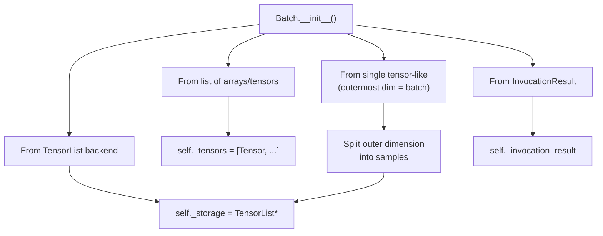

Sources: [dali/python/nvidia/dali/experimental/dynamic/_batch.py:180-243](), [dali/python/nvidia/dali/experimental/dynamic/_batch.py:254-388]()

The `Batch` class provides several access patterns:

```python
batch = ndd.batch([img1, img2, img3])

# Access individual samples
sample = batch[0]           # Returns Tensor
samples = batch[0:2]        # Returns Batch with subset

# Access as tensor list
tensors = batch.tensors     # Returns _TensorList proxy
tensor_list = tensors.tolist()  # Creates list of Tensor objects

# Slice all samples
sliced = batch.slice[10:20, 10:20]  # Spatial crop on all samples
```

Sources: [dali/python/nvidia/dali/experimental/dynamic/_batch.py:443-490](), [dali/python/nvidia/dali/experimental/dynamic/_batch.py:131-178]()

## Execution Model

### EvalContext

`EvalContext` aggregates the runtime state needed to execute operators:

**EvalContext Components**

| Component | Type | Purpose |
|-----------|------|---------|
| `_device` | `Device` | CUDA device ordinal |
| `_thread_pool` | `_ThreadPool` | CPU thread pool for parallel execution |
| `_cuda_stream` | `Stream` | CUDA stream for GPU operations |
| `_invocations` | `list` | Pending lazy invocations (for deferred execution) |

The context follows a thread-local stack model, with a default context per GPU device:

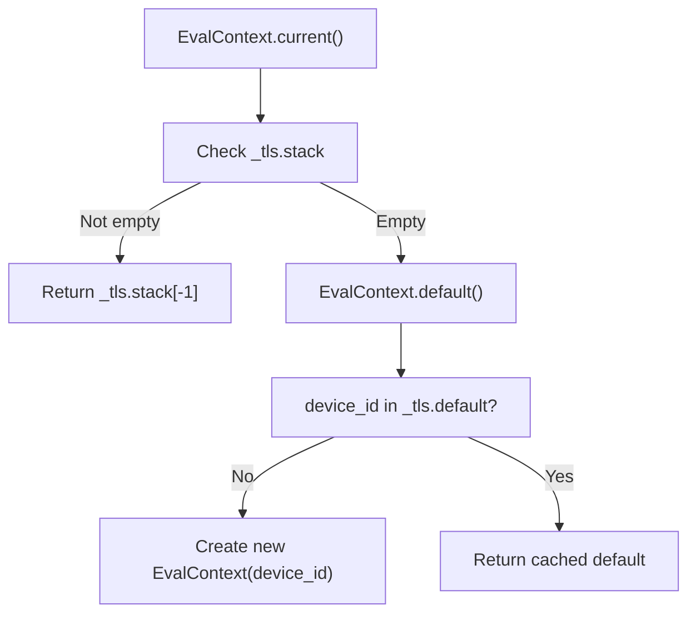

Sources: [dali/python/nvidia/dali/experimental/dynamic/_eval_context.py:30-70](), [dali/python/nvidia/dali/experimental/dynamic/_eval_context.py:71-126]()

Usage pattern:

```python
# Use default context (per-device singleton)
result = ndd.resize(img, size=[100, 100])

# Create explicit context with custom settings
with ndd.EvalContext(num_threads=8, device_id=0) as ctx:
    result = ndd.resize(img, size=[100, 100])
    # Operations use ctx's thread pool and stream
```

Sources: [dali/python/nvidia/dali/experimental/dynamic/_eval_context.py:44-86]()

### EvalMode

`EvalMode` is an enumeration controlling when operator execution occurs:

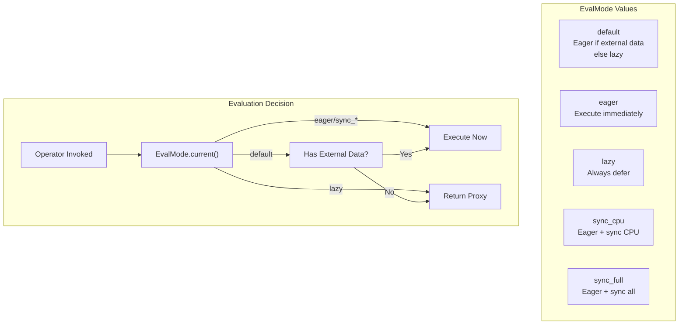

Sources: [dali/python/nvidia/dali/experimental/dynamic/_eval_mode.py](), [dali/python/nvidia/dali/experimental/dynamic/_op_builder.py:407-418]()

The mode is set via context manager:

```python
with ndd.EvalMode.eager():
    # All operations execute immediately
    result = ndd.resize(img, size=[100, 100])
    # result._storage is populated

with ndd.EvalMode.lazy():
    # Operations return proxies
    result = ndd.resize(img, size=[100, 100])
    # result._invocation_result is set, no execution yet
    output = result.evaluate()  # Triggers execution
```

Sources: [dali/python/nvidia/dali/experimental/dynamic/_eval_mode.py]()

### Invocation

The `Invocation` class represents a bound operator call, capturing:
- The operator instance (`_operator`)
- Input tensors/batches (`_inputs`)
- Argument inputs (`_args`)
- Call ordering for stateful operators (`_call_id`, `_previous_invocation`)
- Execution results (`_results`)

**Invocation Lifecycle**

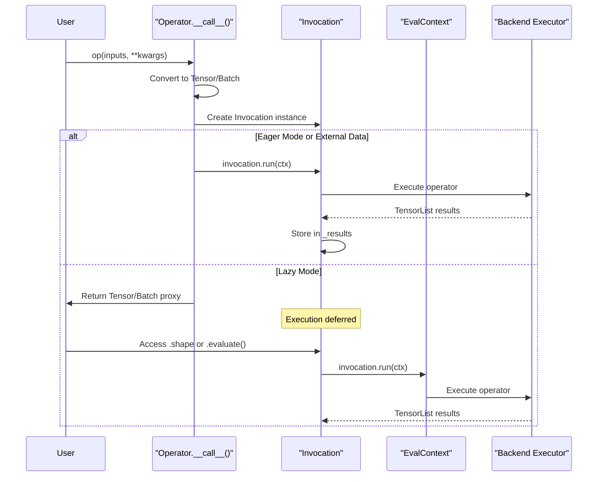

Sources: [dali/python/nvidia/dali/experimental/dynamic/_invocation.py:21-75](), [dali/python/nvidia/dali/experimental/dynamic/_invocation.py:115-149]()

The `Invocation.run()` method handles:
1. Dependency resolution (ensuring previous invocations of stateful operators complete)
2. Input materialization (evaluating any lazy inputs)
3. Backend operator execution via `_operator._run(ctx, *inputs, **args)`
4. Result caching in `_results` list

Sources: [dali/python/nvidia/dali/experimental/dynamic/_invocation.py:115-174]()

## Operator System

### Operator Class Hierarchy

Dynamic API operators inherit from a base `Operator` class in the `_ops` module:

**Dynamic Operator Class Structure**

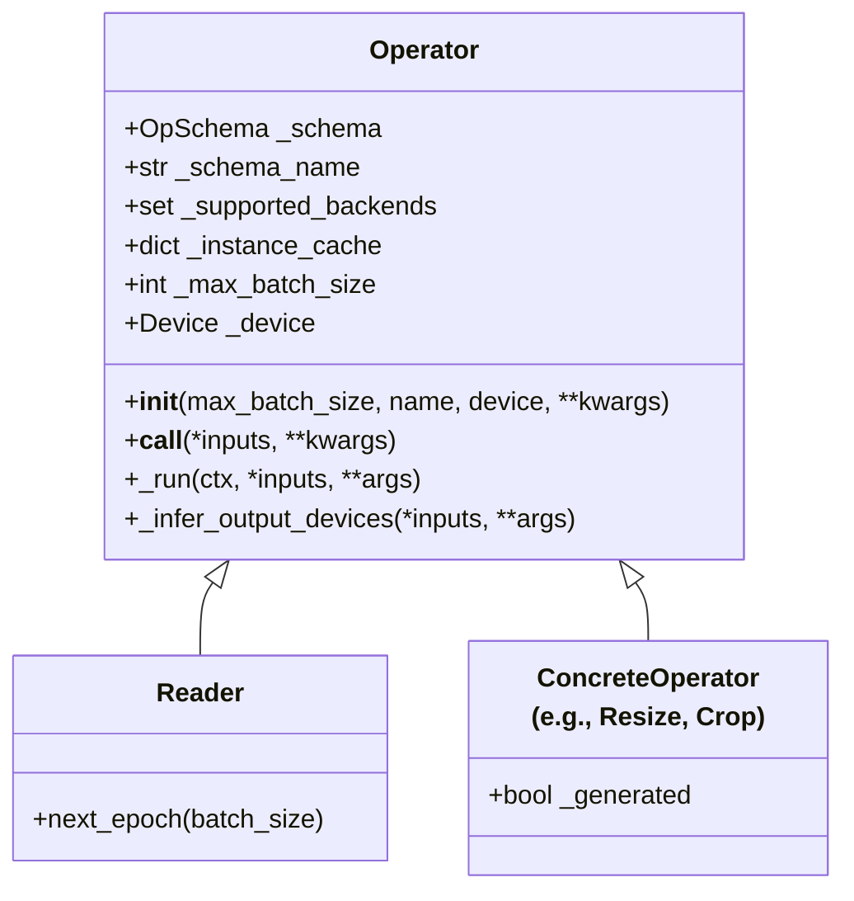

Sources: [dali/python/nvidia/dali/experimental/dynamic/_ops.py]()

### Operator Building Process

Operators are auto-generated from schemas at import time:

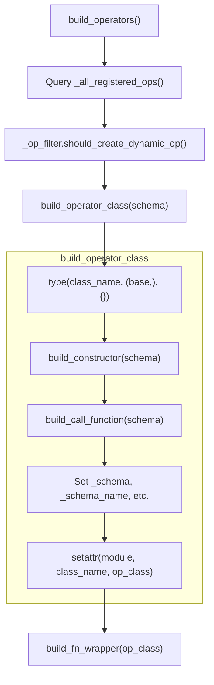

Sources: [dali/python/nvidia/dali/experimental/dynamic/_op_builder.py:602-627](), [dali/python/nvidia/dali/experimental/dynamic/_op_builder.py:155-201]()

The generated `__call__` method handles:
1. **Batch size inference**: Determines if operation is batch or sample based on inputs
2. **Data conversion**: Converts inputs to `Tensor` or `Batch` objects via `_to_tensor()` / `_to_batch()`
3. **RNG state injection**: For random operators, generates random state tensor from `RNG` instance
4. **Invocation creation**: Constructs `Invocation` object with bound arguments
5. **Evaluation decision**: Executes immediately or returns proxy based on `EvalMode`

Sources: [dali/python/nvidia/dali/experimental/dynamic/_op_builder.py:276-448]()

### Functional API Wrappers

Each operator class gets a functional wrapper (snake_case named function) that:
- Infers device from inputs (CPU unless GPU input detected)
- Determines max batch size (rounded up to next power of 2)
- Retrieves or creates cached operator instance via `op._get()`
- Calls the operator instance

```python
# Generated functional wrapper structure
def resize(*inputs, batch_size=None, device=None, **kwargs):
    # Infer batch_size from inputs if not provided
    # Infer device from inputs if not provided
    # Extract init_args (fixed params) and call_args (tensor params)
    max_batch_size = _next_pow2(batch_size or 1)
    
    # Get cached operator instance
    op_inst = Resize._get(
        max_batch_size=max_batch_size,
        device=device,
        **init_args
    )
    
    # Call operator
    return op_inst(*inputs, batch_size=batch_size, **call_args)
```

Sources: [dali/python/nvidia/dali/experimental/dynamic/_op_builder.py:455-589]()

### Instance Caching

Operators are cached based on their initialization parameters to avoid recreating identical instances:

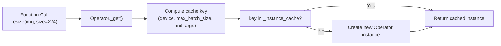

Sources: [dali/python/nvidia/dali/experimental/dynamic/_ops.py]()

## Key Differences from Pipeline API

### Architectural Comparison

| Aspect | Pipeline API | Dynamic API |
|--------|-------------|-------------|
| **Execution Model** | Deferred graph construction and execution | Imperative with optional lazy evaluation |
| **Data Objects** | `DataNode` (symbolic), `TensorList` (materialized) | `Tensor`, `Batch` (can be symbolic or materialized) |
| **Operator Invocation** | Returns `DataNode` edges in graph | Returns `Tensor`/`Batch` (potentially lazy proxy) |
| **Graph Building** | Explicit via `@pipeline_def` / `Pipeline` class | Implicit via operation chaining |
| **State Management** | Pipeline instance holds graph | `EvalContext` holds runtime state |
| **Iteration** | `pipeline.run()` iterates once | Direct Python loops on data |
| **Threading** | Fixed thread pool per pipeline | `EvalContext` thread pool |
| **Device Management** | Device specified per operator in graph | Device specified per operator call or inferred |

Sources: [dali/python/nvidia/dali/experimental/dynamic/__init__.py:15-17](), [dali/python/nvidia/dali/ops/__init__.py]()

### Data Flow Comparison

**Pipeline API Data Flow**

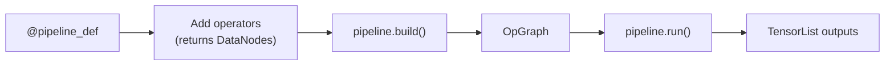

**Dynamic API Data Flow**

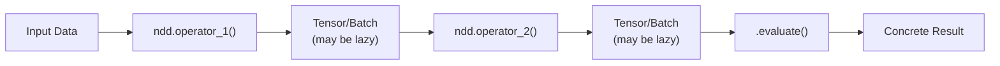

Sources: [dali/python/nvidia/dali/pipeline/__init__.py](), [dali/python/nvidia/dali/experimental/dynamic/__init__.py]()

### Random Operator Handling

The Dynamic API introduces explicit RNG state management for reproducibility:

**Pipeline API**: Random operators use internal seeds and `_random_state` argument
**Dynamic API**: Random operators accept `rng` parameter of type `RNG`

```python
# Pipeline API
@pipeline_def
def pipe():
    # seed affects all random ops in pipeline
    x = fn.random.uniform(range=[0, 1], seed=42)
    return x

# Dynamic API
rng = ndd.random.RNG(seed=42)
x = ndd.random.uniform(range=[0, 1], batch_size=10, rng=rng)
y = ndd.random.uniform(range=[0, 1], batch_size=10, rng=rng)
```

The RNG state is converted to a 7-element uint32 tensor internally:

Sources: [dali/python/nvidia/dali/experimental/dynamic/_op_builder.py:337-356](), [dali/python/nvidia/dali/experimental/dynamic/random.py]()

### Stateful Operator Invocation

Stateful operators (like readers) maintain call ordering through linked invocations:

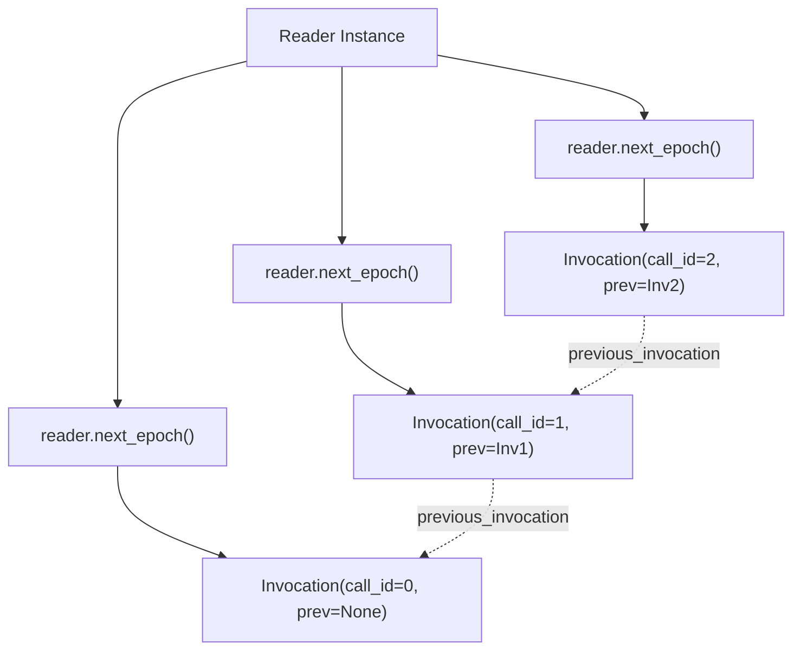

When executing an invocation, the system ensures previous invocations complete first:

Sources: [dali/python/nvidia/dali/experimental/dynamic/_op_builder.py:239-243](), [dali/python/nvidia/dali/experimental/dynamic/_invocation.py:34-74](), [dali/python/nvidia/dali/experimental/dynamic/_invocation.py:115-135]()

## Usage Patterns

### Basic Tensor Operations

```python
import nvidia.dali.experimental.dynamic as ndd

# Create tensors from data
img = ndd.tensor(numpy_array, device="cpu")
batch = ndd.batch([img1, img2, img3], device="gpu")

# Apply operations
resized = ndd.resize(img, size=[224, 224])
cropped = ndd.crop(resized, crop=[200, 200])

# Evaluate to get concrete results
output = cropped.evaluate()
```

### Reader-Based Iteration

```python
import nvidia.dali.experimental.dynamic as ndd

# Create reader
reader = ndd.readers.File(file_root="/data/images", random_shuffle=True)

# Iterate over epochs
for epoch in range(num_epochs):
    for jpegs, labels in reader.next_epoch(batch_size=32):
        # jpegs and labels are Batch objects
        images = ndd.decoders.image(jpegs, device="mixed")
        processed = ndd.resize(images, size=[224, 224])
        
        # Use in training loop
        output = model(processed.cpu().evaluate())
```

Sources: [dali/test/python/experimental_mode/test_rn50_pipeline.py:96-113]()

### Mixed Device Pipeline

```python
# CPU decode, GPU processing
with ndd.EvalContext(num_threads=4, device_id=0):
    jpegs = reader.next_epoch(batch_size=16)
    images = ndd.decoders.image(jpegs, device="cpu")  # CPU decode
    gpu_images = images.gpu()  # Transfer to GPU
    augmented = ndd.random.crop(gpu_images, crop=[224, 224])  # GPU processing
    output = augmented.evaluate()
```

### Lazy vs Eager Evaluation

```python
# Lazy evaluation (default for non-external data)
with ndd.EvalMode.lazy():
    a = ndd.resize(img, size=[100, 100])
    b = ndd.crop(a, crop=[80, 80])
    c = ndd.flip(b, horizontal=1)
    # No execution yet
    result = c.evaluate()  # Executes entire chain

# Eager evaluation
with ndd.EvalMode.eager():
    a = ndd.resize(img, size=[100, 100])  # Executes immediately
    b = ndd.crop(a, crop=[80, 80])  # Executes immediately
    c = ndd.flip(b, horizontal=1)  # Executes immediately
```

Sources: [dali/python/nvidia/dali/experimental/dynamic/_eval_mode.py]()

---

**Primary Sources:**
- [dali/python/nvidia/dali/experimental/dynamic/__init__.py]()
- [dali/python/nvidia/dali/experimental/dynamic/_tensor.py]()
- [dali/python/nvidia/dali/experimental/dynamic/_batch.py]()
- [dali/python/nvidia/dali/experimental/dynamic/_invocation.py]()
- [dali/python/nvidia/dali/experimental/dynamic/_eval_context.py]()
- [dali/python/nvidia/dali/experimental/dynamic/_eval_mode.py]()
- [dali/python/nvidia/dali/experimental/dynamic/_op_builder.py]()
- [dali/python/nvidia/dali/experimental/dynamic/_ops.py]()
- [dali/test/python/experimental_mode/]()
- [docs/dali_dynamic/]()

---

