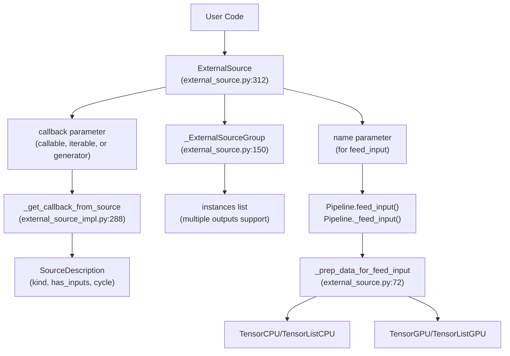
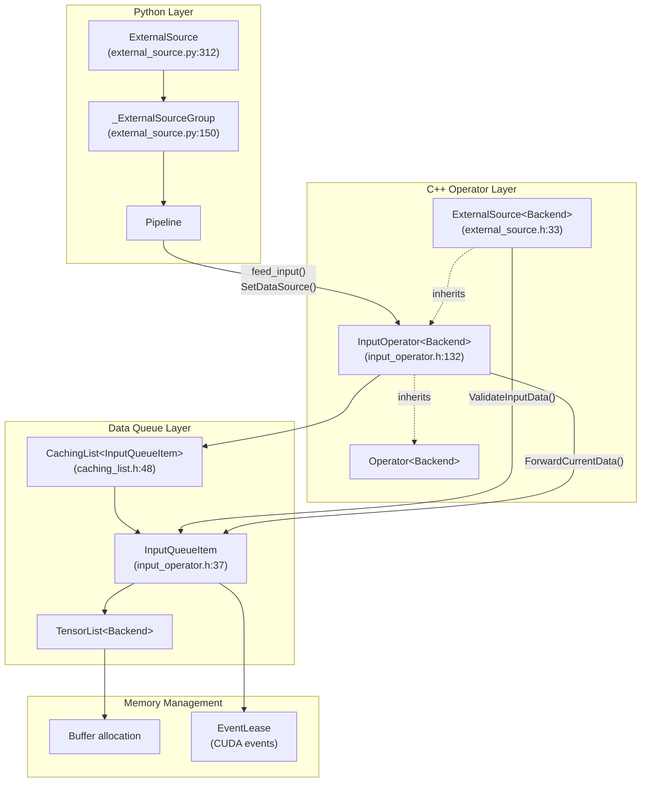
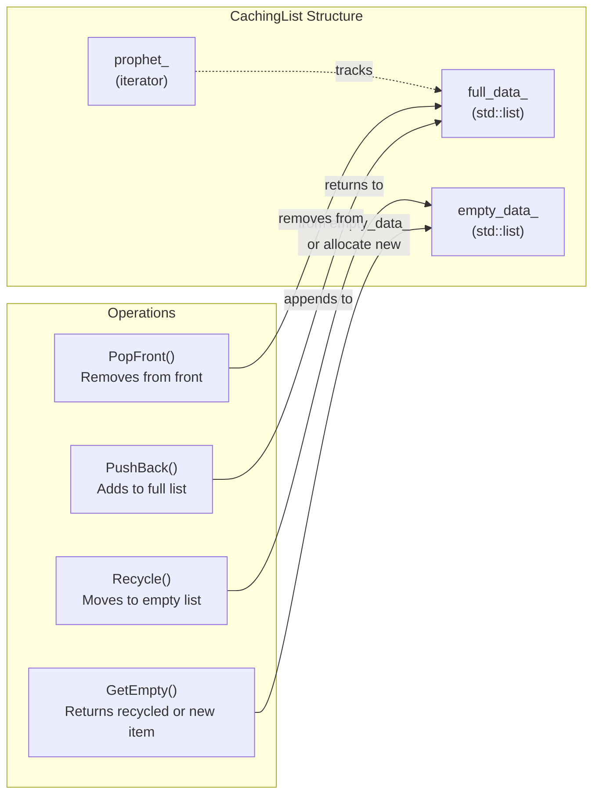
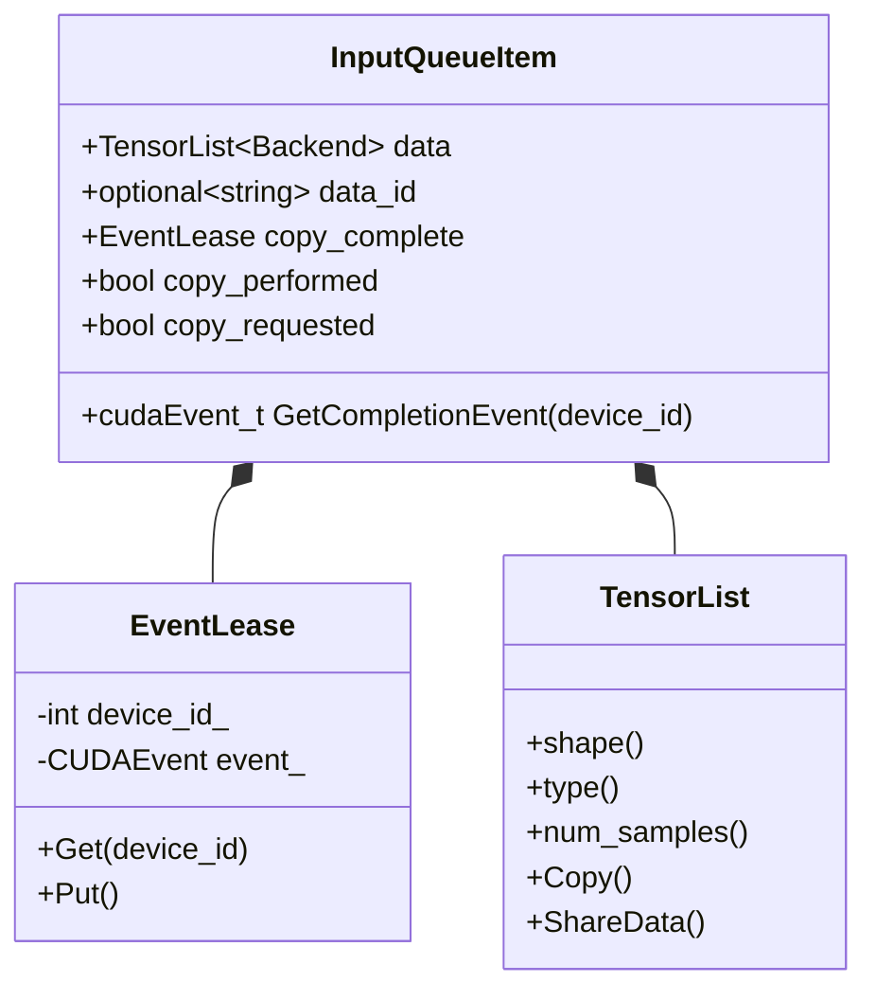
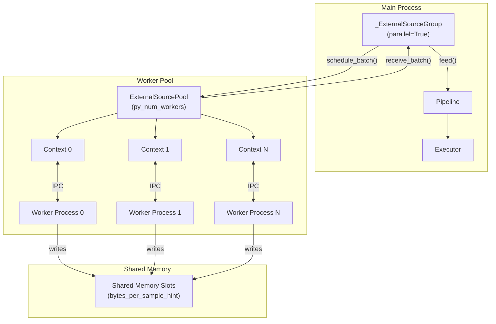
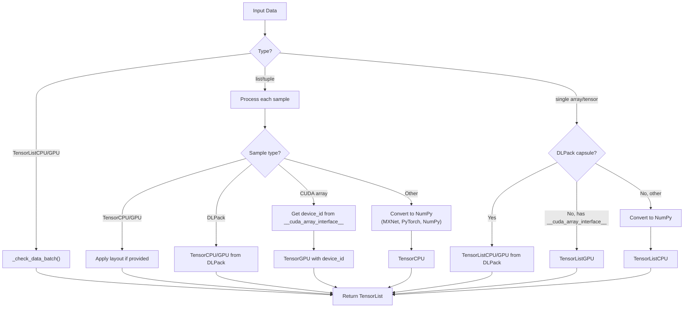
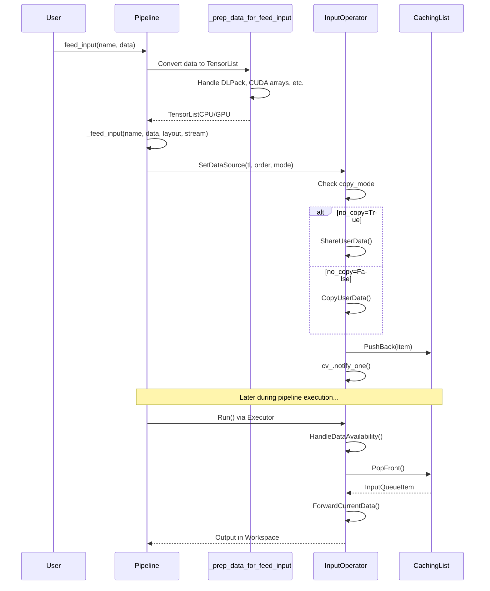
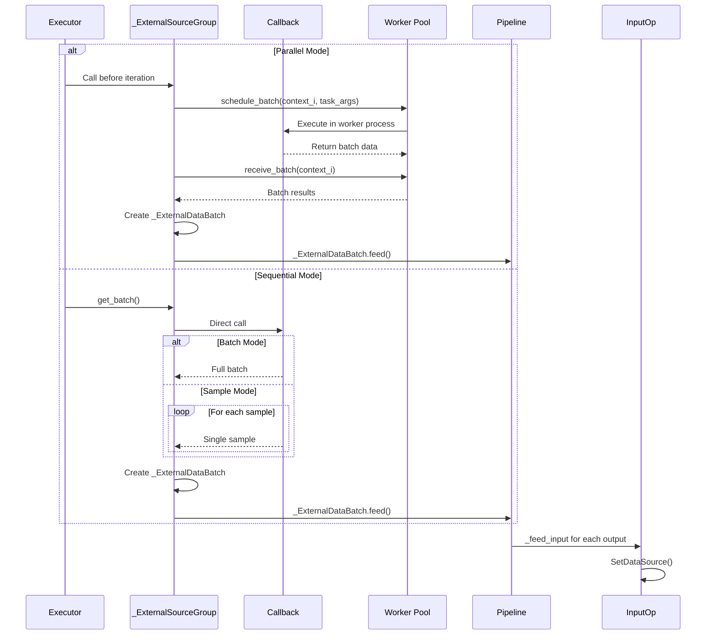

<!-- source: DeepWiki mcp.deepwiki.com · repo NVIDIA/DALI · page 3.3 External Source · fetched 2026-10-26 -->

# External Source

<details>
<summary>Relevant source files</summary>

The following files were used as context for generating this wiki page:

- [dali/c_api/operator_trace_test.cc](dali/c_api/operator_trace_test.cc)
- [dali/core/access_order.cc](dali/core/access_order.cc)
- [dali/core/access_order_test.cu](dali/core/access_order_test.cu)
- [dali/pipeline/operator/batch_size_provider.h](dali/pipeline/operator/batch_size_provider.h)
- [dali/pipeline/operator/builtin/caching_list.h](dali/pipeline/operator/builtin/caching_list.h)
- [dali/pipeline/operator/builtin/caching_list_test.cc](dali/pipeline/operator/builtin/caching_list_test.cc)
- [dali/pipeline/operator/builtin/external_source.cc](dali/pipeline/operator/builtin/external_source.cc)
- [dali/pipeline/operator/builtin/external_source.h](dali/pipeline/operator/builtin/external_source.h)
- [dali/pipeline/operator/builtin/external_source_test.cc](dali/pipeline/operator/builtin/external_source_test.cc)
- [dali/pipeline/operator/builtin/input_operator.cc](dali/pipeline/operator/builtin/input_operator.cc)
- [dali/pipeline/operator/builtin/input_operator.h](dali/pipeline/operator/builtin/input_operator.h)
- [dali/python/nvidia/dali/_utils/external_source_impl.py](dali/python/nvidia/dali/_utils/external_source_impl.py)
- [dali/python/nvidia/dali/external_source.py](dali/python/nvidia/dali/external_source.py)
- [dali/test/operators/identity_input.h](dali/test/operators/identity_input.h)
- [dali/test/operators/passthrough_with_trace.cc](dali/test/operators/passthrough_with_trace.cc)
- [dali/test/operators/passthrough_with_trace.h](dali/test/operators/passthrough_with_trace.h)
- [dali/test/python/test_dali_tf_es_pipelines.py](dali/test/python/test_dali_tf_es_pipelines.py)
- [dali/test/python/test_external_source_cupy.py](dali/test/python/test_external_source_cupy.py)
- [dali/test/python/test_external_source_dali.py](dali/test/python/test_external_source_dali.py)
- [dali/test/python/test_external_source_numpy.py](dali/test/python/test_external_source_numpy.py)
- [dali/test/python/test_external_source_pytorch_gpu.py](dali/test/python/test_external_source_pytorch_gpu.py)

</details>


## Purpose and Overview

The **External Source** system provides a mechanism to feed external data into DALI pipelines from Python. It serves as the primary input operator for custom data sources that are not covered by DALI's built-in readers. External Source supports multiple data feeding patterns including callbacks, iterables, generator functions, and manual data injection via `feed_input()`.

For information about framework-specific iterators that consume DALI pipeline outputs, see [Framework Iterators](#5.3). For information about built-in data readers for specific file formats, see [Data Readers](#5.1).

## Core Concepts

External Source operates in two distinct modes:

**Pull Mode**: Data is retrieved from a user-provided source (callback, iterable, or generator) automatically when the pipeline needs it.

**Push Mode**: Data is explicitly pushed into the pipeline using the `feed_input()` or `set_external_input()` methods.

The operator handles data validation, memory management, and synchronization automatically, supporting both CPU and GPU data with optional zero-copy semantics.

Sources: [dali/python/nvidia/dali/external_source.py:312-326](), [dali/pipeline/operator/builtin/external_source.h:25-32]()

## Python API and Source Types

### ExternalSource Class Structure



**Diagram: Python API Structure**

The `ExternalSource` class ([external_source.py:312-617]()) provides the Python interface with three main configuration paths: source-based pull mode, manual feed push mode, and multi-output support through `_ExternalSourceGroup`.

Sources: [dali/python/nvidia/dali/external_source.py:312-617](), [dali/python/nvidia/dali/_utils/external_source_impl.py:288-362]()

### Source Type Classification

| Source Type | Class | Batch Mode | Sample Mode | Cycle Support |
|-------------|-------|------------|-------------|---------------|
| **Callable** | Function/method accepting 0 or 1 argument | Yes (BatchInfo or int) | Yes (SampleInfo) | No |
| **Iterable** | Object with `__iter__` returning iterator | Yes | Yes | Yes (quiet/raise) |
| **Generator Function** | Function returning generator on each call | Yes | Yes | Yes (quiet/raise) |

The `_get_callback_from_source()` function ([external_source_impl.py:288-362]()) analyzes the source and creates a `SourceDescription` with metadata including `SourceKind` enum (CALLABLE, ITERABLE, or GENERATOR_FUNC), whether it accepts inputs, and cycle mode.

**Callable Sources**: The `accepted_arg_count()` function ([external_source_impl.py:240-285]()) inspects the signature to determine if the callable accepts `SampleInfo`/`BatchInfo` arguments. For batch mode with `batch_info=True`, callables receive a `BatchInfo` instance with iteration and epoch indices. For per-sample mode, they receive `SampleInfo` with sample index, batch position, iteration, and epoch.

**Iterable/Generator Sources**: These are wrapped in `_CycleIter` or `_CycleGenFunc` classes ([external_source_impl.py:167-204]()) when cycle mode is enabled, which handle automatic rewinding and optional `StopIteration` signaling.

Sources: [dali/python/nvidia/dali/_utils/external_source_impl.py:38-42](), [dali/python/nvidia/dali/_utils/external_source_impl.py:167-204](), [dali/python/nvidia/dali/_utils/external_source_impl.py:240-285]()

## Architecture: Python to C++ Bridge

### Component Hierarchy



**Diagram: External Source Architecture**

The architecture spans three layers: Python API, C++ operators, and data management. The Python `ExternalSource` class interfaces with the C++ `ExternalSource<Backend>` operator through the `Pipeline` methods, which call into `InputOperator<Backend>` methods for data management.

Sources: [dali/python/nvidia/dali/external_source.py:312-617](), [dali/pipeline/operator/builtin/external_source.h:33-194](), [dali/pipeline/operator/builtin/input_operator.h:132-540]()

### C++ Operator Implementation

The `ExternalSource<Backend>` template class ([external_source.h:33-194]()) inherits from `InputOperator<Backend>` and adds:

- **Data Validation**: `ValidateInputData()` method ([external_source.h:122-183]()) checks dtype, ndim, layout, and batch size constraints
- **Type Inference**: If `dtype`, `ndim`, or `layout` are not specified in the OpSpec, they are inferred from the first batch
- **Repeat Last**: The `repeat_last_` flag ([external_source.h:185]()) enables reusing the most recent data when no new data is fed
- **Layout Propagation**: The `in_layout()`, `in_ndim()`, and `in_dtype()` methods ([external_source.h:67-77]()) expose metadata for downstream operators

The `RunImpl()` methods ([external_source.cc:22-38]()) call `ForwardCurrentData()` to retrieve data from the queue, set the layout, and emit an operator trace indicating whether the queue is depleted.

Sources: [dali/pipeline/operator/builtin/external_source.h:33-194](), [dali/pipeline/operator/builtin/external_source.cc:21-38]()

## Queue System and Data Management

### CachingList Buffer Recycling



**Diagram: CachingList Buffer Management**

The `CachingList<T>` class ([caching_list.h:48-145]()) implements a buffer recycling mechanism to avoid repeated allocations. It maintains two lists: `full_data_` for data waiting to be consumed, and `empty_data_` for recycled buffers ready for reuse.

**Prophet Iterator**: The `prophet_` member ([caching_list.h:144]()) is a lookahead iterator that tracks which batch will be needed next, independent of the current front/back positions. Methods `PeekProphet()` and `AdvanceProphet()` ([caching_list.h:116-131]()) allow the executor to query future batch sizes without consuming data.

Sources: [dali/pipeline/operator/builtin/caching_list.h:48-145]()

### InputOperator Data Flow

The `InputOperator<Backend>` base class ([input_operator.h:132-540]()) manages the queue and provides:

**SetDataSource Methods** ([input_operator.h:172-200]()): Accept `TensorList<SrcBackend>` or `vector<Tensor<SrcBackend>>` and enqueue them. The `InputOperatorSettingMode` parameter controls:
- `sync`: Whether to block until copy completes
- `use_copy_kernel`: Use CUDA kernel instead of `cudaMemcpyAsync`
- `copy_mode`: Override the `no_copy` operator parameter

**Copy vs. No-Copy Logic**:
- For CPU: No-copy shares data directly if pinned/non-pinned status matches ([input_operator.h:363-377]())
- For GPU: No-copy shares only if data is contiguous and on the same device ([input_operator.h:396-432]()); otherwise, copies are made
- Mixing contiguous and non-contiguous inputs triggers a warning ([input_operator.h:422-426]())

**ForwardCurrentData Methods** ([input_operator.cc:52-169]()): Pop data from the queue and inject it into the workspace output:
- CPU: May copy if pinned status differs ([input_operator.cc:63-80]())
- GPU: Waits for copy completion event if needed ([input_operator.cc:99-101]()), then swaps data and sets access order
- Mixed: Always copies from CPU input to GPU output ([input_operator.cc:126]())

Sources: [dali/pipeline/operator/builtin/input_operator.h:172-287](), [dali/pipeline/operator/builtin/input_operator.cc:52-169]()

### InputQueueItem Structure



**Diagram: InputQueueItem Structure**

Each queue item ([input_operator.h:37-73]()) contains:
- `data`: The actual `TensorList<Backend>` holding samples
- `data_id`: Optional identifier for the data
- `copy_complete`: CUDA event for asynchronous copy synchronization
- `copy_performed`/`copy_requested`: Flags tracking copy operations

The `EventLease` inner class ([input_operator.h:38-61]()) manages CUDA events from `CUDAEventPool`, automatically returning them when the item is recycled.

Sources: [dali/pipeline/operator/builtin/input_operator.h:37-73]()

## Parallel Execution Mode

### Parallel External Source Architecture



**Diagram: Parallel External Source Architecture**

When `parallel=True`, the pipeline creates a worker pool (configured via `py_num_workers` in pipeline constructor) to compute batches in parallel. The `_ExternalSourceGroup` class ([external_source.py:150-309]()) coordinates this execution.

**Scheduling**: The `schedule_batch()` method ([external_source.py:241-253]()) submits work to the pool:
- For batch mode: Passes `TaskArgs.make_batch()` with callback args
- For sample mode: Passes `TaskArgs.make_sample()` with a `SampleRange` covering the batch

**Prefetching**: The `prefetch()` method ([external_source.py:232-239]()) schedules up to `prefetch_queue_depth` batches ahead of the current iteration. This enables computing multiple batches in parallel.

**Receiving Results**: The `schedule_and_receive()` method ([external_source.py:255-272]()) retrieves completed batches from the pool and wraps them in `_ExternalDataBatch` for deferred feeding.

Sources: [dali/python/nvidia/dali/external_source.py:150-309]()

### Parallel Mode Constraints

The parallel mode has specific requirements enforced at operator construction ([external_source.py:791-831]()):

| Constraint | Requirement | Reason |
|------------|-------------|--------|
| **Data Type** | NumPy/MXNet/PyTorch CPU tensors or `TensorCPU` | Worker processes cannot share GPU memory |
| **Source Type (batch=False)** | Callable accepting `SampleInfo` | Need stateless per-sample function |
| **Source Type (batch=True)** | Callable, iterable, or generator | Broader support for batch computation |
| **Statefulness** | Source must be stateless | Workers operate independently in separate processes |
| **AutoGraph** | Source must not be converted | AutoGraph artifacts cannot be pickled for IPC |
| **no_copy** | Automatically set to `True` | Parallel mode uses shared memory |

The `bytes_per_sample_hint` parameter ([external_source.py:597-616]()) helps size shared memory slots. If not provided, DALI estimates based on initial batches, which may lead to reallocation during runtime.

Sources: [dali/python/nvidia/dali/external_source.py:510-616](), [dali/python/nvidia/dali/external_source.py:791-831]()

## Data Preparation and Validation

### Data Type Conversion

The `_prep_data_for_feed_input()` function ([external_source.py:72-136]()) converts various data formats into DALI tensors:



**Diagram: Data Conversion Flow in _prep_data_for_feed_input**

The function handles:
- **DLPack Support**: Detects DLPack capsules via `CheckDLPackCapsule()` ([external_source.py:95-96](), [120-121]())
- **CUDA Array Interface**: Extracts device_id from `__cuda_array_interface__` ([external_source.py:107-110](), [124-126]())
- **Framework Tensors**: Converts MXNet arrays via `asnumpy()` and PyTorch tensors via `numpy()` ([external_source.py:73-81]())
- **Mixed Types Check**: Ensures all samples in a batch are on the same backend ([external_source.py:115-117]())

Sources: [dali/python/nvidia/dali/external_source.py:72-136]()

### C++ Validation Logic

The `ValidateInputData()` method ([external_source.h:122-183]()) enforces constraints:

**Batch Size**: Must not exceed `max_batch_size` ([external_source.h:131-134]())

**Non-Empty Batches**: Rejects batches with zero samples ([external_source.h:136-138]())

**Type Consistency**:
- If `dtype` is specified, incoming data must match ([external_source.h:140-143]())
- If not specified, type is inferred from first batch and must remain consistent ([external_source.h:145-150]())

**Dimensionality**:
- If `ndim` or `layout` is specified, incoming data must match ([external_source.h:153-156]())
- If not specified, dimensionality is inferred and must remain consistent ([external_source.h:157-163]())

**Layout**:
- If `layout` is specified in OpSpec, it overrides data layout ([external_source.h:165-172]())
- If not specified, layout is inferred from data and must remain consistent ([external_source.h:174-181]())

Sources: [dali/pipeline/operator/builtin/external_source.h:122-183]()

## Special Features

### Repeat Last Mode

The `repeat_last` feature ([external_source.h:185]()) enables the operator to reuse the most recent data when `feed_input()` is not called before a pipeline iteration. This is designed for Triton Inference Server decoupled models.

**Behavior**:
- When enabled, if no new data is fed, the operator re-feeds the last batch
- The "depleted" trace ([external_source.cc:27](), [37]()) is set to `false` (not depleted) when repeat_last is active
- Incompatible with `source` parameter (pull mode) - only works in push mode

The repeat_last logic is handled in the C++ `RunImpl()` by checking `HasDataInQueue()` - if the queue is empty and `repeat_last_` is true, the operator doesn't raise an error but reuses the previous output.

Sources: [dali/pipeline/operator/builtin/external_source.h:185](), [dali/pipeline/operator/builtin/external_source.cc:27](), [dali/pipeline/operator/builtin/external_source.cc:37]()

### Blocking Mode

The `blocking` parameter ([input_operator.h:148](), [335]()) controls behavior when data is unavailable:

**blocking=True** (default): The operator waits for data using a condition variable ([input_operator.h:256-264]()):
```cpp
cv_.wait(busy_lock, [&] { return HasDataInQueue(); });
```

**blocking=False**: Throws an error immediately if data is not available ([input_operator.h:261-263]())

The `BreakWaiting()` method ([input_operator.h:231-237]()) allows stopping a blocked operator, typically during pipeline shutdown.

Sources: [dali/pipeline/operator/builtin/input_operator.h:231-264]()

### No-Copy and Zero-Copy Semantics

The `no_copy` parameter ([input_operator.h:149](), [217-226]()) controls memory management:

**no_copy=False** (default): Data is copied into internal buffers
- CPU: Copies via `TensorList::Copy()` ([input_operator.h:437-462]())
- GPU: Copies via `TensorList::Copy()` with optional `use_copy_kernel` ([input_operator.h:468-500]())

**no_copy=True**: Data is shared directly without copy
- CPU: Shares via `ShareData()` if pinned status matches ([input_operator.h:364-377]())
- GPU: Shares only if contiguous and on same device ([input_operator.h:407-411]()); otherwise warns and copies ([input_operator.h:412-428]())

**Force Copy/No-Copy**: The `InputOperatorCopyMode` enum ([input_operator.h:86-90]()) allows overriding the operator's `no_copy` setting per call:
- `DEFAULT`: Use operator's `no_copy` setting
- `FORCE_COPY`: Always copy
- `FORCE_NO_COPY`: Always share (no copy)

Sources: [dali/pipeline/operator/builtin/input_operator.h:86-114](), [dali/pipeline/operator/builtin/input_operator.h:217-531]()

### CUDA Stream Management

External Source handles CUDA stream synchronization for GPU data:

**Stream Parameter**: The `cuda_stream` parameter ([external_source.py:446-464]()) specifies the stream for GPU copies:
- If not provided, DALI attempts to detect the current stream from CuPy or PyTorch
- Special values: `0` for default stream, `1` for DALI's internal stream
- Using internal stream (`1`) blocks until copy completes ([external_source.py:461-463]())

**Access Order**: The `AccessOrder` class ([access_order.cc:23-101]()) manages stream synchronization:
- `wait()` method uses CUDA events to synchronize between streams ([access_order.cc:35-85]())
- Handles cross-device synchronization for multi-GPU setups ([access_order.cc:50-84]())
- Special handling for ambiguous stream handles (`0`, `cudaStreamPerThread`, `cudaStreamLegacy`) ([access_order.cc:28-33]())

**Event Synchronization**: The `EventLease` class ([input_operator.h:38-61]()) manages CUDA events from a pool, recording completion of asynchronous copies and enabling the executor to wait before consuming data.

Sources: [dali/python/nvidia/dali/external_source.py:446-464](), [dali/core/access_order.cc:23-101](), [dali/pipeline/operator/builtin/input_operator.h:38-61]()

## Integration with Pipeline

### Feed Input Flow



**Diagram: Feed Input Sequence**

The `feed_input()` method ([external_source.py:72-136]() for data preparation) converts user data and calls into the C++ `InputOperator::SetDataSource()` ([input_operator.h:172-200]()), which enqueues the data. During execution, `HandleDataAvailability()` ([input_operator.h:256-265]()) ensures data is available, then `ForwardCurrentData()` ([input_operator.cc:52-169]()) retrieves and forwards it.

Sources: [dali/python/nvidia/dali/external_source.py:72-136](), [dali/pipeline/operator/builtin/input_operator.h:172-265](), [dali/pipeline/operator/builtin/input_operator.cc:52-169]()

### Callback Execution Flow



**Diagram: Callback Execution Flow**

The `_ExternalSourceGroup` ([external_source.py:150-309]()) manages callback execution in both parallel and sequential modes. In parallel mode, it coordinates with the worker pool through `schedule_batch()` and `receive_batch()` methods. In sequential mode, it calls the callback directly via `get_batch()` ([external_source.py:274-289]()).

The `callback_args()` method ([external_source.py:205-226]()) generates appropriate arguments based on mode and configuration, tracking `current_iter` and `current_sample` indices.

Sources: [dali/python/nvidia/dali/external_source.py:150-309]()

## Multi-Output Support

External Source can produce multiple outputs via the `num_outputs` parameter:

```python
out1, out2, out3 = fn.external_source(
    source=lambda: ([batch1], [batch2], [batch3]),
    num_outputs=3
)
```

**Implementation**: A single `_ExternalSourceGroup` manages multiple `ExternalSource` instances ([external_source.py:166-167]()), one per output. Each instance has an `_output_index` to extract its data from the tuple/list returned by the source.

**Feeding Logic** ([external_source.py:291-309]()):
- If `is_multioutput=True`, extract `callback_out[op._output_index]` for each instance
- For per-sample mode, iterate through samples and extract the output index from each

**Pruning Unused Outputs**: The `disable_pruned_instances()` method ([external_source.py:194-203]()) filters out unused outputs based on a mask, preventing unnecessary data computation for outputs that aren't connected to the graph.

Sources: [dali/python/nvidia/dali/external_source.py:166-167](), [dali/python/nvidia/dali/external_source.py:194-309]()

## Operator Traces and Diagnostics

External Source emits an operator trace named "depleted" to indicate data availability:

**Trace Values**:
- `"true"`: The operator has no more data and needs to be fed (or will raise `StopIteration`)
- `"false"`: The operator has data available for the next iteration

The trace is set in `SetDepletedOperatorTrace()` ([input_operator.h:329-331]()) called from `RunImpl()`:
```cpp
SetDepletedOperatorTrace(ws, !(repeats_last_ || HasDataInQueue()));
```

This trace is accessible via the C API functions `daliHasOperatorTrace()` and `daliGetOperatorTrace()` ([operator_trace_test.cc:160-165]()) for monitoring pipeline state in production deployments.

Sources: [dali/pipeline/operator/builtin/input_operator.h:329-331](), [dali/pipeline/operator/builtin/external_source.cc:27](), [dali/c_api/operator_trace_test.cc:145-172]()

---

