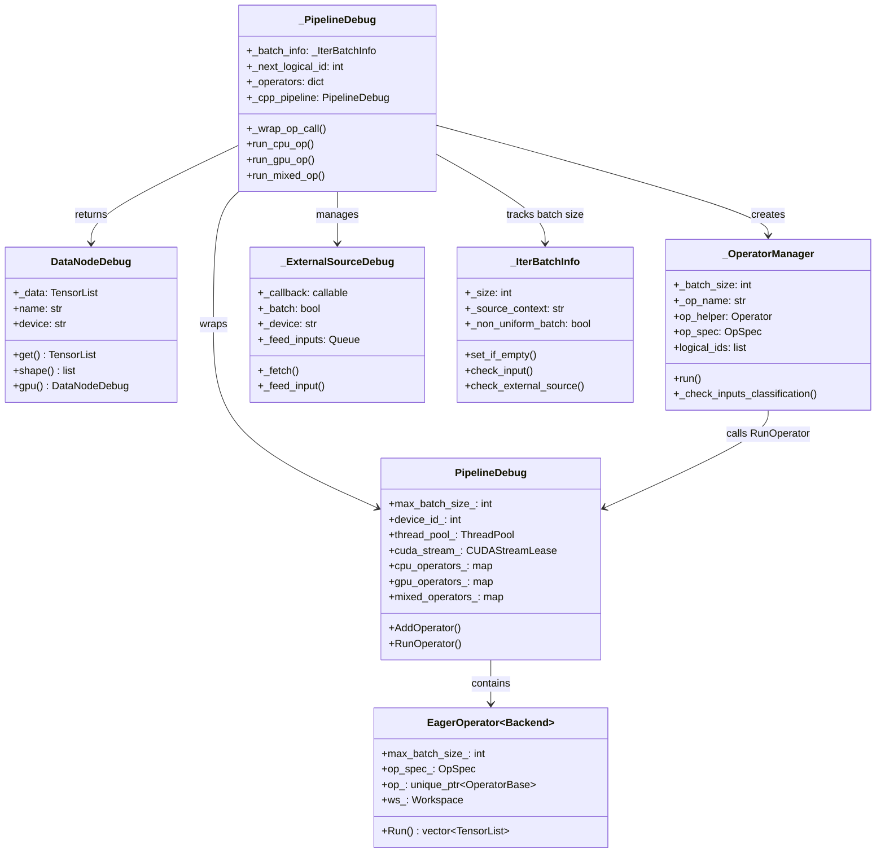
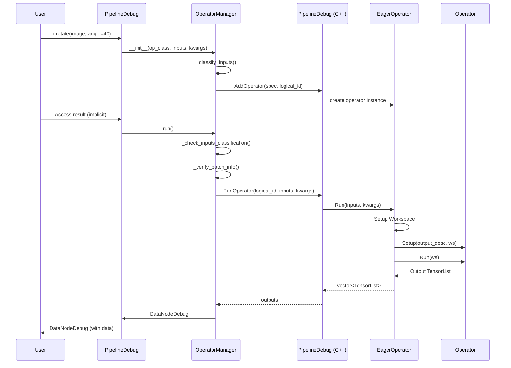
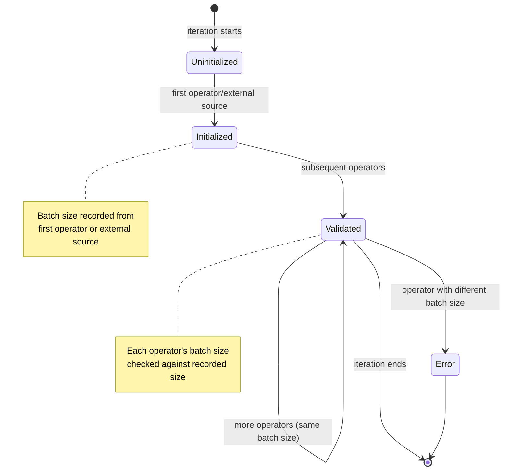

<!-- source: DeepWiki mcp.deepwiki.com · repo NVIDIA/DALI · page 3.4 Debug Mode · fetched 2026-10-26 -->

# Debug Mode

<details>
<summary>Relevant source files</summary>

The following files were used as context for generating this wiki page:

- [dali/pipeline/operator/eager_operator.h](dali/pipeline/operator/eager_operator.h)
- [dali/pipeline/pipeline_debug.h](dali/pipeline/pipeline_debug.h)
- [dali/python/nvidia/dali/_debug_mode.py](dali/python/nvidia/dali/_debug_mode.py)
- [dali/python/nvidia/dali/_debug_utils.py](dali/python/nvidia/dali/_debug_utils.py)
- [dali/test/python/checkpointing/test_dali_stateless_operators.py](dali/test/python/checkpointing/test_dali_stateless_operators.py)
- [dali/test/python/test_dali_cpu_only.py](dali/test/python/test_dali_cpu_only.py)
- [dali/test/python/test_dali_variable_batch_size.py](dali/test/python/test_dali_variable_batch_size.py)
- [dali/test/python/test_pipeline_debug.py](dali/test/python/test_pipeline_debug.py)
- [dali/test/python/test_utils.py](dali/test/python/test_utils.py)
- [qa/TL0_cpu_only/test.sh](qa/TL0_cpu_only/test.sh)
- [qa/TL0_python-self-test-core/test_body.sh](qa/TL0_python-self-test-core/test_body.sh)

</details>


Debug mode enables eager, step-by-step execution of DALI pipelines, allowing inspection of intermediate operator outputs and validation of data processing logic. This mode is designed for development and debugging purposes, executing operators immediately rather than building a deferred execution graph.

For information about the standard graph-based pipeline execution, see [Pipeline System](#2.1). For the dynamic API's eager execution mode, see [Dynamic API](#3.2).

## Overview

Debug mode transforms DALI's deferred graph execution model into an immediate execution model. When enabled, each operator executes as soon as it is called, producing concrete `TensorList` data wrapped in `DataNodeDebug` objects rather than symbolic `DataNode` placeholders. This allows developers to:

- Inspect intermediate operator outputs using the `.get()` method
- Print tensor values and shapes during pipeline definition
- Validate batch sizes and data consistency at each step
- Inject external data directly into the pipeline for testing

Sources: [dali/python/nvidia/dali/_debug_mode.py:1-50]()

## Enabling Debug Mode

Debug mode is activated by setting `debug=True` when creating a pipeline:

```python
@pipeline_def(batch_size=8, num_threads=3, device_id=0, debug=True)
def my_pipeline():
    images = fn.external_source(name="images")
    processed = fn.rotate(images, angle=40)
    # Can inspect intermediate results
    print(f"Processed shape: {processed.shape()}")
    print(f"Processed data: {processed.get().as_array()}")
    return processed
```

Alternatively, pass `debug=True` to the `Pipeline` constructor for imperative-style pipelines.

Sources: [dali/test/python/test_pipeline_debug.py:38-106]()

## Architecture

### Execution Model Comparison

```mermaid
graph TB
    subgraph "Standard Graph Mode"
        A1["User calls fn.rotate()"]
        A2["DataNode created<br/>(symbolic)"]
        A3["OpSpec added to graph"]
        A4["pipeline.build()"]
        A5["Graph optimization"]
        A6["Executor created"]
        A7["pipeline.run()"]
        A8["Batch processing"]
        
        A1 --> A2
        A2 --> A3
        A3 --> A4
        A4 --> A5
        A5 --> A6
        A6 --> A7
        A7 --> A8
    end
    
    subgraph "Debug Mode"
        B1["User calls fn.rotate()"]
        B2["_OperatorManager created"]
        B3["EagerOperator instantiated"]
        B4["EagerOperator.Run()"]
        B5["Operator processes data"]
        B6["DataNodeDebug returned<br/>(with actual data)"]
        
        B1 --> B2
        B2 --> B3
        B3 --> B4
        B4 --> B5
        B5 --> B6
    end
```



Sources: [dali/python/nvidia/dali/_debug_mode.py:358-450](), [dali/pipeline/operator/eager_operator.h:89-114]()

### Core Components



Sources: [dali/python/nvidia/dali/_debug_mode.py:37-153, 155-273, 275-356, 358-524](), [dali/pipeline/pipeline_debug.h:29-102](), [dali/pipeline/operator/eager_operator.h:92-114]()

### Data Flow in Debug Mode



Sources: [dali/python/nvidia/dali/_debug_mode.py:358-524, 526-630](), [dali/pipeline/pipeline_debug.h:52-102, 104-132](), [dali/pipeline/operator/eager_operator.h:200-332]()

## Key Classes and Their Roles

### DataNodeDebug

`DataNodeDebug` is the debug mode equivalent of `DataNode`, wrapping actual `TensorList` data instead of serving as a symbolic placeholder. It provides immediate access to operator outputs.

**Key methods:**
- `.get()` - Returns the underlying `TensorList` with actual data
- `.shape()` - Returns the shape of the tensor data
- `.gpu()` - Moves data to GPU and returns new `DataNodeDebug`

**Location:** [dali/python/nvidia/dali/_debug_mode.py:37-153]()

**Arithmetic operations:** Supports all standard arithmetic operations (`+`, `-`, `*`, `/`, etc.) which delegate to `_ArithmeticGenericOp`.

Sources: [dali/python/nvidia/dali/_debug_mode.py:37-153]()

### _OperatorManager

Manages individual operator execution in debug mode. Creates `OpSpec`, validates inputs, and coordinates between Python and C++ execution layers.

**Key responsibilities:**
- Input classification and validation
- Batch size consistency checking
- OpSpec creation and population
- Coordination with C++ `PipelineDebug` for actual execution

**Location:** [dali/python/nvidia/dali/_debug_mode.py:358-524]()

**Input validation:** Checks that inputs maintain consistent device placement, batch size, and classification across iterations.

Sources: [dali/python/nvidia/dali/_debug_mode.py:358-524]()

### _PipelineDebug

Main Python-side orchestrator for debug mode pipelines. Maintains operator registry, batch size tracking, and provides the execution context.

**Key methods:**
- `_wrap_op_call()` - Intercepts operator calls and creates `_OperatorManager`
- `run_cpu_op()`, `run_gpu_op()`, `run_mixed_op()` - Execute operators by backend type
- `_track_batch_size()` - Validates uniform batch sizes within iterations

**Location:** [dali/python/nvidia/dali/_debug_mode.py:633-839]()

Sources: [dali/python/nvidia/dali/_debug_mode.py:633-839]()

### PipelineDebug (C++)

C++ counterpart managing actual operator instances, thread pool, and CUDA stream resources.

**Key components:**
- `cpu_operators_`, `gpu_operators_`, `mixed_operators_` - Maps of `EagerOperator` instances by logical ID
- `thread_pool_` - Thread pool for CPU operator execution
- `cuda_stream_` - CUDA stream for GPU/Mixed operator execution

**Location:** [dali/pipeline/pipeline_debug.h:29-136]()

Sources: [dali/pipeline/pipeline_debug.h:29-136]()

### EagerOperator

Template class providing immediate operator execution without graph building. Instantiates the actual operator and executes it synchronously.

**Template parameter:** `Backend` - One of `CPUBackend`, `GPUBackend`, or `MixedBackend`

**Key methods:**
- `Run()` - Executes operator with provided inputs and keyword arguments
- `RunImpl()` - Internal implementation handling workspace setup and execution

**Location:** [dali/pipeline/operator/eager_operator.h:92-336]()

**Execution flow:** Creates workspace, adds inputs, calls operator's `Setup()` and `Run()`, returns contiguous output tensors.

Sources: [dali/pipeline/operator/eager_operator.h:92-336]()

## Batch Size Tracking and Validation

Debug mode enforces uniform batch size within each iteration through the `_IterBatchInfo` class:



**Batch size detection sources:**
1. External source operators (highest priority - must be called first)
2. First regular operator's input batch size
3. Explicit batch size in conditional scopes

**Validation points:**
- Input batch size in `_OperatorManager._check_inputs_classification()`
- Output batch size after operator execution
- External source batch size in `_IterBatchInfo.check_external_source()`

**Error conditions:**
- Mismatched batch sizes between operators in same iteration
- Variable external source output sizes within iteration
- External source called after other operators with different batch size

Sources: [dali/python/nvidia/dali/_debug_mode.py:275-356, 526-630]()

## External Source in Debug Mode

`_ExternalSourceDebug` provides debug mode implementation of external source operator with two data feeding modes:

### Callback Mode

Data is pulled from a user-provided callback function or iterable:

```python
def data_generator():
    return [np.random.rand(224, 224, 3) for _ in range(batch_size)]

@pipeline_def(batch_size=8, debug=True)
def pipeline():
    images = fn.external_source(source=data_generator, batch=True)
    return images
```

### Feed Input Mode

Data is pushed explicitly via `feed_input()`:

```python
@pipeline_def(batch_size=8, debug=True)
def pipeline():
    images = fn.external_source(name="input_images")
    return images

pipe = pipeline()
for iteration in range(num_iters):
    data = get_batch_data()
    pipe.feed_input("input_images", data)
    outputs = pipe.run()
```

**Implementation details:**
- Callback executed immediately when operator runs
- `feed_input()` queues data in `_feed_inputs` Queue
- Both modes validate batch size consistency
- Supports `num_outputs` for multiple outputs
- Handles `batch` parameter for batch vs sample callbacks

Sources: [dali/python/nvidia/dali/_debug_mode.py:155-273](), [dali/test/python/test_pipeline_debug.py:231-290]()

## Usage Patterns

### Inspecting Intermediate Outputs

Debug mode allows immediate inspection of operator outputs:

```python
@pipeline_def(batch_size=8, num_threads=3, device_id=0, debug=True)
def inspection_pipeline():
    jpegs, labels = fn.readers.file(file_root=file_root)
    
    # Inspect raw JPEG data
    print(f"JPEG batch size: {len(jpegs.get())}")
    for i, jpeg in enumerate(jpegs.get()):
        print(f"  Sample {i} shape: {jpeg.shape()}")
    
    # Decode and inspect
    images = fn.decoders.image(jpegs, device="mixed", output_type=types.RGB)
    print(f"Decoded images shape: {images.shape()}")
    
    # Process and inspect again
    resized = fn.random_resized_crop(images, device="gpu", size=(224, 224))
    print(f"Resized stats: min={resized.get().as_cpu()[0].min()}, "
          f"max={resized.get().as_cpu()[0].max()}")
    
    return resized
```

Sources: [dali/test/python/test_pipeline_debug.py:64-106]()

### Data Injection

Inject external data directly for testing:

```python
@pipeline_def(batch_size=8, debug=True)
def test_pipeline(data_callback):
    # Inject data from external source
    images = data_callback()
    
    # Process as normal
    rotated = fn.rotate(images, angle=25)
    normalized = fn.crop_mirror_normalize(rotated.gpu(), device="gpu")
    
    return normalized

# Load reference data
reference_pipe = load_images_pipeline()
test_pipe = test_pipeline(lambda: reference_pipe.run()[0])
```

This pattern enables testing pipeline logic with controlled input data.

Sources: [dali/test/python/test_pipeline_debug.py:108-189]()

### Arithmetic Operations

`DataNodeDebug` supports arithmetic operations which are executed immediately:

```python
@pipeline_def(batch_size=8, debug=True)
def arithmetic_pipeline():
    images = fn.external_source(name="images")
    
    # Arithmetic operations execute immediately
    scaled = images * 2
    print(f"Scaled range: [{scaled.get().as_cpu()[0].min()}, "
          f"{scaled.get().as_cpu()[0].max()}]")
    
    normalized = (images - 128) / 128
    combined = scaled + normalized
    
    return combined
```

Sources: [dali/python/nvidia/dali/_debug_mode.py:72-153]()

## Validation and Error Checking

Debug mode performs extensive validation to catch common pipeline errors early:

### Operator Order Consistency

```python
# ERROR: Cannot change operator execution order between iterations
@pipeline_def(batch_size=8, debug=True)
def invalid_pipeline():
    if invalid_pipeline.first_run:
        invalid_pipeline.first_run = False
        x = fn.random.coin_flip()
        y = fn.external_source(name="data")
    else:
        y = fn.external_source(name="data")  # Error: order changed
        x = fn.random.coin_flip()
    return x, y
```

**Error:** "Unexpected operator ... Debug mode does not support changing the order of operators executed within the pipeline."

Sources: [dali/python/nvidia/dali/_debug_mode.py:556-570](), [dali/test/python/test_pipeline_debug.py:317-329]()

### Input Count Consistency

```python
# ERROR: Cannot change number of inputs between iterations
@pipeline_def(batch_size=8, debug=True)
def invalid_pipeline():
    if some_condition:
        return fn.cat(input1, input2)
    else:
        return fn.cat(input1, input2, input3)  # Error: different input count
```

**Error:** "Trying to use operator ... with different number of inputs than when it was built."

Sources: [dali/python/nvidia/dali/_debug_mode.py:571-585](), [dali/test/python/test_pipeline_debug.py:331-350]()

### Batch Size Uniformity

```python
# ERROR: Inconsistent batch sizes within iteration
@pipeline_def(batch_size=8, debug=True)
def invalid_pipeline():
    batch_8 = fn.external_source(name="input8")   # batch_size=8
    batch_4 = fn.external_source(name="input4")   # batch_size=4
    return fn.cat(batch_8, batch_4)  # Error: mismatched batch sizes
```

**Error:** "Batch size must be uniform across an iteration. Input ... has batch size = ..., expected batch size = ..."

Sources: [dali/python/nvidia/dali/_debug_mode.py:275-356]()

## Limitations and Constraints

### Operator Order Immutability

Once a pipeline runs its first iteration, the operator execution order is fixed. Conditional branching that changes operator order will fail.

**Workaround:** Use DALI's conditional execution API (`enable_conditionals=True`) which is designed for dynamic operator selection.

Sources: [dali/python/nvidia/dali/_debug_mode.py:556-570]()

### Input/Argument Immutability

The number and classification (batch vs scalar, device) of inputs and arguments must remain constant across iterations.

Sources: [dali/python/nvidia/dali/_debug_mode.py:571-603]()

### External Source Ordering

External source operators must be called before other operators in the pipeline definition to establish the iteration's batch size.

**Rationale:** External sources determine the batch size for variable batch size support. Calling them after other operators with fixed batch size creates ambiguity.

Sources: [dali/python/nvidia/dali/_debug_mode.py:337-355]()

### Performance

Debug mode introduces significant overhead:
- No prefetching or pipelining
- Synchronous execution (no parallelism between operators)
- Additional validation and tracking logic
- Immediate data materialization

**Not suitable for:** Production workloads, benchmarking, performance optimization.

**Suitable for:** Development, debugging, pipeline prototyping, testing specific operator behavior.

Sources: [dali/pipeline/operator/eager_operator.h:224-253]()

### No Input Sets in Conditional Mode

Multiple input sets (lists of batches as inputs) are not supported when conditionals are enabled (`enable_conditionals=True`).

Sources: [dali/python/nvidia/dali/_debug_mode.py:403-408]()

## Integration with Conditionals

Debug mode supports DALI's conditional execution when `enable_conditionals=True`:

```python
@pipeline_def(batch_size=8, debug=True, enable_conditionals=True)
def conditional_pipeline():
    coin = fn.random.coin_flip(probability=0.5)
    images = fn.external_source(name="images")
    
    if coin:
        processed = fn.rotate(images, angle=90)
    else:
        processed = fn.flip(images, horizontal=True)
    
    return processed
```

In conditional scopes, batch size tracking uses the conditional framework's `scope_batch_size_tracker()` to handle split/merge operations correctly.

Sources: [dali/python/nvidia/dali/_debug_mode.py:294-310](), [dali/test/python/test_pipeline_debug.py:24-32]()

## Comparison Table: Graph Mode vs Debug Mode

| Aspect | Graph Mode | Debug Mode |
|--------|-----------|------------|
| **Execution** | Deferred, graph-based | Immediate, eager |
| **Operator output** | Symbolic `DataNode` | `DataNodeDebug` with actual data |
| **Inspection** | Not possible during definition | `.get()` returns TensorList |
| **Prefetching** | Yes, configurable queue depth | No prefetching |
| **Pipelining** | Yes, async operator execution | No, synchronous execution |
| **Performance** | Optimized for throughput | Slower, for debugging only |
| **Batch size** | Fixed at pipeline creation | Can vary between iterations |
| **Operator order** | Can be optimized/reordered | Fixed after first iteration |
| **Validation** | At build time | At every operator call |

Sources: [dali/python/nvidia/dali/_debug_mode.py:1-839](), [dali/pipeline/pipeline_debug.h:1-136]()

---

