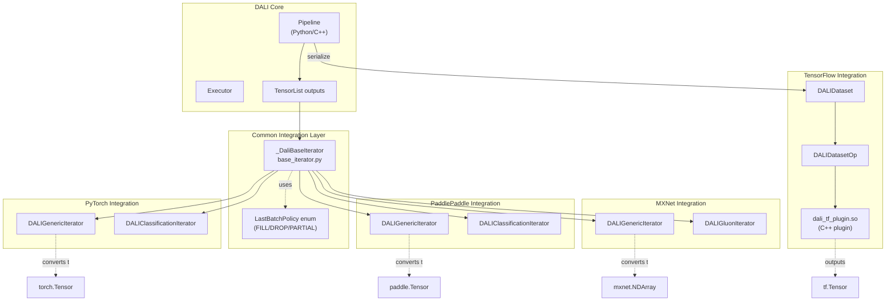
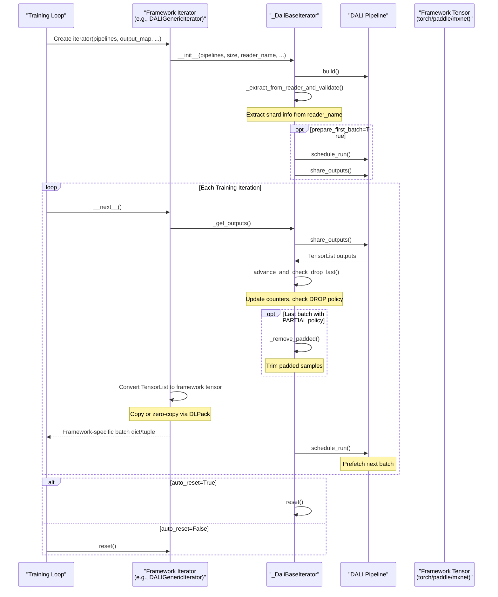
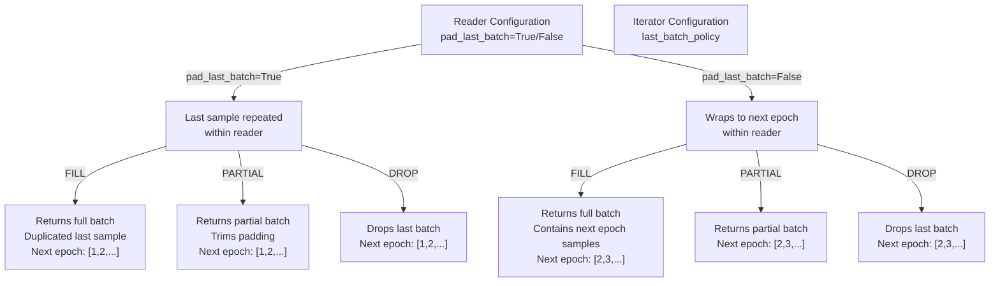
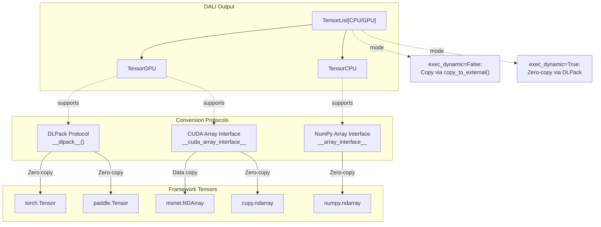

<!-- source: DeepWiki mcp.deepwiki.com · repo NVIDIA/DALI · page 4 Framework Integration · fetched 2026-10-26 -->

# Framework Integration

<details>
<summary>Relevant source files</summary>

The following files were used as context for generating this wiki page:

- [CONTRIBUTING.md](CONTRIBUTING.md)
- [VERSION](VERSION)
- [cmake/libdali.map.in](cmake/libdali.map.in)
- [dali/pipeline/operator/builtin/copy.cc](dali/pipeline/operator/builtin/copy.cc)
- [dali/python/nvidia/dali/_autograph/operators/exceptions.py](dali/python/nvidia/dali/_autograph/operators/exceptions.py)
- [dali/python/nvidia/dali/plugin/base_iterator.py](dali/python/nvidia/dali/plugin/base_iterator.py)
- [dali/python/nvidia/dali/plugin/paddle.py](dali/python/nvidia/dali/plugin/paddle.py)
- [dali/test/python/import_module_test_helper.py](dali/test/python/import_module_test_helper.py)
- [dali/test/python/nose_utils.py](dali/test/python/nose_utils.py)
- [dali/test/python/test_RN50_data_fw_iterators.py](dali/test/python/test_RN50_data_fw_iterators.py)
- [dali/test/python/test_RN50_data_pipeline.py](dali/test/python/test_RN50_data_pipeline.py)
- [dali/test/python/test_backend_impl.py](dali/test/python/test_backend_impl.py)
- [dali/test/python/test_backend_impl_gpu.py](dali/test/python/test_backend_impl_gpu.py)
- [dali/test/python/test_backend_impl_torch_dlpack.py](dali/test/python/test_backend_impl_torch_dlpack.py)
- [dali/test/python/test_data_containers.py](dali/test/python/test_data_containers.py)
- [dali/test/python/test_external_source_parallel_custom_serialization.py](dali/test/python/test_external_source_parallel_custom_serialization.py)
- [dali/test/python/test_fw_iterators.py](dali/test/python/test_fw_iterators.py)
- [dali/test/python/test_fw_iterators_detection.py](dali/test/python/test_fw_iterators_detection.py)
- [docs/advanced_topics_sharding.rst](docs/advanced_topics_sharding.rst)
- [docs/examples/frameworks/pytorch/pytorch-lightning.ipynb](docs/examples/frameworks/pytorch/pytorch-lightning.ipynb)
- [docs/examples/use_cases/video_superres/model/model.py](docs/examples/use_cases/video_superres/model/model.py)
- [docs/images/sharding.png](docs/images/sharding.png)
- [qa/TL0_plugin_manager/test.sh](qa/TL0_plugin_manager/test.sh)
- [qa/TL1_python-nvjpeg_test/test.sh](qa/TL1_python-nvjpeg_test/test.sh)
- [qa/nose_wrapper/__main__.py](qa/nose_wrapper/__main__.py)

</details>


## Purpose and Scope

This document provides an overview of how DALI integrates with popular deep learning frameworks (PyTorch, TensorFlow, PaddlePaddle, MXNet). It covers the common integration patterns, iterator design, data interoperability mechanisms, and configuration options that enable DALI pipelines to serve as efficient data loaders for training workflows.

For framework-specific implementation details and usage examples, see:
- [PyTorch Integration](#4.1)
- [TensorFlow Integration](#4.2)
- [Other Frameworks (PaddlePaddle, MXNet)](#4.3)

For information about DALI's core pipeline system, see [Pipeline System](#2.1). For details on data structures used in framework integration, see [Data Structures](#2.2).

## Integration Architecture

DALI provides two primary integration patterns for deep learning frameworks:

1. **Iterator-based integration** - Used by PyTorch, PaddlePaddle, and MXNet
2. **Plugin-based integration** - Used by TensorFlow

The iterator-based approach wraps DALI pipelines in Python iterator classes that conform to each framework's data loading API. The plugin-based approach serializes pipelines and executes them in framework-native operators.

### High-Level Framework Integration Architecture



Sources: [dali/python/nvidia/dali/plugin/base_iterator.py:1-285](), [dali/python/nvidia/dali/plugin/paddle.py:1-513]()

## Iterator-Based Integration

### Base Iterator Design

The `_DaliBaseIterator` class in [dali/python/nvidia/dali/plugin/base_iterator.py:55-550]() provides the common foundation for PyTorch, PaddlePaddle, and MXNet iterators. It handles:

- **Pipeline management** - Building and scheduling pipeline runs
- **Batching** - Managing batch sizes across multiple GPUs/shards
- **Sharding** - Distributing data across distributed training processes
- **Last batch handling** - Configurable policies for incomplete final batches
- **Epoch management** - Tracking progress and supporting auto-reset

| Component | Responsibility |
|-----------|---------------|
| `_DaliBaseIterator` | Base class with common batching, sharding, and epoch logic |
| `LastBatchPolicy` | Enum defining FILL, DROP, or PARTIAL behavior for incomplete batches |
| `reader_name` parameter | Automatic extraction of shard sizes and padding configuration from readers |
| `auto_reset` parameter | Control whether iterator resets automatically at epoch end |
| `prepare_first_batch` | Option to pre-fetch first batch during iterator construction |

Sources: [dali/python/nvidia/dali/plugin/base_iterator.py:36-53](), [dali/python/nvidia/dali/plugin/base_iterator.py:143-221]()

### Iterator Lifecycle and Data Flow



Sources: [dali/python/nvidia/dali/plugin/base_iterator.py:143-221](), [dali/python/nvidia/dali/plugin/base_iterator.py:371-392](), [dali/python/nvidia/dali/plugin/paddle.py:271-391]()

### Last Batch Policies

The `LastBatchPolicy` enum in [dali/python/nvidia/dali/plugin/base_iterator.py:36-52]() defines how iterators handle incomplete final batches:

| Policy | Behavior | Use Case |
|--------|----------|----------|
| `FILL` | Pad incomplete batch by repeating last sample or wrapping to next epoch | Maintain consistent batch sizes; suitable when training doesn't require exact epoch boundaries |
| `DROP` | Discard incomplete final batch | Prevent contamination from next epoch; useful for validation |
| `PARTIAL` | Return incomplete batch as-is | Ensure all samples are processed exactly once per epoch |

The interaction between `last_batch_policy` and the reader's `pad_last_batch` parameter determines the exact behavior across epoch boundaries:



Sources: [dali/python/nvidia/dali/plugin/base_iterator.py:120-140](), [dali/python/nvidia/dali/plugin/paddle.py:202-221]()

### Reader Name Integration

The `reader_name` parameter enables automatic configuration by querying reader metadata:

```python
# From base_iterator.py:294-350
def _extract_from_reader_and_validate(self):
    if self._reader_name:
        readers_meta = [p.reader_meta(self._reader_name) for p in self._pipes]
        
        # Extract from reader metadata:
        self._size_no_pad = readers_meta[0]['epoch_size']
        self._shards_num = readers_meta[0]['number_of_shards']
        self._last_batch_padded = readers_meta[0]['pad_last_batch']
        self._is_stick_to_shard = readers_meta[0]['stick_to_shard']
        self._shards_id = np.array([meta['shard_id'] for meta in readers_meta])
```

This approach eliminates manual configuration errors and ensures consistency between reader and iterator settings.

Sources: [dali/python/nvidia/dali/plugin/base_iterator.py:294-350](), [docs/advanced_topics_sharding.rst:20-36]()

## Data Interoperability

Framework iterators convert DALI's `TensorList` outputs to framework-native tensors using zero-copy mechanisms when possible.

### Data Conversion Mechanisms



Sources: [dali/python/nvidia/dali/plugin/paddle.py:60-84](), [dali/python/nvidia/dali/plugin/paddle.py:327-346]()

### Copy vs. Zero-Copy Behavior

The `exec_dynamic` pipeline parameter controls data transfer mode:

| Pipeline Mode | Transfer Method | Description |
|---------------|----------------|-------------|
| `exec_dynamic=False` (default) | `copy_to_external()` | Data is copied to pre-allocated framework tensors; compatible with all frameworks |
| `exec_dynamic=True` | DLPack `__dlpack__()` | Zero-copy tensor sharing via DLPack protocol; requires framework DLPack support |

Example from PaddlePaddle integration:

```python
# From paddle.py:327-346
if copy:
    # Copy mode: allocate paddle tensor and copy data
    for cat, tensor in category_tensors.items():
        lod_tensor._set_dims(category_shapes[cat])
        lod_tensor._mutable_data(category_place[cat], category_pd_type[cat])
        ptr = lod_tensor._mutable_data(category_place[cat], category_pd_type[cat])
        feed_ndarray(tensor, ptr, stream)
else:
    # Zero-copy mode: use DLPack
    for cat, tensor in category_tensors.items():
        capsule = tensor.__dlpack__(stream=stream)
        pd_tensor = paddle.framework.core.from_dlpack(capsule)
```

Sources: [dali/python/nvidia/dali/plugin/paddle.py:327-346](), [dali/test/python/test_backend_impl_torch_dlpack.py:37-44]()

## Distributed Training Support

Framework iterators provide built-in support for distributed training through sharding:

### Sharding Configuration

| Parameter | Purpose | Default |
|-----------|---------|---------|
| `shard_id` | Rank/GPU ID in distributed setup | 0 |
| `num_shards` | Total number of GPUs/ranks | 1 |
| `stick_to_shard` | Whether to stay on same shard across epochs | False |

The base iterator manages shard rotation and ensures consistent batch sizes across ranks:

```python
# From base_iterator.py:513-530
def reset(self):
    # Advance to next shard (unless stick_to_shard=True)
    if self._reader_name:
        if not self._is_stick_to_shard:
            # Move shards id for wrapped pipelines
            self._shards_id = (self._shards_id + 1) % self._shards_num
        # Recalculate size for new shard configuration
        if self._last_batch_policy == LastBatchPolicy.FILL and not self._last_batch_padded:
            read_in_next_epoch = self._shard_sizes_per_gpu - self._counter_per_gpu
            self._size = (
                math.ceil(max(read_in_next_epoch) / self.batch_size) * self.batch_size
            )
```

Sources: [dali/python/nvidia/dali/plugin/base_iterator.py:475-550](), [docs/advanced_topics_sharding.rst:1-44]()

## Framework-Specific Adaptations

While sharing the base iterator infrastructure, each framework requires specific adaptations:

| Framework | Key Differences |
|-----------|----------------|
| **PyTorch** | Returns dictionaries mapping `output_map` to `torch.Tensor`; supports `DataLoader` compatibility |
| **PaddlePaddle** | Supports LoD (Level of Detail) tensors for variable-length sequences; uses `output_map` with optional LoD level specification |
| **MXNet** | Returns `DataBatch` objects with `.data` and `.label` attributes; supports sparse batches via `SPARSE_TAG` |
| **TensorFlow** | Uses C++ plugin with pipeline serialization; integrates as `tf.data.Dataset`; no Python iterator |

For detailed implementation information, see the framework-specific documentation pages:
- [PyTorch Integration](#4.1)
- [TensorFlow Integration](#4.2)  
- [Other Frameworks](#4.3)

Sources: [dali/test/python/test_fw_iterators.py:903-1027](), [dali/python/nvidia/dali/plugin/paddle.py:134-221]()

## Usage Example

Basic iterator usage pattern (PaddlePaddle example):

```python
# From paddle.py example documentation
from nvidia.dali.plugin.paddle import DALIGenericIterator, LastBatchPolicy

# Create and build pipeline
pipeline = create_my_pipeline(batch_size=32, device_id=0, num_shards=1, shard_id=0)
pipeline.build()

# Create iterator with automatic reader configuration
train_loader = DALIGenericIterator(
    pipelines=[pipeline],
    output_map=["data", "label"],
    reader_name="Reader",  # Automatic configuration from reader
    last_batch_policy=LastBatchPolicy.PARTIAL,
    auto_reset=True
)

# Use in training loop
for epoch in range(num_epochs):
    for batch in train_loader:
        data = batch[0]["data"]   # paddle.Tensor
        label = batch[0]["label"] # paddle.Tensor
        # Training step...
    # auto_reset=True automatically resets at epoch end
```

Sources: [dali/python/nvidia/dali/plugin/paddle.py:134-221](), [docs/examples/frameworks/pytorch/pytorch-lightning.ipynb:222-255]()

## Checkpointing Support

Iterators support state checkpointing when `enable_checkpointing=True` is set on pipelines:

```python
# From base_iterator.py:463-473
def checkpoints(self):
    """Returns the current checkpoints of the pipelines."""
    if not self._enable_checkpointing:
        raise ValueError("Cannot access checkpoints with checkpointing disabled")
    if not self._ever_consumed:
        return self._initial_checkpoints
    else:
        iterator_data = self._save_state()
        return [p._get_checkpoint(iterator_data=iterator_data) for p in self._pipes]
```

The iterator saves its state (counters, shard IDs, etc.) and includes it in pipeline checkpoints, enabling training to resume from the exact batch position.

Sources: [dali/python/nvidia/dali/plugin/base_iterator.py:252-285](), [dali/python/nvidia/dali/plugin/base_iterator.py:463-473]()

---

