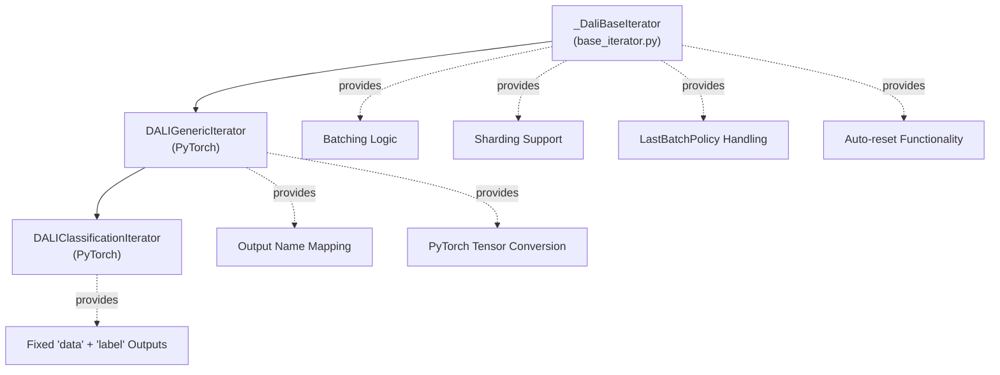
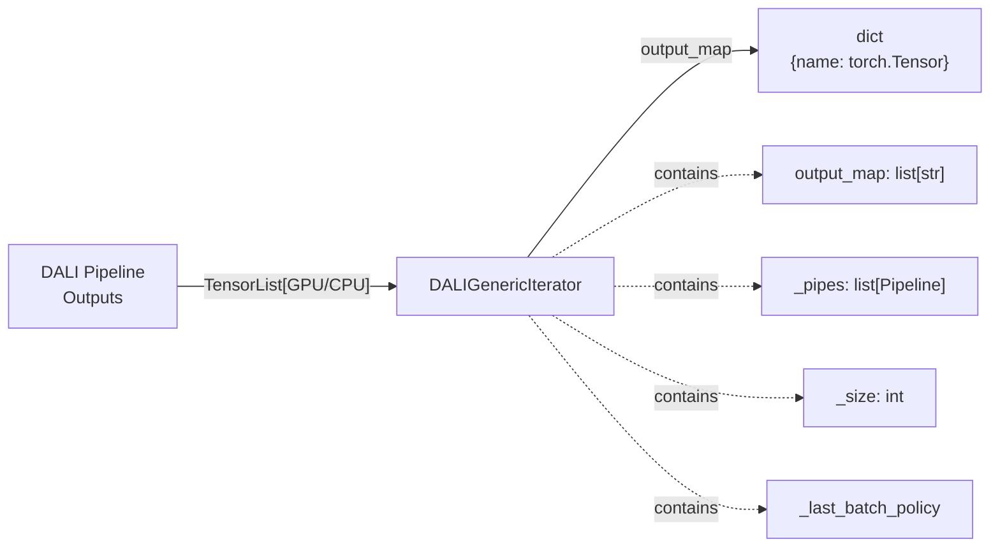
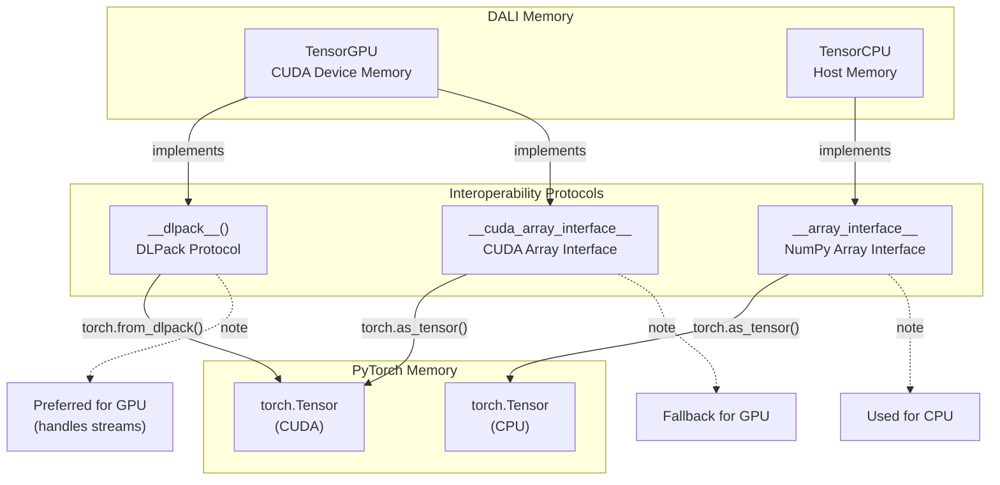
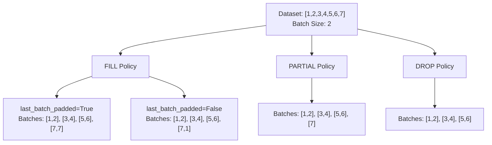

<!-- source: DeepWiki mcp.deepwiki.com · repo NVIDIA/DALI · page 4.1 PyTorch Integration · fetched 2026-10-26 -->

# PyTorch Integration

<details>
<summary>Relevant source files</summary>

The following files were used as context for generating this wiki page:

- [dali/pipeline/operator/builtin/copy.cc](dali/pipeline/operator/builtin/copy.cc)
- [dali/python/nvidia/dali/_autograph/operators/exceptions.py](dali/python/nvidia/dali/_autograph/operators/exceptions.py)
- [dali/python/nvidia/dali/plugin/base_iterator.py](dali/python/nvidia/dali/plugin/base_iterator.py)
- [dali/python/nvidia/dali/plugin/paddle.py](dali/python/nvidia/dali/plugin/paddle.py)
- [dali/test/python/import_module_test_helper.py](dali/test/python/import_module_test_helper.py)
- [dali/test/python/nose_utils.py](dali/test/python/nose_utils.py)
- [dali/test/python/test_backend_impl.py](dali/test/python/test_backend_impl.py)
- [dali/test/python/test_backend_impl_gpu.py](dali/test/python/test_backend_impl_gpu.py)
- [dali/test/python/test_backend_impl_torch_dlpack.py](dali/test/python/test_backend_impl_torch_dlpack.py)
- [dali/test/python/test_external_source_parallel_custom_serialization.py](dali/test/python/test_external_source_parallel_custom_serialization.py)
- [dali/test/python/test_fw_iterators.py](dali/test/python/test_fw_iterators.py)
- [docs/advanced_topics_sharding.rst](docs/advanced_topics_sharding.rst)
- [docs/examples/frameworks/pytorch/pytorch-lightning.ipynb](docs/examples/frameworks/pytorch/pytorch-lightning.ipynb)
- [docs/examples/use_cases/video_superres/model/model.py](docs/examples/use_cases/video_superres/model/model.py)
- [qa/nose_wrapper/__main__.py](qa/nose_wrapper/__main__.py)

</details>


This page documents DALI's integration with PyTorch, including iterator classes, data interoperability mechanisms, and usage patterns. PyTorch integration enables GPU-accelerated data loading and preprocessing with zero-copy data transfer between DALI and PyTorch tensors.

For general framework iterator concepts such as batching and sharding, see [Framework Iterators](#5.3). For interoperability protocols like DLPack, see [Memory Management and Interoperability](#6.1).

---

## Iterator Architecture

DALI integrates with PyTorch through specialized iterator classes that wrap DALI pipelines and expose their outputs as PyTorch-compatible data structures. The iterator hierarchy provides consistent batching, sharding, and epoch management across different use cases.

### Class Hierarchy



**Sources:** [dali/python/nvidia/dali/plugin/base_iterator.py:55-141](), [dali/test/python/test_fw_iterators.py:902-939]()

### _DaliBaseIterator

The base class provides core iteration logic shared across all framework integrations:

| Feature | Description |
|---------|-------------|
| **Pipeline Management** | Builds and schedules DALI pipeline runs |
| **Batch Counting** | Tracks iteration progress and epoch boundaries |
| **Sharding** | Distributes data across multiple pipeline instances |
| **Last Batch Handling** | Implements `LastBatchPolicy` for incomplete batches |
| **Checkpointing** | Saves and restores iterator state |

**Key Methods:**
- `__next__()`: Retrieves next batch and handles StopIteration
- `reset()`: Resets iterator after epoch completion
- `_get_outputs()`: Fetches outputs from pipeline via `share_outputs()`
- `_schedule_runs()`: Schedules pipeline execution via `schedule_run()`
- `_advance_and_check_drop_last()`: Implements DROP policy logic

**Sources:** [dali/python/nvidia/dali/plugin/base_iterator.py:143-534]()

### DALIGenericIterator

The general-purpose PyTorch iterator that maps DALI pipeline outputs to named PyTorch tensors.



**Constructor Parameters:**

| Parameter | Type | Description |
|-----------|------|-------------|
| `pipelines` | `list[Pipeline]` or `Pipeline` | One pipeline per GPU device |
| `output_map` | `list[str]` | Names for consecutive pipeline outputs |
| `size` | `int` | Shard size (deprecated; use `reader_name`) |
| `reader_name` | `str` | Name of reader operator for automatic sizing |
| `auto_reset` | `bool` or `str` | Whether to auto-reset at epoch end |
| `last_batch_policy` | `LastBatchPolicy` | How to handle incomplete last batch |
| `last_batch_padded` | `bool` | Whether reader pads the last batch |
| `prepare_first_batch` | `bool` | Pre-buffer first batch on creation |

**Output Format:**
Returns a list of dictionaries (one per GPU), where each dictionary maps output names to PyTorch tensors:
```python
[
    {"images": torch.Tensor, "labels": torch.Tensor},  # GPU 0
    {"images": torch.Tensor, "labels": torch.Tensor},  # GPU 1
    ...
]
```

**Sources:** [dali/test/python/test_fw_iterators.py:904-930](), [dali/python/nvidia/dali/plugin/base_iterator.py:55-141]()

### DALIClassificationIterator

A convenience wrapper that assumes two outputs named "data" and "label", simplifying typical classification workflows.

```python
# Equivalent calls:
DALIClassificationIterator(pipeline, reader_name="Reader")
# Same as:
DALIGenericIterator(pipeline, output_map=["data", "label"], reader_name="Reader")
```

**Sources:** [docs/examples/frameworks/pytorch/pytorch-lightning.ipynb:242-246](), [dali/python/nvidia/dali/plugin/paddle.py:394-512]() (similar pattern)

---

## Data Interoperability

DALI tensors are converted to PyTorch tensors using zero-copy protocols when possible, minimizing data transfer overhead.



**Sources:** [dali/test/python/test_backend_impl_torch_dlpack.py:37-65](), [dali/test/python/test_backend_impl_gpu.py:80-90](), [dali/test/python/test_backend_impl.py:123-131]()

### DLPack Protocol

DLPack is the preferred protocol for GPU tensors as it properly handles CUDA stream synchronization:

```python
# Creating DALI tensor from PyTorch with stream awareness
s = torch.cuda.Stream()
with torch.cuda.stream(s):
    arr = torch.rand(size=[3, 5, 6], device="cuda")
    tensor = TensorGPU(to_dlpack(arr), stream=s.cuda_stream)
    assert int(tensor.stream) == int(s.cuda_stream)
```

**Key Properties:**
- Zero-copy data sharing
- Stream synchronization for correct execution ordering
- Cross-library compatibility (NumPy, PyTorch, CuPy, JAX, etc.)

**Sources:** [dali/test/python/test_backend_impl_torch_dlpack.py:37-44](), [dali/test/python/test_backend_impl_torch_dlpack.py:54-58]()

### CUDA Array Interface

Alternative protocol for GPU tensors, widely supported but without explicit stream handling:

```python
# DALI tensors expose __cuda_array_interface__
arr = np.random.rand(3, 5, 6)
tensor_list = run_pipeline()[0]
assert tensor_list[0].__cuda_array_interface__["data"][0] == tensor_list[0].data_ptr()
```

**Sources:** [dali/test/python/test_backend_impl_gpu.py:80-90]()

### Zero-Copy Guarantees

Data is shared without copying when:
1. DALI tensors are on the same device as destination PyTorch tensors
2. Memory layout is compatible (contiguous, matching strides)
3. Iterator is created with appropriate parameters (e.g., not forcing copies)

Pipeline configuration affects zero-copy capability:
- `exec_dynamic=False`: Iterator may copy data for consistency
- `exec_dynamic=True`: Can use zero-copy via DLPack directly

**Sources:** [dali/python/nvidia/dali/plugin/paddle.py:285-286](), [dali/python/nvidia/dali/plugin/paddle.py:340-346]()

---

## Configuration and Parameters

### LastBatchPolicy

Controls behavior when the dataset size is not divisible by the batch size:

| Policy | Behavior | Use Case |
|--------|----------|----------|
| `FILL` | Pad incomplete batch by repeating last sample or wrapping to next epoch | Default; ensures consistent batch sizes |
| `PARTIAL` | Return incomplete batch as-is | When batch size must match actual data |
| `DROP` | Skip the last incomplete batch | When partial batches break training logic |



**Sources:** [dali/python/nvidia/dali/plugin/base_iterator.py:36-53](), [dali/test/python/test_fw_iterators.py:942-987]()

### Reader-Based Sizing

The recommended approach for configuring iterator size and padding:

```python
# Automatic configuration via reader_name
iterator = DALIGenericIterator(
    pipeline,
    output_map=["images", "labels"],
    reader_name="Reader",  # Queries reader for size and padding
    last_batch_policy=LastBatchPolicy.PARTIAL
)
```

**Advantages:**
- Automatically extracts `epoch_size` and `pad_last_batch` from reader
- Handles shard size variations across epochs when shards rotate
- No manual calculation of dataset size needed

**Sources:** [docs/examples/frameworks/pytorch/pytorch-lightning.ipynb:242-246](), [dali/python/nvidia/dali/plugin/base_iterator.py:294-350]()

### Manual Sizing (Deprecated)

Explicitly providing size and padding parameters:

```python
# Manual configuration (deprecated)
iterator = DALIGenericIterator(
    pipeline,
    output_map=["images", "labels"],
    size=10000,  # Must calculate manually
    last_batch_padded=True,
    last_batch_policy=LastBatchPolicy.FILL
)
```

**Limitations:**
- Requires manual calculation of shard size
- Doesn't account for shard rotation across epochs
- Error-prone in distributed settings

**Sources:** [dali/python/nvidia/dali/plugin/base_iterator.py:165-208](), [dali/test/python/test_fw_iterators.py:909-930]()

---

## Usage Patterns

### Basic Single-GPU Training

```python
from nvidia.dali import pipeline_def
import nvidia.dali.fn as fn
from nvidia.dali.plugin.pytorch import DALIGenericIterator, LastBatchPolicy

@pipeline_def(batch_size=32, num_threads=4, device_id=0)
def image_pipeline():
    jpegs, labels = fn.readers.file(file_root="/data/imagenet", random_shuffle=True, name="Reader")
    images = fn.decoders.image(jpegs, device="mixed")
    images = fn.resize(images, size=[224, 224])
    return images, labels

# Create pipeline and iterator
pipe = image_pipeline()
train_loader = DALIGenericIterator(
    pipe,
    output_map=["data", "label"],
    reader_name="Reader",
    last_batch_policy=LastBatchPolicy.PARTIAL
)

# Training loop
for epoch in range(num_epochs):
    for batch in train_loader:
        images = batch[0]["data"]  # torch.Tensor on GPU
        labels = batch[0]["label"]
        # ... training step ...
    train_loader.reset()
```

**Sources:** [docs/examples/frameworks/pytorch/pytorch-lightning.ipynb:234-246]()

### Multi-GPU Distributed Training

Each GPU device requires its own pipeline instance with appropriate sharding:

```python
@pipeline_def(batch_size=32, num_threads=4, device_id=0)
def sharded_pipeline(shard_id, num_shards):
    jpegs, labels = fn.readers.file(
        file_root="/data/imagenet",
        random_shuffle=True,
        shard_id=shard_id,
        num_shards=num_shards,
        name="Reader"
    )
    images = fn.decoders.image(jpegs, device="mixed")
    return images, labels

# Create one pipeline per GPU
num_gpus = torch.cuda.device_count()
pipes = [sharded_pipeline(gpu_id, num_gpus, device_id=gpu_id) for gpu_id in range(num_gpus)]

# Iterator wraps all pipelines
train_loader = DALIGenericIterator(
    pipes,
    output_map=["data", "label"],
    reader_name="Reader"
)

# Iterate over all GPUs
for batch in train_loader:
    for gpu_id in range(num_gpus):
        images = batch[gpu_id]["data"]  # Tensor on device gpu_id
        labels = batch[gpu_id]["label"]
        # ... process on respective GPU ...
```

**Sources:** [dali/test/python/test_fw_iterators.py:909-923]()

### PyTorch Lightning Integration

Custom wrapper for seamless PyTorch Lightning integration:

```python
from pytorch_lightning import LightningModule
from nvidia.dali.plugin.pytorch import DALIClassificationIterator

class MyLightningModule(LightningModule):
    def setup(self, stage=None):
        device_id = self.local_rank
        shard_id = self.global_rank
        num_shards = self.trainer.world_size
        
        pipeline = create_dali_pipeline(
            batch_size=64,
            device_id=device_id,
            shard_id=shard_id,
            num_shards=num_shards
        )
        
        # Wrapper to convert DALI output format to PyTorch Lightning format
        class LightningWrapper(DALIClassificationIterator):
            def __next__(self):
                out = super().__next__()
                # DDP uses one pipeline per process
                out = out[0]
                # Convert dict to tuple, squeeze labels
                return [out[k] if k != "label" else torch.squeeze(out[k]) 
                        for k in self.output_map]
        
        self.train_loader = LightningWrapper(
            pipeline,
            reader_name="Reader",
            last_batch_policy=LastBatchPolicy.PARTIAL
        )
    
    def train_dataloader(self):
        return self.train_loader
    
    def training_step(self, batch, batch_idx):
        images, labels = batch  # Already unpacked by wrapper
        # ... training logic ...
```

**Sources:** [docs/examples/frameworks/pytorch/pytorch-lightning.ipynb:332-376]()

### Custom Output Processing

For advanced use cases requiring custom data transformations:

```python
class CustomDALIIterator(DALIGenericIterator):
    def __init__(self, *args, transform_fn=None, **kwargs):
        super().__init__(*args, **kwargs)
        self.transform_fn = transform_fn
    
    def __next__(self):
        batch = super().__next__()
        
        # Apply custom transformations
        if self.transform_fn:
            for gpu_id in range(len(batch)):
                batch[gpu_id] = self.transform_fn(batch[gpu_id])
        
        return batch

# Usage
def normalize_labels(batch_dict):
    batch_dict["label"] = batch_dict["label"].float() / 255.0
    return batch_dict

loader = CustomDALIIterator(
    pipeline,
    output_map=["data", "label"],
    reader_name="Reader",
    transform_fn=normalize_labels
)
```

**Sources:** [docs/examples/frameworks/pytorch/pytorch-lightning.ipynb:353-372]()

---

## Best Practices

### Memory Management

1. **Use `prepare_first_batch=True`** (default) to hide first-batch latency
2. **Set appropriate `prefetch_queue_depth`** in pipeline to balance memory and throughput
3. **Enable `exec_dynamic=True`** when possible for zero-copy data sharing

**Sources:** [dali/python/nvidia/dali/plugin/base_iterator.py:116-118](), [dali/test/python/test_fw_iterators.py:41-48]()

### Sharding Configuration

```python
# ✓ Good: Use reader_name for automatic configuration
DALIGenericIterator(pipeline, output_map=["data"], reader_name="Reader")

# ✗ Avoid: Manual size calculation is error-prone
DALIGenericIterator(pipeline, output_map=["data"], size=calculated_size)
```

**Sources:** [dali/python/nvidia/dali/plugin/base_iterator.py:198-208]()

### Iterator Reset

```python
# Explicit reset at epoch end
for epoch in range(num_epochs):
    for batch in loader:
        # ... training ...
    loader.reset()  # Required unless auto_reset=True

# Or use auto_reset
loader = DALIGenericIterator(pipeline, ..., auto_reset=True)
for epoch in range(num_epochs):
    for batch in loader:
        # ... training ...
    # No manual reset needed
```

**Sources:** [dali/python/nvidia/dali/plugin/base_iterator.py:475-534](), [dali/test/python/test_fw_iterators.py:979-986]()

### Performance Considerations

| Aspect | Recommendation | Reason |
|--------|----------------|--------|
| **num_threads** | 2-4 per pipeline | Balance CPU usage and throughput |
| **prefetch_queue_depth** | 2-3 | Smooth out pipeline stage variations |
| **Decoder placement** | `device="mixed"` | Utilize GPU for decoding when possible |
| **Reader shuffle** | `random_shuffle=True` in reader | Better than shuffling after reading |
| **Batch size** | Multiple of 32 | Optimal GPU utilization |

**Sources:** [docs/examples/frameworks/pytorch/pytorch-lightning.ipynb:234-241]()

---

## Error Handling

### Common Issues

**Empty Pipeline Error:**
```python
RuntimeError: It seems that there is no data in the pipeline. 
This may happen if `last_batch_policy` is set to PARTIAL and 
the requested batch size is greater than the shard size.
```

**Solution:** Ensure batch size ≤ shard size, or use `LastBatchPolicy.FILL`

**Sources:** [dali/python/nvidia/dali/plugin/base_iterator.py:448-461](), [dali/test/python/test_fw_iterators.py:487-496]()

**Inconsistent Batch Sizes:**
```python
AssertionError: Variable batch size is not supported by the iterator 
when reader_name is provided or iterator size is set explicitly
```

**Solution:** Use `dynamic_shape=True` or avoid setting `reader_name` for variable batch sizes

**Sources:** [dali/python/nvidia/dali/plugin/base_iterator.py:394-404]()

---

