<!-- source: DeepWiki mcp.deepwiki.com · repo NVIDIA/DALI · page 4.2 TensorFlow Integration · fetched 2026-10-26 -->

# TensorFlow Integration

<details>
<summary>Relevant source files</summary>

The following files were used as context for generating this wiki page:

- [dali/python/nvidia/dali/plugin/tf.py](dali/python/nvidia/dali/plugin/tf.py)
- [dali/test/python/test_dali_tf_dataset.py](dali/test/python/test_dali_tf_dataset.py)
- [dali/test/python/test_dali_tf_dataset_eager.py](dali/test/python/test_dali_tf_dataset_eager.py)
- [dali/test/python/test_dali_tf_dataset_graph.py](dali/test/python/test_dali_tf_dataset_graph.py)
- [dali/test/python/test_dali_tf_dataset_mnist.py](dali/test/python/test_dali_tf_dataset_mnist.py)
- [dali/test/python/test_dali_tf_dataset_mnist_eager.py](dali/test/python/test_dali_tf_dataset_mnist_eager.py)
- [dali/test/python/test_dali_tf_dataset_mnist_graph.py](dali/test/python/test_dali_tf_dataset_mnist_graph.py)
- [dali/test/python/test_dali_tf_dataset_pipelines.py](dali/test/python/test_dali_tf_dataset_pipelines.py)
- [dali/test/python/test_dali_tf_dataset_shape.py](dali/test/python/test_dali_tf_dataset_shape.py)
- [dali/test/python/test_external_source_impl_utils.py](dali/test/python/test_external_source_impl_utils.py)
- [dali/test/python/test_utils_tensorflow.py](dali/test/python/test_utils_tensorflow.py)
- [dali_tf_plugin/build_dali_stub.sh](dali_tf_plugin/build_dali_stub.sh)
- [dali_tf_plugin/dali_dataset.h](dali_tf_plugin/dali_dataset.h)
- [dali_tf_plugin/dali_dataset_op.cc](dali_tf_plugin/dali_dataset_op.cc)
- [dali_tf_plugin/dali_helper.h](dali_tf_plugin/dali_helper.h)
- [dali_tf_plugin/daliop.cc](dali_tf_plugin/daliop.cc)
- [dali_tf_plugin/tfallocator.h](dali_tf_plugin/tfallocator.h)
- [include/dali/operators.h](include/dali/operators.h)
- [qa/TL1_tensorflow_dataset/test.sh](qa/TL1_tensorflow_dataset/test.sh)
- [qa/TL1_tensorflow_dataset_conda/test.sh](qa/TL1_tensorflow_dataset_conda/test.sh)
- [tools/stubgen.py](tools/stubgen.py)

</details>


## Purpose and Scope

This document describes DALI's integration with TensorFlow, enabling TensorFlow training workflows to leverage DALI's GPU-accelerated data preprocessing pipelines. The integration provides two main approaches: the modern `DALIDataset` API that implements TensorFlow's `tf.data.Dataset` interface, and a legacy iterator-based API. 

For information about PyTorch integration, see [4.1](#4.1). For other framework integrations, see [4.3](#4.3). For details on DALI's pipeline system itself, see [2.1](#2.1).

---

## Architecture Overview

DALI's TensorFlow integration consists of three layers: a Python API layer that provides dataset and iterator classes, a C++ plugin layer that implements TensorFlow custom operators, and the DALI core that executes the preprocessing pipeline.

### High-Level Integration Architecture

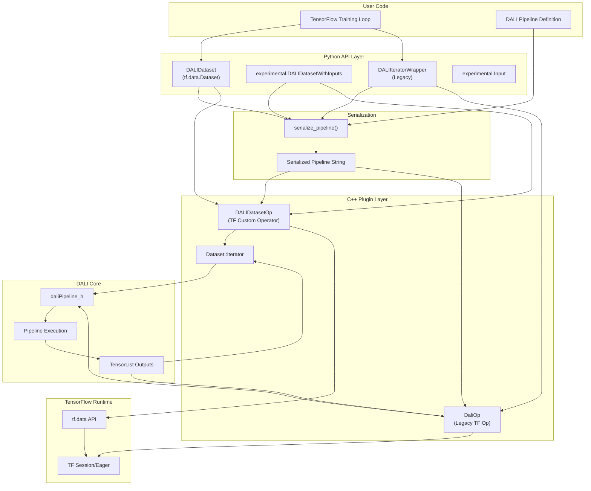

**Sources:** [dali/python/nvidia/dali/plugin/tf.py:1-900](), [dali_tf_plugin/dali_dataset_op.cc:1-100](), [dali_tf_plugin/daliop.cc:1-100]()

---

## Integration Modes

DALI provides two integration modes with TensorFlow, each serving different use cases.

### DALIDataset (Recommended)

The `DALIDataset` class implements TensorFlow's `tf.data.Dataset` interface, providing seamless integration with TensorFlow's data pipeline infrastructure. This is the recommended approach for TensorFlow 1.15+ and all TensorFlow 2.x versions.

| Feature | Description |
|---------|-------------|
| **Base Class** | `tf.data.DatasetV2` or `tf.data.DatasetV1Adapter` (TF < 2.0) |
| **Implementation** | `_DALIDatasetV2` → `_DALIDatasetImpl` → `DALIDataset` |
| **C++ Backend** | `DALIDatasetOp` custom operator |
| **Usage Pattern** | Compatible with Keras `.fit()`, `tf.distribute`, standard dataset operations |
| **Minimum TF Version** | 1.15 |

**Sources:** [dali/python/nvidia/dali/plugin/tf.py:423-869](), [dali_tf_plugin/dali_dataset_op.cc:50-137]()

### DALIIterator (Legacy)

The legacy iterator-based API uses a custom TensorFlow operator that returns tensors directly. This approach predates the `tf.data.Dataset` API and is maintained for backward compatibility.

| Feature | Description |
|---------|-------------|
| **Python Wrapper** | `DALIIteratorWrapper` function |
| **C++ Backend** | `DaliOp` custom operator |
| **Usage Pattern** | Returns tensor outputs directly, used with low-level TF APIs |
| **Status** | Legacy, supported but not recommended for new code |

**Sources:** [dali/python/nvidia/dali/plugin/tf.py:209-318](), [dali_tf_plugin/daliop.cc:96-501]()

---

## Python API

### DALIDataset Class

The `DALIDataset` class wraps a DALI pipeline as a TensorFlow dataset. It handles pipeline serialization, type and shape specification, and device placement.

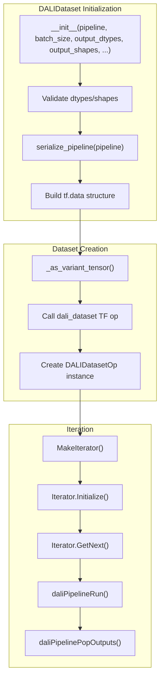

**Key Parameters:**

| Parameter | Type | Description |
|-----------|------|-------------|
| `pipeline` | `Pipeline` | DALI pipeline instance to wrap |
| `batch_size` | `int` | Batch size for the pipeline |
| `output_dtypes` | `tuple[tf.DType]` | TensorFlow data types for each output |
| `output_shapes` | `tuple[tf.TensorShape]` | Expected shapes for each output (can contain `None` for dynamic dimensions) |
| `device_id` | `int` | GPU device ID (or `None` for CPU) |
| `exec_separated` | `bool` | Use separated execution queues |
| `exec_dynamic` | `bool` | Use dynamic execution mode |
| `prefetch_queue_depth` | `int` | Prefetch queue depth |
| `fail_on_device_mismatch` | `bool` | Raise error if TF device doesn't match DALI output device |

**Sources:** [dali/python/nvidia/dali/plugin/tf.py:438-507](), [dali/python/nvidia/dali/plugin/tf.py:845-868]()

### DALIDatasetWithInputs (Experimental)

The `experimental.DALIDatasetWithInputs` class extends `DALIDataset` to support input `tf.data.Dataset` objects that feed DALI's `ExternalSource` operators. This enables hybrid pipelines where TensorFlow datasets provide inputs to DALI processing.

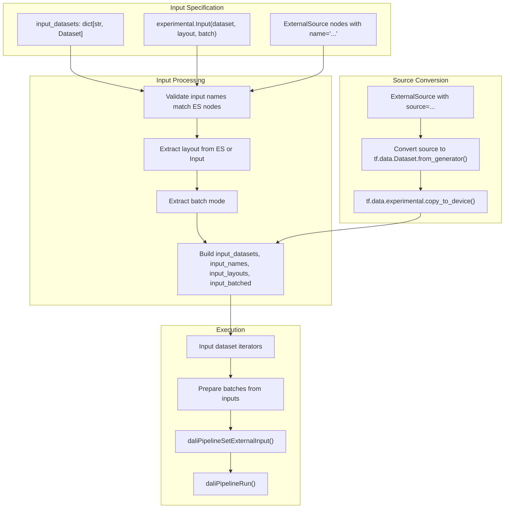

**Input Modes:**

The inputs can operate in two modes:

| Mode | Description | Shape Example |
|------|-------------|---------------|
| **Per-Sample** | Dataset yields individual samples, DALI batches them | `[480, 640, 3]` for one image |
| **Batch** | Dataset yields pre-batched tensors | `[10, 480, 640, 3]` for batch of 10 images |

**Sources:** [dali/python/nvidia/dali/plugin/tf.py:48-171](), [dali/python/nvidia/dali/plugin/tf.py:508-700]()

### experimental.Input Wrapper

The `experimental.Input` class wraps a `tf.data.Dataset` with additional metadata for DALI integration.

```python
# Located in: dali/python/nvidia/dali/plugin/tf.py (experimental module)
class Input:
    def __init__(self, dataset, layout=None, batch=False):
        """
        Parameters:
        - dataset: tf.data.Dataset to use as input
        - layout: Data layout string (e.g., "HWC", "CHW")
        - batch: Whether dataset returns batches (True) or samples (False)
        """
```

**Sources:** [dali/python/nvidia/dali/plugin/tf.py:174-195]()

---

## C++ Plugin Architecture

### DALIDatasetOp Implementation

The `DALIDatasetOp` class implements a TensorFlow custom dataset operator that manages DALI pipeline execution within TensorFlow's execution graph.

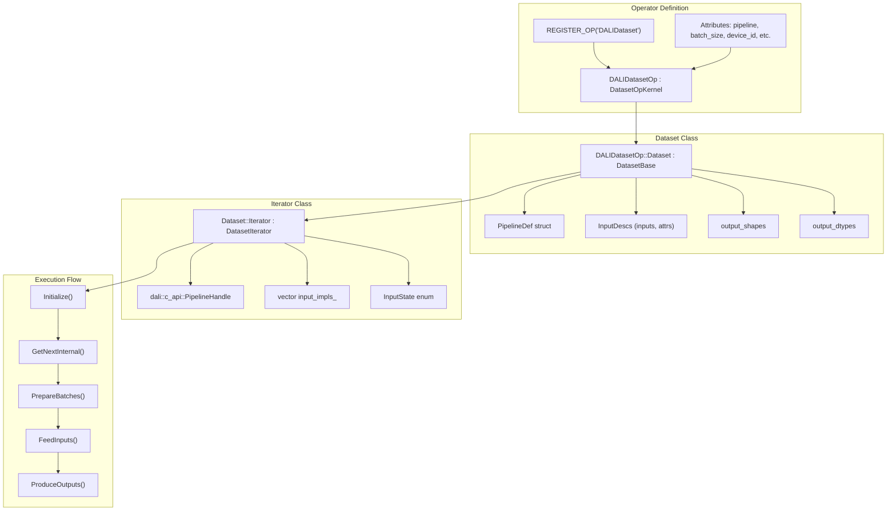

**Key Structures:**

| Structure | Purpose |
|-----------|---------|
| `PipelineDef` | Stores pipeline serialization and execution parameters |
| `Inputs` | Contains references to input `DatasetBase` objects |
| `InputAttrs` | Static attributes describing inputs (names, layouts, batch mode) |
| `InputDescs` | Combines `Inputs` and `InputAttrs` |

**Sources:** [dali_tf_plugin/dali_dataset_op.cc:98-327](), [dali_tf_plugin/dali_dataset.h:50-137]()

### Dataset Iterator Lifecycle

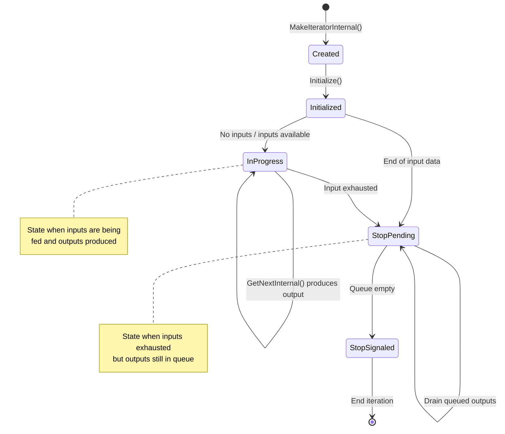

**Iterator States (when inputs present):**

| State | Description | Behavior |
|-------|-------------|----------|
| `in_progress` | Normal operation | Feed inputs, produce outputs |
| `stop_pending` | Inputs exhausted | Don't feed, drain output queue |
| `stop_signaled` | All outputs drained | Signal `end_of_sequence = true` |

**Sources:** [dali_tf_plugin/dali_dataset_op.cc:330-468]()

### Data Type and Shape Handling

The C++ plugin performs type and shape validation and conversion between DALI and TensorFlow representations:

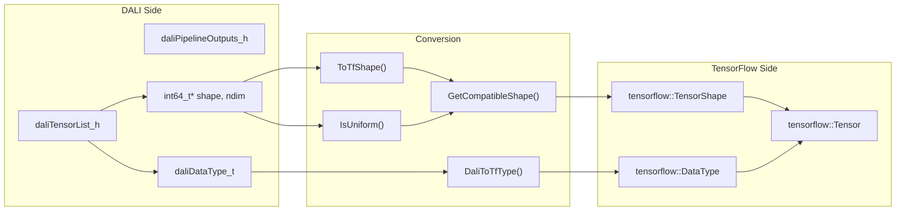

**Type Mapping:**

| DALI Type | TensorFlow Type |
|-----------|----------------|
| `DALI_UINT8` | `DT_UINT8` |
| `DALI_INT32` | `DT_INT32` |
| `DALI_INT64` | `DT_INT64` |
| `DALI_FLOAT16` | `DT_HALF` |
| `DALI_FLOAT` | `DT_FLOAT` |
| `DALI_FLOAT64` | `DT_DOUBLE` |
| `DALI_BOOL` | `DT_BOOL` |

**Sources:** [dali_tf_plugin/dali_helper.h:109-169](), [dali_tf_plugin/dali_dataset_op.cc:675-731]()

---

## Pipeline Serialization

DALI pipelines must be serialized to pass from Python to the C++ plugin layer. This serialization captures the pipeline graph and configuration but not runtime state.

### Serialization Process

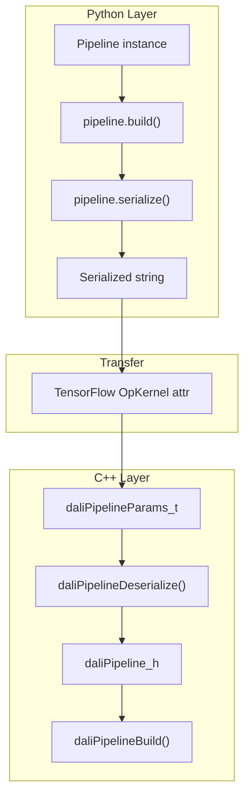

**Serialization Functions:**

| Function | Location | Purpose |
|----------|----------|---------|
| `serialize_pipeline()` | [dali/python/nvidia/dali/plugin/tf.py:198-206]() | Wraps `pipeline.serialize()` with error handling |
| `daliPipelineDeserialize()` | C API | Reconstructs pipeline from serialized string |
| `daliPipelineBuild()` | C API | Builds the pipeline graph in C++ |

**Limitations:**

- Python operators cannot be serialized (they require Python runtime)
- External source callbacks must be converted to TensorFlow datasets
- Pipeline must be built before serialization

**Sources:** [dali/python/nvidia/dali/plugin/tf.py:198-206](), [dali_tf_plugin/dali_dataset_op.cc:277-316]()

---

## External Source Integration

The TensorFlow integration provides special handling for `ExternalSource` operators to bridge TensorFlow's data pipeline with DALI.

### Input Dataset Mapping

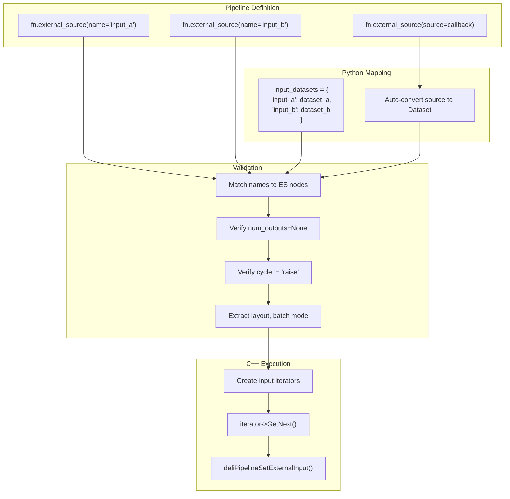

**External Source Requirements:**

| Requirement | Reason |
|-------------|--------|
| Must have `name` parameter | Used for mapping to input datasets |
| `num_outputs` must be `None` | Multi-output not supported with dataset inputs |
| `cycle` must not be `'raise'` | Datasets are not restartable |
| CPU data only (for `source`) | Automatic conversion via `from_generator` |

**Sources:** [dali/python/nvidia/dali/plugin/tf.py:360-392](), [dali/python/nvidia/dali/plugin/tf.py:596-644](), [dali/python/nvidia/dali/plugin/tf.py:646-700]()

### Batch Mode Handling

When feeding inputs, the C++ iterator distinguishes between per-sample and batch modes:

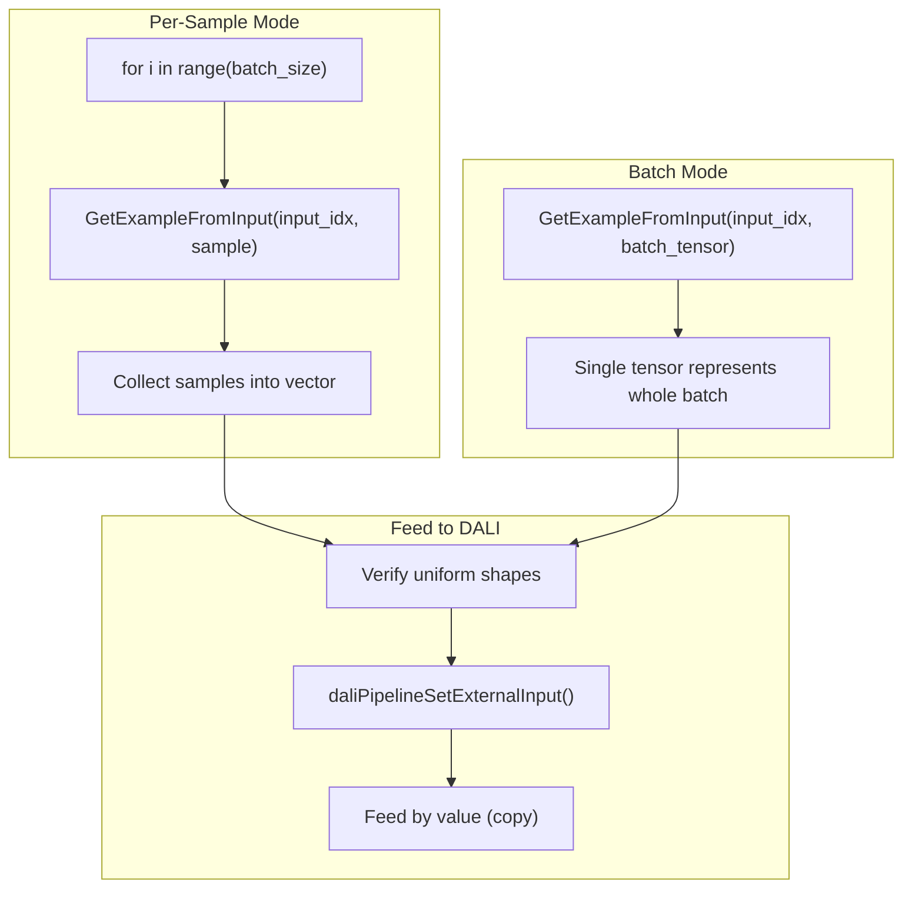

**Sources:** [dali_tf_plugin/dali_dataset_op.cc:597-669](), [dali_tf_plugin/dali_helper.h:214-303]()

---

## Device Placement and Memory Management

### Device Placement Rules

The TensorFlow integration enforces consistency between TensorFlow's device context and DALI's output device:

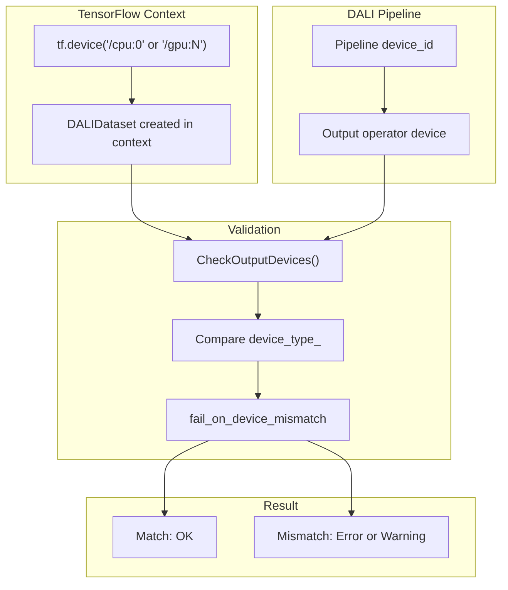

**Device Mismatch Handling:**

| Scenario | `fail_on_device_mismatch=True` | `fail_on_device_mismatch=False` |
|----------|-------------------------------|--------------------------------|
| CPU Pipeline, CPU TF Device | ✓ OK | ✓ OK |
| GPU Pipeline, GPU TF Device | ✓ OK | ✓ OK |
| CPU Pipeline, GPU TF Device | ✗ Error | ⚠ Warning (allows) |
| GPU Pipeline, CPU TF Device | ✗ Error | ⚠ Warning (allows) |

**Sources:** [dali_tf_plugin/dali_dataset_op.cc:367-391]()

### Memory Copy and Synchronization

Data transfer from DALI to TensorFlow tensors involves careful memory management:

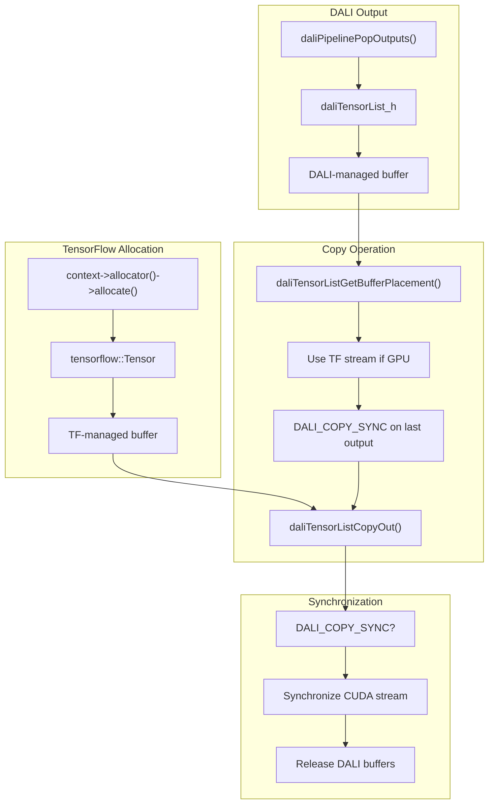

**Copy Strategies:**

| Source | Destination | Stream | Sync |
|--------|-------------|--------|------|
| GPU | GPU | TF stream | On last output |
| CPU | CPU | None | No |
| GPU | CPU (pinned) | TF stream | On last output |
| CPU | GPU | TF stream | On last output |

**Sources:** [dali_tf_plugin/dali_dataset_op.cc:775-804](), [dali_tf_plugin/daliop.cc:439-451]()

---

## Complete Data Flow Example

### End-to-End Execution Flow

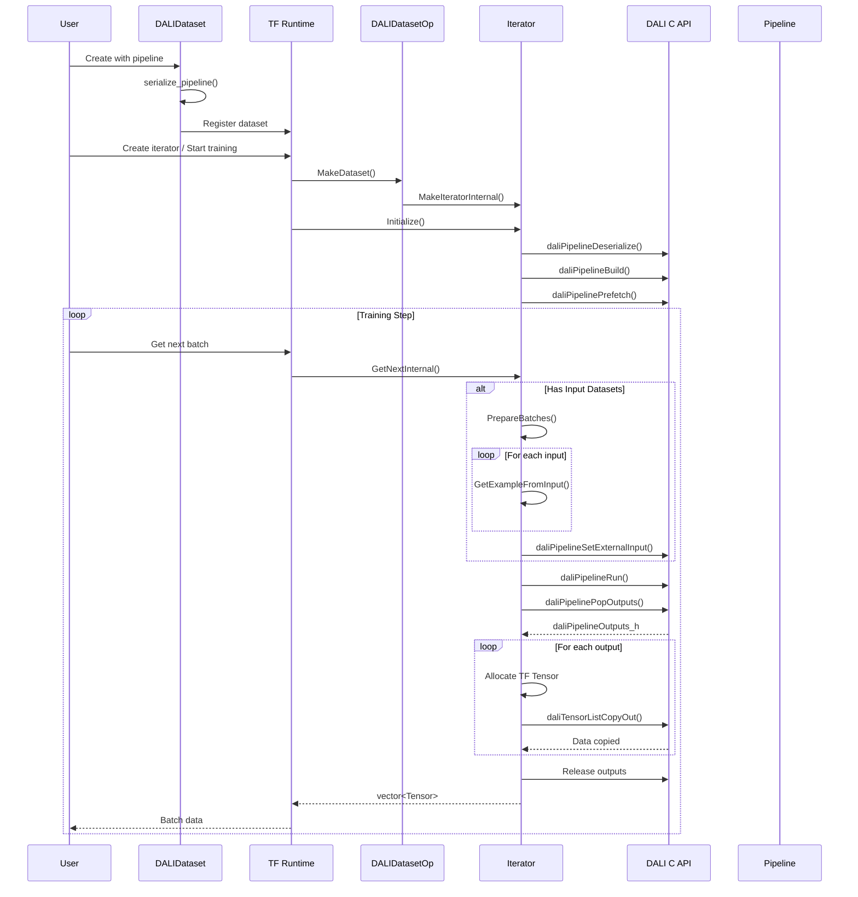

**Sources:** [dali_tf_plugin/dali_dataset_op.cc:330-468](), [dali_tf_plugin/dali_dataset_op.cc:533-563](), [dali_tf_plugin/dali_dataset_op.cc:675-804]()

---

## Build and Deployment

### Plugin Compilation

The TensorFlow plugin is compiled separately from the main DALI library and requires TensorFlow headers:

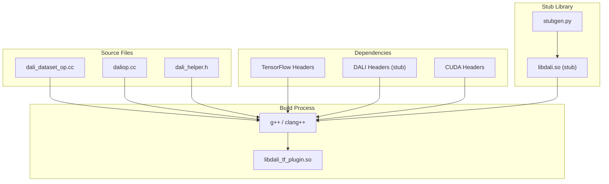

**Build Artifacts:**

| Component | Location | Purpose |
|-----------|----------|---------|
| `libdali_tf_plugin.so` | `dali_tf_plugin/` | TensorFlow custom operators |
| `stub/libdali.so` | Generated | Stub library for compilation |
| `nvidia_dali_tf_plugin` | Python package | Plugin loader and Python bindings |

**Sources:** [dali_tf_plugin/build_dali_stub.sh:1-31](), [tools/stubgen.py:49-63]()

### Plugin Loading

The plugin is loaded at runtime when importing the TensorFlow integration:

```python
# From dali/python/nvidia/dali/plugin/tf.py
from nvidia.dali_tf_plugin import dali_tf_plugin

_dali_tf_module = dali_tf_plugin.load_dali_tf_plugin()
_dali_tf = _dali_tf_module.dali
```

**Sources:** [dali/python/nvidia/dali/plugin/tf.py:32-37]()

---

## Usage Examples

### Basic DALIDataset Usage

```python
import tensorflow as tf
import nvidia.dali as dali
import nvidia.dali.fn as fn
import nvidia.dali.plugin.tf as dali_tf

# Define DALI pipeline
@dali.pipeline_def(batch_size=32, num_threads=4, device_id=0)
def image_pipeline():
    jpegs, labels = fn.readers.file(file_root="/data/imagenet")
    images = fn.decoders.image(jpegs, device="mixed")
    images = fn.resize(images, size=[224, 224])
    return images, labels

# Create pipeline instance
pipeline = image_pipeline()

# Wrap as TensorFlow dataset
with tf.device("/gpu:0"):
    dataset = dali_tf.DALIDataset(
        pipeline=pipeline,
        batch_size=32,
        output_dtypes=(tf.float32, tf.int32),
        output_shapes=((32, 224, 224, 3), (32,)),
        device_id=0
    )

# Use with Keras
model.fit(dataset, epochs=10, steps_per_epoch=1000)
```

### Using Input Datasets

```python
# Define DALI pipeline with external source
@dali.pipeline_def(batch_size=16, num_threads=4, device_id=0)
def processing_pipeline():
    # Named external source as placeholder
    images = fn.external_source(name="images_input")
    # Apply DALI preprocessing
    processed = fn.resize(images, size=[256, 256])
    processed = fn.crop_mirror_normalize(processed, mean=[0.485, 0.456, 0.406])
    return processed

pipeline = processing_pipeline()

# Create input TensorFlow dataset
input_dataset = tf.data.Dataset.from_tensor_slices(image_array)

# Map external source to input dataset
with tf.device("/gpu:0"):
    dataset = dali_tf.experimental.DALIDatasetWithInputs(
        pipeline=pipeline,
        input_datasets={"images_input": input_dataset},
        batch_size=16,
        output_dtypes=tf.float32,
        output_shapes=(16, 3, 256, 256),
        device_id=0
    )
```

**Sources:** [dali/test/python/test_dali_tf_dataset_mnist.py:60-74](), [dali/test/python/test_dali_tf_dataset_eager.py:239-256]()

---

## Testing Infrastructure

The TensorFlow integration includes comprehensive test coverage across graph and eager execution modes:

### Test Organization

| Test File | Coverage |
|-----------|----------|
| `test_dali_tf_dataset.py` | Basic dataset functionality |
| `test_dali_tf_dataset_eager.py` | Eager execution mode tests |
| `test_dali_tf_dataset_graph.py` | Graph execution mode tests |
| `test_dali_tf_dataset_shape.py` | Shape inference and validation |
| `test_dali_tf_dataset_mnist.py` | End-to-end training scenarios |
| `test_dali_tf_dataset_pipelines.py` | Input dataset scenarios |

**Test Execution:**

```bash
# Run TensorFlow dataset tests
qa/TL1_tensorflow_dataset/test.sh

# With conda environment
qa/TL1_tensorflow_dataset_conda/test.sh
```

**Sources:** [qa/TL1_tensorflow_dataset/test.sh:1-12](), [dali/test/python/test_dali_tf_dataset.py:1-62]()

---

