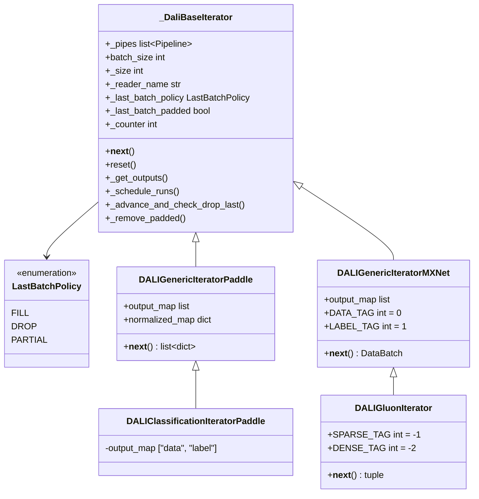
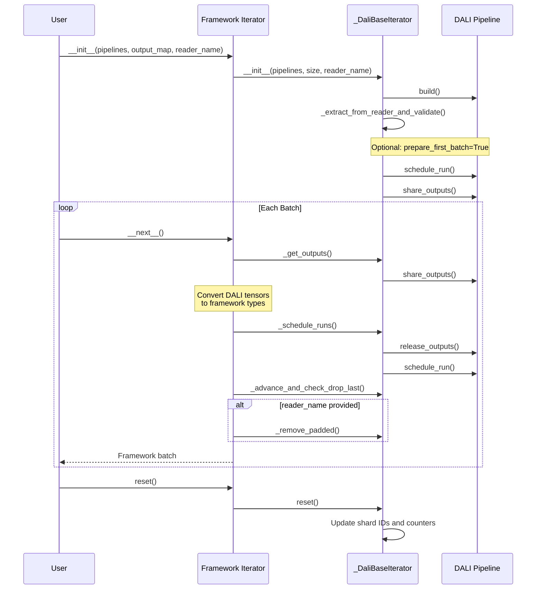
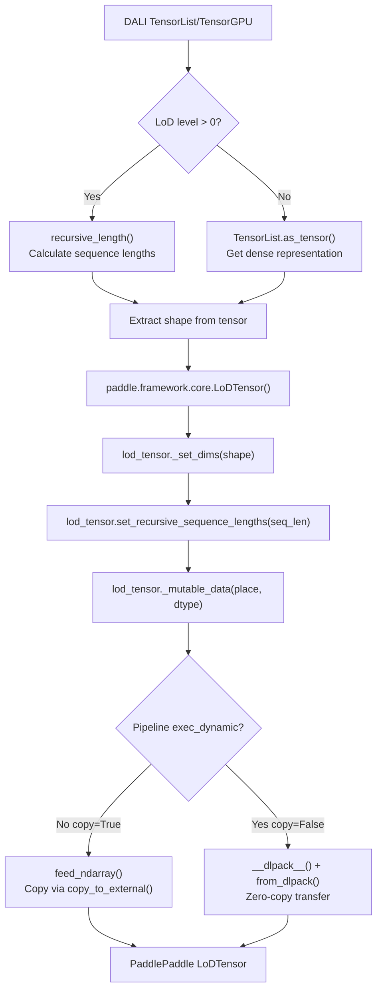
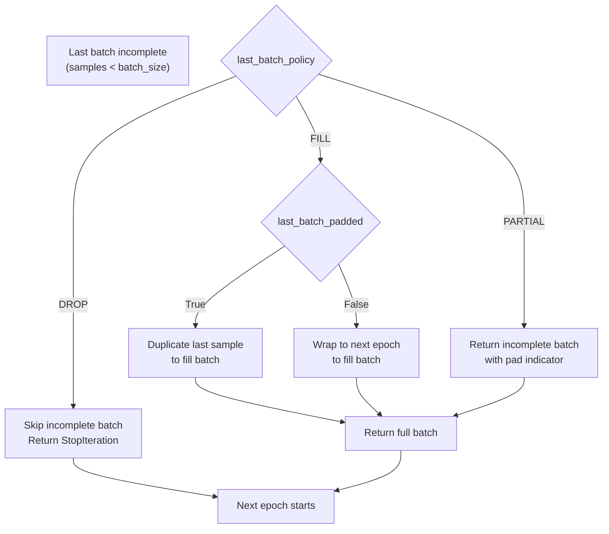
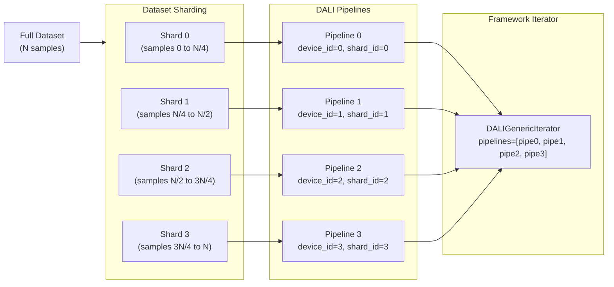
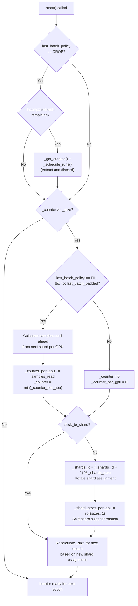

<!-- source: DeepWiki mcp.deepwiki.com · repo NVIDIA/DALI · page 4.3 Other Frameworks · fetched 2026-10-26 -->

# Other Frameworks

<details>
<summary>Relevant source files</summary>

The following files were used as context for generating this wiki page:

- [CONTRIBUTING.md](CONTRIBUTING.md)
- [VERSION](VERSION)
- [cmake/libdali.map.in](cmake/libdali.map.in)
- [dali/pipeline/operator/builtin/copy.cc](dali/pipeline/operator/builtin/copy.cc)
- [dali/python/nvidia/dali/_autograph/operators/exceptions.py](dali/python/nvidia/dali/_autograph/operators/exceptions.py)
- [dali/python/nvidia/dali/plugin/base_iterator.py](dali/python/nvidia/dali/plugin/base_iterator.py)
- [dali/python/nvidia/dali/plugin/paddle.py](dali/python/nvidia/dali/plugin/paddle.py)
- [dali/test/python/import_module_test_helper.py](dali/test/python/import_module_test_helper.py)
- [dali/test/python/nose_utils.py](dali/test/python/nose_utils.py)
- [dali/test/python/test_RN50_data_fw_iterators.py](dali/test/python/test_RN50_data_fw_iterators.py)
- [dali/test/python/test_RN50_data_pipeline.py](dali/test/python/test_RN50_data_pipeline.py)
- [dali/test/python/test_backend_impl.py](dali/test/python/test_backend_impl.py)
- [dali/test/python/test_backend_impl_gpu.py](dali/test/python/test_backend_impl_gpu.py)
- [dali/test/python/test_backend_impl_torch_dlpack.py](dali/test/python/test_backend_impl_torch_dlpack.py)
- [dali/test/python/test_data_containers.py](dali/test/python/test_data_containers.py)
- [dali/test/python/test_external_source_parallel_custom_serialization.py](dali/test/python/test_external_source_parallel_custom_serialization.py)
- [dali/test/python/test_fw_iterators.py](dali/test/python/test_fw_iterators.py)
- [dali/test/python/test_fw_iterators_detection.py](dali/test/python/test_fw_iterators_detection.py)
- [docs/advanced_topics_sharding.rst](docs/advanced_topics_sharding.rst)
- [docs/examples/frameworks/pytorch/pytorch-lightning.ipynb](docs/examples/frameworks/pytorch/pytorch-lightning.ipynb)
- [docs/examples/use_cases/video_superres/model/model.py](docs/examples/use_cases/video_superres/model/model.py)
- [docs/images/sharding.png](docs/images/sharding.png)
- [qa/TL0_plugin_manager/test.sh](qa/TL0_plugin_manager/test.sh)
- [qa/TL1_python-nvjpeg_test/test.sh](qa/TL1_python-nvjpeg_test/test.sh)
- [qa/nose_wrapper/__main__.py](qa/nose_wrapper/__main__.py)

</details>


## Purpose and Scope

This page documents DALI's integration with deep learning frameworks other than PyTorch and TensorFlow. Specifically, it covers:

- **PaddlePaddle**: Full integration including LoD (Level of Detail) tensor support
- **MXNet**: Integration for both standard MXNet and Gluon API

These integrations follow similar iterator-based patterns but have framework-specific data type handling and API considerations. For PyTorch-specific features, see [PyTorch Integration](#4.1). For TensorFlow-specific features, see [TensorFlow Integration](#4.2). For general iterator concepts like batching and sharding, see [Framework Iterators](#5.3).

## Supported Frameworks Overview

DALI provides Python iterator classes in the following modules:

| Framework | Module | Iterator Classes |
|-----------|--------|------------------|
| PaddlePaddle | `nvidia.dali.plugin.paddle` | `DALIGenericIterator`, `DALIClassificationIterator` |
| MXNet | `nvidia.dali.plugin.mxnet` | `DALIGenericIterator`, `DALIGluonIterator` |

All framework iterators inherit from `_DaliBaseIterator` which provides unified batching, sharding, epoch management, and last batch handling logic.

Sources: [dali/python/nvidia/dali/plugin/paddle.py:1-513](), [dali/test/python/test_fw_iterators.py:1-100](), [dali/python/nvidia/dali/plugin/base_iterator.py:55-141]()

## Common Iterator Architecture

### Iterator Class Hierarchy



Sources: [dali/python/nvidia/dali/plugin/base_iterator.py:55-141](), [dali/python/nvidia/dali/plugin/paddle.py:134-221](), [dali/test/python/test_fw_iterators.py:110-160]()

### Iteration Execution Flow



Sources: [dali/python/nvidia/dali/plugin/base_iterator.py:143-259](), [dali/python/nvidia/dali/plugin/paddle.py:271-392](), [dali/python/nvidia/dali/plugin/base_iterator.py:371-392]()

## PaddlePaddle Integration

### Module and Classes

The `nvidia.dali.plugin.paddle` module provides PaddlePaddle integration with two main classes:

| Class | Base | Purpose |
|-------|------|---------|
| `DALIGenericIterator` | `_DaliBaseIterator` | Flexible iterator with custom output mapping and LoD support |
| `DALIClassificationIterator` | `DALIGenericIterator` | Convenience wrapper with fixed `["data", "label"]` outputs |

Sources: [dali/python/nvidia/dali/plugin/paddle.py:134-392](), [dali/python/nvidia/dali/plugin/paddle.py:394-513]()

### PaddlePaddle Type System

**Data Type Mapping**: DALI types are converted to PaddlePaddle's `VarDesc.VarType` through the `dtype_map` dictionary and `to_paddle_type()` function:

| DALI Type | PaddlePaddle Type |
|-----------|-------------------|
| `types.DALIDataType.BOOL` | `VarDesc.VarType.BOOL` |
| `types.DALIDataType.FLOAT` | `VarDesc.VarType.FP32` |
| `types.DALIDataType.FLOAT16` | `VarDesc.VarType.FP16` |
| `types.DALIDataType.FLOAT64` | `VarDesc.VarType.FP64` |
| `types.DALIDataType.INT8` | `VarDesc.VarType.INT8` |
| `types.DALIDataType.INT16` | `VarDesc.VarType.INT16` |
| `types.DALIDataType.INT32` | `VarDesc.VarType.INT32` |
| `types.DALIDataType.INT64` | `VarDesc.VarType.INT64` |
| `types.DALIDataType.UINT8` | `VarDesc.VarType.UINT8` |

Sources: [dali/python/nvidia/dali/plugin/paddle.py:35-58]()

### LoD Tensor Support

PaddlePaddle uses **LoD (Level of Detail) tensors** for variable-length sequences. DALI's PaddlePaddle iterator supports this through the `output_map` parameter:

```python
# Each output can be:
# - String: dense tensor with LoD level 0
# - Tuple (str, int): tensor with specified LoD level

output_map = [
    "images",              # Dense tensor (LoD = 0)
    ("labels", 0),         # Explicitly dense
    ("sequences", 1),      # Single-level sequence
    ("nested_seq", 2)      # Two-level nested sequence
]
```

The iterator converts LoD specifications using the `normalized_map` dictionary where keys are output names and values are LoD levels.

Sources: [dali/python/nvidia/dali/plugin/paddle.py:236-242](), [dali/python/nvidia/dali/plugin/paddle.py:134-221]()

### Data Conversion Pipeline



Sources: [dali/python/nvidia/dali/plugin/paddle.py:271-392](), [dali/python/nvidia/dali/plugin/paddle.py:60-84](), [dali/python/nvidia/dali/plugin/paddle.py:86-113]()

### `recursive_length()` Function

For LoD tensors, `recursive_length()` computes the hierarchical sequence lengths at each LoD level:

```python
def recursive_length(tensor, lod_level):
    # Returns list of lists representing sequence structure
    # Example for lod_level=2:
    # [[3], [2, 5, 1], [...]]
    #   ^    ^^^^^^^^^
    #   |    Lengths of subsequences
    #   Number of sequences in batch
```

The function handles:
- `TensorListCPU` / `TensorListGPU`: Iterates through samples
- Dense tensors with shape: Extracts dimension information
- Recursive structure building for nested sequences

Sources: [dali/python/nvidia/dali/plugin/paddle.py:86-113]()

### `feed_ndarray()` Memory Copy

The `feed_ndarray()` function performs the actual data copy from DALI to PaddlePaddle:

```python
def feed_ndarray(dali_tensor, ptr, cuda_stream=None):
    # ptr: PaddlePaddle tensor data pointer
    # Copies DALI tensor contents to ptr
    
    if isinstance(dali_tensor, (TensorGPU, TensorListGPU)):
        # GPU copy with stream synchronization
        dali_tensor.copy_to_external(ptr, cuda_stream, non_blocking=True)
    else:
        # CPU copy (synchronous)
        dali_tensor.copy_to_external(ptr)
```

Sources: [dali/python/nvidia/dali/plugin/paddle.py:60-84]()

### Partial Batch Clipping

When `last_batch_policy=LastBatchPolicy.PARTIAL` with `reader_name`, the iterator uses `lod_tensor_clip()` to remove padding from the last batch:

```python
def lod_tensor_clip(lod_tensor, size):
    # Clips tensor to 'size' samples while preserving LoD structure
    # 1. Get numpy array from LoDTensor
    # 2. Get recursive sequence lengths
    # 3. Clip sequence lengths to match 'size'
    # 4. Create new LoDTensor with clipped data and lengths
```

This ensures that padded samples (added by reader to complete the batch) are removed before returning to the user.

Sources: [dali/python/nvidia/dali/plugin/paddle.py:116-131](), [dali/python/nvidia/dali/plugin/paddle.py:352-361]()

### PaddlePaddle Iterator Usage Example

```python
from nvidia.dali.plugin.paddle import DALIGenericIterator, DALIClassificationIterator
from nvidia.dali.plugin.base_iterator import LastBatchPolicy

# Generic iterator with LoD specification
generic_iter = DALIGenericIterator(
    pipelines=[pipeline],
    output_map=[
        "images",          # Dense images
        ("labels", 1)      # Single-level sequence labels
    ],
    reader_name="Reader",  # Recommended: auto-query reader
    last_batch_policy=LastBatchPolicy.PARTIAL,
    prepare_first_batch=True
)

# Classification iterator (convenience wrapper)
class_iter = DALIClassificationIterator(
    pipelines=[pipeline],
    reader_name="Reader"
)

# Iteration
for batch in generic_iter:
    # batch is list of dicts (one per GPU)
    for gpu_id, gpu_batch in enumerate(batch):
        images = gpu_batch["images"]  # paddle.Tensor
        labels = gpu_batch["labels"]  # paddle.LoDTensor
```

Sources: [dali/python/nvidia/dali/plugin/paddle.py:134-392](), [dali/python/nvidia/dali/plugin/paddle.py:394-513]()

## MXNet Integration

### MXNet Iterator Classes

The `nvidia.dali.plugin.mxnet` module provides:

| Class | Returns | Use Case |
|-------|---------|----------|
| `DALIGenericIterator` | `mx.io.DataBatch` | Standard MXNet training with `mx.io.DataIter` interface |
| `DALIGluonIterator` | Python tuples/lists | Gluon API compatibility |

Sources: [dali/test/python/test_fw_iterators.py:110-160](), [dali/test/python/test_fw_iterators.py:590-669]()

### Output Tagging System

MXNet iterators use integer tags to categorize outputs:

```python
class DALIGenericIterator:
    DATA_TAG = 0   # For input features/images
    LABEL_TAG = 1  # For target labels
```

The `output_map` specifies name and tag for each output:

```python
output_map = [
    ("images", DALIGenericIterator.DATA_TAG),
    ("labels", DALIGenericIterator.LABEL_TAG)
]

# Creates DataBatch with:
# batch.data[0] = images
# batch.label[0] = labels
```

Sources: [dali/test/python/test_fw_iterators.py:151-153]()

### MXNet DataBatch Structure

`DALIGenericIterator.__next__()` returns an `mx.io.DataBatch` object:

```python
class DataBatch:
    data: list    # Arrays tagged with DATA_TAG
    label: list   # Arrays tagged with LABEL_TAG  
    pad: int      # Number of padded samples in batch
    index: None   # Not used by DALI iterators
```

The `pad` field indicates padding added for incomplete batches when `last_batch_policy=LastBatchPolicy.FILL`.

Sources: [dali/test/python/test_fw_iterators.py:110-160]()

### Gluon Iterator Differences

`DALIGluonIterator` adapts the interface for Gluon's training loops:

**Key Differences:**
- Returns tuples/lists instead of `DataBatch` objects
- Supports sparse batch output (list of per-sample arrays)
- Uses `SPARSE_TAG` and `DENSE_TAG` instead of DATA/LABEL

```python
# Gluon iterator returns:
# - SPARSE_TAG: list of NDArrays (one per sample)  
# - DENSE_TAG: single batched NDArray

iterator = DALIGluonIterator(
    pipelines=[pipe],
    size=epoch_size,
    output_types=[
        GluonIterator.SPARSE_TAG,  # Variable-size bboxes per image
        GluonIterator.DENSE_TAG    # Fixed-size images
    ]
)

for batch in iterator:
    # batch[0] is tuple: (sparse_output, dense_output)
    labels, images = batch[0]
    # labels: list of NDArrays (batch_size elements)
    # images: single NDArray with shape (batch_size, ...)
```

Sources: [dali/test/python/test_fw_iterators.py:717-756]()

### MXNet Iterator Usage Examples

**Standard MXNet Training:**
```python
from nvidia.dali.plugin.mxnet import DALIGenericIterator
import mxnet as mx

# Create iterator
train_iter = DALIGenericIterator(
    pipelines=[pipeline],
    output_map=[
        ("data", DALIGenericIterator.DATA_TAG),
        ("label", DALIGenericIterator.LABEL_TAG)
    ],
    size=dataset_size,
    auto_reset=False
)

# Use with mx.model.FeedForward.fit()
model.fit(train_data=train_iter, num_epoch=10)
```

**Gluon Training:**
```python
from nvidia.dali.plugin.mxnet import DALIGluonIterator

train_iter = DALIGluonIterator(
    pipelines=[pipeline],
    reader_name="Reader",
    last_batch_policy=LastBatchPolicy.PARTIAL
)

for epoch in range(num_epochs):
    for batch in train_iter:
        data, label = batch[0]
        with autograd.record():
            output = net(data)
            loss = loss_fn(output, label)
        loss.backward()
        trainer.step(batch_size)
```

Sources: [dali/test/python/test_fw_iterators.py:110-160](), [dali/test/python/test_fw_iterators.py:590-713]()

## Common Iterator Parameters

All framework iterators inherit these parameters from `_DaliBaseIterator`:

| Parameter | Type | Default | Description |
|-----------|------|---------|-------------|
| `pipelines` | `list[Pipeline]` | Required | List of DALI pipelines (typically one per GPU) |
| `reader_name` | `str` | `None` | Name of reader operator to query for dataset properties |
| `size` | `int` | `-1` | Manual dataset size (prefer `reader_name` instead) |
| `auto_reset` | `bool` or `str` | `False` | Auto-reset at epoch end: `False`/`"no"`, `True`/`"yes"` |
| `last_batch_policy` | `LastBatchPolicy` | `FILL` | Handling of incomplete last batch: `FILL`, `DROP`, `PARTIAL` |
| `last_batch_padded` | `bool` | `False` | Whether reader pads last batch (prefer `reader_name`) |
| `prepare_first_batch` | `bool` | `True` | Prefetch first batch during iterator construction |

Sources: [dali/python/nvidia/dali/plugin/base_iterator.py:55-172]()

### Last Batch Policy Details



**FILL Policy:**
- If `last_batch_padded=True`: Duplicates last sample to complete batch
- If `last_batch_padded=False`: Wraps to next epoch data to complete batch

**DROP Policy:**
- Discards incomplete last batch entirely
- Useful when batch normalization requires consistent batch size

**PARTIAL Policy:**
- Returns incomplete batch with actual sample count
- When `reader_name` is used, padding is automatically removed

Sources: [dali/python/nvidia/dali/plugin/base_iterator.py:36-53](), [dali/python/nvidia/dali/plugin/paddle.py:183-220]()

### Reader Name vs Manual Size

**Recommended Approach** - Use `reader_name`:
```python
iterator = DALIGenericIterator(
    pipelines=[pipe],
    output_map=["data", "label"],
    reader_name="Reader"  # Auto-queries reader properties
)
```

**Deprecated Approach** - Manual configuration:
```python
iterator = DALIGenericIterator(
    pipelines=[pipe],
    output_map=["data", "label"],
    size=12000,              # Must manually calculate
    last_batch_padded=True   # Must match reader config
)
```

Benefits of `reader_name`:
- Automatically queries `epoch_size`, `pad_last_batch`, `num_shards`, etc.
- Handles shard rotation correctly across epochs
- Calculates per-shard sizes accounting for uneven division

Sources: [dali/python/nvidia/dali/plugin/base_iterator.py:25-33](), [dali/python/nvidia/dali/plugin/base_iterator.py:294-350]()

## Sharding and Distributed Training

### Multi-GPU Pipeline Configuration



**Multi-GPU Setup Pattern:**
```python
num_gpus = 4
batch_size = 32

# Create one pipeline per GPU
pipes = [
    create_pipeline(
        batch_size=batch_size,
        num_threads=4,
        device_id=gpu_id,
        shard_id=gpu_id,
        num_shards=num_gpus
    )
    for gpu_id in range(num_gpus)
]

# Single iterator manages all pipelines
iterator = DALIGenericIterator(
    pipelines=pipes,
    output_map=["data", "label"],
    reader_name="Reader"
)

# Each iteration returns list of batches (one per GPU)
for batch_list in iterator:
    for gpu_id, batch in enumerate(batch_list):
        # Process batch for gpu_id
        pass
```

Sources: [dali/test/python/test_fw_iterators.py:96-107](), [dali/test/python/test_fw_iterators.py:460-482]()

### Shard Rotation

By default, shards rotate across epochs to increase data diversity:

**Epoch 0:**
- GPU 0 → Shard 0
- GPU 1 → Shard 1  
- GPU 2 → Shard 2
- GPU 3 → Shard 3

**Epoch 1:**
- GPU 0 → Shard 1
- GPU 1 → Shard 2
- GPU 2 → Shard 3
- GPU 3 → Shard 0

This behavior is controlled by the reader's `stick_to_shard` parameter. When `stick_to_shard=True`, each pipeline always reads the same shard.

Sources: [dali/python/nvidia/dali/plugin/base_iterator.py:515-523]()

### Handling Uneven Shards

When dataset size is not divisible by `num_shards`, shard sizes differ:

```python
# Example: 10,000 samples, 3 GPUs
# Shard 0: samples 0-3333 (3334 samples)
# Shard 1: samples 3334-6666 (3333 samples)  
# Shard 2: samples 6667-9999 (3333 samples)

# Iterator handles this by:
def _calculate_shard_sizes(self, shard_nums):
    shards_beg = floor(shard_nums * size_no_pad / shards_num)
    shards_end = floor((shard_nums + 1) * size_no_pad / shards_num)
    return shards_end - shards_beg
```

The iterator tracks per-GPU sample counts separately and adjusts `_size` appropriately each epoch.

Sources: [dali/python/nvidia/dali/plugin/base_iterator.py:287-292](), [dali/python/nvidia/dali/plugin/base_iterator.py:344-349]()

## Iterator State and Reset

### Reset Behavior Flow



Sources: [dali/python/nvidia/dali/plugin/base_iterator.py:475-540]()

### Checkpointing Support

When pipelines have `enable_checkpointing=True`, iterators support stateful checkpointing:

```python
# Save state
checkpoints = iterator.checkpoints()
# Returns list of checkpoint dicts (one per pipeline)

# Each checkpoint contains:
# - Pipeline state (operator states, RNG seeds)
# - Iterator state (_counter, _counter_per_gpu, _shards_id, etc.)

# Restore later
restored_pipes = [
    Pipeline.deserialize(checkpoint=ckpt, device_id=i)
    for i, ckpt in enumerate(checkpoints)
]
iterator = DALIGenericIterator(
    pipelines=restored_pipes,
    output_map=["data", "label"]
)
# Iterator automatically restores internal counters
```

The iterator saves state in `_save_state()` and restores in `_restore_state()`. Checkpointed fields include: `_counter`, `_counter_per_gpu`, `_shard_sizes_per_gpu`, `_shards_id`, `_size`.

Sources: [dali/python/nvidia/dali/plugin/base_iterator.py:222-250](), [dali/python/nvidia/dali/plugin/base_iterator.py:252-285](), [dali/python/nvidia/dali/plugin/base_iterator.py:463-473]()

## Memory Management and Performance

### Copy vs Zero-Copy Data Transfer

Both PaddlePaddle and MXNet iterators support two data transfer modes:

**Copy Mode (default for `exec_dynamic=False`):**
```python
# Pipeline with static execution
pipe = Pipeline(batch_size=32, exec_dynamic=False, ...)

# Iterator uses feed_ndarray() for explicit copy
ptr = framework_tensor.data_ptr()
dali_tensor.copy_to_external(ptr, stream)
```

**Zero-Copy Mode (`exec_dynamic=True`):**
```python
# Pipeline with dynamic execution  
pipe = Pipeline(batch_size=32, exec_dynamic=True, ...)

# Iterator uses DLPack for zero-copy
capsule = dali_tensor.__dlpack__(stream=stream)
framework_tensor = framework.from_dlpack(capsule)
```

The mode is determined by checking `self._pipes[i].exec_dynamic` in the iterator's `__next__()` method.

Sources: [dali/python/nvidia/dali/plugin/paddle.py:285-346](), [dali/python/nvidia/dali/plugin/paddle.py:328-346]()

### Stream Synchronization

For GPU operations, iterators use the framework's current stream:

**PaddlePaddle:**
```python
stream = paddle.device.cuda.current_stream(dev_id).cuda_stream
```

This ensures:
- DALI operations complete before framework reads the data
- No additional CPU-GPU synchronization overhead
- Proper ordering with framework's compute operations

Sources: [dali/python/nvidia/dali/plugin/paddle.py:327]()

### Prefetching Strategy

The `prepare_first_batch` parameter controls initial prefetching:

```python
# With prefetching (default)
iterator = DALIGenericIterator(
    pipelines=[pipe],
    prepare_first_batch=True  # First batch ready immediately
)
# Pipeline runs during __init__, first __next__() is fast

# Without prefetching
iterator = DALIGenericIterator(
    pipelines=[pipe],
    prepare_first_batch=False
)
# First __next__() triggers initial pipeline run
```

When enabled, the iterator calls `schedule_run()` and `share_outputs()` during initialization, storing the result in `_first_batch`.

Sources: [dali/python/nvidia/dali/plugin/paddle.py:261-269](), [dali/python/nvidia/dali/plugin/paddle.py:271-276]()

## Framework-Specific Considerations

### PaddlePaddle Version Requirements

The PaddlePaddle plugin requires PaddlePaddle version 2.0.0 or later:

```python
if isinstance(paddle.__version__, str):
    assert Version(paddle.__version__) >= Version("2.0.0"), \
        "DALI PaddlePaddle support requires Paddle >= 2.0.0"
```

Sources: [dali/python/nvidia/dali/plugin/paddle.py:29-32]()

### Empty Arrays and Dynamic Shapes

All framework iterators support dynamic shapes (variable-size outputs across batches) through the `dynamic_shape` parameter:

```python
iterator = DALIGenericIterator(
    pipelines=[pipe],
    output_map=["data", "bboxes"],  # bboxes vary per sample
    dynamic_shape=True
)
```

For detection tasks with variable number of bounding boxes per image, this is essential.

Sources: [dali/test/python/test_fw_iterators.py:202-264](), [dali/test/python/test_fw_iterators_detection.py:56-99]()

### API Type Checking

When using iterators, DALI enforces that pipeline methods are not called directly:

```python
# After first __next__() call:
iter_first_batch = iterator.__next__()

# These will raise RuntimeError:
pipe.schedule_run()  # Error: mixing ITERATOR and SCHEDULED API
pipe.run()           # Error: mixing ITERATOR and SCHEDULED API
pipe.outputs()       # Error: mixing ITERATOR and SCHEDULED API

# Disable checking (for advanced use):
pipe.enable_api_check(False)
```

This prevents undefined behavior from mixing iterator-managed execution with manual pipeline control.

Sources: [dali/test/python/test_fw_iterators_detection.py:101-159]()

## Best Practices and Migration

### Recommended Configuration Pattern

**Best Practice:**
```python
# Define pipeline with reader
@pipeline_def
def training_pipeline(shard_id, num_shards):
    images, labels = fn.readers.file(
        file_root=data_dir,
        name="Reader",  # Named reader
        shard_id=shard_id,
        num_shards=num_shards,
        pad_last_batch=True,
        stick_to_shard=False
    )
    # ... augmentation ...
    return images, labels

# Create iterator referencing reader
iterator = DALIGenericIterator(
    pipelines=[training_pipeline(i, num_gpus) for i in range(num_gpus)],
    output_map=["data", "label"],
    reader_name="Reader",  # Automatic property extraction
    last_batch_policy=LastBatchPolicy.PARTIAL
)
```

**Avoid (Deprecated Pattern):**
```python
iterator = DALIGenericIterator(
    pipelines=[pipe],
    output_map=["data", "label"],
    size=12000,              # Manual size calculation
    last_batch_padded=True,  # Manual padding specification
    fill_last_batch=False    # Old parameter name
)
```

Sources: [dali/python/nvidia/dali/plugin/base_iterator.py:25-33](), [dali/python/nvidia/dali/plugin/base_iterator.py:174-192]()

### Common Pitfalls

**1. Variable Batch Size Without reader_name:**

When `size=-1` and no `reader_name`, batch size validation is disabled. This can cause silent failures:

```python
# Problematic:
iterator = DALIGenericIterator(
    pipelines=[pipe],
    size=-1,  # Infinite iteration
    # No batch size checking
)
```

Sources: [dali/python/nvidia/dali/plugin/base_iterator.py:394-404]()

**2. Device ID / Shard ID Mismatch:**

In multi-GPU setups, ensure consistent ID assignment:

```python
# Correct:
for gpu_id in range(num_gpus):
    pipe = Pipeline(
        device_id=gpu_id,  # Where to run
        ...
    )
    reader = fn.readers.file(
        shard_id=gpu_id,       # Which data partition
        num_shards=num_gpus,
        ...
    )

# Incorrect:
for i in range(num_gpus):
    pipe = Pipeline(device_id=0, ...)  # All on GPU 0!
```

**3. Manual Pipeline Control with Iterator:**

Don't mix iterator usage with manual pipeline calls:

```python
iterator = DALIGenericIterator([pipe], ...)

# Wrong - will raise error:
pipe.schedule_run()  
batch = pipe.share_outputs()

# Correct - let iterator manage:
batch = next(iterator)
```

Sources: [dali/test/python/test_fw_iterators_detection.py:133-145]()

### Testing Validation

The test suite provides extensive validation examples:

| Test Category | Test File | Key Tests |
|---------------|-----------|-----------|
| Basic iteration | test_fw_iterators.py | Lines 903-987 (PyTorch/MXNet/Paddle) |
| Last batch policies | test_fw_iterators.py | Lines 163-362 (FILL/DROP/PARTIAL) |
| Sharding | test_fw_iterators.py | Lines 452-546 (multi-GPU coordination) |
| Reader metadata | test_fw_iterators.py | Lines 548-588 (reader_name usage) |
| Detection tasks | test_fw_iterators_detection.py | Lines 56-99 (dynamic shapes) |

Sources: [dali/test/python/test_fw_iterators.py:1-1200](), [dali/test/python/test_fw_iterators_detection.py:1-200]()

---

