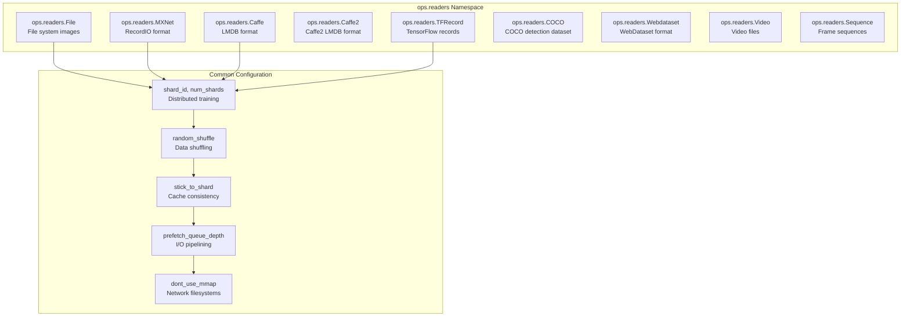
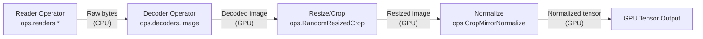
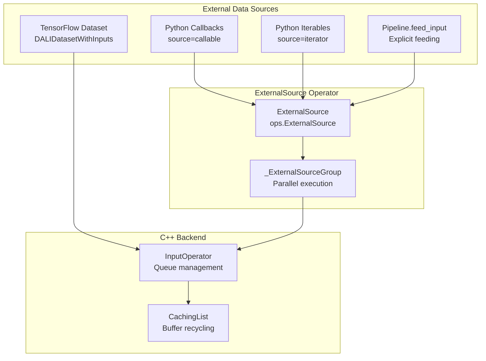
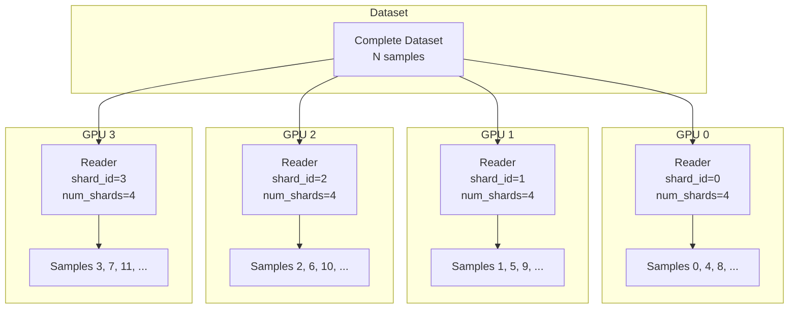

<!-- source: DeepWiki mcp.deepwiki.com · repo NVIDIA/DALI · page 5 Data Loading and Processing · fetched 2026-10-26 -->

# Data Loading and Processing

<details>
<summary>Relevant source files</summary>

The following files were used as context for generating this wiki page:

- [CONTRIBUTING.md](CONTRIBUTING.md)
- [VERSION](VERSION)
- [cmake/libdali.map.in](cmake/libdali.map.in)
- [dali/test/python/test_RN50_data_fw_iterators.py](dali/test/python/test_RN50_data_fw_iterators.py)
- [dali/test/python/test_RN50_data_pipeline.py](dali/test/python/test_RN50_data_pipeline.py)
- [dali/test/python/test_data_containers.py](dali/test/python/test_data_containers.py)
- [dali/test/python/test_fw_iterators_detection.py](dali/test/python/test_fw_iterators_detection.py)
- [docs/images/sharding.png](docs/images/sharding.png)
- [qa/TL0_plugin_manager/test.sh](qa/TL0_plugin_manager/test.sh)
- [qa/TL1_python-nvjpeg_test/test.sh](qa/TL1_python-nvjpeg_test/test.sh)

</details>


## Purpose and Scope

This document explains the data loading and processing capabilities in DALI, including built-in data readers for various formats, common preprocessing patterns, and external data feeding mechanisms. It covers the fundamental concepts and patterns for loading data into DALI pipelines and applying GPU-accelerated preprocessing operations.

For detailed information about specific data readers and their configuration options, see [Data Readers](#5.1). For complete pipeline examples and augmentation strategies, see [Common Pipeline Patterns](#5.2). For framework-specific integration and batching strategies, see [Framework Iterators](#5.3).

## Overview

DALI provides a comprehensive data loading and processing system designed for high-throughput deep learning workloads. The system consists of three main components:

1. **Data Readers**: Operators that read data from various storage formats and file systems
2. **Decoders**: GPU-accelerated decoders for images, video, and audio
3. **Preprocessing Operators**: GPU-accelerated operations for augmentation and normalization

Data flows through a pipeline where readers load raw data, decoders convert it to usable formats, and preprocessing operators apply transformations. All operations are pipelined for maximum throughput.

## Data Reader Taxonomy

DALI provides built-in readers for common data formats used in deep learning. Each reader is implemented as an operator in the `ops.readers` namespace and integrates seamlessly with the pipeline execution model.



**Sources:** [dali/test/python/test_RN50_data_pipeline.py:103-252](), [dali/test/python/test_data_containers.py:42-145]()

### Reader Categories

| Reader Type | Primary Use Case | File Format | Key Configuration |
|------------|------------------|-------------|-------------------|
| `ops.readers.File` | Image classification from directories | JPEG, PNG, TIFF | `file_root`, `file_list` |
| `ops.readers.MXNet` | MXNet RecordIO datasets | `.rec` + `.idx` | `path`, `index_path` |
| `ops.readers.Caffe` | Caffe LMDB databases | LMDB | `path` |
| `ops.readers.Caffe2` | Caffe2 LMDB databases | LMDB | `path` |
| `ops.readers.TFRecord` | TensorFlow datasets | TFRecord + `.idx` | `path`, `index_path`, `features` |
| `ops.readers.COCO` | Object detection datasets | JPEG + JSON annotations | `file_root`, `annotations_file` |
| `ops.readers.Webdataset` | WebDataset tar archives | `.tar` + `.idx` | `paths`, `index_paths`, `ext` |
| `ops.readers.Video` | Video files | MP4, AVI, etc. | `filenames`, `sequence_length` |
| `ops.readers.Sequence` | Image sequences | Frame directories | `file_root`, `sequence_length` |

**Sources:** [dali/test/python/test_RN50_data_pipeline.py:103-252](), [dali/test/python/test_data_containers.py:42-145]()

## Common Reader Configuration

All DALI readers share a common set of configuration parameters that control sharding, shuffling, and I/O behavior.

### Distributed Training Support

Readers support automatic data sharding for distributed training scenarios:

```python
reader = ops.readers.File(
    file_root="/data/imagenet/train",
    shard_id=device_id,        # Which shard this reader handles
    num_shards=num_gpus,       # Total number of shards
    random_shuffle=True,       # Shuffle data
    stick_to_shard=False       # Whether to stay within shard
)
```

**Key Parameters:**
- `shard_id`: Zero-based index identifying this reader's shard
- `num_shards`: Total number of shards across all workers
- `stick_to_shard`: When `True`, reader only sees data from its shard (important for caching)
- `random_shuffle`: Enable random shuffling of data

**Sources:** [dali/test/python/test_RN50_data_pipeline.py:107-115](), [dali/test/python/test_data_containers.py:45-51]()

### Memory-Mapped I/O

By default, readers use memory-mapped I/O for performance. This can be disabled for network filesystems:

```python
reader = ops.readers.File(
    file_root="/nfs/data",
    dont_use_mmap=True  # Disable mmap for network filesystems
)
```

**Sources:** [dali/test/python/test_RN50_data_pipeline.py:132](), [dali/test/python/test_data_containers.py:62]()

### Prefetch Queue Depth

Readers can prefetch data to hide I/O latency:

```python
reader = ops.readers.File(
    file_root="/data/imagenet",
    prefetch_queue_depth=2  # Number of batches to prefetch
)
```

**Sources:** [dali/test/python/test_RN50_data_pipeline.py:114]()

## Typical Data Loading Pipeline

A complete data loading pipeline follows a standard pattern: read → decode → preprocess → output.



**Sources:** [dali/test/python/test_RN50_data_pipeline.py:28-100]()

### Example: Image Classification Pipeline

The following pattern is common for image classification workloads like ResNet-50 training:

```python
class CommonPipeline(Pipeline):
    def __init__(self, data_paths, batch_size, num_threads, device_id, ...):
        super().__init__(batch_size, num_threads, device_id)
        
        # 1. Reader: Load encoded images
        self.input = ops.readers.File(
            file_root=data_paths[0],
            shard_id=device_id,
            num_shards=num_gpus
        )
        
        # 2. Decoder: Decode JPEG to RGB on GPU
        self.decode_gpu = ops.decoders.Image(
            device="mixed",  # CPU input, GPU output
            output_type=types.RGB
        )
        
        # 3. Resize: Random resized crop for augmentation
        self.res = ops.RandomResizedCrop(
            device="gpu",
            size=(224, 224)
        )
        
        # 4. Normalize: Crop, mirror, and normalize
        self.cmnp = ops.CropMirrorNormalize(
            device="gpu",
            dtype=types.FLOAT,
            crop=(224, 224),
            mean=[0.485 * 255, 0.456 * 255, 0.406 * 255],
            std=[0.229 * 255, 0.224 * 255, 0.225 * 255]
        )
        
        self.coin = ops.random.CoinFlip(probability=0.5)
    
    def define_graph(self):
        # Read encoded images and labels
        images, labels = self.input(name="Reader")
        
        # Decode and preprocess
        images = self.decode_gpu(images)
        images = self.res(images)
        rng = self.coin()
        output = self.cmnp(images.gpu(), mirror=rng)
        
        return (output, labels)
```

**Sources:** [dali/test/python/test_RN50_data_pipeline.py:28-100](), [dali/test/python/test_RN50_data_fw_iterators.py:26-56]()

## Decoder Types and Variants

DALI provides several decoder implementations optimized for different scenarios:

### Standard Image Decoding

```python
# Basic nvJPEG decoding (mixed backend)
decode_gpu = ops.decoders.Image(
    device="mixed",           # CPU input, GPU output
    output_type=types.RGB
)
```

### Region-of-Interest Decoding

```python
# Decode only a random crop region
decode_gpu = ops.decoders.ImageRandomCrop(
    device="mixed",
    output_type=types.RGB
)
res = ops.Resize(device="gpu", resize_x=224, resize_y=224)
```

### Cached Decoding

For datasets with repeated images, cached decoding can significantly improve performance:

```python
decode_gpu = ops.decoders.Image(
    device="mixed",
    output_type=types.RGB,
    cache_size=1024,           # Cache size in MB
    cache_threshold=8192,       # Min image size to cache (bytes)
    cache_type="threshold",     # Cache policy
    cache_debug=False
)
```

**Sources:** [dali/test/python/test_RN50_data_pipeline.py:50-80]()

## External Data Sources

In addition to built-in readers, DALI supports feeding external data through the `ExternalSource` operator. This enables integration with custom data loaders, Python generators, and framework-specific datasets.



For detailed information about external data feeding, see [External Source](#3.3).

**Sources:** High-level architecture Diagram 5

## Preprocessing Operator Categories

DALI provides a comprehensive set of GPU-accelerated preprocessing operators organized by function:

| Category | Common Operators | Purpose |
|----------|-----------------|---------|
| **Geometric** | `Resize`, `RandomResizedCrop`, `Rotate`, `Flip`, `Crop` | Spatial transformations |
| **Color** | `ColorSpaceConversion`, `Brightness`, `Contrast`, `Saturation` | Color adjustments |
| **Normalization** | `CropMirrorNormalize`, `Normalize` | Mean/std normalization |
| **Augmentation** | `CoinFlip`, `Uniform`, `Normal` | Random number generation |
| **Arithmetic** | `ArithmeticGenericOp`, `Cast` | Tensor operations |
| **Format** | `Transpose`, `Reshape` | Layout conversions |

### CropMirrorNormalize Pattern

The `CropMirrorNormalize` operator is commonly used as it combines multiple operations efficiently:

```python
cmnp = ops.CropMirrorNormalize(
    device="gpu",
    dtype=types.FLOAT,           # Output data type
    output_layout=types.NCHW,    # Output layout
    crop=(224, 224),             # Center crop size
    mean=[123.68, 116.78, 103.94],  # Mean subtraction
    std=[58.4, 57.12, 57.38]        # Standard deviation
)

# Apply with optional mirroring
output = cmnp(images, mirror=coin_flip())
```

**Sources:** [dali/test/python/test_RN50_data_pipeline.py:85-93](), [dali/test/python/test_RN50_data_fw_iterators.py:40-47]()

## Pipeline Execution Modes

DALI pipelines support different execution modes based on data type and output requirements:

### FP16 vs FP32 Output

```python
out_type = types.FLOAT16 if fp16 else types.FLOAT

cmnp = ops.CropMirrorNormalize(
    device="gpu",
    dtype=out_type,  # FP16 for mixed precision training
    ...
)
```

**Sources:** [dali/test/python/test_RN50_data_pipeline.py:83]()

### Layout Options

```python
# NCHW (default): Channels-first for CUDA libraries
# NHWC: Channels-last for TensorCore efficiency
layout = types.NHWC if nhwc else types.NCHW

cmnp = ops.CropMirrorNormalize(
    device="gpu",
    output_layout=layout,
    ...
)
```

**Sources:** [dali/test/python/test_RN50_data_pipeline.py:82]()

## Format-Specific Reader Examples

### File Reader (Directory of Images)

```python
reader = ops.readers.File(
    file_root="/data/imagenet/train-jpeg",
    shard_id=shard_id,
    num_shards=num_shards,
    random_shuffle=True
)

images, labels = reader(name="Reader")
```

**Sources:** [dali/test/python/test_RN50_data_pipeline.py:160-176]()

### MXNet RecordIO Reader

```python
reader = ops.readers.MXNet(
    path="/data/train.rec",
    index_path="/data/train.idx",
    shard_id=shard_id,
    num_shards=num_shards,
    random_shuffle=True
)

images, labels = reader(name="Reader")
```

**Sources:** [dali/test/python/test_RN50_data_pipeline.py:103-119]()

### TFRecord Reader

```python
import nvidia.dali.tfrecord as tfrec

reader = ops.readers.TFRecord(
    path=tfrecord_files,
    index_path=tfrecord_idx_files,
    features={
        "image/encoded": tfrec.FixedLenFeature((), tfrec.string, ""),
        "image/class/label": tfrec.FixedLenFeature([1], tfrec.int64, -1)
    },
    shard_id=shard_id,
    num_shards=num_shards
)

inputs = reader(name="Reader")
images = inputs["image/encoded"]
labels = inputs["image/class/label"]
```

**Sources:** [dali/test/python/test_RN50_data_pipeline.py:179-213]()

### COCO Reader (Object Detection)

```python
reader = ops.readers.COCO(
    file_root="/data/coco/train2017",
    annotations_file="/data/coco/annotations/instances_train2017.json",
    shard_id=shard_id,
    num_shards=num_shards,
    ratio=True,  # Return bounding boxes as ratios
    ltrb=True    # Use left-top-right-bottom format
)

images, bboxes, labels = reader(name="Reader")
```

**Sources:** [dali/test/python/test_data_containers.py:131-144](), [dali/test/python/test_fw_iterators_detection.py:27-43]()

### Webdataset Reader

```python
reader = ops.readers.Webdataset(
    paths=["/data/train.tar"],
    index_paths=["/data/train.idx"],
    ext=["jpg", "cls"],  # Extensions to extract
    shard_id=shard_id,
    num_shards=num_shards,
    random_shuffle=True
)

images, labels = reader(name="Reader")
```

**Sources:** [dali/test/python/test_RN50_data_pipeline.py:216-251]()

## Data Sharding Visualization

When training with multiple GPUs, DALI automatically shards the dataset to ensure each GPU processes different data:



Each reader sees only `1/num_shards` of the data, determined by round-robin assignment based on `shard_id`. When `random_shuffle=True`, each shard is independently shuffled.

**Sources:** [dali/test/python/test_RN50_data_pipeline.py:561](), [docs/images/sharding.png:1]()

## Epoch Size Calculation

Pipelines expose the `epoch_size` method to query the number of samples available from a reader:

```python
pipe.build()
total_samples = pipe.epoch_size("Reader")

# Calculate iterations per epoch
iters_per_epoch = (total_samples + batch_size - 1) // batch_size

# Account for sharding
iters_per_shard = (iters_per_epoch + num_shards - 1) // num_shards
```

**Sources:** [dali/test/python/test_RN50_data_pipeline.py:587-597]()

## Performance Considerations

### Decoder Caching

For datasets with repeated images (common in small validation sets), decoder caching can provide significant speedups:

- **`cache_size`**: Total cache memory in MB
- **`cache_threshold`**: Minimum image size (bytes) to cache
- **`cache_type`**: `"threshold"` caches images above threshold
- **`stick_to_shard=True`**: Required for effective caching in multi-GPU scenarios

**Sources:** [dali/test/python/test_RN50_data_pipeline.py:59-76]()

### ROI Decoding

For pipelines with heavy cropping, decoding only the region of interest can reduce memory bandwidth:

```python
# Decode and crop in single operation
decode = ops.decoders.ImageRandomCrop(device="mixed")
# Then resize to final size
images = ops.Resize(images, resize_x=224, resize_y=224)
```

**Sources:** [dali/test/python/test_RN50_data_pipeline.py:55-58]()

### Prefetch Queue Depth

The pipeline constructor accepts `prefetch_queue_depth` to control buffer depth:

```python
pipe = Pipeline(
    batch_size=256,
    num_threads=4,
    device_id=0,
    prefetch_queue_depth=2  # Typically 2-3
)
```

Or separately for CPU and GPU stages:

```python
pipe = Pipeline(
    batch_size=256,
    num_threads=4,
    device_id=0,
    prefetch_queue_depth={'cpu_size': 2, 'gpu_size': 2}
)
```

**Sources:** [dali/test/python/test_RN50_data_pipeline.py:46-48](), [dali/test/python/test_RN50_data_fw_iterators.py:114-116]()

## Integration with Framework Iterators

Data loading pipelines are typically wrapped in framework-specific iterators that handle batching, device placement, and epoch management. The iterators consume the pipeline outputs and expose them in framework-native formats.

For detailed information about framework iterators, batching strategies, and last batch handling policies, see [Framework Iterators](#5.3).

**Sources:** [dali/test/python/test_RN50_data_fw_iterators.py:141-231]()

---

