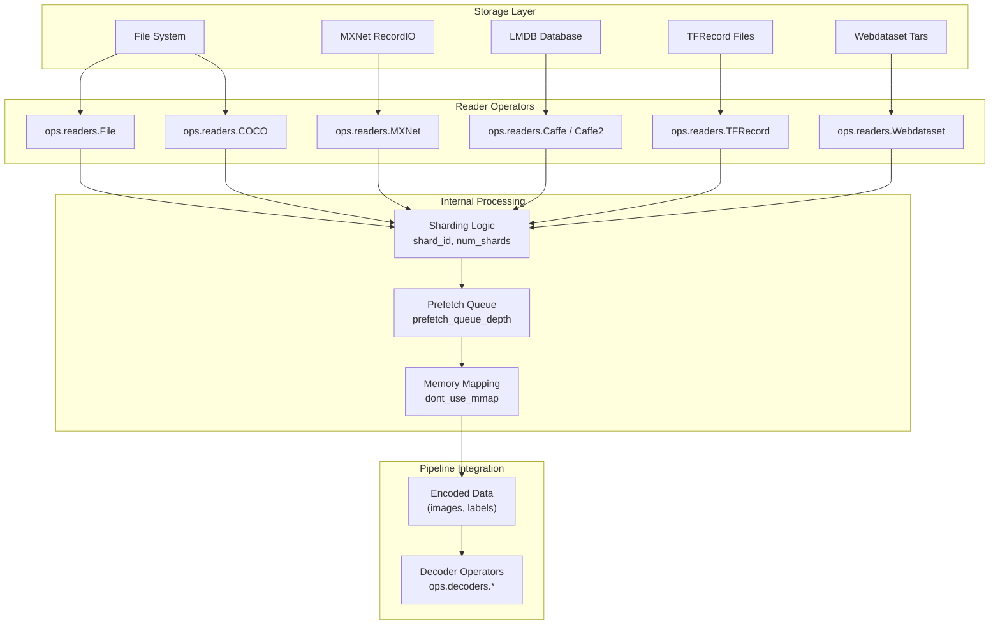
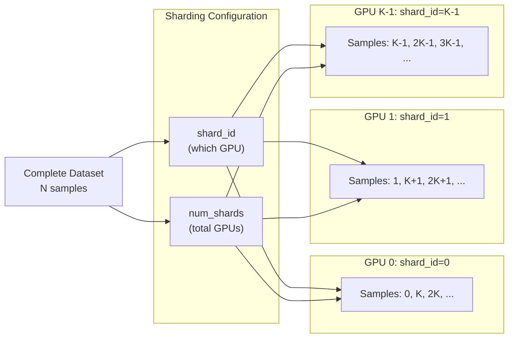
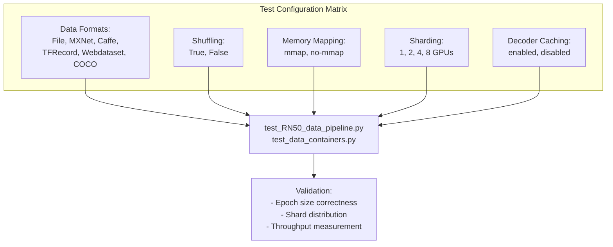

<!-- source: DeepWiki mcp.deepwiki.com · repo NVIDIA/DALI · page 5.1 Data Readers · fetched 2026-10-26 -->

# Data Readers

<details>
<summary>Relevant source files</summary>

The following files were used as context for generating this wiki page:

- [CONTRIBUTING.md](CONTRIBUTING.md)
- [VERSION](VERSION)
- [cmake/libdali.map.in](cmake/libdali.map.in)
- [dali/test/python/test_RN50_data_fw_iterators.py](dali/test/python/test_RN50_data_fw_iterators.py)
- [dali/test/python/test_RN50_data_pipeline.py](dali/test/python/test_RN50_data_pipeline.py)
- [dali/test/python/test_data_containers.py](dali/test/python/test_data_containers.py)
- [dali/test/python/test_fw_iterators_detection.py](dali/test/python/test_fw_iterators_detection.py)
- [docs/images/sharding.png](docs/images/sharding.png)
- [qa/TL0_plugin_manager/test.sh](qa/TL0_plugin_manager/test.sh)
- [qa/TL1_python-nvjpeg_test/test.sh](qa/TL1_python-nvjpeg_test/test.sh)

</details>


## Purpose and Scope

This document describes DALI's built-in data readers for loading data from various file formats and storage systems. Data readers are operators that read encoded data (typically images) from disk, network, or other storage backends and feed them into DALI pipelines.

For information about feeding custom Python data into pipelines, see [External Source](#3.3). For examples of complete preprocessing pipelines using these readers, see [Common Pipeline Patterns](#5.2). For integrating readers with framework training loops, see [Framework Iterators](#5.3).

## Overview

DALI provides specialized reader operators in the `ops.readers` namespace for common data formats used in deep learning. All readers share a common interface and support distributed training through sharding mechanisms. Readers are typically the first operator in a pipeline and are responsible for loading raw encoded data (usually compressed images) before decoding and augmentation operations.

### Available Readers

| Reader | Format | Primary Use Case | Index Required |
|--------|--------|------------------|----------------|
| `ops.readers.File` | File system directories | Image classification, general purpose | No |
| `ops.readers.MXNet` | MXNet RecordIO | MXNet-based workflows | Yes (.idx) |
| `ops.readers.Caffe` | Caffe LMDB | Caffe-based workflows | No |
| `ops.readers.Caffe2` | Caffe2 LMDB | Caffe2-based workflows | No |
| `ops.readers.TFRecord` | TensorFlow TFRecord | TensorFlow-based workflows | Yes (.idx) |
| `ops.readers.Webdataset` | Webdataset tar archives | Large-scale distributed training | Yes (.idx) |
| `ops.readers.COCO` | COCO JSON + images | Object detection | No |

**Sources:** [dali/test/python/test_RN50_data_pipeline.py:103-252](), [dali/test/python/test_data_containers.py:42-145]()

## Reader Architecture

### Data Flow



**Sources:** [dali/test/python/test_RN50_data_pipeline.py:28-101](), [dali/test/python/test_data_containers.py:29-40]()

## File System Reader

The `ops.readers.File` operator reads images from a directory structure, where subdirectories represent class labels.

### Usage

```python
self.input = ops.readers.File(
    file_root="/path/to/dataset",
    shard_id=device_id,
    num_shards=num_gpus,
    random_shuffle=True,
    dont_use_mmap=False,
    stick_to_shard=False,
    prefetch_queue_depth=1
)
```

### Expected Directory Structure

```
dataset_root/
├── class_0/
│   ├── image_001.jpg
│   ├── image_002.jpg
│   └── ...
├── class_1/
│   ├── image_001.jpg
│   └── ...
└── class_N/
    └── ...
```

The subdirectory name is used as the label index. Images are enumerated and labels are assigned based on directory order.

### Output

The reader returns two outputs:
- **images**: Encoded image data (bytes)
- **labels**: Integer labels corresponding to subdirectory indices

**Sources:** [dali/test/python/test_RN50_data_pipeline.py:160-177](), [dali/test/python/test_data_containers.py:82-95]()

## MXNet RecordIO Reader

The `ops.readers.MXNet` operator reads data from MXNet RecordIO format, which stores data in a binary format optimized for sequential access.

### Usage

```python
self.input = ops.readers.MXNet(
    path="/path/to/train.rec",
    index_path="/path/to/train.idx",
    shard_id=device_id,
    num_shards=num_gpus,
    random_shuffle=True,
    stick_to_shard=False,
    prefetch_queue_depth=1
)
```

### Requirements

- A `.rec` file containing the binary data
- A `.idx` index file for random access

### Output

- **images**: Encoded image data
- **labels**: Labels stored in the RecordIO format

**Sources:** [dali/test/python/test_RN50_data_pipeline.py:103-120](), [dali/test/python/test_data_containers.py:42-56]()

## Caffe LMDB Readers

DALI provides two LMDB readers for Caffe and Caffe2 formats.

### Caffe Reader

```python
self.input = ops.readers.Caffe(
    path="/path/to/lmdb",
    shard_id=device_id,
    num_shards=num_gpus,
    random_shuffle=True,
    dont_use_mmap=False,
    stick_to_shard=False,
    prefetch_queue_depth=1
)
```

### Caffe2 Reader

```python
self.input = ops.readers.Caffe2(
    path="/path/to/c2lmdb",
    shard_id=device_id,
    num_shards=num_gpus,
    random_shuffle=True,
    dont_use_mmap=False,
    stick_to_shard=False,
    prefetch_queue_depth=1
)
```

Both readers return encoded images and labels from their respective LMDB database formats.

**Sources:** [dali/test/python/test_RN50_data_pipeline.py:122-158](), [dali/test/python/test_data_containers.py:58-80]()

## TFRecord Reader

The `ops.readers.TFRecord` operator reads TensorFlow TFRecord files with support for parsing structured features.

### Usage

```python
tfrecord_files = sorted(glob.glob("/path/to/train-*"))
tfrecord_idx = sorted(glob.glob("/path/to/train-*.idx"))

self.input = ops.readers.TFRecord(
    path=tfrecord_files,
    index_path=tfrecord_idx,
    shard_id=device_id,
    num_shards=num_gpus,
    random_shuffle=True,
    dont_use_mmap=False,
    stick_to_shard=False,
    features={
        "image/encoded": tfrec.FixedLenFeature((), tfrec.string, ""),
        "image/class/label": tfrec.FixedLenFeature([1], tfrec.int64, -1),
    }
)
```

### Feature Parsing

The `features` parameter defines how to extract data from TFRecord entries using feature descriptors:

- `tfrec.FixedLenFeature(shape, dtype, default)`: For fixed-size features
- `tfrec.VarLenFeature(dtype, default)`: For variable-size features

### Index Generation

TFRecord files require index files for efficient random access. If indices don't exist, they can be generated using the `tfrecord2idx` tool:

```bash
tfrecord2idx input.tfrecord output.idx
```

### Output

The reader returns a dictionary where keys match the feature names:

```python
inputs = self.input(name="Reader")
images = inputs["image/encoded"]
labels = inputs["image/class/label"]
```

**Sources:** [dali/test/python/test_RN50_data_pipeline.py:179-214](), [dali/test/python/test_data_containers.py:97-129]()

## Webdataset Reader

The `ops.readers.Webdataset` operator reads Webdataset format, which packages data into tar archives suitable for streaming and large-scale training.

### Usage

```python
self.input = ops.readers.Webdataset(
    paths="/path/to/dataset.tar",
    index_paths="/path/to/dataset.idx",
    ext=["jpg", "cls"],
    shard_id=device_id,
    num_shards=num_gpus,
    random_shuffle=True,
    dont_use_mmap=False,
    stick_to_shard=False
)
```

### File Extensions

The `ext` parameter specifies which file extensions to extract from the tar archive. For example, `["jpg", "cls"]` will return the `.jpg` file (image) and `.cls` file (label) for each sample.

### Output

Returns one output per extension specified in the `ext` parameter, in the same order.

**Sources:** [dali/test/python/test_RN50_data_pipeline.py:216-252]()

## COCO Reader

The `ops.readers.COCO` operator reads the COCO (Common Objects in Context) format for object detection tasks.

### Usage

```python
self.input = ops.readers.COCO(
    file_root="/path/to/images",
    annotations_file="/path/to/instances.json",
    shard_id=device_id,
    num_shards=num_gpus,
    ratio=True,
    ltrb=True,
    dont_use_mmap=False
)
```

### Parameters

- `file_root`: Directory containing the images
- `annotations_file`: COCO JSON annotations file
- `ratio`: Return bounding box coordinates as ratios (0-1) instead of absolute pixels
- `ltrb`: Return boxes in left-top-right-bottom format instead of left-top-width-height

### Output

Returns three outputs:
- **images**: Encoded image data
- **boxes**: Bounding box coordinates (shape varies per image)
- **labels**: Object class labels (shape varies per image)

**Sources:** [dali/test/python/test_data_containers.py:131-145](), [dali/test/python/test_fw_iterators_detection.py:27-44]()

## Common Parameters

All readers share a common set of parameters for controlling behavior:

### Sharding Parameters



| Parameter | Type | Description |
|-----------|------|-------------|
| `shard_id` | int | ID of the shard to read (typically GPU ID) |
| `num_shards` | int | Total number of shards (typically number of GPUs) |
| `stick_to_shard` | bool | When `True`, ensures each shard sees only its assigned samples (important for caching) |

### Performance Parameters

| Parameter | Type | Default | Description |
|-----------|------|---------|-------------|
| `prefetch_queue_depth` | int | 1 | Number of batches to prefetch in the reader queue |
| `dont_use_mmap` | bool | False | Disable memory mapping (use for network filesystems) |
| `random_shuffle` | bool | False | Randomly shuffle data within each epoch |

### Reader Name

All readers should be given a name for epoch size calculation:

```python
images, labels = self.input(name="Reader")
```

The pipeline can then query the epoch size:

```python
epoch_size = pipe.epoch_size("Reader")
```

**Sources:** [dali/test/python/test_RN50_data_pipeline.py:107-115](), [dali/test/python/test_RN50_data_pipeline.py:164-172]()

## Sharding for Distributed Training

### Sharding Strategy

Data readers partition the dataset across multiple GPUs/processes to avoid redundant work. Each reader instance processes only a subset of the data:

```
Total samples = N
Number of shards = K
Samples per shard ≈ N / K

GPU 0: samples [0, K, 2K, 3K, ...]
GPU 1: samples [1, K+1, 2K+1, 3K+1, ...]
GPU 2: samples [2, K+2, 2K+2, 3K+2, ...]
...
```

### Configuration Example

```python
# Multi-GPU setup
num_gpus = 4
for gpu_id in range(num_gpus):
    pipe = Pipeline(batch_size=32, num_threads=4, device_id=gpu_id)
    
    with pipe:
        reader = ops.readers.File(
            file_root="/data/imagenet",
            shard_id=gpu_id,        # This GPU's shard
            num_shards=num_gpus,    # Total number of shards
            random_shuffle=True
        )
        images, labels = reader(name="Reader")
        # ... rest of pipeline
```

### Stick to Shard

When using cached decoding or when deterministic iteration is required, set `stick_to_shard=True`:

```python
reader = ops.readers.File(
    file_root="/data/imagenet",
    shard_id=gpu_id,
    num_shards=num_gpus,
    stick_to_shard=True  # Each GPU sees only its shard
)
```

This ensures that:
- Each shard contains exactly the same samples across epochs
- Decoder caches remain valid across iterations
- Reproducibility is maintained with fixed seeds

**Sources:** [dali/test/python/test_RN50_data_pipeline.py:107-115](), [dali/test/python/test_RN50_data_pipeline.py:523-524]()

## Memory Mapping and Network Filesystems

### Memory Mapping Behavior

By default, readers use memory mapping (`mmap`) for efficient file I/O. This allows the operating system to optimize disk access and share memory across processes.

### Disabling mmap for Network Filesystems

When reading from network filesystems (NFS, CIFS, etc.), memory mapping can cause performance issues or errors. Disable it with `dont_use_mmap=True`:

```python
reader = ops.readers.File(
    file_root="/nfs/shared/dataset",
    dont_use_mmap=True,  # Disable mmap for network FS
    shard_id=gpu_id,
    num_shards=num_gpus
)
```

The test suite explicitly tests this configuration:

**Sources:** [dali/test/python/test_RN50_data_pipeline.py:355-360](), [dali/test/python/test_data_containers.py:230]()

## Integration with Pipelines

### Basic Pipeline Pattern

```python
class ReaderPipeline(Pipeline):
    def __init__(self, batch_size, num_threads, device_id, 
                 data_path, num_gpus):
        super().__init__(batch_size, num_threads, device_id)
        
        # Initialize reader
        self.reader = ops.readers.File(
            file_root=data_path,
            shard_id=device_id,
            num_shards=num_gpus
        )
        
        # Initialize decoder
        self.decoder = ops.decoders.Image(
            device="mixed",
            output_type=types.RGB
        )
    
    def define_graph(self):
        # Read encoded data
        images, labels = self.reader(name="Reader")
        
        # Decode images
        images = self.decoder(images)
        
        # Return to pipeline
        return images, labels
```

### Epoch Size Calculation

After building the pipeline, query the reader's epoch size to determine iteration count:

```python
pipe.build()

# Total samples in this shard
epoch_size = pipe.epoch_size("Reader")

# Number of full batches
num_iterations = epoch_size // batch_size
```

**Sources:** [dali/test/python/test_RN50_data_pipeline.py:160-177](), [dali/test/python/test_RN50_data_pipeline.py:586-598]()

## Performance Considerations

### Prefetch Queue Depth

The `prefetch_queue_depth` parameter controls how many batches the reader prepares in advance:

```python
reader = ops.readers.File(
    file_root="/data/imagenet",
    prefetch_queue_depth=2,  # Prefetch 2 batches
    ...
)
```

Higher values improve throughput by hiding I/O latency but consume more memory.

### Random Shuffle Performance

Enabling `random_shuffle=True` adds overhead as the reader must maintain and shuffle sample indices. For maximum performance in validation/inference, disable shuffling:

```python
# Training: enable shuffle
train_reader = ops.readers.File(
    file_root="/data/train",
    random_shuffle=True,
    ...
)

# Validation: disable shuffle
val_reader = ops.readers.File(
    file_root="/data/val",
    random_shuffle=False,
    ...
)
```

### Index File Performance

Readers that require index files (MXNet, TFRecord, Webdataset) achieve better random access performance with proper indices. Generate indices ahead of time to avoid runtime overhead.

**Sources:** [dali/test/python/test_RN50_data_pipeline.py:349-354](), [dali/test/python/test_RN50_data_pipeline.py:184-193]()

## Testing and Validation

The DALI test suite includes comprehensive tests for all readers across different configurations:



Test data locations are configured in the test files with both full ImageNet-scale datasets and small sample datasets for quick validation.

**Sources:** [dali/test/python/test_RN50_data_pipeline.py:254-290](), [dali/test/python/test_data_containers.py:147-194](), [qa/TL1_python-nvjpeg_test/test.sh:1-38]()

---

