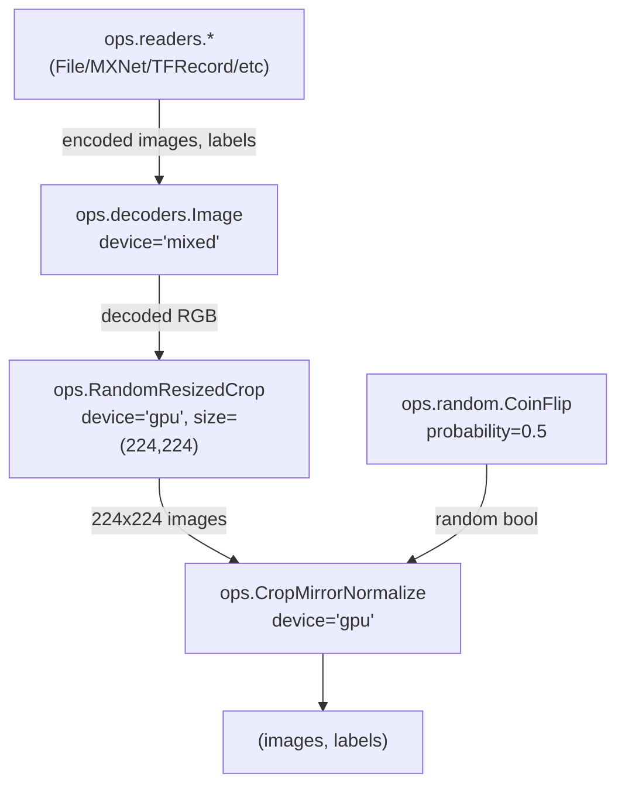
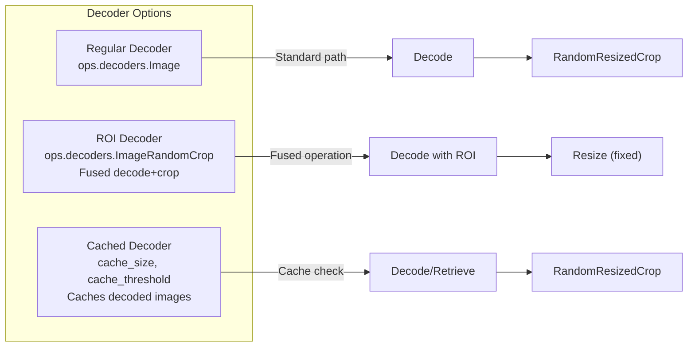
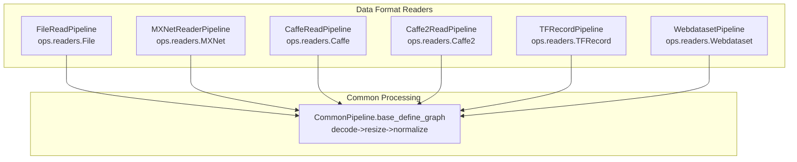
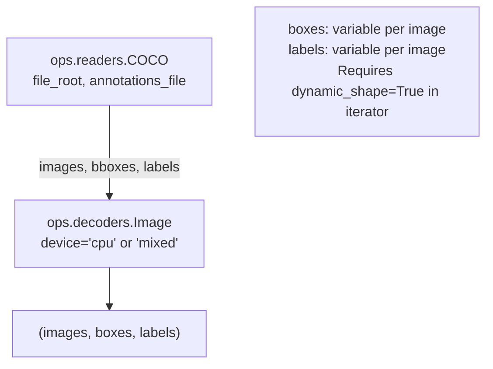
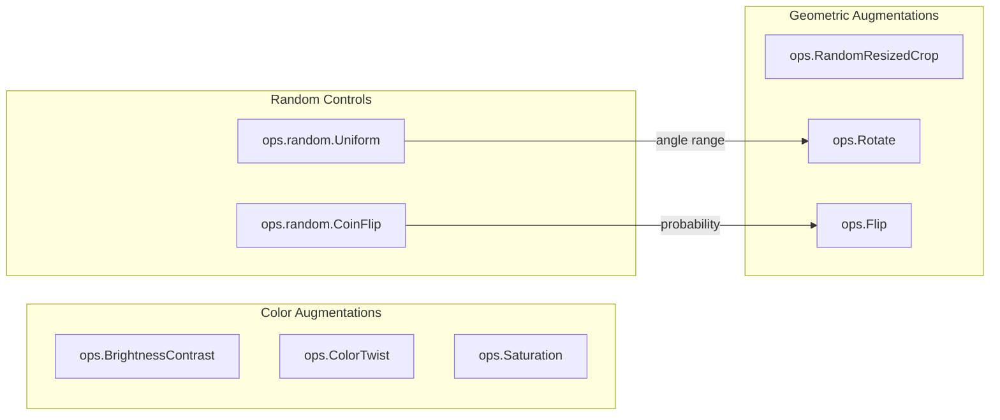

<!-- source: DeepWiki mcp.deepwiki.com · repo NVIDIA/DALI · page 5.2 Common Pipeline Patterns · fetched 2026-10-26 -->

# Common Pipeline Patterns

<details>
<summary>Relevant source files</summary>

The following files were used as context for generating this wiki page:

- [CONTRIBUTING.md](CONTRIBUTING.md)
- [VERSION](VERSION)
- [cmake/libdali.map.in](cmake/libdali.map.in)
- [dali/test/python/test_RN50_data_fw_iterators.py](dali/test/python/test_RN50_data_fw_iterators.py)
- [dali/test/python/test_RN50_data_pipeline.py](dali/test/python/test_RN50_data_pipeline.py)
- [dali/test/python/test_data_containers.py](dali/test/python/test_data_containers.py)
- [dali/test/python/test_fw_iterators_detection.py](dali/test/python/test_fw_iterators_detection.py)
- [docs/images/sharding.png](docs/images/sharding.png)
- [qa/TL0_plugin_manager/test.sh](qa/TL0_plugin_manager/test.sh)
- [qa/TL1_python-nvjpeg_test/test.sh](qa/TL1_python-nvjpeg_test/test.sh)

</details>


## Purpose and Scope

This page documents common pipeline patterns used in DALI for typical data loading and preprocessing tasks. It focuses on practical examples from image classification (ResNet-50 style), object detection, and various data format readers. For information about data readers specifically, see [Data Readers](#5.1). For framework-specific iterator usage, see [Framework Iterators](#5.3).

The patterns described here demonstrate real-world pipeline construction using DALI's operator library, showing how to combine readers, decoders, augmentation, and normalization operations for common deep learning workloads.

---

## Image Classification Pipeline (ResNet-50 Pattern)

The ResNet-50 training pipeline is one of the most common patterns in DALI. It demonstrates typical operations for image classification: reading, decoding, resizing, augmentation, and normalization.

### Basic Pipeline Structure



**Sources:** [dali/test/python/test_RN50_data_pipeline.py:28-101](), [dali/test/python/test_RN50_data_fw_iterators.py:26-57]()

### CommonPipeline Base Class

The `CommonPipeline` class demonstrates the core preprocessing pattern used across different data formats:

| Component | Operator | Device | Parameters |
|-----------|----------|--------|------------|
| Decoder | `ops.decoders.Image` | mixed | `output_type=types.RGB` |
| Resize | `ops.RandomResizedCrop` | gpu | `size=(224, 224)` |
| Normalization | `ops.CropMirrorNormalize` | gpu | ImageNet mean/std values |
| Random Mirror | `ops.random.CoinFlip` | cpu | `probability=0.5` |

The pipeline follows this execution flow defined in `base_define_graph`:

```
1. Generate random mirror flag (CoinFlip)
2. Decode JPEG to RGB (Image decoder on mixed device)
3. Random resized crop to 224x224 (GPU)
4. Normalize with ImageNet statistics and apply random mirror (GPU)
5. Return normalized images and labels
```

**Sources:** [dali/test/python/test_RN50_data_pipeline.py:28-101]()

### Decoder Variants

DALI supports multiple decoder configurations for different performance characteristics:



#### Regular Decoder

Standard nvJPEG decoder without caching:

```python
self.decode_gpu = ops.decoders.Image(device="mixed", output_type=types.RGB)
self.res = ops.RandomResizedCrop(device="gpu", size=(224, 224))
```

**Sources:** [dali/test/python/test_RN50_data_pipeline.py:78-80]()

#### ROI Decoder

Fuses JPEG decoding with random cropping for better performance:

```python
self.decode_gpu = ops.decoders.ImageRandomCrop(device="mixed", output_type=types.RGB)
self.res = ops.Resize(device="gpu", resize_x=224, resize_y=224)
```

**Sources:** [dali/test/python/test_RN50_data_pipeline.py:56-58]()

#### Cached Decoder

Caches decoded images for datasets with repeated samples:

```python
self.decode_gpu = ops.decoders.Image(
    device="mixed",
    output_type=types.RGB,
    cache_size=cache_size,        # Cache size in MB
    cache_threshold=cache_threshold,  # Min image size to cache
    cache_type=cache_type,        # 'threshold' or other types
    cache_debug=False
)
```

When using cached decoding, the reader must use `stick_to_shard=True` to ensure consistent sample ordering for effective caching.

**Sources:** [dali/test/python/test_RN50_data_pipeline.py:59-76]()

### Output Format Configuration

Pipelines can be configured for different output formats:

| Parameter | Options | Impact |
|-----------|---------|--------|
| `fp16` | True/False | Output dtype: `types.FLOAT16` or `types.FLOAT` |
| `nhwc` | True/False | Layout: `types.NHWC` or `types.NCHW` |

```python
layout = types.NHWC if nhwc else types.NCHW
out_type = types.FLOAT16 if fp16 else types.FLOAT

self.cmnp = ops.CropMirrorNormalize(
    device="gpu",
    dtype=out_type,
    output_layout=layout,
    crop=(224, 224),
    mean=[0.485 * 255, 0.456 * 255, 0.406 * 255],
    std=[0.229 * 255, 0.224 * 255, 0.225 * 255]
)
```

**Sources:** [dali/test/python/test_RN50_data_pipeline.py:82-92]()

---

## Pipeline Patterns by Data Format

Different data formats require specific reader operators, but share the same preprocessing pipeline structure.



**Sources:** [dali/test/python/test_RN50_data_pipeline.py:103-252]()

### FileReadPipeline Pattern

For image directories with folder-based class labels:

```python
class FileReadPipeline(CommonPipeline):
    def __init__(self, **kwargs):
        super(FileReadPipeline, self).__init__(**kwargs)
        cache_enabled = kwargs["decoder_cache_params"]["cache_enabled"]
        self.input = ops.readers.File(
            file_root=kwargs["data_paths"][0],
            shard_id=kwargs["shard_id"],
            num_shards=kwargs["num_shards"],
            random_shuffle=kwargs["random_shuffle"],
            dont_use_mmap=kwargs["dont_use_mmap"],
            stick_to_shard=cache_enabled,
            prefetch_queue_depth=kwargs["reader_queue_depth"]
        )

    def define_graph(self):
        images, labels = self.input(name="Reader")
        return self.base_define_graph(images, labels)
```

**Key Configuration:**
- `file_root`: Path to image directory
- `shard_id` / `num_shards`: For distributed training
- `stick_to_shard`: Required when using decoder cache
- `prefetch_queue_depth`: Controls reader prefetching

**Sources:** [dali/test/python/test_RN50_data_pipeline.py:160-177]()

### MXNetReaderPipeline Pattern

For MXNet RecordIO format (`.rec` and `.idx` files):

```python
class MXNetReaderPipeline(CommonPipeline):
    def __init__(self, **kwargs):
        super(MXNetReaderPipeline, self).__init__(**kwargs)
        cache_enabled = kwargs["decoder_cache_params"]["cache_enabled"]
        self.input = ops.readers.MXNet(
            path=kwargs["data_paths"][0],      # .rec file
            index_path=kwargs["data_paths"][1], # .idx file
            shard_id=kwargs["shard_id"],
            num_shards=kwargs["num_shards"],
            random_shuffle=kwargs["random_shuffle"],
            stick_to_shard=cache_enabled,
            prefetch_queue_depth=kwargs["reader_queue_depth"]
        )

    def define_graph(self):
        images, labels = self.input(name="Reader")
        return self.base_define_graph(images, labels)
```

**Sources:** [dali/test/python/test_RN50_data_pipeline.py:103-120]()

### TFRecordPipeline Pattern

For TensorFlow TFRecord format with feature specifications:

```python
class TFRecordPipeline(CommonPipeline):
    def __init__(self, **kwargs):
        super(TFRecordPipeline, self).__init__(**kwargs)
        tfrecord = sorted(glob.glob(kwargs["data_paths"][0]))
        tfrecord_idx = sorted(glob.glob(kwargs["data_paths"][1]))
        
        # Generate indices if not present
        if len(tfrecord_idx) == 0:
            # Index generation logic...
            
        self.input = ops.readers.TFRecord(
            path=tfrecord,
            index_path=tfrecord_idx,
            shard_id=kwargs["shard_id"],
            num_shards=kwargs["num_shards"],
            random_shuffle=kwargs["random_shuffle"],
            dont_use_mmap=kwargs["dont_use_mmap"],
            stick_to_shard=cache_enabled,
            features={
                "image/encoded": tfrec.FixedLenFeature((), tfrec.string, ""),
                "image/class/label": tfrec.FixedLenFeature([1], tfrec.int64, -1)
            }
        )

    def define_graph(self):
        inputs = self.input(name="Reader")
        images = inputs["image/encoded"]
        labels = inputs["image/class/label"]
        return self.base_define_graph(images, labels)
```

**Key Difference:** TFRecord requires feature specification using `tfrec.FixedLenFeature` or `tfrec.VarLenFeature` to parse the protocol buffer format.

**Sources:** [dali/test/python/test_RN50_data_pipeline.py:179-214]()

### WebdatasetPipeline Pattern

For Webdataset tar archive format:

```python
class WebdatasetPipeline(CommonPipeline):
    def __init__(self, data_paths, decoder_cache_params, shard_id, 
                 num_shards, random_shuffle, dont_use_mmap, **kwargs):
        super(WebdatasetPipeline, self).__init__(
            data_paths=data_paths,
            decoder_cache_params=decoder_cache_params,
            shard_id=shard_id,
            num_shards=num_shards,
            random_shuffle=random_shuffle,
            dont_use_mmap=dont_use_mmap,
            **kwargs
        )
        wds, wds_idx = data_paths[:2]
        cache_enabled = decoder_cache_params["cache_enabled"]
        
        self.input = ops.readers.Webdataset(
            paths=wds,
            index_paths=wds_idx,
            ext=["jpg", "cls"],  # File extensions to extract
            shard_id=shard_id,
            num_shards=num_shards,
            random_shuffle=random_shuffle,
            dont_use_mmap=dont_use_mmap,
            stick_to_shard=cache_enabled
        )

    def define_graph(self):
        return self.base_define_graph(*self.input(name="Reader"))
```

**Key Feature:** The `ext` parameter specifies which file extensions to extract from the tar archive (e.g., `["jpg", "cls"]` for images and class labels).

**Sources:** [dali/test/python/test_RN50_data_pipeline.py:216-252]()

### Caffe/Caffe2 Pipeline Patterns

Both follow similar structure to other readers:

```python
# Caffe LMDB
self.input = ops.readers.Caffe(
    path=kwargs["data_paths"][0],
    shard_id=kwargs["shard_id"],
    num_shards=kwargs["num_shards"],
    stick_to_shard=cache_enabled,
    random_shuffle=kwargs["random_shuffle"],
    dont_use_mmap=kwargs["dont_use_mmap"],
    prefetch_queue_depth=kwargs["reader_queue_depth"]
)

# Caffe2 LMDB
self.input = ops.readers.Caffe2(
    path=kwargs["data_paths"][0],
    shard_id=kwargs["shard_id"],
    num_shards=kwargs["num_shards"],
    random_shuffle=kwargs["random_shuffle"],
    dont_use_mmap=kwargs["dont_use_mmap"],
    stick_to_shard=cache_enabled,
    prefetch_queue_depth=kwargs["reader_queue_depth"]
)
```

**Sources:** [dali/test/python/test_RN50_data_pipeline.py:122-158]()

---

## Object Detection Pipeline Pattern

Object detection pipelines differ from classification in that they output multiple items per image (bounding boxes, labels) with variable shapes.



### DetectionPipeline Structure

```python
class DetectionPipeline(Pipeline):
    def __init__(self, batch_size, device_id, file_root, annotations_file):
        super().__init__(batch_size, 2, device_id, True, 12)
        
        self.input = ops.readers.COCO(
            file_root=file_root,
            annotations_file=annotations_file,
            shard_id=device_id,
            num_shards=1,
            ratio=True,      # Return normalized coordinates
            ltrb=True        # Return boxes as (left, top, right, bottom)
        )

    def define_graph(self):
        inputs, boxes, labels = self.input(name="Reader")
        return inputs, boxes.gpu(), labels
```

**Key Parameters:**
- `ratio=True`: Normalize box coordinates to [0, 1] range
- `ltrb=True`: Box format as (left, top, right, bottom) instead of (x, y, width, height)

**Framework Integration:** Detection pipelines require `dynamic_shape=True` in framework iterators because each image has a variable number of bounding boxes:

```python
train_loader = PyTorchIterator(
    [pipeline],
    ["data", "bboxes", "label"],
    EPOCH_SIZE,
    auto_reset=False,
    dynamic_shape=True  # Required for variable-length outputs
)
```

**Sources:** [dali/test/python/test_fw_iterators_detection.py:27-44](), [dali/test/python/test_fw_iterators_detection.py:77-86]()

---

## Common Augmentation Patterns

### Basic Augmentation Operations



### Random Mirror Augmentation

The most common augmentation in the ResNet-50 pattern:

```python
self.coin = ops.random.CoinFlip(probability=0.5)

def define_graph(self):
    rng = self.coin()
    images = self.decode_gpu(inputs)
    images = self.res(images)
    output = self.cmnp(images.gpu(), mirror=rng)  # Random horizontal flip
    return (output, labels)
```

**Sources:** [dali/test/python/test_RN50_data_pipeline.py:93-100]()

### Normalization Parameters

ImageNet standard normalization (per-channel mean and standard deviation):

| Channel | Mean | Std |
|---------|------|-----|
| Red | 0.485 × 255 = 123.675 | 0.229 × 255 = 58.395 |
| Green | 0.456 × 255 = 116.280 | 0.224 × 255 = 57.120 |
| Blue | 0.406 × 255 = 103.530 | 0.225 × 255 = 57.375 |

```python
self.cmnp = ops.CropMirrorNormalize(
    device="gpu",
    dtype=out_type,
    output_layout=layout,
    crop=(224, 224),
    mean=[0.485 * 255, 0.456 * 255, 0.406 * 255],
    std=[0.229 * 255, 0.224 * 255, 0.225 * 255]
)
```

**Sources:** [dali/test/python/test_RN50_data_pipeline.py:85-92]()

---

## Performance Optimization Patterns

### Prefetch Queue Configuration

Control pipeline prefetching for better throughput:

```python
# Single prefetch queue
Pipeline(batch_size, num_threads, device_id, 
         prefetch_queue_depth=2)

# Separate CPU and GPU queues
Pipeline(batch_size, num_threads, device_id,
         prefetch_queue_depth={"cpu_size": 2, "gpu_size": 2})
```

**Sources:** [dali/test/python/test_RN50_data_pipeline.py:46-48]()

### Reader Prefetch Depth

Reader operators have their own prefetch queue:

```python
self.input = ops.readers.File(
    file_root=data_paths,
    prefetch_queue_depth=1  # Default is 1
)
```

Higher values increase memory usage but can improve throughput if reading is a bottleneck.

**Sources:** [dali/test/python/test_RN50_data_pipeline.py:171]()

### Memory Mapping Control

Control whether readers use `mmap()` for file access:

```python
self.input = ops.readers.File(
    file_root=data_paths,
    dont_use_mmap=False  # Use mmap (default)
)
```

Set `dont_use_mmap=True` for network filesystems where `mmap()` may cause issues.

**Sources:** [dali/test/python/test_RN50_data_pipeline.py:169]()

### Sharding for Distributed Training

All readers support sharding for multi-GPU training:

```python
self.input = ops.readers.File(
    file_root=data_paths,
    shard_id=device_id,      # Current GPU/process ID
    num_shards=num_gpus      # Total number of GPUs/processes
)
```

When combined with `stick_to_shard=True`, each shard always reads the same subset of data, which is required for decoder caching.

**Sources:** [dali/test/python/test_RN50_data_pipeline.py:164-168]()

### Decoder Cache Configuration

For datasets with repeated samples (e.g., multiple epochs without shuffling):

```python
decoder_cache_params = {
    "cache_enabled": True,
    "cache_type": "threshold",  # Cache images above threshold size
    "cache_size": 4096,         # Cache size in MB
    "cache_threshold": 0        # Min image size to cache (0 = all)
}

self.decode_gpu = ops.decoders.Image(
    device="mixed",
    output_type=types.RGB,
    cache_size=decoder_cache_params["cache_size"],
    cache_threshold=decoder_cache_params["cache_threshold"],
    cache_type=decoder_cache_params["cache_type"]
)
```

**Cache Types:**
- `"threshold"`: Cache images larger than `cache_threshold` bytes
- Other types available (see operator documentation)

**Important:** Must use `stick_to_shard=True` in reader when caching is enabled.

**Sources:** [dali/test/python/test_RN50_data_pipeline.py:59-76](), [dali/test/python/test_RN50_data_pipeline.py:516-524]()

---

## Pipeline Configuration Summary

### Common Constructor Parameters

All pipeline patterns typically accept these parameters:

| Parameter | Purpose | Typical Value |
|-----------|---------|---------------|
| `batch_size` | Samples per batch | 32-2048 |
| `num_threads` | CPU worker threads | 2-8 |
| `device_id` | GPU device ID | 0 to num_gpus-1 |
| `prefetch_queue_depth` | Pipeline prefetch | 2-4 |
| `random_shuffle` | Shuffle data | True for training |
| `shard_id` | Process ID in distributed | 0 to num_shards-1 |
| `num_shards` | Total processes | Number of GPUs |

**Sources:** [dali/test/python/test_RN50_data_pipeline.py:29-48]()

### Epoch Size Calculation

To determine iterations per epoch:

```python
pipes = [create_pipeline(...) for n in range(num_gpus)]
[pipe.build() for pipe in pipes]

# Get epoch size from reader
epoch_size = pipes[0].epoch_size("Reader")

# Calculate iterations accounting for batch size and sharding
iters = epoch_size // batch_size
if epoch_size % batch_size != 0:
    iters += 1
    
iters = iters // num_shards
if (epoch_size // batch_size) % num_shards != 0:
    iters += 1
```

**Sources:** [dali/test/python/test_RN50_data_pipeline.py:586-598]()

---

