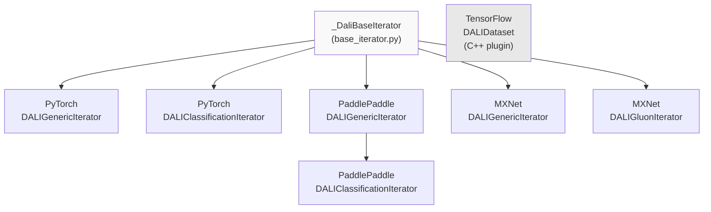
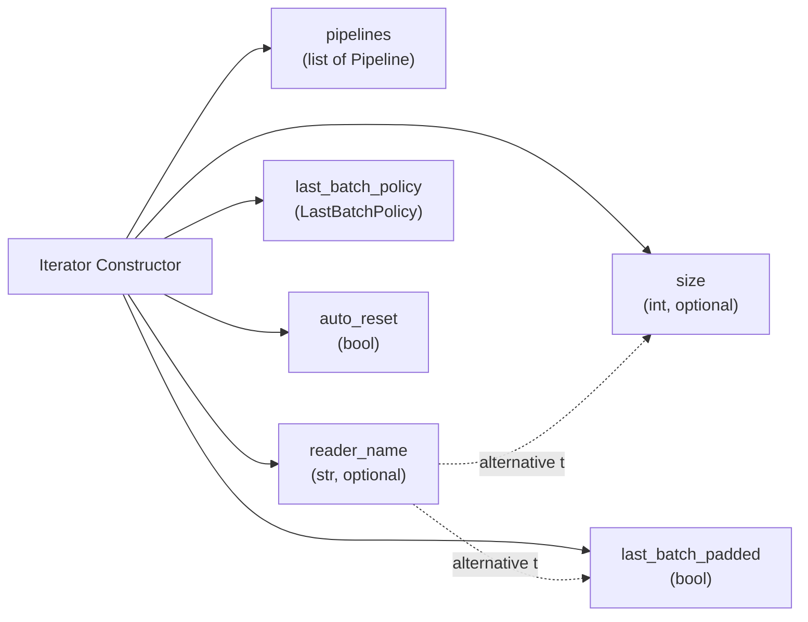
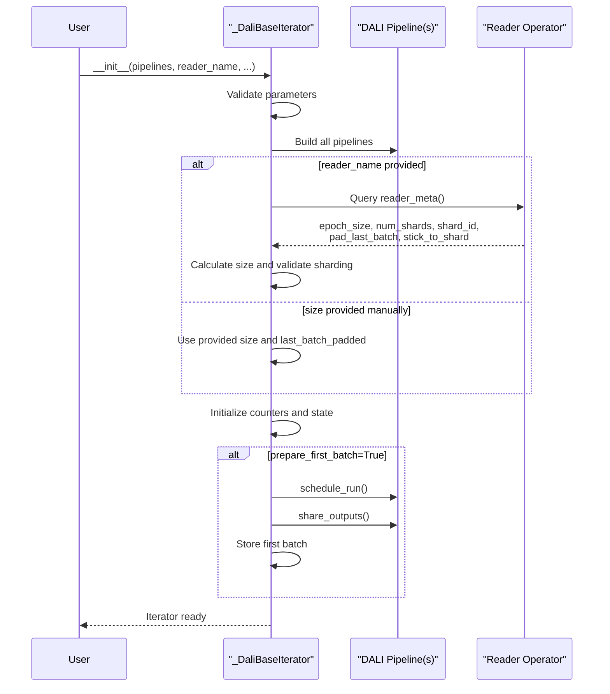
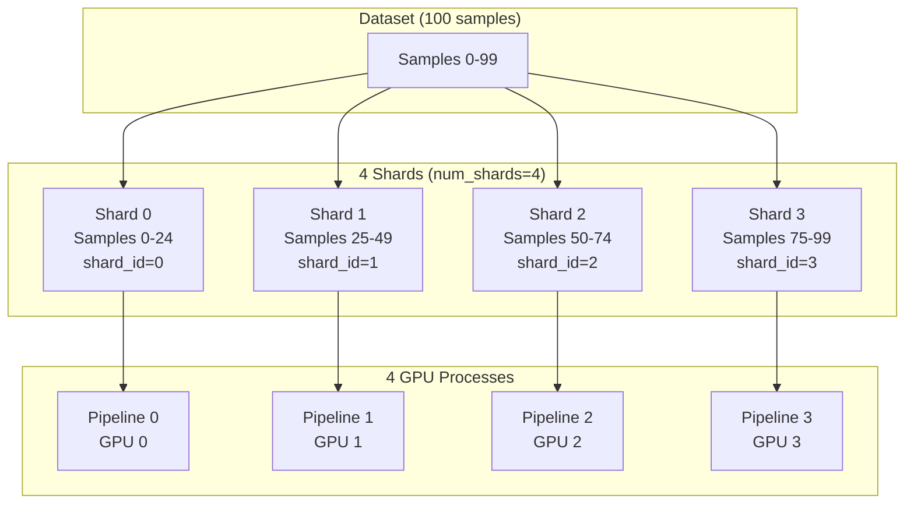
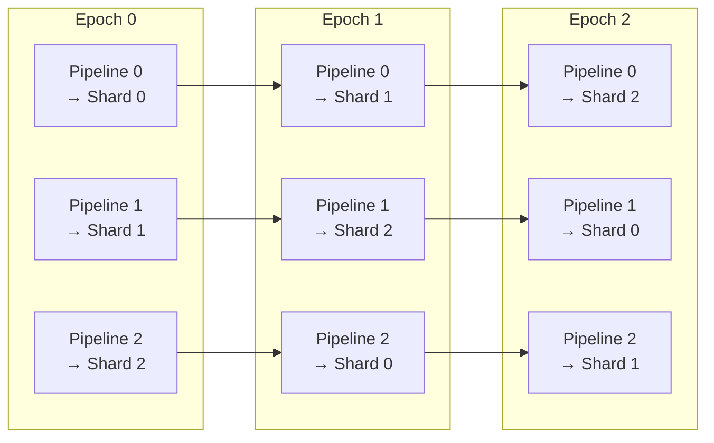
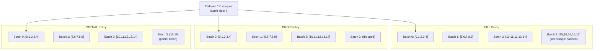
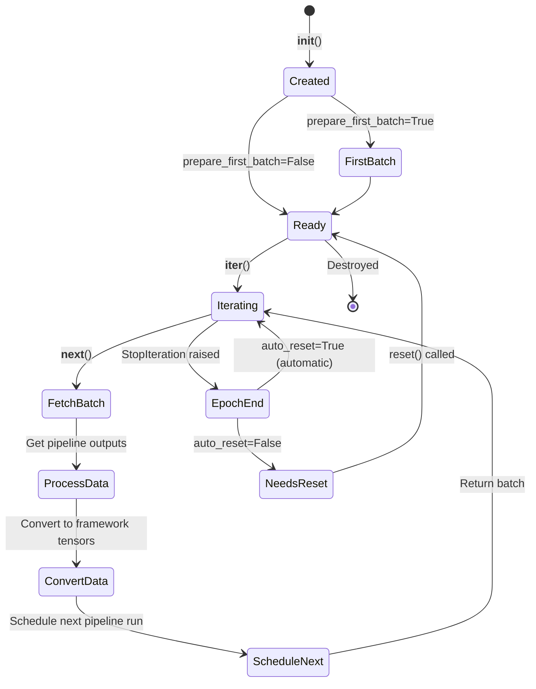
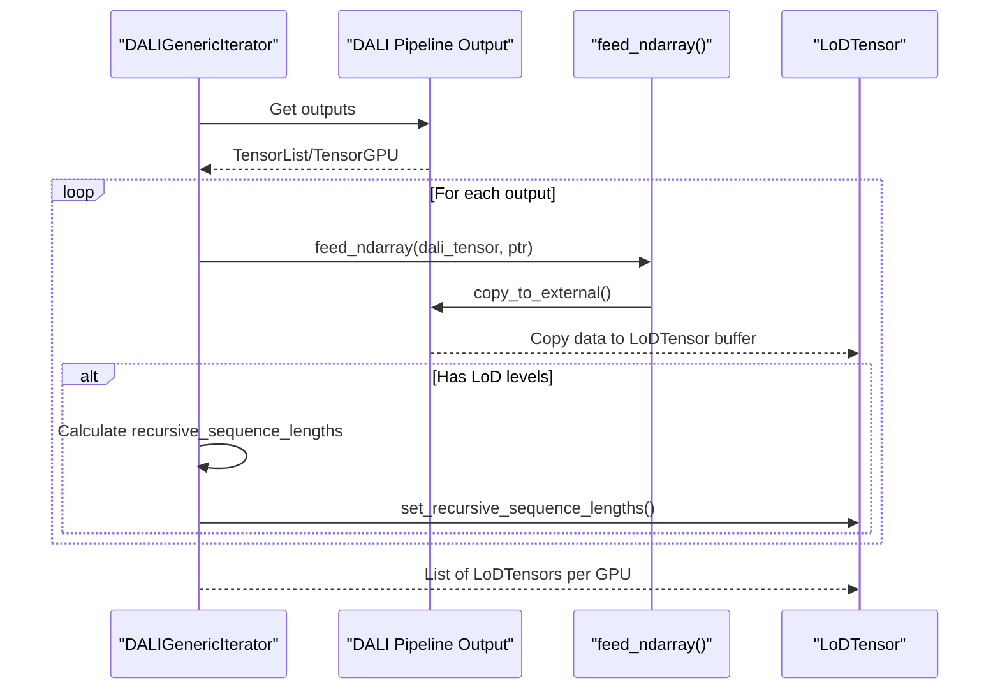
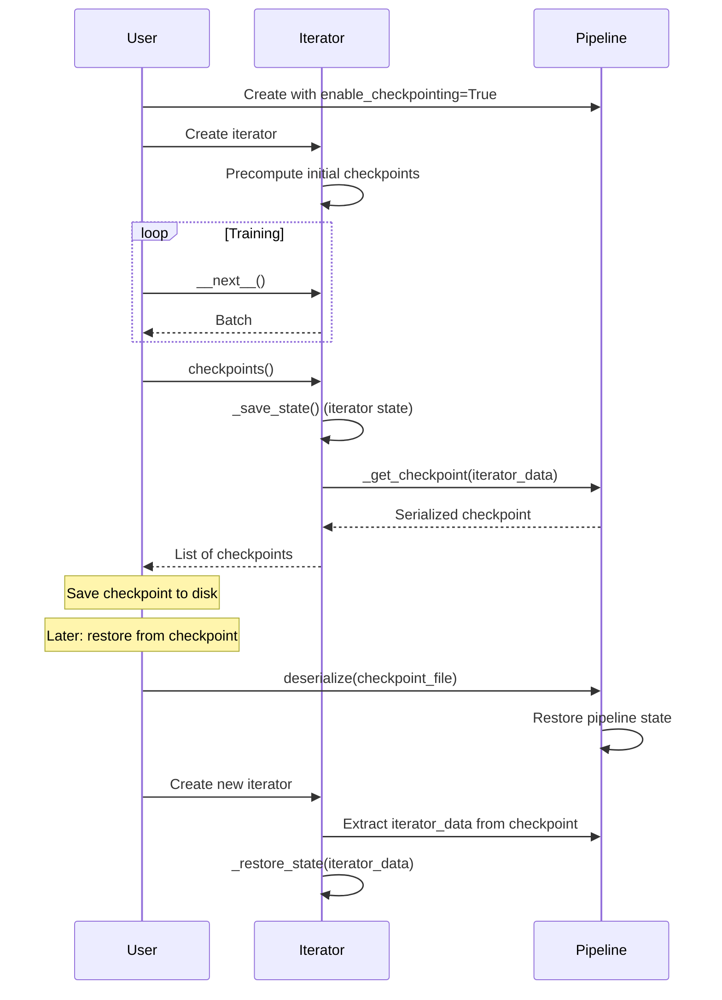

<!-- source: DeepWiki mcp.deepwiki.com · repo NVIDIA/DALI · page 5.3 Framework Iterators · fetched 2026-10-26 -->

# Framework Iterators

<details>
<summary>Relevant source files</summary>

The following files were used as context for generating this wiki page:

- [CONTRIBUTING.md](CONTRIBUTING.md)
- [VERSION](VERSION)
- [cmake/libdali.map.in](cmake/libdali.map.in)
- [dali/pipeline/operator/builtin/copy.cc](dali/pipeline/operator/builtin/copy.cc)
- [dali/python/nvidia/dali/_autograph/operators/exceptions.py](dali/python/nvidia/dali/_autograph/operators/exceptions.py)
- [dali/python/nvidia/dali/plugin/base_iterator.py](dali/python/nvidia/dali/plugin/base_iterator.py)
- [dali/python/nvidia/dali/plugin/paddle.py](dali/python/nvidia/dali/plugin/paddle.py)
- [dali/test/python/import_module_test_helper.py](dali/test/python/import_module_test_helper.py)
- [dali/test/python/nose_utils.py](dali/test/python/nose_utils.py)
- [dali/test/python/test_RN50_data_fw_iterators.py](dali/test/python/test_RN50_data_fw_iterators.py)
- [dali/test/python/test_RN50_data_pipeline.py](dali/test/python/test_RN50_data_pipeline.py)
- [dali/test/python/test_backend_impl.py](dali/test/python/test_backend_impl.py)
- [dali/test/python/test_backend_impl_gpu.py](dali/test/python/test_backend_impl_gpu.py)
- [dali/test/python/test_backend_impl_torch_dlpack.py](dali/test/python/test_backend_impl_torch_dlpack.py)
- [dali/test/python/test_data_containers.py](dali/test/python/test_data_containers.py)
- [dali/test/python/test_external_source_parallel_custom_serialization.py](dali/test/python/test_external_source_parallel_custom_serialization.py)
- [dali/test/python/test_fw_iterators.py](dali/test/python/test_fw_iterators.py)
- [dali/test/python/test_fw_iterators_detection.py](dali/test/python/test_fw_iterators_detection.py)
- [docs/advanced_topics_sharding.rst](docs/advanced_topics_sharding.rst)
- [docs/examples/frameworks/pytorch/pytorch-lightning.ipynb](docs/examples/frameworks/pytorch/pytorch-lightning.ipynb)
- [docs/examples/use_cases/video_superres/model/model.py](docs/examples/use_cases/video_superres/model/model.py)
- [docs/images/sharding.png](docs/images/sharding.png)
- [qa/TL0_plugin_manager/test.sh](qa/TL0_plugin_manager/test.sh)
- [qa/TL1_python-nvjpeg_test/test.sh](qa/TL1_python-nvjpeg_test/test.sh)
- [qa/nose_wrapper/__main__.py](qa/nose_wrapper/__main__.py)

</details>


## Purpose and Scope

Framework iterators provide the bridge between DALI pipelines and deep learning frameworks (PyTorch, TensorFlow, PaddlePaddle, MXNet). They handle batching, sharding, data conversion to framework-specific tensor formats, and distributed training coordination. This document covers the iterator pattern, configuration options, and behavior across different frameworks.

For information about DALI pipelines themselves, see [2.1 Pipeline System](#2.1). For framework-specific plugin architectures, see [4 Framework Integration](#4).

## Iterator Architecture

Framework iterators wrap DALI pipelines to provide Python iteration protocols compatible with framework training loops. All iterators (except TensorFlow, which uses a C++ plugin) inherit from a common base class that implements shared functionality.

### Base Iterator Class Hierarchy



**Sources:** [dali/python/nvidia/dali/plugin/base_iterator.py:55-141](), [dali/python/nvidia/dali/plugin/paddle.py:134-513]()

### Base Iterator Core Responsibilities

The `_DaliBaseIterator` class ([base_iterator.py:55-141]()) provides:

| Responsibility | Implementation |
|---------------|----------------|
| **Pipeline management** | Wraps one or more DALI pipelines, builds them, and schedules execution |
| **Batching** | Retrieves pipeline outputs and organizes them into batches |
| **Sharding** | Distributes dataset across multiple GPUs/nodes using `shard_id` and `num_shards` |
| **Epoch management** | Tracks iteration progress, handles epoch boundaries, implements reset logic |
| **Last batch handling** | Implements policies for incomplete final batches (FILL, DROP, PARTIAL) |
| **Checkpointing** | Saves/restores iterator state for training resumption |

**Sources:** [dali/python/nvidia/dali/plugin/base_iterator.py:55-558]()

## Iterator Initialization

### Key Constructor Parameters



**Parameter Details:**

- **`pipelines`**: List of built DALI pipelines (one per GPU/device). All pipelines must have identical `max_batch_size`.
  
- **`reader_name`**: Name of the reader operator in the pipeline. When provided, the iterator queries the reader for shard size, padding configuration, and other metadata. **Recommended approach** - automatically configures `size` and `last_batch_padded`.

- **`size`**: Total number of samples in the shard(s). Required if `reader_name` is not specified. For multiple pipelines, this is the sum of all shard sizes.

- **`last_batch_policy`**: Controls behavior when the final batch is incomplete:
  - `LastBatchPolicy.FILL`: Pad with duplicate or wraparound data
  - `LastBatchPolicy.DROP`: Skip the incomplete batch
  - `LastBatchPolicy.PARTIAL`: Return the partial batch as-is

- **`last_batch_padded`**: Indicates whether the reader operator pads its last batch with duplicated samples (`True`) or wraps to the next epoch (`False`). Automatically set when using `reader_name`.

- **`auto_reset`**: If `True` or `"yes"`, automatically resets the iterator at epoch end. If `False`, `"no"`, or `None`, user must call `reset()` explicitly.

**Sources:** [dali/python/nvidia/dali/plugin/base_iterator.py:143-228](), [dali/python/nvidia/dali/plugin/paddle.py:223-259]()

### Initialization Flow



**Sources:** [dali/python/nvidia/dali/plugin/base_iterator.py:143-250](), [dali/python/nvidia/dali/plugin/base_iterator.py:294-350]()

## Batching and Sharding

### Sharding Concept

DALI uses sharding to partition datasets across multiple training processes. Each pipeline processes one shard of the data.



**Shard Size Calculation:**

The iterator calculates per-shard sizes using: `shard_size = floor((shard_id + 1) * total_size / num_shards) - floor(shard_id * total_size / num_shards)`. This ensures shards are balanced when the dataset doesn't divide evenly.

**Sources:** [dali/python/nvidia/dali/plugin/base_iterator.py:287-293](), [dali/test/python/test_fw_iterators.py:378-449]()

### Shard Rotation

By default (when `stick_to_shard=False` in the reader), iterators rotate to the next shard after each epoch to increase data diversity:



The rotation logic is implemented in [base_iterator.py:516-519](): `self._shards_id = (self._shards_id + 1) % self._shards_num`.

**Sources:** [dali/python/nvidia/dali/plugin/base_iterator.py:514-545]()

## Last Batch Policies

The `LastBatchPolicy` enum ([base_iterator.py:36-53]()) defines three strategies for handling incomplete final batches:

### LastBatchPolicy Comparison



### Policy Behavior with Padding

When combined with `last_batch_padded` (reader parameter):

| Policy | `last_batch_padded=True` | `last_batch_padded=False` |
|--------|-------------------------|---------------------------|
| **FILL** | Last batch filled with duplicate of last sample | Last batch filled with samples from next epoch |
| **DROP** | Drop incomplete batch | Drop incomplete batch |
| **PARTIAL** | Return partial batch (padding samples trimmed by iterator) | Return partial batch (samples from next epoch trimmed) |

**Example with 7 samples, batch size 2:**

- `FILL` + `padded=True`: Batches `[1,2]`, `[3,4]`, `[5,6]`, `[7,7]` → Next epoch starts at `[1,2]`
- `FILL` + `padded=False`: Batches `[1,2]`, `[3,4]`, `[5,6]`, `[7,1]` → Next epoch starts at `[2,3]`
- `PARTIAL` + `padded=True`: Batches `[1,2]`, `[3,4]`, `[5,6]`, `[7]` → Next epoch starts at `[1,2]`

**Sources:** [dali/python/nvidia/dali/plugin/base_iterator.py:36-53](), [dali/python/nvidia/dali/plugin/paddle.py:200-220](), [dali/test/python/test_fw_iterators.py:364-450]()

### Policy Implementation

The iterator tracks batch progress and applies policies in `_advance_and_check_drop_last()` ([base_iterator.py:422-446]()):

```mermaid
sequenceDiagram
    participant Loop as "Training Loop"
    participant Iterator
    participant Counter as "Counter State"
    participant Pipeline
    
    loop Each Iteration
        Loop->>Iterator: __next__()
        Iterator->>Pipeline: _get_outputs()
        Pipeline-->>Iterator: Batch data
        
        Iterator->>Counter: Increment counter by batch_size
        
        alt DROP policy and would exceed size
            Iterator->>Iterator: raise StopIteration
        else PARTIAL policy and exceeds size
            Iterator->>Iterator: Trim batch to remaining samples
        else FILL policy
            Iterator->>Iterator: Return full batch (may contain padding)
        end
        
        Iterator-->>Loop: Batch data
    end
```

**Sources:** [dali/python/nvidia/dali/plugin/base_iterator.py:422-446](), [dali/python/nvidia/dali/plugin/base_iterator.py:351-370]()

## Iterator Lifecycle

### Iteration Protocol

Framework iterators implement Python's iterator protocol (`__iter__` and `__next__`):



**Sources:** [dali/python/nvidia/dali/plugin/paddle.py:271-391](), [dali/python/nvidia/dali/plugin/base_iterator.py:371-410]()

### Reset Behavior

The `reset()` method ([base_iterator.py:475-558]()) prepares the iterator for the next epoch:

**Reset Actions:**
1. **Handle DROP policy**: If an incomplete batch remains in the pipeline, fetch and discard it
2. **Update counters**: Reset per-GPU sample counters, accounting for wraparound from last epoch
3. **Rotate shards**: Move to next shard if `stick_to_shard=False`
4. **Recalculate size**: Determine next epoch size based on new shard assignments

**Counter Management with FILL Policy:**

When `last_batch_policy=FILL` and `last_batch_padded=False`, the iterator tracks how many samples each GPU read ahead into the next epoch. The next epoch starts from the minimum read-ahead position:

```python
# From base_iterator.py:495-512
self._counter -= min(self._counter_per_gpu)
self._counter_per_gpu = self._counter_per_gpu + self._counter
self._counter_per_gpu = self._counter_per_gpu - self._shard_sizes_per_gpu
self._counter = min(self._counter_per_gpu)
```

**Sources:** [dali/python/nvidia/dali/plugin/base_iterator.py:475-558]()

## Framework-Specific Implementations

### PyTorch Iterator

PyTorch iterators ([plugin/pytorch.py]()) return dictionaries mapping output names to PyTorch tensors.

**Key Features:**
- Zero-copy conversion via DLPack when `exec_dynamic=False`
- Automatic GPU tensor placement
- Compatible with PyTorch DataLoader API

**Example Usage:**
```python
from nvidia.dali.plugin.pytorch import DALIGenericIterator

iterator = DALIGenericIterator(
    pipelines=[pipeline],
    output_map=["images", "labels"],
    reader_name="Reader",
    last_batch_policy=LastBatchPolicy.PARTIAL
)

for batch in iterator:
    images = batch[0]["images"]  # PyTorch tensor on GPU
    labels = batch[0]["labels"]
```

**Sources:** Test examples in [dali/test/python/test_fw_iterators.py:903-1027]()

### PaddlePaddle Iterator

PaddlePaddle iterators convert DALI outputs to `paddle.framework.core.LoDTensor` objects.

**Conversion Flow:**


**LoD (Level of Detail) Support:**

PaddlePaddle's LoDTensor supports variable-length sequences. The iterator calculates sequence lengths using `recursive_length()` ([paddle.py:86-113]()):

```python
# For output_map item ("labels", 2), LoD level = 2
seq_len = recursive_length(tensor, lod + 1)[1:]
lod_tensor.set_recursive_sequence_lengths(seq_len)
```

**Sources:** [dali/python/nvidia/dali/plugin/paddle.py:60-84](), [dali/python/nvidia/dali/plugin/paddle.py:271-391]()

### MXNet Iterators

MXNet provides two iterator types:

**1. DALIGenericIterator** - Returns MXNet `DataBatch` objects with `.data` and `.label` lists.

**2. DALIGluonIterator** - Optimized for Gluon API, returns tuples directly.

**Sparse Batch Support:**

MXNet iterators support sparse outputs (list of NDArrays per sample) for detection tasks:

```python
iterator = MXNetIterator(
    pipelines=[pipeline],
    output_map=[("labels", MXNetIterator.SPARSE_TAG),
                ("ids", MXNetIterator.DENSE_TAG)]
)

for batch in iterator:
    labels, ids = batch[0]  # labels is list of NDArrays
    assert isinstance(labels, (tuple, list))
    assert len(labels) == batch_size
```

**Sources:** [dali/test/python/test_fw_iterators.py:717-756]()

## Advanced Features

### Checkpointing

Iterators support checkpointing when pipelines are created with `enable_checkpointing=True`.

**Checkpointed State:**
- `_counter`: Current sample counter
- `_counter_per_gpu`: Per-shard read positions
- `_shard_sizes_per_gpu`: Shard size array
- `_shards_id`: Current shard assignments
- `_size`: Current epoch size

**Checkpoint Access:**

```python
# Get checkpoints (one per pipeline)
checkpoints = iterator.checkpoints()

# Restore pipeline from checkpoint
restored_pipeline = Pipeline.deserialize(
    filename="checkpoint.dali",
    device_id=0
)

# Iterator state is automatically restored
new_iterator = DALIGenericIterator(
    pipelines=[restored_pipeline],
    reader_name="Reader"
)
```

**Checkpoint Lifecycle:**



**Sources:** [dali/python/nvidia/dali/plugin/base_iterator.py:222-250](), [dali/python/nvidia/dali/plugin/base_iterator.py:252-285](), [dali/python/nvidia/dali/plugin/base_iterator.py:463-474]()

### Iterator Length

Iterators implement `__len__()` to return the number of iterations per epoch:

**Calculation Logic:**
```python
# From base_iterator.py
if last_batch_policy == LastBatchPolicy.DROP:
    length = size // (num_gpus * batch_size)
else:  # FILL or PARTIAL
    length = (size + num_gpus * batch_size - 1) // (num_gpus * batch_size)
```

The length changes between epochs when shards rotate and have uneven sizes.

**Sources:** [dali/test/python/test_fw_iterators.py:510-546]()

### Prepare First Batch

The `prepare_first_batch` parameter (default `True`) pre-fetches the first batch during iterator construction:

**Benefits:**
- Reduced latency for first training step
- Validates pipeline configuration before training starts
- Detects "no data" conditions early

**Implementation:**

```python
# From paddle.py:261-269
if self._prepare_first_batch:
    try:
        self._first_batch = DALIGenericIterator.__next__(self)
        self._ever_consumed = False
    except StopIteration:
        self._report_no_data_in_pipeline()
```

**Sources:** [dali/python/nvidia/dali/plugin/paddle.py:261-269](), [dali/python/nvidia/dali/plugin/base_iterator.py:448-462]()

## Usage Patterns

### Single GPU Training

```python
from nvidia.dali.plugin.pytorch import DALIGenericIterator

# Pipeline reads entire dataset
pipeline = create_pipeline(batch_size=32, device_id=0)

iterator = DALIGenericIterator(
    pipelines=[pipeline],
    output_map=["images", "labels"],
    reader_name="Reader",
    last_batch_policy=LastBatchPolicy.PARTIAL
)

for epoch in range(num_epochs):
    for batch in iterator:
        train_step(batch[0]["images"], batch[0]["labels"])
    # Iterator auto-resets if auto_reset=True
```

### Multi-GPU Training

```python
# Each GPU process creates its own pipeline and iterator
num_gpus = 4
device_id = get_rank()  # 0, 1, 2, or 3

pipeline = create_pipeline(
    batch_size=32,
    device_id=device_id,
    shard_id=device_id,
    num_shards=num_gpus
)

iterator = DALIGenericIterator(
    pipelines=[pipeline],
    output_map=["images", "labels"],
    reader_name="Reader"
)

for epoch in range(num_epochs):
    for batch in iterator:
        # Each GPU processes its shard
        train_step(batch[0]["images"], batch[0]["labels"])
```

### Multiple Pipelines per Iterator

For single-process multi-GPU:

```python
# Create one pipeline per GPU
pipelines = [
    create_pipeline(batch_size=32, device_id=gpu_id,
                   shard_id=gpu_id, num_shards=num_gpus)
    for gpu_id in range(num_gpus)
]

iterator = DALIGenericIterator(
    pipelines=pipelines,
    output_map=["images", "labels"],
    reader_name="Reader"
)

for batch in iterator:
    # batch is a list with one entry per pipeline
    for gpu_id in range(num_gpus):
        train_on_gpu(gpu_id, batch[gpu_id]["images"], batch[gpu_id]["labels"])
```

**Sources:** [dali/test/python/test_fw_iterators.py:546-588](), [docs/examples/frameworks/pytorch/pytorch-lightning.ipynb:230-255]()

### Dynamic Shape Support

For detection/segmentation with variable-size outputs:

```python
iterator = DALIGenericIterator(
    pipelines=[pipeline],
    output_map=["images", "bboxes", "labels"],
    size=epoch_size,
    dynamic_shape=True  # Allow varying tensor shapes
)

for batch in iterator:
    images = batch[0]["images"]  # Fixed shape
    bboxes = batch[0]["bboxes"]  # Variable: different per sample
    labels = batch[0]["labels"]  # Variable: different per sample
```

**Sources:** [dali/test/python/test_fw_iterators_detection.py:77-98]()

## Common Configuration Patterns

### Recommended: Using reader_name

```python
iterator = DALIGenericIterator(
    pipelines=[pipeline],
    output_map=["data", "label"],
    reader_name="Reader",  # Automatically configures size and padding
    last_batch_policy=LastBatchPolicy.PARTIAL
)
```

This approach:
- Queries reader metadata automatically
- Adapts to changing shard sizes across epochs
- Ensures correct synchronization between reader and iterator

### Legacy: Manual Size Configuration

```python
iterator = DALIGenericIterator(
    pipelines=[pipeline],
    output_map=["data", "label"],
    size=50000,  # Must calculate manually
    last_batch_padded=True,  # Must match reader configuration
    last_batch_policy=LastBatchPolicy.FILL
)
```

This approach requires careful coordination with reader parameters and may miss samples or produce duplicates when shards rotate.

**Sources:** [dali/python/nvidia/dali/plugin/base_iterator.py:204-208](), [docs/advanced_topics_sharding.rst:20-43]()

---

