<!-- source: DeepWiki mcp.deepwiki.com · repo NVIDIA/DALI · page 6 Advanced Topics · fetched 2026-10-26 -->

# Advanced Topics

Relevant source files

The following files were used as context for generating this wiki page:

- [dali/c_api/c_api.cc](dali/c_api/c_api.cc)
- [dali/c_api/c_api_test.cc](dali/c_api/c_api_test.cc)
- [dali/pipeline/data/buffer.cc](dali/pipeline/data/buffer.cc)
- [dali/pipeline/data/buffer.h](dali/pipeline/data/buffer.h)
- [dali/pipeline/data/tensor.h](dali/pipeline/data/tensor.h)
- [dali/pipeline/data/tensor_list.cc](dali/pipeline/data/tensor_list.cc)
- [dali/pipeline/data/tensor_list.h](dali/pipeline/data/tensor_list.h)
- [dali/pipeline/data/tensor_list_test.cc](dali/pipeline/data/tensor_list_test.cc)
- [dali/pipeline/data/tensor_test.cc](dali/pipeline/data/tensor_test.cc)
- [dali/pipeline/data/tensor_vector.h](dali/pipeline/data/tensor_vector.h)
- [dali/pipeline/operator/builtin/make_contiguous.cc](dali/pipeline/operator/builtin/make_contiguous.cc)
- [dali/pipeline/operator/builtin/make_contiguous.cu](dali/pipeline/operator/builtin/make_contiguous.cu)
- [dali/pipeline/pipeline.cc](dali/pipeline/pipeline.cc)
- [dali/pipeline/pipeline.h](dali/pipeline/pipeline.h)
- [dali/pipeline/pipeline_test.cc](dali/pipeline/pipeline_test.cc)
- [dali/python/backend_impl.cc](dali/python/backend_impl.cc)
- [dali/python/nvidia/dali/pipeline.py](dali/python/nvidia/dali/pipeline.py)
- [dali/python/nvidia/dali/types.py](dali/python/nvidia/dali/types.py)
- [dali/test/python/test_functional_api.py](dali/test/python/test_functional_api.py)
- [dali/test/python/test_pipeline.py](dali/test/python/test_pipeline.py)
- [docs/supported_ops.rst](docs/supported_ops.rst)
- [include/dali/c_api.h](include/dali/c_api.h)

This page covers advanced features of DALI that enable efficient memory management, framework interoperability, and language-agnostic integration. These topics are essential for users who need fine-grained control over memory allocation, zero-copy data exchange with other frameworks, or integration with non-Python environments.

For information about basic pipeline usage and operator composition, see [Core Architecture](#2). For framework-specific integration patterns using iterators and datasets, see [Framework Integration](#4).

## Overview

DALI provides several advanced capabilities for performance optimization and interoperability:

- **Memory Management and Interoperability** ([details in page 6.1](#6.1)): Zero-copy data exchange through DLPack, CUDA Array Interface, and NumPy Array Interface protocols. These enable seamless integration with PyTorch, TensorFlow, JAX, CuPy, and other frameworks without data duplication.

- **C API** ([details in page 6.2](#6.2)): Language-agnostic interface for integrating DALI with applications written in C, C++, or other languages that support C bindings. Used internally by TensorFlow plugin.

- **Memory Optimization**: Buffer recycling, access order synchronization, and contiguous/non-contiguous memory modes for efficient resource utilization.

## Memory Management Architecture

DALI's memory management system is built on a hierarchy of data structures that support both CPU and GPU backends, with explicit control over synchronization and memory layout.

### Core Data Structure Hierarchy

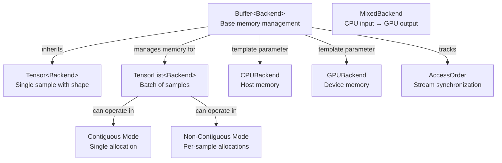

**Core Memory Classes:**

The `Buffer<Backend>` class provides fundamental memory allocation and lifetime management:
- Allocates memory using backend-specific allocators (host, pinned, or device memory)
- Tracks allocation size, data type, and access order
- Supports sharing data with externally managed memory via `shared_ptr`

The `Tensor<Backend>` class extends `Buffer` with shape information:
- Always backed by contiguous memory
- Stores `TensorShape<>` metadata and layout information
- Provides typed accessors: `data<T>()` and `mutable_data<T>()`

The `TensorList<Backend>` class represents batches with two memory modes:
- **Contiguous**: Single allocation with all samples packed sequentially
- **Non-contiguous**: Separate allocation per sample, allowing variable shapes

Sources: [dali/pipeline/data/buffer.h:164-242](), [dali/pipeline/data/tensor.h:42-206](), [dali/pipeline/data/tensor_list.h:43-226]()

### Memory Allocation and Backend Support

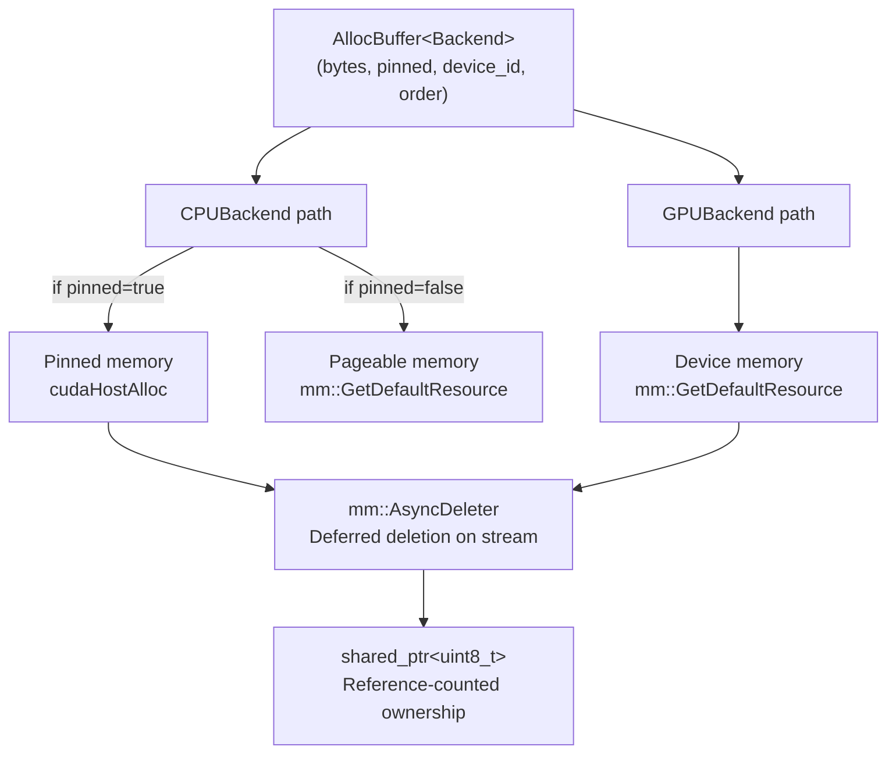

**Allocation Functions:**

The `AllocBuffer()` function template dispatches to backend-specific allocators:
- For `CPUBackend`: Uses pinned memory (via `cudaHostAlloc`) or standard host allocator
- For `GPUBackend`: Uses device memory allocator with specified device ID
- Returns `shared_ptr<uint8_t>` with custom deleter for stream-ordered deallocation

**Stream-Ordered Deallocation:**

GPU allocations use `mm::AsyncDeleter` to defer deallocation until all operations on the associated CUDA stream complete. This prevents use-after-free when buffers are destroyed while GPU operations are still pending.

Sources: [dali/pipeline/data/buffer.h:57-76](), [dali/pipeline/data/buffer.cc:21-44]()

## Interoperability Protocols

DALI implements three major protocols for zero-copy data exchange with external frameworks:

### DLPack Protocol

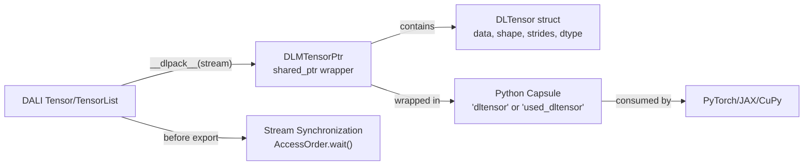

**DLPack Implementation:**

The `__dlpack__()` method creates a `PyCapsule` containing a `DLTensor` structure:
- **Data pointer**: Raw pointer to tensor data
- **Shape and strides**: Dimension information (DALI always uses contiguous layout)
- **Device info**: Device type (`kDLCPU`, `kDLCUDA`, `kDLCUDAHost`) and device ID
- **Data type**: Type code and bit width

**Stream Synchronization:**

When exporting GPU tensors, DALI inserts synchronization:
- If `stream=None`: Wait on host (full blocking)
- If `stream=-1`: No synchronization (caller guarantees correctness)
- If `stream=<handle>`: Insert event into target stream

The capsule's deleter ensures the underlying DALI buffer remains alive until the consumer is done.

Sources: [dali/python/backend_impl.cc:520-593](), [dali/pipeline/data/dltensor.h:1-100]()

### CUDA Array Interface

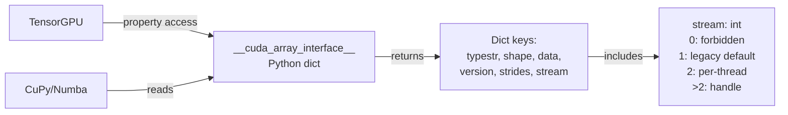

**CUDA Array Interface Implementation:**

The `__cuda_array_interface__` property returns a dictionary descriptor:
- **`typestr`**: NumPy-style type string (e.g., `"<f4"` for float32)
- **`shape`**: Tuple of dimensions
- **`data`**: Tuple of `(ptr, read_only)` where `ptr` is the device pointer
- **`version`**: Protocol version (2 for CUDA tensors)
- **`strides`**: Always `None` (contiguous layout guaranteed)
- **`stream`**: CUDA stream handle for ordering

**Input from External Sources:**

DALI can also consume external data via CUDA Array Interface:
- Function `FillTensorFromCudaArray()` reads the interface from Python objects
- Validates required fields (`typestr`, `shape`, `data`, `version`)
- Creates a `TensorGPU` that shares the external memory
- Preserves stream ordering by extracting and respecting the `stream` field

Sources: [dali/python/backend_impl.cc:130-158](), [dali/python/backend_impl.cc:292-369]()

### NumPy Array Interface

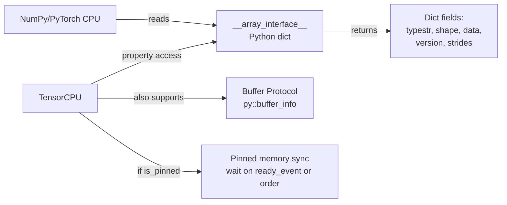

**NumPy Array Interface Implementation:**

For CPU tensors, the `__array_interface__` provides host-accessible data:
- Similar structure to CUDA Array Interface but uses version 3
- For pinned memory, synchronizes before access via `AccessOrder::host().wait()`
- Supports both via property getter and Python Buffer Protocol

**Buffer Protocol:**

`TensorCPU` also implements Python's Buffer Protocol via pybind11:
- Returns `py::buffer_info` with pointer, shape, strides, and format string
- Enables zero-copy NumPy array creation and memory view access
- More efficient than Array Interface for NumPy interoperability

Sources: [dali/python/backend_impl.cc:130-158](), [dali/python/backend_impl.cc:702-728]()

## Access Order and Synchronization

DALI uses the `AccessOrder` abstraction to manage CUDA stream synchronization:

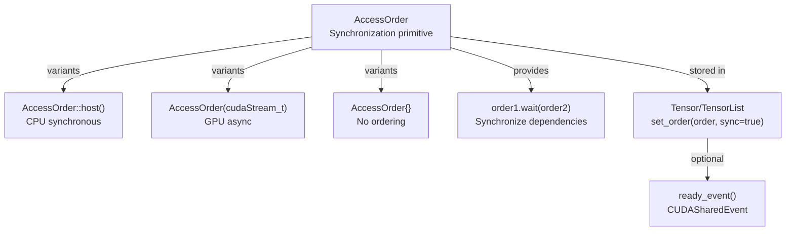

**AccessOrder Semantics:**

The `AccessOrder` class encapsulates ordering requirements:
- **Host order**: `AccessOrder::host()` - synchronous on CPU
- **Stream order**: `AccessOrder(stream)` - asynchronous on specified CUDA stream
- **Empty order**: `AccessOrder{}` - no ordering guarantees (caller responsible)

**Synchronization Patterns:**

When data is accessed across different contexts:
1. Call `set_order(new_order, synchronize=true)` to update the access order
2. If `synchronize=true`, inserts appropriate synchronization primitive
3. For GPU→CPU: Uses events or stream waits
4. For CPU→GPU: No-op unless pinned memory involved

**Ready Events:**

Tensors can track `ready_event()` for fine-grained synchronization:
- Allows waiting only for specific data readiness, not entire stream
- Used when exporting to DLPack or CUDA Array Interface
- More efficient than full stream synchronization

Sources: [dali/core/access_order.h:1-150](), [dali/pipeline/data/buffer.h:102-119](), [dali/python/backend_impl.cc:469-489]()

## Contiguous vs Non-Contiguous Memory

`TensorList` supports two memory layout modes for different use cases:

### Contiguous Mode

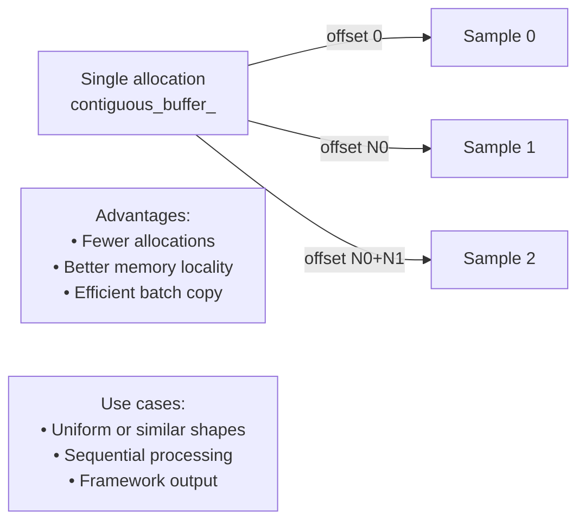

**Contiguous Memory Characteristics:**

In contiguous mode, `TensorList` allocates a single large buffer:
- All samples packed sequentially in memory
- Total size is sum of all sample sizes
- Individual sample tensors point to offsets within the shared buffer
- Enabled by `SetContiguity(BatchContiguity::Contiguous)` or `Resize()` with uniform shapes

**Performance Benefits:**

- Single allocation/deallocation reduces overhead
- Better cache locality when iterating over samples
- Efficient for GPU kernel launching (single device pointer)

Sources: [dali/pipeline/data/tensor_list.h:487-520]()

### Non-Contiguous Mode

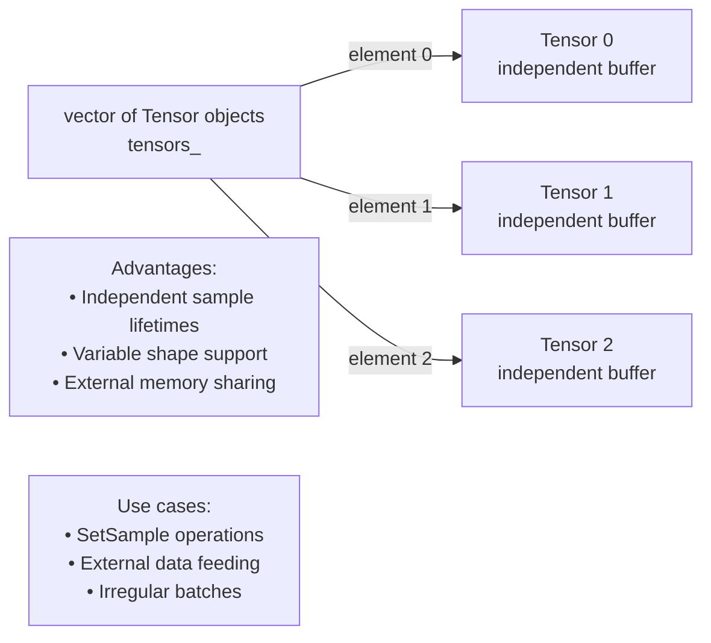

**Non-Contiguous Memory Characteristics:**

In non-contiguous mode, each sample has its own allocation:
- Samples stored in `vector<Tensor<Backend>>`
- Each tensor independently manages its buffer
- Allows samples to share data from different sources
- Required for `SetSample()` operations and external data wrapping

**Use Case - External Input:**

When feeding external data via `SetExternalInput()`:
- Each sample can point to different external allocations
- Supports zero-copy integration with framework iterators
- Samples can have different memory properties (pinned vs non-pinned)

Sources: [dali/pipeline/data/tensor_list.h:250-293](), [dali/pipeline/data/tensor_list.cc:30-54]()

### Mode Transitions

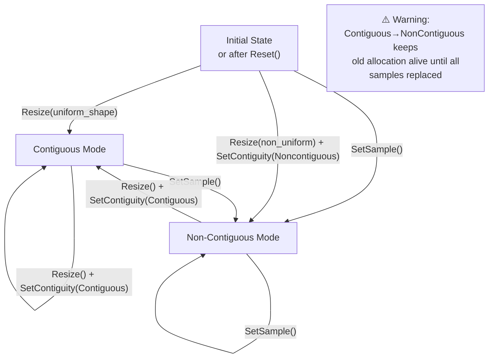

**Automatic Mode Selection:**

By default, `Resize()` chooses mode based on the batch:
- If shapes are uniform: Uses contiguous mode
- If shapes vary significantly: May use non-contiguous mode
- Can be overridden with `SetContiguity()` before or after resize

**Implicit Conversion:**

Calling `SetSample()` on a contiguous `TensorList` converts it to non-contiguous mode:
- Old contiguous buffer remains alive if any samples still reference it
- Best practice: Replace all samples or explicitly allocate in non-contiguous mode

Sources: [dali/pipeline/data/tensor_list.h:164-167](), [dali/pipeline/data/tensor_list.cc:235-272]()

## C API Overview

DALI provides a C API for language-agnostic integration, used internally by TensorFlow plugin and available for custom integrations.

### Pipeline Handle and Lifecycle

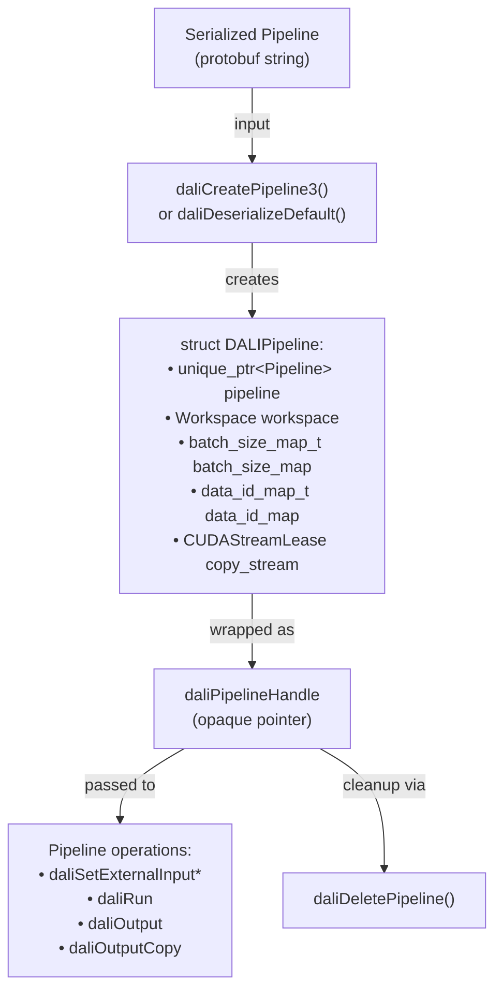

**C API Handle Structure:**

The `daliPipelineHandle` is an opaque pointer to `DALIPipeline`:
- Contains the C++ `Pipeline` object
- Maintains auxiliary state for external input tracking
- Manages CUDA stream for asynchronous copies

**Lifecycle Functions:**

1. **Creation**: `daliCreatePipeline3()` - Deserializes pipeline from protobuf, configures executor
2. **Execution**: `daliRun()` - Runs pipeline iteration
3. **Output**: `daliOutput()` / `daliOutputCopy()` - Retrieves results
4. **Destruction**: `daliDeletePipeline()` - Cleans up resources

Sources: [dali/c_api/c_api.cc:72-80](), [include/dali/c_api.h:28-120]()

### External Input API

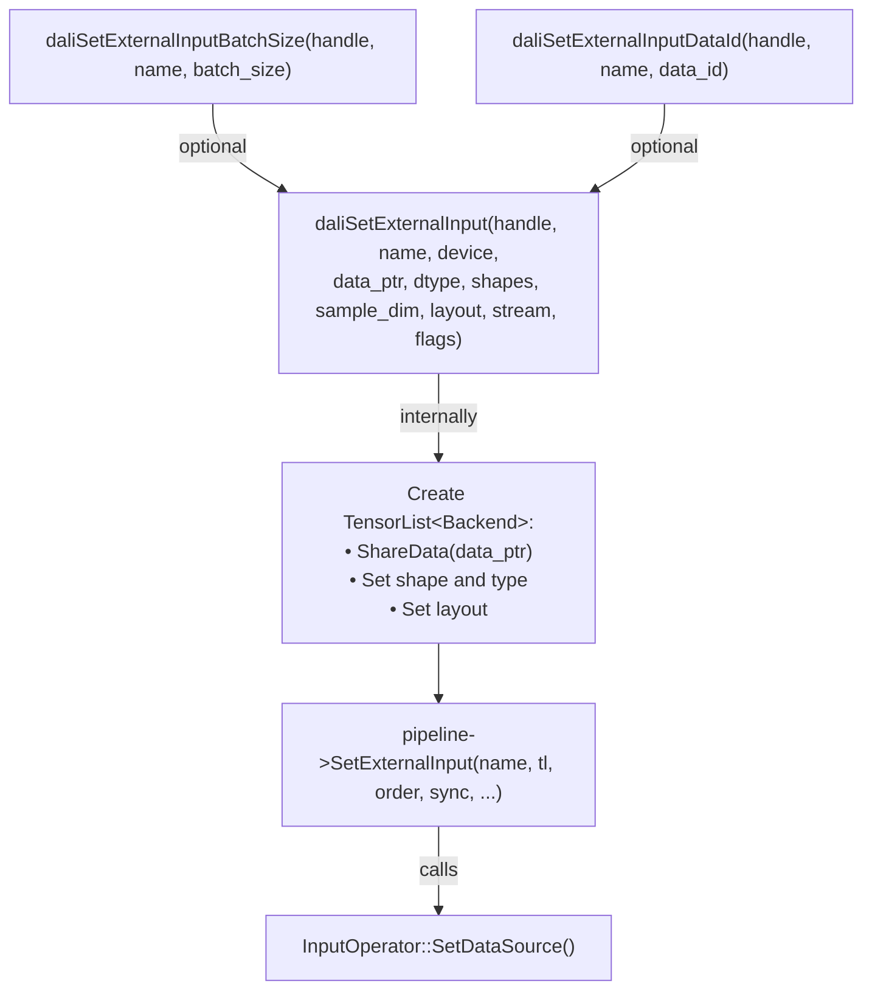

**Setting External Input:**

The C API provides functions to feed data from external sources:
- `daliSetExternalInputBatchSize()` - Pre-set batch size if variable
- `daliSetExternalInputDataId()` - Set data ID for deduplication/tracking
- `daliSetExternalInput()` - Main function for contiguous data
- `daliSetExternalInputTensors()` - Alternative for non-contiguous data (array of pointers)

**Flags for Copy Behavior:**

External input functions accept flags to control copy behavior:
- `DALI_ext_default` (0) - Use operator settings
- `DALI_ext_force_copy` - Force data copy
- `DALI_ext_force_no_copy` - Force zero-copy (must be compatible)
- `DALI_ext_force_sync` - Block until copy complete
- `DALI_use_copy_kernel` - Use GPU kernel for copy instead of cudaMemcpy
- `DALI_ext_pinned` - Mark CPU memory as pinned

Sources: [dali/c_api/c_api.cc:119-210](), [include/dali/c_api.h:189-311]()

### Output Retrieval API

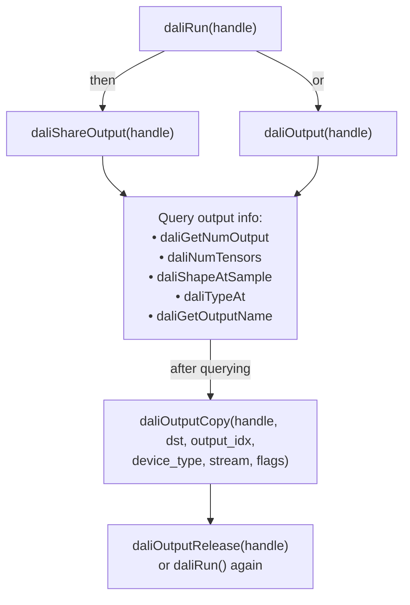

**Output Access Workflow:**

1. **Run**: Call `daliRun()` to execute pipeline iteration
2. **Obtain**: Call `daliOutput()` or `daliShareOutput()` to get outputs
   - `daliOutput()`: Copies data, releases immediately after
   - `daliShareOutput()`: Shares pointers, requires explicit `daliOutputRelease()`
3. **Query**: Use metadata functions to inspect output shapes and types
4. **Copy**: Use `daliOutputCopy()` to copy to external buffer
5. **Release**: Call `daliOutputRelease()` (if using `daliShareOutput`) or next `daliRun()`

**Metadata Query Functions:**

The C API provides rich metadata access:
- `daliShapeAtSample()` - Returns 0-terminated shape array for sample
- `daliMaxDimTensors()` - Maximum dimensionality across batch
- `daliTypeAt()` - Data type of output
- `daliGetOutputName()` - String name of pipeline output

Sources: [include/dali/c_api.h:373-538](), [dali/c_api/c_api.cc:517-632]()

## Performance Optimization Techniques

### Buffer Recycling in External Source

The `InputOperator` class implements buffer recycling for efficient external data handling:

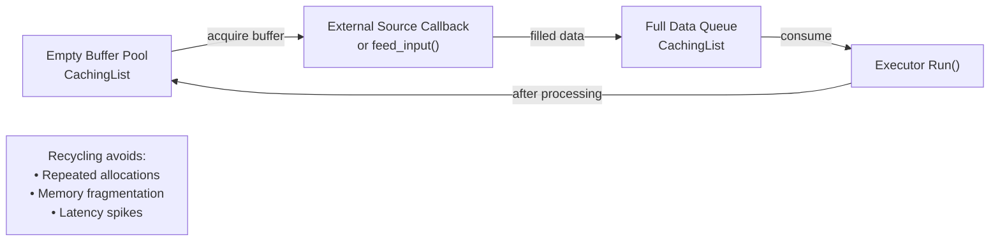

**CachingList Mechanism:**

The `InputOperator` base class manages two `CachingList` instances:
- **Empty buffer pool**: Pre-allocated buffers ready for data
- **Full data queue**: Buffers containing data waiting to be consumed

**Recycling Flow:**

1. External source acquires buffer from empty pool
2. Fills buffer with data from callback or feed_input
3. Enqueues filled buffer to full queue
4. Executor consumes data during Run()
5. After processing, buffer returns to empty pool

This pattern eliminates allocation overhead for repeated iterations.

Sources: [dali/pipeline/operator/builtin/input_operator.h:1-200]()

### Memory Hints and Preallocation

DALI supports `bytes_per_sample_hint` to reduce reallocation:

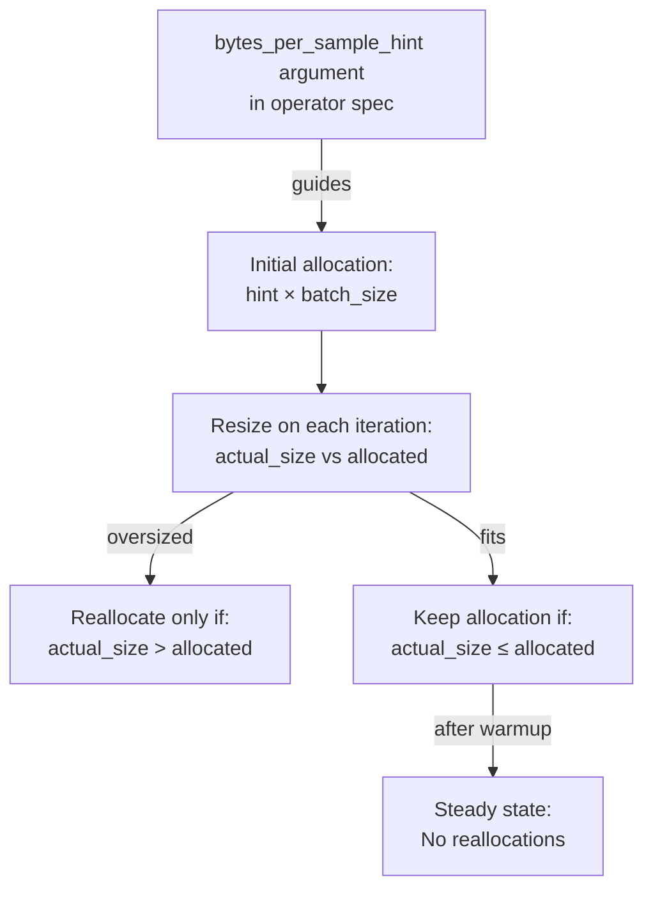

**Hint Propagation:**

Memory hints can propagate through the graph:
- Set via `bytes_per_sample_hint` parameter on operators
- `MakeContiguous` operator copies hints from inputs
- Executor uses hints during buffer preallocation

**Optimization Benefit:**

With accurate hints, after a few warmup iterations:
- Buffers are sized correctly for typical data
- No reallocation overhead in steady state
- Reduced memory fragmentation

Sources: [dali/pipeline/pipeline.cc:502-537]()

### Coalesced Copies in MakeContiguous

The `MakeContiguous` operator optimizes memory transfer efficiency:

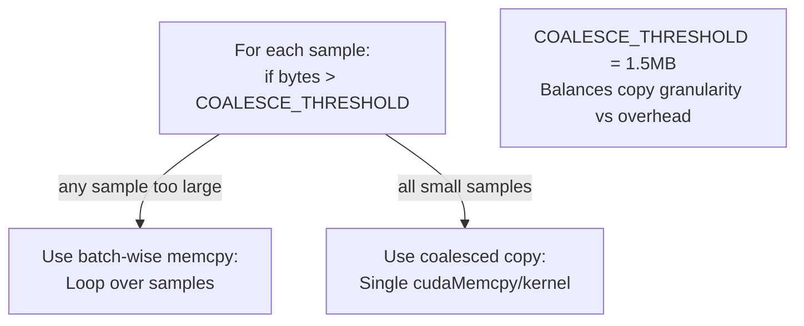

**Coalesced Copy Strategy:**

When multiple small samples need copying:
- Combine into single large copy operation
- Reduces kernel launch overhead on GPU
- Improves PCIe bandwidth utilization for CPU→GPU

**Threshold Tuning:**

The 1.5MB threshold balances:
- Large samples: Individual copies allow better async overlap
- Small samples: Coalescing reduces overhead

Sources: [dali/pipeline/operator/builtin/make_contiguous.cu:22-71]()

## Key Classes and Their Roles

| Class | File | Purpose |
|-------|------|---------|
| `Buffer<Backend>` | [dali/pipeline/data/buffer.h:165-450]() | Base memory management with allocation and type tracking |
| `Tensor<Backend>` | [dali/pipeline/data/tensor.h:43-280]() | Single sample with shape and contiguous storage |
| `TensorList<Backend>` | [dali/pipeline/data/tensor_list.h:73-730]() | Batch container with contiguous/non-contiguous modes |
| `AccessOrder` | [dali/core/access_order.h:30-200]() | CUDA stream synchronization abstraction |
| `InputOperator<Backend>` | [dali/pipeline/operator/builtin/input_operator.h:50-250]() | Base for external data sources with buffer recycling |
| `DALIPipeline` (C API) | [dali/c_api/c_api.cc:73-79]() | C API handle wrapping C++ Pipeline |
| `DLMTensorPtr` | [dali/pipeline/data/dltensor.h:30-100]() | DLPack tensor with shared ownership |

Sources: [dali/pipeline/data/buffer.h](), [dali/pipeline/data/tensor.h](), [dali/pipeline/data/tensor_list.h](), [dali/core/access_order.h](), [dali/c_api/c_api.cc]()

## Summary

Advanced DALI features provide:

1. **Zero-Copy Interoperability**: DLPack, CUDA Array Interface, and NumPy Array Interface enable efficient data sharing with PyTorch, TensorFlow, JAX, NumPy, and CuPy without memory duplication.

2. **Flexible Memory Management**: Contiguous and non-contiguous modes in `TensorList`, stream-ordered allocation/deallocation, and explicit synchronization control via `AccessOrder`.

3. **C API for Language Interoperability**: Complete C interface for integrating DALI with non-Python applications, used by TensorFlow plugin.

4. **Performance Optimizations**: Buffer recycling, memory hints, coalesced copies, and efficient batch operations minimize overhead and maximize throughput.

For detailed information on memory management and interoperability protocols, see [page 6.1](#6.1). For comprehensive C API documentation, see [page 6.2](#6.2).

---

