<!-- source: DeepWiki mcp.deepwiki.com · repo NVIDIA/DALI · page 6.1 Memory Management and Interoperability · fetched 2026-10-26 -->

# Memory Management and Interoperability

<details>
<summary>Relevant source files</summary>

The following files were used as context for generating this wiki page:

- [dali/c_api/c_api.cc](dali/c_api/c_api.cc)
- [dali/c_api/c_api_test.cc](dali/c_api/c_api_test.cc)
- [dali/pipeline/data/buffer.cc](dali/pipeline/data/buffer.cc)
- [dali/pipeline/data/buffer.h](dali/pipeline/data/buffer.h)
- [dali/pipeline/data/tensor.h](dali/pipeline/data/tensor.h)
- [dali/pipeline/data/tensor_list.cc](dali/pipeline/data/tensor_list.cc)
- [dali/pipeline/data/tensor_list.h](dali/pipeline/data/tensor_list.h)
- [dali/pipeline/data/tensor_list_test.cc](dali/pipeline/data/tensor_list_test.cc)
- [dali/pipeline/data/tensor_test.cc](dali/pipeline/data/tensor_test.cc)
- [dali/pipeline/data/tensor_vector.h](dali/pipeline/data/tensor_vector.h)
- [dali/pipeline/operator/builtin/make_contiguous.cc](dali/pipeline/operator/builtin/make_contiguous.cc)
- [dali/pipeline/operator/builtin/make_contiguous.cu](dali/pipeline/operator/builtin/make_contiguous.cu)
- [dali/pipeline/pipeline.cc](dali/pipeline/pipeline.cc)
- [dali/pipeline/pipeline.h](dali/pipeline/pipeline.h)
- [dali/pipeline/pipeline_test.cc](dali/pipeline/pipeline_test.cc)
- [dali/python/backend_impl.cc](dali/python/backend_impl.cc)
- [dali/python/nvidia/dali/pipeline.py](dali/python/nvidia/dali/pipeline.py)
- [dali/python/nvidia/dali/types.py](dali/python/nvidia/dali/types.py)
- [dali/test/python/test_functional_api.py](dali/test/python/test_functional_api.py)
- [dali/test/python/test_pipeline.py](dali/test/python/test_pipeline.py)
- [docs/supported_ops.rst](docs/supported_ops.rst)
- [include/dali/c_api.h](include/dali/c_api.h)

</details>


## Purpose and Scope

This document describes DALI's memory management system and interoperability mechanisms for zero-copy data exchange with external frameworks. It covers:

- Buffer allocation and lifecycle management
- Contiguous vs non-contiguous memory modes for batches
- Synchronization and access ordering with CUDA streams
- Interoperability protocols (DLPack, CUDA Array Interface, NumPy Array Interface)
- C API for language-agnostic framework integration
- Buffer recycling and reuse strategies

For information about the overall data structures (Tensor, TensorList), see [Data Structures](#2.2). For pipeline execution flow, see [Pipeline System](#2.1).

## Memory Management Architecture

### Buffer Hierarchy

DALI's memory management is built on a three-level hierarchy that separates memory management from tensor semantics:

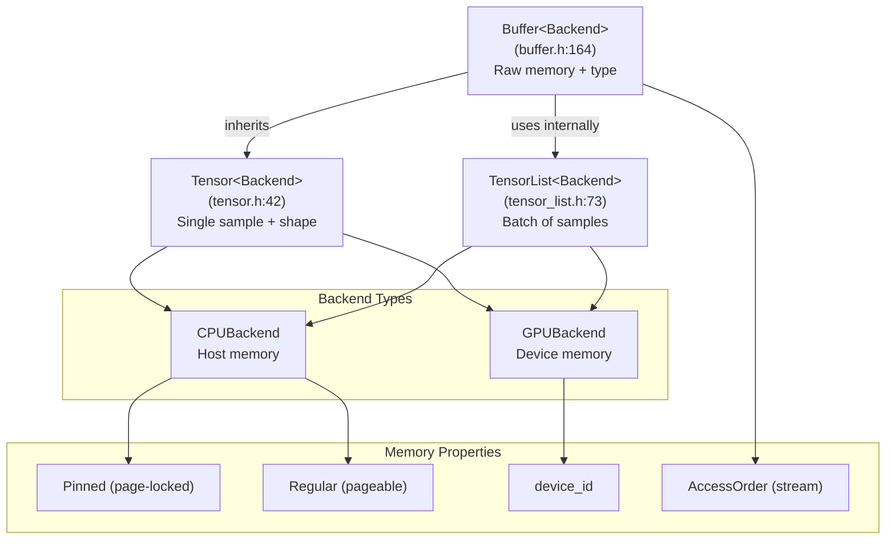

Sources: [dali/pipeline/data/buffer.h:164-343](), [dali/pipeline/data/tensor.h:42-46](), [dali/pipeline/data/tensor_list.h:72-76]()

### Buffer Class

The `Buffer<Backend>` class in [dali/pipeline/data/buffer.h:164-343]() provides the foundation for memory management:

**Key Characteristics:**
- **Type-agnostic initialization**: Buffers start untyped; type is set via `set_type<T>()` or `Resize(shape, type)`
- **Lazy allocation**: Memory allocated only when needed
- **Shared ownership**: Uses `std::shared_ptr<uint8_t>` for reference-counted memory
- **Backend templating**: `CPUBackend` or `GPUBackend` determines allocation strategy

**Core Methods:**
- `resize(size_t bytes)` - Allocates or reuses existing memory if sufficient
- `reserve(size_t bytes)` - Pre-allocates capacity without commitment
- `ShareData(shared_ptr, bytes, ...)` - Wraps external memory with zero-copy
- `set_order(AccessOrder, bool synchronize)` - Associates buffer with CUDA stream

Sources: [dali/pipeline/data/buffer.h:164-343]()

### Memory Allocation

Memory allocation is performed by backend-specific `AllocBuffer` functions:

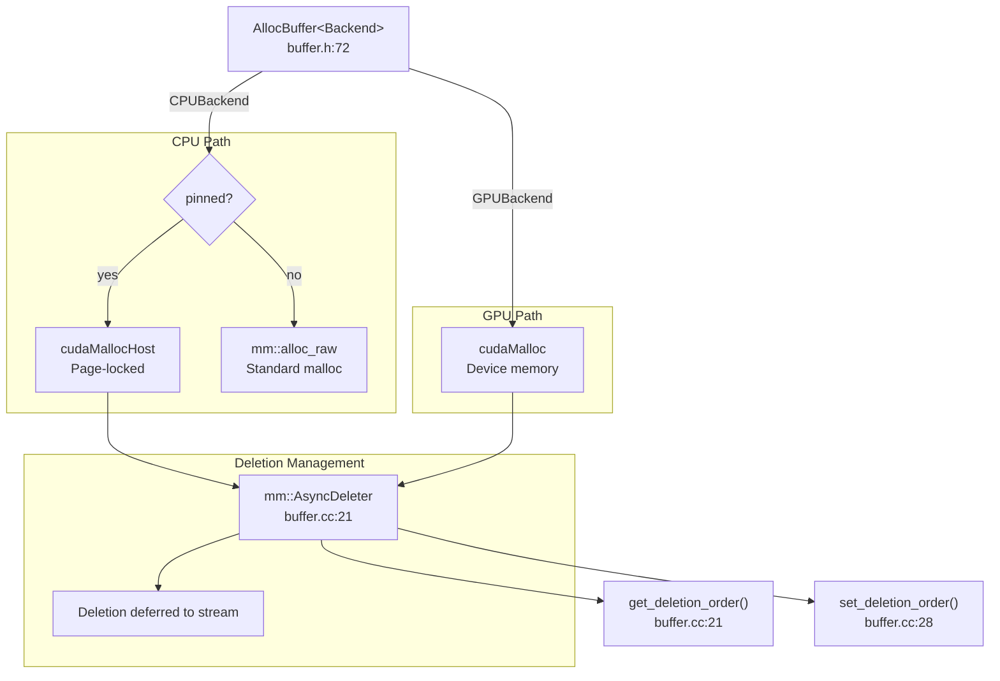

Sources: [dali/pipeline/data/buffer.h:57-76](), [dali/pipeline/data/buffer.cc:21-42]()

**Pinned Memory Usage:**
- Function `RestrictPinnedMemUsage()` checks environment to avoid over-allocation
- Pinned memory enables faster CPU-GPU transfers (~2x) but is a limited resource
- Only allocate pinned memory when GPU transfers are frequent

Sources: [dali/pipeline/data/buffer.h:69](), [dali/pipeline/data/buffer.cc:49-59]()

### Contiguous vs Non-Contiguous Modes

`TensorList<Backend>` supports two allocation strategies controlled by the `BatchContiguity` enum:

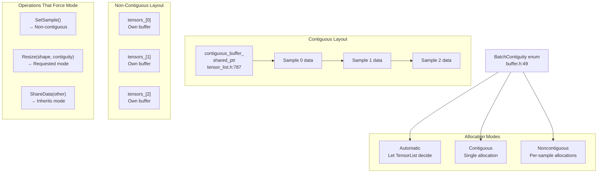

Sources: [dali/pipeline/data/buffer.h:48-53](), [dali/pipeline/data/tensor_list.h:367-415](), [dali/pipeline/data/tensor_list.h:787-791]()

**Contiguous Mode:**
- Single `contiguous_buffer_` shared_ptr holds all sample data sequentially
- More memory efficient for uniform sample sizes
- Enables bulk operations and better cache locality
- Used by `MakeContiguous` operator for pipeline optimization

**Non-Contiguous Mode:**
- Each `Tensor` in `tensors_` vector has independent buffer
- Required for variable-sized samples
- Allows individual sample replacement via `SetSample()`
- Automatically triggered when samples differ in allocation

Sources: [dali/pipeline/data/tensor_list.cc:203-299]()

### Access Order and Synchronization

`AccessOrder` tracks CUDA stream associations to ensure proper synchronization:

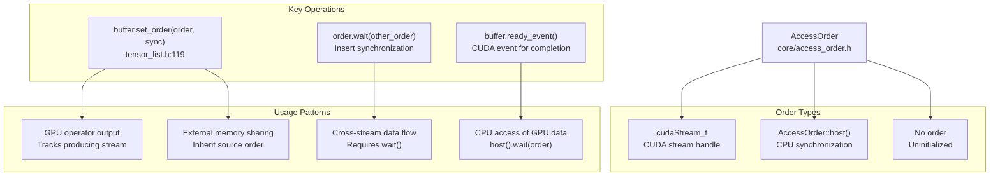

Sources: [dali/pipeline/data/tensor_list.h:102-119](), [dali/core/access_order.h]()

**Synchronization Scenarios:**

1. **Same stream**: No sync needed, operations ordered by stream
2. **Different streams**: `target_order.wait(source_order)` inserts sync
3. **GPU → CPU**: `AccessOrder::host().wait(gpu_order)` for pinned buffers
4. **Fine-grained**: `ready_event()` provides CUDA event for minimal overhead

Sources: [dali/python/backend_impl.cc:149-154](), [dali/python/backend_impl.cc:469-488]()

## Interoperability Protocols

DALI supports multiple zero-copy protocols for efficient data exchange with external frameworks.

### DLPack Protocol

DLPack is DALI's primary interoperability standard for cross-framework tensor sharing.

**Python Interface:**

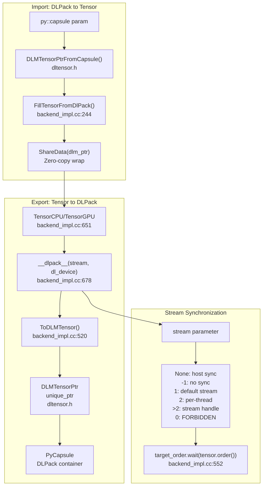

Sources: [dali/python/backend_impl.cc:519-593](), [dali/python/backend_impl.cc:651-701](), [dali/pipeline/data/dltensor.h]()

**Device Type Mapping:**
```
kDLCPU (1)      → Regular CPU memory
kDLCUDAHost (3) → Pinned CPU memory  
kDLCUDA (2)     → CUDA device memory
```

**Stream Handling Special Cases:**
- `stream=0` is explicitly forbidden by DLPack protocol (ambiguous)
- `stream=None` triggers host synchronization before export
- `stream=-1` skips all synchronization (caller's responsibility)
- Numeric stream values converted to `cudaStream_t` for sync

Sources: [dali/python/backend_impl.cc:531-557](), [dali/python/backend_impl.cc:677-701]()

### CUDA Array Interface

The `__cuda_array_interface__` protocol enables zero-copy GPU tensor sharing with CuPy, Numba, and other libraries.

**Interface Dictionary Structure:**

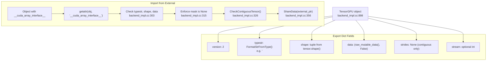

Sources: [dali/python/backend_impl.cc:292-369](), [dali/python/backend_impl.cc:898-967]()

**Stream Interpretation:**
```cpp
// backend_impl.cc:340-352
if (cu_a_interface.contains("stream")) {
  auto stream_long_value = cu_a_interface["stream"].cast<int64_t>();
  auto stream_value = PyLong_AsVoidPtr(...);
  DALI_ENFORCE(stream_value != 0, "0 value is ambiguous and disallowed");
  if (stream_long_value == 1) stream_value = 0;  // Legacy default
  if (stream_long_value == 2) stream_value = CU_STREAM_PER_THREAD;
  batch->set_order(AccessOrder(cudaStream_t(stream_value)));
}
```

Sources: [dali/python/backend_impl.cc:340-352]()

### NumPy Array Interface

The `__array_interface__` protocol provides CPU tensor interoperability with NumPy and buffer-aware libraries.

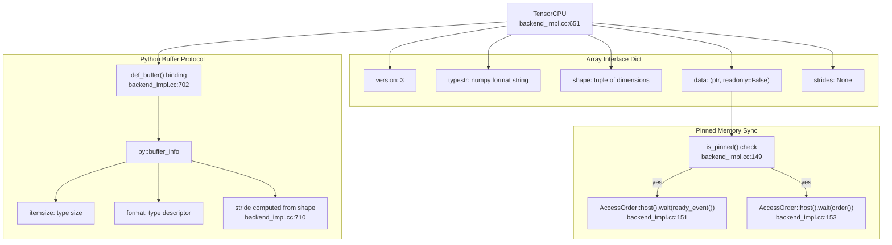

Sources: [dali/python/backend_impl.cc:129-158](), [dali/python/backend_impl.cc:702-728](), [dali/python/backend_impl.cc:874-877]()

**Stride Calculation:**
```cpp
// backend_impl.cc:710-713
stride[(t.ndim()-1) - i] = t.type_info().size() * dim_prod;
dim_prod *= t.shape()[(t.ndim()-1) - i];
```
Strides computed backwards for C-contiguous (row-major) layout.

Sources: [dali/python/backend_impl.cc:706-714]()

### Zero-Copy External Memory Sharing

The `ShareData()` mechanism enables wrapping external memory without copying:

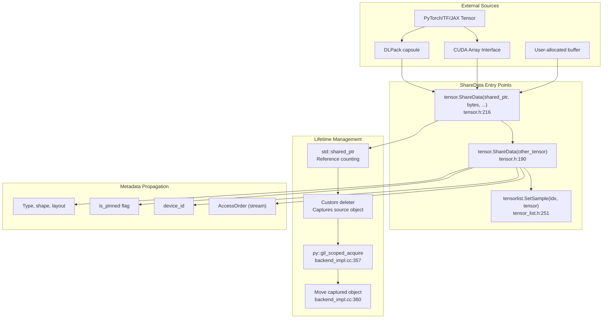

Sources: [dali/pipeline/data/tensor.h:190-237](), [dali/pipeline/data/tensor_list.h:251-272](), [dali/python/backend_impl.cc:354-368](), [dali/python/backend_impl.cc:751-763]()

**Key Properties:**
- **Zero-copy**: Only pointer aliasing, no data duplication
- **Lifetime safety**: Source kept alive via shared_ptr reference counting
- **GIL-aware deleters**: Python object destruction requires GIL
- **Stream propagation**: `AccessOrder` inherited from source
- **Type preservation**: Shape, type, layout, pinned status all copied

Sources: [dali/pipeline/data/tensor.h:190-203](), [dali/pipeline/data/tensor_list.h:290-292]()

## C API for Framework Integration

The C API in [dali/c_api/c_api.cc]() provides language-agnostic integration for frameworks with ABI incompatibilities.

### Pipeline Handle Structure

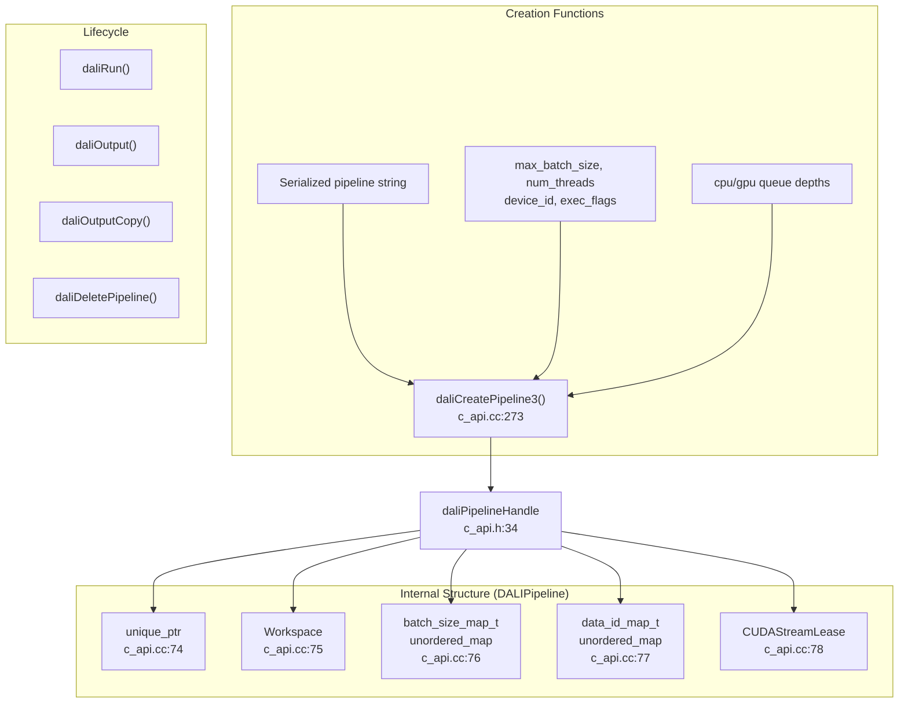

Sources: [dali/c_api/c_api.cc:73-79](), [dali/c_api/c_api.cc:253-294](), [include/dali/c_api.h:34-48]()

### External Input Setting

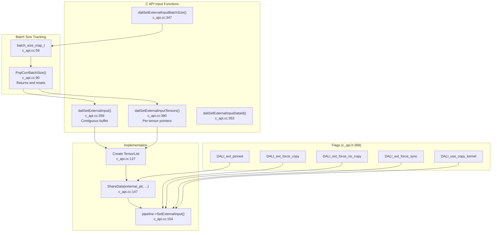

Sources: [dali/c_api/c_api.cc:119-210](), [dali/c_api/c_api.cc:347-450](), [include/dali/c_api.h:285-368]()

**Copy Mode Extraction:**
```cpp
// c_api.cc:106-117
InputOperatorCopyMode GetExternalSourceCopyMode(unsigned int flags) {
  DALI_ENFORCE(!((flags & DALI_ext_force_copy) && 
                 (flags & DALI_ext_force_no_copy)), "Cannot force both");
  if (flags & DALI_ext_force_copy) return InputOperatorCopyMode::FORCE_COPY;
  if (flags & DALI_ext_force_no_copy) return InputOperatorCopyMode::FORCE_NO_COPY;
  return InputOperatorCopyMode::DEFAULT;
}
```

Sources: [dali/c_api/c_api.cc:106-117]()

### Output Copy Operations

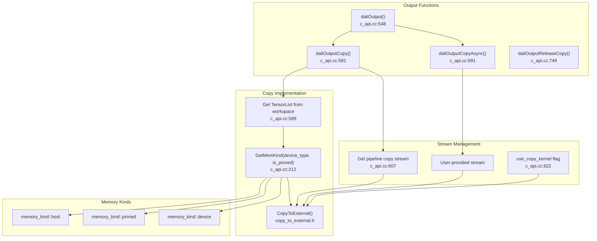

Sources: [dali/c_api/c_api.cc:548-672](), [dali/c_api/c_api.cc:690-740](), [include/dali/c_api.h:464-549]()

**Memory Kind Determination:**
```cpp
// c_api.cc:212-216
inline mm::memory_kind_id GetMemKind(device_type_t device_type, bool is_pinned) {
  return device_type == GPU ? mm::memory_kind_id::device
       : (is_pinned ? mm::memory_kind_id::pinned : mm::memory_kind_id::host);
}
```

Sources: [dali/c_api/c_api.cc:212-216]()

## Buffer Recycling

DALI's `InputOperator` system uses `CachingList` for buffer recycling to minimize allocations.

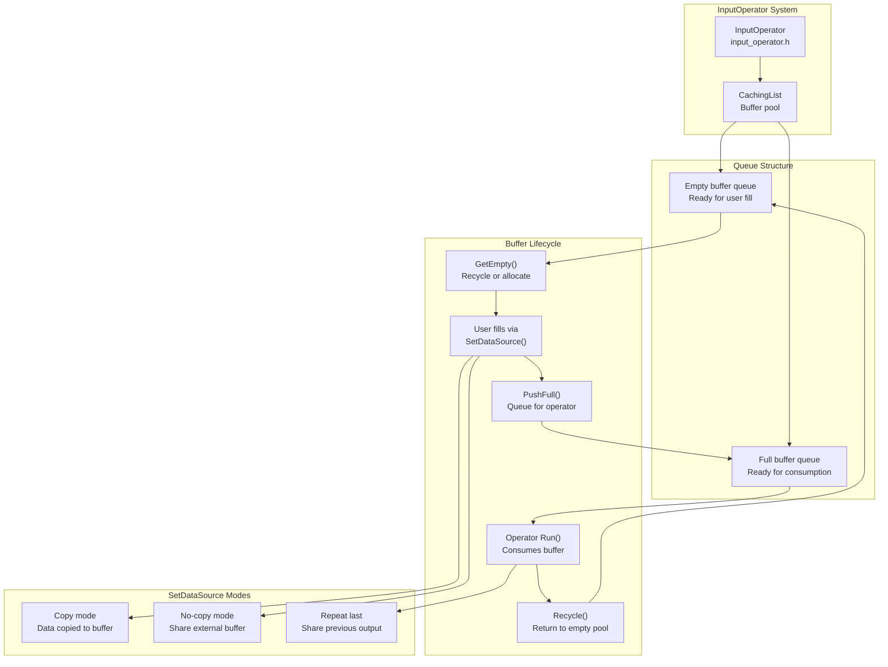

Sources: [dali/pipeline/operator/builtin/input_operator.h](), [dali/python/nvidia/dali/pipeline.py:134-188]()

The recycling system enables efficient reuse across iterations while supporting both copy and zero-copy modes.

## Memory Statistics

DALI provides memory usage tracking when `exec_dynamic=False`:

**Executor Statistics:**
```python
stats = pipeline.executor_statistics()
# Returns dict: {operator_name: metadata}
# Each metadata contains:
#   - real_memory_size: list of actual bytes per output
#   - max_real_memory_size: list of peak bytes per output
#   - reserved_memory_size: list of allocated capacity per output
#   - max_reserved_memory_size: list of peak capacity per output
```

Sources: [dali/python/nvidia/dali/pipeline.py:620-643](), [dali/pipeline/pipeline.h:374-380]()

**Shared Memory Statistics (Parallel ExternalSource):**
```python
shm_stats = pipeline.external_source_shm_statistics()
# Returns:
#   {"capacities": [bytes, ...],
#    "per_sample_capacities": [bytes/sample, ...]}
```

Sources: [dali/python/nvidia/dali/pipeline.py:645-676]()

## Best Practices

### Pinned Memory Usage

**When to use pinned memory:**
- Frequent CPU→GPU transfers (2x faster than pageable)
- Data will be consumed by GPU operators
- Memory footprint is manageable

**When to avoid:**
- CPU-only processing
- System memory constrained (pinned is limited resource)
- `RestrictPinnedMemUsage()` returns true

Sources: [dali/pipeline/data/buffer.h:69](), [dali/pipeline/data/buffer.cc:49-59]()

### Contiguous vs Non-Contiguous

**Use contiguous when:**
- Uniform sample sizes
- Bulk operations benefit from locality
- `MakeContiguous` operator applied

**Use non-contiguous when:**
- Variable sample sizes
- Individual sample manipulation via `SetSample()`
- Building batch from disparate sources

Sources: [dali/pipeline/data/tensor_list.h:367-415](), [dali/pipeline/operator/builtin/make_contiguous.cc]()

### Zero-Copy Interoperability

**For maximum efficiency:**
- Prefer DLPack for framework-agnostic sharing
- Use `no_copy=True` in ExternalSource when data lifetime guaranteed
- Check `ready_event()` before CPU access of GPU-touched pinned memory
- Preserve `AccessOrder` when sharing between streams

Sources: [dali/python/backend_impl.cc:519-593](), [dali/python/nvidia/dali/pipeline.py:201-210]()

### Access Order Management

**Critical synchronization patterns:**
- Call `set_order()` when sharing data between streams
- Use `wait()` to insert sync between different orders
- For GPU→CPU: `AccessOrder::host().wait(gpu_order)`
- External sharing: inherit source's `AccessOrder`

Sources: [dali/pipeline/data/tensor_list.h:102-119](), [dali/python/backend_impl.cc:469-488]()

## Summary

DALI's memory management provides:

1. **Flexible allocation**: Contiguous/non-contiguous modes via `BatchContiguity`
2. **Buffer recycling**: `CachingList` minimizes allocations
3. **Zero-copy protocols**: DLPack, CUDA Array Interface, NumPy Array Interface
4. **Stream ordering**: `AccessOrder` ensures proper synchronization
5. **Safe sharing**: Reference-counted lifetime via `shared_ptr`
6. **Language bridges**: C API for framework integration

This architecture enables efficient data loading while maintaining safety and broad framework compatibility.

Sources: [dali/pipeline/data/buffer.h](), [dali/pipeline/data/tensor.h](), [dali/pipeline/data/tensor_list.h](), [dali/python/backend_impl.cc](), [dali/c_api/c_api.cc]()

---

