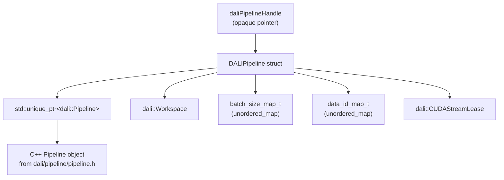
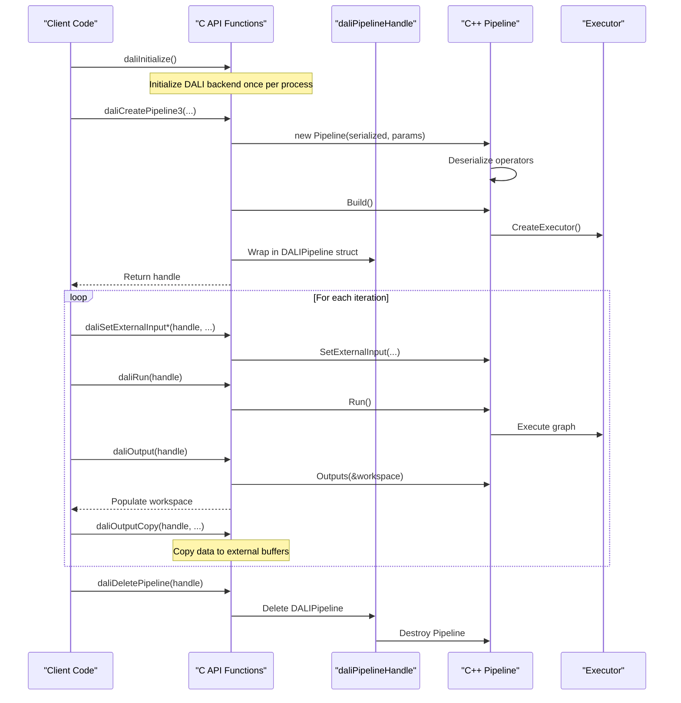
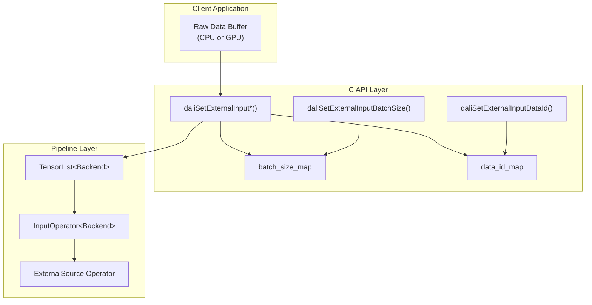
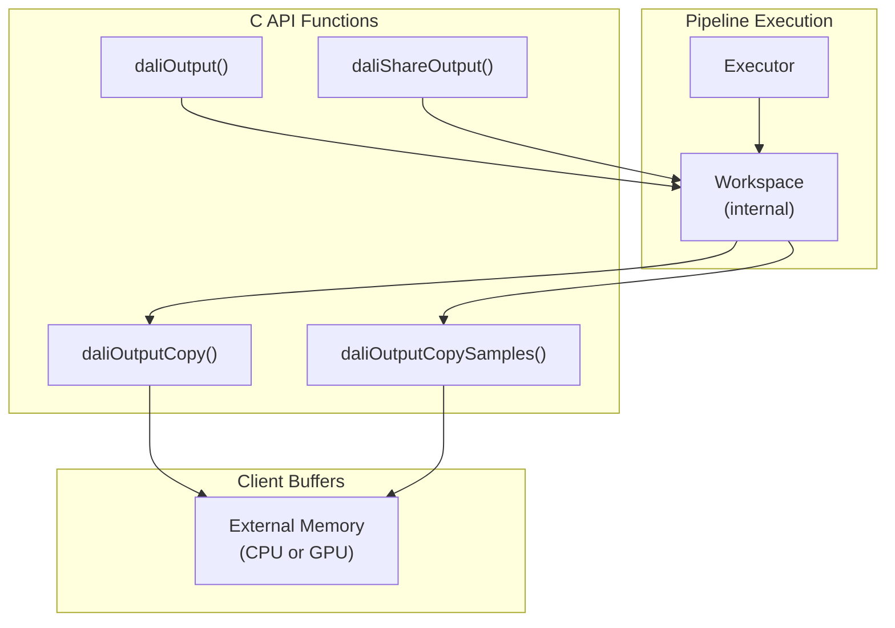
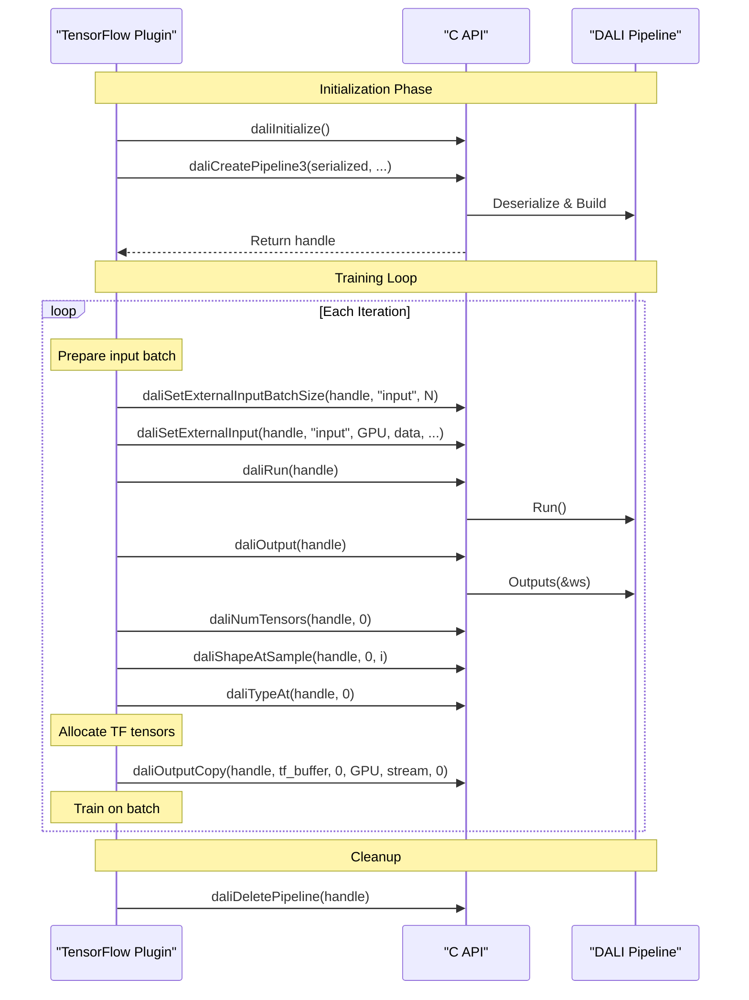

<!-- source: DeepWiki mcp.deepwiki.com · repo NVIDIA/DALI · page 6.2 C API · fetched 2026-10-26 -->

# C API

<details>
<summary>Relevant source files</summary>

The following files were used as context for generating this wiki page:

- [dali/c_api/c_api.cc](dali/c_api/c_api.cc)
- [dali/c_api/c_api_test.cc](dali/c_api/c_api_test.cc)
- [dali/pipeline/pipeline.cc](dali/pipeline/pipeline.cc)
- [dali/pipeline/pipeline.h](dali/pipeline/pipeline.h)
- [dali/pipeline/pipeline_test.cc](dali/pipeline/pipeline_test.cc)
- [dali/python/backend_impl.cc](dali/python/backend_impl.cc)
- [dali/python/nvidia/dali/pipeline.py](dali/python/nvidia/dali/pipeline.py)
- [dali/python/nvidia/dali/types.py](dali/python/nvidia/dali/types.py)
- [dali/test/python/test_functional_api.py](dali/test/python/test_functional_api.py)
- [dali/test/python/test_pipeline.py](dali/test/python/test_pipeline.py)
- [docs/supported_ops.rst](docs/supported_ops.rst)
- [include/dali/c_api.h](include/dali/c_api.h)

</details>


## Purpose and Scope

The C API provides a language-agnostic interface to DALI's pipeline execution system. It exposes C-style functions that wrap the C++ Pipeline API, enabling integration with frameworks and languages that cannot directly use C++ interfaces. The primary use case is the TensorFlow plugin integration.

For information about the underlying C++ Pipeline system, see [Core Architecture](#2). For Python API usage, see [Python API](#3). For framework-specific integration patterns, see [Framework Integration](#4).

## Overview

The C API consists of:
- **Pipeline Management**: Functions to create, build, and destroy pipelines from serialized definitions
- **Execution Control**: Functions to run pipelines and manage prefetching
- **Data Exchange**: Functions to set external inputs and retrieve outputs
- **Metadata Access**: Functions to query pipeline properties and output information

The C API is defined in [include/dali/c_api.h]() and implemented in [dali/c_api/c_api.cc]().

Sources: [include/dali/c_api.h:1-270](), [dali/c_api/c_api.cc:1-80]()

## Core Data Structures and Types

### Pipeline Handle



The `daliPipelineHandle` is an opaque pointer to a `DALIPipeline` struct that aggregates:
- The underlying C++ `Pipeline` object
- A `Workspace` for output data
- Maps for tracking batch sizes and data IDs per input operator
- A CUDA stream lease for copy operations

Sources: [include/dali/c_api.h:34](), [dali/c_api/c_api.cc:73-79]()

### Enumerations and Data Types

| C API Type | Purpose | Values |
|------------|---------|--------|
| `device_type_t` | Device placement | `CPU = 0`, `GPU = 1` |
| `dali_backend_t` | Operator backend | `DALI_BACKEND_CPU`, `DALI_BACKEND_GPU`, `DALI_BACKEND_MIXED` |
| `dali_data_type_t` | Data type identifier | Alias to `daliDataType_t` (matches `DALIDataType` enum) |
| `dali_exec_flags_t` | Executor configuration | Bitfield flags (see below) |

**Executor Flags:**
```cpp
DALI_EXEC_IS_PIPELINED    = 1   // Enable pipelined execution
DALI_EXEC_IS_ASYNC        = 2   // Enable async execution
DALI_EXEC_IS_SEPARATED    = 4   // Separate CPU/GPU queue depths
DALI_EXEC_IS_DYNAMIC      = 8   // Use dynamic executor

DALI_EXEC_SIMPLE          = 0   // No special features
DALI_EXEC_ASYNC_PIPELINED = 3   // Pipelined + Async
DALI_EXEC_DYNAMIC         = 11  // Pipelined + Async + Dynamic
```

**External Input Flags:**
```cpp
DALI_ext_default         = 0       // Default behavior
DALI_ext_force_sync      = (1<<0)  // Synchronous GPU transfer
DALI_ext_pinned          = (1<<1)  // Memory is page-locked
DALI_use_copy_kernel     = (1<<2)  // Use CUDA kernel for copy
DALI_ext_force_copy      = (1<<3)  // Override no_copy, force copy
DALI_ext_force_no_copy   = (1<<4)  // Override no_copy, force zero-copy
```

Sources: [include/dali/c_api.h:36-70](), [include/dali/c_api.h:213-241]()

## Pipeline Lifecycle



Sources: [dali/c_api/c_api.cc:232-301](), [dali/c_api/c_api.cc:319-344](), [dali/c_api/c_api.cc:446-507]()

### Pipeline Creation Functions

**daliCreatePipeline3** (recommended):
```c
void daliCreatePipeline3(
    daliPipelineHandle *pipe_handle,
    const char *serialized_pipeline,
    int length,
    int max_batch_size,
    int num_threads,
    int device_id,
    dali_exec_flags_t exec_flags,
    int prefetch_queue_depth,
    int cpu_prefetch_queue_depth,
    int gpu_prefetch_queue_depth,
    int enable_memory_stats
);
```

Creates a pipeline by deserializing a protobuf string. Parameters override serialized values if specified (non-negative).

**daliDeserializeDefault**:
```c
void daliDeserializeDefault(
    daliPipelineHandle *pipe_handle,
    const char *serialized_pipeline,
    int length
);
```

Deserializes with all parameters inherited from the serialized pipeline.

**daliIsDeserializable**:
```c
int daliIsDeserializable(const char *serialized_pipeline, int length);
```

Returns 0 if deserializable, 1 otherwise.

Sources: [include/dali/c_api.h:135-210](), [dali/c_api/c_api.cc:253-301]()

## Data Input and Output

### Setting External Inputs



**Batch Size Management:**

Before setting external input, optionally specify the batch size (default is max batch size):
```c
void daliSetExternalInputBatchSize(
    daliPipelineHandle *pipe_handle,
    const char *name,
    int batch_size
);
```

**Data ID Tracking:**

Associate a data ID for tracking (used in checkpointing):
```c
void daliSetExternalInputDataId(
    daliPipelineHandle *pipe_handle,
    const char *operator_name,
    const char *data_id
);
```

**External Input Functions:**

For contiguous data (single allocation):
```c
void daliSetExternalInput(
    daliPipelineHandle *pipe_handle,
    const char *name,
    device_type_t device,
    const void *data_ptr,
    dali_data_type_t data_type,
    const int64_t *shapes,        // Flattened: [sample0_shape..., sample1_shape...]
    int sample_dim,               // Dimensionality of each sample
    const char *layout_str,       // Optional layout string
    cudaStream_t stream,
    unsigned int flags
);
```

For non-contiguous data (per-sample pointers):
```c
void daliSetExternalInputTensors(
    daliPipelineHandle *pipe_handle,
    const char *name,
    device_type_t device,
    const void *const *data_ptr,  // Array of pointers, one per sample
    dali_data_type_t data_type,
    const int64_t *shapes,
    int64_t sample_dim,
    const char *layout_str,
    cudaStream_t stream,
    unsigned int flags
);
```

The implementation constructs a `TensorList` with shared ownership (no copy by default) and passes it to the pipeline's `SetExternalInput` method.

Sources: [include/dali/c_api.h:247-317](), [dali/c_api/c_api.cc:119-210](), [dali/c_api/c_api.cc:347-413]()

### Retrieving Outputs



**Output Retrieval:**

```c
// Populates workspace and releases previous outputs
void daliOutput(daliPipelineHandle *pipe_handle);

// Populates workspace without releasing previous outputs
void daliShareOutput(daliPipelineHandle *pipe_handle);

// Release previously shared outputs
void daliReleaseOutput(daliPipelineHandle *pipe_handle);
```

**Output Copy:**

Copy entire output to external buffer:
```c
void daliOutputCopy(
    daliPipelineHandle *pipe_handle,
    void *dst,
    int output_idx,
    device_type_t dst_type,
    cudaStream_t stream,
    unsigned int flags
);
```

Copy specific samples:
```c
void daliOutputCopySamples(
    daliPipelineHandle *pipe_handle,
    void *dst,
    int output_idx,
    device_type_t dst_type,
    cudaStream_t stream,
    unsigned int flags,
    int first_sample,
    int last_sample  // Exclusive
);
```

The copy functions use `CopyToExternal` internally and handle both CPU and GPU destinations with appropriate synchronization.

Sources: [include/dali/c_api.h:344-434](), [dali/c_api/c_api.cc:446-560]()

### Output Metadata

```c
// Number of outputs in the pipeline
int daliGetNumOutput(daliPipelineHandle *pipe_handle);

// Name of output at index
const char* daliGetOutputName(daliPipelineHandle *pipe_handle, int output_idx);

// Number of tensors in output batch
int daliNumTensors(daliPipelineHandle *pipe_handle, int output_idx);

// Maximum tensor size in bytes for an output
size_t daliMaxDimTensors(daliPipelineHandle *pipe_handle, int output_idx);

// Shape at specific index (0-terminated array, caller must free)
int64_t* daliShapeAt(daliPipelineHandle *pipe_handle, int output_idx);
int64_t* daliShapeAtSample(daliPipelineHandle *pipe_handle, int output_idx, int sample_idx);

// Data type of output
dali_data_type_t daliTypeAt(daliPipelineHandle *pipe_handle, int output_idx);
```

Sources: [include/dali/c_api.h:436-516](), [dali/c_api/c_api.cc:562-663]()

## Execution Control

### Running the Pipeline

```c
// Run pipeline once
void daliRun(daliPipelineHandle *pipe_handle);

// Fill prefetch queues
void daliPrefetch(daliPipelineHandle *pipe_handle);

// Query how many times input must be fed before Run can be called
int daliInputFeedCount(daliPipelineHandle *pipe_handle, const char *input_name);

// Get max batch size
int daliGetMaxBatchSize(daliPipelineHandle *pipe_handle);
```

**Execution Flow:**
1. Call `daliSetExternalInput*` for each external input, `InputFeedCount(name)` times
2. Optionally call `daliPrefetch()` to fill queues
3. Call `daliRun()` to execute one iteration
4. Call `daliOutput()` or `daliShareOutput()` to retrieve results
5. Call `daliOutputCopy*()` to copy data to external buffers
6. Repeat from step 1

Sources: [include/dali/c_api.h:319-342](), [dali/c_api/c_api.cc:314-344]()

## Checkpointing Support

The C API provides checkpointing functions to save and restore pipeline state:

```c
// Get serialized checkpoint with external context
void daliGetSerializedCheckpoint(
    daliPipelineHandle *pipe_handle,
    const char **checkpoint,
    size_t *checkpoint_size,
    daliExternalContextCheckpoint *external_ctx_cpt
);

// Restore from serialized checkpoint
void daliRestoreFromCheckpoint(
    daliPipelineHandle *pipe_handle,
    const char *checkpoint,
    size_t checkpoint_size,
    daliExternalContextCheckpoint *external_ctx_cpt
);
```

The `daliExternalContextCheckpoint` struct allows passing framework-specific state:
```c
typedef struct {
    daliExternalContextField pipeline_data;  // User-defined pipeline state
    daliExternalContextField iterator_data;  // User-defined iterator state
} daliExternalContextCheckpoint;

typedef struct daliExternalContextField {
    char *data;
    size_t size;
} daliExternalContextField;
```

Sources: [include/dali/c_api.h:96-108](), [include/dali/c_api.h:551-584](), [dali/c_api/c_api.cc:707-763]()

## Reader and Executor Metadata

### Reader Metadata

```c
typedef struct {
    int64_t epoch_size;          // Raw epoch size
    int64_t epoch_size_padded;   // Epoch size with padding
    int number_of_shards;        // Number of shards
    int shard_id;                // Shard ID
    int pad_last_batch;          // Pad last batch flag
    int stick_to_shard;          // Stick to shard flag
} daliReaderMetadata;

void daliReaderMetadata(
    daliPipelineHandle *pipe_handle,
    daliReaderMetadata *meta,
    const char *reader_name
);
```

### Executor Statistics

```c
typedef struct {
    char *operator_name;
    size_t out_num;
    size_t *real_size;       // Actual output sizes
    size_t *max_real_size;   // Max tensor size
    size_t *reserved;        // Reserved memory
    size_t *max_reserved;    // Max reserved
} daliExecutorMetadata;

size_t daliExecutorMetadata(
    daliPipelineHandle *pipe_handle,
    daliExecutorMetadata **meta
);

void daliDeleteExecutorMetadata(daliExecutorMetadata *meta, int meta_num);
```

Note: Executor metadata is only available when `exec_dynamic=False`.

Sources: [include/dali/c_api.h:74-94](), [include/dali/c_api.h:518-549](), [dali/c_api/c_api.cc:665-705]()

## Memory Management and Cleanup

```c
// Delete pipeline handle and free resources
void daliDeletePipeline(daliPipelineHandle *pipe_handle);
```

The `daliDeletePipeline` function:
1. Calls `Shutdown()` on the pipeline
2. Deletes the `DALIPipeline` struct
3. Releases the CUDA stream lease (if any)
4. Invalidates the handle

**Memory Ownership:**
- Input data passed via `daliSetExternalInput*` is shared (not copied by default unless `DALI_ext_force_copy` is set)
- Shape arrays returned by `daliShapeAt*` must be freed by the caller using `free()`
- Executor metadata returned by `daliExecutorMetadata` must be freed using `daliDeleteExecutorMetadata`
- The client is responsible for managing external buffers passed to `daliOutputCopy*`

Sources: [include/dali/c_api.h:586-593](), [dali/c_api/c_api.cc:765-771]()

## Integration Pattern Example



This pattern is used by the TensorFlow plugin ([dali/c_api/c_api.cc]() is called from TF dataset operations).

Sources: [dali/c_api/c_api.cc:1-771](), [dali/c_api/c_api_test.cc:1-800]()

## Function Reference Summary

| Category | Functions |
|----------|-----------|
| **Initialization** | `daliInitialize` |
| **Pipeline Creation** | `daliCreatePipeline`, `daliCreatePipeline2`, `daliCreatePipeline3`, `daliDeserializeDefault`, `daliIsDeserializable` |
| **External Input** | `daliSetExternalInputBatchSize`, `daliSetExternalInputDataId`, `daliSetExternalInput`, `daliSetExternalInputAsync`, `daliSetExternalInputTensors`, `daliSetExternalInputTensorsAsync` |
| **Execution** | `daliRun`, `daliPrefetch`, `daliPrefetchUniform`, `daliPrefetchSeparate`, `daliInputFeedCount` |
| **Output Retrieval** | `daliOutput`, `daliShareOutput`, `daliReleaseOutput`, `daliOutputCopy`, `daliOutputCopySamples` |
| **Metadata** | `daliGetMaxBatchSize`, `daliGetNumOutput`, `daliGetOutputName`, `daliNumTensors`, `daliMaxDimTensors`, `daliShapeAt`, `daliShapeAtSample`, `daliTypeAt` |
| **Reader Info** | `daliReaderMetadata` |
| **Statistics** | `daliExecutorMetadata`, `daliDeleteExecutorMetadata` |
| **Checkpointing** | `daliGetSerializedCheckpoint`, `daliRestoreFromCheckpoint` |
| **Cleanup** | `daliDeletePipeline` |

Sources: [include/dali/c_api.h:1-595]()

---

