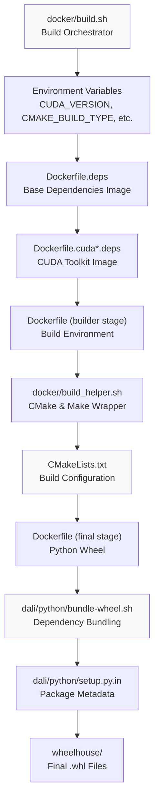
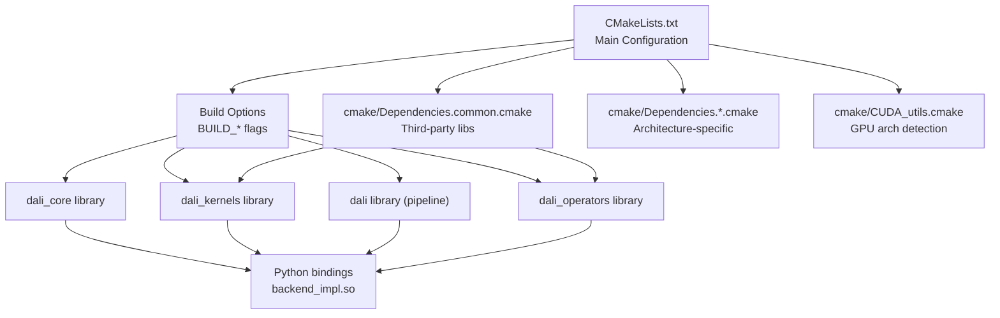
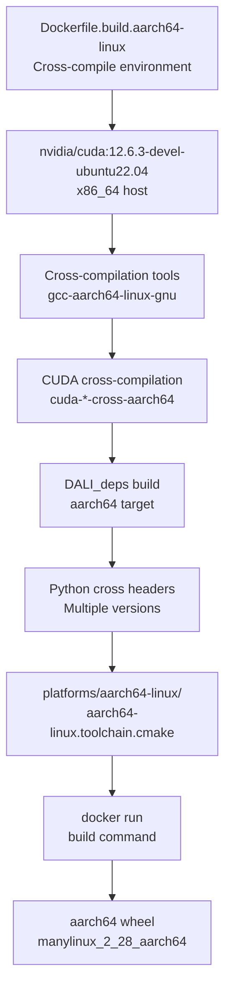

<!-- source: DeepWiki mcp.deepwiki.com · repo NVIDIA/DALI · page 7 Build and Development · fetched 2026-10-26 -->

# Build and Development

<details>
<summary>Relevant source files</summary>

The following files were used as context for generating this wiki page:

- [.gitmodules](.gitmodules)
- [Acknowledgements.txt](Acknowledgements.txt)
- [CMakeLists.txt](CMakeLists.txt)
- [DALI_DEPS_VERSION](DALI_DEPS_VERSION)
- [cmake/Dependencies.common.cmake](cmake/Dependencies.common.cmake)
- [conda/config/conda_build_config.yaml](conda/config/conda_build_config.yaml)
- [conda/third_party/dali_ffmpeg/recipe/build.sh](conda/third_party/dali_ffmpeg/recipe/build.sh)
- [conda/third_party/dali_ffmpeg/recipe/meta.yaml](conda/third_party/dali_ffmpeg/recipe/meta.yaml)
- [conda/third_party/dali_opencv/recipe/meta.yaml](conda/third_party/dali_opencv/recipe/meta.yaml)
- [conda/third_party/jpeg_turbo/recipe/meta.yaml](conda/third_party/jpeg_turbo/recipe/meta.yaml)
- [dali/python/bundle-wheel.sh](dali/python/bundle-wheel.sh)
- [dali/python/nvidia/dali/backend.py](dali/python/nvidia/dali/backend.py)
- [dali/python/setup.py.in](dali/python/setup.py.in)
- [dali_tf_plugin/setup.py.in](dali_tf_plugin/setup.py.in)
- [docker/Dockerfile](docker/Dockerfile)
- [docker/Dockerfile.build.aarch64-linux](docker/Dockerfile.build.aarch64-linux)
- [docker/Dockerfile.deps](docker/Dockerfile.deps)
- [docker/build.sh](docker/build.sh)
- [docker/build_helper.sh](docker/build_helper.sh)
- [docs/compilation.rst](docs/compilation.rst)
- [third_party/README.rst](third_party/README.rst)

</details>


This document covers the build system, development workflow, and infrastructure for compiling DALI from source. It describes the two primary build approaches (Docker-based and bare metal), the CMake build system configuration, and the Python wheel packaging process. For detailed information about specific components, see:
- Build system internals, CMake configuration, and Docker infrastructure: [Build System](#7.1)
- Third-party dependencies and version management: [Dependencies](#7.2)  
- Testing frameworks, QA scripts, and CI integration: [Testing Infrastructure](#7.3)

## Build Approaches

DALI supports two primary build approaches: Docker-based builds (recommended for reproducible builds and release packaging) and bare metal builds (suitable for development iterations).

### Docker Build Flow

The Docker-based build system provides a multi-stage build process that ensures reproducible builds across different environments:



**Docker Build Pipeline**

The `build.sh` script orchestrates the entire Docker build process, creating a series of intermediate images:

1. **Dependencies Image** (`Dockerfile.deps`): Installs system dependencies and builds DALI_deps repository components
2. **CUDA Dependencies Image** (`Dockerfile.cuda*.deps`): Adds CUDA toolkit and GPU-related libraries
3. **Builder Image** (`Dockerfile` builder stage): Compiles DALI C++ code and creates Python bindings
4. **Wheel Image**: Packages the build artifacts into a Python wheel with bundled dependencies

Sources: [docker/build.sh:1-354](), [docker/Dockerfile:1-134](), [docker/Dockerfile.deps:1-47]()

### Build Configuration Variables

The build process is controlled through environment variables that can be set when invoking `build.sh`:

| Variable | Default | Description |
|----------|---------|-------------|
| `CUDA_VERSION` | `13.1` | CUDA toolkit version (12.0-13.1 supported) |
| `CMAKE_BUILD_TYPE` | `Release` | Build type: Release, Debug, DevDebug, RelWithDebInfo |
| `BUILD_PYTHON` | `ON` | Enable Python bindings |
| `BUILD_TEST` | `ON` | Build test suite |
| `BUILD_BENCHMARK` | `ON` | Build benchmarks |
| `BUILD_INHOST` | `YES` | Mount source as volume for faster rebuilds |
| `ARCH` | `x86_64` | Target architecture: x86_64 or aarch64-linux |
| `WHL_PLATFORM_NAME` | `manylinux_2_28_x86_64` | Python wheel platform tag |
| `PYTHON_VERSIONS` | `3.9;3.10;3.11;3.12;3.13` | Python versions to support |

Sources: [docker/build.sh:39-93](), [docker/build_helper.sh:26-77]()

## CMake Build Configuration

The core build system uses CMake with extensive configuration options. The main configuration happens in `CMakeLists.txt`, which manages:



**CMake Configuration Flow**

### Key CMake Options

The build can be customized with numerous CMake options defined in `CMakeLists.txt`:

**Core Build Options:**
- `BUILD_DALI_NODEPS` - Disable all third-party dependencies (builds only core and kernels)
- `LINK_DRIVER` - Link directly with libcuda.so instead of dlopen at runtime
- `WITH_DYNAMIC_CUDA_TOOLKIT` - Link CUDA toolkit libraries dynamically
- `BUILD_WITH_ASAN/LSAN/UBSAN` - Enable sanitizers for debugging

**Component Options:**
- `BUILD_PYTHON` - Build Python bindings (default: ON)
- `BUILD_TEST` - Build GoogleTest test suite (default: ON)
- `BUILD_BENCHMARK` - Build benchmark suite (default: ON)

**Library Options:**
- `BUILD_NVJPEG` - nvJPEG support (default: ON)
- `BUILD_NVJPEG2K` - nvJPEG2K support (default: ON)
- `BUILD_NVDEC` - NVIDIA video decoder (default: ON)
- `BUILD_NVIMAGECODEC` - nvImageCodec library (default: ON)
- `BUILD_OPENCV` - OpenCV support (default: depends on BUILD_DALI_NODEPS)
- `BUILD_FFMPEG` - FFmpeg video support (default: depends on BUILD_NVDEC)
- `BUILD_CVCUDA` - CV-CUDA integration (default: ON)
- `BUILD_NVCOMP` - nvCOMP compression (default: OFF)

Sources: [CMakeLists.txt:52-196](), [CMakeLists.txt:323-387]()

## Python Wheel Packaging

The Python wheel creation is a multi-step process that bundles DALI's native libraries with their dependencies:

```mermaid
graph LR
    SetupPyIn["setup.py.in<br/>Template"]
    Configure["CMake Configure<br/>Substitutes @VARS@"]
    SetupPy["dali/python/setup.py<br/>Generated"]
    
    BuildExt["setup.py bdist_wheel<br/>Creates .whl"]
    RawWheel["Raw wheel<br/>nvidia_dali*.whl"]
    
    BundleScript["bundle-wheel.sh<br/>Dependency bundler"]
    
    CopyDeps["Copy shared libraries<br/>.libs/ directory"]
    PatchELF["patchelf operations<br/>Fix SONAME & RPATH"]
    RepackWheel["Repack with dependencies"]
    
    FinalWheel["Final wheel<br/>wheelhouse/"]
    
    SetupPyIn --> Configure
    Configure --> SetupPy
    SetupPy --> BuildExt
    BuildExt --> RawWheel
    
    RawWheel --> BundleScript
    BundleScript --> CopyDeps
    CopyDeps --> PatchELF
    PatchELF --> RepackWheel
    RepackWheel --> FinalWheel
```



**Wheel Packaging Pipeline**

### Dependency Bundling Process

The `bundle-wheel.sh` script performs several critical operations to create self-contained wheels:

1. **Copy Dependencies**: Collects shared libraries from system paths into the wheel's `.libs/` directory
2. **Hash Naming**: Renames libraries with their SHA256 hash to avoid conflicts (e.g., `libjpeg.so.62` → `libjpeg-a1b2c3d4.so.62`)
3. **Patch SONAME**: Updates the DT_SONAME field in ELF headers using `patchelf`
4. **Fix References**: Updates all references in DALI binaries to point to hashed library names
5. **Set RPATH**: Configures `$ORIGIN`-relative RPATHs for runtime library discovery
6. **Regenerate RECORD**: Updates the wheel's metadata with new file hashes

The bundled dependencies include:

```
libjpeg.so.62        # libjpeg-turbo
libavformat.so.62    # FFmpeg libraries
libavcodec.so.62
libavfilter.so.11
libavutil.so.60
libswscale.so.9
libtiff.so.6         # libtiff
libsndfile.so.1      # libsnd
libcfitsio.so.10     # cfitsio
libcvcuda.so.0       # CV-CUDA
libnvcv_types.so.0
```

Sources: [dali/python/bundle-wheel.sh:82-326](), [dali/python/setup.py.in:1-99]()

### RPATH Configuration

The script sets complex RPATH values to support multiple installation scenarios:

```bash
$ORIGIN:$ORIGIN/../.libs:$ORIGIN/../cufft/lib:$ORIGIN/../npp/lib:
$ORIGIN/../nvjpeg/lib:$ORIGIN/../nvimgcodec:/usr/local/cuda/lib64:
$ORIGIN/../cu${MAJOR_CUDA_VERSION}/lib
```

This allows DALI to find:
- Its own bundled dependencies (`.libs/`)
- CUDA libraries installed via pip wheels (e.g., `nvidia-cufft-cu12`)
- System-wide CUDA installations (`/usr/local/cuda/lib64`)

Sources: [dali/python/bundle-wheel.sh:250-256](), [CMakeLists.txt:240-250]()

## Cross-Compilation for aarch64

DALI supports cross-compilation for ARM64 (aarch64-linux) platforms, primarily targeting NVIDIA Jetson devices:



**ARM64 Cross-Compilation Flow**

The cross-compilation process involves:

1. **Cross Toolchain Setup**: Installing `gcc-aarch64-linux-gnu` and `g++-aarch64-linux-gnu`
2. **CUDA Cross-Compilation**: Using CUDA toolkit packages for aarch64 target
3. **Dependency Building**: Building DALI_deps with `HOST_ARCH_OPTION="--host=aarch64-unknown-linux-gnu"`
4. **Python Headers**: Installing cross-compilation headers for all supported Python versions
5. **CMake Toolchain**: Using `aarch64-linux.toolchain.cmake` to configure the build

Key environment variables for cross-compilation:
```bash
ARCH=aarch64-linux
CMAKE_TOOLCHAIN_FILE=platforms/aarch64-linux/aarch64-linux.toolchain.cmake
BUNDLE_PATH_PREFIX=/usr/aarch64-linux-gnu
```

Sources: [docker/Dockerfile.build.aarch64-linux:1-167]()

## Build Process Execution

### Docker In-Host Build

The recommended development workflow uses in-host builds, which mount the source directory as a volume to enable faster rebuilds:

```bash
BUILD_INHOST=YES CUDA_VERSION=13.1 ./docker/build.sh
```

This approach:
- Mounts source at `/opt/dali` inside the container
- Creates build artifacts in `build-docker-${CMAKE_BUILD_TYPE}-${CUDA_VERSION}`
- Preserves object files between builds for faster incremental compilation
- Outputs wheels to the host's `wheelhouse/` directory

Sources: [docker/build.sh:143-196]()

### CMake Invocation

The `build_helper.sh` script invokes CMake with all configured options:

```bash
cmake ../ -DCMAKE_INSTALL_PREFIX=.                 \
      -DARCH=${ARCH}                               \
      -DCUDA_TARGET_ARCHS=${CUDA_TARGET_ARCHS}     \
      -DCMAKE_BUILD_TYPE=${CMAKE_BUILD_TYPE}       \
      -DBUILD_TEST=${BUILD_TEST}                   \
      -DBUILD_BENCHMARK=${BUILD_BENCHMARK}         \
      # ... all other options
```

After configuration, the build executes:
```bash
make -j"$(grep ^processor /proc/cpuinfo | wc -l)"
```

Sources: [docker/build_helper.sh:80-124]()

## Dependency Management

Dependencies are managed through two mechanisms:

### Git Submodules

Source-based dependencies are tracked as Git submodules in `third_party/`:

```
third_party/
├── googletest/      # Testing framework
├── benchmark/       # Benchmarking framework  
├── pybind11/        # Python-C++ bindings
├── boost/           # Preprocessor macros
├── rapidjson/       # JSON parsing
├── dlpack/          # Tensor interchange
├── ffts/            # FFT library
├── cutlass/         # CUDA templates
├── cocoapi/         # COCO format support
└── cvcuda/          # CV-CUDA library
```

These are initialized with:
```bash
git submodule update --init --recursive
```

Sources: [.gitmodules:1-32](), [third_party/README.rst:1-30]()

### DALI_deps Repository

External binary dependencies are built from the DALI_deps repository. The version is pinned in `DALI_DEPS_VERSION`:

```
cf5f9fa5584c05d8151a2444831ae607b98f3ed6
```

Dependencies include:
- **OpenCV** 4.12.0: Image processing
- **FFmpeg** 8.0.0: Video decoding/encoding
- **libjpeg-turbo** 3.1.12: JPEG codec
- **libtiff**: TIFF format support
- **libsnd**: Audio file support
- **cfitsio**: FITS file format
- **AWS SDK**: S3 storage support

Sources: [DALI_DEPS_VERSION:1-2](), [cmake/Dependencies.common.cmake:1-443]()

## Build Flavors and Variants

### Build Types

CMake supports multiple build configurations:

| Build Type | Optimization | Debug Info | Use Case |
|-----------|--------------|------------|----------|
| `Release` | `-O2` | None | Production builds |
| `Debug` | `-O0` | Full (`-ggdb`) | Development debugging |
| `DevDebug` | `-O0` | Device code (`-G`) | CUDA kernel debugging |
| `RelWithDebInfo` | `-O2` | Host code (`-g3`) | Profiling production issues |

Sources: [CMakeLists.txt:260-378]()

### Sanitizer Builds

DALI supports building with sanitizers for detecting memory and undefined behavior issues:

```bash
BUILD_WITH_ASAN=ON   # Address sanitizer
BUILD_WITH_LSAN=ON   # Leak sanitizer  
BUILD_WITH_UBSAN=ON  # Undefined behavior sanitizer
```

To run with sanitizers:
```bash
LD_LIBRARY_PATH=. ASAN_OPTIONS=symbolize=1:protect_shadow_gap=0 \
ASAN_SYMBOLIZER_PATH=$(which llvm-symbolizer) \
LD_PRELOAD=/path/to/libasan.so.6 ./binary
```

Sources: [CMakeLists.txt:394-404](), [docs/compilation.rst:354-366]()

## CUDA Architecture Targeting

DALI can target specific GPU architectures to reduce binary size or optimize for specific hardware:

The `CUDA_TARGET_ARCHS` variable specifies which GPU architectures to compile for. The build system automatically detects supported architectures and validates the requested targets:

```cmake
CUDA_find_supported_arch_values(CUDA_supported_archs ${USED_CUDA_COMPILER} ${CUDA_known_archs})
CUDA_find_supported_arch_values(CUDA_targeted_archs ${USED_CUDA_COMPILER} ${CUDA_TARGET_ARCHS_SORTED})
```

The targeted architectures are converted to CMake's format:
```cmake
CUDA_get_cmake_cuda_archs(CMAKE_CUDA_ARCHITECTURES ${CUDA_targeted_archs})
```

Sources: [CMakeLists.txt:279-304](), [cmake/CUDA_utils.cmake]()

## Development Workflow

### Incremental Builds

For development, use in-host builds to preserve compilation artifacts:

```bash
# Initial build
BUILD_INHOST=YES CUDA_VERSION=13.1 ./docker/build.sh

# Subsequent builds reuse build-docker-Release-131/
BUILD_INHOST=YES CUDA_VERSION=13.1 ./docker/build.sh
```

### Bare Metal Development

For rapid iteration without Docker overhead:

```bash
mkdir build && cd build
cmake -DCMAKE_BUILD_TYPE=Release ..
make -j$(nproc)
pip install dali/python
```

Note: Bare metal builds require all dependencies to be pre-installed on the system.

Sources: [docs/compilation.rst:230-273]()

### TensorFlow Plugin Build

The TensorFlow plugin has a separate build process:

```bash
BUILD_TF_PLUGIN=YES PREBUILD_TF_PLUGINS=YES ./docker/build.sh
```

This creates two artifacts:
- `nvidia_dali_tf_plugin-*.tar.gz`: Source distribution
- Prebuilt `.so` files for multiple TensorFlow versions

Sources: [docker/build.sh:262-320](), [dali_tf_plugin/setup.py.in:1-99]()

---

