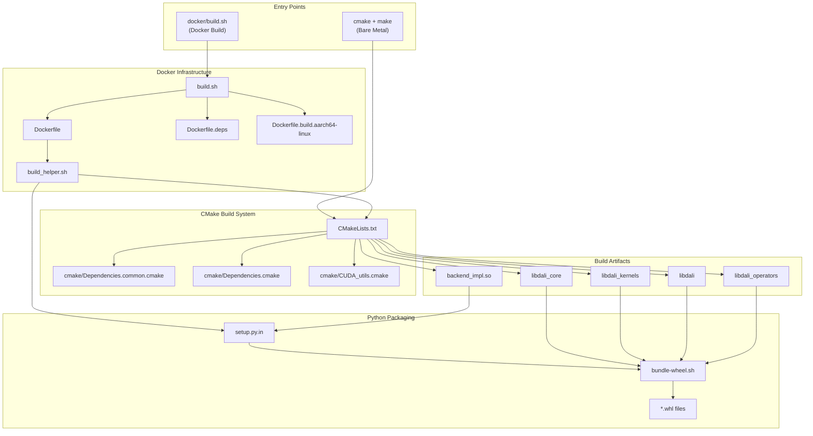
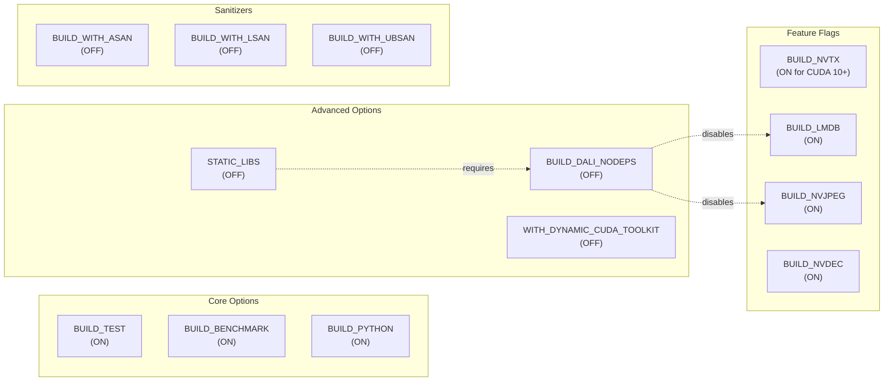
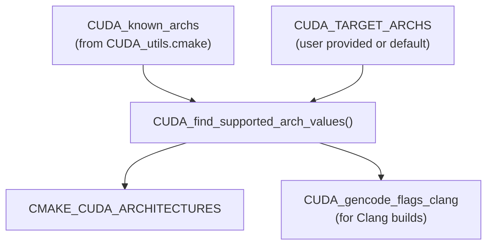
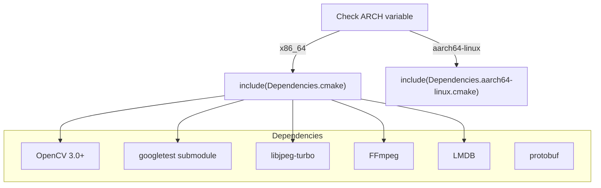
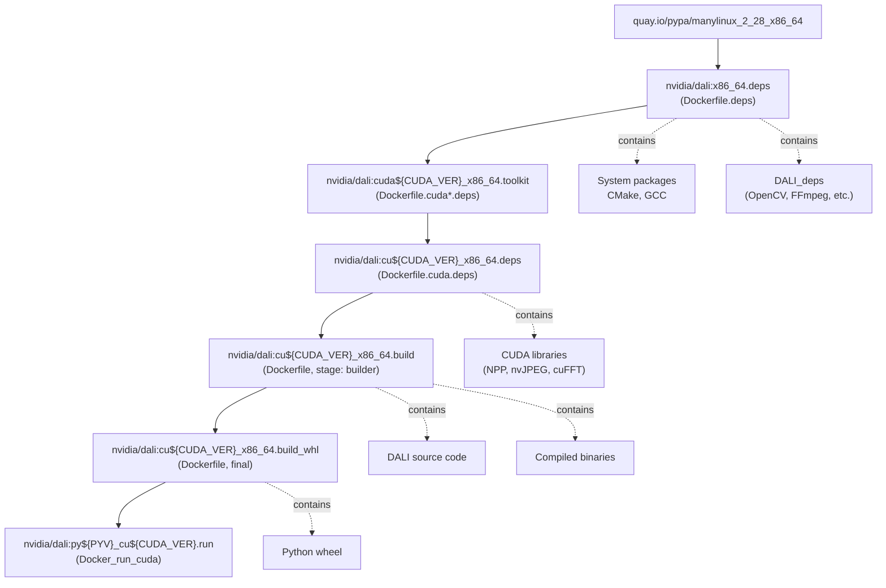
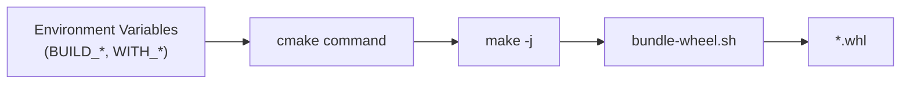
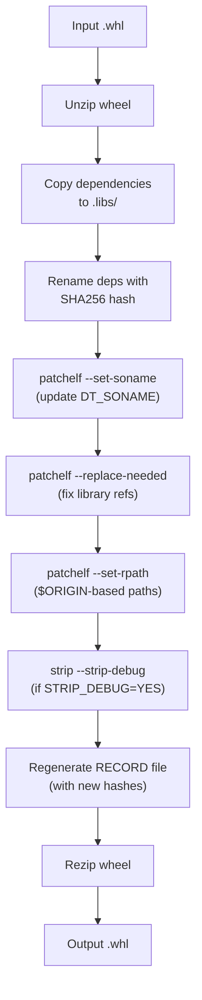
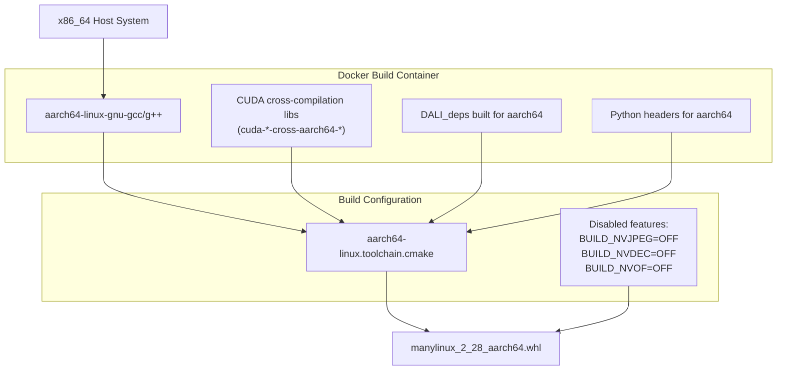
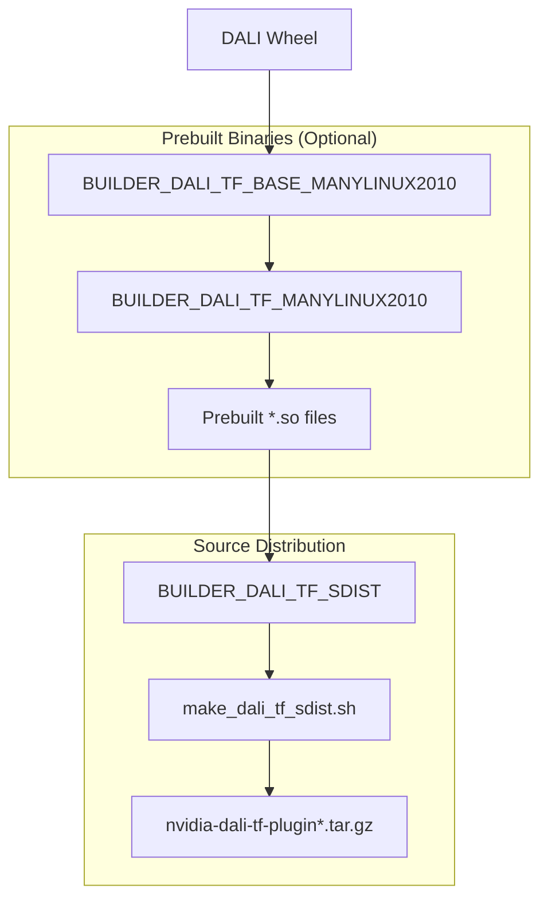

<!-- source: DeepWiki mcp.deepwiki.com · repo NVIDIA/DALI · page 7.1 Build System · fetched 2026-10-26 -->

# Build System

<details>
<summary>Relevant source files</summary>

The following files were used as context for generating this wiki page:

- [CMakeLists.txt](CMakeLists.txt)
- [cmake/Dependencies.common.cmake](cmake/Dependencies.common.cmake)
- [dali/python/bundle-wheel.sh](dali/python/bundle-wheel.sh)
- [dali/python/nvidia/dali/backend.py](dali/python/nvidia/dali/backend.py)
- [dali/python/setup.py.in](dali/python/setup.py.in)
- [dali_tf_plugin/setup.py.in](dali_tf_plugin/setup.py.in)
- [docker/Dockerfile](docker/Dockerfile)
- [docker/Dockerfile.build.aarch64-linux](docker/Dockerfile.build.aarch64-linux)
- [docker/Dockerfile.deps](docker/Dockerfile.deps)
- [docker/build.sh](docker/build.sh)
- [docker/build_helper.sh](docker/build_helper.sh)
- [docs/compilation.rst](docs/compilation.rst)

</details>


## Purpose and Scope

This page documents DALI's build system, which uses CMake as the core build tool with Docker-based build environments for reproducible wheel packaging. The build system supports:

- Native and Docker-based builds
- Python wheel creation with bundled dependencies
- Cross-compilation for aarch64 (Jetson platforms)
- Multiple CUDA versions and Python versions
- Optional dependency configuration

For information about third-party dependencies themselves, see [Dependencies](#7.2). For testing infrastructure, see [Testing Infrastructure](#7.3).

---

## Build System Architecture

The DALI build system consists of three main layers: CMake configuration, Docker orchestration, and Python packaging.



**Sources:** [CMakeLists.txt:1-517](), [docker/build.sh:1-355](), [docker/build_helper.sh:1-177]()

---

## CMake Configuration

### Main CMakeLists.txt

The root [CMakeLists.txt:1-517]() configures the entire build. Key sections include:

**Minimum Version and Policies**
- Requires CMake 3.25.2+ [CMakeLists.txt:15]()
- Sets modern CMake policies [CMakeLists.txt:24-29]()

**Project Definition**
- Languages: CUDA, CXX, C [CMakeLists.txt:31]()
- CUDA version detection [CMakeLists.txt:34-45]()
- CUDA architecture targeting via `CUDA_utils.cmake` [CMakeLists.txt:47]()

**Build Options**



**Sources:** [CMakeLists.txt:52-169]()

### Build Configuration Table

| Option | Default | Purpose |
|--------|---------|---------|
| `BUILD_PYTHON` | ON | Build Python bindings |
| `BUILD_TEST` | ON | Build test suite (requires OpenCV) |
| `BUILD_BENCHMARK` | ON | Build benchmarks |
| `BUILD_NVTX` | ON (CUDA 10+) | Enable NVTX profiling |
| `BUILD_LMDB` | ON | Build LMDB readers |
| `BUILD_NVJPEG` | ON | Build with nvJPEG support |
| `BUILD_NVJPEG2K` | ON | Build with nvJPEG2K support |
| `BUILD_NVDEC` | ON | Build video decoding support |
| `BUILD_CUFILE` | ON/OFF | GPU Direct Storage (CUDA 12.2+ or x86_64 only) |
| `BUILD_NVIMAGECODEC` | ON | Build with nvImageCodec |
| `WITH_DYNAMIC_CUDA_TOOLKIT` | OFF | Link CUDA toolkit libraries dynamically |
| `BUILD_DALI_NODEPS` | OFF | Build only core/kernels without external deps |
| `STATIC_LIBS` | OFF | Build static libraries |
| `WERROR` | OFF | Treat warnings as errors |

**Sources:** [CMakeLists.txt:52-196](), [docs/compilation.rst:323-380]()

### Compiler Flags

**C++ Standard and Flags**
```cmake
CMAKE_CXX_STANDARD = 20
CMAKE_CUDA_STANDARD = 20
CMAKE_C_STANDARD = 11
```

**Key Compiler Options:**
- `-fvisibility=hidden` - Hide symbols by default [CMakeLists.txt:388]()
- `-fPIC` - Position independent code [CMakeLists.txt:388]()
- CUDA: `--compiler-options "-fvisibility=hidden"` [CMakeLists.txt:306]()
- CUDA: `-Xfatbin -compress-all` - Compress device code [CMakeLists.txt:306]()

**Build Types:**
- `Debug`: `-ggdb -O0 -DDALI_DEBUG=1` [CMakeLists.txt:361-363]()
- `DevDebug`: Same as Debug with `-G` for device code [CMakeLists.txt:366-367]()
- `Release`: `-O2 -DDALI_DEBUG=0` [CMakeLists.txt:370-371]()
- `RelWithDebInfo`: `-O2 -g3` with optional device debug info [CMakeLists.txt:374-378]()

**Sources:** [CMakeLists.txt:380-412](), [CMakeLists.txt:361-378]()

### CUDA Architecture Targeting

DALI determines supported CUDA architectures dynamically:



The function `CUDA_find_supported_arch_values()` filters requested architectures against what the compiler supports [CMakeLists.txt:279-288]().

**Sources:** [CMakeLists.txt:269-304](), [cmake/CUDA_utils.cmake:1]()

### Dependency Management

Dependencies are managed through `cmake/Dependencies.common.cmake` and platform-specific files:

**Conditional Dependency Loading:**


**Key Dependencies:**
- **OpenCV**: Minimum version 3.0, used for CPU image operations [cmake/Dependencies.common.cmake:19-32]()
- **GoogleTest**: Git submodule at `third_party/googletest` [cmake/Dependencies.common.cmake:43-49]()
- **libjpeg-turbo**: Version 62 (1.5.3) minimum [cmake/Dependencies.common.cmake:64-70]()
- **FFmpeg**: Dynamically found via `pkg-config` [cmake/Dependencies.common.cmake:170-203]()
- **nvImageCodec**: Either dynamically loaded or statically linked [cmake/Dependencies.common.cmake:296-420]()

**Sources:** [cmake/Dependencies.common.cmake:1-443](), [CMakeLists.txt:323-328]()

---

## Docker-Based Build System

### Build Script Entry Point

The [docker/build.sh:1-355]() script orchestrates the entire Docker build process.

**Environment Variables:**

| Variable | Default | Purpose |
|----------|---------|---------|
| `CUDA_VERSION` | 13.1 | CUDA toolkit version (12.0-13.1 supported) |
| `PYVER` | 3.10 | Python version for runner image |
| `NVIDIA_BUILD_ID` | 12345 | Custom build identifier |
| `CREATE_WHL` | YES | Create Python wheel |
| `CREATE_RUNNER` | NO | Create Docker runner image |
| `BUILD_TF_PLUGIN` | NO | Build TensorFlow plugin |
| `PREBUILD_TF_PLUGINS` | YES | Prebuild TF plugin binaries |
| `CMAKE_BUILD_TYPE` | Release | CMake build configuration |
| `BUILD_INHOST` | YES | Mount source instead of copying |
| `REBUILD_BUILDERS` | NO | Force rebuild of builder images |
| `DALI_BUILD_DIR` | build-docker-${CMAKE_BUILD_TYPE}-${CUDA_VER} | Build directory |
| `ARCH` | x86_64 | Target architecture (x86_64, aarch64) |
| `WHL_PLATFORM_NAME` | manylinux_2_28_x86_64 | Python wheel platform tag |

**Sources:** [docker/build.sh:39-93]()

### Docker Image Hierarchy



**Sources:** [docker/build.sh:74-85](), [docker/build.sh:114-133]()

### Build Stages

**Stage 1: Dependency Image** [docker/build.sh:114-118]()
- Based on `manylinux_2_28_x86_64` (AlmaLinux 8)
- Installs system packages via yum [docker/Dockerfile.deps:11-15]()
- Clones and builds DALI_deps [docker/Dockerfile.deps:35-43]()

**Stage 2: CUDA Dependencies** [docker/build.sh:121-125]()
- Adds CUDA toolkit libraries
- Uses separate `Dockerfile.cuda${CUDA_VER}.${ARCH}.deps` for each CUDA version

**Stage 3: Builder Image** [docker/build.sh:128-133]()
- Multi-stage Dockerfile with `builder` target [docker/Dockerfile:6]()
- Installs Python dependencies (clang, pybind11, etc.) [docker/Dockerfile:23-27]()
- Sets up environment variables [docker/Dockerfile:39-124]()

**Stage 4: Wheel Building** [docker/build.sh:143-246]()
- Either in-host build (mounts source as volume) or in-container build
- Calls [docker/build_helper.sh:1-177]() to run CMake and make
- Bundles dependencies into wheel via [dali/python/bundle-wheel.sh:1-326]()

**Sources:** [docker/build.sh:114-246](), [docker/Dockerfile:1-134]()

### In-Host vs In-Container Builds

**In-Host Build** (`BUILD_INHOST=YES`):
```bash
docker run -v $(pwd):/opt/dali ${BUILDER} /bin/bash -c "build_helper.sh"
```
- Faster for development (reuses object files)
- Source code mounted as volume [docker/build.sh:145]()
- Build artifacts remain on host in `${DALI_BUILD_DIR}` [docker/build.sh:70]()

**In-Container Build** (`BUILD_INHOST=NO`):
```bash
docker build -t ${BUILDER_WHL} --target builder ...
```
- Full source copy into image [docker/Dockerfile:128]()
- Self-contained wheel image
- Requires extracting wheel from container [docker/build.sh:254-258]()

**Sources:** [docker/build.sh:143-246]()

---

## Build Helper Script

The [docker/build_helper.sh:1-177]() script wraps CMake invocation and wheel bundling.

### CMake Invocation



The script translates environment variables to CMake options [docker/build_helper.sh:80-120]():

```bash
cmake ../ -DCMAKE_INSTALL_PREFIX=.                 \
      -DARCH=${ARCH}                               \
      -DCUDA_TARGET_ARCHS=${CUDA_TARGET_ARCHS}     \
      -DCMAKE_BUILD_TYPE=${CMAKE_BUILD_TYPE}       \
      -DBUILD_TEST=${BUILD_TEST}                   \
      ...
```

**Parallel Build:**
- Uses all available CPU cores: `make -j"$(grep ^processor /proc/cpuinfo | wc -l)"` [docker/build_helper.sh:124]()

**Sources:** [docker/build_helper.sh:80-124]()

### Python Wheel Creation

After compilation, the script builds Python wheels:

```bash
python setup.py bdist_wheel \
    --compression=stored \
    --python-tag=py3 \
    --plat-name=${WHL_PLATFORM_NAME}
```

**Key Parameters:**
- `--compression=stored`: No compression initially (bundle-wheel.sh will repack) [docker/build_helper.sh:148]()
- `--python-tag=py3`: Universal Python 3 wheel [docker/build_helper.sh:149]()
- `--plat-name`: Platform tag (e.g., `manylinux_2_28_x86_64`) [docker/build_helper.sh:150]()

**Sources:** [docker/build_helper.sh:142-176]()

---

## Python Wheel Packaging

### Wheel Bundling Process

The [dali/python/bundle-wheel.sh:1-326]() script transforms a basic wheel into a manylinux-compliant wheel with bundled dependencies.



**Sources:** [dali/python/bundle-wheel.sh:1-326]()

### Dependency List

Dependencies bundled into the wheel [dali/python/bundle-wheel.sh:105-152]():

| Library | Purpose |
|---------|---------|
| `libjpeg.so.62` | JPEG decoding (libjpeg-turbo) |
| `libavformat.so.62`, `libavcodec.so.62`, `libavfilter.so.11`, `libavutil.so.60`, `libswscale.so.9` | Video support (FFmpeg) |
| `libtiff.so.6` | TIFF image format |
| `libsndfile.so.1` | Audio file I/O |
| `libcfitsio.so.10` | FITS astronomical data format |
| `libaws-cpp-sdk-*.so` | AWS S3 integration |
| `libcvcuda.so.0`, `libnvcv_types.so.0` | CV-CUDA library |

### RPATH Patching

The script uses `patchelf` to set proper RPATH for library loading:

**Main binaries** (backend_impl.so, etc.):
```bash
$ORIGIN:$ORIGIN$UPDIRS:$ORIGIN$UPDIRS/.libs:$ORIGIN/../cufft/lib:
$ORIGIN/../npp/lib:$ORIGIN/../nvjpeg/lib:$ORIGIN/../nvimgcodec:
$ORIGIN/../libnvcomp/lib64:/usr/local/cuda/lib64
```

**Bundled libraries** (.libs/*.so):
```bash
$ORIGIN
```

This allows DALI to find:
1. Libraries in the same directory
2. Bundled dependencies in `.libs/`
3. Optional CUDA toolkit wheels
4. System CUDA installation

**Sources:** [dali/python/bundle-wheel.sh:250-284]()

### Hash-Based Naming

To avoid library conflicts, dependencies are renamed with a SHA256 hash:

```bash
fname_with_sha256() {
    HASH=$(sha256sum $1 | cut -c1-8)
    BASENAME=$(basename $1)
    INITNAME=$(echo $BASENAME | cut -f1 -d".")
    ENDNAME=$(echo $BASENAME | cut -f 2- -d".")
    echo "$INITNAME-$HASH.$ENDNAME"
}
```

Example: `libjpeg.so.62` → `libjpeg-a1b2c3d4.so.62`

The script then patches all DT_NEEDED entries to reference the hashed names [dali/python/bundle-wheel.sh:211-248]().

**Sources:** [dali/python/bundle-wheel.sh:82-88](), [dali/python/bundle-wheel.sh:177-248]()

---

## Python Package Configuration

### setup.py.in Template

The [dali/python/setup.py.in:1-99]() template is processed by CMake to generate the final `setup.py`.

**CMake Variables Substituted:**
- `@DALI_VERSION@`: Version from VERSION file [dali/python/setup.py.in:54]()
- `@DALI_FLAVOR_MINUS@`: Build flavor (e.g., `-nightly`) [dali/python/setup.py.in:17]()
- `@CUDA_VERSION_SHORT_DIGIT_ONLY@`: CUDA version (e.g., `120`) [dali/python/setup.py.in:17]()
- `@GIT_SHA@`: Git commit SHA [dali/python/setup.py.in:18]()
- `@DALI_INSTALL_REQUIRES_NVIMGCODEC@`: nvImageCodec dependency [dali/python/setup.py.in:94]()
- `@DALI_INSTALL_REQUIRES_NVCOMP@`: nvCOMP dependency [dali/python/setup.py.in:95]()

**Package Naming:**
```
nvidia-dali{flavor}-cuda{version}
```

Examples:
- `nvidia-dali-cuda120` (standard)
- `nvidia-dali-nightly-cuda130` (nightly build)

**Python Version Support:**
- Minimum: Python 3.10
- Maximum: Python 3.13
- Declared in `python_requires` [dali/python/setup.py.in:62]()

**Sources:** [dali/python/setup.py.in:17-96]()

### Dynamic Dependencies

The setup.py template includes conditional dependencies based on build configuration:

**nvImageCodec** (when `WITH_DYNAMIC_NVIMGCODEC=ON`):
```python
@DALI_INSTALL_REQUIRES_NVIMGCODEC@
# Expands to:
'nvidia-nvimgcodec-cu12[all] >= 0.7.0, < 0.8.0',
```

This is set in [cmake/Dependencies.common.cmake:340]().

**nvCOMP** (when `BUILD_NVCOMP=ON` and `WITH_DYNAMIC_NVCOMP=ON`):
```python
@DALI_INSTALL_REQUIRES_NVCOMP@
# Expands to:
'nvidia-libnvcomp-cu12 == 5.1.0.21',
```

This is set in [cmake/Dependencies.common.cmake:161]().

**Sources:** [cmake/Dependencies.common.cmake:138-164](), [cmake/Dependencies.common.cmake:296-342](), [dali/python/setup.py.in:82-96]()

---

## Cross-Compilation for aarch64

### Jetson Platform Build

DALI supports cross-compilation for NVIDIA Jetson platforms (aarch64 architecture).



**Sources:** [docker/Dockerfile.build.aarch64-linux:1-167](), [docs/compilation.rst:390-414]()

### Build Container Setup

The [docker/Dockerfile.build.aarch64-linux:1-167]() creates a cross-compilation environment:

**Key Components:**
1. **Base Image**: `nvidia/cuda:12.6.3-devel-ubuntu22.04` [docker/Dockerfile.build.aarch64-linux:1-2]()
2. **Cross-compilation toolchain**: `gcc-aarch64-linux-gnu`, `g++-aarch64-linux-gnu` [docker/Dockerfile.build.aarch64-linux:21-22]()
3. **CUDA cross libraries**: Installed from NVIDIA repos [docker/Dockerfile.build.aarch64-linux:36-44]()
4. **DALI_deps**: Built with `CC_COMP=aarch64-linux-gnu-gcc` [docker/Dockerfile.build.aarch64-linux:88-95]()

**Python Headers Hack:**
Python headers for aarch64 are cross-compiled and installed to trick host python-config [docker/Dockerfile.build.aarch64-linux:98-110]():

```bash
for PYVER in 3.9.0 3.10.0 3.11.0 3.12.0 3.13.0; do
    ./configure --disable-shared \
        CC=aarch64-linux-gnu-gcc \
        CXX=aarch64-linux-gnu-g++ \
        --host=aarch64-linux-gnu
    make inclinstall
done
```

**Sources:** [docker/Dockerfile.build.aarch64-linux:98-110]()

### Disabled Features

Some features are unavailable on aarch64 due to library availability:

| Feature | Status | Reason |
|---------|--------|--------|
| `BUILD_NVJPEG` | OFF | Not available for aarch64 cross-compilation |
| `BUILD_NVJPEG2K` | OFF | Not available for aarch64 cross-compilation |
| `BUILD_NVOF` | OFF | Optical Flow SDK not available |
| `BUILD_NVDEC` | OFF | Video decoder not available |
| `BUILD_NVML` | OFF | Management library not needed |
| `BUILD_CUFILE` | OFF | GPU Direct Storage not supported |
| `BUILD_NVCOMP` | OFF | nvCOMP not available |

**Sources:** [docker/Dockerfile.build.aarch64-linux:122-150]()

### CMake Toolchain File

The aarch64 build uses a custom CMake toolchain file:

```cmake
-DCMAKE_TOOLCHAIN_FILE=$PWD/../platforms/aarch64-linux/aarch64-linux.toolchain.cmake
```

Additional options specify cross-compilation paths [docker/Dockerfile.build.aarch64-linux:154-160]():

```cmake
-DCMAKE_CUDA_COMPILER=/usr/local/cuda-12.6/bin/nvcc
-DCUDA_HOST=/usr/local/cuda-12.6
-DCUDA_TARGET=/usr/local/cuda-12.6/targets/aarch64-linux
-DCMAKE_PREFIX_PATH=/usr/aarch64-linux-gnu/
```

**Sources:** [docker/Dockerfile.build.aarch64-linux:154-160]()

---

## TensorFlow Plugin Build

The TensorFlow plugin has a separate build process that creates a source distribution (sdist) with optional prebuilt binaries.

### Build Overview



**Sources:** [docker/build.sh:262-320]()

### Prebuilt vs On-Demand Compilation

**With Prebuilt Binaries** (`PREBUILD_TF_PLUGINS=YES`):
- Plugin `.so` files compiled for multiple TensorFlow versions during wheel build
- Stored in `dali_tf_plugin/prebuilt/` directory
- User doesn't need compiler at install time
- Faster installation

**Without Prebuilt** (`PREBUILD_TF_PLUGINS=NO`):
- Only source code packaged
- Plugin compiled during `pip install` on user's machine
- Requires appropriate compiler version matching user's TensorFlow
- Smaller wheel, slower installation

**Sources:** [docker/build.sh:55-63](), [docker/build.sh:287-299]()

### TensorFlow Plugin setup.py

The TensorFlow plugin has its own [dali_tf_plugin/setup.py.in:1-99]() template:

**Key Differences from Main Package:**
- Custom build_ext command that calls `InstallerHelper` [dali_tf_plugin/setup.py.in:22-25]()
- Depends on exact DALI version: `nvidia-dali{flavor}-cuda{ver}=={DALI_VERSION}` [dali_tf_plugin/setup.py.in:90]()
- Uses `CustomDistribution` to signal platform-specific build [dali_tf_plugin/setup.py.in:27-35]()

**Sources:** [dali_tf_plugin/setup.py.in:1-99]()

---

## Build Output and Installation

### Build Artifacts

The CMake build produces the following libraries:

| Library | Purpose | Location |
|---------|---------|----------|
| `libdali_core.so` | Core data structures (Buffer, Tensor) | `dali/core/` |
| `libdali_kernels.so` | Computation kernels | `dali/kernels/` |
| `libdali.so` | Pipeline and executor | `dali/pipeline/` |
| `libdali_operators.so` | Operator implementations | `dali/operators/` |
| `backend_impl.so` | Python bindings (pybind11) | `dali/python/nvidia/dali/` |

### Python Wheel Contents

A typical DALI wheel contains:

```
nvidia_dali-{version}-py3-none-{platform}.whl
├── nvidia/
│   └── dali/
│       ├── __init__.py
│       ├── backend_impl.so        # Python bindings
│       ├── libdali.so             # Pipeline library
│       ├── libdali_operators.so   # Operators
│       ├── libdali_kernels.so     # Kernels
│       ├── libdali_core.so        # Core
│       ├── .libs/                 # Bundled dependencies
│       │   ├── libjpeg-{hash}.so.62
│       │   ├── libavformat-{hash}.so.62
│       │   └── ...
│       ├── plugin/pytorch/
│       ├── plugin/paddle/
│       └── ...
└── nvidia_dali-{version}.dist-info/
```

**Sources:** [dali/python/bundle-wheel.sh:157-158]()

### RPATH Structure

The installed libraries use `$ORIGIN`-based RPATH for relocatable installation:

```
backend_impl.so:
  RPATH: $ORIGIN:$ORIGIN/..:$ORIGIN/../.libs:
         $ORIGIN/../../cufft/lib:$ORIGIN/../../npp/lib:
         $ORIGIN/../../nvjpeg/lib:$ORIGIN/../../nvimgcodec:
         /usr/local/cuda/lib64

.libs/libjpeg-{hash}.so.62:
  RPATH: $ORIGIN
```

This allows finding:
1. Other DALI libraries in the same package
2. Bundled dependencies in `.libs/`
3. Optional CUDA toolkit pip wheels
4. System CUDA installation

**Sources:** [dali/python/bundle-wheel.sh:250-284]()

---

