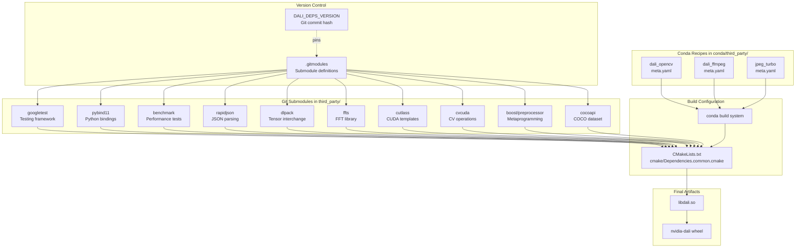
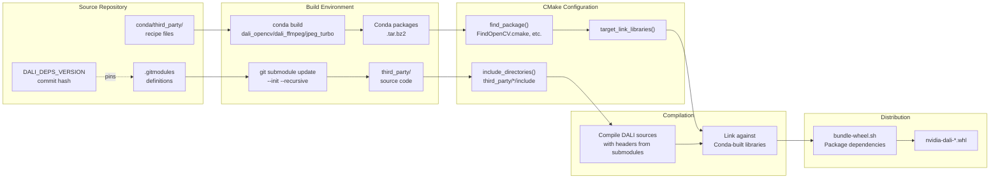

<!-- source: DeepWiki mcp.deepwiki.com · repo NVIDIA/DALI · page 7.2 Dependencies · fetched 2026-10-26 -->

# Dependencies

<details>
<summary>Relevant source files</summary>

The following files were used as context for generating this wiki page:

- [.gitmodules](.gitmodules)
- [Acknowledgements.txt](Acknowledgements.txt)
- [DALI_DEPS_VERSION](DALI_DEPS_VERSION)
- [conda/config/conda_build_config.yaml](conda/config/conda_build_config.yaml)
- [conda/third_party/dali_ffmpeg/recipe/build.sh](conda/third_party/dali_ffmpeg/recipe/build.sh)
- [conda/third_party/dali_ffmpeg/recipe/meta.yaml](conda/third_party/dali_ffmpeg/recipe/meta.yaml)
- [conda/third_party/dali_opencv/recipe/meta.yaml](conda/third_party/dali_opencv/recipe/meta.yaml)
- [conda/third_party/jpeg_turbo/recipe/meta.yaml](conda/third_party/jpeg_turbo/recipe/meta.yaml)
- [third_party/README.rst](third_party/README.rst)

</details>


This document describes DALI's third-party dependencies, including version management, licensing, and integration mechanisms. DALI relies on both Git submodules for header-only or compile-time dependencies and Conda recipes for larger runtime dependencies that are built separately.

For information about the CMake build system and how these dependencies are integrated, see [Build System](#7.1).

---

## Dependency Categories

DALI manages dependencies through two primary mechanisms:

1. **Git Submodules**: Header-only libraries and testing frameworks included directly in the source tree under `third_party/`
2. **Conda Recipes**: Pre-built binary dependencies (OpenCV, FFmpeg, libjpeg-turbo) managed through custom Conda packages

### Dependency Management Overview



**Sources**: [DALI_DEPS_VERSION:1](), [.gitmodules:1-31](), [third_party/README.rst:1-30]()

---

## Version Management

DALI uses a commit hash stored in `DALI_DEPS_VERSION` to pin the exact versions of all Git submodule dependencies. This ensures reproducible builds across different environments and time periods.

### DALI_DEPS_VERSION File

The file contains a single Git commit hash that represents a specific state of all submodules:

```
cf5f9fa5584c05d8151a2444831ae607b98f3ed6
```

This commit hash is used by the build system to checkout the correct versions of all submodules declared in `.gitmodules`.

**Sources**: [DALI_DEPS_VERSION:1-2]()

---

## Git Submodules

DALI includes eleven third-party libraries as Git submodules, each serving specific functionality:

### Core Dependencies Table

| Repository | Version | Purpose | License | Location |
|-----------|---------|---------|---------|----------|
| **GoogleTest** | 1.17.0 | Unit testing framework | BSD 3-Clause | `third_party/googletest` |
| **pybind11** | 3.0.1 | Python-C++ bindings | BSD 3-Clause | `third_party/pybind11` |
| **Google Benchmark** | 1.9.4 | Performance benchmarking | Apache 2.0 | `third_party/benchmark` |
| **DLPack** | 1.2 | Tensor memory interchange protocol | Apache 2.0 | `third_party/dlpack` |
| **RapidJSON** | Top-of-tree (Feb 2025) | JSON parsing for metadata | MIT/BSD/JSON | `third_party/rapidjson` |
| **Boost Preprocessor** | 1.89.0 | C++ metaprogramming macros | Boost 1.0 | `third_party/boost/preprocessor` |
| **CUTLASS** | 4.2.1 | CUDA template library for linear algebra | BSD 3-Clause | `third_party/cutlass` |
| **CV-CUDA** | 0.16.0 beta | Computer vision CUDA operations | Apache 2.0 | `third_party/cvcuda` |
| **FFTS** | Custom fork (Sep 2024) | Fast Fourier Transform library | BSD 3-Clause | `third_party/ffts` |
| **COCO API** | Top-of-tree (Feb 2020) | COCO dataset format support | BSD 2-Clause | `third_party/cocoapi` |

**Sources**: [third_party/README.rst:5-29](), [.gitmodules:1-31]()

### Submodule Configuration

The `.gitmodules` file defines each submodule with its remote URL and local path:

```
[submodule "third_party/pybind11"]
    path = third_party/pybind11
    url = https://github.com/pybind/pybind11.git

[submodule "third_party/dlpack"]
    path = third_party/dlpack
    url = https://github.com/dmlc/dlpack.git

[submodule "third_party/cutlass"]
    path = third_party/cutlass
    url = https://github.com/NVIDIA/cutlass
    ignore = untracked
```

Note that CUTLASS has `ignore = untracked` to prevent Git from tracking generated files within that submodule.

**Sources**: [.gitmodules:7-25]()

### Dependency Roles

```mermaid
graph TB
    subgraph "Python Integration"
        Pybind11["pybind11<br/>v3.0.1"]
        BackendImpl["backend_impl.cc<br/>Python bindings"]
    end
    
    subgraph "Testing & Benchmarking"
        GoogleTest["googletest<br/>v1.17.0"]
        Benchmark["benchmark<br/>v1.9.4"]
        TestSuites["Test suites"]
        PerfTests["Performance tests"]
    end
    
    subgraph "Data Interchange"
        DLPack["dlpack<br/>v1.2"]
        TensorInterop["Tensor interoperability"]
        FrameworkIntegration["Framework integration"]
    end
    
    subgraph "Compute Acceleration"
        CUTLASS["CUTLASS<br/>v4.2.1"]
        CVCUDA["CV-CUDA<br/>v0.16.0-beta"]
        FFTS["FFTS<br/>Custom fork"]
        Operators["GPU Operators"]
    end
    
    subgraph "Utilities"
        RapidJSON["rapidjson<br/>Top-of-tree"]
        Boost["boost/preprocessor<br/>v1.89.0"]
        COCO["cocoapi<br/>Top-of-tree"]
        MetadataParsing["Metadata parsing"]
        Metaprogramming["C++ metaprogramming"]
        DatasetSupport["Dataset format support"]
    end
    
    Pybind11 --> BackendImpl
    
    GoogleTest --> TestSuites
    Benchmark --> PerfTests
    
    DLPack --> TensorInterop
    TensorInterop --> FrameworkIntegration
    
    CUTLASS --> Operators
    CVCUDA --> Operators
    FFTS --> Operators
    
    RapidJSON --> MetadataParsing
    Boost --> Metaprogramming
    COCO --> DatasetSupport
```



**Sources**: [third_party/README.rst:5-29]()

---

## Conda-Built Dependencies

Three major dependencies are built as separate Conda packages with custom recipes: OpenCV, FFmpeg, and libjpeg-turbo. These libraries have complex build requirements and are pre-compiled to specific configurations optimized for DALI's use cases.

### OpenCV Configuration

DALI builds a minimal OpenCV configuration with only essential image processing features enabled.

**Recipe Location**: `conda/third_party/dali_opencv/recipe/meta.yaml`

**Version**: 4.12.0

**Configuration**:
- Enabled: Core image processing, JPEG/TIFF/OpenJPEG support
- Disabled: GUI components, video capture, hardware acceleration, ML modules

**Dependencies**:
```yaml
host:
  - libjpeg-turbo
  - libtiff
  - openjpeg
  - zlib
run:
  - libjpeg-turbo
  - libtiff
  - openjpeg
  - zlib
```

**Sources**: [conda/third_party/dali_opencv/recipe/meta.yaml:1-46]()

### FFmpeg Configuration

DALI builds FFmpeg with a minimal configuration focused on decoding and demuxing, with most encoders and protocols disabled.

**Recipe Location**: `conda/third_party/dali_ffmpeg/recipe/meta.yaml`

**Version**: 8.0.0

**Build Script**: [conda/third_party/dali_ffmpeg/recipe/build.sh:17-54]()

**Key Configuration Options**:
```bash
./configure \
    --disable-static \
    --disable-programs \
    --disable-doc \
    --disable-encoders \
    --disable-hwaccels \
    --disable-muxers \
    --enable-avformat \
    --enable-avcodec \
    --enable-avfilter \
    --enable-protocol=file \
    --enable-bsf=h264_mp4toannexb,hevc_mp4toannexb,mpeg4_unpack_bframes
```

**Symbol Versioning**: The build script prepends `DALI_` to FFmpeg symbol versions to avoid conflicts with system FFmpeg installations:

```bash
sed -i 's/\$\$(M)sed ... | sed '\''s\/\\(\.*{\\)\/DALI_\\1\/'\'' ...' ffbuild/library.mak
```

**Sources**: [conda/third_party/dali_ffmpeg/recipe/meta.yaml:1-40](), [conda/third_party/dali_ffmpeg/recipe/build.sh:1-55]()

### libjpeg-turbo Configuration

**Recipe Location**: `conda/third_party/jpeg_turbo/recipe/meta.yaml`

**Version**: 3.1.12

**Build Requirements**:
- CMake 3.25.2
- Java OpenJDK (for Java bindings, though DALI uses C API)
- YASM (for x86_64 SIMD optimizations)

**Sources**: [conda/third_party/jpeg_turbo/recipe/meta.yaml:1-38]()

### Conda Build Configuration

The `conda/config/conda_build_config.yaml` file specifies compiler versions and standard library requirements:

```yaml
c_compiler_version:
  - 14.2               # [linux]
cxx_compiler_version:
  - 14.2               # [linux]
c_stdlib:
  - sysroot            # [linux]
c_stdlib_version:
  - 2.17               # [linux]
```

This ensures consistent compiler toolchains across builds and compatibility with older glibc versions (2.17) for broader system support.

**Sources**: [conda/config/conda_build_config.yaml:1-10]()

---

## Dependency Integration Workflow



**Sources**: [DALI_DEPS_VERSION:1](), [.gitmodules:1-31](), [conda/third_party/dali_opencv/recipe/meta.yaml:1-46]()

---

## Licensing

DALI's dependencies use permissive open-source licenses that allow redistribution. The full license texts are documented in `Acknowledgements.txt`.

### License Summary

| License Type | Dependencies |
|-------------|--------------|
| **Apache License 2.0** | Google Benchmark, DLPack, CV-CUDA |
| **BSD 3-Clause** | GoogleTest, pybind11, CUTLASS, FFTS, libjpeg-turbo (modified), OpenCV |
| **BSD 2-Clause** | COCO API |
| **Boost Software License 1.0** | Boost Preprocessor |
| **MIT License** | RapidJSON (with BSD/JSON components) |

### License Compliance

The `Acknowledgements.txt` file contains:
- Full license texts for all dependencies (lines 1-275,000+)
- Copyright notices
- Redistribution requirements
- Warranty disclaimers

Key sections include:
- Google Benchmark: [Acknowledgements.txt:4-34]()
- GoogleTest: [Acknowledgements.txt:212-241]()
- pybind11: [Acknowledgements.txt:244-274]()
- OpenCV: [Acknowledgements.txt:277-319]()
- libjpeg-turbo: [Acknowledgements.txt:323-462]()

**Sources**: [Acknowledgements.txt:1-800](), [third_party/README.rst:5-29]()

### Distribution Requirements

When distributing DALI binaries:

1. **Attribution**: Include acknowledgments for all dependencies
2. **License Text**: Provide full license text (from `Acknowledgements.txt`)
3. **Source Availability**: Git submodules allow users to access source code
4. **Symbol Namespacing**: FFmpeg symbols are prefixed with `DALI_` to avoid conflicts

**Sources**: [conda/third_party/dali_ffmpeg/recipe/build.sh:51-52]()

---

## Dependency Update Process

### Updating Git Submodules

1. Navigate to the submodule directory: `cd third_party/<submodule>`
2. Checkout desired version: `git checkout <version-tag>`
3. Return to DALI root and commit: `git add third_party/<submodule>`
4. Update `DALI_DEPS_VERSION` with new commit hash
5. Update version in `third_party/README.rst`

### Updating Conda Dependencies

1. Modify `conda/third_party/<package>/recipe/meta.yaml`
2. Update `build_version` variable
3. Update source URL and SHA256 checksum
4. Test build: `conda build conda/third_party/<package>/recipe`
5. Verify linking and runtime behavior

**Sources**: [DALI_DEPS_VERSION:1](), [conda/third_party/dali_opencv/recipe/meta.yaml:15-24]()

---

## Special Dependency Considerations

### DLPack for Zero-Copy Tensor Exchange

DLPack (v1.2) provides the standardized `DLTensor` structure for zero-copy tensor interchange between frameworks. DALI's `Tensor` and `TensorList` classes implement DLPack export interfaces. See [Memory Management and Interoperability](#6.1) for details.

### pybind11 for Python Bindings

pybind11 (v3.0.1) enables the Python API layer. The `dali/python/backend_impl.cc` file uses pybind11 macros to expose C++ classes (`Pipeline`, `Tensor`, `TensorList`) to Python.

### CUTLASS for GPU Kernels

CUTLASS (v4.2.1) provides templated CUDA kernel primitives used in DALI's GPU operators. The `.gitmodules` configuration includes `ignore = untracked` because CUTLASS generates many temporary files during builds.

### Custom FFTS Fork

DALI uses a custom fork of FFTS (`github.com/JanuszL/ffts`) with modifications for DALI-specific FFT operations. The fork is frozen at commit `95489ebcd6fc136c6a76f50f57d43e6072e2bd38` from September 2024.

**Sources**: [.gitmodules:19-25](), [third_party/README.rst:20-21]()

---

