<!-- source: DeepWiki mcp.deepwiki.com · repo NVIDIA/DALI · page 7.3 Testing Infrastructure · fetched 2026-10-26 -->

# Testing Infrastructure

<details>
<summary>Relevant source files</summary>

The following files were used as context for generating this wiki page:

- [dali/operators/numba_function/numba_func_gpu.cc](dali/operators/numba_function/numba_func_gpu.cc)
- [dali/pipeline/operator/eager_operator.h](dali/pipeline/operator/eager_operator.h)
- [dali/pipeline/pipeline_debug.h](dali/pipeline/pipeline_debug.h)
- [dali/python/nvidia/dali/_debug_mode.py](dali/python/nvidia/dali/_debug_mode.py)
- [dali/python/nvidia/dali/_debug_utils.py](dali/python/nvidia/dali/_debug_utils.py)
- [dali/test/python/checkpointing/test_dali_stateless_operators.py](dali/test/python/checkpointing/test_dali_stateless_operators.py)
- [dali/test/python/test_dali_cpu_only.py](dali/test/python/test_dali_cpu_only.py)
- [dali/test/python/test_dali_variable_batch_size.py](dali/test/python/test_dali_variable_batch_size.py)
- [dali/test/python/test_pipeline_debug.py](dali/test/python/test_pipeline_debug.py)
- [dali/test/python/test_utils.py](dali/test/python/test_utils.py)
- [dali_tf_plugin/CMakeLists.txt](dali_tf_plugin/CMakeLists.txt)
- [dali_tf_plugin/MANIFEST.in](dali_tf_plugin/MANIFEST.in)
- [dali_tf_plugin/build_dali_tf.sh](dali_tf_plugin/build_dali_tf.sh)
- [dali_tf_plugin/build_in_custom_op_docker.sh](dali_tf_plugin/build_in_custom_op_docker.sh)
- [dali_tf_plugin/dali_compile_flags.py](dali_tf_plugin/dali_compile_flags.py)
- [dali_tf_plugin/dali_tf_plugin_install_tool.py](dali_tf_plugin/dali_tf_plugin_install_tool.py)
- [dali_tf_plugin/dali_tf_plugin_utils.py](dali_tf_plugin/dali_tf_plugin_utils.py)
- [dali_tf_plugin/nvidia/dali_tf_plugin/dali_tf_plugin.py](dali_tf_plugin/nvidia/dali_tf_plugin/dali_tf_plugin.py)
- [docker/Docker_run_cuda](docker/Docker_run_cuda)
- [docker/Dockerfile.customopbuilder.clean](docker/Dockerfile.customopbuilder.clean)
- [docker/Dockerfile_dali_tf](docker/Dockerfile_dali_tf)
- [docs/installation.rst](docs/installation.rst)
- [plugins/setup.py.in](plugins/setup.py.in)
- [qa/TL0_cpu_only/test.sh](qa/TL0_cpu_only/test.sh)
- [qa/TL0_python-self-test-base-cuda/test.sh](qa/TL0_python-self-test-base-cuda/test.sh)
- [qa/TL0_python-self-test-core/test_body.sh](qa/TL0_python-self-test-core/test_body.sh)
- [qa/TL0_tensorflow_plugin/test.sh](qa/TL0_tensorflow_plugin/test.sh)
- [qa/TL0_video_plugin/test.sh](qa/TL0_video_plugin/test.sh)
- [qa/TL1_tensorflow-dali_test/test.sh](qa/TL1_tensorflow-dali_test/test.sh)
- [qa/TL1_tensorflow_dataset/test_impl.sh](qa/TL1_tensorflow_dataset/test_impl.sh)
- [qa/TL1_tensorflow_plugin/test.sh](qa/TL1_tensorflow_plugin/test.sh)
- [qa/address.sup](qa/address.sup)
- [qa/download_pip_packages.sh](qa/download_pip_packages.sh)
- [qa/leak.sup](qa/leak.sup)
- [qa/setup_packages.py](qa/setup_packages.py)
- [qa/setup_test_common.sh](qa/setup_test_common.sh)
- [qa/test_template.sh](qa/test_template.sh)
- [qa/test_template_impl.sh](qa/test_template_impl.sh)

</details>


## Purpose and Scope

This document describes DALI's testing infrastructure, which provides a comprehensive framework for validating DALI's functionality across multiple framework versions, CUDA versions, and execution environments. The testing infrastructure handles test orchestration, package management, sanitizer integration, and continuous testing across various configurations.

For information about the build system itself, see [Build System](#7.1). For dependency management in the build process, see [Dependencies](#7.2).

---

## Test Orchestration System

The testing infrastructure is built around a templating system that standardizes test execution across different test suites.

### Core Components

The orchestration system consists of several shell scripts that work together:

| Component | File Path | Purpose |
|-----------|-----------|---------|
| Test Template | `qa/test_template.sh` | Entry point with timestamp logging |
| Test Implementation | `qa/test_template_impl.sh` | Core test execution logic |
| Common Setup | `qa/setup_test_common.sh` | Environment detection and setup |
| Package Setup | `qa/setup_packages.py` | Dependency version management |

### Test Execution Flow

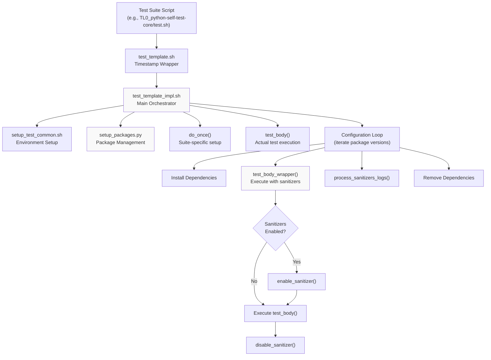

**Sources:** [qa/test_template.sh:1-15](), [qa/test_template_impl.sh:1-232](), [qa/setup_test_common.sh:1-120]()

### Test Suite Structure

Individual test suites follow a standard pattern:

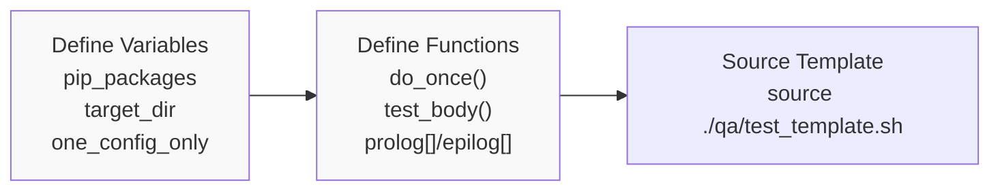

**Example Structure:**

```bash
pip_packages='${python_test_runner_package} tensorflow-gpu'
target_dir=./dali/test/python

do_once() {
    # One-time setup (e.g., download test data)
}

test_body() {
    # Actual test execution
}

source ./qa/test_template.sh
```

**Sources:** [qa/TL0_tensorflow_plugin/test.sh:1-56](), [qa/TL0_python-self-test-core/test_body.sh:1-102]()

---

## Package Management System

The `setup_packages.py` script manages framework dependencies across different versions and CUDA configurations.

### Package Class Hierarchy

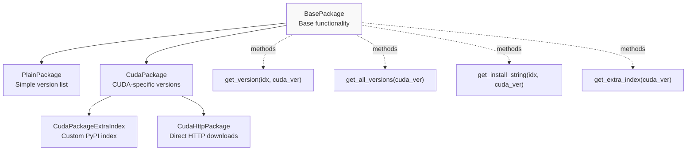

**Sources:** [qa/setup_packages.py:71-480]()

### Package Configuration

The script maintains a registry of supported packages with version constraints:

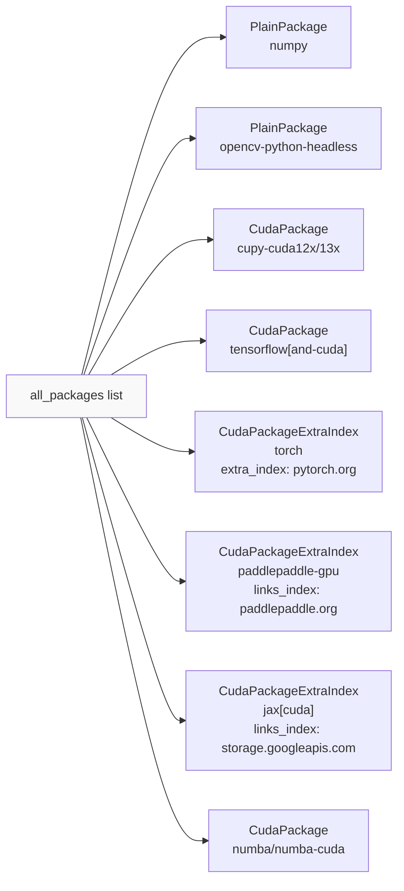

**Key Features:**

| Feature | Description | Example |
|---------|-------------|---------|
| `PckgVer` class | Encapsulates version with Python version constraints | `PckgVer("2.19.1", python_min_ver="3.9")` |
| Version filtering | Automatically filters incompatible versions | Based on `python_min_ver`/`python_max_ver` |
| CUDA mapping | Maps CUDA versions to compatible package versions | `"120": [...]` for CUDA 12.0 |
| Aliases | Alternative package names during installation | `alias="tensorflow[and-cuda]"` |
| Dependencies | Additional packages to install together | `dependencies=["protobuf<4", "numpy<2"]` |

**Sources:** [qa/setup_packages.py:22-605]()

### Package Query Interface

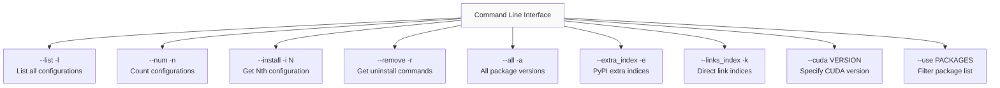

**Usage Examples:**

```bash
# Get number of configurations for TensorFlow
python qa/setup_packages.py -n -u tensorflow-gpu --cuda 120

# Get installation command for configuration #0
python qa/setup_packages.py -i 0 -u tensorflow-gpu --cuda 120

# Get packages to uninstall
python qa/setup_packages.py -r -u tensorflow-gpu --cuda 120

# Get extra PyPI indices
python qa/setup_packages.py -e -u torch --cuda 120
```

**Sources:** [qa/setup_packages.py:609-743](), [qa/test_template_impl.sh:34-36]()

---

## Test Execution Framework

### Python Test Runners

DALI uses two Python test frameworks in parallel during the transition period:

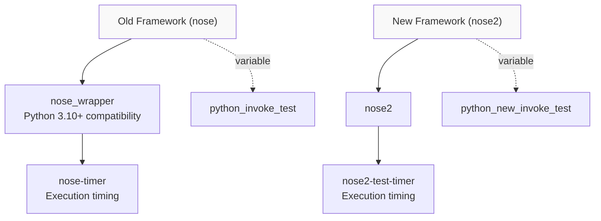

**Configuration Variables:**

| Variable | Value | Purpose |
|----------|-------|---------|
| `python_test_runner` | `python -m nose_wrapper` | Legacy test runner |
| `python_test_args` | `--verbose --with-timer --timer-top-n 20 -s` | Legacy runner arguments |
| `python_invoke_test` | Combined command | Full invocation for legacy tests |
| `python_new_test_runner` | `python -m nose2` | New test runner |
| `python_new_test_args` | `--verbose --plugin=nose2_test_timer.plugin --with-timer` | New runner arguments |
| `python_new_invoke_test` | Combined command | Full invocation for new tests |

**Sources:** [qa/test_template_impl.sh:18-31]()

### Test Environment Setup

The test infrastructure automatically detects and configures the execution environment:

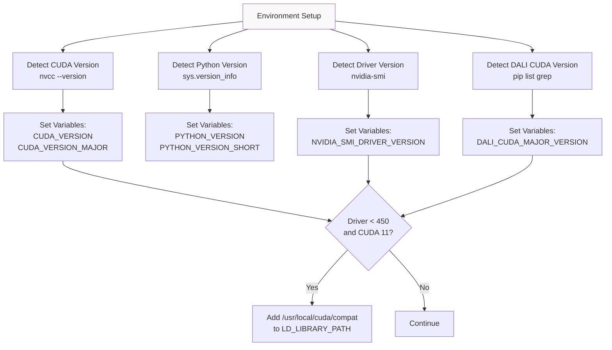

**Sources:** [qa/setup_test_common.sh:1-120]()

### Virtual Environment and Conda Support

The test framework supports both virtualenv and conda environments:

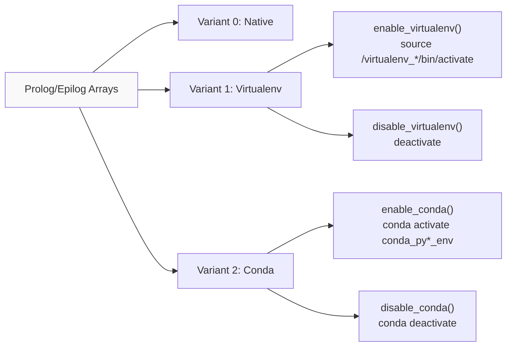

**Sources:** [qa/setup_test_common.sh:76-100](), [qa/test_template_impl.sh:69-72]()

---

## Test Types and Coverage

### Core Test Suites

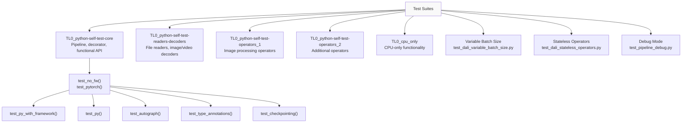

**Sources:** [qa/TL0_python-self-test-core/test_body.sh:1-102]()

### Test Categories

| Category | Files | Purpose |
|----------|-------|---------|
| CPU-Only Tests | `test_dali_cpu_only.py` | Validate CPU-only builds without CUDA |
| Variable Batch Size | `test_dali_variable_batch_size.py` | Test operators with varying batch sizes |
| Stateless Operators | `test_dali_stateless_operators.py` | Verify operators are stateless (reproducible) |
| Debug Mode | `test_pipeline_debug.py` | Test debug mode execution and inspection |
| Conditionals | Various conditionals tests | Test conditional execution in pipelines |
| Checkpointing | `checkpointing/test_dali_checkpointing.py` | Test pipeline state save/restore |

**Sources:** [dali/test/python/test_dali_cpu_only.py:1-100](), [dali/test/python/test_dali_variable_batch_size.py:1-100](), [dali/test/python/checkpointing/test_dali_stateless_operators.py:1-100]()

### Test Utilities

The `test_utils.py` module provides common testing utilities:

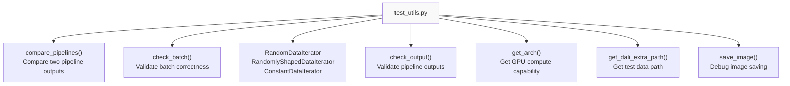

**Sources:** [dali/test/python/test_utils.py:1-700]()

---

## Framework Integration Testing

### TensorFlow Plugin Testing

The TensorFlow plugin has a specialized testing infrastructure:

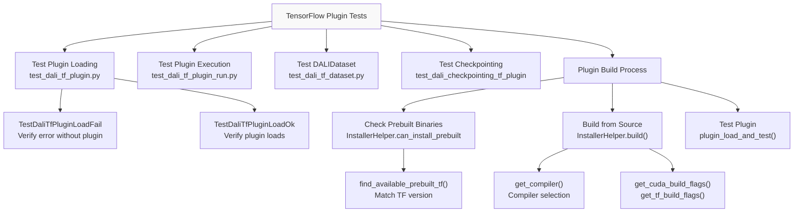

**TensorFlow Plugin Installation Logic:**

The plugin uses a multi-stage installation approach:

1. **Check for prebuilt binaries** in `prebuilt/` directory
2. **Version matching**: Find TF version with same major.minor or compatible version
3. **Compiler compatibility**: Verify g++ version matches TF's build compiler
4. **Build from source** as fallback with either default or alternative compiler
5. **Test loading**: Verify the plugin loads and can execute a simple pipeline

**Sources:** [dali_tf_plugin/dali_tf_plugin_install_tool.py:1-400](), [qa/TL0_tensorflow_plugin/test.sh:1-56]()

### PyTorch Testing

PyTorch integration tests focus on iterator functionality:

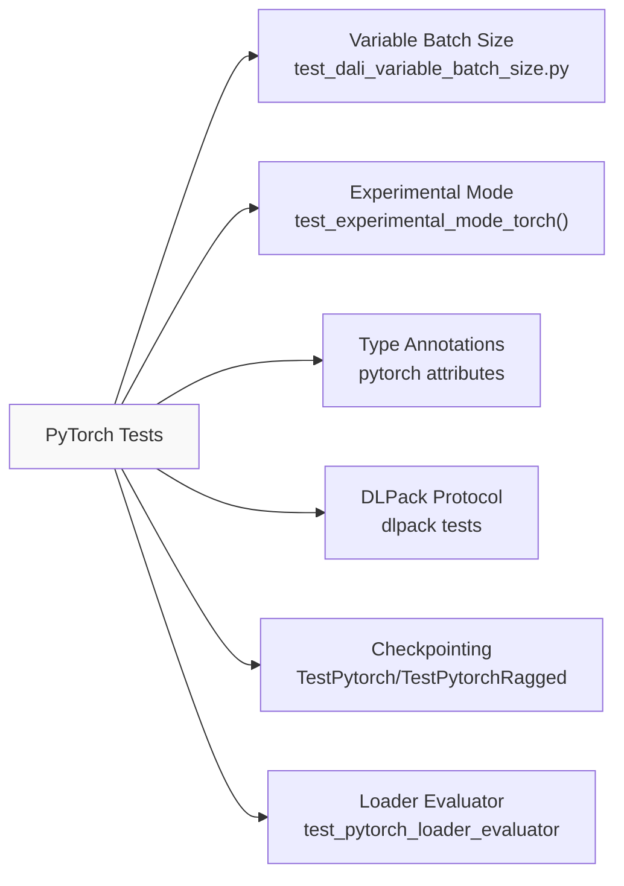

**Sources:** [qa/TL0_python-self-test-core/test_body.sh:60-70]()

### Video Plugin Testing

The video plugin requires additional dependencies and has specialized tests:

```bash
# Video plugin test setup
pip_packages='scikit-build ninja cmake opencv-python-headless'

test_body() {
    # Uninstall old plugin
    pip uninstall -y nvidia-dali-video*
    
    # Build and install with ASAN support if enabled
    ASAN_OPTIONS=... LD_PRELOAD=... \
        pip install --no-deps ../../../nvidia_dali_video*.tar.gz
    
    # Run tests
    ${python_invoke_test} video/test_dali_video.py
}
```

**Sources:** [qa/TL0_video_plugin/test.sh:1-28]()

---

## Sanitizer Support

### Address Sanitizer (ASAN) Integration

The testing infrastructure provides comprehensive sanitizer support for detecting memory errors:

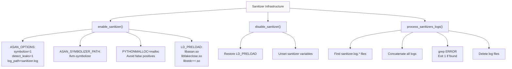

**Key Environment Variables:**

| Variable | Purpose | Value |
|----------|---------|-------|
| `DALI_ENABLE_SANITIZERS` | Enable sanitizer mode | Set to activate |
| `ASAN_OPTIONS` | Address sanitizer config | `detect_leaks=1:log_path=sanitizer.log:...` |
| `LSAN_OPTIONS` | Leak sanitizer config | `suppressions=qa/leak.sup` |
| `LD_PRELOAD` | Preload sanitizer libraries | `/usr/lib/x86_64-linux-gnu/libasan.so:...` |

**Sources:** [qa/test_template_impl.sh:74-124]()

### Suppression Files

The infrastructure uses suppression files to filter known false positives:

**Leak Suppression (`qa/leak.sup`):**
- External library leaks (paddle, sklearn, tensorflow, pytorch, etc.)
- CUDA library initialization leaks
- Python object leaks
- FFmpeg demuxer leaks

**Address Sanitizer Suppression (`qa/address.sup`):**
- APT library issues
- TensorFlow framework issues
- PyTorch issues
- NumPy issues

**Sources:** [qa/leak.sup:1-66](), [qa/address.sup:1-9]()

---

## CI/CD Integration

### Docker-Based Testing

The CI/CD system uses Docker containers for reproducible test environments:

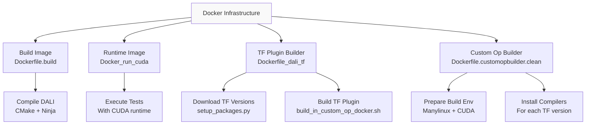

**Sources:** [docker/Dockerfile_dali_tf:1-27](), [docker/Dockerfile.customopbuilder.clean:1-37]()

### Package Download Strategy

For CI efficiency, packages are pre-downloaded:

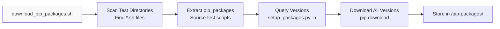

**Process:**
1. Iterate through all test directories (excluding TL3)
2. Source each test script to extract `pip_packages` variable
3. Query `setup_packages.py` for all version configurations
4. Download each version to `/pip-packages/` directory
5. Tests install from local cache with `pip install -f /pip-packages`

**Sources:** [qa/download_pip_packages.sh:1-56]()

### Test Matrix Execution

The infrastructure supports multiple execution modes:

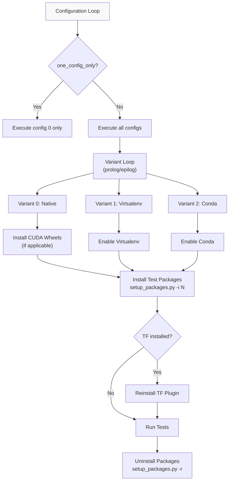

**Sanitizer Mode Adjustments:**

When `DALI_ENABLE_SANITIZERS` is set:
- Only one configuration is tested (`one_config_only=true`)
- Some slow tests are skipped
- Error checking is relaxed (`set +e`) to collect all sanitizer output
- Logs are processed at the end with `process_sanitizers_logs()`

**Sources:** [qa/test_template_impl.sh:58-231]()

---

## Debug and Development Tools

### Debug Pipeline Mode

The testing infrastructure supports a special debug mode for interactive development:

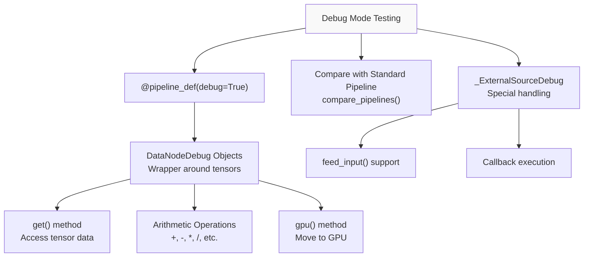

**Features:**
- Immediate execution after each operator
- Ability to inspect intermediate results with `.get()`
- Support for Python operations on data
- Validation against standard pipeline execution
- Print statements work directly in pipeline definition

**Sources:** [dali/python/nvidia/dali/_debug_mode.py:1-500](), [dali/test/python/test_pipeline_debug.py:1-200]()

### Test Comparison Utilities

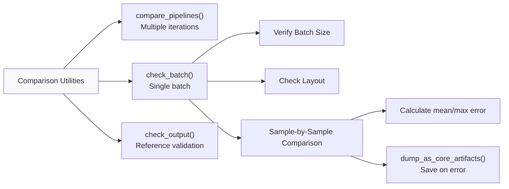

**Error Reporting:**
- Calculates mean, min, max errors
- Reports total error count
- Provides sample index and source info
- Saves failing samples as core artifacts
- Supports custom epsilon and max_allowed_error thresholds

**Sources:** [dali/test/python/test_utils.py:252-407]()

---

## Summary

DALI's testing infrastructure provides:

1. **Comprehensive Package Management**: Automated handling of multiple framework and CUDA versions through `setup_packages.py`
2. **Standardized Test Execution**: Template-based approach ensures consistent test execution across all suites
3. **Multi-Environment Support**: Native, virtualenv, and conda environments tested automatically
4. **Sanitizer Integration**: Built-in ASAN/LSAN support with suppression files for memory error detection
5. **Framework-Specific Testing**: Specialized infrastructure for TensorFlow plugin, PyTorch iterators, and other integrations
6. **Debug Capabilities**: Interactive debug mode with immediate execution and data inspection
7. **CI/CD Optimization**: Pre-downloaded packages, Docker-based reproducibility, and efficient test matrix execution

The infrastructure enables testing across hundreds of configurations while maintaining developer productivity through intelligent defaults and comprehensive error reporting.