# Page: Overview

# Overview

<details>
<summary>Relevant source files</summary>

The following files were used as context for generating this wiki page:

- [.gitignore](.gitignore)
- [README.rst](README.rst)
- [dali/c_api/c_api.cc](dali/c_api/c_api.cc)
- [dali/c_api/c_api_test.cc](dali/c_api/c_api_test.cc)
- [dali/pipeline/pipeline.cc](dali/pipeline/pipeline.cc)
- [dali/pipeline/pipeline.h](dali/pipeline/pipeline.h)
- [dali/pipeline/pipeline_test.cc](dali/pipeline/pipeline_test.cc)
- [dali/python/backend_impl.cc](dali/python/backend_impl.cc)
- [dali/python/nvidia/dali/_typing.py](dali/python/nvidia/dali/_typing.py)
- [dali/python/nvidia/dali/experimental/dynamic/__init__.py](dali/python/nvidia/dali/experimental/dynamic/__init__.py)
- [dali/python/nvidia/dali/experimental/dynamic/_ops.py](dali/python/nvidia/dali/experimental/dynamic/_ops.py)
- [dali/python/nvidia/dali/experimental/dynamic/random.py](dali/python/nvidia/dali/experimental/dynamic/random.py)
- [dali/python/nvidia/dali/fn/__init__.py](dali/python/nvidia/dali/fn/__init__.py)
- [dali/python/nvidia/dali/ops/__init__.py](dali/python/nvidia/dali/ops/__init__.py)
- [dali/python/nvidia/dali/ops/_docs.py](dali/python/nvidia/dali/ops/_docs.py)
- [dali/python/nvidia/dali/ops/_names.py](dali/python/nvidia/dali/ops/_names.py)
- [dali/python/nvidia/dali/ops/_signatures.py](dali/python/nvidia/dali/ops/_signatures.py)
- [dali/python/nvidia/dali/pipeline.py](dali/python/nvidia/dali/pipeline.py)
- [dali/python/nvidia/dali/types.py](dali/python/nvidia/dali/types.py)
- [dali/test/python/experimental_mode/test_arg_conversion.py](dali/test/python/experimental_mode/test_arg_conversion.py)
- [dali/test/python/experimental_mode/test_docs.py](dali/test/python/experimental_mode/test_docs.py)
- [dali/test/python/experimental_mode/test_public_api.py](dali/test/python/experimental_mode/test_public_api.py)
- [dali/test/python/experimental_mode/test_random.py](dali/test/python/experimental_mode/test_random.py)
- [dali/test/python/operator_1/test_operator_exception.py](dali/test/python/operator_1/test_operator_exception.py)
- [dali/test/python/test_functional_api.py](dali/test/python/test_functional_api.py)
- [dali/test/python/test_pipeline.py](dali/test/python/test_pipeline.py)
- [docs/autodoc_submodules.py](docs/autodoc_submodules.py)
- [docs/conf.py](docs/conf.py)
- [docs/dali_dynamic/api_reference.rst](docs/dali_dynamic/api_reference.rst)
- [docs/dali_dynamic/index.rst](docs/dali_dynamic/index.rst)
- [docs/dali_dynamic/ops_reference.rst](docs/dali_dynamic/ops_reference.rst)
- [docs/index.rst](docs/index.rst)
- [docs/operations_table.py](docs/operations_table.py)
- [docs/supported_ops.rst](docs/supported_ops.rst)
- [include/dali/c_api.h](include/dali/c_api.h)
- [internal_tools/python_stub_generator.py](internal_tools/python_stub_generator.py)

</details>


This document provides a high-level introduction to NVIDIA DALI (Data Loading Library), its architecture, and core components. It is intended as an entry point for understanding the system's design and organization.

For detailed information about specific subsystems:
- Pipeline execution model and graph building: see [Core Architecture](#2)
- Data structures and memory management: see [Data Structures](#2.2)
- Operator implementation: see [Operator System](#2.3)
- Python API usage: see [Python API](#3)
- Framework-specific integration: see [Framework Integration](#4)

## Purpose and Scope

NVIDIA DALI is a GPU-accelerated library for data loading and preprocessing in deep learning workflows. It addresses the CPU bottleneck that occurs when data preprocessing cannot keep pace with GPU computation, limiting overall training and inference performance.

DALI provides:
- A collection of ~300+ optimized operators for image, video, and audio processing
- A pipeline execution engine that overlaps data loading, preprocessing, and computation
- Memory-efficient data structures with CPU/GPU transfer capabilities
- Integration with PyTorch, TensorFlow, PaddlePaddle, and MXNet
- Multiple API styles (functional, object-oriented, imperative)

Sources: [README.rst:1-110](), [dali/pipeline/pipeline.h:46-61]()

## What is DALI?

DALI is implemented as a C++ core library with Python bindings, exposing a pipeline-based processing model. Users define data processing graphs composed of operators, which DALI compiles and executes efficiently using prefetching, parallel execution, and GPU acceleration.

### Key Design Principles

| Principle | Implementation |
|-----------|---------------|
| **GPU Acceleration** | Operators execute on GPU where possible; automatic CPU→GPU transfers |
| **Pipeline Execution** | Overlapped execution across CPU/GPU stages with configurable prefetch depth |
| **Zero-Copy** | Memory sharing via DLPack, CUDA Array Interface, and framework-specific protocols |
| **Portability** | Same pipeline code runs across PyTorch, TensorFlow, PaddlePaddle |
| **Flexibility** | Multiple APIs (fn, ops, dynamic), custom operators via Python |

Sources: [README.rst:6-31](), [dali/pipeline/pipeline.h:46-61]()

## System Architecture

### Layered Architecture

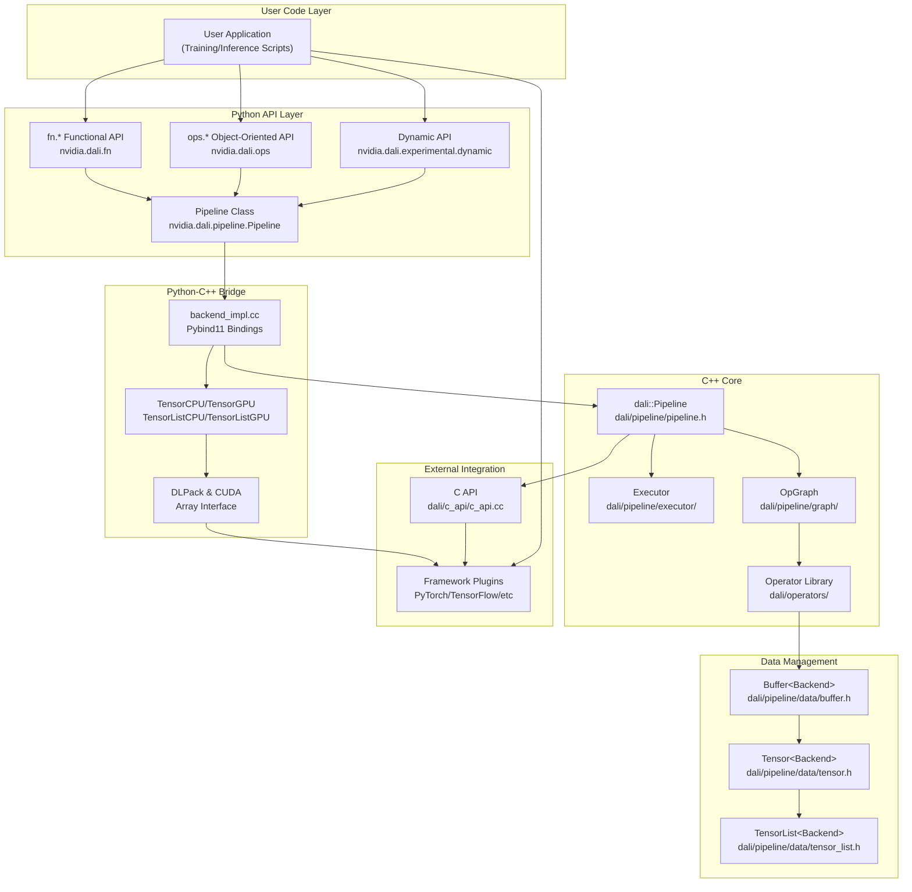

**Figure 1: DALI System Layers**

This architecture separates user-facing Python APIs from the execution engine. The `Pipeline` class orchestrates graph construction and execution, while `Executor` handles the actual operator scheduling and data movement.

Sources: [dali/python/backend_impl.cc:1-50](), [dali/python/nvidia/dali/pipeline.py:97-261](), [dali/pipeline/pipeline.h:15-62]()

### Core Data Flow

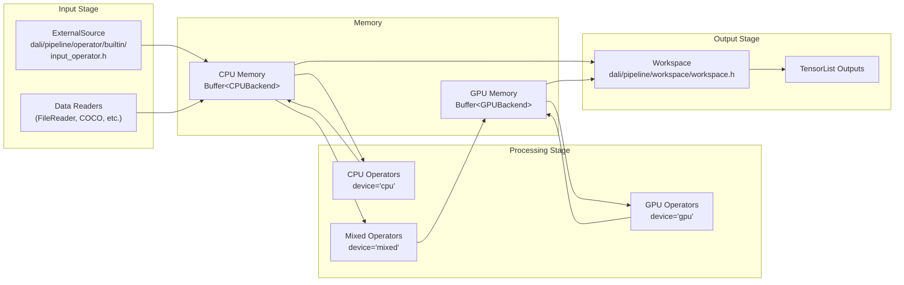

**Figure 2: Data Flow Through Pipeline Stages**

Data flows from input operators through CPU, mixed (CPU input→GPU output), and GPU operators. The `Workspace` manages intermediate and output buffers.

Sources: [dali/pipeline/workspace/workspace.h](), [dali/pipeline/operator/builtin/input_operator.h:1-50]()

## Core Components

### Pipeline Class

The `Pipeline` class is the central orchestrator for defining and executing data processing graphs.

**Python Interface**: `nvidia.dali.pipeline.Pipeline` [dali/python/nvidia/dali/pipeline.py:97-261]()

**C++ Implementation**: `dali::Pipeline` [dali/pipeline/pipeline.h:62-110](), [dali/pipeline/pipeline.cc:124-308]()

Key responsibilities:
- Graph construction via `AddOperator()` and `AddExternalInput()`
- Validation and optimization during `Build()`
- Execution control via `Run()`, `Outputs()`, `Prefetch()`
- Serialization for deployment

**Construction Parameters** (subset):

| Parameter | Type | Purpose |
|-----------|------|---------|
| `batch_size` | int | Maximum batch size |
| `num_threads` | int | CPU worker thread count |
| `device_id` | int | GPU device ID |
| `seed` | int | Random number generator seed |
| `exec_pipelined` | bool | Enable pipeline parallelism |
| `exec_async` | bool | Enable async execution |
| `exec_dynamic` | bool | Enable dynamic executor (GPU→CPU transfers) |
| `prefetch_queue_depth` | int/dict | Prefetch queue size(s) |

Sources: [dali/python/nvidia/dali/pipeline.py:101-261](), [dali/pipeline/pipeline.h:87-110]()

### Executor

The `Executor` manages operator execution, memory allocation, and prefetching. DALI supports multiple executor types:

| Executor Type | Description | Use Case |
|---------------|-------------|----------|
| **Simple** | Sequential, synchronous | Debugging |
| **Pipelined** | Overlapped CPU/GPU stages | Standard training |
| **Async** | Asynchronous execution | Background prefetching |
| **Dynamic** | Dynamic memory, GPU→CPU copies | Complex graphs |
| **Separated** | Independent CPU/GPU queues | Fine-grained control |

The executor is selected via `ExecutorType` flags [dali/pipeline/executor/executor.h]().

Sources: [dali/pipeline/pipeline.cc:382-396](), [dali/pipeline/executor/executor_factory.h]()

### Data Structures

DALI's data structures form a hierarchy:

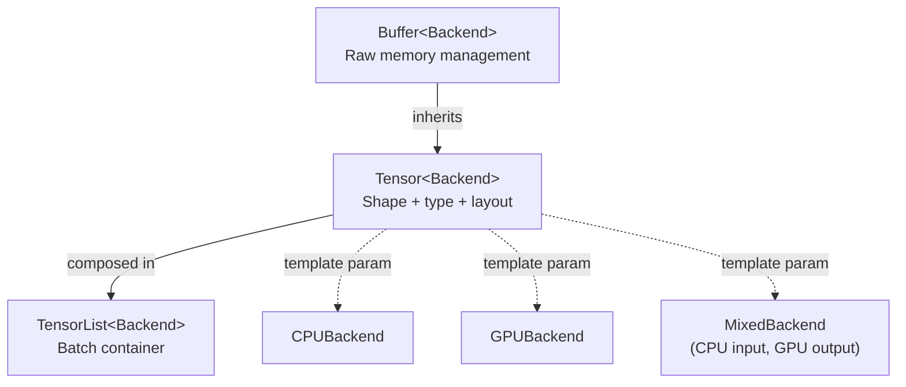

**Figure 3: Data Structure Hierarchy**

- `Buffer<Backend>`: Memory allocation/deallocation, pinned/device memory [dali/pipeline/data/buffer.h]()
- `Tensor<Backend>`: Single sample with shape, type, layout [dali/pipeline/data/tensor.h]()
- `TensorList<Backend>`: Batch of tensors, contiguous or non-contiguous [dali/pipeline/data/tensor_list.h]()

Sources: [dali/pipeline/data/buffer.h](), [dali/pipeline/data/tensor.h](), [dali/pipeline/data/tensor_list.h]()

### Operator System

Operators are the computational building blocks. Each operator:
1. Has an `OpSchema` defining arguments, inputs, outputs [dali/pipeline/operator/op_schema.h]()
2. Implements `Setup()` for shape inference and `Run()` for computation
3. Declares device placement: CPU, GPU, or Mixed
4. Registers via `DALI_REGISTER_OPERATOR` macro

**Registry**: [dali/pipeline/operator/op_schema.cc](), Python wrapper [dali/python/nvidia/dali/ops/_registry.py]()

Sources: [dali/pipeline/operator/operator.h](), [dali/pipeline/operator/op_schema.h]()

## API Styles

DALI provides three complementary APIs:

### Functional API (`fn.*`)

```python
import nvidia.dali.fn as fn

@pipeline_def
def my_pipeline():
    images, labels = fn.readers.file(file_root=image_dir)
    images = fn.decoders.image(images, device="mixed")
    images = fn.resize(images, size=(224, 224))
    return images, labels
```

Operations are functions returning `DataNode` objects representing graph nodes. Used inside `@pipeline_def` decorator or within `Pipeline.define_graph()`.

**Implementation**: [dali/python/nvidia/dali/fn/__init__.py]()

### Object-Oriented API (`ops.*`)

```python
from nvidia.dali import ops, Pipeline

class MyPipeline(Pipeline):
    def __init__(self, **kwargs):
        super().__init__(**kwargs)
        self.reader = ops.readers.File(file_root=image_dir)
        self.decoder = ops.decoders.Image(device="mixed")
        self.resize = ops.Resize(size=(224, 224))
    
    def define_graph(self):
        images, labels = self.reader()
        images = self.decoder(images)
        images = self.resize(images)
        return images, labels
```

Operators are instantiated as objects, then called to produce `DataNode` outputs. Allows operator reuse and stateful operators.

**Implementation**: [dali/python/nvidia/dali/ops/__init__.py:58-500]()

### Dynamic API (`experimental.dynamic.*`)

```python
from nvidia.dali.experimental import dynamic as ndd

def process_batch(batch):
    # Imperative, eager-like execution
    decoded = ndd.imread(batch)
    resized = ndd.resize(decoded, size=(224, 224))
    return resized
```

Imperative API for eager-like execution. Operates on `Tensor` and `Batch` objects with immediate results.

**Implementation**: [dali/python/nvidia/dali/experimental/dynamic/__init__.py]()

Sources: [dali/python/nvidia/dali/fn/__init__.py](), [dali/python/nvidia/dali/ops/__init__.py:1-50](), [dali/python/nvidia/dali/experimental/dynamic/__init__.py]()

## Python-C++ Bridge

The bridge uses Pybind11 to expose C++ classes and functions to Python:

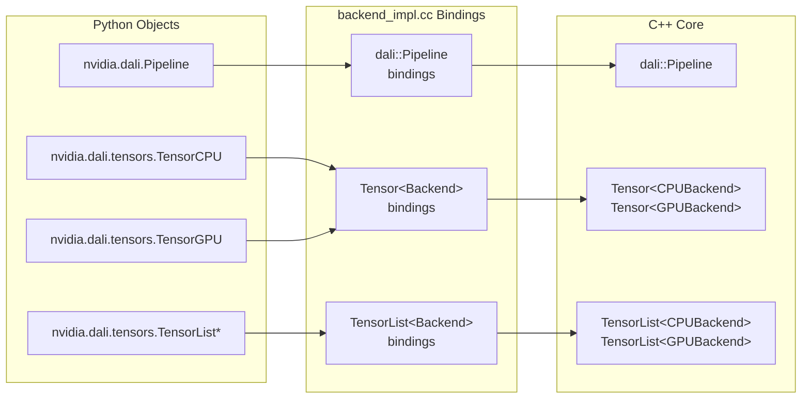

**Figure 4: Python-C++ Bridge via Pybind11**

Key binding entry points:
- `PYBIND11_MODULE(backend_impl, m)` [dali/python/backend_impl.cc:2418-2500]()
- `ExposePipeline()` [dali/python/backend_impl.cc:2100-2200]()
- `ExposeTensor()` [dali/python/backend_impl.cc:624-896]()
- `ExposeTensorList()` [dali/python/backend_impl.cc:998-1200]()

Sources: [dali/python/backend_impl.cc:1-100](), [dali/python/backend_impl.cc:624-896]()

## Framework Integration

DALI integrates with deep learning frameworks through iterators and dataset wrappers:

### Integration Patterns

| Framework | Integration Class | Location |
|-----------|------------------|----------|
| **PyTorch** | `DALIGenericIterator` | `nvidia.dali.plugin.pytorch` |
| **TensorFlow** | `DALIDataset` | `nvidia.dali.plugin.tensorflow` |
| **PaddlePaddle** | `DALIGenericIterator` | `nvidia.dali.plugin.paddle` |
| **MXNet** | `DALIGenericIterator` | `nvidia.dali.plugin.mxnet` |

### Common Iterator Pattern

```python
from nvidia.dali.plugin.pytorch import DALIGenericIterator

train_loader = DALIGenericIterator(
    [pipeline],  # DALI pipeline(s)
    ['data', 'label'],  # Output names
    reader_name='Reader',  # For epoch size
    auto_reset=True  # Auto-restart after epoch
)

for batch in train_loader:
    data = batch[0]['data']  # PyTorch tensor
    labels = batch[0]['label']
    # ... training loop
```

**Base Class**: `_DaliBaseIterator` handles batching, sharding, and epoch management.

**Zero-Copy Transfer**: Uses DLPack (`__dlpack__` protocol) and CUDA Array Interface for efficient data sharing.

Sources: [dali/python/nvidia/dali/plugin/pytorch/__init__.py](), [dali/python/nvidia/dali/plugin/base_iterator.py]()

## C API

DALI provides a C API for language-agnostic integration:

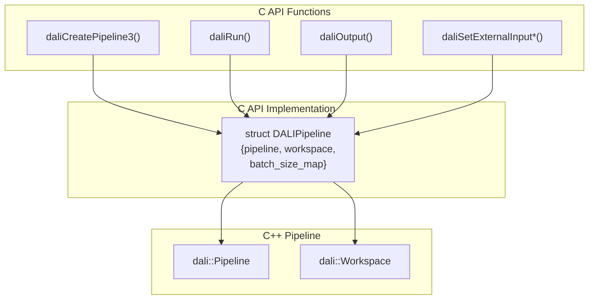

**Figure 5: C API Structure**

Key functions:
- `daliCreatePipeline3()`: Deserialize and build pipeline [dali/c_api/c_api.cc:273-294]()
- `daliSetExternalInput*()`: Feed external data [dali/c_api/c_api.cc:119-210]()
- `daliRun()`, `daliOutput()`: Execute and retrieve results [dali/c_api/c_api.cc:319-350]()

Header: [include/dali/c_api.h]()

Sources: [dali/c_api/c_api.cc:1-100](), [include/dali/c_api.h:1-50]()

## Build System

DALI uses CMake with Docker-based reproducible builds:

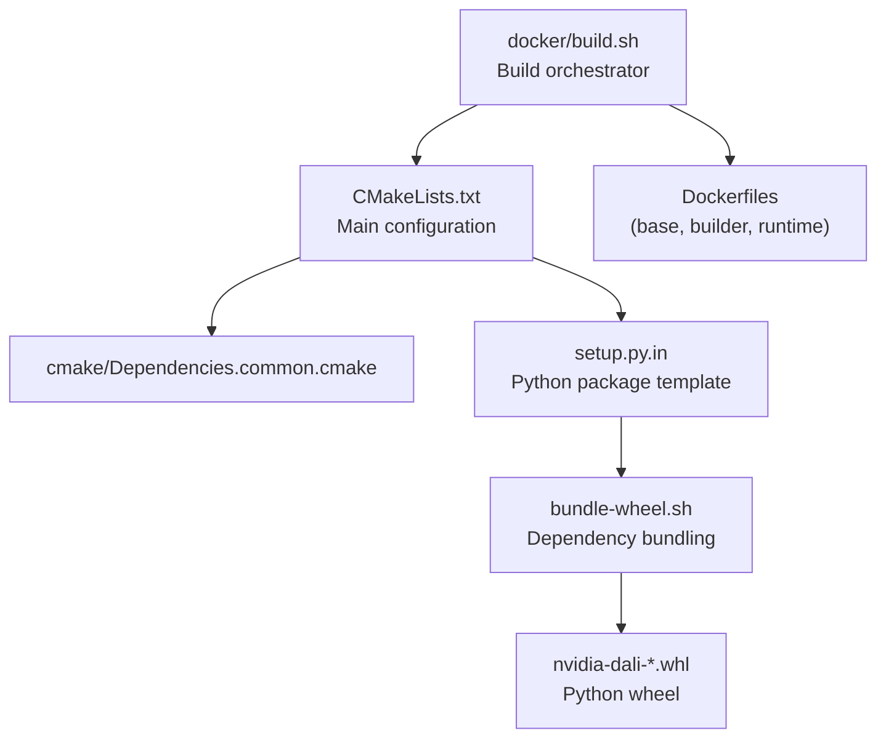

**Figure 6: Build System Overview**

Key entry points:
- `CMakeLists.txt`: Main build configuration
- `docker/build.sh`: Orchestrates Docker builds
- `setup.py.in`: Python package template
- `qa/*.sh`: Test orchestration

Sources: [CMakeLists.txt](), [docker/build.sh](), [qa/TL0_python-self-test/test.sh]()

## Getting Started

A minimal DALI pipeline:

```python
from nvidia.dali import pipeline_def
import nvidia.dali.fn as fn
import nvidia.dali.types as types

@pipeline_def(batch_size=16, num_threads=4, device_id=0)
def simple_pipeline():
    images, labels = fn.readers.file(file_root="/data/images")
    images = fn.decoders.image(images, device="mixed", output_type=types.RGB)
    images = fn.resize(images, size=(224, 224))
    images = fn.crop_mirror_normalize(
        images,
        dtype=types.FLOAT,
        mean=[0.485 * 255, 0.456 * 255, 0.406 * 255],
        std=[0.229 * 255, 0.224 * 255, 0.225 * 255]
    )
    return images, labels

# Build and run
pipe = simple_pipeline()
pipe.build()
outputs = pipe.run()
images, labels = outputs
```

Key steps:
1. Define pipeline with `@pipeline_def` or by subclassing `Pipeline`
2. Chain operators using `fn.*` functions or `ops.*` objects
3. Call `build()` to construct the execution graph
4. Call `run()` to execute one iteration
5. Retrieve outputs as `TensorList` objects

Sources: [README.rst:35-92](), [dali/python/nvidia/dali/pipeline.py:713-810]()

## Documentation and Resources

- **Installation**: [docs/installation.rst]()
- **Examples**: [docs/examples/]()
- **API Reference**: Generated from operator schemas and docstrings
- **Release Notes**: https://docs.nvidia.com/deeplearning/dali/release-notes/
- **GitHub**: https://github.com/NVIDIA/DALI

Sources: [README.rst:136-208](), [docs/index.rst:1-81]()

---

# Page: Core Architecture

# Core Architecture

<details>
<summary>Relevant source files</summary>

The following files were used as context for generating this wiki page:

- [.gitignore](.gitignore)
- [README.rst](README.rst)
- [dali/c_api/c_api.cc](dali/c_api/c_api.cc)
- [dali/c_api/c_api_test.cc](dali/c_api/c_api_test.cc)
- [dali/pipeline/pipeline.cc](dali/pipeline/pipeline.cc)
- [dali/pipeline/pipeline.h](dali/pipeline/pipeline.h)
- [dali/pipeline/pipeline_test.cc](dali/pipeline/pipeline_test.cc)
- [dali/python/backend_impl.cc](dali/python/backend_impl.cc)
- [dali/python/nvidia/dali/_typing.py](dali/python/nvidia/dali/_typing.py)
- [dali/python/nvidia/dali/experimental/dynamic/__init__.py](dali/python/nvidia/dali/experimental/dynamic/__init__.py)
- [dali/python/nvidia/dali/experimental/dynamic/_ops.py](dali/python/nvidia/dali/experimental/dynamic/_ops.py)
- [dali/python/nvidia/dali/experimental/dynamic/random.py](dali/python/nvidia/dali/experimental/dynamic/random.py)
- [dali/python/nvidia/dali/fn/__init__.py](dali/python/nvidia/dali/fn/__init__.py)
- [dali/python/nvidia/dali/ops/__init__.py](dali/python/nvidia/dali/ops/__init__.py)
- [dali/python/nvidia/dali/ops/_docs.py](dali/python/nvidia/dali/ops/_docs.py)
- [dali/python/nvidia/dali/ops/_names.py](dali/python/nvidia/dali/ops/_names.py)
- [dali/python/nvidia/dali/ops/_signatures.py](dali/python/nvidia/dali/ops/_signatures.py)
- [dali/python/nvidia/dali/pipeline.py](dali/python/nvidia/dali/pipeline.py)
- [dali/python/nvidia/dali/types.py](dali/python/nvidia/dali/types.py)
- [dali/test/python/experimental_mode/test_arg_conversion.py](dali/test/python/experimental_mode/test_arg_conversion.py)
- [dali/test/python/experimental_mode/test_docs.py](dali/test/python/experimental_mode/test_docs.py)
- [dali/test/python/experimental_mode/test_public_api.py](dali/test/python/experimental_mode/test_public_api.py)
- [dali/test/python/experimental_mode/test_random.py](dali/test/python/experimental_mode/test_random.py)
- [dali/test/python/operator_1/test_operator_exception.py](dali/test/python/operator_1/test_operator_exception.py)
- [dali/test/python/test_functional_api.py](dali/test/python/test_functional_api.py)
- [dali/test/python/test_pipeline.py](dali/test/python/test_pipeline.py)
- [docs/autodoc_submodules.py](docs/autodoc_submodules.py)
- [docs/conf.py](docs/conf.py)
- [docs/dali_dynamic/api_reference.rst](docs/dali_dynamic/api_reference.rst)
- [docs/dali_dynamic/index.rst](docs/dali_dynamic/index.rst)
- [docs/dali_dynamic/ops_reference.rst](docs/dali_dynamic/ops_reference.rst)
- [docs/index.rst](docs/index.rst)
- [docs/operations_table.py](docs/operations_table.py)
- [docs/supported_ops.rst](docs/supported_ops.rst)
- [include/dali/c_api.h](include/dali/c_api.h)
- [internal_tools/python_stub_generator.py](internal_tools/python_stub_generator.py)

</details>


## Purpose and Scope

This document describes the fundamental architecture of NVIDIA DALI, explaining how its core components work together to provide GPU-accelerated data loading and preprocessing. It covers the layered architecture, the pipeline execution model, and the interaction between Python and C++ components.

For detailed information about specific subsystems:
- Pipeline construction and execution patterns: see [Pipeline System](#2.1)
- Memory management and tensor representations: see [Data Structures](#2.2)  
- Operator lifecycle and scheduling: see [Operator System](#2.3)

---

## Architectural Layers

DALI is structured as a multi-layered system that bridges high-level Python APIs down to optimized C++ execution on CPU and GPU backends.

### Layer Diagram

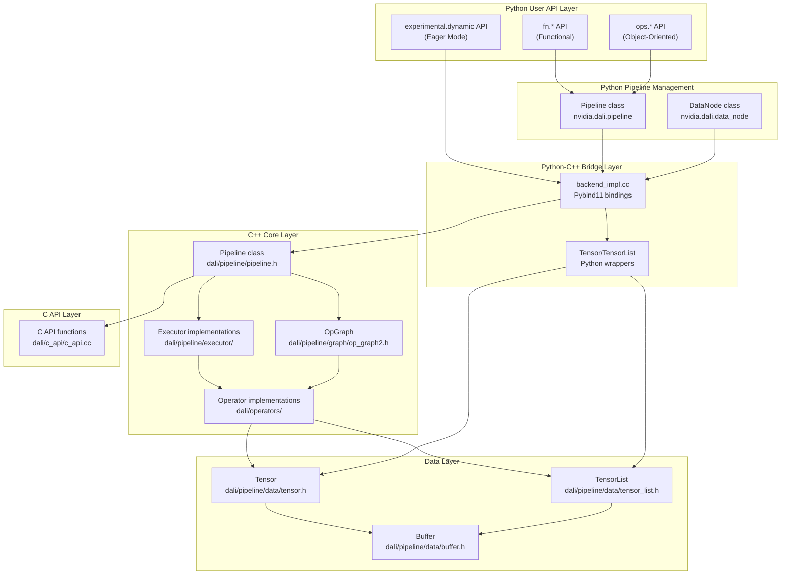

**Sources:** [dali/python/backend_impl.cc:1-100](), [dali/pipeline/pipeline.h:1-70](), [dali/python/nvidia/dali/pipeline.py:1-100]()

---

## Core Components

### Pipeline Management

The `Pipeline` class exists at both Python and C++ levels, serving as the primary interface for constructing and executing data processing graphs.

**Python Pipeline** ([dali/python/nvidia/dali/pipeline.py:97-262]())
- User-facing class for defining data processing pipelines
- Manages operator specifications and graph construction
- Handles Python worker pools for parallel external sources
- Parameters: `batch_size`, `num_threads`, `device_id`, `exec_pipelined`, `exec_async`, `exec_dynamic`

**C++ Pipeline** ([dali/pipeline/pipeline.h:62-110]())
- Core pipeline implementation managing graph building and execution
- Owns the `Executor` and `OpGraph` instances
- Handles operator registration and dependency resolution
- Performs graph optimizations (CSE, implicit copy insertion)

#### Pipeline Lifecycle

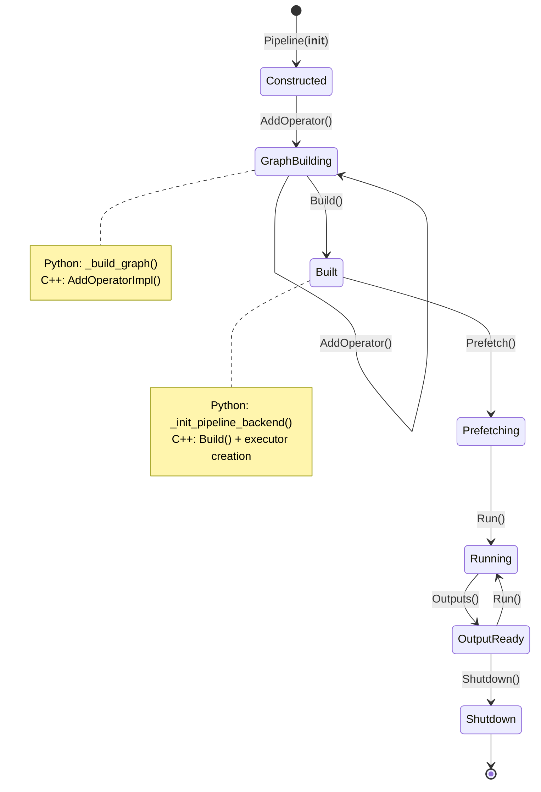

**Sources:** [dali/pipeline/pipeline.cc:124-162](), [dali/python/nvidia/dali/pipeline.py:712-880]()

### Execution Engine

DALI supports multiple execution modes through different `Executor` implementations, selected via `ExecutorType` flags.

**Executor Types** ([dali/pipeline/executor/executor_factory.cc]())

| Type | Flags | Description |
|------|-------|-------------|
| Simple | None | Synchronous, single-threaded execution |
| Pipelined | `PIPELINED` | Overlaps CPU/GPU work across iterations |
| Async | `ASYNC \| PIPELINED` | Asynchronous with prefetching |
| Dynamic | `ASYNC \| PIPELINED \| DYNAMIC` | Dynamic memory allocation, GPU→CPU transfers |

**Key Executor Responsibilities:**
- Schedule operator execution based on graph dependencies
- Manage prefetch queues (configurable via `prefetch_queue_depth`)
- Coordinate CPU/GPU work synchronization
- Handle operator workspace allocation

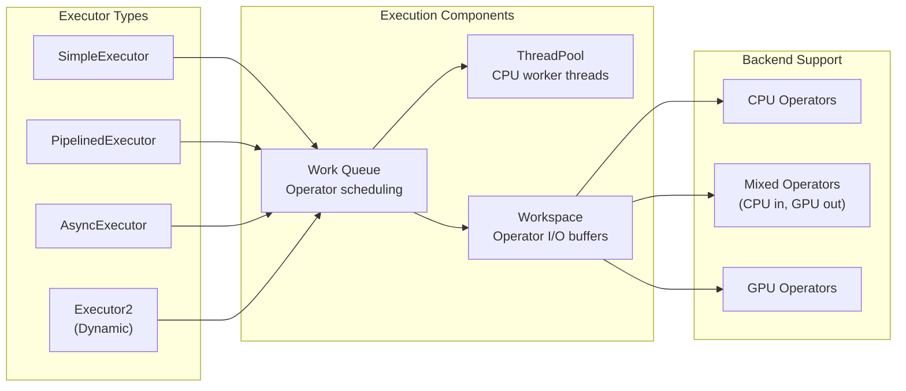

**Sources:** [dali/pipeline/executor/executor.h](), [dali/pipeline/pipeline.cc:382-396]()

### Operator Graph

The `OpGraph` ([dali/pipeline/graph/op_graph2.h]()) represents the data processing graph as a directed acyclic graph (DAG) of operators and data edges.

**Graph Building Process:**

1. **Operator Addition** ([dali/pipeline/pipeline.cc:316-357]())
   - Validate operator specifications
   - Record input/output edge names and devices
   - Track data dependencies

2. **Graph Construction** ([dali/pipeline/pipeline.cc:504-600]())
   - Build DAG from operator specifications
   - Resolve data node storage devices (CPU/GPU)
   - Insert implicit `MakeContiguous` operators for data transfers

3. **Graph Optimization** ([dali/pipeline/pipeline.cc:100-120]())
   - Common Subexpression Elimination (CSE) if enabled
   - Prune unused operators
   - Optimize memory allocation patterns

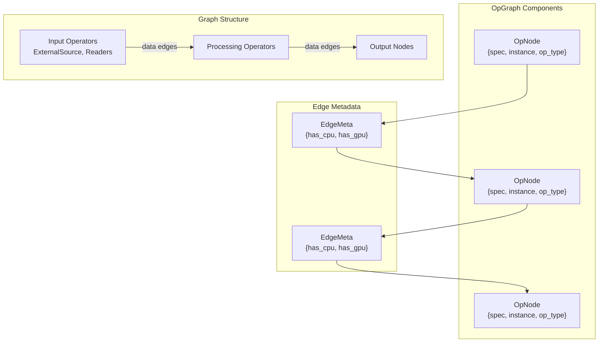

**Sources:** [dali/pipeline/pipeline.h:400-480](), [dali/pipeline/graph/op_graph2.h]()

---

## Data Flow Architecture

Data flows through DALI as batches of tensors, managed by the `Buffer`-`Tensor`-`TensorList` hierarchy.

### Data Structure Hierarchy

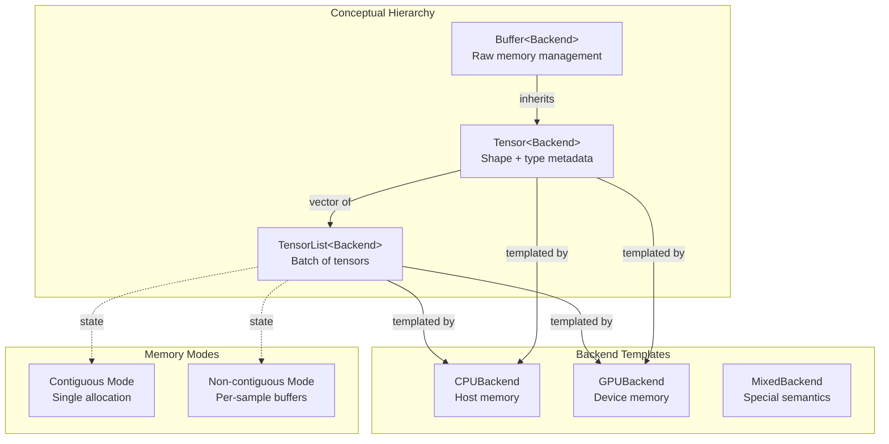

**Key Classes:**
- `Buffer<Backend>`: Manages raw memory allocation and lifetime ([dali/pipeline/data/buffer.h]())
- `Tensor<Backend>`: Adds shape, type, and layout metadata ([dali/pipeline/data/tensor.h]())
- `TensorList<Backend>`: Container for batches with uniform or non-uniform shapes ([dali/pipeline/data/tensor_list.h]())

**Sources:** [dali/pipeline/data/buffer.h](), [dali/pipeline/data/tensor.h](), [dali/pipeline/data/tensor_list.h]()

### Operator Execution Data Flow

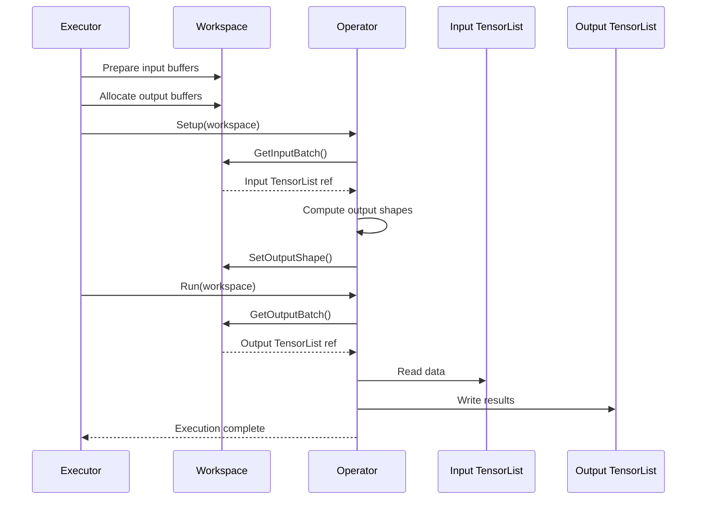

**Sources:** [dali/pipeline/executor/executor.cc](), [dali/pipeline/workspace/workspace.h]()

---

## Python-C++ Bridge

The Python-C++ bridge is implemented using pybind11 in `backend_impl.cc`, exposing C++ classes and functions to Python.

### Key Binding Categories

**Pipeline Bindings** ([dali/python/backend_impl.cc:2400-2600]())
- `Pipeline` class constructor and methods
- Graph building: `AddOperator`, `Build`
- Execution: `Run`, `Outputs`, `Prefetch`
- Serialization: `Serialize`, `Deserialize`

**Tensor Bindings** ([dali/python/backend_impl.cc:624-1100]())
- `TensorCPU` and `TensorGPU` classes
- Buffer protocol for NumPy interop
- DLPack export (`__dlpack__`, `__dlpack_device__`)
- CUDA Array Interface (`__cuda_array_interface__`)

**TensorList Bindings** ([dali/python/backend_impl.cc:1100-1600]())
- Batch-level tensor operations
- Shape queries and manipulation
- Data access methods (`at`, `as_array`, `as_cpu`, `as_gpu`)

### Data Exchange Protocols

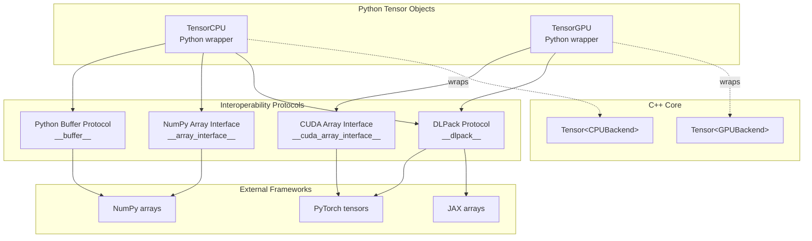

**Sources:** [dali/python/backend_impl.cc:129-158](), [dali/python/backend_impl.cc:624-700]()

---

## C API Layer

DALI provides a C API for language-agnostic integration, primarily used by the TensorFlow plugin.

**Key Functions** ([include/dali/c_api.h](), [dali/c_api/c_api.cc]())

| Function | Purpose |
|----------|---------|
| `daliCreatePipeline` | Deserialize and build pipeline |
| `daliSetExternalInput` | Feed data to external source operators |
| `daliRun` | Execute one pipeline iteration |
| `daliOutput` | Stage outputs for retrieval |
| `daliOutputCopy` | Copy output data to external buffer |
| `daliGetNumOutput` | Query number of pipeline outputs |

### C API Data Flow

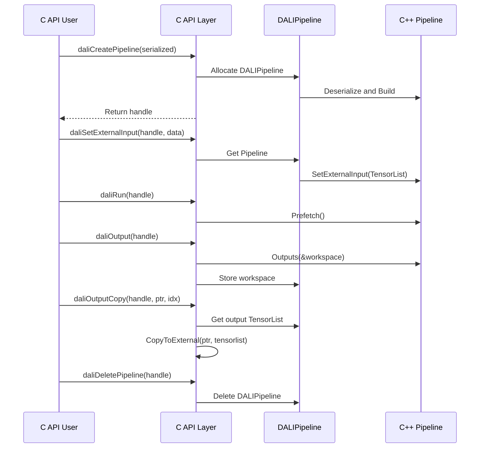

**Sources:** [dali/c_api/c_api.cc:232-300](), [include/dali/c_api.h:120-180]()

---

## Execution Flow Summary

The complete execution flow through DALI's core architecture:

1. **Graph Definition** (Python)
   - User calls `fn.*` or `ops.*` APIs
   - Creates `DataNode` instances representing symbolic tensors
   - Constructs `OpSpec` objects with operator parameters

2. **Pipeline Building** (Python → C++)
   - Python `Pipeline.build()` calls C++ `Pipeline::Build()`
   - Graph optimization (CSE, pruning)
   - Executor instantiation based on configuration
   - Operator instantiation and workspace setup

3. **Execution Loop** (C++)
   - `Pipeline::Run()` → `Executor::Run()`
   - Fill input queues (external sources, readers)
   - Schedule operators based on dependencies
   - Execute in parallel where possible (CPU thread pool, GPU streams)
   - Fill output workspace

4. **Output Retrieval** (C++ → Python)
   - `Pipeline::Outputs()` returns `Workspace`
   - Convert to Python `TensorList` objects via pybind11
   - Zero-copy where possible through DLPack/array interface

**Sources:** [dali/pipeline/pipeline.cc:700-850](), [dali/python/nvidia/dali/pipeline.py:1200-1400]()

---

## Configuration and Tuning

Pipeline behavior is controlled through `PipelineParams` ([dali/pipeline/pipeline_params.h]())

**Key Parameters:**

| Parameter | Type | Default | Description |
|-----------|------|---------|-------------|
| `max_batch_size` | `int` | Required | Maximum batch size |
| `num_threads` | `int` | Required | CPU worker threads |
| `device_id` | `int` | Current GPU | GPU device to use |
| `seed` | `int64_t` | Random | RNG seed |
| `executor_type` | `ExecutorType` | `Dynamic` | Execution model |
| `prefetch_queue_depths` | `QueueSizes` | `{2, 2}` | CPU/GPU queue depths |
| `enable_checkpointing` | `bool` | `false` | Enable state checkpointing |

**Sources:** [dali/pipeline/pipeline_params.h](), [dali/pipeline/pipeline.cc:243-252]()

---

# Page: Pipeline System

# Pipeline System

<details>
<summary>Relevant source files</summary>

The following files were used as context for generating this wiki page:

- [dali/c_api/c_api.cc](dali/c_api/c_api.cc)
- [dali/c_api/c_api_test.cc](dali/c_api/c_api_test.cc)
- [dali/pipeline/pipeline.cc](dali/pipeline/pipeline.cc)
- [dali/pipeline/pipeline.h](dali/pipeline/pipeline.h)
- [dali/pipeline/pipeline_test.cc](dali/pipeline/pipeline_test.cc)
- [dali/python/backend_impl.cc](dali/python/backend_impl.cc)
- [dali/python/nvidia/dali/pipeline.py](dali/python/nvidia/dali/pipeline.py)
- [dali/python/nvidia/dali/types.py](dali/python/nvidia/dali/types.py)
- [dali/test/python/test_functional_api.py](dali/test/python/test_functional_api.py)
- [dali/test/python/test_pipeline.py](dali/test/python/test_pipeline.py)
- [docs/supported_ops.rst](docs/supported_ops.rst)
- [include/dali/c_api.h](include/dali/c_api.h)

</details>


## Purpose and Scope

The Pipeline System is the central orchestration mechanism in DALI that manages the construction, validation, and execution of data processing graphs. It provides both Python and C++ APIs for defining directed acyclic graphs (DAGs) of operators, managing their execution order, and coordinating data flow between CPU and GPU stages.

This document covers the `Pipeline` class architecture, graph building mechanisms, execution models, and lifecycle management. For information about individual operators, see [Operator System](#2.3). For data structures used by pipelines, see [Data Structures](#2.2). For framework-specific integration patterns, see [Framework Integration](#4).

---

## Architecture Overview

The Pipeline System consists of two primary layers connected through pybind11 bindings:

### Python Layer

**Python Pipeline Class** ([dali/python/nvidia/dali/pipeline.py:97-1568]()):
- Main user-facing interface for pipeline construction
- Manages pipeline parameters and configuration
- Handles Python worker pools for parallel external sources
- Provides serialization and deserialization support
- Implements checkpointing functionality

**Key Responsibilities:**
- Operator registration and graph specification
- Python-side validation and error reporting
- External source callback management
- Output specification and validation

### C++ Backend Layer

**C++ Pipeline Class** ([dali/pipeline/pipeline.h:62-582](), [dali/pipeline/pipeline.cc:124-849]()):
- Core pipeline implementation and graph management
- Operator instantiation and lifecycle control
- Graph optimization and validation
- Executor creation and management
- Memory management coordination

**Python-C++ Bridge** ([dali/python/backend_impl.cc:1-1679]()):
- Pybind11 bindings exposing C++ pipeline to Python
- Type conversions between Python and C++ data structures
- Error propagation from C++ exceptions to Python

### Component Architecture

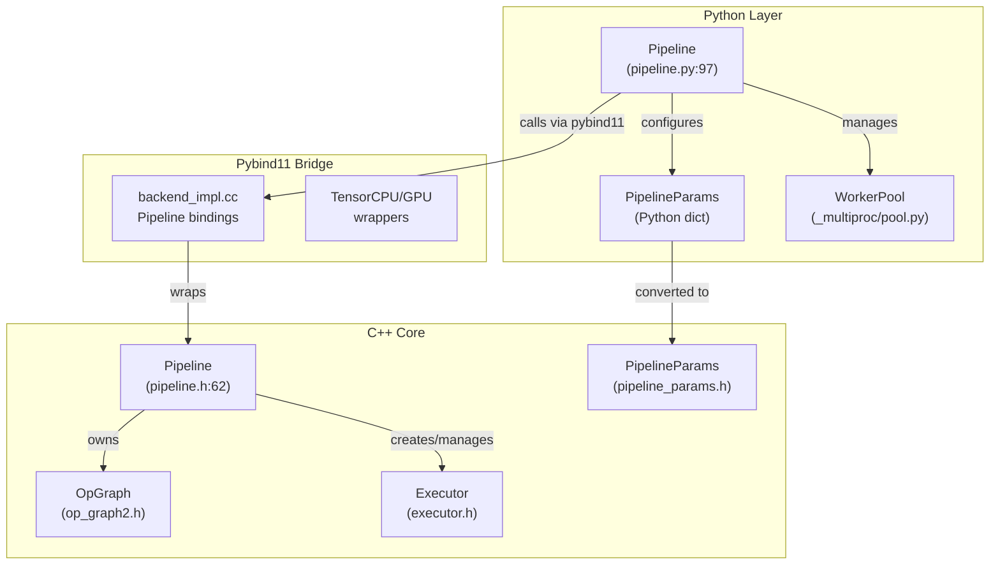

Sources: [dali/python/nvidia/dali/pipeline.py:97-1568](), [dali/pipeline/pipeline.h:62-582](), [dali/python/backend_impl.cc:1-1679]()

---

## Pipeline Lifecycle

The pipeline progresses through distinct phases from construction to execution:

### Lifecycle State Machine

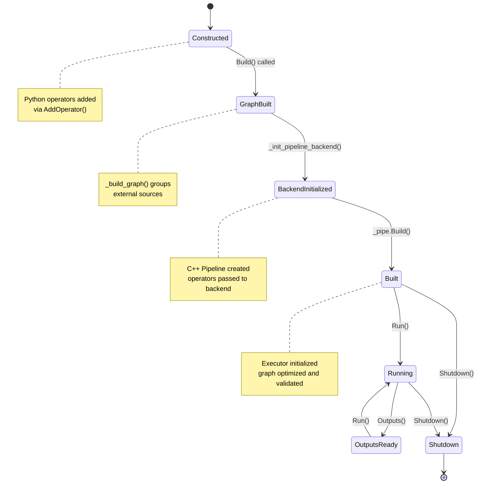

### Lifecycle Phases

**1. Construction Phase** ([dali/python/nvidia/dali/pipeline.py:263-457]()):
- Parameters validated and stored
- Seed generation
- State flags initialized: `_py_graph_built`, `_backend_prepared`, `_built`

**2. Graph Building Phase** ([dali/python/nvidia/dali/pipeline.py:1165-1253]()):
- Method: `_build_graph()`
- Discovers and groups external source operators
- Resolves external source callbacks
- Creates `_ExternalSourceGroup` for parallel execution
- Sets `_py_graph_built = True`

**3. Backend Preparation Phase** ([dali/python/nvidia/dali/pipeline.py:1261-1336]()):
- Method: `_init_pipeline_backend()`
- Creates C++ `Pipeline` object via backend_impl
- Transfers operator specs to C++ layer
- Initializes Python worker pool if needed
- Sets `_backend_prepared = True`

**4. Build Phase** ([dali/pipeline/pipeline.cc:539-687]()):
- C++ `Pipeline::Build()` called
- Graph validation and optimization
- Common subexpression elimination (CSE) if enabled
- MakeContiguous operator insertion
- Executor instantiation
- Sets `_built = True`

**5. Execution Phase** ([dali/python/nvidia/dali/pipeline.py:1433-1508]()):
- `Run()`: Triggers executor to process one iteration
- `Outputs()`: Retrieves results and releases previous buffers
- `ShareOutputs()`: Retrieves results without immediate release

### Build Process Details

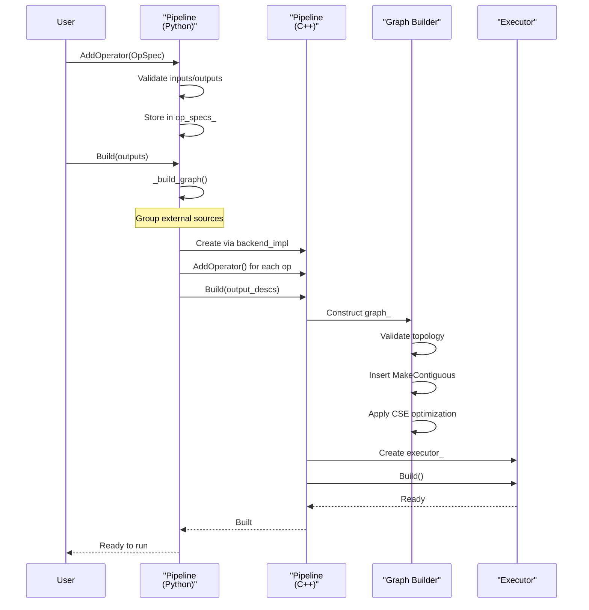

Sources: [dali/python/nvidia/dali/pipeline.py:1165-1336](), [dali/pipeline/pipeline.cc:539-687]()

---

## Execution Models

DALI supports multiple execution models controlled by the `executor_type` parameter:

### Executor Types

| Executor Type | Flags | Description |
|--------------|-------|-------------|
| **Simple** | None | Synchronous, no prefetching |
| **Pipelined** | `PIPELINED` | CPU and GPU stages overlap |
| **Async** | `PIPELINED \| ASYNC` | Asynchronous execution with respect to Python |
| **Separated** | `PIPELINED \| ASYNC \| SEPARATED` | Separate CPU and GPU queue depths |
| **Dynamic** | `PIPELINED \| ASYNC \| DYNAMIC` | Default mode with dynamic memory allocation |

### Execution Model Selection

**Python API** ([dali/python/nvidia/dali/pipeline.py:379-395]()):
```python
# Automatic dynamic executor selection
if exec_dynamic is None and exec_pipelined and exec_async and not self._exec_separated:
    self._exec_dynamic = exec_dynamic = True

self._executor_type = b._MakeExecutorType(
    self._exec_pipelined, self._exec_async, self._exec_separated, self._exec_dynamic
)
```

**C++ API** ([dali/pipeline/pipeline.cc:124-138]()):
```cpp
Pipeline(int max_batch_size, int num_threads, int device_id, int64_t seed,
         bool pipelined_execution, int prefetch_queue_depth,
         bool async_execution, bool dynamic_execution, ...)
: Pipeline(PipelineParams{...})
```

### Stream and Concurrency Policies

**StreamPolicy** ([dali/python/nvidia/dali/pipeline.py:60-76]()):
- `SINGLE`: All operators share one stream
- `PER_BACKEND`: Separate streams for CPU/Mixed/GPU
- `PER_OPERATOR`: Independent operators use distinct streams

**OperatorConcurrency** ([dali/python/nvidia/dali/pipeline.py:79-94]()):
- `NONE`: No concurrent operator execution
- `BACKEND`: Different backends run in parallel
- `FULL`: All independent operators run in parallel

### Queue Depth Configuration

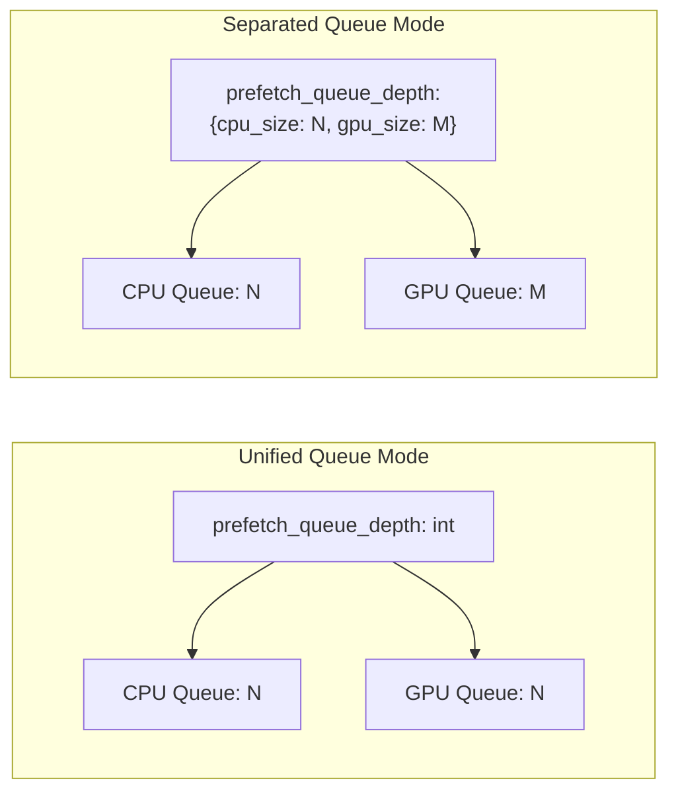

Sources: [dali/python/nvidia/dali/pipeline.py:60-94](), [dali/python/nvidia/dali/pipeline.py:360-384]()

---

## Graph Building and Validation

### Adding Operators

**Operator Addition Flow** ([dali/pipeline/pipeline.cc:337-481]()):

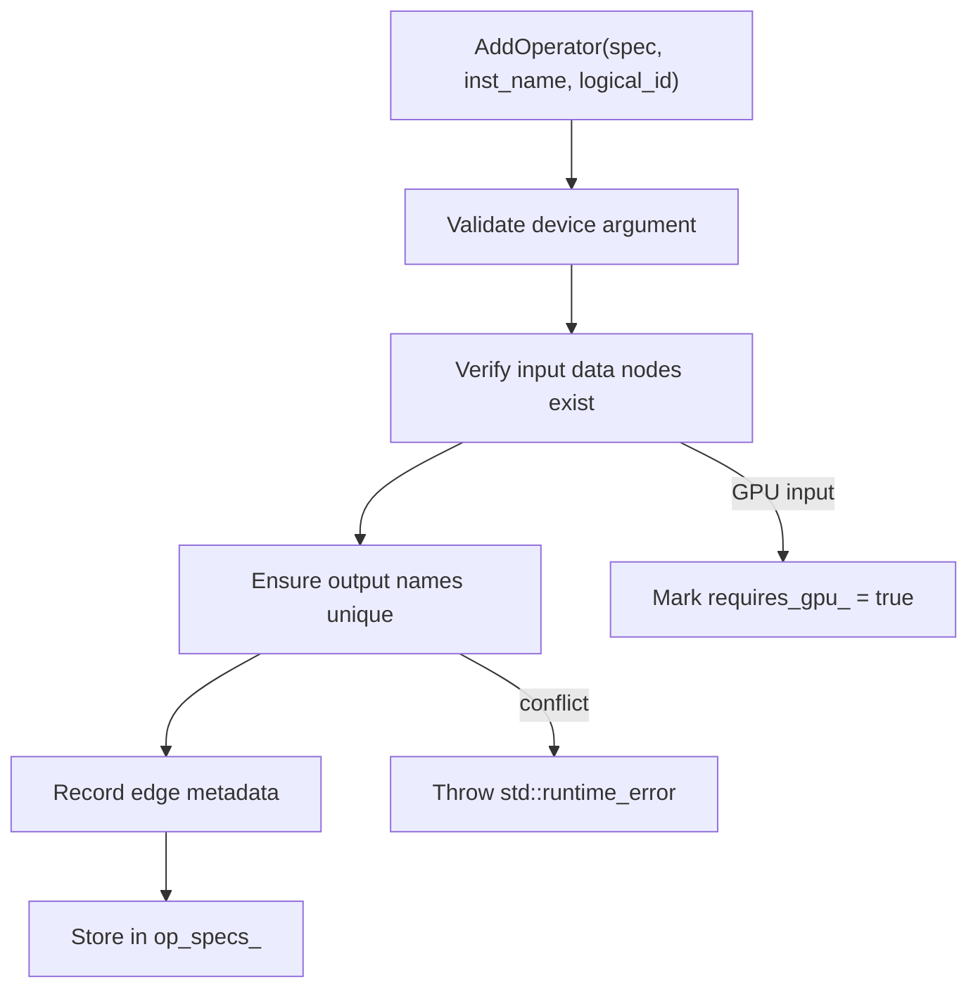

### Edge Management

The pipeline maintains an `edge_names_` map ([dali/pipeline/pipeline.h:501-506]()) tracking data flow:

```cpp
struct EdgeMeta {
  bool has_cpu;    // CPU version of this data exists
  bool has_gpu;    // GPU version exists  
  int cpu_idx;     // Index in CPU outputs (-1 if none)
  int gpu_idx;     // Index in GPU outputs (-1 if none)
};

std::unordered_map<std::string, EdgeMeta> edge_names_;
```

**Edge Creation** ([dali/pipeline/pipeline.cc:453-476]()):
- Each operator output creates an edge
- CPU operators produce CPU edges only
- Mixed/GPU operators produce GPU edges
- Cross-device copies trigger MakeContiguous insertion

### Graph Validation Rules

**Topology Constraints** ([dali/pipeline/pipeline.cc:404-451]()):

| Rule | Enforcement Location | Error Type |
|------|---------------------|------------|
| Input must exist | `AddOperatorImpl:404-416` | `std::runtime_error` |
| Output names unique | `AddOperatorImpl:458-462` | `std::runtime_error` |
| CPU ops produce CPU output only | `AddOperatorImpl:464-467` | `std::runtime_error` |
| Argument inputs must be CPU | `AddOperatorImpl:445-450` | `std::runtime_error` |

### Graph Optimization

**Common Subexpression Elimination (CSE)** ([dali/pipeline/pipeline.cc:110-120]()):
- Enabled by default via `DALI_ENABLE_CSE` environment variable
- Identifies and deduplicates identical operator subgraphs
- Preserves operator names with `preserve_name` argument
- ExternalSource operators never collapsed ([dali/pipeline/pipeline.cc:383]())

**MakeContiguous Insertion** ([dali/pipeline/pipeline.cc:633-669]()):
- Automatically inserted for non-contiguous outputs
- Required when CPU data moves to GPU
- Propagates memory hints from producers to contiguous ops

### Graph Structure Example

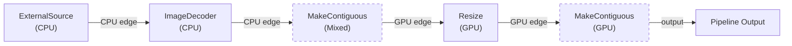

Sources: [dali/pipeline/pipeline.cc:337-481](), [dali/pipeline/pipeline.cc:633-669](), [dali/pipeline/pipeline.h:501-506]()

---

## Pipeline Parameters

### PipelineParams Structure

**Python Parameters** ([dali/python/nvidia/dali/pipeline.py:103-261]()):

| Parameter | Type | Default | Description |
|-----------|------|---------|-------------|
| `batch_size` | int | Required | Maximum batch size |
| `num_threads` | int | Required | CPU thread count |
| `device_id` | int | None | GPU device ID (None for CPU-only) |
| `seed` | int | None | Random seed (auto-generated if None) |
| `exec_pipelined` | bool | True | Enable pipelined execution |
| `exec_async` | bool | True | Enable asynchronous execution |
| `exec_dynamic` | bool | None | Enable dynamic executor (auto-selected) |
| `prefetch_queue_depth` | int or dict | 2 | Queue depth(s) for prefetching |
| `stream_policy` | StreamPolicy | None | Stream allocation policy |
| `concurrency` | OperatorConcurrency | None | Operator concurrency level |
| `enable_checkpointing` | bool | False | Enable checkpoint support |
| `py_num_workers` | int | 1 | Python worker pool size |
| `py_start_method` | str | "fork" | Worker process start method |

**C++ Parameters** ([dali/pipeline/pipeline_params.h](), [dali/pipeline/pipeline.cc:254-288]()):

```cpp
struct PipelineParams {
  std::optional<int> max_batch_size;
  std::optional<int> num_threads;
  std::optional<int> device_id;
  std::optional<int64_t> seed;
  std::optional<ExecutorType> executor_type;
  ExecutorFlags executor_flags = ExecutorFlags::None;
  std::optional<QueueSizes> prefetch_queue_depths;
  bool enable_checkpointing = false;
  bool enable_memory_stats = false;
  size_t bytes_per_sample_hint = 0;
};
```

### Parameter Validation

**Validation Logic** ([dali/pipeline/pipeline.cc:254-288]()):
- Batch size must be positive
- Device ID must be valid CUDA device
- Queue depths must be greater than 0
- Separated queues require different CPU/GPU depths or appropriate executor type

### Device ID Handling

```mermaid
graph TD
    Start["Pipeline Construction"]
    CheckDevID{"device_id specified?"}
    RequiresGPU{"Pipeline requires GPU?"}
    GetCurrent["cudaGetDevice()"]
    UseCurrent["Use current device"]
    UseSpecified["Use specified device"]
    CPUOnly["device_id = CPU_ONLY_DEVICE_ID"]
    
    Start --> CheckDevID
    CheckDevID -->|"Yes"| UseSpecified
    CheckDevID -->|"No"| RequiresGPU
    RequiresGPU -->|"Yes"| GetCurrent
    RequiresGPU -->|"No"| CPUOnly
    GetCurrent --> UseCurrent
```

Sources: [dali/python/nvidia/dali/pipeline.py:103-261](), [dali/pipeline/pipeline.cc:254-308]()

---

## External Inputs

External inputs allow feeding data from outside sources into the pipeline.

### ExternalSource Mechanism

**Adding External Inputs** ([dali/pipeline/pipeline.h:118-131]()):

```cpp
int AddExternalInput(const string &name,
                     const string &device = "cpu",
                     DALIDataType dtype = DALI_NO_TYPE,
                     int ndim = -1,
                     const TensorLayout &layout = "")
```

This creates an `ExternalSource` operator internally.

### Setting External Input Data

**Python API** ([dali/pipeline/pipeline.h:202-210]()):

```cpp
template<typename Backend>
void SetExternalInput(const string &name, const TensorList<Backend> &tl,
                     AccessOrder order = {},
                     bool sync = false, bool use_copy_kernel = false,
                     InputOperatorCopyMode copy_mode = InputOperatorCopyMode::DEFAULT,
                     std::optional<std::string> data_id = std::nullopt)
```

**Key Parameters:**
- `sync`: Block until data copied to internal buffers
- `use_copy_kernel`: Use CUDA kernel instead of cudaMemcpyAsync
- `copy_mode`: Override ExternalSource's `no_copy` setting
- `data_id`: Optional identifier for data tracking

### Data Flow for External Inputs

```mermaid
sequenceDiagram
    participant User
    participant Pipeline
    participant InputOp as "InputOperator"
    participant Queue as "CachingList"
    participant Executor
    
    User->>Pipeline: SetExternalInput(name, data)
    Pipeline->>InputOp: SetDataSource(data)
    InputOp->>Queue: PushBack(data)
    
    User->>Pipeline: Run()
    Pipeline->>Executor: Run()
    Executor->>InputOp: Setup()
    InputOp->>Queue: PopFront()
    InputOp->>Executor: Provide data
    Executor->>Executor: Execute downstream ops
```

### Feed Input Count

**Input Feed Count Calculation** ([dali/python/nvidia/dali/pipeline.py:1509-1529]()):

The pipeline tracks how many times each input must be fed before execution:

```python
def InputFeedCount(self, input_name: str) -> int:
    """Returns number of times feed_input must be called."""
    self.build()
    return self._pipe.InputFeedCount(input_name)
```

This accounts for prefetch queue depth - inputs must be populated enough times to fill the queues.

### Batch Size Management

**Setting Batch Size** ([dali/c_api/c_api.cc:347-350]()):

```cpp
void daliSetExternalInputBatchSize(daliPipelineHandle *pipe_handle, 
                                   const char *name,
                                   int batch_size)
```

Allows variable batch sizes per iteration, must be ≤ `max_batch_size`.

Sources: [dali/pipeline/pipeline.h:118-210](), [dali/python/nvidia/dali/pipeline.py:1509-1529](), [dali/c_api/c_api.cc:119-210]()

---

## Serialization and Deserialization

### Pipeline Serialization

**Python Serialization** ([dali/python/nvidia/dali/pipeline.py:1536-1616]()):

```python
def serialize(self, **kwargs) -> bytes:
    """Serialize the pipeline to a protobuf string."""
```

**What Gets Serialized:**
- Pipeline parameters (batch_size, num_threads, device_id, etc.)
- All operator specifications (OpSpec objects)
- External input declarations
- Output descriptors (names, devices, dtypes, layouts)
- Logical ID groupings for synchronized operators
- Checkpointing state if enabled

### Deserialization

**C++ Deserialization** ([dali/pipeline/pipeline.cc:164-234]()):

```cpp
Pipeline::Pipeline(const string &serialized_pipe, const PipelineParams &params) {
  dali_proto::PipelineDef def;
  DeserializePipeline(serialized_pipe, def);
  
  // Extract serialized parameters
  params_.max_batch_size = def.batch_size();
  params_.num_threads = def.num_threads();
  // ... more parameters
  
  // Override with provided params
  params_.Update(params);
  
  // Reconstruct operators
  for (auto& op_def : def.op()) {
    OpSpec spec;
    DeserializeOpSpec(op_def, &spec);
    AddOperator(spec, op_def.inst_name(), op_def.logical_id());
  }
}
```

### Serialization Format

```mermaid
graph TB
    subgraph "Protobuf Structure"
        PipelineDef["PipelineDef"]
        OpDefs["repeated OpDef"]
        Outputs["repeated PipeOutput"]
        ExtInputs["repeated string"]
        Params["Parameters"]
        
        PipelineDef --> OpDefs
        PipelineDef --> Outputs
        PipelineDef --> ExtInputs
        PipelineDef --> Params
        
        OpDefs --> OpSpec1["OpDef<br/>name, args, inputs, outputs"]
        OpDefs --> OpSpec2["OpDef<br/>..."]
        
        Outputs --> Out1["PipeOutput<br/>name, device, dtype, ndim"]
        
        Params --> BatchSize["batch_size"]
        Params --> NumThreads["num_threads"]
        Params --> DeviceID["device_id"]
    end
```

### Use Cases

| Use Case | Description | API |
|----------|-------------|-----|
| **Save/Load** | Persist pipeline definition | `serialize()` / `deserialize_and_build()` |
| **Distribution** | Send to TensorFlow plugin | C API serialization |
| **Reproduction** | Exact pipeline recreation | Includes seed and parameters |

Sources: [dali/python/nvidia/dali/pipeline.py:1536-1616](), [dali/pipeline/pipeline.cc:164-234]()

---

## Checkpointing

Checkpointing allows saving and restoring pipeline execution state.

### Checkpoint Structure

**Components** ([dali/pipeline/operator/checkpointing/checkpoint.h]()):
- Operator states (reader positions, RNG states)
- Executor metadata
- External context data (custom Python state)

### Checkpoint Operations

**Creating Checkpoints** ([dali/python/nvidia/dali/pipeline.py:1753-1771]()):

```python
def checkpoint(self) -> bytes:
    """Returns serialized checkpoint."""
    self.build()
    return self._pipe.GetSerializedCheckpoint(self._external_ctx_cpt)
```

**Restoring from Checkpoint** ([dali/python/nvidia/dali/pipeline.py:1773-1795]()):

```python
def restore_from_checkpoint(self, checkpoint: bytes):
    """Restores pipeline state."""
    self._checkpoint = checkpoint
    # Applied during build phase
```

### Checkpoint Lifecycle

```mermaid
sequenceDiagram
    participant User
    participant Pipeline
    participant Executor
    participant Operators
    
    User->>Pipeline: enable_checkpointing=True
    User->>Pipeline: Build()
    Pipeline->>Executor: EnableCheckpointing(true)
    
    loop Training Iterations
        User->>Pipeline: Run()
        Pipeline->>Executor: Run()
        Executor->>Operators: Execute
    end
    
    User->>Pipeline: checkpoint()
    Pipeline->>Executor: GetCurrentCheckpoint()
    Executor->>Operators: SaveState()
    Operators-->>Executor: State data
    Executor-->>Pipeline: Checkpoint object
    Pipeline-->>User: Serialized checkpoint
    
    Note over User: Training interrupted
    
    User->>Pipeline: restore_from_checkpoint(cpt)
    User->>Pipeline: Build()
    Pipeline->>Executor: RestoreStateFromCheckpoint(cpt)
    Executor->>Operators: RestoreState()
```

Sources: [dali/python/nvidia/dali/pipeline.py:1753-1795](), [dali/pipeline/pipeline.h:292-369]()

---

## Integration with Executors

The Pipeline creates and manages the Executor but delegates actual execution to it.

### Executor Creation

**Executor Factory** ([dali/pipeline/pipeline.cc:688-745]()):

```cpp
void Pipeline::Build(std::vector<PipelineOutputDesc> output_descs) {
  // ... graph building and validation ...
  
  // Create appropriate executor based on type
  executor_ = GetExecutor(params_.executor_type.value_or(ExecutorType::Dynamic),
                         *params_.max_batch_size,
                         *params_.num_threads,
                         device_id,
                         bytes_per_sample_hint,
                         params_.enable_memory_stats,
                         params_.prefetch_queue_depths->cpu_size,
                         params_.prefetch_queue_depths->gpu_size);
  
  executor_->Init();
  executor_->Build(&graph_, output_descs);
}
```

### Pipeline-Executor Interface

| Operation | Pipeline Method | Executor Method |
|-----------|----------------|-----------------|
| **Execute iteration** | `Run()` | `RunCPU()`, `RunMixed()`, `RunGPU()` |
| **Get outputs** | `Outputs()` | `Outputs()` |
| **Share outputs** | `ShareOutputs()` | `ShareOutputs()` |
| **Release outputs** | `ReleaseOutputs()` | `ReleaseOutputs()` |
| **Get metadata** | `GetExecutorMeta()` | `GetExecutorMeta()` |
| **Shutdown** | `Shutdown()` | `Shutdown()` |

### Run Cycle

```mermaid
graph TB
    Run["Pipeline::Run()"]
    CheckBuilt{"Built?"}
    ExecRun["executor_->Run()"]
    ProcessStages["Process CPU/Mixed/GPU stages"]
    FillQueues["Fill output queues"]
    
    Outputs["Pipeline::Outputs()"]
    GetOutput["executor_->Outputs()"]
    FillWorkspace["Fill Workspace with results"]
    Release["executor_->ReleaseOutputs()"]
    
    Run --> CheckBuilt
    CheckBuilt -->|"Yes"| ExecRun
    CheckBuilt -->|"No"| Error["Throw runtime_error"]
    ExecRun --> ProcessStages
    ProcessStages --> FillQueues
    
    Outputs --> GetOutput
    GetOutput --> FillWorkspace
    FillWorkspace --> Release
```

Sources: [dali/pipeline/pipeline.cc:688-745](), [dali/pipeline/pipeline.cc:831-847]()

---

## C API Layer

The C API provides language-agnostic access to pipeline functionality.

### C API Structure

**Handle Type** ([include/dali/c_api.h:34]()):

```cpp
typedef struct DALIPipeline *daliPipelineHandle;
```

**Internal Wrapper** ([dali/c_api/c_api.cc:73-79]()):

```cpp
struct DALIPipeline {
  std::unique_ptr<dali::Pipeline> pipeline;
  dali::Workspace workspace;
  batch_size_map_t batch_size_map;
  data_id_map_t data_id_map;
  dali::CUDAStreamLease copy_stream;
};
```

### Key C API Functions

| Function | Purpose |
|----------|---------|
| `daliCreatePipeline3()` | Create from serialized pipeline |
| `daliSetExternalInput()` | Feed external data |
| `daliRun()` | Execute one iteration |
| `daliOutput()` | Get outputs |
| `daliOutputCopy()` | Copy outputs to external buffer |
| `daliDeletePipeline()` | Cleanup and destroy |

### C API Usage Pattern

```mermaid
sequenceDiagram
    participant App as "C Application"
    participant CAPI as "C API Layer"
    participant Pipe as "C++ Pipeline"
    
    App->>CAPI: daliCreatePipeline3(serialized)
    CAPI->>Pipe: new Pipeline(serialized, params)
    CAPI->>Pipe: Build()
    CAPI-->>App: daliPipelineHandle
    
    loop Each Iteration
        App->>CAPI: daliSetExternalInput(handle, data)
        CAPI->>Pipe: SetExternalInput()
        
        App->>CAPI: daliRun(handle)
        CAPI->>Pipe: Run()
        
        App->>CAPI: daliOutput(handle)
        CAPI->>Pipe: Outputs(&ws)
        CAPI-->>App: Success
        
        App->>CAPI: daliOutputCopy(handle, buffer)
        CAPI->>CAPI: Copy from workspace
        CAPI-->>App: Data in buffer
    end
    
    App->>CAPI: daliDeletePipeline(handle)
    CAPI->>Pipe: delete pipeline
```

### TensorFlow Integration via C API

The TensorFlow plugin uses C API for pipeline execution:
- Pipeline serialized in Python
- Deserialized in TensorFlow C++ plugin
- Executed via C API calls
- Outputs integrated into TensorFlow dataset

Sources: [include/dali/c_api.h:1-270](), [dali/c_api/c_api.cc:73-362]()

---

## Key Classes and Methods Reference

### Python Pipeline Class

**Location:** [dali/python/nvidia/dali/pipeline.py:97-1568]()

| Method | Purpose |
|--------|---------|
| `__init__()` | Initialize pipeline with parameters |
| `add_operator()` | Register operator in graph |
| `set_outputs()` | Specify pipeline outputs |
| `build()` | Construct and validate graph |
| `run()` | Execute one iteration |
| `outputs()` | Retrieve and release results |
| `share_outputs()` | Retrieve without release |
| `feed_input()` | Provide external source data |
| `serialize()` | Convert to protobuf |
| `deserialize_and_build()` | Reconstruct from protobuf |

### C++ Pipeline Class

**Location:** [dali/pipeline/pipeline.h:62-582](), [dali/pipeline/pipeline.cc:124-849]()

| Method | Purpose |
|--------|---------|
| `Pipeline(params)` | Construct with parameters |
| `Pipeline(serialized, params)` | Deserialize pipeline |
| `AddOperator()` | Add operator to graph |
| `AddExternalInput()` | Create external source |
| `SetExternalInput()` | Feed data to external source |
| `Build()` | Build and optimize graph |
| `Run()` | Execute via executor |
| `Outputs()` | Get results in workspace |
| `SerializeToProtobuf()` | Serialize to string |
| `GetExecutorMeta()` | Get execution statistics |

### Important Helper Functions

**Graph Building** ([dali/pipeline/pipeline.cc:525-537]()):
- `PropagateMemoryHint()`: Pass memory hints through graph
- `SetMemoryHint()`: Configure operator memory allocation
- `NewEdge()`: Create edge metadata for data flow

**Validation** ([dali/pipeline/pipeline.cc:254-288]()):
- `Pipeline::Validate()`: Check parameter consistency
- `AddOperatorImpl()`: Validate operator constraints

**Optimization** ([dali/pipeline/pipeline.cc:100-120]()):
- `IsCSEEnabled()`: Check if CSE optimization active
- `IsGraphOptimizationEnabled()`: Check optimization status

Sources: [dali/python/nvidia/dali/pipeline.py:97-1568](), [dali/pipeline/pipeline.h:62-582](), [dali/pipeline/pipeline.cc:124-849]()

---

# Page: Data Structures

# Data Structures

<details>
<summary>Relevant source files</summary>

The following files were used as context for generating this wiki page:

- [dali/c_api/c_api.cc](dali/c_api/c_api.cc)
- [dali/c_api/c_api_test.cc](dali/c_api/c_api_test.cc)
- [dali/pipeline/data/buffer.cc](dali/pipeline/data/buffer.cc)
- [dali/pipeline/data/buffer.h](dali/pipeline/data/buffer.h)
- [dali/pipeline/data/tensor.h](dali/pipeline/data/tensor.h)
- [dali/pipeline/data/tensor_list.cc](dali/pipeline/data/tensor_list.cc)
- [dali/pipeline/data/tensor_list.h](dali/pipeline/data/tensor_list.h)
- [dali/pipeline/data/tensor_list_test.cc](dali/pipeline/data/tensor_list_test.cc)
- [dali/pipeline/data/tensor_test.cc](dali/pipeline/data/tensor_test.cc)
- [dali/pipeline/data/tensor_vector.h](dali/pipeline/data/tensor_vector.h)
- [dali/pipeline/operator/builtin/make_contiguous.cc](dali/pipeline/operator/builtin/make_contiguous.cc)
- [dali/pipeline/operator/builtin/make_contiguous.cu](dali/pipeline/operator/builtin/make_contiguous.cu)
- [dali/pipeline/pipeline.cc](dali/pipeline/pipeline.cc)
- [dali/pipeline/pipeline.h](dali/pipeline/pipeline.h)
- [dali/pipeline/pipeline_test.cc](dali/pipeline/pipeline_test.cc)
- [dali/python/backend_impl.cc](dali/python/backend_impl.cc)
- [dali/python/nvidia/dali/pipeline.py](dali/python/nvidia/dali/pipeline.py)
- [dali/python/nvidia/dali/types.py](dali/python/nvidia/dali/types.py)
- [dali/test/python/test_functional_api.py](dali/test/python/test_functional_api.py)
- [dali/test/python/test_pipeline.py](dali/test/python/test_pipeline.py)
- [docs/supported_ops.rst](docs/supported_ops.rst)
- [include/dali/c_api.h](include/dali/c_api.h)

</details>


## Purpose and Scope

This document describes the core data structures used throughout DALI for storing and managing tensor data. These structures provide the foundation for data flow through the pipeline, supporting both CPU and GPU backends with flexible memory management strategies.

For information about how these structures are used in pipeline execution, see [Pipeline System](#2.1). For details on operators that process these structures, see [Operator System](#2.3). For Python API access to these structures, see [Pipeline API (fn and ops)](#3.1).

---

## Overview

DALI's data structures are organized in a three-level hierarchy designed for efficient batch processing:

```mermaid
graph TB
    Buffer["Buffer&lt;Backend&gt;<br/>Raw memory management"]
    Tensor["Tensor&lt;Backend&gt;<br/>Single tensor with shape"]
    TensorList["TensorList&lt;Backend&gt;<br/>Batch of tensors"]
    
    Buffer -->|"inherits"| Tensor
    Tensor -->|"contained in"| TensorList
    
    subgraph "Backend Types"
        CPU["CPUBackend<br/>Host memory"]
        GPU["GPUBackend<br/>Device memory"]
        Mixed["MixedBackend<br/>CPU input → GPU output"]
    end
    
    Buffer -.->|"templated on"| CPU
    Buffer -.->|"templated on"| GPU
    Buffer -.->|"templated on"| Mixed
    
    subgraph "Key Properties"
        Type["DALIDataType<br/>Element type"]
        Shape["TensorShape/TensorListShape<br/>Dimensions"]
        Layout["TensorLayout<br/>Axis semantics"]
        Order["AccessOrder<br/>Stream synchronization"]
    end
    
    Tensor --> Type
    Tensor --> Shape
    Tensor --> Layout
    Tensor --> Order
    TensorList --> Type
    TensorList --> Shape
    TensorList --> Layout
    TensorList --> Order
```

**Sources:** [dali/pipeline/data/buffer.h:164-242](), [dali/pipeline/data/tensor.h:42-46](), [dali/pipeline/data/tensor_list.h:72-74]()

---

## Buffer: Base Memory Management

The `Buffer<Backend>` template class provides low-level memory allocation and management. It is untyped on construction and receives a type when data is allocated.

### Key Responsibilities

| Aspect | Description |
|--------|-------------|
| **Memory Allocation** | Allocates raw memory on CPU or GPU |
| **Type Management** | Tracks element type (`DALIDataType`) |
| **Size Tracking** | Maintains size in elements and bytes |
| **Sharing** | Supports zero-copy data sharing via `shared_ptr` |
| **Pinned Memory** | Manages page-locked host memory for faster transfers |

### Core Interface

```cpp
template <typename Backend>
class Buffer {
  // Type and size
  void set_type(DALIDataType type);
  DALIDataType type() const;
  Index size() const;  // elements
  size_t nbytes() const;  // bytes
  
  // Data access
  template <typename T> T* mutable_data();
  template <typename T> const T* data() const;
  void* raw_mutable_data();
  const void* raw_data() const;
  
  // Allocation
  void Resize(Index new_size);
  void reserve(size_t bytes);
  
  // Sharing
  void ShareData(shared_ptr<void> ptr, size_t bytes, ...);
  bool shares_data() const;
  
  // Backend properties
  int device_id() const;
  bool is_pinned() const;
  AccessOrder order() const;
  void set_order(AccessOrder order, bool sync = true);
};
```

### Memory Allocation Strategy

```mermaid
graph LR
    subgraph "CPUBackend"
        Regular["Regular malloc"]
        Pinned["Pinned cudaMallocHost"]
    end
    
    subgraph "GPUBackend"
        Device["Device cudaMalloc"]
    end
    
    subgraph "Allocation Path"
        AllocBuffer["AllocBuffer&lt;Backend&gt;"]
    end
    
    AllocBuffer --> Regular
    AllocBuffer --> Pinned
    AllocBuffer --> Device
    
    Regular -.->|"unpinned"| MMHost["mm::memory_kind::host"]
    Pinned -.->|"pinned"| MMPinned["mm::memory_kind::pinned"]
    Device -.->|"device_id"| MMDevice["mm::memory_kind::device"]
```

**Sources:** [dali/pipeline/data/buffer.h:164-290](), [dali/pipeline/data/buffer.cc:1-89]()

---

## Tensor: Single Multi-Dimensional Array

The `Tensor<Backend>` class extends `Buffer<Backend>` with shape and layout information, representing a single dense tensor.

### Structure

```mermaid
graph TB
    subgraph "Tensor&lt;Backend&gt;"
        InheritedBuffer["Inherited from Buffer:<br/>• shared_ptr&lt;void&gt; data_<br/>• TypeInfo type_<br/>• Index size_<br/>• size_t num_bytes_<br/>• bool pinned_<br/>• int device_<br/>• AccessOrder order_"]
        
        TensorFields["Tensor-specific:<br/>• TensorShape&lt;&gt; shape_<br/>• TensorMeta meta_<br/>• CUDASharedEvent ready_"]
        
        Meta["TensorMeta:<br/>• TensorLayout layout_<br/>• string source_info_"]
    end
    
    InheritedBuffer --- TensorFields
    TensorFields --> Meta
```

### Key Operations

| Operation | Description | Behavior |
|-----------|-------------|----------|
| **`Resize(shape)`** | Allocate to fit shape | Only reallocates if needed |
| **`Resize(shape, type)`** | Resize with new type | Can change type if size matches |
| **`Copy(src)`** | Deep copy from source | Supports cross-backend copies |
| **`ShareData(src)`** | Zero-copy share | Points to same memory |
| **`SubspaceTensor(x)`** | Slice first dimension | Returns view into data |
| **`Reinterpret(type)`** | Change type interpretation | Element size must match |

### Shape and Layout

```cpp
// Shape access
const TensorShape<>& shape() const;
int ndim() const;  // number of dimensions
Index dim(int d) const;  // size of dimension d
Index num_elements() const;  // total elements

// Layout access (semantic meaning of dimensions)
const TensorLayout& GetLayout() const;
void SetLayout(const TensorLayout& layout);

// Example layouts: "HWC" (height, width, channels)
//                  "NHWC" (batch, height, width, channels)
//                  "FHWC" (frames, height, width, channels)
```

**Sources:** [dali/pipeline/data/tensor.h:42-300](), [dali/pipeline/data/tensor_test.cc:34-500]()

---

## TensorList: Batch Container

The `TensorList<Backend>` class manages a batch of tensors, supporting both uniform and non-uniform shapes within a batch.

### Memory Modes

TensorList can operate in two distinct memory modes:

```mermaid
graph TB
    subgraph "Contiguous Mode"
        ContBuf["Single allocation<br/>shared_ptr&lt;uint8_t&gt; contiguous_buffer_"]
        ContSample1["Sample 0"]
        ContSample2["Sample 1"]
        ContSample3["Sample 2"]
        
        ContBuf --> ContSample1
        ContSample1 --> ContSample2
        ContSample2 --> ContSample3
        
        ContNote["• All samples in one buffer<br/>• Better cache locality<br/>• Faster bulk operations<br/>• Default for uniform shapes"]
    end
    
    subgraph "Non-Contiguous Mode"
        NCVec["vector&lt;Tensor&lt;Backend&gt;&gt; tensors_"]
        NCSample1["Sample 0<br/>(own buffer)"]
        NCSample2["Sample 1<br/>(own buffer)"]
        NCSample3["Sample 2<br/>(own buffer)"]
        
        NCVec --> NCSample1
        NCVec --> NCSample2
        NCVec --> NCSample3
        
        NCNote["• Separate buffer per sample<br/>• More flexible<br/>• Required for SetSample<br/>• Used when sharing samples"]
    end
```

### Core Structure

```cpp
template <typename Backend>
class TensorList {
private:
  // Shape and type (uniform across batch)
  TensorListShape<> shape_;  // per-sample shapes
  TypeInfo type_;
  int sample_dim_;
  
  // Sample storage
  vector<Tensor<Backend>> tensors_;  // individual samples
  shared_ptr<uint8_t> contiguous_buffer_;  // optional shared buffer
  BatchContiguity contiguity_state_;
  
  // Batch metadata
  int curr_num_tensors_;  // current batch size
  TensorLayout layout_;
  bool pinned_;
  int device_;
  AccessOrder order_;
  
  // State tracking
  bool shares_data_;
  size_t num_bytes_;
};
```

### Batch Shape Representation

```mermaid
graph LR
    subgraph "TensorListShape&lt;&gt;"
        NumSamples["num_samples = 3"]
        SampleDim["sample_dim = 3"]
        
        Shapes["shapes:<br/>[0]: {480, 640, 3}<br/>[1]: {720, 1280, 3}<br/>[2]: {360, 480, 3}"]
    end
    
    NumSamples --> Shapes
    SampleDim --> Shapes
    
    Properties["Properties:<br/>• Non-uniform shapes allowed<br/>• All samples same dimensionality<br/>• Efficient volume calculations"]
    
    Shapes --> Properties
```

### Key Operations

| Category | Methods | Description |
|----------|---------|-------------|
| **Size Management** | `SetSize(n)`, `Resize(shape)`, `reserve()` | Control batch size and allocation |
| **Sample Access** | `operator[](i)`, `tensor(i)`, `tensor_shape(i)` | Access individual samples |
| **Sample Setting** | `SetSample(i, src)` | Share data from another tensor (→ non-contiguous) |
| **Sample Copying** | `CopySample(i, src)` | Copy data into sample |
| **Batch Operations** | `Copy(src)`, `ShareData(src)` | Operate on entire batch |
| **Mode Control** | `SetContiguity(mode)`, `IsContiguous()` | Manage memory layout |

### Contiguity State Machine

```mermaid
stateDiagram-v2
    [*] --> Uninitialized
    
    Uninitialized --> Contiguous: Resize(uniform_shape)
    Uninitialized --> NonContiguous: SetSample()
    
    Contiguous --> NonContiguous: SetSample()<br/>CopySample(different_shape)
    
    NonContiguous --> Contiguous: Resize(shape, Contiguous)
    
    Contiguous --> Contiguous: Resize(shape)<br/>Copy()<br/>ShareData()
    
    NonContiguous --> NonContiguous: SetSample()<br/>CopySample()
    
    note right of Contiguous
        Single allocation
        tensors_[i] point into
        contiguous_buffer_
    end note
    
    note right of NonContiguous
        Per-sample allocation
        tensors_[i] have own buffers
        contiguous_buffer_ may be nullptr
    end note
```

**Sources:** [dali/pipeline/data/tensor_list.h:72-750](), [dali/pipeline/data/tensor_list.cc:1-800](), [dali/pipeline/data/tensor_list_test.cc:42-2000]()

---

## Backend Types

DALI supports three backend types that determine where data resides and how it's processed:

### Backend Characteristics

```mermaid
graph TB
    subgraph "CPUBackend"
        CPUMem["Memory: Host RAM"]
        CPUAlloc["Allocator: malloc or cudaMallocHost"]
        CPUOps["Operations: CPU threads"]
        CPUCopy["Copy: memcpy or cudaMemcpyAsync"]
    end
    
    subgraph "GPUBackend"
        GPUMem["Memory: Device VRAM"]
        GPUAlloc["Allocator: cudaMalloc"]
        GPUOps["Operations: CUDA kernels"]
        GPUCopy["Copy: cudaMemcpyAsync"]
    end
    
    subgraph "MixedBackend"
        MixedIn["Input: CPUBackend"]
        MixedOut["Output: GPUBackend"]
        MixedOps["Operations: CPU setup + GPU execution"]
    end
    
    CPUMem --> CPUAlloc --> CPUOps --> CPUCopy
    GPUMem --> GPUAlloc --> GPUOps --> GPUCopy
    MixedIn --> MixedOps --> MixedOut
```

### Backend Selection

| Backend | Use Case | Memory Location | Execution |
|---------|----------|-----------------|-----------|
| **CPUBackend** | Data loading, preprocessing | Host RAM | CPU threads |
| **GPUBackend** | Heavy computation, augmentation | Device VRAM | CUDA kernels |
| **MixedBackend** | Decode operations | Input: CPU, Output: GPU | Decode on CPU, output to GPU |

### Cross-Backend Operations

```cpp
// Copy from CPU to GPU
TensorList<CPUBackend> cpu_data;
TensorList<GPUBackend> gpu_data;
gpu_data.Copy(cpu_data, cuda_stream);

// Copy from GPU to CPU
cpu_data.Copy(gpu_data, cuda_stream);

// Share data (same backend only)
TensorList<CPUBackend> shared;
shared.ShareData(cpu_data);  // zero-copy
```

**Sources:** [dali/pipeline/data/backend.h:1-50](), [dali/pipeline/data/tensor_list.cc:28-100]()

---

## Type System

DALI uses a runtime type system to support dynamic typing with compile-time safety checks.

### Type Hierarchy

```mermaid
graph TB
    subgraph "DALIDataType Enum"
        NO_TYPE["NO_TYPE = -1<br/>(uninitialized)"]
        
        IntTypes["Integer Types:<br/>INT8, INT16, INT32, INT64<br/>UINT8, UINT16, UINT32, UINT64"]
        
        FloatTypes["Float Types:<br/>FLOAT16, FLOAT, FLOAT64"]
        
        BoolType["BOOL"]
        
        StringType["STRING"]
    end
    
    subgraph "TypeInfo Structure"
        TypeId["type_id: DALIDataType"]
        TypeSize["size: size_t"]
        TypeName["name: string"]
        CopyFn["Copy function pointer"]
    end
    
    IntTypes --> TypeInfo
    FloatTypes --> TypeInfo
    BoolType --> TypeInfo
    StringType --> TypeInfo
    
    subgraph "TypeTable Registry"
        GetTypeId["GetTypeId&lt;T&gt;()"]
        GetTypeInfo["GetTypeInfo(id)"]
        GetTypeName["GetTypeName&lt;T&gt;()"]
    end
    
    TypeInfo --> GetTypeId
    TypeInfo --> GetTypeInfo
    TypeInfo --> GetTypeName
```

### Type Operations

```cpp
// Setting type
tensor.set_type<float>();  // template version
tensor.set_type(DALI_FLOAT);  // enum version
tensor_list.set_type(DALI_UINT8);

// Querying type
DALIDataType type = tensor.type();
const TypeInfo& info = tensor.type_info();
size_t element_size = info.size();
string name = info.name();

// Type checking
DALI_ENFORCE(IsValidType(type), "Invalid type");
DALI_ENFORCE(tensor.type() == TypeTable::GetTypeId<float>(),
             "Type mismatch");

// Reinterpretation (same size required)
tensor.Reinterpret(DALI_INT32);  // float → int32 (both 4 bytes)
```

### Type Conversion Table

| C++ Type | DALIDataType | Size | Common Use |
|----------|--------------|------|------------|
| `uint8_t` | `UINT8` | 1 | Images, encoded data |
| `int32_t` | `INT32` | 4 | Labels, indices |
| `float` | `FLOAT` | 4 | Normalized images, features |
| `float16` | `FLOAT16` | 2 | Mixed-precision training |

**Sources:** [dali/pipeline/data/types.h:1-200](), [dali/python/nvidia/dali/types.py:52-135]()

---

## Interoperability Protocols

DALI tensors support multiple zero-copy protocols for integration with other frameworks:

### Supported Protocols

```mermaid
graph TB
    subgraph "DALI Tensors"
        TensorCPU["Tensor&lt;CPUBackend&gt;"]
        TensorGPU["Tensor&lt;GPUBackend&gt;"]
        TensorListCPU["TensorList&lt;CPUBackend&gt;"]
        TensorListGPU["TensorList&lt;GPUBackend&gt;"]
    end
    
    subgraph "CPU Protocols"
        NumPyArray["NumPy Array Interface<br/>__array_interface__"]
        PythonBuffer["Python Buffer Protocol"]
        DLPackCPU["DLPack<br/>(kDLCPU / kDLCUDAHost)"]
    end
    
    subgraph "GPU Protocols"
        CUDAArray["CUDA Array Interface<br/>__cuda_array_interface__"]
        DLPackGPU["DLPack<br/>(kDLCUDA)"]
    end
    
    TensorCPU --> NumPyArray
    TensorCPU --> PythonBuffer
    TensorCPU --> DLPackCPU
    TensorListCPU --> NumPyArray
    TensorListCPU --> DLPackCPU
    
    TensorGPU --> CUDAArray
    TensorGPU --> DLPackGPU
    TensorListGPU --> CUDAArray
    TensorListGPU --> DLPackGPU
```

### NumPy Array Interface (CPU)

Exposed via `__array_interface__` property for zero-copy NumPy integration:

```python
# DALI Tensor → NumPy (zero-copy)
tensor_cpu = outputs[0].as_cpu()
numpy_array = np.array(tensor_cpu, copy=False)

# Array interface structure
tensor.__array_interface__ = {
    'version': 3,
    'typestr': '<f4',  # dtype format
    'shape': (224, 224, 3),
    'data': (ptr, False),  # (address, readonly)
    'strides': None  # C-contiguous
}
```

### CUDA Array Interface (GPU)

Exposed via `__cuda_array_interface__` for CuPy, Numba, PyTorch integration:

```python
# DALI Tensor → CuPy (zero-copy)
tensor_gpu = outputs[0].as_gpu()
cupy_array = cp.asarray(tensor_gpu)

# CUDA array interface structure
tensor.__cuda_array_interface__ = {
    'version': 2,
    'typestr': '<f4',
    'shape': (224, 224, 3),
    'data': (ptr, False),
    'stream': stream_ptr,  # synchronization
    'strides': None
}
```

### DLPack Protocol

Standard for tensor exchange across frameworks:

```python
# Export to DLPack
capsule = tensor.__dlpack__(stream=cuda_stream)

# Import from DLPack
tensor = TensorGPU(dlpack_capsule, layout="HWC")

# Framework integration
pytorch_tensor = torch.from_dlpack(dali_tensor)
tf_tensor = tf.experimental.dlpack.from_dlpack(dali_tensor)
```

### DLPack Implementation Details

```mermaid
graph LR
    subgraph "DALI Export"
        DALITensor["Tensor&lt;Backend&gt;"]
        ToDLMTensor["ToDLMTensor()"]
        DLMTensorPtr["DLMTensorPtr<br/>managed object"]
        Capsule["PyCapsule<br/>Python object"]
    end
    
    subgraph "DLTensor Structure"
        Data["data: void*"]
        Device["device: DLDevice"]
        DeviceType["device_type: kDLCUDA/kDLCPU"]
        DeviceId["device_id: int"]
        DType["dtype: DLDataType"]
        Shape["shape: int64_t*"]
        Strides["strides: int64_t* (null)"]
    end
    
    DALITensor --> ToDLMTensor
    ToDLMTensor --> DLMTensorPtr
    DLMTensorPtr --> Capsule
    
    DLMTensorPtr --> Data
    DLMTensorPtr --> Device
    Device --> DeviceType
    Device --> DeviceId
    DLMTensorPtr --> DType
    DLMTensorPtr --> Shape
    DLMTensorPtr --> Strides
    
    subgraph "Import to DALI"
        ImportCapsule["PyCapsule"]
        ExtractDLPack["DLMTensorPtrFromCapsule()"]
        CreateTensor["FillTensorFromDlPack()"]
        NewTensor["Tensor&lt;Backend&gt;"]
    end
    
    ImportCapsule --> ExtractDLPack
    ExtractDLPack --> CreateTensor
    CreateTensor --> NewTensor
```

**Sources:** [dali/python/backend_impl.cc:243-593](), [dali/pipeline/data/dltensor.h:1-200]()

---

## AccessOrder and Synchronization

`AccessOrder` manages CUDA stream synchronization for proper GPU operation ordering.

### AccessOrder Concept

```mermaid
graph TB
    subgraph "AccessOrder Types"
        Host["AccessOrder::host()<br/>CPU operations"]
        Stream["AccessOrder(cudaStream_t)<br/>GPU stream"]
        Null["AccessOrder{}<br/>No ordering"]
    end
    
    subgraph "Tensor Synchronization"
        TensorOrder["tensor.order()<br/>Last write stream"]
        ReadyEvent["tensor.ready_event()<br/>Optional event"]
        SetOrder["tensor.set_order(order, sync)"]
    end
    
    subgraph "Synchronization Primitives"
        Wait["order1.wait(order2)<br/>Synchronize streams"]
        Event["CUDASharedEvent<br/>Cross-stream sync"]
    end
    
    Host --> TensorOrder
    Stream --> TensorOrder
    TensorOrder --> ReadyEvent
    TensorOrder --> SetOrder
    
    SetOrder --> Wait
    ReadyEvent --> Event
```

### Usage Patterns

```cpp
// Set stream order for GPU tensor
cudaStream_t stream = ...;
tensor.set_order(AccessOrder(stream));

// Wait before accessing on different stream
cudaStream_t other_stream = ...;
AccessOrder other_order(other_stream);
other_order.wait(tensor.order());

// Copy with explicit ordering
tensor_gpu.Copy(tensor_cpu, AccessOrder(stream));

// Host synchronization for CPU access
if (tensor.is_pinned() && tensor.ready_event()) {
    AccessOrder::host().wait(tensor.ready_event());
}
```

### Stream Ordering in Pipeline

```mermaid
sequenceDiagram
    participant CPU as CPU Thread
    participant S1 as CUDA Stream 1
    participant S2 as CUDA Stream 2
    participant S3 as CUDA Stream 3
    
    CPU->>S1: Op1.Run() → tensor1
    Note over tensor1: order = Stream 1
    
    CPU->>S2: Op2.Run() reads tensor1
    S2->>S1: wait(tensor1.order())
    Note over S2: synchronized
    S2->>S2: Process tensor1
    S2->>tensor2: write
    Note over tensor2: order = Stream 2
    
    CPU->>S3: Op3.Run() reads tensor2
    S3->>S2: wait(tensor2.order())
    S3->>S3: Process tensor2
```

**Sources:** [dali/core/access_order.h:1-200](), [dali/pipeline/data/buffer.h:102-119](), [dali/python/backend_impl.cc:595-613]()

---

## Python Bindings

DALI's C++ data structures are exposed to Python through pybind11 bindings:

### TensorCPU Bindings

```python
# Creation from buffer protocol
import numpy as np
arr = np.array([[1, 2], [3, 4]], dtype=np.float32)
tensor = TensorCPU(arr, layout="HW")

# Creation from DLPack
dlpack_capsule = other_framework.to_dlpack()
tensor = TensorCPU(dlpack_capsule, layout="HWC")

# Properties
shape = tensor.shape()  # list of dimensions
ndim = tensor.ndim()
dtype = tensor.dtype  # DALIDataType
layout = tensor.layout()

# Array protocols
array_interface = tensor.__array_interface__
numpy_view = np.array(tensor, copy=False)

# Copy operations
tensor.copy_to_external(ctypes.c_void_p(ptr))
data_ptr = tensor.data_ptr()  # raw pointer
```

### TensorGPU Bindings

```python
# Creation from CUDA array interface
import cupy as cp
arr = cp.array([[1, 2], [3, 4]], dtype=cp.float32)
tensor = TensorGPU(arr, layout="HW")

# Stream association
tensor._set_stream(cuda_stream)

# Array protocols
cuda_interface = tensor.__cuda_array_interface__
cupy_view = cp.asarray(tensor)

# DLPack export
device_type, device_id = tensor.__dlpack_device__()
capsule = tensor.__dlpack__(stream=stream_ptr)

# Copy between CPU and GPU
tensor_gpu = tensor_cpu._as_gpu()  # copy to GPU
tensor_cpu = tensor_gpu.as_cpu()   # copy to CPU
```

### TensorListCPU / TensorListGPU

```python
# Accessing batch
batch = pipeline.run()
tensor_list = batch[0]  # TensorListGPU or TensorListCPU

# Batch properties
num_samples = len(tensor_list)
shapes = [tensor_list[i].shape() for i in range(num_samples)]

# Convert to dense array (if uniform shape)
dense = tensor_list.as_array()  # numpy or cupy array

# Access individual samples
sample_0 = tensor_list.at(0)  # returns Tensor
sample_tensor = tensor_list[0]  # also returns Tensor

# Iteration
for sample in tensor_list:
    process(sample)
```

### Binding Implementation

```mermaid
graph TB
    subgraph "Python Layer"
        PyTensor["nvidia.dali.tensors.Tensor*"]
        PyTensorList["nvidia.dali.tensors.TensorList*"]
    end
    
    subgraph "Pybind11 Bindings"
        ModuleDef["backend_impl.cc"]
        TensorCPUBind["py::class_&lt;Tensor&lt;CPUBackend&gt;&gt;"]
        TensorGPUBind["py::class_&lt;Tensor&lt;GPUBackend&gt;&gt;"]
        TensorListBind["py::class_&lt;TensorList&lt;*&gt;&gt;"]
    end
    
    subgraph "C++ Core"
        TensorCPU["Tensor&lt;CPUBackend&gt;"]
        TensorGPU["Tensor&lt;GPUBackend&gt;"]
        TensorListCPU["TensorList&lt;CPUBackend&gt;"]
        TensorListGPU["TensorList&lt;GPUBackend&gt;"]
    end
    
    PyTensor -.->|"wraps"| TensorCPUBind
    PyTensor -.->|"wraps"| TensorGPUBind
    PyTensorList -.->|"wraps"| TensorListBind
    
    TensorCPUBind --> TensorCPU
    TensorGPUBind --> TensorGPU
    TensorListBind --> TensorListCPU
    TensorListBind --> TensorListGPU
```

**Sources:** [dali/python/backend_impl.cc:624-1500](), [dali/python/nvidia/dali/pipeline.py:1-100]()

---

## Memory Management and Lifecycle

### Allocation Strategies

```mermaid
graph TB
    subgraph "Initial Allocation"
        Request["Resize() / reserve()"]
        CheckCap["Check capacity"]
        AllocNew{"Need new<br/>allocation?"}
        GetResource["mm::GetDefaultResource()"]
        Allocate["Allocate memory"]
    end
    
    Request --> CheckCap
    CheckCap --> AllocNew
    AllocNew -->|"capacity insufficient"| GetResource
    AllocNew -->|"capacity sufficient"| Reuse["Reuse existing"]
    GetResource --> Allocate
    
    subgraph "Memory Resources"
        HostRes["mm::host_resource<br/>(malloc/free)"]
        PinnedRes["mm::pinned_resource<br/>(cudaMallocHost)"]
        DeviceRes["mm::device_resource<br/>(cudaMalloc)"]
    end
    
    GetResource --> HostRes
    GetResource --> PinnedRes
    GetResource --> DeviceRes
    
    subgraph "Deallocation"
        SharedPtr["shared_ptr&lt;void&gt;"]
        RefCount["Reference counting"]
        AsyncDel["mm::AsyncDeleter"]
        StreamSync["Stream synchronization"]
        FreeMemory["Free memory"]
    end
    
    Allocate --> SharedPtr
    SharedPtr --> RefCount
    RefCount -->|"last reference"| AsyncDel
    AsyncDel --> StreamSync
    StreamSync --> FreeMemory
```

### Zero-Copy Sharing

```cpp
// Share data between tensors (same backend)
Tensor<GPUBackend> tensor1;
tensor1.Resize({1920, 1080, 3}, DALI_UINT8);

Tensor<GPUBackend> tensor2;
tensor2.ShareData(tensor1);  // zero-copy

// Both point to same memory
assert(tensor1.raw_data() == tensor2.raw_data());
assert(tensor1.shares_data() && tensor2.shares_data());

// Share external memory
shared_ptr<void> external_ptr = ...;
tensor.ShareData(external_ptr, num_bytes, is_pinned, 
                 shape, type, device_id, order);
```

### Lifetime Management

```mermaid
sequenceDiagram
    participant Op as Operator
    participant WS as Workspace
    participant TL as TensorList
    participant Buf as Buffer
    participant Pool as Memory Pool
    
    Op->>WS: Output(0)
    WS->>TL: Get output TensorList
    Op->>TL: Resize(shape)
    TL->>Pool: Request allocation
    Pool->>TL: shared_ptr<memory>
    TL->>Buf: Store shared_ptr
    
    Op->>TL: Fill data
    
    Note over WS: Pipeline iteration complete
    WS->>Executor: Return outputs
    
    Note over TL: User processes data
    
    Note over TL: shared_ptr refcount → 0
    TL->>Buf: Destructor called
    Buf->>Pool: Return memory
    Pool->>Pool: Recycle for reuse
```

**Sources:** [dali/pipeline/data/buffer.h:242-400](), [dali/pipeline/data/buffer.cc:21-89](), [dali/core/mm/default_resources.h:1-100]()

---

## Summary

DALI's data structures form a cohesive hierarchy designed for efficient batch processing:

| Structure | Purpose | Key Features |
|-----------|---------|--------------|
| **Buffer** | Raw memory management | Type-agnostic allocation, sharing, device placement |
| **Tensor** | Single tensor | Shape, layout, always contiguous |
| **TensorList** | Batch of tensors | Flexible shapes, contiguous/non-contiguous modes |

These structures support:
- **Multiple backends** (CPU, GPU, Mixed)
- **Flexible memory modes** (contiguous for performance, non-contiguous for flexibility)
- **Zero-copy interoperability** (DLPack, NumPy, CUDA Array Interface)
- **Stream-ordered execution** (AccessOrder for proper GPU synchronization)
- **Efficient memory reuse** (pooling, reference counting)

For usage in pipelines, see [Pipeline System](#2.1). For operator implementations that process these structures, see [Operator System](#2.3).

---

# Page: Operator System

# Operator System

<details>
<summary>Relevant source files</summary>

The following files were used as context for generating this wiki page:

- [.gitignore](.gitignore)
- [README.rst](README.rst)
- [dali/c_api/c_api.cc](dali/c_api/c_api.cc)
- [dali/c_api/c_api_test.cc](dali/c_api/c_api_test.cc)
- [dali/pipeline/pipeline.cc](dali/pipeline/pipeline.cc)
- [dali/pipeline/pipeline.h](dali/pipeline/pipeline.h)
- [dali/pipeline/pipeline_test.cc](dali/pipeline/pipeline_test.cc)
- [dali/python/backend_impl.cc](dali/python/backend_impl.cc)
- [dali/python/nvidia/dali/_typing.py](dali/python/nvidia/dali/_typing.py)
- [dali/python/nvidia/dali/experimental/dynamic/__init__.py](dali/python/nvidia/dali/experimental/dynamic/__init__.py)
- [dali/python/nvidia/dali/experimental/dynamic/_ops.py](dali/python/nvidia/dali/experimental/dynamic/_ops.py)
- [dali/python/nvidia/dali/experimental/dynamic/random.py](dali/python/nvidia/dali/experimental/dynamic/random.py)
- [dali/python/nvidia/dali/fn/__init__.py](dali/python/nvidia/dali/fn/__init__.py)
- [dali/python/nvidia/dali/ops/__init__.py](dali/python/nvidia/dali/ops/__init__.py)
- [dali/python/nvidia/dali/ops/_docs.py](dali/python/nvidia/dali/ops/_docs.py)
- [dali/python/nvidia/dali/ops/_names.py](dali/python/nvidia/dali/ops/_names.py)
- [dali/python/nvidia/dali/ops/_signatures.py](dali/python/nvidia/dali/ops/_signatures.py)
- [dali/python/nvidia/dali/pipeline.py](dali/python/nvidia/dali/pipeline.py)
- [dali/python/nvidia/dali/types.py](dali/python/nvidia/dali/types.py)
- [dali/test/python/experimental_mode/test_arg_conversion.py](dali/test/python/experimental_mode/test_arg_conversion.py)
- [dali/test/python/experimental_mode/test_docs.py](dali/test/python/experimental_mode/test_docs.py)
- [dali/test/python/experimental_mode/test_public_api.py](dali/test/python/experimental_mode/test_public_api.py)
- [dali/test/python/experimental_mode/test_random.py](dali/test/python/experimental_mode/test_random.py)
- [dali/test/python/operator_1/test_operator_exception.py](dali/test/python/operator_1/test_operator_exception.py)
- [dali/test/python/test_functional_api.py](dali/test/python/test_functional_api.py)
- [dali/test/python/test_pipeline.py](dali/test/python/test_pipeline.py)
- [docs/autodoc_submodules.py](docs/autodoc_submodules.py)
- [docs/conf.py](docs/conf.py)
- [docs/dali_dynamic/api_reference.rst](docs/dali_dynamic/api_reference.rst)
- [docs/dali_dynamic/index.rst](docs/dali_dynamic/index.rst)
- [docs/dali_dynamic/ops_reference.rst](docs/dali_dynamic/ops_reference.rst)
- [docs/index.rst](docs/index.rst)
- [docs/operations_table.py](docs/operations_table.py)
- [docs/supported_ops.rst](docs/supported_ops.rst)
- [include/dali/c_api.h](include/dali/c_api.h)
- [internal_tools/python_stub_generator.py](internal_tools/python_stub_generator.py)

</details>


## Purpose and Scope

The Operator System is the foundation of DALI's data processing capabilities. This document describes how operators are defined, registered, instantiated, and executed within DALI pipelines. An operator in DALI is a processing unit that transforms data (e.g., image decoding, resizing, augmentation) and can run on CPU, GPU, or as a mixed operation.

For information about how operators are invoked within pipelines and how the execution graph is built, see [Pipeline System](#2.1). For the data structures operators process, see [Data Structures](#2.2).

---

## Operator Architecture Overview

```mermaid
graph TB
    subgraph "Schema Layer"
        OpSchema["OpSchema<br/>(Metadata Registry)"]
        SchemaRegistry["SchemaRegistry<br/>(Global Registry)"]
    end
    
    subgraph "Specification Layer"
        OpSpec["OpSpec<br/>(Operator Instance Spec)"]
    end
    
    subgraph "Instantiation Layer"
        OperatorFactory["OperatorFactory"]
        OperatorBase["OperatorBase&lt;Backend&gt;"]
    end
    
    subgraph "Execution Layer"
        Setup["Setup(workspace)"]
        Run["Run(workspace)"]
        Workspace["Workspace"]
    end
    
    subgraph "Python API"
        FnAPI["fn.* API"]
        OpsAPI["ops.* API"]
    end
    
    SchemaRegistry -->|"GetSchema(name)"| OpSchema
    OpSchema -->|"defines args<br/>inputs/outputs"| OpSpec
    FnAPI -->|creates| OpSpec
    OpsAPI -->|creates| OpSpec
    OpSpec -->|"InstantiateOperator()"| OperatorFactory
    OperatorFactory -->|instantiates| OperatorBase
    OperatorBase -->|executes| Setup
    OperatorBase -->|executes| Run
    Setup -->|uses| Workspace
    Run -->|uses| Workspace
```

**Diagram: Operator System Architecture**

The operator system consists of four primary layers:
1. **Schema Layer**: Defines operator metadata and maintains a global registry
2. **Specification Layer**: Captures instance-specific configuration via `OpSpec`
3. **Instantiation Layer**: Creates actual operator instances from specifications
4. **Execution Layer**: Runs operators on data through `Setup()` and `Run()` methods

Sources: [dali/pipeline/operator/operator.h](), [dali/pipeline/operator/op_spec.h](), [dali/pipeline/operator/op_schema.h]()

---

## OpSchema: Operator Metadata Registry

`OpSchema` is the metadata description for an operator type. Each operator (e.g., "Resize", "ImageDecoder") has exactly one schema that describes:
- Valid arguments and their types
- Number and types of inputs
- Number and types of outputs  
- Documentation
- Backend support (CPU/GPU/Mixed)

### Schema Registration

Schemas are registered globally in the `SchemaRegistry` singleton. Operators register themselves using the `DALI_SCHEMA` macro or programmatically via `SchemaRegistry::Register()`.

```mermaid
graph LR
    DALI_SCHEMA["DALI_SCHEMA(OpName)"]
    Register["SchemaRegistry::Register()"]
    GlobalRegistry["Global SchemaRegistry<br/>(singleton)"]
    GetSchema["GetSchema(name)"]
    
    DALI_SCHEMA -->|"expands to"| Register
    Register -->|"adds schema"| GlobalRegistry
    GlobalRegistry -->|"lookup"| GetSchema
```

**Diagram: Schema Registration Flow**

Key operations:
- `SchemaRegistry::GetSchema(name)` - Retrieves schema by operator name
- `SchemaRegistry::TryGetSchema(name)` - Safe lookup that doesn't throw
- `OpSchema::AddArg()` - Defines an argument with type and documentation
- `OpSchema::NumInput()` / `NumOutput()` - Specifies input/output cardinality

Sources: [dali/pipeline/operator/op_schema.h](), [dali/pipeline/operator/op_schema.cc]()

### Schema Components

| Component | Description | Example |
|-----------|-------------|---------|
| `name_` | Operator name | "Resize" |
| `dox_` | Documentation string | "Resizes images..." |
| `arguments_` | Map of argument definitions | `{{"resize_x", ArgDef{...}}}` |
| `num_input_` | Input cardinality | 1 |
| `num_output_` | Output cardinality | 1 |
| `allow_sequences_` | Whether operator supports sequences | true/false |
| `support_volumetric_` | Whether operator supports 3D data | true/false |
| `is_internal_` | Internal-only operator flag | true/false |

Sources: [dali/pipeline/operator/op_schema.h:30-200]()

---

## OpSpec: Operator Specification

`OpSpec` represents a specific instance configuration for an operator. While `OpSchema` defines what *can* be specified, `OpSpec` defines what *is* specified for a particular operator instance in a pipeline.

### Creating an OpSpec

```mermaid
graph TB
    Start["OpSpec('Resize')"]
    SetSchema["SetSchema('Resize')"]
    AddArg1["AddArg('resize_x', 224)"]
    AddArg2["AddArg('resize_y', 224)"]
    AddArg3["AddArg('device', 'gpu')"]
    AddInput["AddInput('images', GPU)"]
    AddOutput["AddOutput('resized', GPU)"]
    Validate["Validate against OpSchema"]
    
    Start --> SetSchema
    SetSchema --> AddArg1
    AddArg1 --> AddArg2
    AddArg2 --> AddArg3
    AddArg3 --> AddInput
    AddInput --> AddOutput
    AddOutput --> Validate
```

**Diagram: OpSpec Construction**

An `OpSpec` is built through a fluent interface:

```python
# Python example
spec = OpSpec("Resize")
    .AddArg("device", "gpu")
    .AddArg("resize_x", 224)
    .AddArg("resize_y", 224)
    .AddInput("images", StorageDevice.GPU)
    .AddOutput("resized", StorageDevice.GPU)
```

Sources: [dali/pipeline/operator/op_spec.h](), [dali/pipeline/operator/op_spec.cc]()

### OpSpec Components

| Method | Purpose |
|--------|---------|
| `SetSchema(name)` | Associates with an operator schema |
| `AddArg(name, value)` | Adds a named argument |
| `AddArgumentInput(arg_name, input_name)` | Specifies tensor argument input |
| `AddInput(name, device)` | Adds a regular input |
| `AddOutput(name, device)` | Adds an output |
| `GetArgument<T>(name)` | Retrieves a typed argument value |
| `NumInput()` / `NumOutput()` | Query input/output counts |

Sources: [dali/pipeline/operator/op_spec.h:50-300]()

---

## Operator Categories and Backends

DALI operators are categorized by where they execute:

```mermaid
graph TB
    subgraph "CPU Operators"
        CPUOp["Operator&lt;CPUBackend&gt;"]
        CPUInput["CPU Inputs"]
        CPUOutput["CPU Outputs"]
        CPUInput --> CPUOp
        CPUOp --> CPUOutput
    end
    
    subgraph "GPU Operators"
        GPUOp["Operator&lt;GPUBackend&gt;"]
        GPUInput["GPU Inputs"]
        GPUOutput["GPU Outputs"]
        GPUInput --> GPUOp
        GPUOp --> GPUOutput
    end
    
    subgraph "Mixed Operators"
        MixedOp["Operator&lt;MixedBackend&gt;"]
        MixedCPUInput["CPU Inputs"]
        MixedGPUOutput["GPU Outputs"]
        MixedCPUInput --> MixedOp
        MixedOp --> MixedGPUOutput
    end
```

**Diagram: Operator Backend Categories**

### Backend Types

| Backend | Template | Input Device | Output Device | Use Case |
|---------|----------|--------------|---------------|----------|
| **CPU** | `Operator<CPUBackend>` | CPU | CPU | Pre-processing, decoding |
| **GPU** | `Operator<GPUBackend>` | GPU | GPU | Augmentation, color conversion |
| **Mixed** | `Operator<MixedBackend>` | CPU | GPU | Image decoding with GPU output |

The device is specified in the OpSpec via the `"device"` argument:
- `"device": "cpu"` → CPU operator
- `"device": "gpu"` → GPU operator  
- `"device": "mixed"` → Mixed operator

Sources: [dali/pipeline/operator/operator.h](), [dali/pipeline/pipeline.cc:342-398]()

### Backend Validation

During pipeline construction, DALI validates device compatibility:

```mermaid
graph TD
    AddOp["Pipeline::AddOperator(spec)"]
    CheckDevice["Validate device argument"]
    CheckInputs["Verify input devices"]
    CheckOutputs["Verify output devices"]
    InsertCopy["Insert MakeContiguous<br/>if needed"]
    
    AddOp --> CheckDevice
    CheckDevice -->|"cpu/gpu/mixed"| CheckInputs
    CheckInputs --> CheckOutputs
    CheckOutputs -->|"device mismatch"| InsertCopy
    CheckOutputs -->|"match"| Success["Add to graph"]
    InsertCopy --> Success
```

**Diagram: Device Validation During Operator Addition**

Sources: [dali/pipeline/pipeline.cc:337-481]()

---

## Operator Lifecycle

### Instantiation Process

```mermaid
sequenceDiagram
    participant Pipeline
    participant OpSpec
    participant Registry
    participant Factory
    participant Operator
    
    Pipeline->>OpSpec: Create OpSpec
    Pipeline->>Registry: GetSchema(name)
    Registry-->>Pipeline: OpSchema
    Pipeline->>OpSpec: Validate against schema
    OpSpec->>Factory: InstantiateOperator(spec, workspace)
    Factory->>Operator: new Operator<Backend>(spec)
    Operator-->>Factory: operator instance
    Factory-->>Pipeline: OperatorBase*
```

**Diagram: Operator Instantiation Sequence**

The instantiation follows these steps:
1. **Specification**: Create `OpSpec` with arguments
2. **Validation**: Check against `OpSchema` for correctness
3. **Factory Creation**: `InstantiateOperator()` creates the concrete operator
4. **Backend Selection**: Template specialization selects CPU/GPU/Mixed implementation

Sources: [dali/pipeline/operator/operator_factory.h](), [dali/pipeline/operator/operator_factory.cc]()

### Execution Lifecycle

Each operator implements two key methods:

| Method | Purpose | When Called |
|--------|---------|-------------|
| `Setup(workspace)` | Computes output shapes and metadata | Before each batch |
| `Run(workspace)` | Performs actual computation | After Setup |

```mermaid
graph LR
    Setup["Setup(workspace)"]
    AllocateOutput["Allocate Output Buffers"]
    Run["Run(workspace)"]
    ProcessData["Process Data"]
    
    Setup -->|"compute shapes"| AllocateOutput
    AllocateOutput --> Run
    Run --> ProcessData
```

**Diagram: Operator Execution Flow**

Sources: [dali/pipeline/operator/operator.h:200-400]()

---

## Argument System

Operators accept three types of arguments:

### Argument Types

| Type | Description | Specified In |
|------|-------------|--------------|
| **Regular Arguments** | Scalar or vector constants | OpSpec at construction |
| **Tensor Arguments** | Per-sample values from other operators | OpSpec via `AddArgumentInput()` |
| **Inputs** | Regular data inputs | OpSpec via `AddInput()` |

```mermaid
graph TB
    subgraph "Regular Arguments"
        ConstArg["'resize_x': 224<br/>(constant)"]
    end
    
    subgraph "Tensor Arguments"
        TensorArg["'crop_pos_x': coin_flip<br/>(per-sample tensor)"]
        CoinFlip["CoinFlip operator output"]
        CoinFlip --> TensorArg
    end
    
    subgraph "Regular Inputs"
        Input["'images': decoded_images<br/>(batch input)"]
        Decoder["Decoder output"]
        Decoder --> Input
    end
    
    ConstArg --> Operator["Resize Operator"]
    TensorArg --> Operator
    Input --> Operator
```

**Diagram: Operator Argument Types**

### Accessing Arguments in Operator Implementation

```cpp
// C++ operator implementation
template <typename Backend>
class ResizeOp : public Operator<Backend> {
  void Setup(...) {
    // Get regular argument
    int resize_x = spec_.GetArgument<int>("resize_x");
    
    // Get tensor argument (per-sample values)
    auto &crop_pos = workspace.ArgumentInput("crop_pos_x");
  }
};
```

Sources: [dali/pipeline/operator/argument.h](), [dali/pipeline/operator/op_spec.h:150-250]()

---

## Python Operator Interface

### Functional API (fn.*)

The functional API provides a convenient way to invoke operators:

```python
import nvidia.dali.fn as fn

# Functional API - returns DataNode
images = fn.resize(input_images, resize_x=224, resize_y=224, device="gpu")
```

Implementation: `fn.<operator_name>()` creates an `OpSpec`, adds it to the current pipeline, and returns a `DataNode` representing the output.

Sources: [dali/python/nvidia/dali/fn/__init__.py](), [dali/python/nvidia/dali/ops/__init__.py:400-600]()

### Object-Oriented API (ops.*)

The object-oriented API creates operator instances explicitly:

```python
import nvidia.dali.ops as ops

# Create operator instance
resize_op = ops.Resize(device="gpu", resize_x=224, resize_y=224)

# Call operator (in define_graph)
images = resize_op(input_images)
```

Sources: [dali/python/nvidia/dali/ops/__init__.py:200-400]()

### API Comparison

| Aspect | fn.* (Functional) | ops.* (Object-Oriented) |
|--------|-------------------|-------------------------|
| **Style** | Functional call | Object instantiation + call |
| **Reuse** | One-time use | Reusable operator instance |
| **Verbosity** | More concise | More explicit |
| **Use Case** | Quick prototyping | Operator reuse across pipeline |

```mermaid
graph TB
    subgraph "fn API"
        FnCall["fn.resize(...)"]
        FnOpSpec["Create OpSpec"]
        FnAddOp["Add to Pipeline"]
        FnReturn["Return DataNode"]
        
        FnCall --> FnOpSpec
        FnOpSpec --> FnAddOp
        FnAddOp --> FnReturn
    end
    
    subgraph "ops API"
        OpsCreate["ops.Resize(...)"]
        OpsOpSpec["Create OpSpec<br/>(stored)"]
        OpsCall["resize_op(...)"]
        OpsAddOp["Add to Pipeline"]
        OpsReturn["Return DataNode"]
        
        OpsCreate --> OpsOpSpec
        OpsCall --> OpsAddOp
        OpsAddOp --> OpsReturn
    end
```

**Diagram: fn.* vs ops.* API Flow**

Sources: [dali/python/nvidia/dali/fn/__init__.py:1-100](), [dali/python/nvidia/dali/ops/__init__.py:1-200]()

---

## Operator Registration

### Automatic Registration via Macros

C++ operators register themselves using the `DALI_REGISTER_OPERATOR` macro:

```cpp
// Define schema
DALI_SCHEMA(Resize)
  .DocStr("Resize images")
  .NumInput(1)
  .NumOutput(1)
  .AddOptionalArg("resize_x", "Target width", 0)
  .AddOptionalArg("resize_y", "Target height", 0);

// Register CPU implementation
DALI_REGISTER_OPERATOR(Resize, ResizeOp<CPUBackend>, CPU);

// Register GPU implementation  
DALI_REGISTER_OPERATOR(Resize, ResizeOp<GPUBackend>, GPU);
```

This registration happens at static initialization time and populates:
1. `SchemaRegistry` with the operator schema
2. Operator factory with backend-specific implementations

Sources: [dali/pipeline/operator/op_schema.h:500-600](), [dali/pipeline/operator/operator.h:600-700]()

### Python Operator Discovery

Python operators are discovered through:

| Mechanism | Location | Purpose |
|-----------|----------|---------|
| `cpu_ops()` | `dali/python/nvidia/dali/ops/_registry.py` | Lists CPU operators |
| `gpu_ops()` | `dali/python/nvidia/dali/ops/_registry.py` | Lists GPU operators |
| `mixed_ops()` | `dali/python/nvidia/dali/ops/_registry.py` | Lists Mixed operators |

```mermaid
graph TB
    SchemaRegistry["C++ SchemaRegistry"]
    PyBindings["Python Bindings<br/>(backend_impl)"]
    OpsRegistry["ops._registry"]
    FnModule["fn module"]
    OpsModule["ops module"]
    
    SchemaRegistry -->|"exposed via"| PyBindings
    PyBindings -->|"cpu_ops()<br/>gpu_ops()"| OpsRegistry
    OpsRegistry -->|"generates"| FnModule
    OpsRegistry -->|"generates"| OpsModule
```

**Diagram: Python Operator Discovery**

Sources: [dali/python/nvidia/dali/ops/_registry.py](), [dali/python/backend_impl.cc:1-100]()

---

## Integration with Pipeline

When an operator is added to a pipeline:

1. **Specification Creation**: `OpSpec` is constructed with arguments
2. **Schema Validation**: Arguments are validated against `OpSchema`
3. **Device Validation**: Input/output devices are checked for compatibility
4. **Graph Addition**: Operator node is added to the operator graph
5. **Edge Creation**: Input/output edges are registered in `edge_names_` map

```mermaid
graph TB
    AddOp["Pipeline::AddOperator(spec)"]
    Validate["Validate device & args"]
    CheckInputs["Verify input edges exist"]
    CreateEdges["Create output edges"]
    StoreSpec["Store in op_specs_"]
    RegisterLogical["Register logical_id"]
    
    AddOp --> Validate
    Validate --> CheckInputs
    CheckInputs -->|"all inputs found"| CreateEdges
    CheckInputs -->|"missing input"| Error["Throw error"]
    CreateEdges --> StoreSpec
    StoreSpec --> RegisterLogical
```

**Diagram: Operator Addition to Pipeline**

Key data structures in Pipeline:
- `op_specs_`: Vector of `(instance_name, OpSpec, logical_id)` tuples
- `edge_names_`: Map from edge name to `EdgeMeta` (device info)
- `logical_ids_`: Map from logical_id to operator indices (for seed sharing)

Sources: [dali/pipeline/pipeline.cc:316-501](), [dali/pipeline/pipeline.h:220-280]()

---

## Operator Metadata and Introspection

### Querying Operator Information

| Function | Purpose | Returns |
|----------|---------|---------|
| `GetSchema(name)` | Get operator schema | `OpSchema&` |
| `HasArgument(name)` | Check if argument defined | `bool` |
| `GetArgument<T>(name)` | Get typed argument value | `T` |
| `NumInput()` / `NumOutput()` | Get input/output count | `int` |
| `InputDevice(i)` / `OutputDevice(i)` | Get device of input/output | `StorageDevice` |

### Runtime Operator Metadata

```mermaid
graph LR
    Executor["Executor"]
    GetOp["GetOperator(name)"]
    OpBase["OperatorBase*"]
    Spec["OpSpec"]
    Schema["OpSchema"]
    
    Executor -->|"by instance name"| GetOp
    GetOp --> OpBase
    OpBase -->|"has"| Spec
    Spec -->|"references"| Schema
```

**Diagram: Runtime Operator Metadata Access**

The `OperatorBase` pointer provides access to:
- The operator's `OpSpec` via `spec_` member
- Type information (CPU/GPU/Mixed)
- Execution statistics (when enabled)

Sources: [dali/pipeline/operator/operator.h:50-150](), [dali/pipeline/pipeline.h:240-270]()

---

## Special Operator Types

### InputOperator

`InputOperator<Backend>` is a special base class for operators that feed external data:

- **ExternalSource**: Accepts data from Python callbacks or direct feeding
- **Readers**: File system readers, database readers, etc.

Key features:
- Queue-based buffering via `CachingList`
- Support for both synchronous and asynchronous data feeding
- Batch size provider functionality

Sources: [dali/pipeline/operator/builtin/input_operator.h]()

### Make Contiguous

`MakeContiguous<Backend>` is automatically inserted to ensure data layout compatibility:

- Converts non-contiguous `TensorList` to contiguous layout
- Inserted by graph builder when needed
- Transparent to the user

Sources: [dali/pipeline/graph/op_graph_builder.cc]()

---

## Summary

The Operator System provides:

1. **Schema-based Definition**: Operators self-describe via `OpSchema`
2. **Flexible Specification**: `OpSpec` captures instance configuration
3. **Multi-backend Support**: CPU, GPU, and Mixed execution modes
4. **Type-safe Arguments**: Compile-time type checking for operator arguments
5. **Multiple API Styles**: Both functional (`fn.*`) and object-oriented (`ops.*`) interfaces
6. **Automatic Registration**: Static registration of operators at startup
7. **Integration with Pipeline**: Seamless incorporation into execution graphs

Key classes:
- `OpSchema`: Operator metadata and validation rules
- `OpSpec`: Instance-specific configuration
- `Operator<Backend>`: Base template for operator implementations
- `OperatorBase`: Type-erased runtime interface

Sources: [dali/pipeline/operator/operator.h](), [dali/pipeline/operator/op_schema.h](), [dali/pipeline/operator/op_spec.h](), [dali/python/nvidia/dali/ops/__init__.py]()

---

# Page: Python API

# Python API

<details>
<summary>Relevant source files</summary>

The following files were used as context for generating this wiki page:

- [.gitignore](.gitignore)
- [README.rst](README.rst)
- [dali/c_api/c_api.cc](dali/c_api/c_api.cc)
- [dali/c_api/c_api_test.cc](dali/c_api/c_api_test.cc)
- [dali/pipeline/pipeline.cc](dali/pipeline/pipeline.cc)
- [dali/pipeline/pipeline.h](dali/pipeline/pipeline.h)
- [dali/pipeline/pipeline_test.cc](dali/pipeline/pipeline_test.cc)
- [dali/python/backend_impl.cc](dali/python/backend_impl.cc)
- [dali/python/nvidia/dali/_typing.py](dali/python/nvidia/dali/_typing.py)
- [dali/python/nvidia/dali/experimental/dynamic/__init__.py](dali/python/nvidia/dali/experimental/dynamic/__init__.py)
- [dali/python/nvidia/dali/experimental/dynamic/_ops.py](dali/python/nvidia/dali/experimental/dynamic/_ops.py)
- [dali/python/nvidia/dali/experimental/dynamic/random.py](dali/python/nvidia/dali/experimental/dynamic/random.py)
- [dali/python/nvidia/dali/fn/__init__.py](dali/python/nvidia/dali/fn/__init__.py)
- [dali/python/nvidia/dali/ops/__init__.py](dali/python/nvidia/dali/ops/__init__.py)
- [dali/python/nvidia/dali/ops/_docs.py](dali/python/nvidia/dali/ops/_docs.py)
- [dali/python/nvidia/dali/ops/_names.py](dali/python/nvidia/dali/ops/_names.py)
- [dali/python/nvidia/dali/ops/_signatures.py](dali/python/nvidia/dali/ops/_signatures.py)
- [dali/python/nvidia/dali/pipeline.py](dali/python/nvidia/dali/pipeline.py)
- [dali/python/nvidia/dali/types.py](dali/python/nvidia/dali/types.py)
- [dali/test/python/experimental_mode/test_arg_conversion.py](dali/test/python/experimental_mode/test_arg_conversion.py)
- [dali/test/python/experimental_mode/test_docs.py](dali/test/python/experimental_mode/test_docs.py)
- [dali/test/python/experimental_mode/test_public_api.py](dali/test/python/experimental_mode/test_public_api.py)
- [dali/test/python/experimental_mode/test_random.py](dali/test/python/experimental_mode/test_random.py)
- [dali/test/python/operator_1/test_operator_exception.py](dali/test/python/operator_1/test_operator_exception.py)
- [dali/test/python/test_functional_api.py](dali/test/python/test_functional_api.py)
- [dali/test/python/test_pipeline.py](dali/test/python/test_pipeline.py)
- [docs/autodoc_submodules.py](docs/autodoc_submodules.py)
- [docs/conf.py](docs/conf.py)
- [docs/dali_dynamic/api_reference.rst](docs/dali_dynamic/api_reference.rst)
- [docs/dali_dynamic/index.rst](docs/dali_dynamic/index.rst)
- [docs/dali_dynamic/ops_reference.rst](docs/dali_dynamic/ops_reference.rst)
- [docs/index.rst](docs/index.rst)
- [docs/operations_table.py](docs/operations_table.py)
- [docs/supported_ops.rst](docs/supported_ops.rst)
- [include/dali/c_api.h](include/dali/c_api.h)
- [internal_tools/python_stub_generator.py](internal_tools/python_stub_generator.py)

</details>


## Purpose and Scope

This document provides an overview of the Python APIs that DALI exposes for defining and executing data processing pipelines. It covers the architecture of the Python layer, the different API styles available, and how Python interfaces with the underlying C++ execution engine.

For detailed information about specific API components:
- Pipeline definition and execution patterns: see [Pipeline API (fn and ops)](#3.1)
- Imperative execution mode: see [Dynamic API](#3.2)
- External data feeding: see [External Source](#3.3)
- Step-by-step debugging: see [Debug Mode](#3.4)

For framework-specific integration details, see [Framework Integration](#4).

## Python API Architecture

DALI provides multiple Python API styles that serve different use cases while sharing the same underlying C++ execution engine. The Python layer acts as a bridge between user code and the optimized C++ pipeline implementation.

### High-Level Architecture

```mermaid
graph TB
    subgraph "User Code"
        UserApp["User Application"]
        PipelineDef["Pipeline Definition"]
    end
    
    subgraph "Python API Layer"
        FnAPI["fn module<br/>nvidia.dali.fn"]
        OpsAPI["ops module<br/>nvidia.dali.ops"]
        DynamicAPI["experimental.dynamic module"]
    end
    
    subgraph "Python-C++ Bridge"
        BackendImpl["backend_impl<br/>pybind11 bindings"]
        DataNode["DataNode<br/>Symbolic references"]
        PyTensor["Tensor/TensorList<br/>Python wrappers"]
    end
    
    subgraph "C++ Core"
        Pipeline["Pipeline class"]
        OpGraph["Operator Graph"]
        Executor["Executor"]
        Operators["Operator Library"]
    end
    
    UserApp --> PipelineDef
    PipelineDef --> FnAPI
    PipelineDef --> OpsAPI
    PipelineDef --> DynamicAPI
    
    FnAPI --> DataNode
    OpsAPI --> DataNode
    DynamicAPI --> PyTensor
    
    DataNode --> BackendImpl
    PyTensor --> BackendImpl
    BackendImpl --> Pipeline
    Pipeline --> OpGraph
    OpGraph --> Executor
    Executor --> Operators
```

Sources: [dali/python/backend_impl.cc:1-100](), [dali/python/nvidia/dali/pipeline.py:1-100](), [README.rst:35-92]()

### Python API Modules

DALI exposes three primary API styles, each implemented as a separate Python module:

| API Style | Module Path | Primary Use Case | Execution Mode |
|-----------|-------------|------------------|----------------|
| Functional | `nvidia.dali.fn` | Most common, Pythonic syntax | Graph (deferred) |
| Object-Oriented | `nvidia.dali.ops` | Legacy, explicit control | Graph (deferred) |
| Dynamic | `nvidia.dali.experimental.dynamic` | Eager execution, debugging | Eager (immediate) |

Sources: [dali/python/nvidia/dali/fn/__init__.py:1-20](), [dali/python/nvidia/dali/ops/__init__.py:1-50](), [dali/python/nvidia/dali/experimental/dynamic/__init__.py:1-32]()

## API Styles

### Functional API (fn)

The functional API provides a Pythonic interface where operators are called as functions that return `DataNode` objects. This is the recommended API for most users.

**Key Characteristics:**
- Operators accessed as `fn.operator_name()`
- Returns `DataNode` objects (symbolic tensor references)
- Used with `@pipeline_def` decorator
- Execution is deferred until pipeline runs

**Example Structure:**
```python
from nvidia.dali import pipeline_def
import nvidia.dali.fn as fn

@pipeline_def
def my_pipeline():
    images = fn.readers.file(file_root=path)
    images = fn.decoders.image(images, device="mixed")
    images = fn.resize(images, resize_x=224, resize_y=224)
    return images
```

**Implementation Details:**
- Functions are auto-generated from operator schemas
- Located in `dali/python/nvidia/dali/fn/__init__.py`
- Internally creates `DataNode` objects via the ops API
- Operator signatures generated in `dali/python/nvidia/dali/ops/_signatures.py`

Sources: [README.rst:61-78](), [dali/python/nvidia/dali/fn/__init__.py:1-100](), [dali/python/nvidia/dali/ops/_signatures.py:31-150]()

### Object-Oriented API (ops)

The object-oriented API provides explicit control through operator instances. Each operator is instantiated as an object and then called to produce outputs.

**Key Characteristics:**
- Operators accessed as `ops.OperatorName()`
- Create operator instances, then call them
- Returns `DataNode` objects
- Allows operator instance reuse

**Example Structure:**
```python
from nvidia.dali import Pipeline
import nvidia.dali.ops as ops

class MyPipeline(Pipeline):
    def __init__(self, **kwargs):
        super().__init__(**kwargs)
        self.reader = ops.readers.File(file_root=path)
        self.decoder = ops.decoders.Image(device="mixed")
    
    def define_graph(self):
        images = self.reader()
        images = self.decoder(images)
        return images
```

**Implementation Details:**
- Operator classes inherit from `_OperatorInstance`
- Located in `dali/python/nvidia/dali/ops/__init__.py`
- Each instance maintains state (e.g., seed, device assignment)
- Operator schemas define available operators and arguments

Sources: [dali/python/nvidia/dali/ops/__init__.py:150-500](), [dali/test/python/test_pipeline.py:55-94]()

### Dynamic API (experimental)

The dynamic API provides eager execution where operations are executed immediately, returning concrete data rather than symbolic references.

**Key Characteristics:**
- Operators in `nvidia.dali.experimental.dynamic`
- Returns `Tensor` or `Batch` objects (concrete data)
- Execution happens immediately
- Allows interleaving Python code with DALI operations

**Implementation Details:**
- Experimental and subject to change
- Uses `EagerOperator` for immediate execution
- Located in `dali/python/nvidia/dali/experimental/dynamic/`
- See [Dynamic API](#3.2) for detailed documentation

Sources: [dali/python/nvidia/dali/experimental/dynamic/__init__.py:1-32](), [docs/dali_dynamic/api_reference.rst:1-50]()

## Python-C++ Bridge (backend_impl)

The bridge between Python and C++ is implemented through pybind11 bindings in the `backend_impl` module. This provides Python access to C++ classes and functions with minimal overhead.

### Core Bridge Components

```mermaid
graph TB
    subgraph "Python Space"
        PyPipeline["Pipeline<br/>(Python class)"]
        PyDataNode["DataNode<br/>(Symbolic reference)"]
        PyTensorCPU["TensorCPU<br/>(Python wrapper)"]
        PyTensorGPU["TensorGPU<br/>(Python wrapper)"]
        PyTensorListCPU["TensorListCPU<br/>(Python wrapper)"]
        PyTensorListGPU["TensorListGPU<br/>(Python wrapper)"]
    end
    
    subgraph "Pybind11 Layer"
        BackendImpl["backend_impl module<br/>C++ bindings"]
        PyBind["pybind11::class_<>"]
        
        TensorCPUBind["Tensor<CPUBackend>"]
        TensorGPUBind["Tensor<GPUBackend>"]
        TensorListCPUBind["TensorList<CPUBackend>"]
        TensorListGPUBind["TensorList<GPUBackend>"]
        PipelineBind["Pipeline"]
    end
    
    subgraph "C++ Core"
        TensorCPP["Tensor<Backend>"]
        TensorListCPP["TensorList<Backend>"]
        PipelineCPP["Pipeline"]
        WorkspaceCPP["Workspace"]
    end
    
    PyPipeline --> BackendImpl
    PyDataNode --> BackendImpl
    PyTensorCPU --> TensorCPUBind
    PyTensorGPU --> TensorGPUBind
    PyTensorListCPU --> TensorListCPUBind
    PyTensorListGPU --> TensorListGPUBind
    
    TensorCPUBind --> TensorCPP
    TensorGPUBind --> TensorCPP
    TensorListCPUBind --> TensorListCPP
    TensorListGPUBind --> TensorListCPP
    PipelineBind --> PipelineCPP
```

Sources: [dali/python/backend_impl.cc:1-100]()

### Key Exported Classes and Functions

The `backend_impl` module exports the following main components:

**Tensor Classes:**
- `TensorCPU`: Wrapper for CPU tensors, supports Python Buffer Protocol and NumPy Array Interface
- `TensorGPU`: Wrapper for GPU tensors, supports CUDA Array Interface
- `TensorListCPU`: Batch of CPU tensors
- `TensorListGPU`: Batch of GPU tensors

**Pipeline Operations:**
- Pipeline construction and serialization
- `AddOperator()`, `Build()`, `Run()`, `Outputs()`
- External input management
- Checkpoint operations

**Interoperability Protocols:**
- DLPack export/import via `__dlpack__()` and `__dlpack_device__()`
- CUDA Array Interface via `__cuda_array_interface__`
- NumPy Array Interface via `__array_interface__`

Sources: [dali/python/backend_impl.cc:624-1500]()

### Type Conversions and Wrapping

```mermaid
graph LR
    subgraph "Python → C++"
        PyData["Python data<br/>(NumPy, PyTorch, etc.)"]
        PyBuffer["Buffer Protocol"]
        CUDAArrayIf["CUDA Array Interface"]
        DLPackCapsule["DLPack Capsule"]
        
        PyData --> PyBuffer
        PyData --> CUDAArrayIf
        PyData --> DLPackCapsule
        
        PyBuffer --> TensorCPU_["TensorCPU constructor"]
        CUDAArrayIf --> TensorGPU_["TensorGPU constructor"]
        DLPackCapsule --> FillFromDlPack["FillTensorFromDlPack()"]
    end
    
    subgraph "C++ → Python"
        CPPTensor["C++ Tensor<Backend>"]
        WrapCPU["Wrap as TensorCPU"]
        WrapGPU["Wrap as TensorGPU"]
        ExportDLP["Export as DLPack"]
        ExportArray["Export as Array Interface"]
        
        CPPTensor --> WrapCPU
        CPPTensor --> WrapGPU
        CPPTensor --> ExportDLP
        CPPTensor --> ExportArray
    end
```

**Key Functions:**
- `FillTensorFromDlPack()`: Import data from DLPack capsule [dali/python/backend_impl.cc:243-290]()
- `FillTensorFromCudaArray()`: Import data from CUDA Array Interface [dali/python/backend_impl.cc:292-369]()
- `ToDLPack()`: Export tensor as DLPack capsule [dali/python/backend_impl.cc:585-593]()
- `ArrayInterfaceRepr()`: Export as NumPy/CUDA array interface [dali/python/backend_impl.cc:129-158]()

Sources: [dali/python/backend_impl.cc:80-400]()

## Common Data Types

### DataNode (Symbolic)

`DataNode` represents a symbolic reference to data in a pipeline graph. It does not contain actual data but describes how data will flow through operators.

**Purpose:**
- Represent operator outputs in pipeline definition
- Enable graph construction before execution
- Support operator chaining with `.gpu()`, `.cpu()` methods

**Key Methods:**
- `.gpu()`: Create a GPU copy of the data
- `.cpu()`: Create a CPU copy of the data
- Arithmetic operators for element-wise operations

**Location:** [dali/python/nvidia/dali/data_node.py]()

### Tensor and TensorList (Concrete)

These classes hold actual data after pipeline execution.

| Class | Description | Backend | Protocols Supported |
|-------|-------------|---------|---------------------|
| `TensorCPU` | Single sample on CPU | `CPUBackend` | Buffer, Array Interface, DLPack |
| `TensorGPU` | Single sample on GPU | `GPUBackend` | CUDA Array Interface, DLPack |
| `TensorListCPU` | Batch on CPU | `CPUBackend` | Array Interface |
| `TensorListGPU` | Batch on GPU | `GPUBackend` | CUDA Array Interface |

**Key Properties:**
- `shape()`: Returns tensor shape
- `dtype()`: Returns data type
- `layout()`: Returns tensor layout string
- `device_id()`: Returns GPU device ID (GPU tensors only)

**Key Methods:**
- `as_cpu()`: Convert to CPU tensor
- `_as_gpu()`: Convert to GPU tensor
- `as_array()`: Convert to NumPy array (blocking)
- `copy_to_external()`: Copy data to external buffer

Sources: [dali/python/backend_impl.cc:651-1400]()

## Pipeline Class

The `Pipeline` class is the central Python object for defining and running data processing pipelines.

### Pipeline Lifecycle

```mermaid
graph TD
    Create["Pipeline Creation<br/>Pipeline.__init__()"]
    Define["Graph Definition<br/>Add operators via fn/ops"]
    Build["Build Graph<br/>Pipeline.build()"]
    Run["Execute<br/>Pipeline.run()"]
    Output["Get Results<br/>Pipeline.outputs()"]
    Release["Release<br/>Pipeline.release_outputs()"]
    
    Create --> Define
    Define --> Build
    Build --> Run
    Run --> Output
    Output --> Release
    Release --> Run
```

**Key Methods:**

| Method | Purpose | Phase |
|--------|---------|-------|
| `__init__()` | Create pipeline with configuration parameters | Construction |
| `add_operator()` | Add operator to graph (internal) | Definition |
| `build()` | Finalize graph and initialize executor | Compilation |
| `run()` | Execute one iteration | Execution |
| `outputs()` | Retrieve results from last iteration | Retrieval |
| `release_outputs()` | Free output buffers for reuse | Cleanup |
| `feed_input()` | Provide external input data | Data Feeding |

**Configuration Parameters:**
- `batch_size`: Maximum batch size
- `num_threads`: CPU thread count
- `device_id`: GPU device ID (or `None` for CPU-only)
- `seed`: Random seed for reproducibility
- `exec_async`: Enable asynchronous execution
- `exec_pipelined`: Enable pipelined execution
- `exec_dynamic`: Enable dynamic executor (default)
- `prefetch_queue_depth`: Pipeline depth for prefetching

Sources: [dali/python/nvidia/dali/pipeline.py:97-460]()

### Pipeline Definition Patterns

**Functional API with @pipeline_def:**
```python
from nvidia.dali import pipeline_def
import nvidia.dali.fn as fn

@pipeline_def(batch_size=32, num_threads=4, device_id=0)
def my_pipeline():
    images = fn.external_source(name="images")
    images = fn.resize(images, resize_x=224, resize_y=224)
    return images

pipe = my_pipeline()
pipe.build()
```

**Object-Oriented API with define_graph:**
```python
from nvidia.dali import Pipeline
import nvidia.dali.ops as ops

class MyPipeline(Pipeline):
    def __init__(self, **kwargs):
        super().__init__(**kwargs)
        self.source = ops.ExternalSource()
        self.resize = ops.Resize(resize_x=224, resize_y=224)
    
    def define_graph(self):
        images = self.source()
        images = self.resize(images)
        return images

pipe = MyPipeline(batch_size=32, num_threads=4, device_id=0)
pipe.build()
```

Sources: [README.rst:61-92](), [dali/test/python/test_pipeline.py:55-95]()

## Type System and Conversions

### DALI Data Types

DALI defines its own type system that maps to common numerical types:

**Scalar Types:**
- Integer types: `INT8`, `INT16`, `INT32`, `INT64`, `UINT8`, `UINT16`, `UINT32`, `UINT64`
- Floating point: `FLOAT16`, `FLOAT`, `FLOAT64`
- Boolean: `BOOL`
- String: `STRING`

**Enum Types:**
- `DALIDataType`: Data type enum
- `DALIImageType`: Image format enum (RGB, BGR, GRAY, etc.)
- `DALIInterpType`: Interpolation type enum

**Type Conversion Functions:**
- `to_numpy_type()`: Convert DALI type to NumPy dtype
- Type inference from array protocols

Sources: [dali/python/nvidia/dali/types.py:52-177]()

## C API Integration

DALI also provides a C API for language-agnostic integration. The Python API can interoperate with the C API through serialization.

**C API Functions** (subset):
- `daliCreatePipeline()`: Create pipeline from serialized definition
- `daliPrefetch()`: Prefetch batches
- `daliRun()`: Execute iteration
- `daliOutput()`: Get output data
- `daliSetExternalInput()`: Feed external data

**Python ↔ C API:**
- `Pipeline.serialize()`: Export pipeline as string
- `Pipeline.deserialize_and_build()`: Import serialized pipeline

Sources: [dali/c_api/c_api.cc:230-350](), [include/dali/c_api.h:1-150]()

## Error Handling

DALI propagates C++ exceptions to Python with context information:

**Error Context:**
- Operator name and instance
- Input/output names and devices
- Parameter values

**Exception Types:**
- `RuntimeError`: General execution errors
- `ValueError`: Invalid parameter values
- `TypeError`: Type mismatches

**Example Error Message:**
```
Error when executing operator `resize` [instance: '__Resize_0']:
  Input 'images' must be a DataNode or convertible to a constant.
  Got: <class 'list'>
```

Sources: [dali/pipeline/operator/error_reporting.h](), [dali/python/nvidia/dali/ops/__init__.py:100-150]()

---

# Page: Pipeline API (fn and ops)

# Pipeline API (fn and ops)

<details>
<summary>Relevant source files</summary>

The following files were used as context for generating this wiki page:

- [.gitignore](.gitignore)
- [README.rst](README.rst)
- [dali/python/nvidia/dali/_typing.py](dali/python/nvidia/dali/_typing.py)
- [dali/python/nvidia/dali/experimental/dynamic/__init__.py](dali/python/nvidia/dali/experimental/dynamic/__init__.py)
- [dali/python/nvidia/dali/experimental/dynamic/_ops.py](dali/python/nvidia/dali/experimental/dynamic/_ops.py)
- [dali/python/nvidia/dali/experimental/dynamic/random.py](dali/python/nvidia/dali/experimental/dynamic/random.py)
- [dali/python/nvidia/dali/fn/__init__.py](dali/python/nvidia/dali/fn/__init__.py)
- [dali/python/nvidia/dali/ops/__init__.py](dali/python/nvidia/dali/ops/__init__.py)
- [dali/python/nvidia/dali/ops/_docs.py](dali/python/nvidia/dali/ops/_docs.py)
- [dali/python/nvidia/dali/ops/_names.py](dali/python/nvidia/dali/ops/_names.py)
- [dali/python/nvidia/dali/ops/_signatures.py](dali/python/nvidia/dali/ops/_signatures.py)
- [dali/test/python/experimental_mode/test_arg_conversion.py](dali/test/python/experimental_mode/test_arg_conversion.py)
- [dali/test/python/experimental_mode/test_docs.py](dali/test/python/experimental_mode/test_docs.py)
- [dali/test/python/experimental_mode/test_public_api.py](dali/test/python/experimental_mode/test_public_api.py)
- [dali/test/python/experimental_mode/test_random.py](dali/test/python/experimental_mode/test_random.py)
- [dali/test/python/operator_1/test_operator_exception.py](dali/test/python/operator_1/test_operator_exception.py)
- [docs/autodoc_submodules.py](docs/autodoc_submodules.py)
- [docs/conf.py](docs/conf.py)
- [docs/dali_dynamic/api_reference.rst](docs/dali_dynamic/api_reference.rst)
- [docs/dali_dynamic/index.rst](docs/dali_dynamic/index.rst)
- [docs/dali_dynamic/ops_reference.rst](docs/dali_dynamic/ops_reference.rst)
- [docs/index.rst](docs/index.rst)
- [docs/operations_table.py](docs/operations_table.py)
- [internal_tools/python_stub_generator.py](internal_tools/python_stub_generator.py)

</details>


## Purpose and Scope

This document describes DALI's two primary Python APIs for defining data processing operators within pipelines in graph mode: the **functional API** (`fn.*`) and the **object-oriented API** (`ops.*`). Both APIs enable users to construct computational graphs that are executed efficiently by DALI's backend, but they differ in syntax, usage patterns, and level of control.

For information about the experimental imperative execution mode, see the Dynamic API documentation [3.2](#3.2). For details about External Source operators that feed external data into pipelines, see [3.3](#3.3). For information about debug mode that enables step-by-step pipeline inspection, see [3.4](#3.4).

---

## API Overview and Key Differences

### Functional API (fn.*)

The functional API provides a convenient, pythonic way to define operators using snake_case functions. It is the recommended API for most users due to its simplicity and automatic device placement.

**Key characteristics:**
- Functions use `snake_case` naming convention (e.g., `fn.resize`, `fn.crop_mirror_normalize`)
- Automatic device selection based on input placement
- Typically used with the `@pipeline_def` decorator
- One-shot invocation: operator instance created and executed in a single call
- Located in `nvidia.dali.fn` module

**Example:**
```python
from nvidia.dali.pipeline import pipeline_def
import nvidia.dali.fn as fn

@pipeline_def(num_threads=4, device_id=0)
def get_dali_pipeline():
    images, labels = fn.readers.file(file_root=images_dir, random_shuffle=True)
    images = fn.decoders.image_random_crop(images, device="mixed")
    images = fn.resize(images, resize_x=256, resize_y=256)
    return images, labels
```

Sources: [README.rst:36-78](), [dali/python/nvidia/dali/fn/__init__.py:1-149]()

### Object-Oriented API (ops.*)

The object-oriented API provides explicit control over operator lifecycle by separating instantiation from invocation. This is useful when you need to reuse the same operator configuration multiple times or require fine-grained control.

**Key characteristics:**
- Classes use `CamelCase` naming convention (e.g., `ops.Resize`, `ops.CropMirrorNormalize`)
- Explicit device specification in `__init__`
- Two-stage usage: instantiate with `__init__`, invoke with `__call__`
- Operator instances can be reused across multiple invocations
- Located in `nvidia.dali.ops` module

**Example:**
```python
import nvidia.dali.ops as ops

# Instantiate operator
resize_op = ops.Resize(device="cpu", resize_x=256, resize_y=256)

# Later, invoke multiple times within pipeline definition
@pipeline_def(num_threads=4, device_id=0)
def pipeline():
    image1 = ...
    image2 = ...
    resized1 = resize_op(image1)
    resized2 = resize_op(image2)
    return resized1, resized2
```

Sources: [dali/python/nvidia/dali/ops/__init__.py:553-692]()

---

## Architecture Diagram: API Layers

```mermaid
graph TB
    subgraph "User Code"
        UserPipeline["@pipeline_def decorated function"]
        FnCall["fn.resize(img, size=256)"]
        OpsInstantiate["resize_op = ops.Resize(device='cpu')"]
        OpsCall["resize_op(img)"]
    end
    
    subgraph "Python API Layer"
        FnWrapper["_wrap_op_fn()"]
        OpsClass["Operator class (metaclass=_DaliOperatorMeta)"]
        OpsInit["Operator.__init__"]
        OpsCallMethod["Operator.__call__"]
    end
    
    subgraph "Internal Processing"
        OpInstance["_OperatorInstance"]
        ProcessInputs["_process_inputs()"]
        ProcessArgs["_process_arguments()"]
        ProcessArgInputs["_process_argument_inputs()"]
        HandleConstants["_handle_constant()"]
        SeparateKwargs["_separate_kwargs()"]
    end
    
    subgraph "Graph Building"
        DataNode["DataNode objects"]
        OpSpec["OpSpec (C++ binding)"]
        Pipeline["Pipeline graph"]
    end
    
    subgraph "Backend"
        Schema["OpSchema"]
        BackendOp["C++ Operator"]
    end
    
    UserPipeline --> FnCall
    UserPipeline --> OpsInstantiate
    OpsInstantiate --> OpsCall
    
    FnCall --> FnWrapper
    FnWrapper --> SeparateKwargs
    SeparateKwargs --> OpsInit
    OpsInit --> OpsClass
    
    OpsCall --> OpsCallMethod
    OpsCallMethod --> SeparateKwargs
    
    OpsCallMethod --> OpInstance
    OpInstance --> ProcessInputs
    OpInstance --> ProcessArgs
    OpInstance --> ProcessArgInputs
    
    ProcessArgInputs --> HandleConstants
    
    ProcessInputs --> DataNode
    ProcessArgInputs --> DataNode
    
    OpInstance --> OpSpec
    OpSpec --> Schema
    OpSpec --> Pipeline
    
    DataNode --> Pipeline
    Pipeline --> BackendOp
```

**Diagram: Pipeline API Architecture**

This diagram shows how user code flows through the fn and ops APIs to create DataNode objects and OpSpec instances that define the computational graph.

Sources: [dali/python/nvidia/dali/fn/__init__.py:66-112](), [dali/python/nvidia/dali/ops/__init__.py:347-536]()

---

## Operator Name Transformations

DALI operators have schema names (typically `CamelCase`) that are transformed into API-specific names:

| Schema Name | ops.* Name | fn.* Name |
|-------------|------------|-----------|
| `Resize` | `ops.Resize` | `fn.resize` |
| `CropMirrorNormalize` | `ops.CropMirrorNormalize` | `fn.crop_mirror_normalize` |
| `ExternalSource` | `ops.ExternalSource` | `fn.external_source` |
| `experimental__readers__Video` | `ops.experimental.readers.Video` | `fn.experimental.readers.video` |

The transformation is handled by `_to_snake_case()` for fn API and `_process_op_name()` for both APIs.

Sources: [dali/python/nvidia/dali/fn/__init__.py:31-63](), [dali/python/nvidia/dali/ops/_names.py:24-92]()

### Name Transformation Flow

```mermaid
graph LR
    Schema["OpSchema.OperatorName()"]
    SchemaModule["OpSchema.ModulePath()"]
    
    ProcessName["_process_op_name()"]
    ToSnake["_to_snake_case()"]
    
    OpsName["ops.CamelCase"]
    FnName["fn.snake_case"]
    
    Schema --> ProcessName
    SchemaModule --> ProcessName
    
    ProcessName --> OpsName
    ProcessName --> ToSnake
    ToSnake --> FnName
```

**Diagram: Operator Name Transformation**

Sources: [dali/python/nvidia/dali/ops/_names.py:24-92](), [dali/python/nvidia/dali/fn/__init__.py:31-63]()

---

## Functional API Implementation

### Operator Wrapping Process

The functional API wraps operator classes to create convenient function-like interfaces. The wrapping process is handled by `_wrap_op()` and `_wrap_op_fn()`:

1. **Schema lookup**: Retrieve operator schema using `_b.TryGetSchema(op_class.schema_name)`
2. **Name transformation**: Convert CamelCase to snake_case via `_to_snake_case()`
3. **Function creation**: Generate wrapper function with appropriate signature
4. **Module placement**: Insert into correct module/submodule hierarchy
5. **Documentation**: Attach docstrings and signatures

The wrapper function created by `_wrap_op_fn()` performs:
- Argument separation via `_separate_kwargs()` into init args and call args
- Automatic device selection via `_choose_device(inputs)` if not specified
- Operator instantiation and immediate invocation

Sources: [dali/python/nvidia/dali/fn/__init__.py:66-145]()

### Device Selection

The fn API automatically selects the device for operators based on input placement:

- If all inputs are on CPU → operator runs on CPU
- If any input is on GPU → operator runs on GPU (if supported)
- Can be overridden with explicit `device` parameter

The device selection logic is in `_choose_device()` function in the ops module.

Sources: [dali/python/nvidia/dali/fn/__init__.py:66-78]()

---

## Object-Oriented API Implementation

### Operator Class Structure

Operator classes are generated by `python_op_factory()` which creates classes with a custom metaclass `_DaliOperatorMeta`:

```mermaid
graph TB
    Factory["python_op_factory(name, schema_name)"]
    
    subgraph "Generated Operator Class"
        Meta["_DaliOperatorMeta"]
        Class["Operator class"]
        Init["__init__(device, **kwargs)"]
        Call["__call__(*inputs, **kwargs)"]
        Properties["Properties: spec, schema, device, preserve"]
    end
    
    subgraph "__init__ Processing"
        InitSpec["Create OpSpec"]
        InitSchema["Get OpSchema"]
        InitSeparate["_separate_kwargs()"]
        InitValidate["_process_arguments()"]
    end
    
    subgraph "__call__ Processing"
        CallBuild["_build_input_sets()"]
        CallResolve["_resolve_double_definitions()"]
        CallInstance["Create _OperatorInstance"]
        CallOutput["Generate DataNode outputs"]
    end
    
    Factory --> Class
    Class --> Meta
    Class --> Init
    Class --> Call
    Class --> Properties
    
    Init --> InitSpec
    Init --> InitSchema
    Init --> InitSeparate
    Init --> InitValidate
    
    Call --> CallBuild
    Call --> CallResolve
    Call --> CallInstance
    CallInstance --> CallOutput
```

**Diagram: ops.* Class Structure**

Sources: [dali/python/nvidia/dali/ops/__init__.py:553-692]()

### Two-Stage Execution

The ops API separates configuration from execution:

**Stage 1: `__init__` (Configuration)**
- Creates `OpSpec` with schema name
- Stores device parameter
- Processes and validates scalar arguments
- Stores operator state in instance variables

**Stage 2: `__call__` (Invocation)**
- Accepts inputs (DataNode objects) and additional arguments
- Resolves conflicts between `__init__` and `__call__` arguments
- Creates `_OperatorInstance` for each input set (supporting Multiple Input Sets)
- Generates and returns DataNode outputs

Sources: [dali/python/nvidia/dali/ops/__init__.py:571-677]()

---

## Operator Instance and Graph Building

Both APIs ultimately create `_OperatorInstance` objects that handle the actual graph building:

```mermaid
graph TB
    OpClass["Operator class (fn or ops)"]
    
    subgraph "_OperatorInstance"
        Constructor["__init__(inputs, arg_inputs, arguments, _processed_arguments, op)"]
        ProcessName["_process_instance_name()"]
        ProcessTrace["_process_trace()"]
        ProcessInputs["_process_inputs()"]
        ProcessArgInputs["_process_argument_inputs()"]
        GenOutputs["_generate_outputs()"]
    end
    
    subgraph "Input Processing"
        ValidateInputs["Validate input count"]
        AddToSpec["spec.AddInput()"]
        PromoteConstants["_handle_constant()"]
        AddArgInput["spec.AddArgumentInput()"]
    end
    
    subgraph "Output Generation"
        CalcOutputs["schema.CalculateOutputs()"]
        CreateDataNode["DataNode(name, device, source)"]
        AddSink["pipeline.add_sink() if preserve"]
    end
    
    OpClass --> Constructor
    Constructor --> ProcessName
    Constructor --> ProcessTrace
    Constructor --> ProcessInputs
    Constructor --> ProcessArgInputs
    Constructor --> GenOutputs
    
    ProcessInputs --> ValidateInputs
    ValidateInputs --> AddToSpec
    
    ProcessArgInputs --> PromoteConstants
    PromoteConstants --> AddArgInput
    
    GenOutputs --> CalcOutputs
    CalcOutputs --> CreateDataNode
    CreateDataNode --> AddSink
```

**Diagram: Operator Instance Creation Flow**

Sources: [dali/python/nvidia/dali/ops/__init__.py:347-536]()

### Key Processing Steps

**Input Processing** (`_process_inputs`):
- Validates input count against schema min/max
- Type-checks that all inputs are DataNode objects
- Adds inputs to OpSpec with `spec.AddInput(name, device)`

**Argument Input Processing** (`_process_argument_inputs`):
- Handles DataNode keyword arguments (tensor arguments)
- Promotes constants to DataNode objects via `_handle_constant()`
- Validates argument inputs must be on CPU
- Adds to OpSpec with `spec.AddArgumentInput(name, node_name)`

**Output Generation** (`_generate_outputs`):
- Calculates number of outputs via `schema.CalculateOutputs(spec)`
- Creates DataNode objects for each output
- Automatically adds to pipeline sinks if `preserve=True`

Sources: [dali/python/nvidia/dali/ops/__init__.py:265-304](), [dali/python/nvidia/dali/ops/__init__.py:307-329](), [dali/python/nvidia/dali/ops/__init__.py:456-484]()

---

## DataNode: The Common Output Type

Both APIs produce `DataNode` objects, which are symbolic references to operator outputs in the computational graph:

| Property | Description |
|----------|-------------|
| `name` | Unique identifier for this tensor in the graph |
| `device` | Placement: "cpu" or "gpu" |
| `source` | Reference to the `_OperatorInstance` that produces this output |

DataNodes are placeholders that represent data edges in the graph. They don't hold actual data until pipeline execution. They can be used as inputs to subsequent operators, creating the graph structure.

Sources: [dali/python/nvidia/dali/ops/__init__.py:456-484]()

---

## Multiple Input Sets (MIS)

Both APIs support Multiple Input Sets, allowing a single operator invocation to process multiple independent batches:

```python
# Process two separate batches with one call
batch1 = [image1, image2]
batch2 = [image3, image4]
outputs = fn.resize([batch1, batch2], size=256)
# outputs = [[resized1, resized2], [resized3, resized4]]
```

The MIS processing:
1. `_build_input_sets()` groups inputs into sets
2. Creates one `_OperatorInstance` per input set
3. Links instances with same `relation_id`
4. `_repack_output_sets()` restructures outputs to match input structure

Sources: [dali/python/nvidia/dali/ops/__init__.py:634-677](), [dali/python/nvidia/dali/ops/_operator_utils.py]()

---

## Signature Generation and Type Annotations

DALI automatically generates type signatures for both APIs to enable IDE autocomplete and type checking:

### Signature Components

```mermaid
graph TB
    Schema["OpSchema"]
    
    subgraph "Signature Generation"
        CallSig["_call_signature()"]
        GetInputParams["_get_positional_input_params()"]
        GetKwParams["_get_keyword_params()"]
        GetImplicit["_get_implicit_extra_params()"]
    end
    
    subgraph "Type Annotations"
        InputAnnot["Union[DataNode, TensorLikeIn]"]
        KwAnnot["Union type from schema"]
        ReturnAnnot["DataNode | Sequence[DataNode] | None"]
    end
    
    subgraph "API-Specific"
        FnSig["fn.* function signature"]
        OpsInitSig["ops.* __init__ signature"]
        OpsCallSig["ops.* __call__ signature"]
    end
    
    Schema --> CallSig
    CallSig --> GetInputParams
    CallSig --> GetKwParams
    CallSig --> GetImplicit
    
    GetInputParams --> InputAnnot
    GetKwParams --> KwAnnot
    CallSig --> ReturnAnnot
    
    CallSig --> FnSig
    CallSig --> OpsInitSig
    CallSig --> OpsCallSig
```

**Diagram: Signature Generation Process**

Sources: [dali/python/nvidia/dali/ops/_signatures.py:422-510]()

### Signature Generation Functions

Key functions in `_signatures.py`:

- **`_call_signature()`**: Master function that generates complete signature
- **`_get_positional_input_params()`**: Creates parameters for operator inputs
- **`_get_keyword_params()`**: Creates parameters from schema arguments
- **`_get_implicit_extra_params()`**: Adds device, name, max_batch_size parameters
- **`_gen_fn_signature()`**: Generates complete fn API function signature with MIS overloads
- **`_gen_ops_signature()`**: Generates ops API class with `__init__` and `__call__` signatures

For operators with inputs, both APIs generate two overloads:
1. Primary overload: accepts regular DataNode inputs
2. MIS overload: accepts List[DataNode] for Multiple Input Sets

Sources: [dali/python/nvidia/dali/ops/_signatures.py:422-647]()

### Type Annotation Placeholders

DALI uses special placeholder classes for type annotations that render cleanly in documentation:

| Placeholder | Represents | Usage |
|-------------|------------|-------|
| `_DataNode` | DataNode class | Input/output type for pipeline mode |
| `_TensorLikeIn` | Convertible to constant | Scalar/array that becomes DataNode |
| `_TensorLikeArg` | Tensor argument | Named tensor input |
| `_DALIDataType` | DALI data type enum | Type specifications |
| `_DALIImageType` | Image type enum | Image format specifications |
| `_DALIInterpType` | Interpolation type enum | Interpolation methods |

These are created via `_create_annotation_placeholder()` which generates classes that format nicely in type hints.

Sources: [dali/python/nvidia/dali/ops/_signatures.py:34-86]()

---

## Documentation Generation

Both APIs auto-generate documentation from operator schemas:

### Documentation Components

```mermaid
graph TB
    Schema["OpSchema"]
    
    subgraph "Documentation Generators"
        MainDoc["_docstring_generator_main()"]
        ClassDoc["_docstring_generator_class()"]
        CallDoc["_docstring_generator_call()"]
        FnDoc["_docstring_generator_fn()"]
    end
    
    subgraph "Content Sections"
        Dox["schema.Dox()"]
        InputDox["_get_inputs_doc()"]
        KwargsDox["_get_kwargs()"]
        Deprecation["Deprecation warnings"]
        Backends["Supported backends"]
    end
    
    subgraph "Formatting"
        Numpydoc["_numpydoc_formatter()"]
        Layouts["_supported_layouts_str()"]
    end
    
    Schema --> MainDoc
    Schema --> ClassDoc
    Schema --> CallDoc
    Schema --> FnDoc
    
    MainDoc --> Dox
    MainDoc --> Deprecation
    MainDoc --> Backends
    
    ClassDoc --> InputDox
    ClassDoc --> KwargsDox
    
    CallDoc --> InputDox
    CallDoc --> KwargsDox
    
    FnDoc --> InputDox
    FnDoc --> KwargsDox
    
    InputDox --> Numpydoc
    KwargsDox --> Numpydoc
    InputDox --> Layouts
```

**Diagram: Documentation Generation Flow**

Sources: [dali/python/nvidia/dali/ops/_docs.py:1-373]()

### Documentation Sections

**For ops.* classes** (`_docstring_generator_class`):
- Operator description from `schema.Dox()`
- Deprecation warnings if applicable
- Supported backends (cpu/gpu/mixed)
- Keyword arguments with types and defaults
- Input documentation (attached to `__call__`)

**For fn.* functions** (`_docstring_generator_fn`):
- Combined documentation including inputs and keyword arguments
- All information in single docstring
- Formatted in numpydoc style

**Key features:**
- Type information from `schema.GetArgumentType()`
- Default values from `schema.GetArgumentDefaultValueString()`
- Optional parameters marked with "optional"
- Tensor arguments shown with type annotations
- Layout support indicated with supported layout strings

Sources: [dali/python/nvidia/dali/ops/_docs.py:201-277](), [dali/python/nvidia/dali/ops/_docs.py:333-359](), [dali/python/nvidia/dali/ops/_docs.py:361-373]()

---

## Argument and Input Processing

### Argument Separation

The `_separate_kwargs()` function divides keyword arguments into two categories:

**Init Args (Scalar Arguments):**
- Simple types: int, float, str, bool
- Lists/tuples of scalars
- ScalarConstant objects
- Passed to `__init__` in ops API

**Call Args (Argument Inputs):**
- DataNode objects
- TensorList objects (for eager mode)
- Represent data dependencies in graph
- Passed to `__call__` in ops API

In fn API, this separation happens automatically within the wrapper, but users don't see it.

Sources: [dali/python/nvidia/dali/ops/__init__.py:122-162]()

### Argument Deprecation Handling

`_handle_arg_deprecations()` processes deprecated arguments:
- Renames arguments if schema specifies `renamed_to`
- Removes arguments if marked as `removed`
- Issues DeprecationWarning to user
- Prevents conflicts when both old and new names are provided

Sources: [dali/python/nvidia/dali/ops/__init__.py:165-210]()

### Constant Promotion

`_handle_constant()` promotes Python values to DataNode objects:
- Accepts scalars, arrays, or ScalarConstant objects
- Creates Constant operator to represent the value
- Ensures proper device placement (typically CPU for argument inputs)
- Type-checks that value is convertible to DALI constant

Sources: [dali/python/nvidia/dali/ops/__init__.py:72-120]()

---

## Comparison Table: fn vs ops

| Feature | fn.* API | ops.* API |
|---------|----------|-----------|
| **Naming** | snake_case | CamelCase |
| **Instantiation** | Implicit (one-shot) | Explicit (`__init__`) |
| **Device selection** | Automatic from inputs | Manual specification |
| **Reusability** | Create new instance per call | Reuse instance |
| **Argument passing** | All in single call | Split between `__init__` and `__call__` |
| **Syntax** | `fn.resize(img, size=256)` | `op = ops.Resize(size=256); op(img)` |
| **Use case** | Quick prototyping, clean pipelines | Fine control, reusable configs |
| **Backend** | Same (both create `_OperatorInstance`) | Same |
| **Output** | DataNode(s) | DataNode(s) |

---

## Common Backend: OpSpec and Schema

Both APIs converge on the same backend representation:

```mermaid
graph LR
    FnAPI["fn.* call"]
    OpsAPI["ops.* call"]
    
    OpInstance["_OperatorInstance"]
    
    OpSpec["OpSpec (C++ binding)"]
    Schema["OpSchema"]
    
    BackendOp["C++ Operator implementation"]
    
    FnAPI --> OpInstance
    OpsAPI --> OpInstance
    
    OpInstance --> OpSpec
    OpSpec --> Schema
    OpSpec --> BackendOp
    
    Schema --> BackendOp
```

**Diagram: Common Backend Path**

**OpSpec** (from `backend_impl`):
- C++ binding object created via `_b.OpSpec(schema_name)`
- Stores operator arguments via `AddArg()`, `AddArgEmptyList()`
- Stores input references via `AddInput(name, device)`
- Stores argument input references via `AddArgumentInput(name, node_name)`
- Stores output definitions via `AddOutput(name, device)`

**OpSchema** (from backend):
- Metadata about operator: name, arguments, input/output counts
- Validation rules for arguments and inputs
- Documentation strings
- Device support information
- Retrieved via `_b.GetSchema(schema_name)`

Sources: [dali/python/nvidia/dali/ops/__init__.py:576-578](), [dali/python/nvidia/dali/ops/__init__.py:265-271]()

---

## Module Structure and Auto-Generation

### Module Hierarchy

Both APIs organize operators into submodules based on `OpSchema.ModulePath()`:

```
nvidia.dali.fn/
├── readers/
│   ├── file()
│   ├── caffe()
│   └── tfrecord()
├── decoders/
│   ├── image()
│   └── image_random_crop()
├── experimental/
│   └── readers/
│       └── video()
└── resize()
    crop()
    ...
```

The submodule structure is created dynamically by `_get_submodule()` in internal module.

Sources: [dali/python/nvidia/dali/fn/__init__.py:115-145]()

### Registration Process

Operators are registered and wrapped during module initialization:

1. **Discovery**: Scan `cpu_ops()`, `gpu_ops()`, `mixed_ops()` registries
2. **Factory**: Create operator class with `python_op_factory()`
3. **Wrapping**: Wrap in fn API with `_wrap_op()`
4. **Placement**: Insert into correct module/submodule
5. **Documentation**: Attach generated docs and signatures

This happens automatically when importing `nvidia.dali.ops` or `nvidia.dali.fn`.

Sources: [dali/python/nvidia/dali/ops/__init__.py:553-692](), [dali/python/nvidia/dali/fn/__init__.py:115-145]()

---

## Special Operators

### ExternalSource

Both APIs expose the `external_source` operator, but it's handled specially:
- Pre-defined function in `nvidia.dali.external_source` module
- Manually assigned schema name: `external_source._schema_name = "ExternalSource"`
- Module adjusted to appear in fn namespace
- See [3.3](#3.3) for complete ExternalSource documentation

Sources: [dali/python/nvidia/dali/fn/__init__.py:147-148]()

### Hidden Operators

Some operators are marked as "hidden" in schema:
- Not directly exposed in main namespace
- Accessible via `.hidden` submodule
- Used for internal/advanced functionality
- Example: conditional operators for if/else support

Sources: [dali/python/nvidia/dali/fn/__init__.py:126-145]()

---

## Stub Generation for IDE Support

DALI generates `.pyi` stub files for type checking and IDE autocomplete:

**Process:**
1. `_signatures.gen_all_signatures()` generates stubs for each API
2. Creates `.pyi` files in wheel before packaging
3. Stubs contain function signatures with full type annotations
4. Includes overloads for MIS support

**Stub formats:**

For fn API:
```python
@overload
def resize(__input: Union[DataNode, TensorLikeIn], /, *, 
           size: Union[Sequence[float], float], 
           device: Optional[Literal['cpu', 'gpu']] = None) -> DataNode: ...

@overload  # MIS overload
def resize(__input: Union[List[DataNode], DataNode, TensorLikeIn], /, *, 
           size: Union[Sequence[float], float], 
           device: Optional[Literal['cpu', 'gpu']] = None) -> Union[DataNode, List[DataNode]]: ...
```

For ops API:
```python
class Resize:
    def __init__(self, *, device: Union[Device, Literal['cpu', 'gpu']] = 'cpu',
                 size: Union[Sequence[float], float], ...) -> None: ...
    
    @overload
    def __call__(self, __input: Union[DataNode, TensorLikeIn], /, ...) -> DataNode: ...
    
    @overload  # MIS overload
    def __call__(self, __input: Union[List[DataNode], DataNode, TensorLikeIn], /, ...) -> Union[DataNode, List[DataNode]]: ...
```

Sources: [dali/python/nvidia/dali/ops/_signatures.py:527-647](), [internal_tools/python_stub_generator.py:1-41]()

---

## Error Handling and Validation

Both APIs perform extensive validation:

### Input Validation
- Count validation: `len(inputs) >= schema.MinNumInput()` and `<= schema.MaxNumInput()`
- Type validation: All inputs must be DataNode objects
- Device validation: Argument inputs must be on CPU
- Raises `ValueError` or `TypeError` with descriptive messages

### Argument Validation
- Schema-based validation via `schema.CheckArgs(spec)`
- Type checking against expected types from schema
- Deprecation handling with warnings
- Conflict detection (same argument in `__init__` and `__call__`)

### Error Context
When operators fail, DALI provides rich error messages including:
- Operator name and module
- Stack trace to pipeline definition line
- Specific error from C++ backend
- Clear indication that pipeline is invalid

Sources: [dali/python/nvidia/dali/ops/__init__.py:316-329](), [dali/python/nvidia/dali/ops/__init__.py:414-416](), [dali/test/python/operator_1/test_operator_exception.py:29-201]()

---

## Summary

The fn and ops APIs provide two equivalent ways to define DALI pipelines:
- **fn API**: Convenient, automatic, recommended for most users
- **ops API**: Explicit, reusable, useful for advanced control

Both APIs:
- Create DataNode objects representing graph edges
- Use OpSpec to specify operator configuration
- Leverage OpSchema for validation and documentation
- Generate the same computational graph structure
- Execute with identical performance

The choice between them is primarily stylistic, depending on whether you prefer functional or object-oriented style, and whether you need to reuse operator configurations.

Sources: [README.rst:36-92](), [dali/python/nvidia/dali/fn/__init__.py:1-149](), [dali/python/nvidia/dali/ops/__init__.py:1-692]()

---

# Page: Dynamic API

# Dynamic API

<details>
<summary>Relevant source files</summary>

The following files were used as context for generating this wiki page:

- [.gitignore](.gitignore)
- [README.rst](README.rst)
- [dali/python/nvidia/dali/_typing.py](dali/python/nvidia/dali/_typing.py)
- [dali/python/nvidia/dali/experimental/dynamic/__init__.py](dali/python/nvidia/dali/experimental/dynamic/__init__.py)
- [dali/python/nvidia/dali/experimental/dynamic/_batch.py](dali/python/nvidia/dali/experimental/dynamic/_batch.py)
- [dali/python/nvidia/dali/experimental/dynamic/_device.py](dali/python/nvidia/dali/experimental/dynamic/_device.py)
- [dali/python/nvidia/dali/experimental/dynamic/_eval_context.py](dali/python/nvidia/dali/experimental/dynamic/_eval_context.py)
- [dali/python/nvidia/dali/experimental/dynamic/_eval_mode.py](dali/python/nvidia/dali/experimental/dynamic/_eval_mode.py)
- [dali/python/nvidia/dali/experimental/dynamic/_invocation.py](dali/python/nvidia/dali/experimental/dynamic/_invocation.py)
- [dali/python/nvidia/dali/experimental/dynamic/_op_builder.py](dali/python/nvidia/dali/experimental/dynamic/_op_builder.py)
- [dali/python/nvidia/dali/experimental/dynamic/_ops.py](dali/python/nvidia/dali/experimental/dynamic/_ops.py)
- [dali/python/nvidia/dali/experimental/dynamic/_tensor.py](dali/python/nvidia/dali/experimental/dynamic/_tensor.py)
- [dali/python/nvidia/dali/experimental/dynamic/random.py](dali/python/nvidia/dali/experimental/dynamic/random.py)
- [dali/python/nvidia/dali/fn/__init__.py](dali/python/nvidia/dali/fn/__init__.py)
- [dali/python/nvidia/dali/ops/__init__.py](dali/python/nvidia/dali/ops/__init__.py)
- [dali/python/nvidia/dali/ops/_docs.py](dali/python/nvidia/dali/ops/_docs.py)
- [dali/python/nvidia/dali/ops/_names.py](dali/python/nvidia/dali/ops/_names.py)
- [dali/python/nvidia/dali/ops/_signatures.py](dali/python/nvidia/dali/ops/_signatures.py)
- [dali/test/python/experimental_mode/test_arg_conversion.py](dali/test/python/experimental_mode/test_arg_conversion.py)
- [dali/test/python/experimental_mode/test_batch.py](dali/test/python/experimental_mode/test_batch.py)
- [dali/test/python/experimental_mode/test_docs.py](dali/test/python/experimental_mode/test_docs.py)
- [dali/test/python/experimental_mode/test_eval_context.py](dali/test/python/experimental_mode/test_eval_context.py)
- [dali/test/python/experimental_mode/test_invocation.py](dali/test/python/experimental_mode/test_invocation.py)
- [dali/test/python/experimental_mode/test_public_api.py](dali/test/python/experimental_mode/test_public_api.py)
- [dali/test/python/experimental_mode/test_random.py](dali/test/python/experimental_mode/test_random.py)
- [dali/test/python/experimental_mode/test_rn50_pipeline.py](dali/test/python/experimental_mode/test_rn50_pipeline.py)
- [dali/test/python/experimental_mode/test_tensor.py](dali/test/python/experimental_mode/test_tensor.py)
- [dali/test/python/operator_1/test_operator_exception.py](dali/test/python/operator_1/test_operator_exception.py)
- [docs/autodoc_submodules.py](docs/autodoc_submodules.py)
- [docs/conf.py](docs/conf.py)
- [docs/dali_dynamic/api_reference.rst](docs/dali_dynamic/api_reference.rst)
- [docs/dali_dynamic/index.rst](docs/dali_dynamic/index.rst)
- [docs/dali_dynamic/ops_reference.rst](docs/dali_dynamic/ops_reference.rst)
- [docs/index.rst](docs/index.rst)
- [docs/operations_table.py](docs/operations_table.py)
- [internal_tools/python_stub_generator.py](internal_tools/python_stub_generator.py)

</details>


## Purpose and Scope

The Dynamic API is an experimental imperative execution interface for DALI that allows operators to be invoked directly on data, similar to how NumPy or PyTorch operations work. Unlike the traditional Pipeline API (see [Pipeline API (fn and ops)](#3.1)) which uses deferred graph execution, the Dynamic API enables immediate or lazy evaluation of operators without requiring explicit pipeline construction.

This page covers:
- Core data structures: `Tensor` and `Batch` objects
- Execution model: `EvalContext`, `EvalMode`, and `Invocation`
- Operator invocation and evaluation strategies
- Key architectural differences from the Pipeline API

For information about the traditional graph-based pipeline system, see [Pipeline System](#2.1). For operator internals, see [Operator System](#2.3).

## Core Concepts

### Imperative Execution Model

The Dynamic API operates in an imperative fashion where operators can be called directly:

```python
import nvidia.dali.experimental.dynamic as ndd

# Create a tensor from data
img = ndd.tensor(image_data, device="cpu")

# Apply operations directly
decoded = ndd.decoders.image(img, device="mixed")
resized = ndd.resize(decoded, size=[224, 224])

# Evaluate to get results
output = resized.cpu().evaluate()
```

The API supports two primary execution strategies:
- **Eager evaluation**: Operations execute immediately, producing concrete results
- **Lazy evaluation**: Operations return lightweight proxy objects that defer computation until results are needed

**Evaluation Trigger Diagram**

```mermaid
graph TB
    OpCall["Operator Call<br/>(e.g., ndd.resize())"]
    CreateInvocation["Create Invocation Object"]
    CheckMode["Check EvalMode.current()"]
    CheckExternal["External Data<br/>Involved?"]
    EagerExec["Execute Immediately<br/>via ctx.run()"]
    ReturnProxy["Return Tensor/Batch Proxy"]
    AccessData["User Accesses Data<br/>(e.g., .evaluate(), .shape)"]
    LazyExec["Execute on Demand"]
    
    OpCall --> CreateInvocation
    CreateInvocation --> CheckMode
    CheckMode -->|eager/sync_*| EagerExec
    CheckMode -->|default| CheckExternal
    CheckExternal -->|Yes| EagerExec
    CheckExternal -->|No| ReturnProxy
    CheckMode -->|lazy| ReturnProxy
    ReturnProxy --> AccessData
    AccessData --> LazyExec
```

Sources: [dali/python/nvidia/dali/experimental/dynamic/_op_builder.py:407-423](), [dali/python/nvidia/dali/experimental/dynamic/_eval_mode.py]()

## Data Structures

### Tensor Class

The `Tensor` class represents a single sample with consistent shape, dtype, and layout. A `Tensor` can wrap:
- DALI-owned data (`TensorCPU`/`TensorGPU` backend storage)
- External data (via DLPack, `__cuda_array_interface__`, or NumPy arrays)
- A lazy operator result (`InvocationResult`)
- A sample extracted from a `Batch` object

**Tensor Internal State Diagram**

```mermaid
graph LR
    Tensor["Tensor Object"]
    Storage["_storage<br/>(TensorCPU/TensorGPU)"]
    InvResult["_invocation_result<br/>(InvocationResult)"]
    Batch["_batch<br/>(parent Batch)"]
    Slice["_slice<br/>(TensorSlice)"]
    
    Tensor --> Storage
    Tensor --> InvResult
    Tensor --> Batch
    Tensor --> Slice
    
    Storage -->|"Concrete data"| BackendTensor["Backend Tensor<br/>dali.backend.Tensor*"]
    InvResult -->|"Lazy proxy"| InvocationObj["Invocation instance"]
    Batch -->|"View into batch"| ParentBatch["Parent Batch + index"]
```

Sources: [dali/python/nvidia/dali/experimental/dynamic/_tensor.py:70-130]()

**Key Tensor Properties and Methods**

| Member | Type | Description |
|--------|------|-------------|
| `_storage` | `TensorCPU`/`TensorGPU` | Backend storage when data is materialized |
| `_invocation_result` | `InvocationResult` | Lazy evaluation proxy |
| `_batch` | `Batch` | Parent batch if this is a sample view |
| `_index_in_batch` | `int` | Sample index in parent batch |
| `_wraps_external_data` | `bool` | True if wrapping external memory |
| `device` | `Device` | Device placement (cpu/gpu) |
| `dtype` | `DType` | Element data type |
| `shape` | `tuple[int]` | Tensor dimensions |
| `ndim` | `int` | Number of dimensions |
| `layout` | `str` | Layout string (e.g., "HWC") |

Sources: [dali/python/nvidia/dali/experimental/dynamic/_tensor.py:85-159]()

### Batch Class

The `Batch` class represents a collection of samples (tensors) that share the same dtype, layout, and number of dimensions but may have different shapes. Internally, a `Batch` can be:
- A contiguous `TensorListCPU`/`TensorListGPU` backend buffer
- A list of individual `Tensor` objects
- A lazy operator result producing batched output

**Batch Construction Patterns**

```mermaid
graph TB
    BatchInit["Batch.__init__()"]
    FromList["From list of arrays/tensors"]
    FromTensorList["From TensorList backend"]
    FromTensorLike["From single tensor-like<br/>(outermost dim = batch)"]
    FromInvocation["From InvocationResult"]
    
    BatchInit --> FromList
    BatchInit --> FromTensorList
    BatchInit --> FromTensorLike
    BatchInit --> FromInvocation
    
    FromList --> ListOfTensors["self._tensors = [Tensor, ...]"]
    FromTensorList --> BackendStorage["self._storage = TensorList*"]
    FromTensorLike --> Reshape["Split outer dimension<br/>into samples"]
    FromInvocation --> LazyProxy["self._invocation_result"]
    
    Reshape --> BackendStorage
```

Sources: [dali/python/nvidia/dali/experimental/dynamic/_batch.py:180-243](), [dali/python/nvidia/dali/experimental/dynamic/_batch.py:254-388]()

The `Batch` class provides several access patterns:

```python
batch = ndd.batch([img1, img2, img3])

# Access individual samples
sample = batch[0]           # Returns Tensor
samples = batch[0:2]        # Returns Batch with subset

# Access as tensor list
tensors = batch.tensors     # Returns _TensorList proxy
tensor_list = tensors.tolist()  # Creates list of Tensor objects

# Slice all samples
sliced = batch.slice[10:20, 10:20]  # Spatial crop on all samples
```

Sources: [dali/python/nvidia/dali/experimental/dynamic/_batch.py:443-490](), [dali/python/nvidia/dali/experimental/dynamic/_batch.py:131-178]()

## Execution Model

### EvalContext

`EvalContext` aggregates the runtime state needed to execute operators:

**EvalContext Components**

| Component | Type | Purpose |
|-----------|------|---------|
| `_device` | `Device` | CUDA device ordinal |
| `_thread_pool` | `_ThreadPool` | CPU thread pool for parallel execution |
| `_cuda_stream` | `Stream` | CUDA stream for GPU operations |
| `_invocations` | `list` | Pending lazy invocations (for deferred execution) |

The context follows a thread-local stack model, with a default context per GPU device:

```mermaid
graph TB
    GetCurrent["EvalContext.current()"]
    CheckStack["Check _tls.stack"]
    ReturnTop["Return _tls.stack[-1]"]
    GetDefault["EvalContext.default()"]
    CheckDefaultCache["device_id in _tls.default?"]
    CreateDefault["Create new EvalContext(device_id)"]
    ReturnCached["Return cached default"]
    
    GetCurrent --> CheckStack
    CheckStack -->|"Not empty"| ReturnTop
    CheckStack -->|"Empty"| GetDefault
    GetDefault --> CheckDefaultCache
    CheckDefaultCache -->|"No"| CreateDefault
    CheckDefaultCache -->|"Yes"| ReturnCached
```

Sources: [dali/python/nvidia/dali/experimental/dynamic/_eval_context.py:30-70](), [dali/python/nvidia/dali/experimental/dynamic/_eval_context.py:71-126]()

Usage pattern:

```python
# Use default context (per-device singleton)
result = ndd.resize(img, size=[100, 100])

# Create explicit context with custom settings
with ndd.EvalContext(num_threads=8, device_id=0) as ctx:
    result = ndd.resize(img, size=[100, 100])
    # Operations use ctx's thread pool and stream
```

Sources: [dali/python/nvidia/dali/experimental/dynamic/_eval_context.py:44-86]()

### EvalMode

`EvalMode` is an enumeration controlling when operator execution occurs:

```mermaid
graph TB
    subgraph "EvalMode Values"
        Default["default<br/>Eager if external data<br/>else lazy"]
        Eager["eager<br/>Execute immediately"]
        Lazy["lazy<br/>Always defer"]
        SyncCPU["sync_cpu<br/>Eager + sync CPU"]
        SyncFull["sync_full<br/>Eager + sync all"]
    end
    
    subgraph "Evaluation Decision"
        OpInvoke["Operator Invoked"]
        CurrentMode["EvalMode.current()"]
        HasExternal["Has External Data?"]
        RunNow["Execute Now"]
        ReturnProxy["Return Proxy"]
    end
    
    OpInvoke --> CurrentMode
    CurrentMode -->|"eager/sync_*"| RunNow
    CurrentMode -->|"lazy"| ReturnProxy
    CurrentMode -->|"default"| HasExternal
    HasExternal -->|"Yes"| RunNow
    HasExternal -->|"No"| ReturnProxy
```

Sources: [dali/python/nvidia/dali/experimental/dynamic/_eval_mode.py](), [dali/python/nvidia/dali/experimental/dynamic/_op_builder.py:407-418]()

The mode is set via context manager:

```python
with ndd.EvalMode.eager():
    # All operations execute immediately
    result = ndd.resize(img, size=[100, 100])
    # result._storage is populated

with ndd.EvalMode.lazy():
    # Operations return proxies
    result = ndd.resize(img, size=[100, 100])
    # result._invocation_result is set, no execution yet
    output = result.evaluate()  # Triggers execution
```

Sources: [dali/python/nvidia/dali/experimental/dynamic/_eval_mode.py]()

### Invocation

The `Invocation` class represents a bound operator call, capturing:
- The operator instance (`_operator`)
- Input tensors/batches (`_inputs`)
- Argument inputs (`_args`)
- Call ordering for stateful operators (`_call_id`, `_previous_invocation`)
- Execution results (`_results`)

**Invocation Lifecycle**

```mermaid
sequenceDiagram
    participant User
    participant OpCall as "Operator.__call__()"
    participant Inv as "Invocation"
    participant Ctx as "EvalContext"
    participant Backend as "Backend Executor"
    
    User->>OpCall: op(inputs, **kwargs)
    OpCall->>OpCall: Convert to Tensor/Batch
    OpCall->>Inv: Create Invocation instance
    
    alt Eager Mode or External Data
        OpCall->>Inv: invocation.run(ctx)
        Inv->>Backend: Execute operator
        Backend-->>Inv: TensorList results
        Inv->>Inv: Store in _results
    else Lazy Mode
        OpCall->>User: Return Tensor/Batch proxy
        Note over Inv: Execution deferred
        User->>Inv: Access .shape or .evaluate()
        Inv->>Ctx: invocation.run(ctx)
        Ctx->>Backend: Execute operator
        Backend-->>Inv: TensorList results
    end
```

Sources: [dali/python/nvidia/dali/experimental/dynamic/_invocation.py:21-75](), [dali/python/nvidia/dali/experimental/dynamic/_invocation.py:115-149]()

The `Invocation.run()` method handles:
1. Dependency resolution (ensuring previous invocations of stateful operators complete)
2. Input materialization (evaluating any lazy inputs)
3. Backend operator execution via `_operator._run(ctx, *inputs, **args)`
4. Result caching in `_results` list

Sources: [dali/python/nvidia/dali/experimental/dynamic/_invocation.py:115-174]()

## Operator System

### Operator Class Hierarchy

Dynamic API operators inherit from a base `Operator` class in the `_ops` module:

**Dynamic Operator Class Structure**

```mermaid
classDiagram
    class Operator {
        +OpSchema _schema
        +str _schema_name
        +set _supported_backends
        +dict _instance_cache
        +int _max_batch_size
        +Device _device
        +__init__(max_batch_size, name, device, **kwargs)
        +__call__(*inputs, **kwargs)
        +_run(ctx, *inputs, **args)
        +_infer_output_devices(*inputs, **args)
    }
    
    class Reader {
        +next_epoch(batch_size)
    }
    
    class GeneratedOp["ConcreteOperator<br/>(e.g., Resize, Crop)"] {
        +bool _generated
    }
    
    Operator <|-- Reader
    Operator <|-- GeneratedOp
```

Sources: [dali/python/nvidia/dali/experimental/dynamic/_ops.py]()

### Operator Building Process

Operators are auto-generated from schemas at import time:

```mermaid
graph TB
    BuildOps["build_operators()"]
    GetSchemas["Query _all_registered_ops()"]
    FilterOps["_op_filter.should_create_dynamic_op()"]
    BuildClass["build_operator_class(schema)"]
    
    BuildOps --> GetSchemas
    GetSchemas --> FilterOps
    FilterOps --> BuildClass
    
    subgraph "build_operator_class"
        CreateType["type(class_name, (base,), {})"]
        BuildInit["build_constructor(schema)"]
        BuildCall["build_call_function(schema)"]
        SetAttrs["Set _schema, _schema_name, etc."]
        RegisterMod["setattr(module, class_name, op_class)"]
    end
    
    BuildClass --> CreateType
    CreateType --> BuildInit
    BuildInit --> BuildCall
    BuildCall --> SetAttrs
    SetAttrs --> RegisterMod
    
    BuildFnWrapper["build_fn_wrapper(op_class)"]
    RegisterMod --> BuildFnWrapper
```

Sources: [dali/python/nvidia/dali/experimental/dynamic/_op_builder.py:602-627](), [dali/python/nvidia/dali/experimental/dynamic/_op_builder.py:155-201]()

The generated `__call__` method handles:
1. **Batch size inference**: Determines if operation is batch or sample based on inputs
2. **Data conversion**: Converts inputs to `Tensor` or `Batch` objects via `_to_tensor()` / `_to_batch()`
3. **RNG state injection**: For random operators, generates random state tensor from `RNG` instance
4. **Invocation creation**: Constructs `Invocation` object with bound arguments
5. **Evaluation decision**: Executes immediately or returns proxy based on `EvalMode`

Sources: [dali/python/nvidia/dali/experimental/dynamic/_op_builder.py:276-448]()

### Functional API Wrappers

Each operator class gets a functional wrapper (snake_case named function) that:
- Infers device from inputs (CPU unless GPU input detected)
- Determines max batch size (rounded up to next power of 2)
- Retrieves or creates cached operator instance via `op._get()`
- Calls the operator instance

```python
# Generated functional wrapper structure
def resize(*inputs, batch_size=None, device=None, **kwargs):
    # Infer batch_size from inputs if not provided
    # Infer device from inputs if not provided
    # Extract init_args (fixed params) and call_args (tensor params)
    max_batch_size = _next_pow2(batch_size or 1)
    
    # Get cached operator instance
    op_inst = Resize._get(
        max_batch_size=max_batch_size,
        device=device,
        **init_args
    )
    
    # Call operator
    return op_inst(*inputs, batch_size=batch_size, **call_args)
```

Sources: [dali/python/nvidia/dali/experimental/dynamic/_op_builder.py:455-589]()

### Instance Caching

Operators are cached based on their initialization parameters to avoid recreating identical instances:

```mermaid
graph LR
    FnCall["Function Call<br/>resize(img, size=224)"]
    GetInstance["Operator._get()"]
    CacheKey["Compute cache key<br/>(device, max_batch_size, init_args)"]
    CheckCache["key in _instance_cache?"]
    CreateOp["Create new Operator instance"]
    ReturnCached["Return cached instance"]
    
    FnCall --> GetInstance
    GetInstance --> CacheKey
    CacheKey --> CheckCache
    CheckCache -->|"No"| CreateOp
    CheckCache -->|"Yes"| ReturnCached
    CreateOp --> ReturnCached
```

Sources: [dali/python/nvidia/dali/experimental/dynamic/_ops.py]()

## Key Differences from Pipeline API

### Architectural Comparison

| Aspect | Pipeline API | Dynamic API |
|--------|-------------|-------------|
| **Execution Model** | Deferred graph construction and execution | Imperative with optional lazy evaluation |
| **Data Objects** | `DataNode` (symbolic), `TensorList` (materialized) | `Tensor`, `Batch` (can be symbolic or materialized) |
| **Operator Invocation** | Returns `DataNode` edges in graph | Returns `Tensor`/`Batch` (potentially lazy proxy) |
| **Graph Building** | Explicit via `@pipeline_def` / `Pipeline` class | Implicit via operation chaining |
| **State Management** | Pipeline instance holds graph | `EvalContext` holds runtime state |
| **Iteration** | `pipeline.run()` iterates once | Direct Python loops on data |
| **Threading** | Fixed thread pool per pipeline | `EvalContext` thread pool |
| **Device Management** | Device specified per operator in graph | Device specified per operator call or inferred |

Sources: [dali/python/nvidia/dali/experimental/dynamic/__init__.py:15-17](), [dali/python/nvidia/dali/ops/__init__.py]()

### Data Flow Comparison

**Pipeline API Data Flow**

```mermaid
graph LR
    Def["@pipeline_def"]
    AddOps["Add operators<br/>(returns DataNodes)"]
    Build["pipeline.build()"]
    Graph["OpGraph"]
    Run["pipeline.run()"]
    Output["TensorList outputs"]
    
    Def --> AddOps
    AddOps --> Build
    Build --> Graph
    Graph --> Run
    Run --> Output
```

**Dynamic API Data Flow**

```mermaid
graph LR
    Data["Input Data"]
    Op1["ndd.operator_1()"]
    Proxy1["Tensor/Batch<br/>(may be lazy)"]
    Op2["ndd.operator_2()"]
    Proxy2["Tensor/Batch<br/>(may be lazy)"]
    Eval[".evaluate()"]
    Output["Concrete Result"]
    
    Data --> Op1
    Op1 --> Proxy1
    Proxy1 --> Op2
    Op2 --> Proxy2
    Proxy2 --> Eval
    Eval --> Output
```

Sources: [dali/python/nvidia/dali/pipeline/__init__.py](), [dali/python/nvidia/dali/experimental/dynamic/__init__.py]()

### Random Operator Handling

The Dynamic API introduces explicit RNG state management for reproducibility:

**Pipeline API**: Random operators use internal seeds and `_random_state` argument
**Dynamic API**: Random operators accept `rng` parameter of type `RNG`

```python
# Pipeline API
@pipeline_def
def pipe():
    # seed affects all random ops in pipeline
    x = fn.random.uniform(range=[0, 1], seed=42)
    return x

# Dynamic API
rng = ndd.random.RNG(seed=42)
x = ndd.random.uniform(range=[0, 1], batch_size=10, rng=rng)
y = ndd.random.uniform(range=[0, 1], batch_size=10, rng=rng)
```

The RNG state is converted to a 7-element uint32 tensor internally:

Sources: [dali/python/nvidia/dali/experimental/dynamic/_op_builder.py:337-356](), [dali/python/nvidia/dali/experimental/dynamic/random.py]()

### Stateful Operator Invocation

Stateful operators (like readers) maintain call ordering through linked invocations:

```mermaid
graph TB
    Reader["Reader Instance"]
    Call1["reader.next_epoch()"]
    Inv1["Invocation(call_id=0, prev=None)"]
    Call2["reader.next_epoch()"]
    Inv2["Invocation(call_id=1, prev=Inv1)"]
    Call3["reader.next_epoch()"]
    Inv3["Invocation(call_id=2, prev=Inv2)"]
    
    Reader --> Call1
    Call1 --> Inv1
    Reader --> Call2
    Call2 --> Inv2
    Inv2 -.previous_invocation.-> Inv1
    Reader --> Call3
    Call3 --> Inv3
    Inv3 -.previous_invocation.-> Inv2
```

When executing an invocation, the system ensures previous invocations complete first:

Sources: [dali/python/nvidia/dali/experimental/dynamic/_op_builder.py:239-243](), [dali/python/nvidia/dali/experimental/dynamic/_invocation.py:34-74](), [dali/python/nvidia/dali/experimental/dynamic/_invocation.py:115-135]()

## Usage Patterns

### Basic Tensor Operations

```python
import nvidia.dali.experimental.dynamic as ndd

# Create tensors from data
img = ndd.tensor(numpy_array, device="cpu")
batch = ndd.batch([img1, img2, img3], device="gpu")

# Apply operations
resized = ndd.resize(img, size=[224, 224])
cropped = ndd.crop(resized, crop=[200, 200])

# Evaluate to get concrete results
output = cropped.evaluate()
```

### Reader-Based Iteration

```python
import nvidia.dali.experimental.dynamic as ndd

# Create reader
reader = ndd.readers.File(file_root="/data/images", random_shuffle=True)

# Iterate over epochs
for epoch in range(num_epochs):
    for jpegs, labels in reader.next_epoch(batch_size=32):
        # jpegs and labels are Batch objects
        images = ndd.decoders.image(jpegs, device="mixed")
        processed = ndd.resize(images, size=[224, 224])
        
        # Use in training loop
        output = model(processed.cpu().evaluate())
```

Sources: [dali/test/python/experimental_mode/test_rn50_pipeline.py:96-113]()

### Mixed Device Pipeline

```python
# CPU decode, GPU processing
with ndd.EvalContext(num_threads=4, device_id=0):
    jpegs = reader.next_epoch(batch_size=16)
    images = ndd.decoders.image(jpegs, device="cpu")  # CPU decode
    gpu_images = images.gpu()  # Transfer to GPU
    augmented = ndd.random.crop(gpu_images, crop=[224, 224])  # GPU processing
    output = augmented.evaluate()
```

### Lazy vs Eager Evaluation

```python
# Lazy evaluation (default for non-external data)
with ndd.EvalMode.lazy():
    a = ndd.resize(img, size=[100, 100])
    b = ndd.crop(a, crop=[80, 80])
    c = ndd.flip(b, horizontal=1)
    # No execution yet
    result = c.evaluate()  # Executes entire chain

# Eager evaluation
with ndd.EvalMode.eager():
    a = ndd.resize(img, size=[100, 100])  # Executes immediately
    b = ndd.crop(a, crop=[80, 80])  # Executes immediately
    c = ndd.flip(b, horizontal=1)  # Executes immediately
```

Sources: [dali/python/nvidia/dali/experimental/dynamic/_eval_mode.py]()

---

**Primary Sources:**
- [dali/python/nvidia/dali/experimental/dynamic/__init__.py]()
- [dali/python/nvidia/dali/experimental/dynamic/_tensor.py]()
- [dali/python/nvidia/dali/experimental/dynamic/_batch.py]()
- [dali/python/nvidia/dali/experimental/dynamic/_invocation.py]()
- [dali/python/nvidia/dali/experimental/dynamic/_eval_context.py]()
- [dali/python/nvidia/dali/experimental/dynamic/_eval_mode.py]()
- [dali/python/nvidia/dali/experimental/dynamic/_op_builder.py]()
- [dali/python/nvidia/dali/experimental/dynamic/_ops.py]()
- [dali/test/python/experimental_mode/]()
- [docs/dali_dynamic/]()

---

# Page: External Source

# External Source

<details>
<summary>Relevant source files</summary>

The following files were used as context for generating this wiki page:

- [dali/c_api/operator_trace_test.cc](dali/c_api/operator_trace_test.cc)
- [dali/core/access_order.cc](dali/core/access_order.cc)
- [dali/core/access_order_test.cu](dali/core/access_order_test.cu)
- [dali/pipeline/operator/batch_size_provider.h](dali/pipeline/operator/batch_size_provider.h)
- [dali/pipeline/operator/builtin/caching_list.h](dali/pipeline/operator/builtin/caching_list.h)
- [dali/pipeline/operator/builtin/caching_list_test.cc](dali/pipeline/operator/builtin/caching_list_test.cc)
- [dali/pipeline/operator/builtin/external_source.cc](dali/pipeline/operator/builtin/external_source.cc)
- [dali/pipeline/operator/builtin/external_source.h](dali/pipeline/operator/builtin/external_source.h)
- [dali/pipeline/operator/builtin/external_source_test.cc](dali/pipeline/operator/builtin/external_source_test.cc)
- [dali/pipeline/operator/builtin/input_operator.cc](dali/pipeline/operator/builtin/input_operator.cc)
- [dali/pipeline/operator/builtin/input_operator.h](dali/pipeline/operator/builtin/input_operator.h)
- [dali/python/nvidia/dali/_utils/external_source_impl.py](dali/python/nvidia/dali/_utils/external_source_impl.py)
- [dali/python/nvidia/dali/external_source.py](dali/python/nvidia/dali/external_source.py)
- [dali/test/operators/identity_input.h](dali/test/operators/identity_input.h)
- [dali/test/operators/passthrough_with_trace.cc](dali/test/operators/passthrough_with_trace.cc)
- [dali/test/operators/passthrough_with_trace.h](dali/test/operators/passthrough_with_trace.h)
- [dali/test/python/test_dali_tf_es_pipelines.py](dali/test/python/test_dali_tf_es_pipelines.py)
- [dali/test/python/test_external_source_cupy.py](dali/test/python/test_external_source_cupy.py)
- [dali/test/python/test_external_source_dali.py](dali/test/python/test_external_source_dali.py)
- [dali/test/python/test_external_source_numpy.py](dali/test/python/test_external_source_numpy.py)
- [dali/test/python/test_external_source_pytorch_gpu.py](dali/test/python/test_external_source_pytorch_gpu.py)

</details>


## Purpose and Overview

The **External Source** system provides a mechanism to feed external data into DALI pipelines from Python. It serves as the primary input operator for custom data sources that are not covered by DALI's built-in readers. External Source supports multiple data feeding patterns including callbacks, iterables, generator functions, and manual data injection via `feed_input()`.

For information about framework-specific iterators that consume DALI pipeline outputs, see [Framework Iterators](#5.3). For information about built-in data readers for specific file formats, see [Data Readers](#5.1).

## Core Concepts

External Source operates in two distinct modes:

**Pull Mode**: Data is retrieved from a user-provided source (callback, iterable, or generator) automatically when the pipeline needs it.

**Push Mode**: Data is explicitly pushed into the pipeline using the `feed_input()` or `set_external_input()` methods.

The operator handles data validation, memory management, and synchronization automatically, supporting both CPU and GPU data with optional zero-copy semantics.

Sources: [dali/python/nvidia/dali/external_source.py:312-326](), [dali/pipeline/operator/builtin/external_source.h:25-32]()

## Python API and Source Types

### ExternalSource Class Structure

```mermaid
graph TB
    User["User Code"] --> ESClass["ExternalSource<br/>(external_source.py:312)"]
    ESClass --> SourceCallback["callback parameter<br/>(callable, iterable, or generator)"]
    ESClass --> ManualFeed["name parameter<br/>(for feed_input)"]
    
    SourceCallback --> GetCallback["_get_callback_from_source<br/>(external_source_impl.py:288)"]
    GetCallback --> SourceDesc["SourceDescription<br/>(kind, has_inputs, cycle)"]
    
    ESClass --> ESGroup["_ExternalSourceGroup<br/>(external_source.py:150)"]
    ESGroup --> Instances["instances list<br/>(multiple outputs support)"]
    
    ManualFeed --> FeedInput["Pipeline.feed_input()<br/>Pipeline._feed_input()"]
    FeedInput --> PrepData["_prep_data_for_feed_input<br/>(external_source.py:72)"]
    
    PrepData --> TensorCPU["TensorCPU/TensorListCPU"]
    PrepData --> TensorGPU["TensorGPU/TensorListGPU"]
```

**Diagram: Python API Structure**

The `ExternalSource` class ([external_source.py:312-617]()) provides the Python interface with three main configuration paths: source-based pull mode, manual feed push mode, and multi-output support through `_ExternalSourceGroup`.

Sources: [dali/python/nvidia/dali/external_source.py:312-617](), [dali/python/nvidia/dali/_utils/external_source_impl.py:288-362]()

### Source Type Classification

| Source Type | Class | Batch Mode | Sample Mode | Cycle Support |
|-------------|-------|------------|-------------|---------------|
| **Callable** | Function/method accepting 0 or 1 argument | Yes (BatchInfo or int) | Yes (SampleInfo) | No |
| **Iterable** | Object with `__iter__` returning iterator | Yes | Yes | Yes (quiet/raise) |
| **Generator Function** | Function returning generator on each call | Yes | Yes | Yes (quiet/raise) |

The `_get_callback_from_source()` function ([external_source_impl.py:288-362]()) analyzes the source and creates a `SourceDescription` with metadata including `SourceKind` enum (CALLABLE, ITERABLE, or GENERATOR_FUNC), whether it accepts inputs, and cycle mode.

**Callable Sources**: The `accepted_arg_count()` function ([external_source_impl.py:240-285]()) inspects the signature to determine if the callable accepts `SampleInfo`/`BatchInfo` arguments. For batch mode with `batch_info=True`, callables receive a `BatchInfo` instance with iteration and epoch indices. For per-sample mode, they receive `SampleInfo` with sample index, batch position, iteration, and epoch.

**Iterable/Generator Sources**: These are wrapped in `_CycleIter` or `_CycleGenFunc` classes ([external_source_impl.py:167-204]()) when cycle mode is enabled, which handle automatic rewinding and optional `StopIteration` signaling.

Sources: [dali/python/nvidia/dali/_utils/external_source_impl.py:38-42](), [dali/python/nvidia/dali/_utils/external_source_impl.py:167-204](), [dali/python/nvidia/dali/_utils/external_source_impl.py:240-285]()

## Architecture: Python to C++ Bridge

### Component Hierarchy

```mermaid
graph TB
    subgraph "Python Layer"
        ESPy["ExternalSource<br/>(external_source.py:312)"]
        ESGroup["_ExternalSourceGroup<br/>(external_source.py:150)"]
        Pipeline["Pipeline"]
    end
    
    subgraph "C++ Operator Layer"
        ESCpp["ExternalSource&lt;Backend&gt;<br/>(external_source.h:33)"]
        InputOp["InputOperator&lt;Backend&gt;<br/>(input_operator.h:132)"]
        OpBase["Operator&lt;Backend&gt;"]
    end
    
    subgraph "Data Queue Layer"
        CachingList["CachingList&lt;InputQueueItem&gt;<br/>(caching_list.h:48)"]
        QueueItem["InputQueueItem<br/>(input_operator.h:37)"]
        TensorList["TensorList&lt;Backend&gt;"]
    end
    
    subgraph "Memory Management"
        Buffer["Buffer allocation"]
        EventLease["EventLease<br/>(CUDA events)"]
    end
    
    ESPy --> ESGroup
    ESGroup --> Pipeline
    Pipeline -->|"feed_input()<br/>SetDataSource()"| InputOp
    
    ESCpp -.inherits.-> InputOp
    InputOp -.inherits.-> OpBase
    InputOp --> CachingList
    
    CachingList --> QueueItem
    QueueItem --> TensorList
    QueueItem --> EventLease
    
    TensorList --> Buffer
    
    ESCpp -->|"ValidateInputData()"| QueueItem
    InputOp -->|"ForwardCurrentData()"| QueueItem
```

**Diagram: External Source Architecture**

The architecture spans three layers: Python API, C++ operators, and data management. The Python `ExternalSource` class interfaces with the C++ `ExternalSource<Backend>` operator through the `Pipeline` methods, which call into `InputOperator<Backend>` methods for data management.

Sources: [dali/python/nvidia/dali/external_source.py:312-617](), [dali/pipeline/operator/builtin/external_source.h:33-194](), [dali/pipeline/operator/builtin/input_operator.h:132-540]()

### C++ Operator Implementation

The `ExternalSource<Backend>` template class ([external_source.h:33-194]()) inherits from `InputOperator<Backend>` and adds:

- **Data Validation**: `ValidateInputData()` method ([external_source.h:122-183]()) checks dtype, ndim, layout, and batch size constraints
- **Type Inference**: If `dtype`, `ndim`, or `layout` are not specified in the OpSpec, they are inferred from the first batch
- **Repeat Last**: The `repeat_last_` flag ([external_source.h:185]()) enables reusing the most recent data when no new data is fed
- **Layout Propagation**: The `in_layout()`, `in_ndim()`, and `in_dtype()` methods ([external_source.h:67-77]()) expose metadata for downstream operators

The `RunImpl()` methods ([external_source.cc:22-38]()) call `ForwardCurrentData()` to retrieve data from the queue, set the layout, and emit an operator trace indicating whether the queue is depleted.

Sources: [dali/pipeline/operator/builtin/external_source.h:33-194](), [dali/pipeline/operator/builtin/external_source.cc:21-38]()

## Queue System and Data Management

### CachingList Buffer Recycling

```mermaid
graph LR
    subgraph "CachingList Structure"
        FullData["full_data_<br/>(std::list)"]
        EmptyData["empty_data_<br/>(std::list)"]
        Prophet["prophet_<br/>(iterator)"]
    end
    
    subgraph "Operations"
        GetEmpty["GetEmpty()<br/>Returns recycled or new item"]
        PushBack["PushBack()<br/>Adds to full list"]
        PopFront["PopFront()<br/>Removes from front"]
        Recycle["Recycle()<br/>Moves to empty list"]
    end
    
    GetEmpty -->|"from empty_data_<br/>or allocate new"| EmptyData
    PushBack -->|"appends to"| FullData
    PopFront -->|"removes from"| FullData
    Recycle -->|"returns to"| EmptyData
    
    Prophet -.tracks.-> FullData
```

**Diagram: CachingList Buffer Management**

The `CachingList<T>` class ([caching_list.h:48-145]()) implements a buffer recycling mechanism to avoid repeated allocations. It maintains two lists: `full_data_` for data waiting to be consumed, and `empty_data_` for recycled buffers ready for reuse.

**Prophet Iterator**: The `prophet_` member ([caching_list.h:144]()) is a lookahead iterator that tracks which batch will be needed next, independent of the current front/back positions. Methods `PeekProphet()` and `AdvanceProphet()` ([caching_list.h:116-131]()) allow the executor to query future batch sizes without consuming data.

Sources: [dali/pipeline/operator/builtin/caching_list.h:48-145]()

### InputOperator Data Flow

The `InputOperator<Backend>` base class ([input_operator.h:132-540]()) manages the queue and provides:

**SetDataSource Methods** ([input_operator.h:172-200]()): Accept `TensorList<SrcBackend>` or `vector<Tensor<SrcBackend>>` and enqueue them. The `InputOperatorSettingMode` parameter controls:
- `sync`: Whether to block until copy completes
- `use_copy_kernel`: Use CUDA kernel instead of `cudaMemcpyAsync`
- `copy_mode`: Override the `no_copy` operator parameter

**Copy vs. No-Copy Logic**:
- For CPU: No-copy shares data directly if pinned/non-pinned status matches ([input_operator.h:363-377]())
- For GPU: No-copy shares only if data is contiguous and on the same device ([input_operator.h:396-432]()); otherwise, copies are made
- Mixing contiguous and non-contiguous inputs triggers a warning ([input_operator.h:422-426]())

**ForwardCurrentData Methods** ([input_operator.cc:52-169]()): Pop data from the queue and inject it into the workspace output:
- CPU: May copy if pinned status differs ([input_operator.cc:63-80]())
- GPU: Waits for copy completion event if needed ([input_operator.cc:99-101]()), then swaps data and sets access order
- Mixed: Always copies from CPU input to GPU output ([input_operator.cc:126]())

Sources: [dali/pipeline/operator/builtin/input_operator.h:172-287](), [dali/pipeline/operator/builtin/input_operator.cc:52-169]()

### InputQueueItem Structure

```mermaid
classDiagram
    class InputQueueItem {
        +TensorList~Backend~ data
        +optional~string~ data_id
        +EventLease copy_complete
        +bool copy_performed
        +bool copy_requested
        +cudaEvent_t GetCompletionEvent(device_id)
    }
    
    class EventLease {
        -int device_id_
        -CUDAEvent event_
        +Get(device_id)
        +Put()
    }
    
    class TensorList {
        +shape()
        +type()
        +num_samples()
        +Copy()
        +ShareData()
    }
    
    InputQueueItem *-- EventLease
    InputQueueItem *-- TensorList
```

**Diagram: InputQueueItem Structure**

Each queue item ([input_operator.h:37-73]()) contains:
- `data`: The actual `TensorList<Backend>` holding samples
- `data_id`: Optional identifier for the data
- `copy_complete`: CUDA event for asynchronous copy synchronization
- `copy_performed`/`copy_requested`: Flags tracking copy operations

The `EventLease` inner class ([input_operator.h:38-61]()) manages CUDA events from `CUDAEventPool`, automatically returning them when the item is recycled.

Sources: [dali/pipeline/operator/builtin/input_operator.h:37-73]()

## Parallel Execution Mode

### Parallel External Source Architecture

```mermaid
graph TB
    subgraph "Main Process"
        ESGroup["_ExternalSourceGroup<br/>(parallel=True)"]
        Pipeline["Pipeline"]
        Executor["Executor"]
    end
    
    subgraph "Worker Pool"
        Pool["ExternalSourcePool<br/>(py_num_workers)"]
        Context1["Context 0"]
        Context2["Context 1"]
        ContextN["Context N"]
        Worker1["Worker Process 0"]
        Worker2["Worker Process 1"]
        WorkerN["Worker Process N"]
    end
    
    subgraph "Shared Memory"
        SHM["Shared Memory Slots<br/>(bytes_per_sample_hint)"]
    end
    
    ESGroup -->|"schedule_batch()"| Pool
    Pool --> Context1
    Pool --> Context2
    Pool --> ContextN
    
    Context1 <-->|"IPC"| Worker1
    Context2 <-->|"IPC"| Worker2
    ContextN <-->|"IPC"| WorkerN
    
    Worker1 -->|"writes"| SHM
    Worker2 -->|"writes"| SHM
    WorkerN -->|"writes"| SHM
    
    Pool -->|"receive_batch()"| ESGroup
    ESGroup -->|"feed()"| Pipeline
    
    Pipeline --> Executor
```

**Diagram: Parallel External Source Architecture**

When `parallel=True`, the pipeline creates a worker pool (configured via `py_num_workers` in pipeline constructor) to compute batches in parallel. The `_ExternalSourceGroup` class ([external_source.py:150-309]()) coordinates this execution.

**Scheduling**: The `schedule_batch()` method ([external_source.py:241-253]()) submits work to the pool:
- For batch mode: Passes `TaskArgs.make_batch()` with callback args
- For sample mode: Passes `TaskArgs.make_sample()` with a `SampleRange` covering the batch

**Prefetching**: The `prefetch()` method ([external_source.py:232-239]()) schedules up to `prefetch_queue_depth` batches ahead of the current iteration. This enables computing multiple batches in parallel.

**Receiving Results**: The `schedule_and_receive()` method ([external_source.py:255-272]()) retrieves completed batches from the pool and wraps them in `_ExternalDataBatch` for deferred feeding.

Sources: [dali/python/nvidia/dali/external_source.py:150-309]()

### Parallel Mode Constraints

The parallel mode has specific requirements enforced at operator construction ([external_source.py:791-831]()):

| Constraint | Requirement | Reason |
|------------|-------------|--------|
| **Data Type** | NumPy/MXNet/PyTorch CPU tensors or `TensorCPU` | Worker processes cannot share GPU memory |
| **Source Type (batch=False)** | Callable accepting `SampleInfo` | Need stateless per-sample function |
| **Source Type (batch=True)** | Callable, iterable, or generator | Broader support for batch computation |
| **Statefulness** | Source must be stateless | Workers operate independently in separate processes |
| **AutoGraph** | Source must not be converted | AutoGraph artifacts cannot be pickled for IPC |
| **no_copy** | Automatically set to `True` | Parallel mode uses shared memory |

The `bytes_per_sample_hint` parameter ([external_source.py:597-616]()) helps size shared memory slots. If not provided, DALI estimates based on initial batches, which may lead to reallocation during runtime.

Sources: [dali/python/nvidia/dali/external_source.py:510-616](), [dali/python/nvidia/dali/external_source.py:791-831]()

## Data Preparation and Validation

### Data Type Conversion

The `_prep_data_for_feed_input()` function ([external_source.py:72-136]()) converts various data formats into DALI tensors:

```mermaid
graph TD
    Input["Input Data"] --> CheckType{"Type?"}
    
    CheckType -->|"TensorListCPU/GPU"| ValidateBatch["_check_data_batch()"]
    CheckType -->|"list/tuple"| IterateSamples["Process each sample"]
    CheckType -->|"single array/tensor"| CheckDLPack{"DLPack capsule?"}
    
    IterateSamples --> CheckSample{"Sample type?"}
    CheckSample -->|"TensorCPU/GPU"| ConvertTensor["Apply layout if provided"]
    CheckSample -->|"DLPack"| CreateFromDLPack["TensorCPU/GPU from DLPack"]
    CheckSample -->|"CUDA array"| ExtractDevice["Get device_id from __cuda_array_interface__"]
    CheckSample -->|"Other"| ToNumPy["Convert to NumPy<br/>(MXNet, PyTorch, NumPy)"]
    
    CheckDLPack -->|"Yes"| CreateTensorList["TensorListCPU/GPU from DLPack"]
    CheckDLPack -->|"No, has __cuda_array_interface__"| CreateGPUList["TensorListGPU"]
    CheckDLPack -->|"No, other"| ConvertToNumPy["Convert to NumPy"]
    
    ValidateBatch --> Return["Return TensorList"]
    ConvertTensor --> Return
    CreateFromDLPack --> Return
    ExtractDevice --> CreateGPUTensor["TensorGPU with device_id"]
    ToNumPy --> CreateCPUTensor["TensorCPU"]
    CreateTensorList --> Return
    CreateGPUList --> Return
    ConvertToNumPy --> CreateCPUList["TensorListCPU"]
    CreateGPUTensor --> Return
    CreateCPUTensor --> Return
    CreateCPUList --> Return
```

**Diagram: Data Conversion Flow in _prep_data_for_feed_input**

The function handles:
- **DLPack Support**: Detects DLPack capsules via `CheckDLPackCapsule()` ([external_source.py:95-96](), [120-121]())
- **CUDA Array Interface**: Extracts device_id from `__cuda_array_interface__` ([external_source.py:107-110](), [124-126]())
- **Framework Tensors**: Converts MXNet arrays via `asnumpy()` and PyTorch tensors via `numpy()` ([external_source.py:73-81]())
- **Mixed Types Check**: Ensures all samples in a batch are on the same backend ([external_source.py:115-117]())

Sources: [dali/python/nvidia/dali/external_source.py:72-136]()

### C++ Validation Logic

The `ValidateInputData()` method ([external_source.h:122-183]()) enforces constraints:

**Batch Size**: Must not exceed `max_batch_size` ([external_source.h:131-134]())

**Non-Empty Batches**: Rejects batches with zero samples ([external_source.h:136-138]())

**Type Consistency**:
- If `dtype` is specified, incoming data must match ([external_source.h:140-143]())
- If not specified, type is inferred from first batch and must remain consistent ([external_source.h:145-150]())

**Dimensionality**:
- If `ndim` or `layout` is specified, incoming data must match ([external_source.h:153-156]())
- If not specified, dimensionality is inferred and must remain consistent ([external_source.h:157-163]())

**Layout**:
- If `layout` is specified in OpSpec, it overrides data layout ([external_source.h:165-172]())
- If not specified, layout is inferred from data and must remain consistent ([external_source.h:174-181]())

Sources: [dali/pipeline/operator/builtin/external_source.h:122-183]()

## Special Features

### Repeat Last Mode

The `repeat_last` feature ([external_source.h:185]()) enables the operator to reuse the most recent data when `feed_input()` is not called before a pipeline iteration. This is designed for Triton Inference Server decoupled models.

**Behavior**:
- When enabled, if no new data is fed, the operator re-feeds the last batch
- The "depleted" trace ([external_source.cc:27](), [37]()) is set to `false` (not depleted) when repeat_last is active
- Incompatible with `source` parameter (pull mode) - only works in push mode

The repeat_last logic is handled in the C++ `RunImpl()` by checking `HasDataInQueue()` - if the queue is empty and `repeat_last_` is true, the operator doesn't raise an error but reuses the previous output.

Sources: [dali/pipeline/operator/builtin/external_source.h:185](), [dali/pipeline/operator/builtin/external_source.cc:27](), [dali/pipeline/operator/builtin/external_source.cc:37]()

### Blocking Mode

The `blocking` parameter ([input_operator.h:148](), [335]()) controls behavior when data is unavailable:

**blocking=True** (default): The operator waits for data using a condition variable ([input_operator.h:256-264]()):
```cpp
cv_.wait(busy_lock, [&] { return HasDataInQueue(); });
```

**blocking=False**: Throws an error immediately if data is not available ([input_operator.h:261-263]())

The `BreakWaiting()` method ([input_operator.h:231-237]()) allows stopping a blocked operator, typically during pipeline shutdown.

Sources: [dali/pipeline/operator/builtin/input_operator.h:231-264]()

### No-Copy and Zero-Copy Semantics

The `no_copy` parameter ([input_operator.h:149](), [217-226]()) controls memory management:

**no_copy=False** (default): Data is copied into internal buffers
- CPU: Copies via `TensorList::Copy()` ([input_operator.h:437-462]())
- GPU: Copies via `TensorList::Copy()` with optional `use_copy_kernel` ([input_operator.h:468-500]())

**no_copy=True**: Data is shared directly without copy
- CPU: Shares via `ShareData()` if pinned status matches ([input_operator.h:364-377]())
- GPU: Shares only if contiguous and on same device ([input_operator.h:407-411]()); otherwise warns and copies ([input_operator.h:412-428]())

**Force Copy/No-Copy**: The `InputOperatorCopyMode` enum ([input_operator.h:86-90]()) allows overriding the operator's `no_copy` setting per call:
- `DEFAULT`: Use operator's `no_copy` setting
- `FORCE_COPY`: Always copy
- `FORCE_NO_COPY`: Always share (no copy)

Sources: [dali/pipeline/operator/builtin/input_operator.h:86-114](), [dali/pipeline/operator/builtin/input_operator.h:217-531]()

### CUDA Stream Management

External Source handles CUDA stream synchronization for GPU data:

**Stream Parameter**: The `cuda_stream` parameter ([external_source.py:446-464]()) specifies the stream for GPU copies:
- If not provided, DALI attempts to detect the current stream from CuPy or PyTorch
- Special values: `0` for default stream, `1` for DALI's internal stream
- Using internal stream (`1`) blocks until copy completes ([external_source.py:461-463]())

**Access Order**: The `AccessOrder` class ([access_order.cc:23-101]()) manages stream synchronization:
- `wait()` method uses CUDA events to synchronize between streams ([access_order.cc:35-85]())
- Handles cross-device synchronization for multi-GPU setups ([access_order.cc:50-84]())
- Special handling for ambiguous stream handles (`0`, `cudaStreamPerThread`, `cudaStreamLegacy`) ([access_order.cc:28-33]())

**Event Synchronization**: The `EventLease` class ([input_operator.h:38-61]()) manages CUDA events from a pool, recording completion of asynchronous copies and enabling the executor to wait before consuming data.

Sources: [dali/python/nvidia/dali/external_source.py:446-464](), [dali/core/access_order.cc:23-101](), [dali/pipeline/operator/builtin/input_operator.h:38-61]()

## Integration with Pipeline

### Feed Input Flow

```mermaid
sequenceDiagram
    participant User
    participant Pipeline
    participant PrepData as _prep_data_for_feed_input
    participant InputOp as InputOperator
    participant Queue as CachingList
    
    User->>Pipeline: feed_input(name, data)
    Pipeline->>PrepData: Convert data to TensorList
    PrepData->>PrepData: Handle DLPack, CUDA arrays, etc.
    PrepData-->>Pipeline: TensorListCPU/GPU
    Pipeline->>Pipeline: _feed_input(name, data, layout, stream)
    Pipeline->>InputOp: SetDataSource(tl, order, mode)
    InputOp->>InputOp: Check copy_mode
    alt no_copy=True
        InputOp->>InputOp: ShareUserData()
    else no_copy=False
        InputOp->>InputOp: CopyUserData()
    end
    InputOp->>Queue: PushBack(item)
    InputOp->>InputOp: cv_.notify_one()
    
    Note over Pipeline,Queue: Later during pipeline execution...
    
    Pipeline->>InputOp: Run() via Executor
    InputOp->>InputOp: HandleDataAvailability()
    InputOp->>Queue: PopFront()
    Queue-->>InputOp: InputQueueItem
    InputOp->>InputOp: ForwardCurrentData()
    InputOp-->>Pipeline: Output in Workspace
```

**Diagram: Feed Input Sequence**

The `feed_input()` method ([external_source.py:72-136]() for data preparation) converts user data and calls into the C++ `InputOperator::SetDataSource()` ([input_operator.h:172-200]()), which enqueues the data. During execution, `HandleDataAvailability()` ([input_operator.h:256-265]()) ensures data is available, then `ForwardCurrentData()` ([input_operator.cc:52-169]()) retrieves and forwards it.

Sources: [dali/python/nvidia/dali/external_source.py:72-136](), [dali/pipeline/operator/builtin/input_operator.h:172-265](), [dali/pipeline/operator/builtin/input_operator.cc:52-169]()

### Callback Execution Flow

```mermaid
sequenceDiagram
    participant Executor
    participant ESGroup as _ExternalSourceGroup
    participant Callback
    participant Pool as Worker Pool
    participant Pipeline
    participant InputOp
    
    alt Parallel Mode
        Executor->>ESGroup: Call before iteration
        ESGroup->>Pool: schedule_batch(context_i, task_args)
        Pool->>Callback: Execute in worker process
        Callback-->>Pool: Return batch data
        ESGroup->>Pool: receive_batch(context_i)
        Pool-->>ESGroup: Batch results
        ESGroup->>ESGroup: Create _ExternalDataBatch
        ESGroup->>Pipeline: _ExternalDataBatch.feed()
    else Sequential Mode
        Executor->>ESGroup: get_batch()
        ESGroup->>Callback: Direct call
        alt Batch Mode
            Callback-->>ESGroup: Full batch
        else Sample Mode
            loop For each sample
                Callback-->>ESGroup: Single sample
            end
        end
        ESGroup->>ESGroup: Create _ExternalDataBatch
        ESGroup->>Pipeline: _ExternalDataBatch.feed()
    end
    
    Pipeline->>InputOp: _feed_input for each output
    InputOp->>InputOp: SetDataSource()
```

**Diagram: Callback Execution Flow**

The `_ExternalSourceGroup` ([external_source.py:150-309]()) manages callback execution in both parallel and sequential modes. In parallel mode, it coordinates with the worker pool through `schedule_batch()` and `receive_batch()` methods. In sequential mode, it calls the callback directly via `get_batch()` ([external_source.py:274-289]()).

The `callback_args()` method ([external_source.py:205-226]()) generates appropriate arguments based on mode and configuration, tracking `current_iter` and `current_sample` indices.

Sources: [dali/python/nvidia/dali/external_source.py:150-309]()

## Multi-Output Support

External Source can produce multiple outputs via the `num_outputs` parameter:

```python
out1, out2, out3 = fn.external_source(
    source=lambda: ([batch1], [batch2], [batch3]),
    num_outputs=3
)
```

**Implementation**: A single `_ExternalSourceGroup` manages multiple `ExternalSource` instances ([external_source.py:166-167]()), one per output. Each instance has an `_output_index` to extract its data from the tuple/list returned by the source.

**Feeding Logic** ([external_source.py:291-309]()):
- If `is_multioutput=True`, extract `callback_out[op._output_index]` for each instance
- For per-sample mode, iterate through samples and extract the output index from each

**Pruning Unused Outputs**: The `disable_pruned_instances()` method ([external_source.py:194-203]()) filters out unused outputs based on a mask, preventing unnecessary data computation for outputs that aren't connected to the graph.

Sources: [dali/python/nvidia/dali/external_source.py:166-167](), [dali/python/nvidia/dali/external_source.py:194-309]()

## Operator Traces and Diagnostics

External Source emits an operator trace named "depleted" to indicate data availability:

**Trace Values**:
- `"true"`: The operator has no more data and needs to be fed (or will raise `StopIteration`)
- `"false"`: The operator has data available for the next iteration

The trace is set in `SetDepletedOperatorTrace()` ([input_operator.h:329-331]()) called from `RunImpl()`:
```cpp
SetDepletedOperatorTrace(ws, !(repeats_last_ || HasDataInQueue()));
```

This trace is accessible via the C API functions `daliHasOperatorTrace()` and `daliGetOperatorTrace()` ([operator_trace_test.cc:160-165]()) for monitoring pipeline state in production deployments.

Sources: [dali/pipeline/operator/builtin/input_operator.h:329-331](), [dali/pipeline/operator/builtin/external_source.cc:27](), [dali/c_api/operator_trace_test.cc:145-172]()

---

# Page: Debug Mode

# Debug Mode

<details>
<summary>Relevant source files</summary>

The following files were used as context for generating this wiki page:

- [dali/pipeline/operator/eager_operator.h](dali/pipeline/operator/eager_operator.h)
- [dali/pipeline/pipeline_debug.h](dali/pipeline/pipeline_debug.h)
- [dali/python/nvidia/dali/_debug_mode.py](dali/python/nvidia/dali/_debug_mode.py)
- [dali/python/nvidia/dali/_debug_utils.py](dali/python/nvidia/dali/_debug_utils.py)
- [dali/test/python/checkpointing/test_dali_stateless_operators.py](dali/test/python/checkpointing/test_dali_stateless_operators.py)
- [dali/test/python/test_dali_cpu_only.py](dali/test/python/test_dali_cpu_only.py)
- [dali/test/python/test_dali_variable_batch_size.py](dali/test/python/test_dali_variable_batch_size.py)
- [dali/test/python/test_pipeline_debug.py](dali/test/python/test_pipeline_debug.py)
- [dali/test/python/test_utils.py](dali/test/python/test_utils.py)
- [qa/TL0_cpu_only/test.sh](qa/TL0_cpu_only/test.sh)
- [qa/TL0_python-self-test-core/test_body.sh](qa/TL0_python-self-test-core/test_body.sh)

</details>


Debug mode enables eager, step-by-step execution of DALI pipelines, allowing inspection of intermediate operator outputs and validation of data processing logic. This mode is designed for development and debugging purposes, executing operators immediately rather than building a deferred execution graph.

For information about the standard graph-based pipeline execution, see [Pipeline System](#2.1). For the dynamic API's eager execution mode, see [Dynamic API](#3.2).

## Overview

Debug mode transforms DALI's deferred graph execution model into an immediate execution model. When enabled, each operator executes as soon as it is called, producing concrete `TensorList` data wrapped in `DataNodeDebug` objects rather than symbolic `DataNode` placeholders. This allows developers to:

- Inspect intermediate operator outputs using the `.get()` method
- Print tensor values and shapes during pipeline definition
- Validate batch sizes and data consistency at each step
- Inject external data directly into the pipeline for testing

Sources: [dali/python/nvidia/dali/_debug_mode.py:1-50]()

## Enabling Debug Mode

Debug mode is activated by setting `debug=True` when creating a pipeline:

```python
@pipeline_def(batch_size=8, num_threads=3, device_id=0, debug=True)
def my_pipeline():
    images = fn.external_source(name="images")
    processed = fn.rotate(images, angle=40)
    # Can inspect intermediate results
    print(f"Processed shape: {processed.shape()}")
    print(f"Processed data: {processed.get().as_array()}")
    return processed
```

Alternatively, pass `debug=True` to the `Pipeline` constructor for imperative-style pipelines.

Sources: [dali/test/python/test_pipeline_debug.py:38-106]()

## Architecture

### Execution Model Comparison

```mermaid
graph TB
    subgraph "Standard Graph Mode"
        A1["User calls fn.rotate()"]
        A2["DataNode created<br/>(symbolic)"]
        A3["OpSpec added to graph"]
        A4["pipeline.build()"]
        A5["Graph optimization"]
        A6["Executor created"]
        A7["pipeline.run()"]
        A8["Batch processing"]
        
        A1 --> A2
        A2 --> A3
        A3 --> A4
        A4 --> A5
        A5 --> A6
        A6 --> A7
        A7 --> A8
    end
    
    subgraph "Debug Mode"
        B1["User calls fn.rotate()"]
        B2["_OperatorManager created"]
        B3["EagerOperator instantiated"]
        B4["EagerOperator.Run()"]
        B5["Operator processes data"]
        B6["DataNodeDebug returned<br/>(with actual data)"]
        
        B1 --> B2
        B2 --> B3
        B3 --> B4
        B4 --> B5
        B5 --> B6
    end
```

Sources: [dali/python/nvidia/dali/_debug_mode.py:358-450](), [dali/pipeline/operator/eager_operator.h:89-114]()

### Core Components

```mermaid
classDiagram
    class _PipelineDebug {
        +_batch_info: _IterBatchInfo
        +_next_logical_id: int
        +_operators: dict
        +_cpp_pipeline: PipelineDebug
        +_wrap_op_call()
        +run_cpu_op()
        +run_gpu_op()
        +run_mixed_op()
    }
    
    class DataNodeDebug {
        +_data: TensorList
        +name: str
        +device: str
        +get() TensorList
        +shape() list
        +gpu() DataNodeDebug
    }
    
    class _OperatorManager {
        +_batch_size: int
        +_op_name: str
        +op_helper: Operator
        +op_spec: OpSpec
        +logical_ids: list
        +run()
        +_check_inputs_classification()
    }
    
    class PipelineDebug {
        +max_batch_size_: int
        +device_id_: int
        +thread_pool_: ThreadPool
        +cuda_stream_: CUDAStreamLease
        +cpu_operators_: map
        +gpu_operators_: map
        +mixed_operators_: map
        +AddOperator()
        +RunOperator()
    }
    
    class EagerOperator~Backend~ {
        +max_batch_size_: int
        +op_spec_: OpSpec
        +op_: unique_ptr~OperatorBase~
        +ws_: Workspace
        +Run() vector~TensorList~
    }
    
    class _ExternalSourceDebug {
        +_callback: callable
        +_batch: bool
        +_device: str
        +_feed_inputs: Queue
        +_fetch()
        +_feed_input()
    }
    
    class _IterBatchInfo {
        +_size: int
        +_source_context: str
        +_non_uniform_batch: bool
        +set_if_empty()
        +check_input()
        +check_external_source()
    }
    
    _PipelineDebug --> PipelineDebug : wraps
    _PipelineDebug --> _OperatorManager : creates
    _PipelineDebug --> _IterBatchInfo : tracks batch size
    _OperatorManager --> PipelineDebug : calls RunOperator
    PipelineDebug --> EagerOperator : contains
    _PipelineDebug --> DataNodeDebug : returns
    _PipelineDebug --> _ExternalSourceDebug : manages
```

Sources: [dali/python/nvidia/dali/_debug_mode.py:37-153, 155-273, 275-356, 358-524](), [dali/pipeline/pipeline_debug.h:29-102](), [dali/pipeline/operator/eager_operator.h:92-114]()

### Data Flow in Debug Mode

```mermaid
sequenceDiagram
    participant User
    participant PipelineDebug
    participant OperatorManager
    participant PipelineDebugCpp as PipelineDebug (C++)
    participant EagerOperator
    participant Operator
    
    User->>PipelineDebug: fn.rotate(image, angle=40)
    PipelineDebug->>OperatorManager: __init__(op_class, inputs, kwargs)
    OperatorManager->>OperatorManager: _classify_inputs()
    OperatorManager->>PipelineDebugCpp: AddOperator(spec, logical_id)
    PipelineDebugCpp->>EagerOperator: create operator instance
    
    User->>PipelineDebug: Access result (implicit)
    PipelineDebug->>OperatorManager: run()
    OperatorManager->>OperatorManager: _check_inputs_classification()
    OperatorManager->>OperatorManager: _verify_batch_info()
    OperatorManager->>PipelineDebugCpp: RunOperator(logical_id, inputs, kwargs)
    PipelineDebugCpp->>EagerOperator: Run(inputs, kwargs)
    EagerOperator->>EagerOperator: Setup Workspace
    EagerOperator->>Operator: Setup(output_desc, ws)
    EagerOperator->>Operator: Run(ws)
    Operator-->>EagerOperator: Output TensorList
    EagerOperator-->>PipelineDebugCpp: vector<TensorList>
    PipelineDebugCpp-->>OperatorManager: outputs
    OperatorManager->>PipelineDebug: DataNodeDebug
    PipelineDebug-->>User: DataNodeDebug (with data)
```

Sources: [dali/python/nvidia/dali/_debug_mode.py:358-524, 526-630](), [dali/pipeline/pipeline_debug.h:52-102, 104-132](), [dali/pipeline/operator/eager_operator.h:200-332]()

## Key Classes and Their Roles

### DataNodeDebug

`DataNodeDebug` is the debug mode equivalent of `DataNode`, wrapping actual `TensorList` data instead of serving as a symbolic placeholder. It provides immediate access to operator outputs.

**Key methods:**
- `.get()` - Returns the underlying `TensorList` with actual data
- `.shape()` - Returns the shape of the tensor data
- `.gpu()` - Moves data to GPU and returns new `DataNodeDebug`

**Location:** [dali/python/nvidia/dali/_debug_mode.py:37-153]()

**Arithmetic operations:** Supports all standard arithmetic operations (`+`, `-`, `*`, `/`, etc.) which delegate to `_ArithmeticGenericOp`.

Sources: [dali/python/nvidia/dali/_debug_mode.py:37-153]()

### _OperatorManager

Manages individual operator execution in debug mode. Creates `OpSpec`, validates inputs, and coordinates between Python and C++ execution layers.

**Key responsibilities:**
- Input classification and validation
- Batch size consistency checking
- OpSpec creation and population
- Coordination with C++ `PipelineDebug` for actual execution

**Location:** [dali/python/nvidia/dali/_debug_mode.py:358-524]()

**Input validation:** Checks that inputs maintain consistent device placement, batch size, and classification across iterations.

Sources: [dali/python/nvidia/dali/_debug_mode.py:358-524]()

### _PipelineDebug

Main Python-side orchestrator for debug mode pipelines. Maintains operator registry, batch size tracking, and provides the execution context.

**Key methods:**
- `_wrap_op_call()` - Intercepts operator calls and creates `_OperatorManager`
- `run_cpu_op()`, `run_gpu_op()`, `run_mixed_op()` - Execute operators by backend type
- `_track_batch_size()` - Validates uniform batch sizes within iterations

**Location:** [dali/python/nvidia/dali/_debug_mode.py:633-839]()

Sources: [dali/python/nvidia/dali/_debug_mode.py:633-839]()

### PipelineDebug (C++)

C++ counterpart managing actual operator instances, thread pool, and CUDA stream resources.

**Key components:**
- `cpu_operators_`, `gpu_operators_`, `mixed_operators_` - Maps of `EagerOperator` instances by logical ID
- `thread_pool_` - Thread pool for CPU operator execution
- `cuda_stream_` - CUDA stream for GPU/Mixed operator execution

**Location:** [dali/pipeline/pipeline_debug.h:29-136]()

Sources: [dali/pipeline/pipeline_debug.h:29-136]()

### EagerOperator

Template class providing immediate operator execution without graph building. Instantiates the actual operator and executes it synchronously.

**Template parameter:** `Backend` - One of `CPUBackend`, `GPUBackend`, or `MixedBackend`

**Key methods:**
- `Run()` - Executes operator with provided inputs and keyword arguments
- `RunImpl()` - Internal implementation handling workspace setup and execution

**Location:** [dali/pipeline/operator/eager_operator.h:92-336]()

**Execution flow:** Creates workspace, adds inputs, calls operator's `Setup()` and `Run()`, returns contiguous output tensors.

Sources: [dali/pipeline/operator/eager_operator.h:92-336]()

## Batch Size Tracking and Validation

Debug mode enforces uniform batch size within each iteration through the `_IterBatchInfo` class:

```mermaid
stateDiagram-v2
    [*] --> Uninitialized: iteration starts
    Uninitialized --> Initialized: first operator/external source
    Initialized --> Validated: subsequent operators
    Validated --> Validated: more operators (same batch size)
    Validated --> Error: operator with different batch size
    Validated --> [*]: iteration ends
    Error --> [*]
    
    note right of Initialized
        Batch size recorded from
        first operator or external source
    end note
    
    note right of Validated
        Each operator's batch size
        checked against recorded size
    end note
```

**Batch size detection sources:**
1. External source operators (highest priority - must be called first)
2. First regular operator's input batch size
3. Explicit batch size in conditional scopes

**Validation points:**
- Input batch size in `_OperatorManager._check_inputs_classification()`
- Output batch size after operator execution
- External source batch size in `_IterBatchInfo.check_external_source()`

**Error conditions:**
- Mismatched batch sizes between operators in same iteration
- Variable external source output sizes within iteration
- External source called after other operators with different batch size

Sources: [dali/python/nvidia/dali/_debug_mode.py:275-356, 526-630]()

## External Source in Debug Mode

`_ExternalSourceDebug` provides debug mode implementation of external source operator with two data feeding modes:

### Callback Mode

Data is pulled from a user-provided callback function or iterable:

```python
def data_generator():
    return [np.random.rand(224, 224, 3) for _ in range(batch_size)]

@pipeline_def(batch_size=8, debug=True)
def pipeline():
    images = fn.external_source(source=data_generator, batch=True)
    return images
```

### Feed Input Mode

Data is pushed explicitly via `feed_input()`:

```python
@pipeline_def(batch_size=8, debug=True)
def pipeline():
    images = fn.external_source(name="input_images")
    return images

pipe = pipeline()
for iteration in range(num_iters):
    data = get_batch_data()
    pipe.feed_input("input_images", data)
    outputs = pipe.run()
```

**Implementation details:**
- Callback executed immediately when operator runs
- `feed_input()` queues data in `_feed_inputs` Queue
- Both modes validate batch size consistency
- Supports `num_outputs` for multiple outputs
- Handles `batch` parameter for batch vs sample callbacks

Sources: [dali/python/nvidia/dali/_debug_mode.py:155-273](), [dali/test/python/test_pipeline_debug.py:231-290]()

## Usage Patterns

### Inspecting Intermediate Outputs

Debug mode allows immediate inspection of operator outputs:

```python
@pipeline_def(batch_size=8, num_threads=3, device_id=0, debug=True)
def inspection_pipeline():
    jpegs, labels = fn.readers.file(file_root=file_root)
    
    # Inspect raw JPEG data
    print(f"JPEG batch size: {len(jpegs.get())}")
    for i, jpeg in enumerate(jpegs.get()):
        print(f"  Sample {i} shape: {jpeg.shape()}")
    
    # Decode and inspect
    images = fn.decoders.image(jpegs, device="mixed", output_type=types.RGB)
    print(f"Decoded images shape: {images.shape()}")
    
    # Process and inspect again
    resized = fn.random_resized_crop(images, device="gpu", size=(224, 224))
    print(f"Resized stats: min={resized.get().as_cpu()[0].min()}, "
          f"max={resized.get().as_cpu()[0].max()}")
    
    return resized
```

Sources: [dali/test/python/test_pipeline_debug.py:64-106]()

### Data Injection

Inject external data directly for testing:

```python
@pipeline_def(batch_size=8, debug=True)
def test_pipeline(data_callback):
    # Inject data from external source
    images = data_callback()
    
    # Process as normal
    rotated = fn.rotate(images, angle=25)
    normalized = fn.crop_mirror_normalize(rotated.gpu(), device="gpu")
    
    return normalized

# Load reference data
reference_pipe = load_images_pipeline()
test_pipe = test_pipeline(lambda: reference_pipe.run()[0])
```

This pattern enables testing pipeline logic with controlled input data.

Sources: [dali/test/python/test_pipeline_debug.py:108-189]()

### Arithmetic Operations

`DataNodeDebug` supports arithmetic operations which are executed immediately:

```python
@pipeline_def(batch_size=8, debug=True)
def arithmetic_pipeline():
    images = fn.external_source(name="images")
    
    # Arithmetic operations execute immediately
    scaled = images * 2
    print(f"Scaled range: [{scaled.get().as_cpu()[0].min()}, "
          f"{scaled.get().as_cpu()[0].max()}]")
    
    normalized = (images - 128) / 128
    combined = scaled + normalized
    
    return combined
```

Sources: [dali/python/nvidia/dali/_debug_mode.py:72-153]()

## Validation and Error Checking

Debug mode performs extensive validation to catch common pipeline errors early:

### Operator Order Consistency

```python
# ERROR: Cannot change operator execution order between iterations
@pipeline_def(batch_size=8, debug=True)
def invalid_pipeline():
    if invalid_pipeline.first_run:
        invalid_pipeline.first_run = False
        x = fn.random.coin_flip()
        y = fn.external_source(name="data")
    else:
        y = fn.external_source(name="data")  # Error: order changed
        x = fn.random.coin_flip()
    return x, y
```

**Error:** "Unexpected operator ... Debug mode does not support changing the order of operators executed within the pipeline."

Sources: [dali/python/nvidia/dali/_debug_mode.py:556-570](), [dali/test/python/test_pipeline_debug.py:317-329]()

### Input Count Consistency

```python
# ERROR: Cannot change number of inputs between iterations
@pipeline_def(batch_size=8, debug=True)
def invalid_pipeline():
    if some_condition:
        return fn.cat(input1, input2)
    else:
        return fn.cat(input1, input2, input3)  # Error: different input count
```

**Error:** "Trying to use operator ... with different number of inputs than when it was built."

Sources: [dali/python/nvidia/dali/_debug_mode.py:571-585](), [dali/test/python/test_pipeline_debug.py:331-350]()

### Batch Size Uniformity

```python
# ERROR: Inconsistent batch sizes within iteration
@pipeline_def(batch_size=8, debug=True)
def invalid_pipeline():
    batch_8 = fn.external_source(name="input8")   # batch_size=8
    batch_4 = fn.external_source(name="input4")   # batch_size=4
    return fn.cat(batch_8, batch_4)  # Error: mismatched batch sizes
```

**Error:** "Batch size must be uniform across an iteration. Input ... has batch size = ..., expected batch size = ..."

Sources: [dali/python/nvidia/dali/_debug_mode.py:275-356]()

## Limitations and Constraints

### Operator Order Immutability

Once a pipeline runs its first iteration, the operator execution order is fixed. Conditional branching that changes operator order will fail.

**Workaround:** Use DALI's conditional execution API (`enable_conditionals=True`) which is designed for dynamic operator selection.

Sources: [dali/python/nvidia/dali/_debug_mode.py:556-570]()

### Input/Argument Immutability

The number and classification (batch vs scalar, device) of inputs and arguments must remain constant across iterations.

Sources: [dali/python/nvidia/dali/_debug_mode.py:571-603]()

### External Source Ordering

External source operators must be called before other operators in the pipeline definition to establish the iteration's batch size.

**Rationale:** External sources determine the batch size for variable batch size support. Calling them after other operators with fixed batch size creates ambiguity.

Sources: [dali/python/nvidia/dali/_debug_mode.py:337-355]()

### Performance

Debug mode introduces significant overhead:
- No prefetching or pipelining
- Synchronous execution (no parallelism between operators)
- Additional validation and tracking logic
- Immediate data materialization

**Not suitable for:** Production workloads, benchmarking, performance optimization.

**Suitable for:** Development, debugging, pipeline prototyping, testing specific operator behavior.

Sources: [dali/pipeline/operator/eager_operator.h:224-253]()

### No Input Sets in Conditional Mode

Multiple input sets (lists of batches as inputs) are not supported when conditionals are enabled (`enable_conditionals=True`).

Sources: [dali/python/nvidia/dali/_debug_mode.py:403-408]()

## Integration with Conditionals

Debug mode supports DALI's conditional execution when `enable_conditionals=True`:

```python
@pipeline_def(batch_size=8, debug=True, enable_conditionals=True)
def conditional_pipeline():
    coin = fn.random.coin_flip(probability=0.5)
    images = fn.external_source(name="images")
    
    if coin:
        processed = fn.rotate(images, angle=90)
    else:
        processed = fn.flip(images, horizontal=True)
    
    return processed
```

In conditional scopes, batch size tracking uses the conditional framework's `scope_batch_size_tracker()` to handle split/merge operations correctly.

Sources: [dali/python/nvidia/dali/_debug_mode.py:294-310](), [dali/test/python/test_pipeline_debug.py:24-32]()

## Comparison Table: Graph Mode vs Debug Mode

| Aspect | Graph Mode | Debug Mode |
|--------|-----------|------------|
| **Execution** | Deferred, graph-based | Immediate, eager |
| **Operator output** | Symbolic `DataNode` | `DataNodeDebug` with actual data |
| **Inspection** | Not possible during definition | `.get()` returns TensorList |
| **Prefetching** | Yes, configurable queue depth | No prefetching |
| **Pipelining** | Yes, async operator execution | No, synchronous execution |
| **Performance** | Optimized for throughput | Slower, for debugging only |
| **Batch size** | Fixed at pipeline creation | Can vary between iterations |
| **Operator order** | Can be optimized/reordered | Fixed after first iteration |
| **Validation** | At build time | At every operator call |

Sources: [dali/python/nvidia/dali/_debug_mode.py:1-839](), [dali/pipeline/pipeline_debug.h:1-136]()

---

# Page: Framework Integration

# Framework Integration

<details>
<summary>Relevant source files</summary>

The following files were used as context for generating this wiki page:

- [CONTRIBUTING.md](CONTRIBUTING.md)
- [VERSION](VERSION)
- [cmake/libdali.map.in](cmake/libdali.map.in)
- [dali/pipeline/operator/builtin/copy.cc](dali/pipeline/operator/builtin/copy.cc)
- [dali/python/nvidia/dali/_autograph/operators/exceptions.py](dali/python/nvidia/dali/_autograph/operators/exceptions.py)
- [dali/python/nvidia/dali/plugin/base_iterator.py](dali/python/nvidia/dali/plugin/base_iterator.py)
- [dali/python/nvidia/dali/plugin/paddle.py](dali/python/nvidia/dali/plugin/paddle.py)
- [dali/test/python/import_module_test_helper.py](dali/test/python/import_module_test_helper.py)
- [dali/test/python/nose_utils.py](dali/test/python/nose_utils.py)
- [dali/test/python/test_RN50_data_fw_iterators.py](dali/test/python/test_RN50_data_fw_iterators.py)
- [dali/test/python/test_RN50_data_pipeline.py](dali/test/python/test_RN50_data_pipeline.py)
- [dali/test/python/test_backend_impl.py](dali/test/python/test_backend_impl.py)
- [dali/test/python/test_backend_impl_gpu.py](dali/test/python/test_backend_impl_gpu.py)
- [dali/test/python/test_backend_impl_torch_dlpack.py](dali/test/python/test_backend_impl_torch_dlpack.py)
- [dali/test/python/test_data_containers.py](dali/test/python/test_data_containers.py)
- [dali/test/python/test_external_source_parallel_custom_serialization.py](dali/test/python/test_external_source_parallel_custom_serialization.py)
- [dali/test/python/test_fw_iterators.py](dali/test/python/test_fw_iterators.py)
- [dali/test/python/test_fw_iterators_detection.py](dali/test/python/test_fw_iterators_detection.py)
- [docs/advanced_topics_sharding.rst](docs/advanced_topics_sharding.rst)
- [docs/examples/frameworks/pytorch/pytorch-lightning.ipynb](docs/examples/frameworks/pytorch/pytorch-lightning.ipynb)
- [docs/examples/use_cases/video_superres/model/model.py](docs/examples/use_cases/video_superres/model/model.py)
- [docs/images/sharding.png](docs/images/sharding.png)
- [qa/TL0_plugin_manager/test.sh](qa/TL0_plugin_manager/test.sh)
- [qa/TL1_python-nvjpeg_test/test.sh](qa/TL1_python-nvjpeg_test/test.sh)
- [qa/nose_wrapper/__main__.py](qa/nose_wrapper/__main__.py)

</details>


## Purpose and Scope

This document provides an overview of how DALI integrates with popular deep learning frameworks (PyTorch, TensorFlow, PaddlePaddle, MXNet). It covers the common integration patterns, iterator design, data interoperability mechanisms, and configuration options that enable DALI pipelines to serve as efficient data loaders for training workflows.

For framework-specific implementation details and usage examples, see:
- [PyTorch Integration](#4.1)
- [TensorFlow Integration](#4.2)
- [Other Frameworks (PaddlePaddle, MXNet)](#4.3)

For information about DALI's core pipeline system, see [Pipeline System](#2.1). For details on data structures used in framework integration, see [Data Structures](#2.2).

## Integration Architecture

DALI provides two primary integration patterns for deep learning frameworks:

1. **Iterator-based integration** - Used by PyTorch, PaddlePaddle, and MXNet
2. **Plugin-based integration** - Used by TensorFlow

The iterator-based approach wraps DALI pipelines in Python iterator classes that conform to each framework's data loading API. The plugin-based approach serializes pipelines and executes them in framework-native operators.

### High-Level Framework Integration Architecture

```mermaid
graph TB
    subgraph "DALI Core"
        Pipeline["Pipeline<br/>(Python/C++)"]
        Executor["Executor"]
        TensorList["TensorList outputs"]
    end
    
    subgraph "Common Integration Layer"
        BaseIterator["_DaliBaseIterator<br/>base_iterator.py"]
        LastBatchPolicy["LastBatchPolicy enum<br/>(FILL/DROP/PARTIAL)"]
    end
    
    subgraph "PyTorch Integration"
        PTGeneric["DALIGenericIterator"]
        PTClassification["DALIClassificationIterator"]
    end
    
    subgraph "PaddlePaddle Integration"
        PDGeneric["DALIGenericIterator"]
        PDClassification["DALIClassificationIterator"]
    end
    
    subgraph "MXNet Integration"
        MXGeneric["DALIGenericIterator"]
        MXGluon["DALIGluonIterator"]
    end
    
    subgraph "TensorFlow Integration"
        TFDataset["DALIDataset"]
        TFPlugin["dali_tf_plugin.so<br/>(C++ plugin)"]
        TFDatasetOp["DALIDatasetOp"]
    end
    
    Pipeline --> TensorList
    TensorList --> BaseIterator
    
    BaseIterator --> PTGeneric
    BaseIterator --> PTClassification
    BaseIterator --> PDGeneric
    BaseIterator --> PDClassification
    BaseIterator --> MXGeneric
    BaseIterator --> MXGluon
    
    BaseIterator -.uses.-> LastBatchPolicy
    
    Pipeline -->|serialize| TFDataset
    TFDataset --> TFDatasetOp
    TFDatasetOp --> TFPlugin
    
    PTGeneric -.converts to.-> PyTorchTensor["torch.Tensor"]
    PDGeneric -.converts to.-> PaddleTensor["paddle.Tensor"]
    MXGeneric -.converts to.-> MXNetTensor["mxnet.NDArray"]
    TFPlugin -.outputs.-> TFTensor["tf.Tensor"]
```

Sources: [dali/python/nvidia/dali/plugin/base_iterator.py:1-285](), [dali/python/nvidia/dali/plugin/paddle.py:1-513]()

## Iterator-Based Integration

### Base Iterator Design

The `_DaliBaseIterator` class in [dali/python/nvidia/dali/plugin/base_iterator.py:55-550]() provides the common foundation for PyTorch, PaddlePaddle, and MXNet iterators. It handles:

- **Pipeline management** - Building and scheduling pipeline runs
- **Batching** - Managing batch sizes across multiple GPUs/shards
- **Sharding** - Distributing data across distributed training processes
- **Last batch handling** - Configurable policies for incomplete final batches
- **Epoch management** - Tracking progress and supporting auto-reset

| Component | Responsibility |
|-----------|---------------|
| `_DaliBaseIterator` | Base class with common batching, sharding, and epoch logic |
| `LastBatchPolicy` | Enum defining FILL, DROP, or PARTIAL behavior for incomplete batches |
| `reader_name` parameter | Automatic extraction of shard sizes and padding configuration from readers |
| `auto_reset` parameter | Control whether iterator resets automatically at epoch end |
| `prepare_first_batch` | Option to pre-fetch first batch during iterator construction |

Sources: [dali/python/nvidia/dali/plugin/base_iterator.py:36-53](), [dali/python/nvidia/dali/plugin/base_iterator.py:143-221]()

### Iterator Lifecycle and Data Flow

```mermaid
sequenceDiagram
    participant User as "Training Loop"
    participant Iterator as "Framework Iterator<br/>(e.g., DALIGenericIterator)"
    participant BaseIter as "_DaliBaseIterator"
    participant Pipeline as "DALI Pipeline"
    participant Framework as "Framework Tensor<br/>(torch/paddle/mxnet)"
    
    User->>Iterator: Create iterator(pipelines, output_map, ...)
    Iterator->>BaseIter: __init__(pipelines, size, reader_name, ...)
    BaseIter->>Pipeline: build()
    BaseIter->>BaseIter: _extract_from_reader_and_validate()
    Note over BaseIter: Extract shard info from reader_name
    opt prepare_first_batch=True
        BaseIter->>Pipeline: schedule_run()
        BaseIter->>Pipeline: share_outputs()
    end
    
    loop Each Training Iteration
        User->>Iterator: __next__()
        Iterator->>BaseIter: _get_outputs()
        BaseIter->>Pipeline: share_outputs()
        Pipeline-->>BaseIter: TensorList outputs
        
        BaseIter->>BaseIter: _advance_and_check_drop_last()
        Note over BaseIter: Update counters, check DROP policy
        
        opt Last batch with PARTIAL policy
            BaseIter->>BaseIter: _remove_padded()
            Note over BaseIter: Trim padded samples
        end
        
        Iterator->>Iterator: Convert TensorList to framework tensor
        Note over Iterator: Copy or zero-copy via DLPack
        Iterator-->>User: Framework-specific batch dict/tuple
        
        BaseIter->>Pipeline: schedule_run()
        Note over Pipeline: Prefetch next batch
    end
    
    alt auto_reset=True
        BaseIter->>BaseIter: reset()
    else auto_reset=False
        User->>Iterator: reset()
    end
```

Sources: [dali/python/nvidia/dali/plugin/base_iterator.py:143-221](), [dali/python/nvidia/dali/plugin/base_iterator.py:371-392](), [dali/python/nvidia/dali/plugin/paddle.py:271-391]()

### Last Batch Policies

The `LastBatchPolicy` enum in [dali/python/nvidia/dali/plugin/base_iterator.py:36-52]() defines how iterators handle incomplete final batches:

| Policy | Behavior | Use Case |
|--------|----------|----------|
| `FILL` | Pad incomplete batch by repeating last sample or wrapping to next epoch | Maintain consistent batch sizes; suitable when training doesn't require exact epoch boundaries |
| `DROP` | Discard incomplete final batch | Prevent contamination from next epoch; useful for validation |
| `PARTIAL` | Return incomplete batch as-is | Ensure all samples are processed exactly once per epoch |

The interaction between `last_batch_policy` and the reader's `pad_last_batch` parameter determines the exact behavior across epoch boundaries:

```mermaid
graph TB
    ReaderConfig["Reader Configuration<br/>pad_last_batch=True/False"]
    IteratorConfig["Iterator Configuration<br/>last_batch_policy"]
    
    ReaderConfig -->|pad_last_batch=True| Padded["Last sample repeated<br/>within reader"]
    ReaderConfig -->|pad_last_batch=False| NotPadded["Wraps to next epoch<br/>within reader"]
    
    Padded -->|FILL| FillPad["Returns full batch<br/>Duplicated last sample<br/>Next epoch: [1,2,...]"]
    Padded -->|PARTIAL| PartialPad["Returns partial batch<br/>Trims padding<br/>Next epoch: [1,2,...]"]
    Padded -->|DROP| DropPad["Drops last batch<br/>Next epoch: [1,2,...]"]
    
    NotPadded -->|FILL| FillNoPad["Returns full batch<br/>Contains next epoch samples<br/>Next epoch: [2,3,...]"]
    NotPadded -->|PARTIAL| PartialNoPad["Returns partial batch<br/>Next epoch: [2,3,...]"]
    NotPadded -->|DROP| DropNoPad["Drops last batch<br/>Next epoch: [2,3,...]"]
```

Sources: [dali/python/nvidia/dali/plugin/base_iterator.py:120-140](), [dali/python/nvidia/dali/plugin/paddle.py:202-221]()

### Reader Name Integration

The `reader_name` parameter enables automatic configuration by querying reader metadata:

```python
# From base_iterator.py:294-350
def _extract_from_reader_and_validate(self):
    if self._reader_name:
        readers_meta = [p.reader_meta(self._reader_name) for p in self._pipes]
        
        # Extract from reader metadata:
        self._size_no_pad = readers_meta[0]['epoch_size']
        self._shards_num = readers_meta[0]['number_of_shards']
        self._last_batch_padded = readers_meta[0]['pad_last_batch']
        self._is_stick_to_shard = readers_meta[0]['stick_to_shard']
        self._shards_id = np.array([meta['shard_id'] for meta in readers_meta])
```

This approach eliminates manual configuration errors and ensures consistency between reader and iterator settings.

Sources: [dali/python/nvidia/dali/plugin/base_iterator.py:294-350](), [docs/advanced_topics_sharding.rst:20-36]()

## Data Interoperability

Framework iterators convert DALI's `TensorList` outputs to framework-native tensors using zero-copy mechanisms when possible.

### Data Conversion Mechanisms

```mermaid
graph TB
    subgraph "DALI Output"
        TensorList["TensorList[CPU/GPU]"]
        TensorGPU["TensorGPU"]
        TensorCPU["TensorCPU"]
    end
    
    subgraph "Conversion Protocols"
        DLPack["DLPack Protocol<br/>__dlpack__()"]
        CUDAArray["CUDA Array Interface<br/>__cuda_array_interface__"]
        NumpyArray["NumPy Array Interface<br/>__array_interface__"]
    end
    
    subgraph "Framework Tensors"
        TorchTensor["torch.Tensor"]
        PaddleTensor["paddle.Tensor"]
        MXNetArray["mxnet.NDArray"]
        CuPyArray["cupy.ndarray"]
        NumpyArray2["numpy.ndarray"]
    end
    
    TensorList --> TensorGPU
    TensorList --> TensorCPU
    
    TensorGPU -.supports.-> DLPack
    TensorGPU -.supports.-> CUDAArray
    TensorCPU -.supports.-> NumpyArray
    
    DLPack -->|Zero-copy| TorchTensor
    DLPack -->|Zero-copy| PaddleTensor
    
    CUDAArray -->|Zero-copy| CuPyArray
    CUDAArray -->|Data copy| MXNetArray
    
    NumpyArray -->|Zero-copy| NumpyArray2
    
    Note1["exec_dynamic=False:<br/>Copy via copy_to_external()"]
    Note2["exec_dynamic=True:<br/>Zero-copy via DLPack"]
    
    TensorList -.mode.-> Note1
    TensorList -.mode.-> Note2
```

Sources: [dali/python/nvidia/dali/plugin/paddle.py:60-84](), [dali/python/nvidia/dali/plugin/paddle.py:327-346]()

### Copy vs. Zero-Copy Behavior

The `exec_dynamic` pipeline parameter controls data transfer mode:

| Pipeline Mode | Transfer Method | Description |
|---------------|----------------|-------------|
| `exec_dynamic=False` (default) | `copy_to_external()` | Data is copied to pre-allocated framework tensors; compatible with all frameworks |
| `exec_dynamic=True` | DLPack `__dlpack__()` | Zero-copy tensor sharing via DLPack protocol; requires framework DLPack support |

Example from PaddlePaddle integration:

```python
# From paddle.py:327-346
if copy:
    # Copy mode: allocate paddle tensor and copy data
    for cat, tensor in category_tensors.items():
        lod_tensor._set_dims(category_shapes[cat])
        lod_tensor._mutable_data(category_place[cat], category_pd_type[cat])
        ptr = lod_tensor._mutable_data(category_place[cat], category_pd_type[cat])
        feed_ndarray(tensor, ptr, stream)
else:
    # Zero-copy mode: use DLPack
    for cat, tensor in category_tensors.items():
        capsule = tensor.__dlpack__(stream=stream)
        pd_tensor = paddle.framework.core.from_dlpack(capsule)
```

Sources: [dali/python/nvidia/dali/plugin/paddle.py:327-346](), [dali/test/python/test_backend_impl_torch_dlpack.py:37-44]()

## Distributed Training Support

Framework iterators provide built-in support for distributed training through sharding:

### Sharding Configuration

| Parameter | Purpose | Default |
|-----------|---------|---------|
| `shard_id` | Rank/GPU ID in distributed setup | 0 |
| `num_shards` | Total number of GPUs/ranks | 1 |
| `stick_to_shard` | Whether to stay on same shard across epochs | False |

The base iterator manages shard rotation and ensures consistent batch sizes across ranks:

```python
# From base_iterator.py:513-530
def reset(self):
    # Advance to next shard (unless stick_to_shard=True)
    if self._reader_name:
        if not self._is_stick_to_shard:
            # Move shards id for wrapped pipelines
            self._shards_id = (self._shards_id + 1) % self._shards_num
        # Recalculate size for new shard configuration
        if self._last_batch_policy == LastBatchPolicy.FILL and not self._last_batch_padded:
            read_in_next_epoch = self._shard_sizes_per_gpu - self._counter_per_gpu
            self._size = (
                math.ceil(max(read_in_next_epoch) / self.batch_size) * self.batch_size
            )
```

Sources: [dali/python/nvidia/dali/plugin/base_iterator.py:475-550](), [docs/advanced_topics_sharding.rst:1-44]()

## Framework-Specific Adaptations

While sharing the base iterator infrastructure, each framework requires specific adaptations:

| Framework | Key Differences |
|-----------|----------------|
| **PyTorch** | Returns dictionaries mapping `output_map` to `torch.Tensor`; supports `DataLoader` compatibility |
| **PaddlePaddle** | Supports LoD (Level of Detail) tensors for variable-length sequences; uses `output_map` with optional LoD level specification |
| **MXNet** | Returns `DataBatch` objects with `.data` and `.label` attributes; supports sparse batches via `SPARSE_TAG` |
| **TensorFlow** | Uses C++ plugin with pipeline serialization; integrates as `tf.data.Dataset`; no Python iterator |

For detailed implementation information, see the framework-specific documentation pages:
- [PyTorch Integration](#4.1)
- [TensorFlow Integration](#4.2)  
- [Other Frameworks](#4.3)

Sources: [dali/test/python/test_fw_iterators.py:903-1027](), [dali/python/nvidia/dali/plugin/paddle.py:134-221]()

## Usage Example

Basic iterator usage pattern (PaddlePaddle example):

```python
# From paddle.py example documentation
from nvidia.dali.plugin.paddle import DALIGenericIterator, LastBatchPolicy

# Create and build pipeline
pipeline = create_my_pipeline(batch_size=32, device_id=0, num_shards=1, shard_id=0)
pipeline.build()

# Create iterator with automatic reader configuration
train_loader = DALIGenericIterator(
    pipelines=[pipeline],
    output_map=["data", "label"],
    reader_name="Reader",  # Automatic configuration from reader
    last_batch_policy=LastBatchPolicy.PARTIAL,
    auto_reset=True
)

# Use in training loop
for epoch in range(num_epochs):
    for batch in train_loader:
        data = batch[0]["data"]   # paddle.Tensor
        label = batch[0]["label"] # paddle.Tensor
        # Training step...
    # auto_reset=True automatically resets at epoch end
```

Sources: [dali/python/nvidia/dali/plugin/paddle.py:134-221](), [docs/examples/frameworks/pytorch/pytorch-lightning.ipynb:222-255]()

## Checkpointing Support

Iterators support state checkpointing when `enable_checkpointing=True` is set on pipelines:

```python
# From base_iterator.py:463-473
def checkpoints(self):
    """Returns the current checkpoints of the pipelines."""
    if not self._enable_checkpointing:
        raise ValueError("Cannot access checkpoints with checkpointing disabled")
    if not self._ever_consumed:
        return self._initial_checkpoints
    else:
        iterator_data = self._save_state()
        return [p._get_checkpoint(iterator_data=iterator_data) for p in self._pipes]
```

The iterator saves its state (counters, shard IDs, etc.) and includes it in pipeline checkpoints, enabling training to resume from the exact batch position.

Sources: [dali/python/nvidia/dali/plugin/base_iterator.py:252-285](), [dali/python/nvidia/dali/plugin/base_iterator.py:463-473]()

---

# Page: PyTorch Integration

# PyTorch Integration

<details>
<summary>Relevant source files</summary>

The following files were used as context for generating this wiki page:

- [dali/pipeline/operator/builtin/copy.cc](dali/pipeline/operator/builtin/copy.cc)
- [dali/python/nvidia/dali/_autograph/operators/exceptions.py](dali/python/nvidia/dali/_autograph/operators/exceptions.py)
- [dali/python/nvidia/dali/plugin/base_iterator.py](dali/python/nvidia/dali/plugin/base_iterator.py)
- [dali/python/nvidia/dali/plugin/paddle.py](dali/python/nvidia/dali/plugin/paddle.py)
- [dali/test/python/import_module_test_helper.py](dali/test/python/import_module_test_helper.py)
- [dali/test/python/nose_utils.py](dali/test/python/nose_utils.py)
- [dali/test/python/test_backend_impl.py](dali/test/python/test_backend_impl.py)
- [dali/test/python/test_backend_impl_gpu.py](dali/test/python/test_backend_impl_gpu.py)
- [dali/test/python/test_backend_impl_torch_dlpack.py](dali/test/python/test_backend_impl_torch_dlpack.py)
- [dali/test/python/test_external_source_parallel_custom_serialization.py](dali/test/python/test_external_source_parallel_custom_serialization.py)
- [dali/test/python/test_fw_iterators.py](dali/test/python/test_fw_iterators.py)
- [docs/advanced_topics_sharding.rst](docs/advanced_topics_sharding.rst)
- [docs/examples/frameworks/pytorch/pytorch-lightning.ipynb](docs/examples/frameworks/pytorch/pytorch-lightning.ipynb)
- [docs/examples/use_cases/video_superres/model/model.py](docs/examples/use_cases/video_superres/model/model.py)
- [qa/nose_wrapper/__main__.py](qa/nose_wrapper/__main__.py)

</details>


This page documents DALI's integration with PyTorch, including iterator classes, data interoperability mechanisms, and usage patterns. PyTorch integration enables GPU-accelerated data loading and preprocessing with zero-copy data transfer between DALI and PyTorch tensors.

For general framework iterator concepts such as batching and sharding, see [Framework Iterators](#5.3). For interoperability protocols like DLPack, see [Memory Management and Interoperability](#6.1).

---

## Iterator Architecture

DALI integrates with PyTorch through specialized iterator classes that wrap DALI pipelines and expose their outputs as PyTorch-compatible data structures. The iterator hierarchy provides consistent batching, sharding, and epoch management across different use cases.

### Class Hierarchy

```mermaid
graph TB
    BaseIterator["_DaliBaseIterator<br/>(base_iterator.py)"]
    GenericPT["DALIGenericIterator<br/>(PyTorch)"]
    ClassificationPT["DALIClassificationIterator<br/>(PyTorch)"]
    
    BaseIterator --> GenericPT
    GenericPT --> ClassificationPT
    
    BaseIterator -.provides.-> Batching["Batching Logic"]
    BaseIterator -.provides.-> Sharding["Sharding Support"]
    BaseIterator -.provides.-> LastBatch["LastBatchPolicy Handling"]
    BaseIterator -.provides.-> AutoReset["Auto-reset Functionality"]
    
    GenericPT -.provides.-> OutputMapping["Output Name Mapping"]
    GenericPT -.provides.-> TensorConversion["PyTorch Tensor Conversion"]
    
    ClassificationPT -.provides.-> DataLabel["Fixed 'data' + 'label' Outputs"]
```

**Sources:** [dali/python/nvidia/dali/plugin/base_iterator.py:55-141](), [dali/test/python/test_fw_iterators.py:902-939]()

### _DaliBaseIterator

The base class provides core iteration logic shared across all framework integrations:

| Feature | Description |
|---------|-------------|
| **Pipeline Management** | Builds and schedules DALI pipeline runs |
| **Batch Counting** | Tracks iteration progress and epoch boundaries |
| **Sharding** | Distributes data across multiple pipeline instances |
| **Last Batch Handling** | Implements `LastBatchPolicy` for incomplete batches |
| **Checkpointing** | Saves and restores iterator state |

**Key Methods:**
- `__next__()`: Retrieves next batch and handles StopIteration
- `reset()`: Resets iterator after epoch completion
- `_get_outputs()`: Fetches outputs from pipeline via `share_outputs()`
- `_schedule_runs()`: Schedules pipeline execution via `schedule_run()`
- `_advance_and_check_drop_last()`: Implements DROP policy logic

**Sources:** [dali/python/nvidia/dali/plugin/base_iterator.py:143-534]()

### DALIGenericIterator

The general-purpose PyTorch iterator that maps DALI pipeline outputs to named PyTorch tensors.

```mermaid
graph LR
    Pipeline["DALI Pipeline<br/>Outputs"]
    Iterator["DALIGenericIterator"]
    Dict["dict<br/>{name: torch.Tensor}"]
    
    Pipeline -->|"TensorList[GPU/CPU]"| Iterator
    Iterator -->|"output_map"| Dict
    
    Iterator -.contains.-> OutputMap["output_map: list[str]"]
    Iterator -.contains.-> Pipelines["_pipes: list[Pipeline]"]
    Iterator -.contains.-> Size["_size: int"]
    Iterator -.contains.-> LastBatchPolicy["_last_batch_policy"]
```

**Constructor Parameters:**

| Parameter | Type | Description |
|-----------|------|-------------|
| `pipelines` | `list[Pipeline]` or `Pipeline` | One pipeline per GPU device |
| `output_map` | `list[str]` | Names for consecutive pipeline outputs |
| `size` | `int` | Shard size (deprecated; use `reader_name`) |
| `reader_name` | `str` | Name of reader operator for automatic sizing |
| `auto_reset` | `bool` or `str` | Whether to auto-reset at epoch end |
| `last_batch_policy` | `LastBatchPolicy` | How to handle incomplete last batch |
| `last_batch_padded` | `bool` | Whether reader pads the last batch |
| `prepare_first_batch` | `bool` | Pre-buffer first batch on creation |

**Output Format:**
Returns a list of dictionaries (one per GPU), where each dictionary maps output names to PyTorch tensors:
```python
[
    {"images": torch.Tensor, "labels": torch.Tensor},  # GPU 0
    {"images": torch.Tensor, "labels": torch.Tensor},  # GPU 1
    ...
]
```

**Sources:** [dali/test/python/test_fw_iterators.py:904-930](), [dali/python/nvidia/dali/plugin/base_iterator.py:55-141]()

### DALIClassificationIterator

A convenience wrapper that assumes two outputs named "data" and "label", simplifying typical classification workflows.

```python
# Equivalent calls:
DALIClassificationIterator(pipeline, reader_name="Reader")
# Same as:
DALIGenericIterator(pipeline, output_map=["data", "label"], reader_name="Reader")
```

**Sources:** [docs/examples/frameworks/pytorch/pytorch-lightning.ipynb:242-246](), [dali/python/nvidia/dali/plugin/paddle.py:394-512]() (similar pattern)

---

## Data Interoperability

DALI tensors are converted to PyTorch tensors using zero-copy protocols when possible, minimizing data transfer overhead.

```mermaid
graph TB
    subgraph "DALI Memory"
        TensorGPU["TensorGPU<br/>CUDA Device Memory"]
        TensorCPU["TensorCPU<br/>Host Memory"]
    end
    
    subgraph "Interoperability Protocols"
        DLPack["__dlpack__()<br/>DLPack Protocol"]
        CUDAArray["__cuda_array_interface__<br/>CUDA Array Interface"]
        Array["__array_interface__<br/>NumPy Array Interface"]
    end
    
    subgraph "PyTorch Memory"
        TorchGPU["torch.Tensor<br/>(CUDA)"]
        TorchCPU["torch.Tensor<br/>(CPU)"]
    end
    
    TensorGPU -->|"implements"| DLPack
    TensorGPU -->|"implements"| CUDAArray
    TensorCPU -->|"implements"| Array
    
    DLPack -->|"torch.from_dlpack()"| TorchGPU
    CUDAArray -->|"torch.as_tensor()"| TorchGPU
    Array -->|"torch.as_tensor()"| TorchCPU
    
    DLPack -.note.-> PreferredGPU["Preferred for GPU<br/>(handles streams)"]
    CUDAArray -.note.-> FallbackGPU["Fallback for GPU"]
    Array -.note.-> PreferredCPU["Used for CPU"]
```

**Sources:** [dali/test/python/test_backend_impl_torch_dlpack.py:37-65](), [dali/test/python/test_backend_impl_gpu.py:80-90](), [dali/test/python/test_backend_impl.py:123-131]()

### DLPack Protocol

DLPack is the preferred protocol for GPU tensors as it properly handles CUDA stream synchronization:

```python
# Creating DALI tensor from PyTorch with stream awareness
s = torch.cuda.Stream()
with torch.cuda.stream(s):
    arr = torch.rand(size=[3, 5, 6], device="cuda")
    tensor = TensorGPU(to_dlpack(arr), stream=s.cuda_stream)
    assert int(tensor.stream) == int(s.cuda_stream)
```

**Key Properties:**
- Zero-copy data sharing
- Stream synchronization for correct execution ordering
- Cross-library compatibility (NumPy, PyTorch, CuPy, JAX, etc.)

**Sources:** [dali/test/python/test_backend_impl_torch_dlpack.py:37-44](), [dali/test/python/test_backend_impl_torch_dlpack.py:54-58]()

### CUDA Array Interface

Alternative protocol for GPU tensors, widely supported but without explicit stream handling:

```python
# DALI tensors expose __cuda_array_interface__
arr = np.random.rand(3, 5, 6)
tensor_list = run_pipeline()[0]
assert tensor_list[0].__cuda_array_interface__["data"][0] == tensor_list[0].data_ptr()
```

**Sources:** [dali/test/python/test_backend_impl_gpu.py:80-90]()

### Zero-Copy Guarantees

Data is shared without copying when:
1. DALI tensors are on the same device as destination PyTorch tensors
2. Memory layout is compatible (contiguous, matching strides)
3. Iterator is created with appropriate parameters (e.g., not forcing copies)

Pipeline configuration affects zero-copy capability:
- `exec_dynamic=False`: Iterator may copy data for consistency
- `exec_dynamic=True`: Can use zero-copy via DLPack directly

**Sources:** [dali/python/nvidia/dali/plugin/paddle.py:285-286](), [dali/python/nvidia/dali/plugin/paddle.py:340-346]()

---

## Configuration and Parameters

### LastBatchPolicy

Controls behavior when the dataset size is not divisible by the batch size:

| Policy | Behavior | Use Case |
|--------|----------|----------|
| `FILL` | Pad incomplete batch by repeating last sample or wrapping to next epoch | Default; ensures consistent batch sizes |
| `PARTIAL` | Return incomplete batch as-is | When batch size must match actual data |
| `DROP` | Skip the last incomplete batch | When partial batches break training logic |

```mermaid
graph TB
    Dataset["Dataset: [1,2,3,4,5,6,7]<br/>Batch Size: 2"]
    
    Dataset --> Fill["FILL Policy"]
    Dataset --> Partial["PARTIAL Policy"]
    Dataset --> Drop["DROP Policy"]
    
    Fill --> FillPadded["last_batch_padded=True<br/>Batches: [1,2], [3,4], [5,6], [7,7]"]
    Fill --> FillWrapped["last_batch_padded=False<br/>Batches: [1,2], [3,4], [5,6], [7,1]"]
    
    Partial --> PartialOut["Batches: [1,2], [3,4], [5,6], [7]"]
    
    Drop --> DropOut["Batches: [1,2], [3,4], [5,6]"]
```

**Sources:** [dali/python/nvidia/dali/plugin/base_iterator.py:36-53](), [dali/test/python/test_fw_iterators.py:942-987]()

### Reader-Based Sizing

The recommended approach for configuring iterator size and padding:

```python
# Automatic configuration via reader_name
iterator = DALIGenericIterator(
    pipeline,
    output_map=["images", "labels"],
    reader_name="Reader",  # Queries reader for size and padding
    last_batch_policy=LastBatchPolicy.PARTIAL
)
```

**Advantages:**
- Automatically extracts `epoch_size` and `pad_last_batch` from reader
- Handles shard size variations across epochs when shards rotate
- No manual calculation of dataset size needed

**Sources:** [docs/examples/frameworks/pytorch/pytorch-lightning.ipynb:242-246](), [dali/python/nvidia/dali/plugin/base_iterator.py:294-350]()

### Manual Sizing (Deprecated)

Explicitly providing size and padding parameters:

```python
# Manual configuration (deprecated)
iterator = DALIGenericIterator(
    pipeline,
    output_map=["images", "labels"],
    size=10000,  # Must calculate manually
    last_batch_padded=True,
    last_batch_policy=LastBatchPolicy.FILL
)
```

**Limitations:**
- Requires manual calculation of shard size
- Doesn't account for shard rotation across epochs
- Error-prone in distributed settings

**Sources:** [dali/python/nvidia/dali/plugin/base_iterator.py:165-208](), [dali/test/python/test_fw_iterators.py:909-930]()

---

## Usage Patterns

### Basic Single-GPU Training

```python
from nvidia.dali import pipeline_def
import nvidia.dali.fn as fn
from nvidia.dali.plugin.pytorch import DALIGenericIterator, LastBatchPolicy

@pipeline_def(batch_size=32, num_threads=4, device_id=0)
def image_pipeline():
    jpegs, labels = fn.readers.file(file_root="/data/imagenet", random_shuffle=True, name="Reader")
    images = fn.decoders.image(jpegs, device="mixed")
    images = fn.resize(images, size=[224, 224])
    return images, labels

# Create pipeline and iterator
pipe = image_pipeline()
train_loader = DALIGenericIterator(
    pipe,
    output_map=["data", "label"],
    reader_name="Reader",
    last_batch_policy=LastBatchPolicy.PARTIAL
)

# Training loop
for epoch in range(num_epochs):
    for batch in train_loader:
        images = batch[0]["data"]  # torch.Tensor on GPU
        labels = batch[0]["label"]
        # ... training step ...
    train_loader.reset()
```

**Sources:** [docs/examples/frameworks/pytorch/pytorch-lightning.ipynb:234-246]()

### Multi-GPU Distributed Training

Each GPU device requires its own pipeline instance with appropriate sharding:

```python
@pipeline_def(batch_size=32, num_threads=4, device_id=0)
def sharded_pipeline(shard_id, num_shards):
    jpegs, labels = fn.readers.file(
        file_root="/data/imagenet",
        random_shuffle=True,
        shard_id=shard_id,
        num_shards=num_shards,
        name="Reader"
    )
    images = fn.decoders.image(jpegs, device="mixed")
    return images, labels

# Create one pipeline per GPU
num_gpus = torch.cuda.device_count()
pipes = [sharded_pipeline(gpu_id, num_gpus, device_id=gpu_id) for gpu_id in range(num_gpus)]

# Iterator wraps all pipelines
train_loader = DALIGenericIterator(
    pipes,
    output_map=["data", "label"],
    reader_name="Reader"
)

# Iterate over all GPUs
for batch in train_loader:
    for gpu_id in range(num_gpus):
        images = batch[gpu_id]["data"]  # Tensor on device gpu_id
        labels = batch[gpu_id]["label"]
        # ... process on respective GPU ...
```

**Sources:** [dali/test/python/test_fw_iterators.py:909-923]()

### PyTorch Lightning Integration

Custom wrapper for seamless PyTorch Lightning integration:

```python
from pytorch_lightning import LightningModule
from nvidia.dali.plugin.pytorch import DALIClassificationIterator

class MyLightningModule(LightningModule):
    def setup(self, stage=None):
        device_id = self.local_rank
        shard_id = self.global_rank
        num_shards = self.trainer.world_size
        
        pipeline = create_dali_pipeline(
            batch_size=64,
            device_id=device_id,
            shard_id=shard_id,
            num_shards=num_shards
        )
        
        # Wrapper to convert DALI output format to PyTorch Lightning format
        class LightningWrapper(DALIClassificationIterator):
            def __next__(self):
                out = super().__next__()
                # DDP uses one pipeline per process
                out = out[0]
                # Convert dict to tuple, squeeze labels
                return [out[k] if k != "label" else torch.squeeze(out[k]) 
                        for k in self.output_map]
        
        self.train_loader = LightningWrapper(
            pipeline,
            reader_name="Reader",
            last_batch_policy=LastBatchPolicy.PARTIAL
        )
    
    def train_dataloader(self):
        return self.train_loader
    
    def training_step(self, batch, batch_idx):
        images, labels = batch  # Already unpacked by wrapper
        # ... training logic ...
```

**Sources:** [docs/examples/frameworks/pytorch/pytorch-lightning.ipynb:332-376]()

### Custom Output Processing

For advanced use cases requiring custom data transformations:

```python
class CustomDALIIterator(DALIGenericIterator):
    def __init__(self, *args, transform_fn=None, **kwargs):
        super().__init__(*args, **kwargs)
        self.transform_fn = transform_fn
    
    def __next__(self):
        batch = super().__next__()
        
        # Apply custom transformations
        if self.transform_fn:
            for gpu_id in range(len(batch)):
                batch[gpu_id] = self.transform_fn(batch[gpu_id])
        
        return batch

# Usage
def normalize_labels(batch_dict):
    batch_dict["label"] = batch_dict["label"].float() / 255.0
    return batch_dict

loader = CustomDALIIterator(
    pipeline,
    output_map=["data", "label"],
    reader_name="Reader",
    transform_fn=normalize_labels
)
```

**Sources:** [docs/examples/frameworks/pytorch/pytorch-lightning.ipynb:353-372]()

---

## Best Practices

### Memory Management

1. **Use `prepare_first_batch=True`** (default) to hide first-batch latency
2. **Set appropriate `prefetch_queue_depth`** in pipeline to balance memory and throughput
3. **Enable `exec_dynamic=True`** when possible for zero-copy data sharing

**Sources:** [dali/python/nvidia/dali/plugin/base_iterator.py:116-118](), [dali/test/python/test_fw_iterators.py:41-48]()

### Sharding Configuration

```python
# ✓ Good: Use reader_name for automatic configuration
DALIGenericIterator(pipeline, output_map=["data"], reader_name="Reader")

# ✗ Avoid: Manual size calculation is error-prone
DALIGenericIterator(pipeline, output_map=["data"], size=calculated_size)
```

**Sources:** [dali/python/nvidia/dali/plugin/base_iterator.py:198-208]()

### Iterator Reset

```python
# Explicit reset at epoch end
for epoch in range(num_epochs):
    for batch in loader:
        # ... training ...
    loader.reset()  # Required unless auto_reset=True

# Or use auto_reset
loader = DALIGenericIterator(pipeline, ..., auto_reset=True)
for epoch in range(num_epochs):
    for batch in loader:
        # ... training ...
    # No manual reset needed
```

**Sources:** [dali/python/nvidia/dali/plugin/base_iterator.py:475-534](), [dali/test/python/test_fw_iterators.py:979-986]()

### Performance Considerations

| Aspect | Recommendation | Reason |
|--------|----------------|--------|
| **num_threads** | 2-4 per pipeline | Balance CPU usage and throughput |
| **prefetch_queue_depth** | 2-3 | Smooth out pipeline stage variations |
| **Decoder placement** | `device="mixed"` | Utilize GPU for decoding when possible |
| **Reader shuffle** | `random_shuffle=True` in reader | Better than shuffling after reading |
| **Batch size** | Multiple of 32 | Optimal GPU utilization |

**Sources:** [docs/examples/frameworks/pytorch/pytorch-lightning.ipynb:234-241]()

---

## Error Handling

### Common Issues

**Empty Pipeline Error:**
```python
RuntimeError: It seems that there is no data in the pipeline. 
This may happen if `last_batch_policy` is set to PARTIAL and 
the requested batch size is greater than the shard size.
```

**Solution:** Ensure batch size ≤ shard size, or use `LastBatchPolicy.FILL`

**Sources:** [dali/python/nvidia/dali/plugin/base_iterator.py:448-461](), [dali/test/python/test_fw_iterators.py:487-496]()

**Inconsistent Batch Sizes:**
```python
AssertionError: Variable batch size is not supported by the iterator 
when reader_name is provided or iterator size is set explicitly
```

**Solution:** Use `dynamic_shape=True` or avoid setting `reader_name` for variable batch sizes

**Sources:** [dali/python/nvidia/dali/plugin/base_iterator.py:394-404]()

---

# Page: TensorFlow Integration

# TensorFlow Integration

<details>
<summary>Relevant source files</summary>

The following files were used as context for generating this wiki page:

- [dali/python/nvidia/dali/plugin/tf.py](dali/python/nvidia/dali/plugin/tf.py)
- [dali/test/python/test_dali_tf_dataset.py](dali/test/python/test_dali_tf_dataset.py)
- [dali/test/python/test_dali_tf_dataset_eager.py](dali/test/python/test_dali_tf_dataset_eager.py)
- [dali/test/python/test_dali_tf_dataset_graph.py](dali/test/python/test_dali_tf_dataset_graph.py)
- [dali/test/python/test_dali_tf_dataset_mnist.py](dali/test/python/test_dali_tf_dataset_mnist.py)
- [dali/test/python/test_dali_tf_dataset_mnist_eager.py](dali/test/python/test_dali_tf_dataset_mnist_eager.py)
- [dali/test/python/test_dali_tf_dataset_mnist_graph.py](dali/test/python/test_dali_tf_dataset_mnist_graph.py)
- [dali/test/python/test_dali_tf_dataset_pipelines.py](dali/test/python/test_dali_tf_dataset_pipelines.py)
- [dali/test/python/test_dali_tf_dataset_shape.py](dali/test/python/test_dali_tf_dataset_shape.py)
- [dali/test/python/test_external_source_impl_utils.py](dali/test/python/test_external_source_impl_utils.py)
- [dali/test/python/test_utils_tensorflow.py](dali/test/python/test_utils_tensorflow.py)
- [dali_tf_plugin/build_dali_stub.sh](dali_tf_plugin/build_dali_stub.sh)
- [dali_tf_plugin/dali_dataset.h](dali_tf_plugin/dali_dataset.h)
- [dali_tf_plugin/dali_dataset_op.cc](dali_tf_plugin/dali_dataset_op.cc)
- [dali_tf_plugin/dali_helper.h](dali_tf_plugin/dali_helper.h)
- [dali_tf_plugin/daliop.cc](dali_tf_plugin/daliop.cc)
- [dali_tf_plugin/tfallocator.h](dali_tf_plugin/tfallocator.h)
- [include/dali/operators.h](include/dali/operators.h)
- [qa/TL1_tensorflow_dataset/test.sh](qa/TL1_tensorflow_dataset/test.sh)
- [qa/TL1_tensorflow_dataset_conda/test.sh](qa/TL1_tensorflow_dataset_conda/test.sh)
- [tools/stubgen.py](tools/stubgen.py)

</details>


## Purpose and Scope

This document describes DALI's integration with TensorFlow, enabling TensorFlow training workflows to leverage DALI's GPU-accelerated data preprocessing pipelines. The integration provides two main approaches: the modern `DALIDataset` API that implements TensorFlow's `tf.data.Dataset` interface, and a legacy iterator-based API. 

For information about PyTorch integration, see [4.1](#4.1). For other framework integrations, see [4.3](#4.3). For details on DALI's pipeline system itself, see [2.1](#2.1).

---

## Architecture Overview

DALI's TensorFlow integration consists of three layers: a Python API layer that provides dataset and iterator classes, a C++ plugin layer that implements TensorFlow custom operators, and the DALI core that executes the preprocessing pipeline.

### High-Level Integration Architecture

```mermaid
graph TB
    subgraph "User Code"
        TFTraining["TensorFlow Training Loop"]
        PipelineDef["DALI Pipeline Definition"]
    end
    
    subgraph "Python API Layer"
        DALIDataset["DALIDataset<br/>(tf.data.Dataset)"]
        DALIDatasetInputs["experimental.DALIDatasetWithInputs"]
        DALIIterWrapper["DALIIteratorWrapper<br/>(Legacy)"]
        InputWrapper["experimental.Input"]
    end
    
    subgraph "Serialization"
        SerializePipe["serialize_pipeline()"]
        PipelineSerialized["Serialized Pipeline String"]
    end
    
    subgraph "C++ Plugin Layer"
        DALIDatasetOp["DALIDatasetOp<br/>(TF Custom Operator)"]
        DaliOp["DaliOp<br/>(Legacy TF Op)"]
        DatasetIterator["Dataset::Iterator"]
    end
    
    subgraph "DALI Core"
        PipelineHandle["daliPipeline_h"]
        PipelineExec["Pipeline Execution"]
        OutputBuffers["TensorList Outputs"]
    end
    
    subgraph "TensorFlow Runtime"
        TFDatasetAPI["tf.data API"]
        TFSession["TF Session/Eager"]
    end
    
    TFTraining --> DALIDataset
    TFTraining --> DALIIterWrapper
    PipelineDef --> SerializePipe
    
    DALIDataset --> SerializePipe
    DALIDatasetInputs --> SerializePipe
    DALIIterWrapper --> SerializePipe
    
    SerializePipe --> PipelineSerialized
    
    DALIDataset --> DALIDatasetOp
    DALIDatasetInputs --> DALIDatasetOp
    DALIIterWrapper --> DaliOp
    
    PipelineSerialized --> DALIDatasetOp
    PipelineSerialized --> DaliOp
    
    DALIDatasetOp --> DatasetIterator
    DatasetIterator --> PipelineHandle
    DaliOp --> PipelineHandle
    
    PipelineHandle --> PipelineExec
    PipelineExec --> OutputBuffers
    
    OutputBuffers --> DatasetIterator
    OutputBuffers --> DaliOp
    
    DALIDatasetOp --> TFDatasetAPI
    TFDatasetAPI --> TFSession
    DaliOp --> TFSession
```

**Sources:** [dali/python/nvidia/dali/plugin/tf.py:1-900](), [dali_tf_plugin/dali_dataset_op.cc:1-100](), [dali_tf_plugin/daliop.cc:1-100]()

---

## Integration Modes

DALI provides two integration modes with TensorFlow, each serving different use cases.

### DALIDataset (Recommended)

The `DALIDataset` class implements TensorFlow's `tf.data.Dataset` interface, providing seamless integration with TensorFlow's data pipeline infrastructure. This is the recommended approach for TensorFlow 1.15+ and all TensorFlow 2.x versions.

| Feature | Description |
|---------|-------------|
| **Base Class** | `tf.data.DatasetV2` or `tf.data.DatasetV1Adapter` (TF < 2.0) |
| **Implementation** | `_DALIDatasetV2` → `_DALIDatasetImpl` → `DALIDataset` |
| **C++ Backend** | `DALIDatasetOp` custom operator |
| **Usage Pattern** | Compatible with Keras `.fit()`, `tf.distribute`, standard dataset operations |
| **Minimum TF Version** | 1.15 |

**Sources:** [dali/python/nvidia/dali/plugin/tf.py:423-869](), [dali_tf_plugin/dali_dataset_op.cc:50-137]()

### DALIIterator (Legacy)

The legacy iterator-based API uses a custom TensorFlow operator that returns tensors directly. This approach predates the `tf.data.Dataset` API and is maintained for backward compatibility.

| Feature | Description |
|---------|-------------|
| **Python Wrapper** | `DALIIteratorWrapper` function |
| **C++ Backend** | `DaliOp` custom operator |
| **Usage Pattern** | Returns tensor outputs directly, used with low-level TF APIs |
| **Status** | Legacy, supported but not recommended for new code |

**Sources:** [dali/python/nvidia/dali/plugin/tf.py:209-318](), [dali_tf_plugin/daliop.cc:96-501]()

---

## Python API

### DALIDataset Class

The `DALIDataset` class wraps a DALI pipeline as a TensorFlow dataset. It handles pipeline serialization, type and shape specification, and device placement.

```mermaid
graph TB
    subgraph "DALIDataset Initialization"
        Init["__init__(pipeline, batch_size, output_dtypes, output_shapes, ...)"]
        ValidateArgs["Validate dtypes/shapes"]
        SerializePipeline["serialize_pipeline(pipeline)"]
        BuildStructure["Build tf.data structure"]
    end
    
    subgraph "Dataset Creation"
        AsVariant["_as_variant_tensor()"]
        CallOp["Call dali_dataset TF op"]
        OpCreation["Create DALIDatasetOp instance"]
    end
    
    subgraph "Iteration"
        MakeIterator["MakeIterator()"]
        InitIterator["Iterator.Initialize()"]
        GetNext["Iterator.GetNext()"]
        PipelineRun["daliPipelineRun()"]
        PopOutputs["daliPipelinePopOutputs()"]
    end
    
    Init --> ValidateArgs
    ValidateArgs --> SerializePipeline
    SerializePipeline --> BuildStructure
    BuildStructure --> AsVariant
    
    AsVariant --> CallOp
    CallOp --> OpCreation
    
    OpCreation --> MakeIterator
    MakeIterator --> InitIterator
    InitIterator --> GetNext
    GetNext --> PipelineRun
    PipelineRun --> PopOutputs
```

**Key Parameters:**

| Parameter | Type | Description |
|-----------|------|-------------|
| `pipeline` | `Pipeline` | DALI pipeline instance to wrap |
| `batch_size` | `int` | Batch size for the pipeline |
| `output_dtypes` | `tuple[tf.DType]` | TensorFlow data types for each output |
| `output_shapes` | `tuple[tf.TensorShape]` | Expected shapes for each output (can contain `None` for dynamic dimensions) |
| `device_id` | `int` | GPU device ID (or `None` for CPU) |
| `exec_separated` | `bool` | Use separated execution queues |
| `exec_dynamic` | `bool` | Use dynamic execution mode |
| `prefetch_queue_depth` | `int` | Prefetch queue depth |
| `fail_on_device_mismatch` | `bool` | Raise error if TF device doesn't match DALI output device |

**Sources:** [dali/python/nvidia/dali/plugin/tf.py:438-507](), [dali/python/nvidia/dali/plugin/tf.py:845-868]()

### DALIDatasetWithInputs (Experimental)

The `experimental.DALIDatasetWithInputs` class extends `DALIDataset` to support input `tf.data.Dataset` objects that feed DALI's `ExternalSource` operators. This enables hybrid pipelines where TensorFlow datasets provide inputs to DALI processing.

```mermaid
graph TB
    subgraph "Input Specification"
        InputDict["input_datasets: dict[str, Dataset]"]
        InputWrapper["experimental.Input(dataset, layout, batch)"]
        ESNodes["ExternalSource nodes with name='...'"]
    end
    
    subgraph "Input Processing"
        ValidateInputs["Validate input names match ES nodes"]
        ExtractLayouts["Extract layout from ES or Input"]
        ExtractBatch["Extract batch mode"]
        BuildInputLists["Build input_datasets, input_names, input_layouts, input_batched"]
    end
    
    subgraph "Source Conversion"
        ESWithSource["ExternalSource with source=..."]
        SourceToDataset["Convert source to tf.data.Dataset.from_generator()"]
        CopyToDevice["tf.data.experimental.copy_to_device()"]
    end
    
    subgraph "Execution"
        InputIterators["Input dataset iterators"]
        PrepareBatches["Prepare batches from inputs"]
        FeedInputs["daliPipelineSetExternalInput()"]
        RunPipeline["daliPipelineRun()"]
    end
    
    InputDict --> ValidateInputs
    InputWrapper --> ValidateInputs
    ESNodes --> ValidateInputs
    
    ValidateInputs --> ExtractLayouts
    ExtractLayouts --> ExtractBatch
    ExtractBatch --> BuildInputLists
    
    ESWithSource --> SourceToDataset
    SourceToDataset --> CopyToDevice
    CopyToDevice --> BuildInputLists
    
    BuildInputLists --> InputIterators
    InputIterators --> PrepareBatches
    PrepareBatches --> FeedInputs
    FeedInputs --> RunPipeline
```

**Input Modes:**

The inputs can operate in two modes:

| Mode | Description | Shape Example |
|------|-------------|---------------|
| **Per-Sample** | Dataset yields individual samples, DALI batches them | `[480, 640, 3]` for one image |
| **Batch** | Dataset yields pre-batched tensors | `[10, 480, 640, 3]` for batch of 10 images |

**Sources:** [dali/python/nvidia/dali/plugin/tf.py:48-171](), [dali/python/nvidia/dali/plugin/tf.py:508-700]()

### experimental.Input Wrapper

The `experimental.Input` class wraps a `tf.data.Dataset` with additional metadata for DALI integration.

```python
# Located in: dali/python/nvidia/dali/plugin/tf.py (experimental module)
class Input:
    def __init__(self, dataset, layout=None, batch=False):
        """
        Parameters:
        - dataset: tf.data.Dataset to use as input
        - layout: Data layout string (e.g., "HWC", "CHW")
        - batch: Whether dataset returns batches (True) or samples (False)
        """
```

**Sources:** [dali/python/nvidia/dali/plugin/tf.py:174-195]()

---

## C++ Plugin Architecture

### DALIDatasetOp Implementation

The `DALIDatasetOp` class implements a TensorFlow custom dataset operator that manages DALI pipeline execution within TensorFlow's execution graph.

```mermaid
graph TB
    subgraph "Operator Definition"
        OpRegistration["REGISTER_OP('DALIDataset')"]
        OpAttributes["Attributes: pipeline, batch_size, device_id, etc."]
        OpKernel["DALIDatasetOp : DatasetOpKernel"]
    end
    
    subgraph "Dataset Class"
        DatasetBase["DALIDatasetOp::Dataset : DatasetBase"]
        PipelineDef["PipelineDef struct"]
        InputDescs["InputDescs (inputs, attrs)"]
        Shapes["output_shapes"]
        Dtypes["output_dtypes"]
    end
    
    subgraph "Iterator Class"
        IteratorBase["Dataset::Iterator : DatasetIterator"]
        PipelineHandle["dali::c_api::PipelineHandle"]
        InputIterators["vector<IteratorBase*> input_impls_"]
        IteratorState["InputState enum"]
    end
    
    subgraph "Execution Flow"
        Initialize["Initialize()"]
        GetNextInternal["GetNextInternal()"]
        PrepareBatches["PrepareBatches()"]
        FeedInputs["FeedInputs()"]
        ProduceOutputs["ProduceOutputs()"]
    end
    
    OpRegistration --> OpKernel
    OpAttributes --> OpKernel
    
    OpKernel --> DatasetBase
    DatasetBase --> PipelineDef
    DatasetBase --> InputDescs
    DatasetBase --> Shapes
    DatasetBase --> Dtypes
    
    DatasetBase --> IteratorBase
    IteratorBase --> PipelineHandle
    IteratorBase --> InputIterators
    IteratorBase --> IteratorState
    
    IteratorBase --> Initialize
    Initialize --> GetNextInternal
    GetNextInternal --> PrepareBatches
    PrepareBatches --> FeedInputs
    FeedInputs --> ProduceOutputs
```

**Key Structures:**

| Structure | Purpose |
|-----------|---------|
| `PipelineDef` | Stores pipeline serialization and execution parameters |
| `Inputs` | Contains references to input `DatasetBase` objects |
| `InputAttrs` | Static attributes describing inputs (names, layouts, batch mode) |
| `InputDescs` | Combines `Inputs` and `InputAttrs` |

**Sources:** [dali_tf_plugin/dali_dataset_op.cc:98-327](), [dali_tf_plugin/dali_dataset.h:50-137]()

### Dataset Iterator Lifecycle

```mermaid
stateDiagram-v2
    [*] --> Created: MakeIteratorInternal()
    Created --> Initialized: Initialize()
    
    Initialized --> InProgress: No inputs / inputs available
    Initialized --> StopPending: End of input data
    
    InProgress --> InProgress: GetNextInternal() produces output
    InProgress --> StopPending: Input exhausted
    
    StopPending --> StopPending: Drain queued outputs
    StopPending --> StopSignaled: Queue empty
    
    StopSignaled --> [*]: End iteration
    
    note right of InProgress
        State when inputs are being
        fed and outputs produced
    end note
    
    note right of StopPending
        State when inputs exhausted
        but outputs still in queue
    end note
```

**Iterator States (when inputs present):**

| State | Description | Behavior |
|-------|-------------|----------|
| `in_progress` | Normal operation | Feed inputs, produce outputs |
| `stop_pending` | Inputs exhausted | Don't feed, drain output queue |
| `stop_signaled` | All outputs drained | Signal `end_of_sequence = true` |

**Sources:** [dali_tf_plugin/dali_dataset_op.cc:330-468]()

### Data Type and Shape Handling

The C++ plugin performs type and shape validation and conversion between DALI and TensorFlow representations:

```mermaid
graph LR
    subgraph "DALI Side"
        DALIOutput["daliPipelineOutputs_h"]
        TensorList["daliTensorList_h"]
        DALIType["daliDataType_t"]
        DALIShape["int64_t* shape, ndim"]
    end
    
    subgraph "Conversion"
        DaliToTfType["DaliToTfType()"]
        ToTfShape["ToTfShape()"]
        IsUniform["IsUniform()"]
        GetCompatibleShape["GetCompatibleShape()"]
    end
    
    subgraph "TensorFlow Side"
        TFTensor["tensorflow::Tensor"]
        TFType["tensorflow::DataType"]
        TFShape["tensorflow::TensorShape"]
    end
    
    TensorList --> DALIType
    TensorList --> DALIShape
    
    DALIType --> DaliToTfType
    DALIShape --> IsUniform
    DALIShape --> ToTfShape
    
    DaliToTfType --> TFType
    ToTfShape --> GetCompatibleShape
    IsUniform --> GetCompatibleShape
    
    GetCompatibleShape --> TFShape
    TFShape --> TFTensor
    TFType --> TFTensor
```

**Type Mapping:**

| DALI Type | TensorFlow Type |
|-----------|----------------|
| `DALI_UINT8` | `DT_UINT8` |
| `DALI_INT32` | `DT_INT32` |
| `DALI_INT64` | `DT_INT64` |
| `DALI_FLOAT16` | `DT_HALF` |
| `DALI_FLOAT` | `DT_FLOAT` |
| `DALI_FLOAT64` | `DT_DOUBLE` |
| `DALI_BOOL` | `DT_BOOL` |

**Sources:** [dali_tf_plugin/dali_helper.h:109-169](), [dali_tf_plugin/dali_dataset_op.cc:675-731]()

---

## Pipeline Serialization

DALI pipelines must be serialized to pass from Python to the C++ plugin layer. This serialization captures the pipeline graph and configuration but not runtime state.

### Serialization Process

```mermaid
graph TB
    subgraph "Python Layer"
        PythonPipe["Pipeline instance"]
        Build["pipeline.build()"]
        Serialize["pipeline.serialize()"]
        SerializedStr["Serialized string"]
    end
    
    subgraph "Transfer"
        AttrValue["TensorFlow OpKernel attr"]
    end
    
    subgraph "C++ Layer"
        DeserParams["daliPipelineParams_t"]
        Deserialize["daliPipelineDeserialize()"]
        PipeHandle["daliPipeline_h"]
        BuildCpp["daliPipelineBuild()"]
    end
    
    PythonPipe --> Build
    Build --> Serialize
    Serialize --> SerializedStr
    
    SerializedStr --> AttrValue
    AttrValue --> DeserParams
    DeserParams --> Deserialize
    Deserialize --> PipeHandle
    PipeHandle --> BuildCpp
```

**Serialization Functions:**

| Function | Location | Purpose |
|----------|----------|---------|
| `serialize_pipeline()` | [dali/python/nvidia/dali/plugin/tf.py:198-206]() | Wraps `pipeline.serialize()` with error handling |
| `daliPipelineDeserialize()` | C API | Reconstructs pipeline from serialized string |
| `daliPipelineBuild()` | C API | Builds the pipeline graph in C++ |

**Limitations:**

- Python operators cannot be serialized (they require Python runtime)
- External source callbacks must be converted to TensorFlow datasets
- Pipeline must be built before serialization

**Sources:** [dali/python/nvidia/dali/plugin/tf.py:198-206](), [dali_tf_plugin/dali_dataset_op.cc:277-316]()

---

## External Source Integration

The TensorFlow integration provides special handling for `ExternalSource` operators to bridge TensorFlow's data pipeline with DALI.

### Input Dataset Mapping

```mermaid
graph TB
    subgraph "Pipeline Definition"
        ES1["fn.external_source(name='input_a')"]
        ES2["fn.external_source(name='input_b')"]
        ESWithSource["fn.external_source(source=callback)"]
    end
    
    subgraph "Python Mapping"
        InputDict["input_datasets = {<br/>'input_a': dataset_a,<br/>'input_b': dataset_b<br/>}"]
        SourceConvert["Auto-convert source to Dataset"]
    end
    
    subgraph "Validation"
        NameMatch["Match names to ES nodes"]
        CheckNumOutputs["Verify num_outputs=None"]
        CheckCycle["Verify cycle != 'raise'"]
        ExtractParams["Extract layout, batch mode"]
    end
    
    subgraph "C++ Execution"
        InputIterators["Create input iterators"]
        GetNext["iterator->GetNext()"]
        FeedExternal["daliPipelineSetExternalInput()"]
    end
    
    ES1 --> NameMatch
    ES2 --> NameMatch
    ESWithSource --> SourceConvert
    
    InputDict --> NameMatch
    SourceConvert --> NameMatch
    
    NameMatch --> CheckNumOutputs
    CheckNumOutputs --> CheckCycle
    CheckCycle --> ExtractParams
    
    ExtractParams --> InputIterators
    InputIterators --> GetNext
    GetNext --> FeedExternal
```

**External Source Requirements:**

| Requirement | Reason |
|-------------|--------|
| Must have `name` parameter | Used for mapping to input datasets |
| `num_outputs` must be `None` | Multi-output not supported with dataset inputs |
| `cycle` must not be `'raise'` | Datasets are not restartable |
| CPU data only (for `source`) | Automatic conversion via `from_generator` |

**Sources:** [dali/python/nvidia/dali/plugin/tf.py:360-392](), [dali/python/nvidia/dali/plugin/tf.py:596-644](), [dali/python/nvidia/dali/plugin/tf.py:646-700]()

### Batch Mode Handling

When feeding inputs, the C++ iterator distinguishes between per-sample and batch modes:

```mermaid
graph TB
    subgraph "Per-Sample Mode"
        GetSampleLoop["for i in range(batch_size)"]
        GetSample["GetExampleFromInput(input_idx, sample)"]
        BuildBatch["Collect samples into vector"]
    end
    
    subgraph "Batch Mode"
        GetBatch["GetExampleFromInput(input_idx, batch_tensor)"]
        SingleTensor["Single tensor represents whole batch"]
    end
    
    subgraph "Feed to DALI"
        CheckUniform["Verify uniform shapes"]
        SetExternal["daliPipelineSetExternalInput()"]
        ByValue["Feed by value (copy)"]
    end
    
    GetSampleLoop --> GetSample
    GetSample --> BuildBatch
    BuildBatch --> CheckUniform
    
    GetBatch --> SingleTensor
    SingleTensor --> CheckUniform
    
    CheckUniform --> SetExternal
    SetExternal --> ByValue
```

**Sources:** [dali_tf_plugin/dali_dataset_op.cc:597-669](), [dali_tf_plugin/dali_helper.h:214-303]()

---

## Device Placement and Memory Management

### Device Placement Rules

The TensorFlow integration enforces consistency between TensorFlow's device context and DALI's output device:

```mermaid
graph TB
    subgraph "TensorFlow Context"
        TFDevice["tf.device('/cpu:0' or '/gpu:N')"]
        DALIDatasetCtx["DALIDataset created in context"]
    end
    
    subgraph "DALI Pipeline"
        PipelineDevice["Pipeline device_id"]
        OutputDevice["Output operator device"]
    end
    
    subgraph "Validation"
        CheckMatch["CheckOutputDevices()"]
        DeviceSpec["Compare device_type_"]
        FailFlag["fail_on_device_mismatch"]
    end
    
    subgraph "Result"
        Match["Match: OK"]
        Mismatch["Mismatch: Error or Warning"]
    end
    
    TFDevice --> DALIDatasetCtx
    DALIDatasetCtx --> CheckMatch
    
    PipelineDevice --> OutputDevice
    OutputDevice --> CheckMatch
    
    CheckMatch --> DeviceSpec
    DeviceSpec --> FailFlag
    
    FailFlag --> Match
    FailFlag --> Mismatch
```

**Device Mismatch Handling:**

| Scenario | `fail_on_device_mismatch=True` | `fail_on_device_mismatch=False` |
|----------|-------------------------------|--------------------------------|
| CPU Pipeline, CPU TF Device | ✓ OK | ✓ OK |
| GPU Pipeline, GPU TF Device | ✓ OK | ✓ OK |
| CPU Pipeline, GPU TF Device | ✗ Error | ⚠ Warning (allows) |
| GPU Pipeline, CPU TF Device | ✗ Error | ⚠ Warning (allows) |

**Sources:** [dali_tf_plugin/dali_dataset_op.cc:367-391]()

### Memory Copy and Synchronization

Data transfer from DALI to TensorFlow tensors involves careful memory management:

```mermaid
graph TB
    subgraph "DALI Output"
        PopOutputs["daliPipelinePopOutputs()"]
        TensorListHandle["daliTensorList_h"]
        DALIBuffer["DALI-managed buffer"]
    end
    
    subgraph "TensorFlow Allocation"
        AllocOutput["context->allocator()->allocate()"]
        TFTensor["tensorflow::Tensor"]
        TFBuffer["TF-managed buffer"]
    end
    
    subgraph "Copy Operation"
        GetPlacement["daliTensorListGetBufferPlacement()"]
        SelectStream["Use TF stream if GPU"]
        CopyFlags["DALI_COPY_SYNC on last output"]
        TensorListCopyOut["daliTensorListCopyOut()"]
    end
    
    subgraph "Synchronization"
        SyncFlag["DALI_COPY_SYNC?"]
        StreamSync["Synchronize CUDA stream"]
        ReleaseDALI["Release DALI buffers"]
    end
    
    PopOutputs --> TensorListHandle
    TensorListHandle --> DALIBuffer
    
    AllocOutput --> TFTensor
    TFTensor --> TFBuffer
    
    DALIBuffer --> GetPlacement
    GetPlacement --> SelectStream
    SelectStream --> CopyFlags
    TFBuffer --> TensorListCopyOut
    CopyFlags --> TensorListCopyOut
    
    TensorListCopyOut --> SyncFlag
    SyncFlag --> StreamSync
    StreamSync --> ReleaseDALI
```

**Copy Strategies:**

| Source | Destination | Stream | Sync |
|--------|-------------|--------|------|
| GPU | GPU | TF stream | On last output |
| CPU | CPU | None | No |
| GPU | CPU (pinned) | TF stream | On last output |
| CPU | GPU | TF stream | On last output |

**Sources:** [dali_tf_plugin/dali_dataset_op.cc:775-804](), [dali_tf_plugin/daliop.cc:439-451]()

---

## Complete Data Flow Example

### End-to-End Execution Flow

```mermaid
sequenceDiagram
    participant User
    participant DALIDataset
    participant TFRuntime as TF Runtime
    participant DALIDatasetOp
    participant Iterator
    participant DALI as DALI C API
    participant Pipeline
    
    User->>DALIDataset: Create with pipeline
    DALIDataset->>DALIDataset: serialize_pipeline()
    DALIDataset->>TFRuntime: Register dataset
    
    User->>TFRuntime: Create iterator / Start training
    TFRuntime->>DALIDatasetOp: MakeDataset()
    DALIDatasetOp->>Iterator: MakeIteratorInternal()
    
    TFRuntime->>Iterator: Initialize()
    Iterator->>DALI: daliPipelineDeserialize()
    Iterator->>DALI: daliPipelineBuild()
    Iterator->>DALI: daliPipelinePrefetch()
    
    loop Training Step
        User->>TFRuntime: Get next batch
        TFRuntime->>Iterator: GetNextInternal()
        
        alt Has Input Datasets
            Iterator->>Iterator: PrepareBatches()
            loop For each input
                Iterator->>Iterator: GetExampleFromInput()
            end
            Iterator->>DALI: daliPipelineSetExternalInput()
        end
        
        Iterator->>DALI: daliPipelineRun()
        
        Iterator->>DALI: daliPipelinePopOutputs()
        DALI-->>Iterator: daliPipelineOutputs_h
        
        loop For each output
            Iterator->>Iterator: Allocate TF Tensor
            Iterator->>DALI: daliTensorListCopyOut()
            DALI-->>Iterator: Data copied
        end
        
        Iterator->>DALI: Release outputs
        Iterator-->>TFRuntime: vector<Tensor>
        TFRuntime-->>User: Batch data
    end
```

**Sources:** [dali_tf_plugin/dali_dataset_op.cc:330-468](), [dali_tf_plugin/dali_dataset_op.cc:533-563](), [dali_tf_plugin/dali_dataset_op.cc:675-804]()

---

## Build and Deployment

### Plugin Compilation

The TensorFlow plugin is compiled separately from the main DALI library and requires TensorFlow headers:

```mermaid
graph TB
    subgraph "Source Files"
        DALIDatasetCC["dali_dataset_op.cc"]
        DALIOpCC["daliop.cc"]
        HelperH["dali_helper.h"]
    end
    
    subgraph "Dependencies"
        TFHeaders["TensorFlow Headers"]
        DALIHeaders["DALI Headers (stub)"]
        CUDAH["CUDA Headers"]
    end
    
    subgraph "Build Process"
        Compiler["g++ / clang++"]
        SharedLib["libdali_tf_plugin.so"]
    end
    
    subgraph "Stub Library"
        StubGen["stubgen.py"]
        DALIStub["libdali.so (stub)"]
    end
    
    DALIDatasetCC --> Compiler
    DALIOpCC --> Compiler
    HelperH --> Compiler
    
    TFHeaders --> Compiler
    DALIHeaders --> Compiler
    CUDAH --> Compiler
    
    StubGen --> DALIStub
    DALIStub --> Compiler
    
    Compiler --> SharedLib
```

**Build Artifacts:**

| Component | Location | Purpose |
|-----------|----------|---------|
| `libdali_tf_plugin.so` | `dali_tf_plugin/` | TensorFlow custom operators |
| `stub/libdali.so` | Generated | Stub library for compilation |
| `nvidia_dali_tf_plugin` | Python package | Plugin loader and Python bindings |

**Sources:** [dali_tf_plugin/build_dali_stub.sh:1-31](), [tools/stubgen.py:49-63]()

### Plugin Loading

The plugin is loaded at runtime when importing the TensorFlow integration:

```python
# From dali/python/nvidia/dali/plugin/tf.py
from nvidia.dali_tf_plugin import dali_tf_plugin

_dali_tf_module = dali_tf_plugin.load_dali_tf_plugin()
_dali_tf = _dali_tf_module.dali
```

**Sources:** [dali/python/nvidia/dali/plugin/tf.py:32-37]()

---

## Usage Examples

### Basic DALIDataset Usage

```python
import tensorflow as tf
import nvidia.dali as dali
import nvidia.dali.fn as fn
import nvidia.dali.plugin.tf as dali_tf

# Define DALI pipeline
@dali.pipeline_def(batch_size=32, num_threads=4, device_id=0)
def image_pipeline():
    jpegs, labels = fn.readers.file(file_root="/data/imagenet")
    images = fn.decoders.image(jpegs, device="mixed")
    images = fn.resize(images, size=[224, 224])
    return images, labels

# Create pipeline instance
pipeline = image_pipeline()

# Wrap as TensorFlow dataset
with tf.device("/gpu:0"):
    dataset = dali_tf.DALIDataset(
        pipeline=pipeline,
        batch_size=32,
        output_dtypes=(tf.float32, tf.int32),
        output_shapes=((32, 224, 224, 3), (32,)),
        device_id=0
    )

# Use with Keras
model.fit(dataset, epochs=10, steps_per_epoch=1000)
```

### Using Input Datasets

```python
# Define DALI pipeline with external source
@dali.pipeline_def(batch_size=16, num_threads=4, device_id=0)
def processing_pipeline():
    # Named external source as placeholder
    images = fn.external_source(name="images_input")
    # Apply DALI preprocessing
    processed = fn.resize(images, size=[256, 256])
    processed = fn.crop_mirror_normalize(processed, mean=[0.485, 0.456, 0.406])
    return processed

pipeline = processing_pipeline()

# Create input TensorFlow dataset
input_dataset = tf.data.Dataset.from_tensor_slices(image_array)

# Map external source to input dataset
with tf.device("/gpu:0"):
    dataset = dali_tf.experimental.DALIDatasetWithInputs(
        pipeline=pipeline,
        input_datasets={"images_input": input_dataset},
        batch_size=16,
        output_dtypes=tf.float32,
        output_shapes=(16, 3, 256, 256),
        device_id=0
    )
```

**Sources:** [dali/test/python/test_dali_tf_dataset_mnist.py:60-74](), [dali/test/python/test_dali_tf_dataset_eager.py:239-256]()

---

## Testing Infrastructure

The TensorFlow integration includes comprehensive test coverage across graph and eager execution modes:

### Test Organization

| Test File | Coverage |
|-----------|----------|
| `test_dali_tf_dataset.py` | Basic dataset functionality |
| `test_dali_tf_dataset_eager.py` | Eager execution mode tests |
| `test_dali_tf_dataset_graph.py` | Graph execution mode tests |
| `test_dali_tf_dataset_shape.py` | Shape inference and validation |
| `test_dali_tf_dataset_mnist.py` | End-to-end training scenarios |
| `test_dali_tf_dataset_pipelines.py` | Input dataset scenarios |

**Test Execution:**

```bash
# Run TensorFlow dataset tests
qa/TL1_tensorflow_dataset/test.sh

# With conda environment
qa/TL1_tensorflow_dataset_conda/test.sh
```

**Sources:** [qa/TL1_tensorflow_dataset/test.sh:1-12](), [dali/test/python/test_dali_tf_dataset.py:1-62]()

---

# Page: Other Frameworks

# Other Frameworks

<details>
<summary>Relevant source files</summary>

The following files were used as context for generating this wiki page:

- [CONTRIBUTING.md](CONTRIBUTING.md)
- [VERSION](VERSION)
- [cmake/libdali.map.in](cmake/libdali.map.in)
- [dali/pipeline/operator/builtin/copy.cc](dali/pipeline/operator/builtin/copy.cc)
- [dali/python/nvidia/dali/_autograph/operators/exceptions.py](dali/python/nvidia/dali/_autograph/operators/exceptions.py)
- [dali/python/nvidia/dali/plugin/base_iterator.py](dali/python/nvidia/dali/plugin/base_iterator.py)
- [dali/python/nvidia/dali/plugin/paddle.py](dali/python/nvidia/dali/plugin/paddle.py)
- [dali/test/python/import_module_test_helper.py](dali/test/python/import_module_test_helper.py)
- [dali/test/python/nose_utils.py](dali/test/python/nose_utils.py)
- [dali/test/python/test_RN50_data_fw_iterators.py](dali/test/python/test_RN50_data_fw_iterators.py)
- [dali/test/python/test_RN50_data_pipeline.py](dali/test/python/test_RN50_data_pipeline.py)
- [dali/test/python/test_backend_impl.py](dali/test/python/test_backend_impl.py)
- [dali/test/python/test_backend_impl_gpu.py](dali/test/python/test_backend_impl_gpu.py)
- [dali/test/python/test_backend_impl_torch_dlpack.py](dali/test/python/test_backend_impl_torch_dlpack.py)
- [dali/test/python/test_data_containers.py](dali/test/python/test_data_containers.py)
- [dali/test/python/test_external_source_parallel_custom_serialization.py](dali/test/python/test_external_source_parallel_custom_serialization.py)
- [dali/test/python/test_fw_iterators.py](dali/test/python/test_fw_iterators.py)
- [dali/test/python/test_fw_iterators_detection.py](dali/test/python/test_fw_iterators_detection.py)
- [docs/advanced_topics_sharding.rst](docs/advanced_topics_sharding.rst)
- [docs/examples/frameworks/pytorch/pytorch-lightning.ipynb](docs/examples/frameworks/pytorch/pytorch-lightning.ipynb)
- [docs/examples/use_cases/video_superres/model/model.py](docs/examples/use_cases/video_superres/model/model.py)
- [docs/images/sharding.png](docs/images/sharding.png)
- [qa/TL0_plugin_manager/test.sh](qa/TL0_plugin_manager/test.sh)
- [qa/TL1_python-nvjpeg_test/test.sh](qa/TL1_python-nvjpeg_test/test.sh)
- [qa/nose_wrapper/__main__.py](qa/nose_wrapper/__main__.py)

</details>


## Purpose and Scope

This page documents DALI's integration with deep learning frameworks other than PyTorch and TensorFlow. Specifically, it covers:

- **PaddlePaddle**: Full integration including LoD (Level of Detail) tensor support
- **MXNet**: Integration for both standard MXNet and Gluon API

These integrations follow similar iterator-based patterns but have framework-specific data type handling and API considerations. For PyTorch-specific features, see [PyTorch Integration](#4.1). For TensorFlow-specific features, see [TensorFlow Integration](#4.2). For general iterator concepts like batching and sharding, see [Framework Iterators](#5.3).

## Supported Frameworks Overview

DALI provides Python iterator classes in the following modules:

| Framework | Module | Iterator Classes |
|-----------|--------|------------------|
| PaddlePaddle | `nvidia.dali.plugin.paddle` | `DALIGenericIterator`, `DALIClassificationIterator` |
| MXNet | `nvidia.dali.plugin.mxnet` | `DALIGenericIterator`, `DALIGluonIterator` |

All framework iterators inherit from `_DaliBaseIterator` which provides unified batching, sharding, epoch management, and last batch handling logic.

Sources: [dali/python/nvidia/dali/plugin/paddle.py:1-513](), [dali/test/python/test_fw_iterators.py:1-100](), [dali/python/nvidia/dali/plugin/base_iterator.py:55-141]()

## Common Iterator Architecture

### Iterator Class Hierarchy

```mermaid
classDiagram
    class _DaliBaseIterator {
        +_pipes list~Pipeline~
        +batch_size int
        +_size int
        +_reader_name str
        +_last_batch_policy LastBatchPolicy
        +_last_batch_padded bool
        +_counter int
        +__next__()
        +reset()
        +_get_outputs()
        +_schedule_runs()
        +_advance_and_check_drop_last()
        +_remove_padded()
    }
    
    class LastBatchPolicy {
        <<enumeration>>
        FILL
        DROP  
        PARTIAL
    }
    
    class DALIGenericIteratorPaddle {
        +output_map list
        +normalized_map dict
        +__next__() list~dict~
    }
    
    class DALIClassificationIteratorPaddle {
        -output_map ["data", "label"]
    }
    
    class DALIGenericIteratorMXNet {
        +output_map list
        +DATA_TAG int = 0
        +LABEL_TAG int = 1
        +__next__() DataBatch
    }
    
    class DALIGluonIterator {
        +SPARSE_TAG int = -1
        +DENSE_TAG int = -2
        +__next__() tuple
    }
    
    _DaliBaseIterator <|-- DALIGenericIteratorPaddle
    _DaliBaseIterator <|-- DALIGenericIteratorMXNet
    DALIGenericIteratorPaddle <|-- DALIClassificationIteratorPaddle
    DALIGenericIteratorMXNet <|-- DALIGluonIterator
    _DaliBaseIterator --> LastBatchPolicy
```

Sources: [dali/python/nvidia/dali/plugin/base_iterator.py:55-141](), [dali/python/nvidia/dali/plugin/paddle.py:134-221](), [dali/test/python/test_fw_iterators.py:110-160]()

### Iteration Execution Flow

```mermaid
sequenceDiagram
    participant User
    participant FrameworkIter as Framework Iterator
    participant BaseIter as _DaliBaseIterator
    participant Pipeline as DALI Pipeline
    
    User->>FrameworkIter: __init__(pipelines, output_map, reader_name)
    FrameworkIter->>BaseIter: __init__(pipelines, size, reader_name)
    BaseIter->>Pipeline: build()
    BaseIter->>BaseIter: _extract_from_reader_and_validate()
    
    Note over BaseIter,Pipeline: Optional: prepare_first_batch=True
    BaseIter->>Pipeline: schedule_run()
    BaseIter->>Pipeline: share_outputs()
    
    loop Each Batch
        User->>FrameworkIter: __next__()
        FrameworkIter->>BaseIter: _get_outputs()
        BaseIter->>Pipeline: share_outputs()
        Note over FrameworkIter: Convert DALI tensors<br/>to framework types
        FrameworkIter->>BaseIter: _schedule_runs()
        BaseIter->>Pipeline: release_outputs()
        BaseIter->>Pipeline: schedule_run()
        FrameworkIter->>BaseIter: _advance_and_check_drop_last()
        alt reader_name provided
            FrameworkIter->>BaseIter: _remove_padded()
        end
        FrameworkIter-->>User: Framework batch
    end
    
    User->>FrameworkIter: reset()
    FrameworkIter->>BaseIter: reset()
    BaseIter->>BaseIter: Update shard IDs and counters
```

Sources: [dali/python/nvidia/dali/plugin/base_iterator.py:143-259](), [dali/python/nvidia/dali/plugin/paddle.py:271-392](), [dali/python/nvidia/dali/plugin/base_iterator.py:371-392]()

## PaddlePaddle Integration

### Module and Classes

The `nvidia.dali.plugin.paddle` module provides PaddlePaddle integration with two main classes:

| Class | Base | Purpose |
|-------|------|---------|
| `DALIGenericIterator` | `_DaliBaseIterator` | Flexible iterator with custom output mapping and LoD support |
| `DALIClassificationIterator` | `DALIGenericIterator` | Convenience wrapper with fixed `["data", "label"]` outputs |

Sources: [dali/python/nvidia/dali/plugin/paddle.py:134-392](), [dali/python/nvidia/dali/plugin/paddle.py:394-513]()

### PaddlePaddle Type System

**Data Type Mapping**: DALI types are converted to PaddlePaddle's `VarDesc.VarType` through the `dtype_map` dictionary and `to_paddle_type()` function:

| DALI Type | PaddlePaddle Type |
|-----------|-------------------|
| `types.DALIDataType.BOOL` | `VarDesc.VarType.BOOL` |
| `types.DALIDataType.FLOAT` | `VarDesc.VarType.FP32` |
| `types.DALIDataType.FLOAT16` | `VarDesc.VarType.FP16` |
| `types.DALIDataType.FLOAT64` | `VarDesc.VarType.FP64` |
| `types.DALIDataType.INT8` | `VarDesc.VarType.INT8` |
| `types.DALIDataType.INT16` | `VarDesc.VarType.INT16` |
| `types.DALIDataType.INT32` | `VarDesc.VarType.INT32` |
| `types.DALIDataType.INT64` | `VarDesc.VarType.INT64` |
| `types.DALIDataType.UINT8` | `VarDesc.VarType.UINT8` |

Sources: [dali/python/nvidia/dali/plugin/paddle.py:35-58]()

### LoD Tensor Support

PaddlePaddle uses **LoD (Level of Detail) tensors** for variable-length sequences. DALI's PaddlePaddle iterator supports this through the `output_map` parameter:

```python
# Each output can be:
# - String: dense tensor with LoD level 0
# - Tuple (str, int): tensor with specified LoD level

output_map = [
    "images",              # Dense tensor (LoD = 0)
    ("labels", 0),         # Explicitly dense
    ("sequences", 1),      # Single-level sequence
    ("nested_seq", 2)      # Two-level nested sequence
]
```

The iterator converts LoD specifications using the `normalized_map` dictionary where keys are output names and values are LoD levels.

Sources: [dali/python/nvidia/dali/plugin/paddle.py:236-242](), [dali/python/nvidia/dali/plugin/paddle.py:134-221]()

### Data Conversion Pipeline

```mermaid
flowchart TD
    Start["DALI TensorList/TensorGPU"]
    CheckLoD{"LoD level > 0?"}
    RecursiveLen["recursive_length()<br/>Calculate sequence lengths"]
    AsTensor["TensorList.as_tensor()<br/>Get dense representation"]
    GetShape["Extract shape from tensor"]
    CreateLoDTensor["paddle.framework.core.LoDTensor()"]
    SetDims["lod_tensor._set_dims(shape)"]
    SetSeqLen["lod_tensor.set_recursive_sequence_lengths(seq_len)"]
    AllocData["lod_tensor._mutable_data(place, dtype)"]
    CheckDynamic{"Pipeline exec_dynamic?"}
    CopyPath["feed_ndarray()<br/>Copy via copy_to_external()"]
    DLPackPath["__dlpack__() + from_dlpack()<br/>Zero-copy transfer"]
    Result["PaddlePaddle LoDTensor"]
    
    Start --> CheckLoD
    CheckLoD -->|Yes| RecursiveLen
    CheckLoD -->|No| AsTensor
    RecursiveLen --> GetShape
    AsTensor --> GetShape
    GetShape --> CreateLoDTensor
    CreateLoDTensor --> SetDims
    SetDims --> SetSeqLen
    SetSeqLen --> AllocData
    AllocData --> CheckDynamic
    CheckDynamic -->|No copy=True| CopyPath
    CheckDynamic -->|Yes copy=False| DLPackPath
    CopyPath --> Result
    DLPackPath --> Result
```

Sources: [dali/python/nvidia/dali/plugin/paddle.py:271-392](), [dali/python/nvidia/dali/plugin/paddle.py:60-84](), [dali/python/nvidia/dali/plugin/paddle.py:86-113]()

### `recursive_length()` Function

For LoD tensors, `recursive_length()` computes the hierarchical sequence lengths at each LoD level:

```python
def recursive_length(tensor, lod_level):
    # Returns list of lists representing sequence structure
    # Example for lod_level=2:
    # [[3], [2, 5, 1], [...]]
    #   ^    ^^^^^^^^^
    #   |    Lengths of subsequences
    #   Number of sequences in batch
```

The function handles:
- `TensorListCPU` / `TensorListGPU`: Iterates through samples
- Dense tensors with shape: Extracts dimension information
- Recursive structure building for nested sequences

Sources: [dali/python/nvidia/dali/plugin/paddle.py:86-113]()

### `feed_ndarray()` Memory Copy

The `feed_ndarray()` function performs the actual data copy from DALI to PaddlePaddle:

```python
def feed_ndarray(dali_tensor, ptr, cuda_stream=None):
    # ptr: PaddlePaddle tensor data pointer
    # Copies DALI tensor contents to ptr
    
    if isinstance(dali_tensor, (TensorGPU, TensorListGPU)):
        # GPU copy with stream synchronization
        dali_tensor.copy_to_external(ptr, cuda_stream, non_blocking=True)
    else:
        # CPU copy (synchronous)
        dali_tensor.copy_to_external(ptr)
```

Sources: [dali/python/nvidia/dali/plugin/paddle.py:60-84]()

### Partial Batch Clipping

When `last_batch_policy=LastBatchPolicy.PARTIAL` with `reader_name`, the iterator uses `lod_tensor_clip()` to remove padding from the last batch:

```python
def lod_tensor_clip(lod_tensor, size):
    # Clips tensor to 'size' samples while preserving LoD structure
    # 1. Get numpy array from LoDTensor
    # 2. Get recursive sequence lengths
    # 3. Clip sequence lengths to match 'size'
    # 4. Create new LoDTensor with clipped data and lengths
```

This ensures that padded samples (added by reader to complete the batch) are removed before returning to the user.

Sources: [dali/python/nvidia/dali/plugin/paddle.py:116-131](), [dali/python/nvidia/dali/plugin/paddle.py:352-361]()

### PaddlePaddle Iterator Usage Example

```python
from nvidia.dali.plugin.paddle import DALIGenericIterator, DALIClassificationIterator
from nvidia.dali.plugin.base_iterator import LastBatchPolicy

# Generic iterator with LoD specification
generic_iter = DALIGenericIterator(
    pipelines=[pipeline],
    output_map=[
        "images",          # Dense images
        ("labels", 1)      # Single-level sequence labels
    ],
    reader_name="Reader",  # Recommended: auto-query reader
    last_batch_policy=LastBatchPolicy.PARTIAL,
    prepare_first_batch=True
)

# Classification iterator (convenience wrapper)
class_iter = DALIClassificationIterator(
    pipelines=[pipeline],
    reader_name="Reader"
)

# Iteration
for batch in generic_iter:
    # batch is list of dicts (one per GPU)
    for gpu_id, gpu_batch in enumerate(batch):
        images = gpu_batch["images"]  # paddle.Tensor
        labels = gpu_batch["labels"]  # paddle.LoDTensor
```

Sources: [dali/python/nvidia/dali/plugin/paddle.py:134-392](), [dali/python/nvidia/dali/plugin/paddle.py:394-513]()

## MXNet Integration

### MXNet Iterator Classes

The `nvidia.dali.plugin.mxnet` module provides:

| Class | Returns | Use Case |
|-------|---------|----------|
| `DALIGenericIterator` | `mx.io.DataBatch` | Standard MXNet training with `mx.io.DataIter` interface |
| `DALIGluonIterator` | Python tuples/lists | Gluon API compatibility |

Sources: [dali/test/python/test_fw_iterators.py:110-160](), [dali/test/python/test_fw_iterators.py:590-669]()

### Output Tagging System

MXNet iterators use integer tags to categorize outputs:

```python
class DALIGenericIterator:
    DATA_TAG = 0   # For input features/images
    LABEL_TAG = 1  # For target labels
```

The `output_map` specifies name and tag for each output:

```python
output_map = [
    ("images", DALIGenericIterator.DATA_TAG),
    ("labels", DALIGenericIterator.LABEL_TAG)
]

# Creates DataBatch with:
# batch.data[0] = images
# batch.label[0] = labels
```

Sources: [dali/test/python/test_fw_iterators.py:151-153]()

### MXNet DataBatch Structure

`DALIGenericIterator.__next__()` returns an `mx.io.DataBatch` object:

```python
class DataBatch:
    data: list    # Arrays tagged with DATA_TAG
    label: list   # Arrays tagged with LABEL_TAG  
    pad: int      # Number of padded samples in batch
    index: None   # Not used by DALI iterators
```

The `pad` field indicates padding added for incomplete batches when `last_batch_policy=LastBatchPolicy.FILL`.

Sources: [dali/test/python/test_fw_iterators.py:110-160]()

### Gluon Iterator Differences

`DALIGluonIterator` adapts the interface for Gluon's training loops:

**Key Differences:**
- Returns tuples/lists instead of `DataBatch` objects
- Supports sparse batch output (list of per-sample arrays)
- Uses `SPARSE_TAG` and `DENSE_TAG` instead of DATA/LABEL

```python
# Gluon iterator returns:
# - SPARSE_TAG: list of NDArrays (one per sample)  
# - DENSE_TAG: single batched NDArray

iterator = DALIGluonIterator(
    pipelines=[pipe],
    size=epoch_size,
    output_types=[
        GluonIterator.SPARSE_TAG,  # Variable-size bboxes per image
        GluonIterator.DENSE_TAG    # Fixed-size images
    ]
)

for batch in iterator:
    # batch[0] is tuple: (sparse_output, dense_output)
    labels, images = batch[0]
    # labels: list of NDArrays (batch_size elements)
    # images: single NDArray with shape (batch_size, ...)
```

Sources: [dali/test/python/test_fw_iterators.py:717-756]()

### MXNet Iterator Usage Examples

**Standard MXNet Training:**
```python
from nvidia.dali.plugin.mxnet import DALIGenericIterator
import mxnet as mx

# Create iterator
train_iter = DALIGenericIterator(
    pipelines=[pipeline],
    output_map=[
        ("data", DALIGenericIterator.DATA_TAG),
        ("label", DALIGenericIterator.LABEL_TAG)
    ],
    size=dataset_size,
    auto_reset=False
)

# Use with mx.model.FeedForward.fit()
model.fit(train_data=train_iter, num_epoch=10)
```

**Gluon Training:**
```python
from nvidia.dali.plugin.mxnet import DALIGluonIterator

train_iter = DALIGluonIterator(
    pipelines=[pipeline],
    reader_name="Reader",
    last_batch_policy=LastBatchPolicy.PARTIAL
)

for epoch in range(num_epochs):
    for batch in train_iter:
        data, label = batch[0]
        with autograd.record():
            output = net(data)
            loss = loss_fn(output, label)
        loss.backward()
        trainer.step(batch_size)
```

Sources: [dali/test/python/test_fw_iterators.py:110-160](), [dali/test/python/test_fw_iterators.py:590-713]()

## Common Iterator Parameters

All framework iterators inherit these parameters from `_DaliBaseIterator`:

| Parameter | Type | Default | Description |
|-----------|------|---------|-------------|
| `pipelines` | `list[Pipeline]` | Required | List of DALI pipelines (typically one per GPU) |
| `reader_name` | `str` | `None` | Name of reader operator to query for dataset properties |
| `size` | `int` | `-1` | Manual dataset size (prefer `reader_name` instead) |
| `auto_reset` | `bool` or `str` | `False` | Auto-reset at epoch end: `False`/`"no"`, `True`/`"yes"` |
| `last_batch_policy` | `LastBatchPolicy` | `FILL` | Handling of incomplete last batch: `FILL`, `DROP`, `PARTIAL` |
| `last_batch_padded` | `bool` | `False` | Whether reader pads last batch (prefer `reader_name`) |
| `prepare_first_batch` | `bool` | `True` | Prefetch first batch during iterator construction |

Sources: [dali/python/nvidia/dali/plugin/base_iterator.py:55-172]()

### Last Batch Policy Details

```mermaid
flowchart TD
    Start["Last batch incomplete<br/>(samples < batch_size)"]
    CheckPolicy{"last_batch_policy"}
    
    CheckPolicy -->|"FILL"| CheckPadded{"last_batch_padded"}
    CheckPadded -->|"True"| FillDup["Duplicate last sample<br/>to fill batch"]
    CheckPadded -->|"False"| FillWrap["Wrap to next epoch<br/>to fill batch"]
    
    CheckPolicy -->|"DROP"| Drop["Skip incomplete batch<br/>Return StopIteration"]
    
    CheckPolicy -->|"PARTIAL"| Partial["Return incomplete batch<br/>with pad indicator"]
    
    FillDup --> Return["Return full batch"]
    FillWrap --> Return
    Drop --> Next["Next epoch starts"]
    Partial --> Return
    Return --> Next
```

**FILL Policy:**
- If `last_batch_padded=True`: Duplicates last sample to complete batch
- If `last_batch_padded=False`: Wraps to next epoch data to complete batch

**DROP Policy:**
- Discards incomplete last batch entirely
- Useful when batch normalization requires consistent batch size

**PARTIAL Policy:**
- Returns incomplete batch with actual sample count
- When `reader_name` is used, padding is automatically removed

Sources: [dali/python/nvidia/dali/plugin/base_iterator.py:36-53](), [dali/python/nvidia/dali/plugin/paddle.py:183-220]()

### Reader Name vs Manual Size

**Recommended Approach** - Use `reader_name`:
```python
iterator = DALIGenericIterator(
    pipelines=[pipe],
    output_map=["data", "label"],
    reader_name="Reader"  # Auto-queries reader properties
)
```

**Deprecated Approach** - Manual configuration:
```python
iterator = DALIGenericIterator(
    pipelines=[pipe],
    output_map=["data", "label"],
    size=12000,              # Must manually calculate
    last_batch_padded=True   # Must match reader config
)
```

Benefits of `reader_name`:
- Automatically queries `epoch_size`, `pad_last_batch`, `num_shards`, etc.
- Handles shard rotation correctly across epochs
- Calculates per-shard sizes accounting for uneven division

Sources: [dali/python/nvidia/dali/plugin/base_iterator.py:25-33](), [dali/python/nvidia/dali/plugin/base_iterator.py:294-350]()

## Sharding and Distributed Training

### Multi-GPU Pipeline Configuration

```mermaid
flowchart LR
    Dataset["Full Dataset<br/>(N samples)"]
    
    subgraph Sharding["Dataset Sharding"]
        Shard0["Shard 0<br/>(samples 0 to N/4)"]
        Shard1["Shard 1<br/>(samples N/4 to N/2)"]
        Shard2["Shard 2<br/>(samples N/2 to 3N/4)"]
        Shard3["Shard 3<br/>(samples 3N/4 to N)"]
    end
    
    subgraph Pipelines["DALI Pipelines"]
        Pipe0["Pipeline 0<br/>device_id=0, shard_id=0"]
        Pipe1["Pipeline 1<br/>device_id=1, shard_id=1"]
        Pipe2["Pipeline 2<br/>device_id=2, shard_id=2"]
        Pipe3["Pipeline 3<br/>device_id=3, shard_id=3"]
    end
    
    subgraph Iterator["Framework Iterator"]
        Iter["DALIGenericIterator<br/>pipelines=[pipe0, pipe1, pipe2, pipe3]"]
    end
    
    Dataset --> Sharding
    Shard0 --> Pipe0
    Shard1 --> Pipe1
    Shard2 --> Pipe2
    Shard3 --> Pipe3
    Pipe0 --> Iter
    Pipe1 --> Iter
    Pipe2 --> Iter
    Pipe3 --> Iter
```

**Multi-GPU Setup Pattern:**
```python
num_gpus = 4
batch_size = 32

# Create one pipeline per GPU
pipes = [
    create_pipeline(
        batch_size=batch_size,
        num_threads=4,
        device_id=gpu_id,
        shard_id=gpu_id,
        num_shards=num_gpus
    )
    for gpu_id in range(num_gpus)
]

# Single iterator manages all pipelines
iterator = DALIGenericIterator(
    pipelines=pipes,
    output_map=["data", "label"],
    reader_name="Reader"
)

# Each iteration returns list of batches (one per GPU)
for batch_list in iterator:
    for gpu_id, batch in enumerate(batch_list):
        # Process batch for gpu_id
        pass
```

Sources: [dali/test/python/test_fw_iterators.py:96-107](), [dali/test/python/test_fw_iterators.py:460-482]()

### Shard Rotation

By default, shards rotate across epochs to increase data diversity:

**Epoch 0:**
- GPU 0 → Shard 0
- GPU 1 → Shard 1  
- GPU 2 → Shard 2
- GPU 3 → Shard 3

**Epoch 1:**
- GPU 0 → Shard 1
- GPU 1 → Shard 2
- GPU 2 → Shard 3
- GPU 3 → Shard 0

This behavior is controlled by the reader's `stick_to_shard` parameter. When `stick_to_shard=True`, each pipeline always reads the same shard.

Sources: [dali/python/nvidia/dali/plugin/base_iterator.py:515-523]()

### Handling Uneven Shards

When dataset size is not divisible by `num_shards`, shard sizes differ:

```python
# Example: 10,000 samples, 3 GPUs
# Shard 0: samples 0-3333 (3334 samples)
# Shard 1: samples 3334-6666 (3333 samples)  
# Shard 2: samples 6667-9999 (3333 samples)

# Iterator handles this by:
def _calculate_shard_sizes(self, shard_nums):
    shards_beg = floor(shard_nums * size_no_pad / shards_num)
    shards_end = floor((shard_nums + 1) * size_no_pad / shards_num)
    return shards_end - shards_beg
```

The iterator tracks per-GPU sample counts separately and adjusts `_size` appropriately each epoch.

Sources: [dali/python/nvidia/dali/plugin/base_iterator.py:287-292](), [dali/python/nvidia/dali/plugin/base_iterator.py:344-349]()

## Iterator State and Reset

### Reset Behavior Flow

```mermaid
flowchart TD
    ResetCall["reset() called"]
    
    CheckDrop{"last_batch_policy<br/>== DROP?"}
    CheckRemain{"Incomplete batch<br/>remaining?"}
    ExtractAndDrop["_get_outputs() +<br/>_schedule_runs()<br/>(extract and discard)"]
    
    CheckCounter{"_counter >= _size?"}
    
    CheckPadding{"last_batch_policy == FILL<br/>&& not last_batch_padded?"}
    CalcReadAhead["Calculate samples read ahead<br/>from next shard per GPU"]
    UpdateCounters["_counter_per_gpu += samples_read<br/>_counter = min(_counter_per_gpu)"]
    ResetToZero["_counter = 0<br/>_counter_per_gpu = 0"]
    
    CheckStick{"stick_to_shard?"}
    RotateShards["_shards_id = (_shards_id + 1) % _shards_num<br/>Rotate shard assignment"]
    RollSizes["_shard_sizes_per_gpu = roll(sizes, 1)<br/>Shift shard sizes for rotation"]
    
    RecalcSize["Recalculate _size for next epoch<br/>based on new shard assignment"]
    
    Done["Iterator ready for next epoch"]
    
    ResetCall --> CheckDrop
    CheckDrop -->|Yes| CheckRemain
    CheckRemain -->|Yes| ExtractAndDrop
    CheckRemain -->|No| CheckCounter
    ExtractAndDrop --> CheckCounter
    CheckDrop -->|No| CheckCounter
    
    CheckCounter -->|Yes| CheckPadding
    CheckCounter -->|No| Done
    
    CheckPadding -->|Yes| CalcReadAhead
    CheckPadding -->|No| ResetToZero
    CalcReadAhead --> UpdateCounters
    UpdateCounters --> CheckStick
    ResetToZero --> CheckStick
    
    CheckStick -->|No| RotateShards
    CheckStick -->|Yes| RecalcSize
    RotateShards --> RollSizes
    RollSizes --> RecalcSize
    RecalcSize --> Done
```

Sources: [dali/python/nvidia/dali/plugin/base_iterator.py:475-540]()

### Checkpointing Support

When pipelines have `enable_checkpointing=True`, iterators support stateful checkpointing:

```python
# Save state
checkpoints = iterator.checkpoints()
# Returns list of checkpoint dicts (one per pipeline)

# Each checkpoint contains:
# - Pipeline state (operator states, RNG seeds)
# - Iterator state (_counter, _counter_per_gpu, _shards_id, etc.)

# Restore later
restored_pipes = [
    Pipeline.deserialize(checkpoint=ckpt, device_id=i)
    for i, ckpt in enumerate(checkpoints)
]
iterator = DALIGenericIterator(
    pipelines=restored_pipes,
    output_map=["data", "label"]
)
# Iterator automatically restores internal counters
```

The iterator saves state in `_save_state()` and restores in `_restore_state()`. Checkpointed fields include: `_counter`, `_counter_per_gpu`, `_shard_sizes_per_gpu`, `_shards_id`, `_size`.

Sources: [dali/python/nvidia/dali/plugin/base_iterator.py:222-250](), [dali/python/nvidia/dali/plugin/base_iterator.py:252-285](), [dali/python/nvidia/dali/plugin/base_iterator.py:463-473]()

## Memory Management and Performance

### Copy vs Zero-Copy Data Transfer

Both PaddlePaddle and MXNet iterators support two data transfer modes:

**Copy Mode (default for `exec_dynamic=False`):**
```python
# Pipeline with static execution
pipe = Pipeline(batch_size=32, exec_dynamic=False, ...)

# Iterator uses feed_ndarray() for explicit copy
ptr = framework_tensor.data_ptr()
dali_tensor.copy_to_external(ptr, stream)
```

**Zero-Copy Mode (`exec_dynamic=True`):**
```python
# Pipeline with dynamic execution  
pipe = Pipeline(batch_size=32, exec_dynamic=True, ...)

# Iterator uses DLPack for zero-copy
capsule = dali_tensor.__dlpack__(stream=stream)
framework_tensor = framework.from_dlpack(capsule)
```

The mode is determined by checking `self._pipes[i].exec_dynamic` in the iterator's `__next__()` method.

Sources: [dali/python/nvidia/dali/plugin/paddle.py:285-346](), [dali/python/nvidia/dali/plugin/paddle.py:328-346]()

### Stream Synchronization

For GPU operations, iterators use the framework's current stream:

**PaddlePaddle:**
```python
stream = paddle.device.cuda.current_stream(dev_id).cuda_stream
```

This ensures:
- DALI operations complete before framework reads the data
- No additional CPU-GPU synchronization overhead
- Proper ordering with framework's compute operations

Sources: [dali/python/nvidia/dali/plugin/paddle.py:327]()

### Prefetching Strategy

The `prepare_first_batch` parameter controls initial prefetching:

```python
# With prefetching (default)
iterator = DALIGenericIterator(
    pipelines=[pipe],
    prepare_first_batch=True  # First batch ready immediately
)
# Pipeline runs during __init__, first __next__() is fast

# Without prefetching
iterator = DALIGenericIterator(
    pipelines=[pipe],
    prepare_first_batch=False
)
# First __next__() triggers initial pipeline run
```

When enabled, the iterator calls `schedule_run()` and `share_outputs()` during initialization, storing the result in `_first_batch`.

Sources: [dali/python/nvidia/dali/plugin/paddle.py:261-269](), [dali/python/nvidia/dali/plugin/paddle.py:271-276]()

## Framework-Specific Considerations

### PaddlePaddle Version Requirements

The PaddlePaddle plugin requires PaddlePaddle version 2.0.0 or later:

```python
if isinstance(paddle.__version__, str):
    assert Version(paddle.__version__) >= Version("2.0.0"), \
        "DALI PaddlePaddle support requires Paddle >= 2.0.0"
```

Sources: [dali/python/nvidia/dali/plugin/paddle.py:29-32]()

### Empty Arrays and Dynamic Shapes

All framework iterators support dynamic shapes (variable-size outputs across batches) through the `dynamic_shape` parameter:

```python
iterator = DALIGenericIterator(
    pipelines=[pipe],
    output_map=["data", "bboxes"],  # bboxes vary per sample
    dynamic_shape=True
)
```

For detection tasks with variable number of bounding boxes per image, this is essential.

Sources: [dali/test/python/test_fw_iterators.py:202-264](), [dali/test/python/test_fw_iterators_detection.py:56-99]()

### API Type Checking

When using iterators, DALI enforces that pipeline methods are not called directly:

```python
# After first __next__() call:
iter_first_batch = iterator.__next__()

# These will raise RuntimeError:
pipe.schedule_run()  # Error: mixing ITERATOR and SCHEDULED API
pipe.run()           # Error: mixing ITERATOR and SCHEDULED API
pipe.outputs()       # Error: mixing ITERATOR and SCHEDULED API

# Disable checking (for advanced use):
pipe.enable_api_check(False)
```

This prevents undefined behavior from mixing iterator-managed execution with manual pipeline control.

Sources: [dali/test/python/test_fw_iterators_detection.py:101-159]()

## Best Practices and Migration

### Recommended Configuration Pattern

**Best Practice:**
```python
# Define pipeline with reader
@pipeline_def
def training_pipeline(shard_id, num_shards):
    images, labels = fn.readers.file(
        file_root=data_dir,
        name="Reader",  # Named reader
        shard_id=shard_id,
        num_shards=num_shards,
        pad_last_batch=True,
        stick_to_shard=False
    )
    # ... augmentation ...
    return images, labels

# Create iterator referencing reader
iterator = DALIGenericIterator(
    pipelines=[training_pipeline(i, num_gpus) for i in range(num_gpus)],
    output_map=["data", "label"],
    reader_name="Reader",  # Automatic property extraction
    last_batch_policy=LastBatchPolicy.PARTIAL
)
```

**Avoid (Deprecated Pattern):**
```python
iterator = DALIGenericIterator(
    pipelines=[pipe],
    output_map=["data", "label"],
    size=12000,              # Manual size calculation
    last_batch_padded=True,  # Manual padding specification
    fill_last_batch=False    # Old parameter name
)
```

Sources: [dali/python/nvidia/dali/plugin/base_iterator.py:25-33](), [dali/python/nvidia/dali/plugin/base_iterator.py:174-192]()

### Common Pitfalls

**1. Variable Batch Size Without reader_name:**

When `size=-1` and no `reader_name`, batch size validation is disabled. This can cause silent failures:

```python
# Problematic:
iterator = DALIGenericIterator(
    pipelines=[pipe],
    size=-1,  # Infinite iteration
    # No batch size checking
)
```

Sources: [dali/python/nvidia/dali/plugin/base_iterator.py:394-404]()

**2. Device ID / Shard ID Mismatch:**

In multi-GPU setups, ensure consistent ID assignment:

```python
# Correct:
for gpu_id in range(num_gpus):
    pipe = Pipeline(
        device_id=gpu_id,  # Where to run
        ...
    )
    reader = fn.readers.file(
        shard_id=gpu_id,       # Which data partition
        num_shards=num_gpus,
        ...
    )

# Incorrect:
for i in range(num_gpus):
    pipe = Pipeline(device_id=0, ...)  # All on GPU 0!
```

**3. Manual Pipeline Control with Iterator:**

Don't mix iterator usage with manual pipeline calls:

```python
iterator = DALIGenericIterator([pipe], ...)

# Wrong - will raise error:
pipe.schedule_run()  
batch = pipe.share_outputs()

# Correct - let iterator manage:
batch = next(iterator)
```

Sources: [dali/test/python/test_fw_iterators_detection.py:133-145]()

### Testing Validation

The test suite provides extensive validation examples:

| Test Category | Test File | Key Tests |
|---------------|-----------|-----------|
| Basic iteration | test_fw_iterators.py | Lines 903-987 (PyTorch/MXNet/Paddle) |
| Last batch policies | test_fw_iterators.py | Lines 163-362 (FILL/DROP/PARTIAL) |
| Sharding | test_fw_iterators.py | Lines 452-546 (multi-GPU coordination) |
| Reader metadata | test_fw_iterators.py | Lines 548-588 (reader_name usage) |
| Detection tasks | test_fw_iterators_detection.py | Lines 56-99 (dynamic shapes) |

Sources: [dali/test/python/test_fw_iterators.py:1-1200](), [dali/test/python/test_fw_iterators_detection.py:1-200]()

---

# Page: Data Loading and Processing

# Data Loading and Processing

<details>
<summary>Relevant source files</summary>

The following files were used as context for generating this wiki page:

- [CONTRIBUTING.md](CONTRIBUTING.md)
- [VERSION](VERSION)
- [cmake/libdali.map.in](cmake/libdali.map.in)
- [dali/test/python/test_RN50_data_fw_iterators.py](dali/test/python/test_RN50_data_fw_iterators.py)
- [dali/test/python/test_RN50_data_pipeline.py](dali/test/python/test_RN50_data_pipeline.py)
- [dali/test/python/test_data_containers.py](dali/test/python/test_data_containers.py)
- [dali/test/python/test_fw_iterators_detection.py](dali/test/python/test_fw_iterators_detection.py)
- [docs/images/sharding.png](docs/images/sharding.png)
- [qa/TL0_plugin_manager/test.sh](qa/TL0_plugin_manager/test.sh)
- [qa/TL1_python-nvjpeg_test/test.sh](qa/TL1_python-nvjpeg_test/test.sh)

</details>


## Purpose and Scope

This document explains the data loading and processing capabilities in DALI, including built-in data readers for various formats, common preprocessing patterns, and external data feeding mechanisms. It covers the fundamental concepts and patterns for loading data into DALI pipelines and applying GPU-accelerated preprocessing operations.

For detailed information about specific data readers and their configuration options, see [Data Readers](#5.1). For complete pipeline examples and augmentation strategies, see [Common Pipeline Patterns](#5.2). For framework-specific integration and batching strategies, see [Framework Iterators](#5.3).

## Overview

DALI provides a comprehensive data loading and processing system designed for high-throughput deep learning workloads. The system consists of three main components:

1. **Data Readers**: Operators that read data from various storage formats and file systems
2. **Decoders**: GPU-accelerated decoders for images, video, and audio
3. **Preprocessing Operators**: GPU-accelerated operations for augmentation and normalization

Data flows through a pipeline where readers load raw data, decoders convert it to usable formats, and preprocessing operators apply transformations. All operations are pipelined for maximum throughput.

## Data Reader Taxonomy

DALI provides built-in readers for common data formats used in deep learning. Each reader is implemented as an operator in the `ops.readers` namespace and integrates seamlessly with the pipeline execution model.

```mermaid
graph TB
    subgraph "ops.readers Namespace"
        FileReader["ops.readers.File<br/>File system images"]
        MXNetReader["ops.readers.MXNet<br/>RecordIO format"]
        CaffeReader["ops.readers.Caffe<br/>LMDB format"]
        Caffe2Reader["ops.readers.Caffe2<br/>Caffe2 LMDB format"]
        TFRecordReader["ops.readers.TFRecord<br/>TensorFlow records"]
        COCOReader["ops.readers.COCO<br/>COCO detection dataset"]
        WebdatasetReader["ops.readers.Webdataset<br/>WebDataset format"]
        VideoReader["ops.readers.Video<br/>Video files"]
        SequenceReader["ops.readers.Sequence<br/>Frame sequences"]
    end
    
    subgraph "Common Configuration"
        ShardConfig["shard_id, num_shards<br/>Distributed training"]
        ShuffleConfig["random_shuffle<br/>Data shuffling"]
        StickConfig["stick_to_shard<br/>Cache consistency"]
        PrefetchConfig["prefetch_queue_depth<br/>I/O pipelining"]
        MmapConfig["dont_use_mmap<br/>Network filesystems"]
    end
    
    FileReader --> ShardConfig
    MXNetReader --> ShardConfig
    CaffeReader --> ShardConfig
    TFRecordReader --> ShardConfig
    
    ShardConfig --> ShuffleConfig
    ShuffleConfig --> StickConfig
    StickConfig --> PrefetchConfig
    PrefetchConfig --> MmapConfig
```

**Sources:** [dali/test/python/test_RN50_data_pipeline.py:103-252](), [dali/test/python/test_data_containers.py:42-145]()

### Reader Categories

| Reader Type | Primary Use Case | File Format | Key Configuration |
|------------|------------------|-------------|-------------------|
| `ops.readers.File` | Image classification from directories | JPEG, PNG, TIFF | `file_root`, `file_list` |
| `ops.readers.MXNet` | MXNet RecordIO datasets | `.rec` + `.idx` | `path`, `index_path` |
| `ops.readers.Caffe` | Caffe LMDB databases | LMDB | `path` |
| `ops.readers.Caffe2` | Caffe2 LMDB databases | LMDB | `path` |
| `ops.readers.TFRecord` | TensorFlow datasets | TFRecord + `.idx` | `path`, `index_path`, `features` |
| `ops.readers.COCO` | Object detection datasets | JPEG + JSON annotations | `file_root`, `annotations_file` |
| `ops.readers.Webdataset` | WebDataset tar archives | `.tar` + `.idx` | `paths`, `index_paths`, `ext` |
| `ops.readers.Video` | Video files | MP4, AVI, etc. | `filenames`, `sequence_length` |
| `ops.readers.Sequence` | Image sequences | Frame directories | `file_root`, `sequence_length` |

**Sources:** [dali/test/python/test_RN50_data_pipeline.py:103-252](), [dali/test/python/test_data_containers.py:42-145]()

## Common Reader Configuration

All DALI readers share a common set of configuration parameters that control sharding, shuffling, and I/O behavior.

### Distributed Training Support

Readers support automatic data sharding for distributed training scenarios:

```python
reader = ops.readers.File(
    file_root="/data/imagenet/train",
    shard_id=device_id,        # Which shard this reader handles
    num_shards=num_gpus,       # Total number of shards
    random_shuffle=True,       # Shuffle data
    stick_to_shard=False       # Whether to stay within shard
)
```

**Key Parameters:**
- `shard_id`: Zero-based index identifying this reader's shard
- `num_shards`: Total number of shards across all workers
- `stick_to_shard`: When `True`, reader only sees data from its shard (important for caching)
- `random_shuffle`: Enable random shuffling of data

**Sources:** [dali/test/python/test_RN50_data_pipeline.py:107-115](), [dali/test/python/test_data_containers.py:45-51]()

### Memory-Mapped I/O

By default, readers use memory-mapped I/O for performance. This can be disabled for network filesystems:

```python
reader = ops.readers.File(
    file_root="/nfs/data",
    dont_use_mmap=True  # Disable mmap for network filesystems
)
```

**Sources:** [dali/test/python/test_RN50_data_pipeline.py:132](), [dali/test/python/test_data_containers.py:62]()

### Prefetch Queue Depth

Readers can prefetch data to hide I/O latency:

```python
reader = ops.readers.File(
    file_root="/data/imagenet",
    prefetch_queue_depth=2  # Number of batches to prefetch
)
```

**Sources:** [dali/test/python/test_RN50_data_pipeline.py:114]()

## Typical Data Loading Pipeline

A complete data loading pipeline follows a standard pattern: read → decode → preprocess → output.

```mermaid
graph LR
    Reader["Reader Operator<br/>ops.readers.*"]
    Decoder["Decoder Operator<br/>ops.decoders.Image"]
    Resize["Resize/Crop<br/>ops.RandomResizedCrop"]
    Normalize["Normalize<br/>ops.CropMirrorNormalize"]
    Output["GPU Tensor Output"]
    
    Reader -->|"Raw bytes<br/>(CPU)"| Decoder
    Decoder -->|"Decoded image<br/>(GPU)"| Resize
    Resize -->|"Resized image<br/>(GPU)"| Normalize
    Normalize -->|"Normalized tensor<br/>(GPU)"| Output
```

**Sources:** [dali/test/python/test_RN50_data_pipeline.py:28-100]()

### Example: Image Classification Pipeline

The following pattern is common for image classification workloads like ResNet-50 training:

```python
class CommonPipeline(Pipeline):
    def __init__(self, data_paths, batch_size, num_threads, device_id, ...):
        super().__init__(batch_size, num_threads, device_id)
        
        # 1. Reader: Load encoded images
        self.input = ops.readers.File(
            file_root=data_paths[0],
            shard_id=device_id,
            num_shards=num_gpus
        )
        
        # 2. Decoder: Decode JPEG to RGB on GPU
        self.decode_gpu = ops.decoders.Image(
            device="mixed",  # CPU input, GPU output
            output_type=types.RGB
        )
        
        # 3. Resize: Random resized crop for augmentation
        self.res = ops.RandomResizedCrop(
            device="gpu",
            size=(224, 224)
        )
        
        # 4. Normalize: Crop, mirror, and normalize
        self.cmnp = ops.CropMirrorNormalize(
            device="gpu",
            dtype=types.FLOAT,
            crop=(224, 224),
            mean=[0.485 * 255, 0.456 * 255, 0.406 * 255],
            std=[0.229 * 255, 0.224 * 255, 0.225 * 255]
        )
        
        self.coin = ops.random.CoinFlip(probability=0.5)
    
    def define_graph(self):
        # Read encoded images and labels
        images, labels = self.input(name="Reader")
        
        # Decode and preprocess
        images = self.decode_gpu(images)
        images = self.res(images)
        rng = self.coin()
        output = self.cmnp(images.gpu(), mirror=rng)
        
        return (output, labels)
```

**Sources:** [dali/test/python/test_RN50_data_pipeline.py:28-100](), [dali/test/python/test_RN50_data_fw_iterators.py:26-56]()

## Decoder Types and Variants

DALI provides several decoder implementations optimized for different scenarios:

### Standard Image Decoding

```python
# Basic nvJPEG decoding (mixed backend)
decode_gpu = ops.decoders.Image(
    device="mixed",           # CPU input, GPU output
    output_type=types.RGB
)
```

### Region-of-Interest Decoding

```python
# Decode only a random crop region
decode_gpu = ops.decoders.ImageRandomCrop(
    device="mixed",
    output_type=types.RGB
)
res = ops.Resize(device="gpu", resize_x=224, resize_y=224)
```

### Cached Decoding

For datasets with repeated images, cached decoding can significantly improve performance:

```python
decode_gpu = ops.decoders.Image(
    device="mixed",
    output_type=types.RGB,
    cache_size=1024,           # Cache size in MB
    cache_threshold=8192,       # Min image size to cache (bytes)
    cache_type="threshold",     # Cache policy
    cache_debug=False
)
```

**Sources:** [dali/test/python/test_RN50_data_pipeline.py:50-80]()

## External Data Sources

In addition to built-in readers, DALI supports feeding external data through the `ExternalSource` operator. This enables integration with custom data loaders, Python generators, and framework-specific datasets.

```mermaid
graph TB
    subgraph "External Data Sources"
        PythonCallback["Python Callbacks<br/>source=callable"]
        PythonIterator["Python Iterables<br/>source=iterator"]
        FeedInput["Pipeline.feed_input<br/>Explicit feeding"]
        TFDataset["TensorFlow Dataset<br/>DALIDatasetWithInputs"]
    end
    
    subgraph "ExternalSource Operator"
        ESOperator["ExternalSource<br/>ops.ExternalSource"]
        ESGroup["_ExternalSourceGroup<br/>Parallel execution"]
    end
    
    subgraph "C++ Backend"
        InputOperator["InputOperator<br/>Queue management"]
        CachingList["CachingList<br/>Buffer recycling"]
    end
    
    PythonCallback --> ESOperator
    PythonIterator --> ESOperator
    FeedInput --> ESOperator
    TFDataset --> InputOperator
    
    ESOperator --> ESGroup
    ESGroup --> InputOperator
    InputOperator --> CachingList
```

For detailed information about external data feeding, see [External Source](#3.3).

**Sources:** High-level architecture Diagram 5

## Preprocessing Operator Categories

DALI provides a comprehensive set of GPU-accelerated preprocessing operators organized by function:

| Category | Common Operators | Purpose |
|----------|-----------------|---------|
| **Geometric** | `Resize`, `RandomResizedCrop`, `Rotate`, `Flip`, `Crop` | Spatial transformations |
| **Color** | `ColorSpaceConversion`, `Brightness`, `Contrast`, `Saturation` | Color adjustments |
| **Normalization** | `CropMirrorNormalize`, `Normalize` | Mean/std normalization |
| **Augmentation** | `CoinFlip`, `Uniform`, `Normal` | Random number generation |
| **Arithmetic** | `ArithmeticGenericOp`, `Cast` | Tensor operations |
| **Format** | `Transpose`, `Reshape` | Layout conversions |

### CropMirrorNormalize Pattern

The `CropMirrorNormalize` operator is commonly used as it combines multiple operations efficiently:

```python
cmnp = ops.CropMirrorNormalize(
    device="gpu",
    dtype=types.FLOAT,           # Output data type
    output_layout=types.NCHW,    # Output layout
    crop=(224, 224),             # Center crop size
    mean=[123.68, 116.78, 103.94],  # Mean subtraction
    std=[58.4, 57.12, 57.38]        # Standard deviation
)

# Apply with optional mirroring
output = cmnp(images, mirror=coin_flip())
```

**Sources:** [dali/test/python/test_RN50_data_pipeline.py:85-93](), [dali/test/python/test_RN50_data_fw_iterators.py:40-47]()

## Pipeline Execution Modes

DALI pipelines support different execution modes based on data type and output requirements:

### FP16 vs FP32 Output

```python
out_type = types.FLOAT16 if fp16 else types.FLOAT

cmnp = ops.CropMirrorNormalize(
    device="gpu",
    dtype=out_type,  # FP16 for mixed precision training
    ...
)
```

**Sources:** [dali/test/python/test_RN50_data_pipeline.py:83]()

### Layout Options

```python
# NCHW (default): Channels-first for CUDA libraries
# NHWC: Channels-last for TensorCore efficiency
layout = types.NHWC if nhwc else types.NCHW

cmnp = ops.CropMirrorNormalize(
    device="gpu",
    output_layout=layout,
    ...
)
```

**Sources:** [dali/test/python/test_RN50_data_pipeline.py:82]()

## Format-Specific Reader Examples

### File Reader (Directory of Images)

```python
reader = ops.readers.File(
    file_root="/data/imagenet/train-jpeg",
    shard_id=shard_id,
    num_shards=num_shards,
    random_shuffle=True
)

images, labels = reader(name="Reader")
```

**Sources:** [dali/test/python/test_RN50_data_pipeline.py:160-176]()

### MXNet RecordIO Reader

```python
reader = ops.readers.MXNet(
    path="/data/train.rec",
    index_path="/data/train.idx",
    shard_id=shard_id,
    num_shards=num_shards,
    random_shuffle=True
)

images, labels = reader(name="Reader")
```

**Sources:** [dali/test/python/test_RN50_data_pipeline.py:103-119]()

### TFRecord Reader

```python
import nvidia.dali.tfrecord as tfrec

reader = ops.readers.TFRecord(
    path=tfrecord_files,
    index_path=tfrecord_idx_files,
    features={
        "image/encoded": tfrec.FixedLenFeature((), tfrec.string, ""),
        "image/class/label": tfrec.FixedLenFeature([1], tfrec.int64, -1)
    },
    shard_id=shard_id,
    num_shards=num_shards
)

inputs = reader(name="Reader")
images = inputs["image/encoded"]
labels = inputs["image/class/label"]
```

**Sources:** [dali/test/python/test_RN50_data_pipeline.py:179-213]()

### COCO Reader (Object Detection)

```python
reader = ops.readers.COCO(
    file_root="/data/coco/train2017",
    annotations_file="/data/coco/annotations/instances_train2017.json",
    shard_id=shard_id,
    num_shards=num_shards,
    ratio=True,  # Return bounding boxes as ratios
    ltrb=True    # Use left-top-right-bottom format
)

images, bboxes, labels = reader(name="Reader")
```

**Sources:** [dali/test/python/test_data_containers.py:131-144](), [dali/test/python/test_fw_iterators_detection.py:27-43]()

### Webdataset Reader

```python
reader = ops.readers.Webdataset(
    paths=["/data/train.tar"],
    index_paths=["/data/train.idx"],
    ext=["jpg", "cls"],  # Extensions to extract
    shard_id=shard_id,
    num_shards=num_shards,
    random_shuffle=True
)

images, labels = reader(name="Reader")
```

**Sources:** [dali/test/python/test_RN50_data_pipeline.py:216-251]()

## Data Sharding Visualization

When training with multiple GPUs, DALI automatically shards the dataset to ensure each GPU processes different data:

```mermaid
graph TB
    subgraph "Dataset"
        D["Complete Dataset<br/>N samples"]
    end
    
    subgraph "GPU 0"
        R0["Reader<br/>shard_id=0<br/>num_shards=4"]
        S0["Samples 0, 4, 8, ..."]
    end
    
    subgraph "GPU 1"
        R1["Reader<br/>shard_id=1<br/>num_shards=4"]
        S1["Samples 1, 5, 9, ..."]
    end
    
    subgraph "GPU 2"
        R2["Reader<br/>shard_id=2<br/>num_shards=4"]
        S2["Samples 2, 6, 10, ..."]
    end
    
    subgraph "GPU 3"
        R3["Reader<br/>shard_id=3<br/>num_shards=4"]
        S3["Samples 3, 7, 11, ..."]
    end
    
    D --> R0
    D --> R1
    D --> R2
    D --> R3
    
    R0 --> S0
    R1 --> S1
    R2 --> S2
    R3 --> S3
```

Each reader sees only `1/num_shards` of the data, determined by round-robin assignment based on `shard_id`. When `random_shuffle=True`, each shard is independently shuffled.

**Sources:** [dali/test/python/test_RN50_data_pipeline.py:561](), [docs/images/sharding.png:1]()

## Epoch Size Calculation

Pipelines expose the `epoch_size` method to query the number of samples available from a reader:

```python
pipe.build()
total_samples = pipe.epoch_size("Reader")

# Calculate iterations per epoch
iters_per_epoch = (total_samples + batch_size - 1) // batch_size

# Account for sharding
iters_per_shard = (iters_per_epoch + num_shards - 1) // num_shards
```

**Sources:** [dali/test/python/test_RN50_data_pipeline.py:587-597]()

## Performance Considerations

### Decoder Caching

For datasets with repeated images (common in small validation sets), decoder caching can provide significant speedups:

- **`cache_size`**: Total cache memory in MB
- **`cache_threshold`**: Minimum image size (bytes) to cache
- **`cache_type`**: `"threshold"` caches images above threshold
- **`stick_to_shard=True`**: Required for effective caching in multi-GPU scenarios

**Sources:** [dali/test/python/test_RN50_data_pipeline.py:59-76]()

### ROI Decoding

For pipelines with heavy cropping, decoding only the region of interest can reduce memory bandwidth:

```python
# Decode and crop in single operation
decode = ops.decoders.ImageRandomCrop(device="mixed")
# Then resize to final size
images = ops.Resize(images, resize_x=224, resize_y=224)
```

**Sources:** [dali/test/python/test_RN50_data_pipeline.py:55-58]()

### Prefetch Queue Depth

The pipeline constructor accepts `prefetch_queue_depth` to control buffer depth:

```python
pipe = Pipeline(
    batch_size=256,
    num_threads=4,
    device_id=0,
    prefetch_queue_depth=2  # Typically 2-3
)
```

Or separately for CPU and GPU stages:

```python
pipe = Pipeline(
    batch_size=256,
    num_threads=4,
    device_id=0,
    prefetch_queue_depth={'cpu_size': 2, 'gpu_size': 2}
)
```

**Sources:** [dali/test/python/test_RN50_data_pipeline.py:46-48](), [dali/test/python/test_RN50_data_fw_iterators.py:114-116]()

## Integration with Framework Iterators

Data loading pipelines are typically wrapped in framework-specific iterators that handle batching, device placement, and epoch management. The iterators consume the pipeline outputs and expose them in framework-native formats.

For detailed information about framework iterators, batching strategies, and last batch handling policies, see [Framework Iterators](#5.3).

**Sources:** [dali/test/python/test_RN50_data_fw_iterators.py:141-231]()

---

# Page: Data Readers

# Data Readers

<details>
<summary>Relevant source files</summary>

The following files were used as context for generating this wiki page:

- [CONTRIBUTING.md](CONTRIBUTING.md)
- [VERSION](VERSION)
- [cmake/libdali.map.in](cmake/libdali.map.in)
- [dali/test/python/test_RN50_data_fw_iterators.py](dali/test/python/test_RN50_data_fw_iterators.py)
- [dali/test/python/test_RN50_data_pipeline.py](dali/test/python/test_RN50_data_pipeline.py)
- [dali/test/python/test_data_containers.py](dali/test/python/test_data_containers.py)
- [dali/test/python/test_fw_iterators_detection.py](dali/test/python/test_fw_iterators_detection.py)
- [docs/images/sharding.png](docs/images/sharding.png)
- [qa/TL0_plugin_manager/test.sh](qa/TL0_plugin_manager/test.sh)
- [qa/TL1_python-nvjpeg_test/test.sh](qa/TL1_python-nvjpeg_test/test.sh)

</details>


## Purpose and Scope

This document describes DALI's built-in data readers for loading data from various file formats and storage systems. Data readers are operators that read encoded data (typically images) from disk, network, or other storage backends and feed them into DALI pipelines.

For information about feeding custom Python data into pipelines, see [External Source](#3.3). For examples of complete preprocessing pipelines using these readers, see [Common Pipeline Patterns](#5.2). For integrating readers with framework training loops, see [Framework Iterators](#5.3).

## Overview

DALI provides specialized reader operators in the `ops.readers` namespace for common data formats used in deep learning. All readers share a common interface and support distributed training through sharding mechanisms. Readers are typically the first operator in a pipeline and are responsible for loading raw encoded data (usually compressed images) before decoding and augmentation operations.

### Available Readers

| Reader | Format | Primary Use Case | Index Required |
|--------|--------|------------------|----------------|
| `ops.readers.File` | File system directories | Image classification, general purpose | No |
| `ops.readers.MXNet` | MXNet RecordIO | MXNet-based workflows | Yes (.idx) |
| `ops.readers.Caffe` | Caffe LMDB | Caffe-based workflows | No |
| `ops.readers.Caffe2` | Caffe2 LMDB | Caffe2-based workflows | No |
| `ops.readers.TFRecord` | TensorFlow TFRecord | TensorFlow-based workflows | Yes (.idx) |
| `ops.readers.Webdataset` | Webdataset tar archives | Large-scale distributed training | Yes (.idx) |
| `ops.readers.COCO` | COCO JSON + images | Object detection | No |

**Sources:** [dali/test/python/test_RN50_data_pipeline.py:103-252](), [dali/test/python/test_data_containers.py:42-145]()

## Reader Architecture

### Data Flow

```mermaid
graph TB
    subgraph "Storage Layer"
        FS["File System"]
        RecordIO["MXNet RecordIO"]
        LMDB["LMDB Database"]
        TFRec["TFRecord Files"]
        WDS["Webdataset Tars"]
    end
    
    subgraph "Reader Operators"
        FileReader["ops.readers.File"]
        MXNetReader["ops.readers.MXNet"]
        CaffeReader["ops.readers.Caffe / Caffe2"]
        TFReader["ops.readers.TFRecord"]
        WebReader["ops.readers.Webdataset"]
        COCOReader["ops.readers.COCO"]
    end
    
    subgraph "Internal Processing"
        ShardLogic["Sharding Logic<br/>shard_id, num_shards"]
        QueueMgmt["Prefetch Queue<br/>prefetch_queue_depth"]
        MMapCtrl["Memory Mapping<br/>dont_use_mmap"]
    end
    
    subgraph "Pipeline Integration"
        EncodedData["Encoded Data<br/>(images, labels)"]
        Decoders["Decoder Operators<br/>ops.decoders.*"]
    end
    
    FS --> FileReader
    FS --> COCOReader
    RecordIO --> MXNetReader
    LMDB --> CaffeReader
    TFRec --> TFReader
    WDS --> WebReader
    
    FileReader --> ShardLogic
    MXNetReader --> ShardLogic
    CaffeReader --> ShardLogic
    TFReader --> ShardLogic
    WebReader --> ShardLogic
    COCOReader --> ShardLogic
    
    ShardLogic --> QueueMgmt
    QueueMgmt --> MMapCtrl
    MMapCtrl --> EncodedData
    EncodedData --> Decoders
```

**Sources:** [dali/test/python/test_RN50_data_pipeline.py:28-101](), [dali/test/python/test_data_containers.py:29-40]()

## File System Reader

The `ops.readers.File` operator reads images from a directory structure, where subdirectories represent class labels.

### Usage

```python
self.input = ops.readers.File(
    file_root="/path/to/dataset",
    shard_id=device_id,
    num_shards=num_gpus,
    random_shuffle=True,
    dont_use_mmap=False,
    stick_to_shard=False,
    prefetch_queue_depth=1
)
```

### Expected Directory Structure

```
dataset_root/
├── class_0/
│   ├── image_001.jpg
│   ├── image_002.jpg
│   └── ...
├── class_1/
│   ├── image_001.jpg
│   └── ...
└── class_N/
    └── ...
```

The subdirectory name is used as the label index. Images are enumerated and labels are assigned based on directory order.

### Output

The reader returns two outputs:
- **images**: Encoded image data (bytes)
- **labels**: Integer labels corresponding to subdirectory indices

**Sources:** [dali/test/python/test_RN50_data_pipeline.py:160-177](), [dali/test/python/test_data_containers.py:82-95]()

## MXNet RecordIO Reader

The `ops.readers.MXNet` operator reads data from MXNet RecordIO format, which stores data in a binary format optimized for sequential access.

### Usage

```python
self.input = ops.readers.MXNet(
    path="/path/to/train.rec",
    index_path="/path/to/train.idx",
    shard_id=device_id,
    num_shards=num_gpus,
    random_shuffle=True,
    stick_to_shard=False,
    prefetch_queue_depth=1
)
```

### Requirements

- A `.rec` file containing the binary data
- A `.idx` index file for random access

### Output

- **images**: Encoded image data
- **labels**: Labels stored in the RecordIO format

**Sources:** [dali/test/python/test_RN50_data_pipeline.py:103-120](), [dali/test/python/test_data_containers.py:42-56]()

## Caffe LMDB Readers

DALI provides two LMDB readers for Caffe and Caffe2 formats.

### Caffe Reader

```python
self.input = ops.readers.Caffe(
    path="/path/to/lmdb",
    shard_id=device_id,
    num_shards=num_gpus,
    random_shuffle=True,
    dont_use_mmap=False,
    stick_to_shard=False,
    prefetch_queue_depth=1
)
```

### Caffe2 Reader

```python
self.input = ops.readers.Caffe2(
    path="/path/to/c2lmdb",
    shard_id=device_id,
    num_shards=num_gpus,
    random_shuffle=True,
    dont_use_mmap=False,
    stick_to_shard=False,
    prefetch_queue_depth=1
)
```

Both readers return encoded images and labels from their respective LMDB database formats.

**Sources:** [dali/test/python/test_RN50_data_pipeline.py:122-158](), [dali/test/python/test_data_containers.py:58-80]()

## TFRecord Reader

The `ops.readers.TFRecord` operator reads TensorFlow TFRecord files with support for parsing structured features.

### Usage

```python
tfrecord_files = sorted(glob.glob("/path/to/train-*"))
tfrecord_idx = sorted(glob.glob("/path/to/train-*.idx"))

self.input = ops.readers.TFRecord(
    path=tfrecord_files,
    index_path=tfrecord_idx,
    shard_id=device_id,
    num_shards=num_gpus,
    random_shuffle=True,
    dont_use_mmap=False,
    stick_to_shard=False,
    features={
        "image/encoded": tfrec.FixedLenFeature((), tfrec.string, ""),
        "image/class/label": tfrec.FixedLenFeature([1], tfrec.int64, -1),
    }
)
```

### Feature Parsing

The `features` parameter defines how to extract data from TFRecord entries using feature descriptors:

- `tfrec.FixedLenFeature(shape, dtype, default)`: For fixed-size features
- `tfrec.VarLenFeature(dtype, default)`: For variable-size features

### Index Generation

TFRecord files require index files for efficient random access. If indices don't exist, they can be generated using the `tfrecord2idx` tool:

```bash
tfrecord2idx input.tfrecord output.idx
```

### Output

The reader returns a dictionary where keys match the feature names:

```python
inputs = self.input(name="Reader")
images = inputs["image/encoded"]
labels = inputs["image/class/label"]
```

**Sources:** [dali/test/python/test_RN50_data_pipeline.py:179-214](), [dali/test/python/test_data_containers.py:97-129]()

## Webdataset Reader

The `ops.readers.Webdataset` operator reads Webdataset format, which packages data into tar archives suitable for streaming and large-scale training.

### Usage

```python
self.input = ops.readers.Webdataset(
    paths="/path/to/dataset.tar",
    index_paths="/path/to/dataset.idx",
    ext=["jpg", "cls"],
    shard_id=device_id,
    num_shards=num_gpus,
    random_shuffle=True,
    dont_use_mmap=False,
    stick_to_shard=False
)
```

### File Extensions

The `ext` parameter specifies which file extensions to extract from the tar archive. For example, `["jpg", "cls"]` will return the `.jpg` file (image) and `.cls` file (label) for each sample.

### Output

Returns one output per extension specified in the `ext` parameter, in the same order.

**Sources:** [dali/test/python/test_RN50_data_pipeline.py:216-252]()

## COCO Reader

The `ops.readers.COCO` operator reads the COCO (Common Objects in Context) format for object detection tasks.

### Usage

```python
self.input = ops.readers.COCO(
    file_root="/path/to/images",
    annotations_file="/path/to/instances.json",
    shard_id=device_id,
    num_shards=num_gpus,
    ratio=True,
    ltrb=True,
    dont_use_mmap=False
)
```

### Parameters

- `file_root`: Directory containing the images
- `annotations_file`: COCO JSON annotations file
- `ratio`: Return bounding box coordinates as ratios (0-1) instead of absolute pixels
- `ltrb`: Return boxes in left-top-right-bottom format instead of left-top-width-height

### Output

Returns three outputs:
- **images**: Encoded image data
- **boxes**: Bounding box coordinates (shape varies per image)
- **labels**: Object class labels (shape varies per image)

**Sources:** [dali/test/python/test_data_containers.py:131-145](), [dali/test/python/test_fw_iterators_detection.py:27-44]()

## Common Parameters

All readers share a common set of parameters for controlling behavior:

### Sharding Parameters

```mermaid
graph LR
    Dataset["Complete Dataset<br/>N samples"]
    
    subgraph "Sharding Configuration"
        ShardID["shard_id<br/>(which GPU)"]
        NumShards["num_shards<br/>(total GPUs)"]
    end
    
    subgraph "GPU 0: shard_id=0"
        Shard0["Samples: 0, K, 2K, ..."]
    end
    
    subgraph "GPU 1: shard_id=1"
        Shard1["Samples: 1, K+1, 2K+1, ..."]
    end
    
    subgraph "GPU K-1: shard_id=K-1"
        ShardK["Samples: K-1, 2K-1, 3K-1, ..."]
    end
    
    Dataset --> ShardID
    Dataset --> NumShards
    ShardID --> Shard0
    ShardID --> Shard1
    ShardID --> ShardK
    NumShards --> Shard0
    NumShards --> Shard1
    NumShards --> ShardK
```

| Parameter | Type | Description |
|-----------|------|-------------|
| `shard_id` | int | ID of the shard to read (typically GPU ID) |
| `num_shards` | int | Total number of shards (typically number of GPUs) |
| `stick_to_shard` | bool | When `True`, ensures each shard sees only its assigned samples (important for caching) |

### Performance Parameters

| Parameter | Type | Default | Description |
|-----------|------|---------|-------------|
| `prefetch_queue_depth` | int | 1 | Number of batches to prefetch in the reader queue |
| `dont_use_mmap` | bool | False | Disable memory mapping (use for network filesystems) |
| `random_shuffle` | bool | False | Randomly shuffle data within each epoch |

### Reader Name

All readers should be given a name for epoch size calculation:

```python
images, labels = self.input(name="Reader")
```

The pipeline can then query the epoch size:

```python
epoch_size = pipe.epoch_size("Reader")
```

**Sources:** [dali/test/python/test_RN50_data_pipeline.py:107-115](), [dali/test/python/test_RN50_data_pipeline.py:164-172]()

## Sharding for Distributed Training

### Sharding Strategy

Data readers partition the dataset across multiple GPUs/processes to avoid redundant work. Each reader instance processes only a subset of the data:

```
Total samples = N
Number of shards = K
Samples per shard ≈ N / K

GPU 0: samples [0, K, 2K, 3K, ...]
GPU 1: samples [1, K+1, 2K+1, 3K+1, ...]
GPU 2: samples [2, K+2, 2K+2, 3K+2, ...]
...
```

### Configuration Example

```python
# Multi-GPU setup
num_gpus = 4
for gpu_id in range(num_gpus):
    pipe = Pipeline(batch_size=32, num_threads=4, device_id=gpu_id)
    
    with pipe:
        reader = ops.readers.File(
            file_root="/data/imagenet",
            shard_id=gpu_id,        # This GPU's shard
            num_shards=num_gpus,    # Total number of shards
            random_shuffle=True
        )
        images, labels = reader(name="Reader")
        # ... rest of pipeline
```

### Stick to Shard

When using cached decoding or when deterministic iteration is required, set `stick_to_shard=True`:

```python
reader = ops.readers.File(
    file_root="/data/imagenet",
    shard_id=gpu_id,
    num_shards=num_gpus,
    stick_to_shard=True  # Each GPU sees only its shard
)
```

This ensures that:
- Each shard contains exactly the same samples across epochs
- Decoder caches remain valid across iterations
- Reproducibility is maintained with fixed seeds

**Sources:** [dali/test/python/test_RN50_data_pipeline.py:107-115](), [dali/test/python/test_RN50_data_pipeline.py:523-524]()

## Memory Mapping and Network Filesystems

### Memory Mapping Behavior

By default, readers use memory mapping (`mmap`) for efficient file I/O. This allows the operating system to optimize disk access and share memory across processes.

### Disabling mmap for Network Filesystems

When reading from network filesystems (NFS, CIFS, etc.), memory mapping can cause performance issues or errors. Disable it with `dont_use_mmap=True`:

```python
reader = ops.readers.File(
    file_root="/nfs/shared/dataset",
    dont_use_mmap=True,  # Disable mmap for network FS
    shard_id=gpu_id,
    num_shards=num_gpus
)
```

The test suite explicitly tests this configuration:

**Sources:** [dali/test/python/test_RN50_data_pipeline.py:355-360](), [dali/test/python/test_data_containers.py:230]()

## Integration with Pipelines

### Basic Pipeline Pattern

```python
class ReaderPipeline(Pipeline):
    def __init__(self, batch_size, num_threads, device_id, 
                 data_path, num_gpus):
        super().__init__(batch_size, num_threads, device_id)
        
        # Initialize reader
        self.reader = ops.readers.File(
            file_root=data_path,
            shard_id=device_id,
            num_shards=num_gpus
        )
        
        # Initialize decoder
        self.decoder = ops.decoders.Image(
            device="mixed",
            output_type=types.RGB
        )
    
    def define_graph(self):
        # Read encoded data
        images, labels = self.reader(name="Reader")
        
        # Decode images
        images = self.decoder(images)
        
        # Return to pipeline
        return images, labels
```

### Epoch Size Calculation

After building the pipeline, query the reader's epoch size to determine iteration count:

```python
pipe.build()

# Total samples in this shard
epoch_size = pipe.epoch_size("Reader")

# Number of full batches
num_iterations = epoch_size // batch_size
```

**Sources:** [dali/test/python/test_RN50_data_pipeline.py:160-177](), [dali/test/python/test_RN50_data_pipeline.py:586-598]()

## Performance Considerations

### Prefetch Queue Depth

The `prefetch_queue_depth` parameter controls how many batches the reader prepares in advance:

```python
reader = ops.readers.File(
    file_root="/data/imagenet",
    prefetch_queue_depth=2,  # Prefetch 2 batches
    ...
)
```

Higher values improve throughput by hiding I/O latency but consume more memory.

### Random Shuffle Performance

Enabling `random_shuffle=True` adds overhead as the reader must maintain and shuffle sample indices. For maximum performance in validation/inference, disable shuffling:

```python
# Training: enable shuffle
train_reader = ops.readers.File(
    file_root="/data/train",
    random_shuffle=True,
    ...
)

# Validation: disable shuffle
val_reader = ops.readers.File(
    file_root="/data/val",
    random_shuffle=False,
    ...
)
```

### Index File Performance

Readers that require index files (MXNet, TFRecord, Webdataset) achieve better random access performance with proper indices. Generate indices ahead of time to avoid runtime overhead.

**Sources:** [dali/test/python/test_RN50_data_pipeline.py:349-354](), [dali/test/python/test_RN50_data_pipeline.py:184-193]()

## Testing and Validation

The DALI test suite includes comprehensive tests for all readers across different configurations:

```mermaid
graph TB
    subgraph "Test Configuration Matrix"
        DataFormats["Data Formats:<br/>File, MXNet, Caffe,<br/>TFRecord, Webdataset, COCO"]
        Shuffling["Shuffling:<br/>True, False"]
        MemoryMap["Memory Mapping:<br/>mmap, no-mmap"]
        Sharding["Sharding:<br/>1, 2, 4, 8 GPUs"]
        Caching["Decoder Caching:<br/>enabled, disabled"]
    end
    
    TestScript["test_RN50_data_pipeline.py<br/>test_data_containers.py"]
    
    DataFormats --> TestScript
    Shuffling --> TestScript
    MemoryMap --> TestScript
    Sharding --> TestScript
    Caching --> TestScript
    
    TestScript --> Validation["Validation:<br/>- Epoch size correctness<br/>- Shard distribution<br/>- Throughput measurement"]
```

Test data locations are configured in the test files with both full ImageNet-scale datasets and small sample datasets for quick validation.

**Sources:** [dali/test/python/test_RN50_data_pipeline.py:254-290](), [dali/test/python/test_data_containers.py:147-194](), [qa/TL1_python-nvjpeg_test/test.sh:1-38]()

---

# Page: Common Pipeline Patterns

# Common Pipeline Patterns

<details>
<summary>Relevant source files</summary>

The following files were used as context for generating this wiki page:

- [CONTRIBUTING.md](CONTRIBUTING.md)
- [VERSION](VERSION)
- [cmake/libdali.map.in](cmake/libdali.map.in)
- [dali/test/python/test_RN50_data_fw_iterators.py](dali/test/python/test_RN50_data_fw_iterators.py)
- [dali/test/python/test_RN50_data_pipeline.py](dali/test/python/test_RN50_data_pipeline.py)
- [dali/test/python/test_data_containers.py](dali/test/python/test_data_containers.py)
- [dali/test/python/test_fw_iterators_detection.py](dali/test/python/test_fw_iterators_detection.py)
- [docs/images/sharding.png](docs/images/sharding.png)
- [qa/TL0_plugin_manager/test.sh](qa/TL0_plugin_manager/test.sh)
- [qa/TL1_python-nvjpeg_test/test.sh](qa/TL1_python-nvjpeg_test/test.sh)

</details>


## Purpose and Scope

This page documents common pipeline patterns used in DALI for typical data loading and preprocessing tasks. It focuses on practical examples from image classification (ResNet-50 style), object detection, and various data format readers. For information about data readers specifically, see [Data Readers](#5.1). For framework-specific iterator usage, see [Framework Iterators](#5.3).

The patterns described here demonstrate real-world pipeline construction using DALI's operator library, showing how to combine readers, decoders, augmentation, and normalization operations for common deep learning workloads.

---

## Image Classification Pipeline (ResNet-50 Pattern)

The ResNet-50 training pipeline is one of the most common patterns in DALI. It demonstrates typical operations for image classification: reading, decoding, resizing, augmentation, and normalization.

### Basic Pipeline Structure

```mermaid
graph TB
    Reader["ops.readers.*<br/>(File/MXNet/TFRecord/etc)"]
    Decoder["ops.decoders.Image<br/>device='mixed'"]
    Resize["ops.RandomResizedCrop<br/>device='gpu', size=(224,224)"]
    CoinFlip["ops.random.CoinFlip<br/>probability=0.5"]
    Normalize["ops.CropMirrorNormalize<br/>device='gpu'"]
    Output["(images, labels)"]
    
    Reader -->|"encoded images, labels"| Decoder
    Decoder -->|"decoded RGB"| Resize
    Resize -->|"224x224 images"| Normalize
    CoinFlip -->|"random bool"| Normalize
    Normalize --> Output
```

**Sources:** [dali/test/python/test_RN50_data_pipeline.py:28-101](), [dali/test/python/test_RN50_data_fw_iterators.py:26-57]()

### CommonPipeline Base Class

The `CommonPipeline` class demonstrates the core preprocessing pattern used across different data formats:

| Component | Operator | Device | Parameters |
|-----------|----------|--------|------------|
| Decoder | `ops.decoders.Image` | mixed | `output_type=types.RGB` |
| Resize | `ops.RandomResizedCrop` | gpu | `size=(224, 224)` |
| Normalization | `ops.CropMirrorNormalize` | gpu | ImageNet mean/std values |
| Random Mirror | `ops.random.CoinFlip` | cpu | `probability=0.5` |

The pipeline follows this execution flow defined in `base_define_graph`:

```
1. Generate random mirror flag (CoinFlip)
2. Decode JPEG to RGB (Image decoder on mixed device)
3. Random resized crop to 224x224 (GPU)
4. Normalize with ImageNet statistics and apply random mirror (GPU)
5. Return normalized images and labels
```

**Sources:** [dali/test/python/test_RN50_data_pipeline.py:28-101]()

### Decoder Variants

DALI supports multiple decoder configurations for different performance characteristics:

```mermaid
graph LR
    subgraph "Decoder Options"
        Regular["Regular Decoder<br/>ops.decoders.Image"]
        ROI["ROI Decoder<br/>ops.decoders.ImageRandomCrop<br/>Fused decode+crop"]
        Cached["Cached Decoder<br/>cache_size, cache_threshold<br/>Caches decoded images"]
    end
    
    Regular -->|"Standard path"| Decode1["Decode"] --> Resize1["RandomResizedCrop"]
    ROI -->|"Fused operation"| Decode2["Decode with ROI"] --> Resize2["Resize (fixed)"]
    Cached -->|"Cache check"| Decode3["Decode/Retrieve"] --> Resize3["RandomResizedCrop"]
```

#### Regular Decoder

Standard nvJPEG decoder without caching:

```python
self.decode_gpu = ops.decoders.Image(device="mixed", output_type=types.RGB)
self.res = ops.RandomResizedCrop(device="gpu", size=(224, 224))
```

**Sources:** [dali/test/python/test_RN50_data_pipeline.py:78-80]()

#### ROI Decoder

Fuses JPEG decoding with random cropping for better performance:

```python
self.decode_gpu = ops.decoders.ImageRandomCrop(device="mixed", output_type=types.RGB)
self.res = ops.Resize(device="gpu", resize_x=224, resize_y=224)
```

**Sources:** [dali/test/python/test_RN50_data_pipeline.py:56-58]()

#### Cached Decoder

Caches decoded images for datasets with repeated samples:

```python
self.decode_gpu = ops.decoders.Image(
    device="mixed",
    output_type=types.RGB,
    cache_size=cache_size,        # Cache size in MB
    cache_threshold=cache_threshold,  # Min image size to cache
    cache_type=cache_type,        # 'threshold' or other types
    cache_debug=False
)
```

When using cached decoding, the reader must use `stick_to_shard=True` to ensure consistent sample ordering for effective caching.

**Sources:** [dali/test/python/test_RN50_data_pipeline.py:59-76]()

### Output Format Configuration

Pipelines can be configured for different output formats:

| Parameter | Options | Impact |
|-----------|---------|--------|
| `fp16` | True/False | Output dtype: `types.FLOAT16` or `types.FLOAT` |
| `nhwc` | True/False | Layout: `types.NHWC` or `types.NCHW` |

```python
layout = types.NHWC if nhwc else types.NCHW
out_type = types.FLOAT16 if fp16 else types.FLOAT

self.cmnp = ops.CropMirrorNormalize(
    device="gpu",
    dtype=out_type,
    output_layout=layout,
    crop=(224, 224),
    mean=[0.485 * 255, 0.456 * 255, 0.406 * 255],
    std=[0.229 * 255, 0.224 * 255, 0.225 * 255]
)
```

**Sources:** [dali/test/python/test_RN50_data_pipeline.py:82-92]()

---

## Pipeline Patterns by Data Format

Different data formats require specific reader operators, but share the same preprocessing pipeline structure.

```mermaid
graph TB
    subgraph "Data Format Readers"
        FileReader["FileReadPipeline<br/>ops.readers.File"]
        MXNetReader["MXNetReaderPipeline<br/>ops.readers.MXNet"]
        CaffeReader["CaffeReadPipeline<br/>ops.readers.Caffe"]
        Caffe2Reader["Caffe2ReadPipeline<br/>ops.readers.Caffe2"]
        TFRecordReader["TFRecordPipeline<br/>ops.readers.TFRecord"]
        WebdatasetReader["WebdatasetPipeline<br/>ops.readers.Webdataset"]
    end
    
    subgraph "Common Processing"
        BaseDefineGraph["CommonPipeline.base_define_graph<br/>decode->resize->normalize"]
    end
    
    FileReader --> BaseDefineGraph
    MXNetReader --> BaseDefineGraph
    CaffeReader --> BaseDefineGraph
    Caffe2Reader --> BaseDefineGraph
    TFRecordReader --> BaseDefineGraph
    WebdatasetReader --> BaseDefineGraph
```

**Sources:** [dali/test/python/test_RN50_data_pipeline.py:103-252]()

### FileReadPipeline Pattern

For image directories with folder-based class labels:

```python
class FileReadPipeline(CommonPipeline):
    def __init__(self, **kwargs):
        super(FileReadPipeline, self).__init__(**kwargs)
        cache_enabled = kwargs["decoder_cache_params"]["cache_enabled"]
        self.input = ops.readers.File(
            file_root=kwargs["data_paths"][0],
            shard_id=kwargs["shard_id"],
            num_shards=kwargs["num_shards"],
            random_shuffle=kwargs["random_shuffle"],
            dont_use_mmap=kwargs["dont_use_mmap"],
            stick_to_shard=cache_enabled,
            prefetch_queue_depth=kwargs["reader_queue_depth"]
        )

    def define_graph(self):
        images, labels = self.input(name="Reader")
        return self.base_define_graph(images, labels)
```

**Key Configuration:**
- `file_root`: Path to image directory
- `shard_id` / `num_shards`: For distributed training
- `stick_to_shard`: Required when using decoder cache
- `prefetch_queue_depth`: Controls reader prefetching

**Sources:** [dali/test/python/test_RN50_data_pipeline.py:160-177]()

### MXNetReaderPipeline Pattern

For MXNet RecordIO format (`.rec` and `.idx` files):

```python
class MXNetReaderPipeline(CommonPipeline):
    def __init__(self, **kwargs):
        super(MXNetReaderPipeline, self).__init__(**kwargs)
        cache_enabled = kwargs["decoder_cache_params"]["cache_enabled"]
        self.input = ops.readers.MXNet(
            path=kwargs["data_paths"][0],      # .rec file
            index_path=kwargs["data_paths"][1], # .idx file
            shard_id=kwargs["shard_id"],
            num_shards=kwargs["num_shards"],
            random_shuffle=kwargs["random_shuffle"],
            stick_to_shard=cache_enabled,
            prefetch_queue_depth=kwargs["reader_queue_depth"]
        )

    def define_graph(self):
        images, labels = self.input(name="Reader")
        return self.base_define_graph(images, labels)
```

**Sources:** [dali/test/python/test_RN50_data_pipeline.py:103-120]()

### TFRecordPipeline Pattern

For TensorFlow TFRecord format with feature specifications:

```python
class TFRecordPipeline(CommonPipeline):
    def __init__(self, **kwargs):
        super(TFRecordPipeline, self).__init__(**kwargs)
        tfrecord = sorted(glob.glob(kwargs["data_paths"][0]))
        tfrecord_idx = sorted(glob.glob(kwargs["data_paths"][1]))
        
        # Generate indices if not present
        if len(tfrecord_idx) == 0:
            # Index generation logic...
            
        self.input = ops.readers.TFRecord(
            path=tfrecord,
            index_path=tfrecord_idx,
            shard_id=kwargs["shard_id"],
            num_shards=kwargs["num_shards"],
            random_shuffle=kwargs["random_shuffle"],
            dont_use_mmap=kwargs["dont_use_mmap"],
            stick_to_shard=cache_enabled,
            features={
                "image/encoded": tfrec.FixedLenFeature((), tfrec.string, ""),
                "image/class/label": tfrec.FixedLenFeature([1], tfrec.int64, -1)
            }
        )

    def define_graph(self):
        inputs = self.input(name="Reader")
        images = inputs["image/encoded"]
        labels = inputs["image/class/label"]
        return self.base_define_graph(images, labels)
```

**Key Difference:** TFRecord requires feature specification using `tfrec.FixedLenFeature` or `tfrec.VarLenFeature` to parse the protocol buffer format.

**Sources:** [dali/test/python/test_RN50_data_pipeline.py:179-214]()

### WebdatasetPipeline Pattern

For Webdataset tar archive format:

```python
class WebdatasetPipeline(CommonPipeline):
    def __init__(self, data_paths, decoder_cache_params, shard_id, 
                 num_shards, random_shuffle, dont_use_mmap, **kwargs):
        super(WebdatasetPipeline, self).__init__(
            data_paths=data_paths,
            decoder_cache_params=decoder_cache_params,
            shard_id=shard_id,
            num_shards=num_shards,
            random_shuffle=random_shuffle,
            dont_use_mmap=dont_use_mmap,
            **kwargs
        )
        wds, wds_idx = data_paths[:2]
        cache_enabled = decoder_cache_params["cache_enabled"]
        
        self.input = ops.readers.Webdataset(
            paths=wds,
            index_paths=wds_idx,
            ext=["jpg", "cls"],  # File extensions to extract
            shard_id=shard_id,
            num_shards=num_shards,
            random_shuffle=random_shuffle,
            dont_use_mmap=dont_use_mmap,
            stick_to_shard=cache_enabled
        )

    def define_graph(self):
        return self.base_define_graph(*self.input(name="Reader"))
```

**Key Feature:** The `ext` parameter specifies which file extensions to extract from the tar archive (e.g., `["jpg", "cls"]` for images and class labels).

**Sources:** [dali/test/python/test_RN50_data_pipeline.py:216-252]()

### Caffe/Caffe2 Pipeline Patterns

Both follow similar structure to other readers:

```python
# Caffe LMDB
self.input = ops.readers.Caffe(
    path=kwargs["data_paths"][0],
    shard_id=kwargs["shard_id"],
    num_shards=kwargs["num_shards"],
    stick_to_shard=cache_enabled,
    random_shuffle=kwargs["random_shuffle"],
    dont_use_mmap=kwargs["dont_use_mmap"],
    prefetch_queue_depth=kwargs["reader_queue_depth"]
)

# Caffe2 LMDB
self.input = ops.readers.Caffe2(
    path=kwargs["data_paths"][0],
    shard_id=kwargs["shard_id"],
    num_shards=kwargs["num_shards"],
    random_shuffle=kwargs["random_shuffle"],
    dont_use_mmap=kwargs["dont_use_mmap"],
    stick_to_shard=cache_enabled,
    prefetch_queue_depth=kwargs["reader_queue_depth"]
)
```

**Sources:** [dali/test/python/test_RN50_data_pipeline.py:122-158]()

---

## Object Detection Pipeline Pattern

Object detection pipelines differ from classification in that they output multiple items per image (bounding boxes, labels) with variable shapes.

```mermaid
graph TB
    COCOReader["ops.readers.COCO<br/>file_root, annotations_file"]
    ImageDecode["ops.decoders.Image<br/>device='cpu' or 'mixed'"]
    Output["(images, boxes, labels)"]
    
    COCOReader -->|"images, bboxes, labels"| ImageDecode
    ImageDecode --> Output
    
    Note["boxes: variable per image<br/>labels: variable per image<br/>Requires dynamic_shape=True in iterator"]
```

### DetectionPipeline Structure

```python
class DetectionPipeline(Pipeline):
    def __init__(self, batch_size, device_id, file_root, annotations_file):
        super().__init__(batch_size, 2, device_id, True, 12)
        
        self.input = ops.readers.COCO(
            file_root=file_root,
            annotations_file=annotations_file,
            shard_id=device_id,
            num_shards=1,
            ratio=True,      # Return normalized coordinates
            ltrb=True        # Return boxes as (left, top, right, bottom)
        )

    def define_graph(self):
        inputs, boxes, labels = self.input(name="Reader")
        return inputs, boxes.gpu(), labels
```

**Key Parameters:**
- `ratio=True`: Normalize box coordinates to [0, 1] range
- `ltrb=True`: Box format as (left, top, right, bottom) instead of (x, y, width, height)

**Framework Integration:** Detection pipelines require `dynamic_shape=True` in framework iterators because each image has a variable number of bounding boxes:

```python
train_loader = PyTorchIterator(
    [pipeline],
    ["data", "bboxes", "label"],
    EPOCH_SIZE,
    auto_reset=False,
    dynamic_shape=True  # Required for variable-length outputs
)
```

**Sources:** [dali/test/python/test_fw_iterators_detection.py:27-44](), [dali/test/python/test_fw_iterators_detection.py:77-86]()

---

## Common Augmentation Patterns

### Basic Augmentation Operations

```mermaid
graph LR
    subgraph "Geometric Augmentations"
        RandomCrop["ops.RandomResizedCrop"]
        Rotate["ops.Rotate"]
        Flip["ops.Flip"]
    end
    
    subgraph "Color Augmentations"
        Brightness["ops.BrightnessContrast"]
        ColorTwist["ops.ColorTwist"]
        Saturation["ops.Saturation"]
    end
    
    subgraph "Random Controls"
        CoinFlip["ops.random.CoinFlip"]
        Uniform["ops.random.Uniform"]
    end
    
    CoinFlip -->|"probability"| Flip
    Uniform -->|"angle range"| Rotate
```

### Random Mirror Augmentation

The most common augmentation in the ResNet-50 pattern:

```python
self.coin = ops.random.CoinFlip(probability=0.5)

def define_graph(self):
    rng = self.coin()
    images = self.decode_gpu(inputs)
    images = self.res(images)
    output = self.cmnp(images.gpu(), mirror=rng)  # Random horizontal flip
    return (output, labels)
```

**Sources:** [dali/test/python/test_RN50_data_pipeline.py:93-100]()

### Normalization Parameters

ImageNet standard normalization (per-channel mean and standard deviation):

| Channel | Mean | Std |
|---------|------|-----|
| Red | 0.485 × 255 = 123.675 | 0.229 × 255 = 58.395 |
| Green | 0.456 × 255 = 116.280 | 0.224 × 255 = 57.120 |
| Blue | 0.406 × 255 = 103.530 | 0.225 × 255 = 57.375 |

```python
self.cmnp = ops.CropMirrorNormalize(
    device="gpu",
    dtype=out_type,
    output_layout=layout,
    crop=(224, 224),
    mean=[0.485 * 255, 0.456 * 255, 0.406 * 255],
    std=[0.229 * 255, 0.224 * 255, 0.225 * 255]
)
```

**Sources:** [dali/test/python/test_RN50_data_pipeline.py:85-92]()

---

## Performance Optimization Patterns

### Prefetch Queue Configuration

Control pipeline prefetching for better throughput:

```python
# Single prefetch queue
Pipeline(batch_size, num_threads, device_id, 
         prefetch_queue_depth=2)

# Separate CPU and GPU queues
Pipeline(batch_size, num_threads, device_id,
         prefetch_queue_depth={"cpu_size": 2, "gpu_size": 2})
```

**Sources:** [dali/test/python/test_RN50_data_pipeline.py:46-48]()

### Reader Prefetch Depth

Reader operators have their own prefetch queue:

```python
self.input = ops.readers.File(
    file_root=data_paths,
    prefetch_queue_depth=1  # Default is 1
)
```

Higher values increase memory usage but can improve throughput if reading is a bottleneck.

**Sources:** [dali/test/python/test_RN50_data_pipeline.py:171]()

### Memory Mapping Control

Control whether readers use `mmap()` for file access:

```python
self.input = ops.readers.File(
    file_root=data_paths,
    dont_use_mmap=False  # Use mmap (default)
)
```

Set `dont_use_mmap=True` for network filesystems where `mmap()` may cause issues.

**Sources:** [dali/test/python/test_RN50_data_pipeline.py:169]()

### Sharding for Distributed Training

All readers support sharding for multi-GPU training:

```python
self.input = ops.readers.File(
    file_root=data_paths,
    shard_id=device_id,      # Current GPU/process ID
    num_shards=num_gpus      # Total number of GPUs/processes
)
```

When combined with `stick_to_shard=True`, each shard always reads the same subset of data, which is required for decoder caching.

**Sources:** [dali/test/python/test_RN50_data_pipeline.py:164-168]()

### Decoder Cache Configuration

For datasets with repeated samples (e.g., multiple epochs without shuffling):

```python
decoder_cache_params = {
    "cache_enabled": True,
    "cache_type": "threshold",  # Cache images above threshold size
    "cache_size": 4096,         # Cache size in MB
    "cache_threshold": 0        # Min image size to cache (0 = all)
}

self.decode_gpu = ops.decoders.Image(
    device="mixed",
    output_type=types.RGB,
    cache_size=decoder_cache_params["cache_size"],
    cache_threshold=decoder_cache_params["cache_threshold"],
    cache_type=decoder_cache_params["cache_type"]
)
```

**Cache Types:**
- `"threshold"`: Cache images larger than `cache_threshold` bytes
- Other types available (see operator documentation)

**Important:** Must use `stick_to_shard=True` in reader when caching is enabled.

**Sources:** [dali/test/python/test_RN50_data_pipeline.py:59-76](), [dali/test/python/test_RN50_data_pipeline.py:516-524]()

---

## Pipeline Configuration Summary

### Common Constructor Parameters

All pipeline patterns typically accept these parameters:

| Parameter | Purpose | Typical Value |
|-----------|---------|---------------|
| `batch_size` | Samples per batch | 32-2048 |
| `num_threads` | CPU worker threads | 2-8 |
| `device_id` | GPU device ID | 0 to num_gpus-1 |
| `prefetch_queue_depth` | Pipeline prefetch | 2-4 |
| `random_shuffle` | Shuffle data | True for training |
| `shard_id` | Process ID in distributed | 0 to num_shards-1 |
| `num_shards` | Total processes | Number of GPUs |

**Sources:** [dali/test/python/test_RN50_data_pipeline.py:29-48]()

### Epoch Size Calculation

To determine iterations per epoch:

```python
pipes = [create_pipeline(...) for n in range(num_gpus)]
[pipe.build() for pipe in pipes]

# Get epoch size from reader
epoch_size = pipes[0].epoch_size("Reader")

# Calculate iterations accounting for batch size and sharding
iters = epoch_size // batch_size
if epoch_size % batch_size != 0:
    iters += 1
    
iters = iters // num_shards
if (epoch_size // batch_size) % num_shards != 0:
    iters += 1
```

**Sources:** [dali/test/python/test_RN50_data_pipeline.py:586-598]()

---

# Page: Framework Iterators

# Framework Iterators

<details>
<summary>Relevant source files</summary>

The following files were used as context for generating this wiki page:

- [CONTRIBUTING.md](CONTRIBUTING.md)
- [VERSION](VERSION)
- [cmake/libdali.map.in](cmake/libdali.map.in)
- [dali/pipeline/operator/builtin/copy.cc](dali/pipeline/operator/builtin/copy.cc)
- [dali/python/nvidia/dali/_autograph/operators/exceptions.py](dali/python/nvidia/dali/_autograph/operators/exceptions.py)
- [dali/python/nvidia/dali/plugin/base_iterator.py](dali/python/nvidia/dali/plugin/base_iterator.py)
- [dali/python/nvidia/dali/plugin/paddle.py](dali/python/nvidia/dali/plugin/paddle.py)
- [dali/test/python/import_module_test_helper.py](dali/test/python/import_module_test_helper.py)
- [dali/test/python/nose_utils.py](dali/test/python/nose_utils.py)
- [dali/test/python/test_RN50_data_fw_iterators.py](dali/test/python/test_RN50_data_fw_iterators.py)
- [dali/test/python/test_RN50_data_pipeline.py](dali/test/python/test_RN50_data_pipeline.py)
- [dali/test/python/test_backend_impl.py](dali/test/python/test_backend_impl.py)
- [dali/test/python/test_backend_impl_gpu.py](dali/test/python/test_backend_impl_gpu.py)
- [dali/test/python/test_backend_impl_torch_dlpack.py](dali/test/python/test_backend_impl_torch_dlpack.py)
- [dali/test/python/test_data_containers.py](dali/test/python/test_data_containers.py)
- [dali/test/python/test_external_source_parallel_custom_serialization.py](dali/test/python/test_external_source_parallel_custom_serialization.py)
- [dali/test/python/test_fw_iterators.py](dali/test/python/test_fw_iterators.py)
- [dali/test/python/test_fw_iterators_detection.py](dali/test/python/test_fw_iterators_detection.py)
- [docs/advanced_topics_sharding.rst](docs/advanced_topics_sharding.rst)
- [docs/examples/frameworks/pytorch/pytorch-lightning.ipynb](docs/examples/frameworks/pytorch/pytorch-lightning.ipynb)
- [docs/examples/use_cases/video_superres/model/model.py](docs/examples/use_cases/video_superres/model/model.py)
- [docs/images/sharding.png](docs/images/sharding.png)
- [qa/TL0_plugin_manager/test.sh](qa/TL0_plugin_manager/test.sh)
- [qa/TL1_python-nvjpeg_test/test.sh](qa/TL1_python-nvjpeg_test/test.sh)
- [qa/nose_wrapper/__main__.py](qa/nose_wrapper/__main__.py)

</details>


## Purpose and Scope

Framework iterators provide the bridge between DALI pipelines and deep learning frameworks (PyTorch, TensorFlow, PaddlePaddle, MXNet). They handle batching, sharding, data conversion to framework-specific tensor formats, and distributed training coordination. This document covers the iterator pattern, configuration options, and behavior across different frameworks.

For information about DALI pipelines themselves, see [2.1 Pipeline System](#2.1). For framework-specific plugin architectures, see [4 Framework Integration](#4).

## Iterator Architecture

Framework iterators wrap DALI pipelines to provide Python iteration protocols compatible with framework training loops. All iterators (except TensorFlow, which uses a C++ plugin) inherit from a common base class that implements shared functionality.

### Base Iterator Class Hierarchy

```mermaid
graph TB
    BaseIterator["_DaliBaseIterator<br/>(base_iterator.py)"]
    
    PyTorchGeneric["PyTorch<br/>DALIGenericIterator"]
    PyTorchClassif["PyTorch<br/>DALIClassificationIterator"]
    
    PaddleGeneric["PaddlePaddle<br/>DALIGenericIterator"]
    PaddleClassif["PaddlePaddle<br/>DALIClassificationIterator"]
    
    MXNetGeneric["MXNet<br/>DALIGenericIterator"]
    MXNetGluon["MXNet<br/>DALIGluonIterator"]
    
    TFDataset["TensorFlow<br/>DALIDataset<br/>(C++ plugin)"]
    
    BaseIterator --> PyTorchGeneric
    BaseIterator --> PyTorchClassif
    BaseIterator --> PaddleGeneric
    BaseIterator --> MXNetGeneric
    BaseIterator --> MXNetGluon
    
    PaddleGeneric --> PaddleClassif
    
    style BaseIterator fill:#f9f9f9
    style TFDataset fill:#e8e8e8
```

**Sources:** [dali/python/nvidia/dali/plugin/base_iterator.py:55-141](), [dali/python/nvidia/dali/plugin/paddle.py:134-513]()

### Base Iterator Core Responsibilities

The `_DaliBaseIterator` class ([base_iterator.py:55-141]()) provides:

| Responsibility | Implementation |
|---------------|----------------|
| **Pipeline management** | Wraps one or more DALI pipelines, builds them, and schedules execution |
| **Batching** | Retrieves pipeline outputs and organizes them into batches |
| **Sharding** | Distributes dataset across multiple GPUs/nodes using `shard_id` and `num_shards` |
| **Epoch management** | Tracks iteration progress, handles epoch boundaries, implements reset logic |
| **Last batch handling** | Implements policies for incomplete final batches (FILL, DROP, PARTIAL) |
| **Checkpointing** | Saves/restores iterator state for training resumption |

**Sources:** [dali/python/nvidia/dali/plugin/base_iterator.py:55-558]()

## Iterator Initialization

### Key Constructor Parameters

```mermaid
graph LR
    Init["Iterator Constructor"]
    
    Pipelines["pipelines<br/>(list of Pipeline)"]
    ReaderName["reader_name<br/>(str, optional)"]
    Size["size<br/>(int, optional)"]
    Policy["last_batch_policy<br/>(LastBatchPolicy)"]
    Padded["last_batch_padded<br/>(bool)"]
    AutoReset["auto_reset<br/>(bool)"]
    
    Init --> Pipelines
    Init --> ReaderName
    Init --> Size
    Init --> Policy
    Init --> Padded
    Init --> AutoReset
    
    ReaderName -.alternative to.-> Size
    ReaderName -.alternative to.-> Padded
```

**Parameter Details:**

- **`pipelines`**: List of built DALI pipelines (one per GPU/device). All pipelines must have identical `max_batch_size`.
  
- **`reader_name`**: Name of the reader operator in the pipeline. When provided, the iterator queries the reader for shard size, padding configuration, and other metadata. **Recommended approach** - automatically configures `size` and `last_batch_padded`.

- **`size`**: Total number of samples in the shard(s). Required if `reader_name` is not specified. For multiple pipelines, this is the sum of all shard sizes.

- **`last_batch_policy`**: Controls behavior when the final batch is incomplete:
  - `LastBatchPolicy.FILL`: Pad with duplicate or wraparound data
  - `LastBatchPolicy.DROP`: Skip the incomplete batch
  - `LastBatchPolicy.PARTIAL`: Return the partial batch as-is

- **`last_batch_padded`**: Indicates whether the reader operator pads its last batch with duplicated samples (`True`) or wraps to the next epoch (`False`). Automatically set when using `reader_name`.

- **`auto_reset`**: If `True` or `"yes"`, automatically resets the iterator at epoch end. If `False`, `"no"`, or `None`, user must call `reset()` explicitly.

**Sources:** [dali/python/nvidia/dali/plugin/base_iterator.py:143-228](), [dali/python/nvidia/dali/plugin/paddle.py:223-259]()

### Initialization Flow

```mermaid
sequenceDiagram
    participant User
    participant Iterator as "_DaliBaseIterator"
    participant Pipeline as "DALI Pipeline(s)"
    participant Reader as "Reader Operator"
    
    User->>Iterator: __init__(pipelines, reader_name, ...)
    
    Iterator->>Iterator: Validate parameters
    Iterator->>Pipeline: Build all pipelines
    
    alt reader_name provided
        Iterator->>Reader: Query reader_meta()
        Reader-->>Iterator: epoch_size, num_shards, shard_id,<br/>pad_last_batch, stick_to_shard
        Iterator->>Iterator: Calculate size and validate sharding
    else size provided manually
        Iterator->>Iterator: Use provided size and last_batch_padded
    end
    
    Iterator->>Iterator: Initialize counters and state
    
    alt prepare_first_batch=True
        Iterator->>Pipeline: schedule_run()
        Iterator->>Pipeline: share_outputs()
        Iterator->>Iterator: Store first batch
    end
    
    Iterator-->>User: Iterator ready
```

**Sources:** [dali/python/nvidia/dali/plugin/base_iterator.py:143-250](), [dali/python/nvidia/dali/plugin/base_iterator.py:294-350]()

## Batching and Sharding

### Sharding Concept

DALI uses sharding to partition datasets across multiple training processes. Each pipeline processes one shard of the data.

```mermaid
graph TB
    subgraph "Dataset (100 samples)"
        D["Samples 0-99"]
    end
    
    subgraph "4 Shards (num_shards=4)"
        S0["Shard 0<br/>Samples 0-24<br/>shard_id=0"]
        S1["Shard 1<br/>Samples 25-49<br/>shard_id=1"]
        S2["Shard 2<br/>Samples 50-74<br/>shard_id=2"]
        S3["Shard 3<br/>Samples 75-99<br/>shard_id=3"]
    end
    
    subgraph "4 GPU Processes"
        P0["Pipeline 0<br/>GPU 0"]
        P1["Pipeline 1<br/>GPU 1"]
        P2["Pipeline 2<br/>GPU 2"]
        P3["Pipeline 3<br/>GPU 3"]
    end
    
    D --> S0
    D --> S1
    D --> S2
    D --> S3
    
    S0 --> P0
    S1 --> P1
    S2 --> P2
    S3 --> P3
```

**Shard Size Calculation:**

The iterator calculates per-shard sizes using: `shard_size = floor((shard_id + 1) * total_size / num_shards) - floor(shard_id * total_size / num_shards)`. This ensures shards are balanced when the dataset doesn't divide evenly.

**Sources:** [dali/python/nvidia/dali/plugin/base_iterator.py:287-293](), [dali/test/python/test_fw_iterators.py:378-449]()

### Shard Rotation

By default (when `stick_to_shard=False` in the reader), iterators rotate to the next shard after each epoch to increase data diversity:

```mermaid
graph LR
    subgraph "Epoch 0"
        E0P0["Pipeline 0<br/>→ Shard 0"]
        E0P1["Pipeline 1<br/>→ Shard 1"]
        E0P2["Pipeline 2<br/>→ Shard 2"]
    end
    
    subgraph "Epoch 1"
        E1P0["Pipeline 0<br/>→ Shard 1"]
        E1P1["Pipeline 1<br/>→ Shard 2"]
        E1P2["Pipeline 2<br/>→ Shard 0"]
    end
    
    subgraph "Epoch 2"
        E2P0["Pipeline 0<br/>→ Shard 2"]
        E2P1["Pipeline 1<br/>→ Shard 0"]
        E2P2["Pipeline 2<br/>→ Shard 1"]
    end
    
    E0P0 --> E1P0
    E0P1 --> E1P1
    E0P2 --> E1P2
    
    E1P0 --> E2P0
    E1P1 --> E2P1
    E1P2 --> E2P2
```

The rotation logic is implemented in [base_iterator.py:516-519](): `self._shards_id = (self._shards_id + 1) % self._shards_num`.

**Sources:** [dali/python/nvidia/dali/plugin/base_iterator.py:514-545]()

## Last Batch Policies

The `LastBatchPolicy` enum ([base_iterator.py:36-53]()) defines three strategies for handling incomplete final batches:

### LastBatchPolicy Comparison

```mermaid
graph TB
    Dataset["Dataset: 17 samples<br/>Batch size: 5"]
    
    subgraph "FILL Policy"
        F1["Batch 0: [0,1,2,3,4]"]
        F2["Batch 1: [5,6,7,8,9]"]
        F3["Batch 2: [10,11,12,13,14]"]
        F4["Batch 3: [15,16,16,16,16]<br/>(last sample padded)"]
    end
    
    subgraph "DROP Policy"
        D1["Batch 0: [0,1,2,3,4]"]
        D2["Batch 1: [5,6,7,8,9]"]
        D3["Batch 2: [10,11,12,13,14]"]
        D4["Batch 3: (dropped)"]
    end
    
    subgraph "PARTIAL Policy"
        P1["Batch 0: [0,1,2,3,4]"]
        P2["Batch 1: [5,6,7,8,9]"]
        P3["Batch 2: [10,11,12,13,14]"]
        P4["Batch 3: [15,16]<br/>(partial batch)"]
    end
    
    Dataset --> F1
    Dataset --> D1
    Dataset --> P1
```

### Policy Behavior with Padding

When combined with `last_batch_padded` (reader parameter):

| Policy | `last_batch_padded=True` | `last_batch_padded=False` |
|--------|-------------------------|---------------------------|
| **FILL** | Last batch filled with duplicate of last sample | Last batch filled with samples from next epoch |
| **DROP** | Drop incomplete batch | Drop incomplete batch |
| **PARTIAL** | Return partial batch (padding samples trimmed by iterator) | Return partial batch (samples from next epoch trimmed) |

**Example with 7 samples, batch size 2:**

- `FILL` + `padded=True`: Batches `[1,2]`, `[3,4]`, `[5,6]`, `[7,7]` → Next epoch starts at `[1,2]`
- `FILL` + `padded=False`: Batches `[1,2]`, `[3,4]`, `[5,6]`, `[7,1]` → Next epoch starts at `[2,3]`
- `PARTIAL` + `padded=True`: Batches `[1,2]`, `[3,4]`, `[5,6]`, `[7]` → Next epoch starts at `[1,2]`

**Sources:** [dali/python/nvidia/dali/plugin/base_iterator.py:36-53](), [dali/python/nvidia/dali/plugin/paddle.py:200-220](), [dali/test/python/test_fw_iterators.py:364-450]()

### Policy Implementation

The iterator tracks batch progress and applies policies in `_advance_and_check_drop_last()` ([base_iterator.py:422-446]()):

```mermaid
sequenceDiagram
    participant Loop as "Training Loop"
    participant Iterator
    participant Counter as "Counter State"
    participant Pipeline
    
    loop Each Iteration
        Loop->>Iterator: __next__()
        Iterator->>Pipeline: _get_outputs()
        Pipeline-->>Iterator: Batch data
        
        Iterator->>Counter: Increment counter by batch_size
        
        alt DROP policy and would exceed size
            Iterator->>Iterator: raise StopIteration
        else PARTIAL policy and exceeds size
            Iterator->>Iterator: Trim batch to remaining samples
        else FILL policy
            Iterator->>Iterator: Return full batch (may contain padding)
        end
        
        Iterator-->>Loop: Batch data
    end
```

**Sources:** [dali/python/nvidia/dali/plugin/base_iterator.py:422-446](), [dali/python/nvidia/dali/plugin/base_iterator.py:351-370]()

## Iterator Lifecycle

### Iteration Protocol

Framework iterators implement Python's iterator protocol (`__iter__` and `__next__`):

```mermaid
stateDiagram-v2
    [*] --> Created: __init__()
    Created --> FirstBatch: prepare_first_batch=True
    Created --> Ready: prepare_first_batch=False
    FirstBatch --> Ready
    
    Ready --> Iterating: __iter__()
    Iterating --> FetchBatch: __next__()
    FetchBatch --> ProcessData: Get pipeline outputs
    ProcessData --> ConvertData: Convert to framework tensors
    ConvertData --> ScheduleNext: Schedule next pipeline run
    ScheduleNext --> Iterating: Return batch
    
    Iterating --> EpochEnd: StopIteration raised
    EpochEnd --> Iterating: auto_reset=True (automatic)
    EpochEnd --> NeedsReset: auto_reset=False
    NeedsReset --> Ready: reset() called
    
    Ready --> [*]: Destroyed
```

**Sources:** [dali/python/nvidia/dali/plugin/paddle.py:271-391](), [dali/python/nvidia/dali/plugin/base_iterator.py:371-410]()

### Reset Behavior

The `reset()` method ([base_iterator.py:475-558]()) prepares the iterator for the next epoch:

**Reset Actions:**
1. **Handle DROP policy**: If an incomplete batch remains in the pipeline, fetch and discard it
2. **Update counters**: Reset per-GPU sample counters, accounting for wraparound from last epoch
3. **Rotate shards**: Move to next shard if `stick_to_shard=False`
4. **Recalculate size**: Determine next epoch size based on new shard assignments

**Counter Management with FILL Policy:**

When `last_batch_policy=FILL` and `last_batch_padded=False`, the iterator tracks how many samples each GPU read ahead into the next epoch. The next epoch starts from the minimum read-ahead position:

```python
# From base_iterator.py:495-512
self._counter -= min(self._counter_per_gpu)
self._counter_per_gpu = self._counter_per_gpu + self._counter
self._counter_per_gpu = self._counter_per_gpu - self._shard_sizes_per_gpu
self._counter = min(self._counter_per_gpu)
```

**Sources:** [dali/python/nvidia/dali/plugin/base_iterator.py:475-558]()

## Framework-Specific Implementations

### PyTorch Iterator

PyTorch iterators ([plugin/pytorch.py]()) return dictionaries mapping output names to PyTorch tensors.

**Key Features:**
- Zero-copy conversion via DLPack when `exec_dynamic=False`
- Automatic GPU tensor placement
- Compatible with PyTorch DataLoader API

**Example Usage:**
```python
from nvidia.dali.plugin.pytorch import DALIGenericIterator

iterator = DALIGenericIterator(
    pipelines=[pipeline],
    output_map=["images", "labels"],
    reader_name="Reader",
    last_batch_policy=LastBatchPolicy.PARTIAL
)

for batch in iterator:
    images = batch[0]["images"]  # PyTorch tensor on GPU
    labels = batch[0]["labels"]
```

**Sources:** Test examples in [dali/test/python/test_fw_iterators.py:903-1027]()

### PaddlePaddle Iterator

PaddlePaddle iterators convert DALI outputs to `paddle.framework.core.LoDTensor` objects.

**Conversion Flow:**
```mermaid
sequenceDiagram
    participant Iterator as "DALIGenericIterator"
    participant DALI as "DALI Pipeline Output"
    participant Converter as "feed_ndarray()"
    participant Paddle as "LoDTensor"
    
    Iterator->>DALI: Get outputs
    DALI-->>Iterator: TensorList/TensorGPU
    
    loop For each output
        Iterator->>Converter: feed_ndarray(dali_tensor, ptr)
        Converter->>DALI: copy_to_external()
        DALI-->>Paddle: Copy data to LoDTensor buffer
        
        alt Has LoD levels
            Iterator->>Iterator: Calculate recursive_sequence_lengths
            Iterator->>Paddle: set_recursive_sequence_lengths()
        end
    end
    
    Iterator-->>Paddle: List of LoDTensors per GPU
```

**LoD (Level of Detail) Support:**

PaddlePaddle's LoDTensor supports variable-length sequences. The iterator calculates sequence lengths using `recursive_length()` ([paddle.py:86-113]()):

```python
# For output_map item ("labels", 2), LoD level = 2
seq_len = recursive_length(tensor, lod + 1)[1:]
lod_tensor.set_recursive_sequence_lengths(seq_len)
```

**Sources:** [dali/python/nvidia/dali/plugin/paddle.py:60-84](), [dali/python/nvidia/dali/plugin/paddle.py:271-391]()

### MXNet Iterators

MXNet provides two iterator types:

**1. DALIGenericIterator** - Returns MXNet `DataBatch` objects with `.data` and `.label` lists.

**2. DALIGluonIterator** - Optimized for Gluon API, returns tuples directly.

**Sparse Batch Support:**

MXNet iterators support sparse outputs (list of NDArrays per sample) for detection tasks:

```python
iterator = MXNetIterator(
    pipelines=[pipeline],
    output_map=[("labels", MXNetIterator.SPARSE_TAG),
                ("ids", MXNetIterator.DENSE_TAG)]
)

for batch in iterator:
    labels, ids = batch[0]  # labels is list of NDArrays
    assert isinstance(labels, (tuple, list))
    assert len(labels) == batch_size
```

**Sources:** [dali/test/python/test_fw_iterators.py:717-756]()

## Advanced Features

### Checkpointing

Iterators support checkpointing when pipelines are created with `enable_checkpointing=True`.

**Checkpointed State:**
- `_counter`: Current sample counter
- `_counter_per_gpu`: Per-shard read positions
- `_shard_sizes_per_gpu`: Shard size array
- `_shards_id`: Current shard assignments
- `_size`: Current epoch size

**Checkpoint Access:**

```python
# Get checkpoints (one per pipeline)
checkpoints = iterator.checkpoints()

# Restore pipeline from checkpoint
restored_pipeline = Pipeline.deserialize(
    filename="checkpoint.dali",
    device_id=0
)

# Iterator state is automatically restored
new_iterator = DALIGenericIterator(
    pipelines=[restored_pipeline],
    reader_name="Reader"
)
```

**Checkpoint Lifecycle:**

```mermaid
sequenceDiagram
    participant User
    participant Iterator
    participant Pipeline
    
    User->>Pipeline: Create with enable_checkpointing=True
    User->>Iterator: Create iterator
    
    Iterator->>Iterator: Precompute initial checkpoints
    
    loop Training
        User->>Iterator: __next__()
        Iterator-->>User: Batch
    end
    
    User->>Iterator: checkpoints()
    Iterator->>Iterator: _save_state() (iterator state)
    Iterator->>Pipeline: _get_checkpoint(iterator_data)
    Pipeline-->>Iterator: Serialized checkpoint
    Iterator-->>User: List of checkpoints
    
    Note over User: Save checkpoint to disk
    Note over User: Later: restore from checkpoint
    
    User->>Pipeline: deserialize(checkpoint_file)
    Pipeline->>Pipeline: Restore pipeline state
    User->>Iterator: Create new iterator
    Iterator->>Pipeline: Extract iterator_data from checkpoint
    Iterator->>Iterator: _restore_state(iterator_data)
```

**Sources:** [dali/python/nvidia/dali/plugin/base_iterator.py:222-250](), [dali/python/nvidia/dali/plugin/base_iterator.py:252-285](), [dali/python/nvidia/dali/plugin/base_iterator.py:463-474]()

### Iterator Length

Iterators implement `__len__()` to return the number of iterations per epoch:

**Calculation Logic:**
```python
# From base_iterator.py
if last_batch_policy == LastBatchPolicy.DROP:
    length = size // (num_gpus * batch_size)
else:  # FILL or PARTIAL
    length = (size + num_gpus * batch_size - 1) // (num_gpus * batch_size)
```

The length changes between epochs when shards rotate and have uneven sizes.

**Sources:** [dali/test/python/test_fw_iterators.py:510-546]()

### Prepare First Batch

The `prepare_first_batch` parameter (default `True`) pre-fetches the first batch during iterator construction:

**Benefits:**
- Reduced latency for first training step
- Validates pipeline configuration before training starts
- Detects "no data" conditions early

**Implementation:**

```python
# From paddle.py:261-269
if self._prepare_first_batch:
    try:
        self._first_batch = DALIGenericIterator.__next__(self)
        self._ever_consumed = False
    except StopIteration:
        self._report_no_data_in_pipeline()
```

**Sources:** [dali/python/nvidia/dali/plugin/paddle.py:261-269](), [dali/python/nvidia/dali/plugin/base_iterator.py:448-462]()

## Usage Patterns

### Single GPU Training

```python
from nvidia.dali.plugin.pytorch import DALIGenericIterator

# Pipeline reads entire dataset
pipeline = create_pipeline(batch_size=32, device_id=0)

iterator = DALIGenericIterator(
    pipelines=[pipeline],
    output_map=["images", "labels"],
    reader_name="Reader",
    last_batch_policy=LastBatchPolicy.PARTIAL
)

for epoch in range(num_epochs):
    for batch in iterator:
        train_step(batch[0]["images"], batch[0]["labels"])
    # Iterator auto-resets if auto_reset=True
```

### Multi-GPU Training

```python
# Each GPU process creates its own pipeline and iterator
num_gpus = 4
device_id = get_rank()  # 0, 1, 2, or 3

pipeline = create_pipeline(
    batch_size=32,
    device_id=device_id,
    shard_id=device_id,
    num_shards=num_gpus
)

iterator = DALIGenericIterator(
    pipelines=[pipeline],
    output_map=["images", "labels"],
    reader_name="Reader"
)

for epoch in range(num_epochs):
    for batch in iterator:
        # Each GPU processes its shard
        train_step(batch[0]["images"], batch[0]["labels"])
```

### Multiple Pipelines per Iterator

For single-process multi-GPU:

```python
# Create one pipeline per GPU
pipelines = [
    create_pipeline(batch_size=32, device_id=gpu_id,
                   shard_id=gpu_id, num_shards=num_gpus)
    for gpu_id in range(num_gpus)
]

iterator = DALIGenericIterator(
    pipelines=pipelines,
    output_map=["images", "labels"],
    reader_name="Reader"
)

for batch in iterator:
    # batch is a list with one entry per pipeline
    for gpu_id in range(num_gpus):
        train_on_gpu(gpu_id, batch[gpu_id]["images"], batch[gpu_id]["labels"])
```

**Sources:** [dali/test/python/test_fw_iterators.py:546-588](), [docs/examples/frameworks/pytorch/pytorch-lightning.ipynb:230-255]()

### Dynamic Shape Support

For detection/segmentation with variable-size outputs:

```python
iterator = DALIGenericIterator(
    pipelines=[pipeline],
    output_map=["images", "bboxes", "labels"],
    size=epoch_size,
    dynamic_shape=True  # Allow varying tensor shapes
)

for batch in iterator:
    images = batch[0]["images"]  # Fixed shape
    bboxes = batch[0]["bboxes"]  # Variable: different per sample
    labels = batch[0]["labels"]  # Variable: different per sample
```

**Sources:** [dali/test/python/test_fw_iterators_detection.py:77-98]()

## Common Configuration Patterns

### Recommended: Using reader_name

```python
iterator = DALIGenericIterator(
    pipelines=[pipeline],
    output_map=["data", "label"],
    reader_name="Reader",  # Automatically configures size and padding
    last_batch_policy=LastBatchPolicy.PARTIAL
)
```

This approach:
- Queries reader metadata automatically
- Adapts to changing shard sizes across epochs
- Ensures correct synchronization between reader and iterator

### Legacy: Manual Size Configuration

```python
iterator = DALIGenericIterator(
    pipelines=[pipeline],
    output_map=["data", "label"],
    size=50000,  # Must calculate manually
    last_batch_padded=True,  # Must match reader configuration
    last_batch_policy=LastBatchPolicy.FILL
)
```

This approach requires careful coordination with reader parameters and may miss samples or produce duplicates when shards rotate.

**Sources:** [dali/python/nvidia/dali/plugin/base_iterator.py:204-208](), [docs/advanced_topics_sharding.rst:20-43]()

---

# Page: Advanced Topics

# Advanced Topics

<details>
<summary>Relevant source files</summary>

The following files were used as context for generating this wiki page:

- [dali/c_api/c_api.cc](dali/c_api/c_api.cc)
- [dali/c_api/c_api_test.cc](dali/c_api/c_api_test.cc)
- [dali/pipeline/data/buffer.cc](dali/pipeline/data/buffer.cc)
- [dali/pipeline/data/buffer.h](dali/pipeline/data/buffer.h)
- [dali/pipeline/data/tensor.h](dali/pipeline/data/tensor.h)
- [dali/pipeline/data/tensor_list.cc](dali/pipeline/data/tensor_list.cc)
- [dali/pipeline/data/tensor_list.h](dali/pipeline/data/tensor_list.h)
- [dali/pipeline/data/tensor_list_test.cc](dali/pipeline/data/tensor_list_test.cc)
- [dali/pipeline/data/tensor_test.cc](dali/pipeline/data/tensor_test.cc)
- [dali/pipeline/data/tensor_vector.h](dali/pipeline/data/tensor_vector.h)
- [dali/pipeline/operator/builtin/make_contiguous.cc](dali/pipeline/operator/builtin/make_contiguous.cc)
- [dali/pipeline/operator/builtin/make_contiguous.cu](dali/pipeline/operator/builtin/make_contiguous.cu)
- [dali/pipeline/pipeline.cc](dali/pipeline/pipeline.cc)
- [dali/pipeline/pipeline.h](dali/pipeline/pipeline.h)
- [dali/pipeline/pipeline_test.cc](dali/pipeline/pipeline_test.cc)
- [dali/python/backend_impl.cc](dali/python/backend_impl.cc)
- [dali/python/nvidia/dali/pipeline.py](dali/python/nvidia/dali/pipeline.py)
- [dali/python/nvidia/dali/types.py](dali/python/nvidia/dali/types.py)
- [dali/test/python/test_functional_api.py](dali/test/python/test_functional_api.py)
- [dali/test/python/test_pipeline.py](dali/test/python/test_pipeline.py)
- [docs/supported_ops.rst](docs/supported_ops.rst)
- [include/dali/c_api.h](include/dali/c_api.h)

</details>


This page covers advanced features of DALI that enable efficient memory management, framework interoperability, and language-agnostic integration. These topics are essential for users who need fine-grained control over memory allocation, zero-copy data exchange with other frameworks, or integration with non-Python environments.

For information about basic pipeline usage and operator composition, see [Core Architecture](#2). For framework-specific integration patterns using iterators and datasets, see [Framework Integration](#4).

## Overview

DALI provides several advanced capabilities for performance optimization and interoperability:

- **Memory Management and Interoperability** ([details in page 6.1](#6.1)): Zero-copy data exchange through DLPack, CUDA Array Interface, and NumPy Array Interface protocols. These enable seamless integration with PyTorch, TensorFlow, JAX, CuPy, and other frameworks without data duplication.

- **C API** ([details in page 6.2](#6.2)): Language-agnostic interface for integrating DALI with applications written in C, C++, or other languages that support C bindings. Used internally by TensorFlow plugin.

- **Memory Optimization**: Buffer recycling, access order synchronization, and contiguous/non-contiguous memory modes for efficient resource utilization.

## Memory Management Architecture

DALI's memory management system is built on a hierarchy of data structures that support both CPU and GPU backends, with explicit control over synchronization and memory layout.

### Core Data Structure Hierarchy

```mermaid
graph TB
    Buffer["Buffer&lt;Backend&gt;<br/>Base memory management"]
    Tensor["Tensor&lt;Backend&gt;<br/>Single sample with shape"]
    TensorList["TensorList&lt;Backend&gt;<br/>Batch of samples"]
    
    Buffer -->|inherits| Tensor
    Buffer -->|manages memory for| TensorList
    
    ContiguousMode["Contiguous Mode<br/>Single allocation"]
    NonContiguousMode["Non-Contiguous Mode<br/>Per-sample allocations"]
    
    TensorList -->|can operate in| ContiguousMode
    TensorList -->|can operate in| NonContiguousMode
    
    CPUBackend["CPUBackend<br/>Host memory"]
    GPUBackend["GPUBackend<br/>Device memory"]
    MixedBackend["MixedBackend<br/>CPU input → GPU output"]
    
    Buffer -->|template parameter| CPUBackend
    Buffer -->|template parameter| GPUBackend
    
    AccessOrder["AccessOrder<br/>Stream synchronization"]
    Buffer -->|tracks| AccessOrder
```

**Core Memory Classes:**

The `Buffer<Backend>` class provides fundamental memory allocation and lifetime management:
- Allocates memory using backend-specific allocators (host, pinned, or device memory)
- Tracks allocation size, data type, and access order
- Supports sharing data with externally managed memory via `shared_ptr`

The `Tensor<Backend>` class extends `Buffer` with shape information:
- Always backed by contiguous memory
- Stores `TensorShape<>` metadata and layout information
- Provides typed accessors: `data<T>()` and `mutable_data<T>()`

The `TensorList<Backend>` class represents batches with two memory modes:
- **Contiguous**: Single allocation with all samples packed sequentially
- **Non-contiguous**: Separate allocation per sample, allowing variable shapes

Sources: [dali/pipeline/data/buffer.h:164-242](), [dali/pipeline/data/tensor.h:42-206](), [dali/pipeline/data/tensor_list.h:43-226]()

### Memory Allocation and Backend Support

```mermaid
graph TB
    AllocBuffer["AllocBuffer&lt;Backend&gt;(bytes, pinned, device_id, order)"]
    
    CPUPath["CPUBackend path"]
    GPUPath["GPUBackend path"]
    
    AllocBuffer --> CPUPath
    AllocBuffer --> GPUPath
    
    CPUPinned["Pinned memory<br/>cudaHostAlloc"]
    CPUPageable["Pageable memory<br/>mm::GetDefaultResource"]
    
    CPUPath -->|if pinned=true| CPUPinned
    CPUPath -->|if pinned=false| CPUPageable
    
    GPUDevice["Device memory<br/>mm::GetDefaultResource"]
    
    GPUPath --> GPUDevice
    
    AsyncDeleter["mm::AsyncDeleter<br/>Deferred deletion on stream"]
    
    CPUPinned --> AsyncDeleter
    GPUDevice --> AsyncDeleter
    
    SharedPtr["shared_ptr&lt;uint8_t&gt;<br/>Reference-counted ownership"]
    
    AsyncDeleter --> SharedPtr
```

**Allocation Functions:**

The `AllocBuffer()` function template dispatches to backend-specific allocators:
- For `CPUBackend`: Uses pinned memory (via `cudaHostAlloc`) or standard host allocator
- For `GPUBackend`: Uses device memory allocator with specified device ID
- Returns `shared_ptr<uint8_t>` with custom deleter for stream-ordered deallocation

**Stream-Ordered Deallocation:**

GPU allocations use `mm::AsyncDeleter` to defer deallocation until all operations on the associated CUDA stream complete. This prevents use-after-free when buffers are destroyed while GPU operations are still pending.

Sources: [dali/pipeline/data/buffer.h:57-76](), [dali/pipeline/data/buffer.cc:21-44]()

## Interoperability Protocols

DALI implements three major protocols for zero-copy data exchange with external frameworks:

### DLPack Protocol

```mermaid
graph LR
    DALITensor["DALI Tensor/TensorList"]
    DLMTensorPtr["DLMTensorPtr<br/>shared_ptr wrapper"]
    DLTensor["DLTensor struct<br/>data, shape, strides, dtype"]
    PyCapsule["Python Capsule<br/>'dltensor' or 'used_dltensor'"]
    Framework["PyTorch/JAX/CuPy"]
    
    DALITensor -->|"__dlpack__(stream)"| DLMTensorPtr
    DLMTensorPtr -->|contains| DLTensor
    DLMTensorPtr -->|wrapped in| PyCapsule
    PyCapsule -->|consumed by| Framework
    
    StreamSync["Stream Synchronization<br/>AccessOrder.wait()"]
    DALITensor -->|before export| StreamSync
```

**DLPack Implementation:**

The `__dlpack__()` method creates a `PyCapsule` containing a `DLTensor` structure:
- **Data pointer**: Raw pointer to tensor data
- **Shape and strides**: Dimension information (DALI always uses contiguous layout)
- **Device info**: Device type (`kDLCPU`, `kDLCUDA`, `kDLCUDAHost`) and device ID
- **Data type**: Type code and bit width

**Stream Synchronization:**

When exporting GPU tensors, DALI inserts synchronization:
- If `stream=None`: Wait on host (full blocking)
- If `stream=-1`: No synchronization (caller guarantees correctness)
- If `stream=<handle>`: Insert event into target stream

The capsule's deleter ensures the underlying DALI buffer remains alive until the consumer is done.

Sources: [dali/python/backend_impl.cc:520-593](), [dali/pipeline/data/dltensor.h:1-100]()

### CUDA Array Interface

```mermaid
graph LR
    TensorGPU["TensorGPU"]
    CUDAArrayInterface["__cuda_array_interface__<br/>Python dict"]
    Framework["CuPy/Numba"]
    
    TensorGPU -->|property access| CUDAArrayInterface
    
    DictKeys["Dict keys:<br/>typestr, shape, data,<br/>version, strides, stream"]
    
    CUDAArrayInterface -->|returns| DictKeys
    Framework -->|reads| CUDAArrayInterface
    
    StreamValue["stream: int<br/>0: forbidden<br/>1: legacy default<br/>2: per-thread<br/>>2: handle"]
    
    DictKeys -->|includes| StreamValue
```

**CUDA Array Interface Implementation:**

The `__cuda_array_interface__` property returns a dictionary descriptor:
- **`typestr`**: NumPy-style type string (e.g., `"<f4"` for float32)
- **`shape`**: Tuple of dimensions
- **`data`**: Tuple of `(ptr, read_only)` where `ptr` is the device pointer
- **`version`**: Protocol version (2 for CUDA tensors)
- **`strides`**: Always `None` (contiguous layout guaranteed)
- **`stream`**: CUDA stream handle for ordering

**Input from External Sources:**

DALI can also consume external data via CUDA Array Interface:
- Function `FillTensorFromCudaArray()` reads the interface from Python objects
- Validates required fields (`typestr`, `shape`, `data`, `version`)
- Creates a `TensorGPU` that shares the external memory
- Preserves stream ordering by extracting and respecting the `stream` field

Sources: [dali/python/backend_impl.cc:130-158](), [dali/python/backend_impl.cc:292-369]()

### NumPy Array Interface

```mermaid
graph LR
    TensorCPU["TensorCPU"]
    ArrayInterface["__array_interface__<br/>Python dict"]
    NumPy["NumPy/PyTorch CPU"]
    
    TensorCPU -->|property access| ArrayInterface
    
    BufferProtocol["Buffer Protocol<br/>py::buffer_info"]
    TensorCPU -->|also supports| BufferProtocol
    
    InterfaceFields["Dict fields:<br/>typestr, shape, data,<br/>version, strides"]
    
    ArrayInterface -->|returns| InterfaceFields
    NumPy -->|reads| ArrayInterface
    
    PinnedSync["Pinned memory sync<br/>wait on ready_event or order"]
    TensorCPU -->|if is_pinned| PinnedSync
```

**NumPy Array Interface Implementation:**

For CPU tensors, the `__array_interface__` provides host-accessible data:
- Similar structure to CUDA Array Interface but uses version 3
- For pinned memory, synchronizes before access via `AccessOrder::host().wait()`
- Supports both via property getter and Python Buffer Protocol

**Buffer Protocol:**

`TensorCPU` also implements Python's Buffer Protocol via pybind11:
- Returns `py::buffer_info` with pointer, shape, strides, and format string
- Enables zero-copy NumPy array creation and memory view access
- More efficient than Array Interface for NumPy interoperability

Sources: [dali/python/backend_impl.cc:130-158](), [dali/python/backend_impl.cc:702-728]()

## Access Order and Synchronization

DALI uses the `AccessOrder` abstraction to manage CUDA stream synchronization:

```mermaid
graph TB
    AccessOrder["AccessOrder<br/>Synchronization primitive"]
    
    HostOrder["AccessOrder::host()<br/>CPU synchronous"]
    StreamOrder["AccessOrder(cudaStream_t)<br/>GPU async"]
    NoOrder["AccessOrder{}<br/>No ordering"]
    
    AccessOrder -->|variants| HostOrder
    AccessOrder -->|variants| StreamOrder
    AccessOrder -->|variants| NoOrder
    
    WaitMethod["order1.wait(order2)<br/>Synchronize dependencies"]
    AccessOrder -->|provides| WaitMethod
    
    TensorOrder["Tensor/TensorList<br/>set_order(order, sync=true)"]
    AccessOrder -->|stored in| TensorOrder
    
    ReadyEvent["ready_event()<br/>CUDASharedEvent"]
    TensorOrder -->|optional| ReadyEvent
```

**AccessOrder Semantics:**

The `AccessOrder` class encapsulates ordering requirements:
- **Host order**: `AccessOrder::host()` - synchronous on CPU
- **Stream order**: `AccessOrder(stream)` - asynchronous on specified CUDA stream
- **Empty order**: `AccessOrder{}` - no ordering guarantees (caller responsible)

**Synchronization Patterns:**

When data is accessed across different contexts:
1. Call `set_order(new_order, synchronize=true)` to update the access order
2. If `synchronize=true`, inserts appropriate synchronization primitive
3. For GPU→CPU: Uses events or stream waits
4. For CPU→GPU: No-op unless pinned memory involved

**Ready Events:**

Tensors can track `ready_event()` for fine-grained synchronization:
- Allows waiting only for specific data readiness, not entire stream
- Used when exporting to DLPack or CUDA Array Interface
- More efficient than full stream synchronization

Sources: [dali/core/access_order.h:1-150](), [dali/pipeline/data/buffer.h:102-119](), [dali/python/backend_impl.cc:469-489]()

## Contiguous vs Non-Contiguous Memory

`TensorList` supports two memory layout modes for different use cases:

### Contiguous Mode

```mermaid
graph LR
    ContiguousBuffer["Single allocation<br/>contiguous_buffer_"]
    Sample0["Sample 0"]
    Sample1["Sample 1"]
    Sample2["Sample 2"]
    
    ContiguousBuffer -->|offset 0| Sample0
    ContiguousBuffer -->|offset N0| Sample1
    ContiguousBuffer -->|offset N0+N1| Sample2
    
    Advantages["Advantages:<br/>• Fewer allocations<br/>• Better memory locality<br/>• Efficient batch copy"]
    
    UseCase["Use cases:<br/>• Uniform or similar shapes<br/>• Sequential processing<br/>• Framework output"]
```

**Contiguous Memory Characteristics:**

In contiguous mode, `TensorList` allocates a single large buffer:
- All samples packed sequentially in memory
- Total size is sum of all sample sizes
- Individual sample tensors point to offsets within the shared buffer
- Enabled by `SetContiguity(BatchContiguity::Contiguous)` or `Resize()` with uniform shapes

**Performance Benefits:**

- Single allocation/deallocation reduces overhead
- Better cache locality when iterating over samples
- Efficient for GPU kernel launching (single device pointer)

Sources: [dali/pipeline/data/tensor_list.h:487-520]()

### Non-Contiguous Mode

```mermaid
graph LR
    TensorVector["vector of Tensor objects<br/>tensors_"]
    Tensor0["Tensor 0<br/>independent buffer"]
    Tensor1["Tensor 1<br/>independent buffer"]
    Tensor2["Tensor 2<br/>independent buffer"]
    
    TensorVector -->|element 0| Tensor0
    TensorVector -->|element 1| Tensor1
    TensorVector -->|element 2| Tensor2
    
    Advantages["Advantages:<br/>• Independent sample lifetimes<br/>• Variable shape support<br/>• External memory sharing"]
    
    UseCase["Use cases:<br/>• SetSample operations<br/>• External data feeding<br/>• Irregular batches"]
```

**Non-Contiguous Memory Characteristics:**

In non-contiguous mode, each sample has its own allocation:
- Samples stored in `vector<Tensor<Backend>>`
- Each tensor independently manages its buffer
- Allows samples to share data from different sources
- Required for `SetSample()` operations and external data wrapping

**Use Case - External Input:**

When feeding external data via `SetExternalInput()`:
- Each sample can point to different external allocations
- Supports zero-copy integration with framework iterators
- Samples can have different memory properties (pinned vs non-pinned)

Sources: [dali/pipeline/data/tensor_list.h:250-293](), [dali/pipeline/data/tensor_list.cc:30-54]()

### Mode Transitions

```mermaid
graph TB
    Initial["Initial State<br/>or after Reset()"]
    Contiguous["Contiguous Mode"]
    NonContiguous["Non-Contiguous Mode"]
    
    Initial -->|"Resize(uniform_shape)"| Contiguous
    Initial -->|"SetSample()"| NonContiguous
    Initial -->|"Resize(non_uniform) + SetContiguity(Noncontiguous)"| NonContiguous
    
    Contiguous -->|"SetSample()"| NonContiguous
    Contiguous -->|"Resize() + SetContiguity(Contiguous)"| Contiguous
    
    NonContiguous -->|"Resize() + SetContiguity(Contiguous)"| Contiguous
    NonContiguous -->|"SetSample()"| NonContiguous
    
    Warning["⚠️ Warning:<br/>Contiguous→NonContiguous keeps<br/>old allocation alive until all<br/>samples replaced"]
```

**Automatic Mode Selection:**

By default, `Resize()` chooses mode based on the batch:
- If shapes are uniform: Uses contiguous mode
- If shapes vary significantly: May use non-contiguous mode
- Can be overridden with `SetContiguity()` before or after resize

**Implicit Conversion:**

Calling `SetSample()` on a contiguous `TensorList` converts it to non-contiguous mode:
- Old contiguous buffer remains alive if any samples still reference it
- Best practice: Replace all samples or explicitly allocate in non-contiguous mode

Sources: [dali/pipeline/data/tensor_list.h:164-167](), [dali/pipeline/data/tensor_list.cc:235-272]()

## C API Overview

DALI provides a C API for language-agnostic integration, used internally by TensorFlow plugin and available for custom integrations.

### Pipeline Handle and Lifecycle

```mermaid
graph TB
    SerializedPipeline["Serialized Pipeline<br/>(protobuf string)"]
    
    CreateFunc["daliCreatePipeline3()<br/>or daliDeserializeDefault()"]
    
    SerializedPipeline -->|input| CreateFunc
    
    DALIPipelineStruct["struct DALIPipeline:<br/>• unique_ptr&lt;Pipeline&gt; pipeline<br/>• Workspace workspace<br/>• batch_size_map_t batch_size_map<br/>• data_id_map_t data_id_map<br/>• CUDAStreamLease copy_stream"]
    
    CreateFunc -->|creates| DALIPipelineStruct
    
    HandlePtr["daliPipelineHandle<br/>(opaque pointer)"]
    
    DALIPipelineStruct -->|wrapped as| HandlePtr
    
    Operations["Pipeline operations:<br/>• daliSetExternalInput*<br/>• daliRun<br/>• daliOutput<br/>• daliOutputCopy"]
    
    HandlePtr -->|passed to| Operations
    
    DeleteFunc["daliDeletePipeline()"]
    HandlePtr -->|cleanup via| DeleteFunc
```

**C API Handle Structure:**

The `daliPipelineHandle` is an opaque pointer to `DALIPipeline`:
- Contains the C++ `Pipeline` object
- Maintains auxiliary state for external input tracking
- Manages CUDA stream for asynchronous copies

**Lifecycle Functions:**

1. **Creation**: `daliCreatePipeline3()` - Deserializes pipeline from protobuf, configures executor
2. **Execution**: `daliRun()` - Runs pipeline iteration
3. **Output**: `daliOutput()` / `daliOutputCopy()` - Retrieves results
4. **Destruction**: `daliDeletePipeline()` - Cleans up resources

Sources: [dali/c_api/c_api.cc:72-80](), [include/dali/c_api.h:28-120]()

### External Input API

```mermaid
graph TB
    SetBatchSize["daliSetExternalInputBatchSize(handle, name, batch_size)"]
    SetDataId["daliSetExternalInputDataId(handle, name, data_id)"]
    
    SetExternalInput["daliSetExternalInput(handle, name, device,<br/>data_ptr, dtype, shapes, sample_dim, layout, stream, flags)"]
    
    SetBatchSize -->|optional| SetExternalInput
    SetDataId -->|optional| SetExternalInput
    
    TensorListSetup["Create TensorList&lt;Backend&gt;:<br/>• ShareData(data_ptr)<br/>• Set shape and type<br/>• Set layout"]
    
    SetExternalInput -->|internally| TensorListSetup
    
    PipelineSetExt["pipeline->SetExternalInput(name, tl, order, sync, ...)"]
    
    TensorListSetup --> PipelineSetExt
    
    InputOperator["InputOperator::SetDataSource()"]
    
    PipelineSetExt -->|calls| InputOperator
```

**Setting External Input:**

The C API provides functions to feed data from external sources:
- `daliSetExternalInputBatchSize()` - Pre-set batch size if variable
- `daliSetExternalInputDataId()` - Set data ID for deduplication/tracking
- `daliSetExternalInput()` - Main function for contiguous data
- `daliSetExternalInputTensors()` - Alternative for non-contiguous data (array of pointers)

**Flags for Copy Behavior:**

External input functions accept flags to control copy behavior:
- `DALI_ext_default` (0) - Use operator settings
- `DALI_ext_force_copy` - Force data copy
- `DALI_ext_force_no_copy` - Force zero-copy (must be compatible)
- `DALI_ext_force_sync` - Block until copy complete
- `DALI_use_copy_kernel` - Use GPU kernel for copy instead of cudaMemcpy
- `DALI_ext_pinned` - Mark CPU memory as pinned

Sources: [dali/c_api/c_api.cc:119-210](), [include/dali/c_api.h:189-311]()

### Output Retrieval API

```mermaid
graph TB
    RunPipeline["daliRun(handle)"]
    
    ShareOutput["daliShareOutput(handle)"]
    CopyOutput["daliOutput(handle)"]
    
    RunPipeline -->|then| ShareOutput
    RunPipeline -->|or| CopyOutput
    
    QueryOutput["Query output info:<br/>• daliGetNumOutput<br/>• daliNumTensors<br/>• daliShapeAtSample<br/>• daliTypeAt<br/>• daliGetOutputName"]
    
    ShareOutput --> QueryOutput
    CopyOutput --> QueryOutput
    
    CopyToExternal["daliOutputCopy(handle, dst, output_idx,<br/>device_type, stream, flags)"]
    
    QueryOutput -->|after querying| CopyToExternal
    
    ReleaseBuf["daliOutputRelease(handle)<br/>or daliRun() again"]
    
    CopyToExternal --> ReleaseBuf
```

**Output Access Workflow:**

1. **Run**: Call `daliRun()` to execute pipeline iteration
2. **Obtain**: Call `daliOutput()` or `daliShareOutput()` to get outputs
   - `daliOutput()`: Copies data, releases immediately after
   - `daliShareOutput()`: Shares pointers, requires explicit `daliOutputRelease()`
3. **Query**: Use metadata functions to inspect output shapes and types
4. **Copy**: Use `daliOutputCopy()` to copy to external buffer
5. **Release**: Call `daliOutputRelease()` (if using `daliShareOutput`) or next `daliRun()`

**Metadata Query Functions:**

The C API provides rich metadata access:
- `daliShapeAtSample()` - Returns 0-terminated shape array for sample
- `daliMaxDimTensors()` - Maximum dimensionality across batch
- `daliTypeAt()` - Data type of output
- `daliGetOutputName()` - String name of pipeline output

Sources: [include/dali/c_api.h:373-538](), [dali/c_api/c_api.cc:517-632]()

## Performance Optimization Techniques

### Buffer Recycling in External Source

The `InputOperator` class implements buffer recycling for efficient external data handling:

```mermaid
graph LR
    EmptyPool["Empty Buffer Pool<br/>CachingList"]
    FullQueue["Full Data Queue<br/>CachingList"]
    
    Callback["External Source Callback<br/>or feed_input()"]
    
    EmptyPool -->|acquire buffer| Callback
    Callback -->|filled data| FullQueue
    
    Executor["Executor Run()"]
    FullQueue -->|consume| Executor
    
    Executor -->|after processing| EmptyPool
    
    RecycleNote["Recycling avoids:<br/>• Repeated allocations<br/>• Memory fragmentation<br/>• Latency spikes"]
```

**CachingList Mechanism:**

The `InputOperator` base class manages two `CachingList` instances:
- **Empty buffer pool**: Pre-allocated buffers ready for data
- **Full data queue**: Buffers containing data waiting to be consumed

**Recycling Flow:**

1. External source acquires buffer from empty pool
2. Fills buffer with data from callback or feed_input
3. Enqueues filled buffer to full queue
4. Executor consumes data during Run()
5. After processing, buffer returns to empty pool

This pattern eliminates allocation overhead for repeated iterations.

Sources: [dali/pipeline/operator/builtin/input_operator.h:1-200]()

### Memory Hints and Preallocation

DALI supports `bytes_per_sample_hint` to reduce reallocation:

```mermaid
graph TB
    Hint["bytes_per_sample_hint argument<br/>in operator spec"]
    
    InitialAlloc["Initial allocation:<br/>hint × batch_size"]
    
    Hint -->|guides| InitialAlloc
    
    Resize["Resize on each iteration:<br/>actual_size vs allocated"]
    
    InitialAlloc --> Resize
    
    Realloc["Reallocate only if:<br/>actual_size > allocated"]
    
    NoRealloc["Keep allocation if:<br/>actual_size ≤ allocated"]
    
    Resize -->|oversized| Realloc
    Resize -->|fits| NoRealloc
    
    Stability["Steady state:<br/>No reallocations"]
    
    NoRealloc -->|after warmup| Stability
```

**Hint Propagation:**

Memory hints can propagate through the graph:
- Set via `bytes_per_sample_hint` parameter on operators
- `MakeContiguous` operator copies hints from inputs
- Executor uses hints during buffer preallocation

**Optimization Benefit:**

With accurate hints, after a few warmup iterations:
- Buffers are sized correctly for typical data
- No reallocation overhead in steady state
- Reduced memory fragmentation

Sources: [dali/pipeline/pipeline.cc:502-537]()

### Coalesced Copies in MakeContiguous

The `MakeContiguous` operator optimizes memory transfer efficiency:

```mermaid
graph TB
    CheckThreshold["For each sample:<br/>if bytes > COALESCE_THRESHOLD"]
    
    FallbackMode["Use batch-wise memcpy:<br/>Loop over samples"]
    
    CoalescedMode["Use coalesced copy:<br/>Single cudaMemcpy/kernel"]
    
    CheckThreshold -->|any sample too large| FallbackMode
    CheckThreshold -->|all small samples| CoalescedMode
    
    ThresholdNote["COALESCE_THRESHOLD = 1.5MB<br/>Balances copy granularity vs overhead"]
```

**Coalesced Copy Strategy:**

When multiple small samples need copying:
- Combine into single large copy operation
- Reduces kernel launch overhead on GPU
- Improves PCIe bandwidth utilization for CPU→GPU

**Threshold Tuning:**

The 1.5MB threshold balances:
- Large samples: Individual copies allow better async overlap
- Small samples: Coalescing reduces overhead

Sources: [dali/pipeline/operator/builtin/make_contiguous.cu:22-71]()

## Key Classes and Their Roles

| Class | File | Purpose |
|-------|------|---------|
| `Buffer<Backend>` | [dali/pipeline/data/buffer.h:165-450]() | Base memory management with allocation and type tracking |
| `Tensor<Backend>` | [dali/pipeline/data/tensor.h:43-280]() | Single sample with shape and contiguous storage |
| `TensorList<Backend>` | [dali/pipeline/data/tensor_list.h:73-730]() | Batch container with contiguous/non-contiguous modes |
| `AccessOrder` | [dali/core/access_order.h:30-200]() | CUDA stream synchronization abstraction |
| `InputOperator<Backend>` | [dali/pipeline/operator/builtin/input_operator.h:50-250]() | Base for external data sources with buffer recycling |
| `DALIPipeline` (C API) | [dali/c_api/c_api.cc:73-79]() | C API handle wrapping C++ Pipeline |
| `DLMTensorPtr` | [dali/pipeline/data/dltensor.h:30-100]() | DLPack tensor with shared ownership |

Sources: [dali/pipeline/data/buffer.h](), [dali/pipeline/data/tensor.h](), [dali/pipeline/data/tensor_list.h](), [dali/core/access_order.h](), [dali/c_api/c_api.cc]()

## Summary

Advanced DALI features provide:

1. **Zero-Copy Interoperability**: DLPack, CUDA Array Interface, and NumPy Array Interface enable efficient data sharing with PyTorch, TensorFlow, JAX, NumPy, and CuPy without memory duplication.

2. **Flexible Memory Management**: Contiguous and non-contiguous modes in `TensorList`, stream-ordered allocation/deallocation, and explicit synchronization control via `AccessOrder`.

3. **C API for Language Interoperability**: Complete C interface for integrating DALI with non-Python applications, used by TensorFlow plugin.

4. **Performance Optimizations**: Buffer recycling, memory hints, coalesced copies, and efficient batch operations minimize overhead and maximize throughput.

For detailed information on memory management and interoperability protocols, see [page 6.1](#6.1). For comprehensive C API documentation, see [page 6.2](#6.2).

---

# Page: Memory Management and Interoperability

# Memory Management and Interoperability

<details>
<summary>Relevant source files</summary>

The following files were used as context for generating this wiki page:

- [dali/c_api/c_api.cc](dali/c_api/c_api.cc)
- [dali/c_api/c_api_test.cc](dali/c_api/c_api_test.cc)
- [dali/pipeline/data/buffer.cc](dali/pipeline/data/buffer.cc)
- [dali/pipeline/data/buffer.h](dali/pipeline/data/buffer.h)
- [dali/pipeline/data/tensor.h](dali/pipeline/data/tensor.h)
- [dali/pipeline/data/tensor_list.cc](dali/pipeline/data/tensor_list.cc)
- [dali/pipeline/data/tensor_list.h](dali/pipeline/data/tensor_list.h)
- [dali/pipeline/data/tensor_list_test.cc](dali/pipeline/data/tensor_list_test.cc)
- [dali/pipeline/data/tensor_test.cc](dali/pipeline/data/tensor_test.cc)
- [dali/pipeline/data/tensor_vector.h](dali/pipeline/data/tensor_vector.h)
- [dali/pipeline/operator/builtin/make_contiguous.cc](dali/pipeline/operator/builtin/make_contiguous.cc)
- [dali/pipeline/operator/builtin/make_contiguous.cu](dali/pipeline/operator/builtin/make_contiguous.cu)
- [dali/pipeline/pipeline.cc](dali/pipeline/pipeline.cc)
- [dali/pipeline/pipeline.h](dali/pipeline/pipeline.h)
- [dali/pipeline/pipeline_test.cc](dali/pipeline/pipeline_test.cc)
- [dali/python/backend_impl.cc](dali/python/backend_impl.cc)
- [dali/python/nvidia/dali/pipeline.py](dali/python/nvidia/dali/pipeline.py)
- [dali/python/nvidia/dali/types.py](dali/python/nvidia/dali/types.py)
- [dali/test/python/test_functional_api.py](dali/test/python/test_functional_api.py)
- [dali/test/python/test_pipeline.py](dali/test/python/test_pipeline.py)
- [docs/supported_ops.rst](docs/supported_ops.rst)
- [include/dali/c_api.h](include/dali/c_api.h)

</details>


## Purpose and Scope

This document describes DALI's memory management system and interoperability mechanisms for zero-copy data exchange with external frameworks. It covers:

- Buffer allocation and lifecycle management
- Contiguous vs non-contiguous memory modes for batches
- Synchronization and access ordering with CUDA streams
- Interoperability protocols (DLPack, CUDA Array Interface, NumPy Array Interface)
- C API for language-agnostic framework integration
- Buffer recycling and reuse strategies

For information about the overall data structures (Tensor, TensorList), see [Data Structures](#2.2). For pipeline execution flow, see [Pipeline System](#2.1).

## Memory Management Architecture

### Buffer Hierarchy

DALI's memory management is built on a three-level hierarchy that separates memory management from tensor semantics:

```mermaid
graph TB
    Buffer["Buffer&lt;Backend&gt;<br/>(buffer.h:164)<br/>Raw memory + type"]
    Tensor["Tensor&lt;Backend&gt;<br/>(tensor.h:42)<br/>Single sample + shape"]
    TensorList["TensorList&lt;Backend&gt;<br/>(tensor_list.h:73)<br/>Batch of samples"]
    
    Buffer -->|"inherits"| Tensor
    Buffer -->|"uses internally"| TensorList
    
    subgraph "Backend Types"
        CPU["CPUBackend<br/>Host memory"]
        GPU["GPUBackend<br/>Device memory"]
    end
    
    subgraph "Memory Properties"
        Pinned["Pinned (page-locked)"]
        Regular["Regular (pageable)"]
        DeviceID["device_id"]
        AccessOrder["AccessOrder (stream)"]
    end
    
    Tensor --> CPU
    Tensor --> GPU
    TensorList --> CPU
    TensorList --> GPU
    
    CPU --> Pinned
    CPU --> Regular
    GPU --> DeviceID
    
    Buffer --> AccessOrder
```

Sources: [dali/pipeline/data/buffer.h:164-343](), [dali/pipeline/data/tensor.h:42-46](), [dali/pipeline/data/tensor_list.h:72-76]()

### Buffer Class

The `Buffer<Backend>` class in [dali/pipeline/data/buffer.h:164-343]() provides the foundation for memory management:

**Key Characteristics:**
- **Type-agnostic initialization**: Buffers start untyped; type is set via `set_type<T>()` or `Resize(shape, type)`
- **Lazy allocation**: Memory allocated only when needed
- **Shared ownership**: Uses `std::shared_ptr<uint8_t>` for reference-counted memory
- **Backend templating**: `CPUBackend` or `GPUBackend` determines allocation strategy

**Core Methods:**
- `resize(size_t bytes)` - Allocates or reuses existing memory if sufficient
- `reserve(size_t bytes)` - Pre-allocates capacity without commitment
- `ShareData(shared_ptr, bytes, ...)` - Wraps external memory with zero-copy
- `set_order(AccessOrder, bool synchronize)` - Associates buffer with CUDA stream

Sources: [dali/pipeline/data/buffer.h:164-343]()

### Memory Allocation

Memory allocation is performed by backend-specific `AllocBuffer` functions:

```mermaid
graph TB
    AllocFunc["AllocBuffer&lt;Backend&gt;<br/>buffer.h:72"]
    
    subgraph "CPU Path"
        PinnedCheck{"pinned?"}
        CUDAHostAlloc["cudaMallocHost<br/>Page-locked"]
        MallocAlloc["mm::alloc_raw<br/>Standard malloc"]
    end
    
    subgraph "GPU Path"
        CUDAAlloc["cudaMalloc<br/>Device memory"]
    end
    
    AllocFunc -->|"CPUBackend"| PinnedCheck
    PinnedCheck -->|"yes"| CUDAHostAlloc
    PinnedCheck -->|"no"| MallocAlloc
    AllocFunc -->|"GPUBackend"| CUDAAlloc
    
    subgraph "Deletion Management"
        AsyncDel["mm::AsyncDeleter<br/>buffer.cc:21"]
        StreamOrder["Deletion deferred to stream"]
    end
    
    CUDAHostAlloc --> AsyncDel
    CUDAAlloc --> AsyncDel
    AsyncDel --> StreamOrder
    
    GetDelOrder["get_deletion_order()<br/>buffer.cc:21"]
    SetDelOrder["set_deletion_order()<br/>buffer.cc:28"]
    
    AsyncDel --> GetDelOrder
    AsyncDel --> SetDelOrder
```

Sources: [dali/pipeline/data/buffer.h:57-76](), [dali/pipeline/data/buffer.cc:21-42]()

**Pinned Memory Usage:**
- Function `RestrictPinnedMemUsage()` checks environment to avoid over-allocation
- Pinned memory enables faster CPU-GPU transfers (~2x) but is a limited resource
- Only allocate pinned memory when GPU transfers are frequent

Sources: [dali/pipeline/data/buffer.h:69](), [dali/pipeline/data/buffer.cc:49-59]()

### Contiguous vs Non-Contiguous Modes

`TensorList<Backend>` supports two allocation strategies controlled by the `BatchContiguity` enum:

```mermaid
graph TB
    BatchCont["BatchContiguity enum<br/>buffer.h:49"]
    
    subgraph "Allocation Modes"
        Auto["Automatic<br/>Let TensorList decide"]
        Cont["Contiguous<br/>Single allocation"]
        NonCont["Noncontiguous<br/>Per-sample allocations"]
    end
    
    BatchCont --> Auto
    BatchCont --> Cont
    BatchCont --> NonCont
    
    subgraph "Contiguous Layout"
        ContBuf["contiguous_buffer_<br/>shared_ptr<br/>tensor_list.h:787"]
        S1["Sample 0 data"]
        S2["Sample 1 data"]
        S3["Sample 2 data"]
        ContBuf --> S1
        S1 --> S2
        S2 --> S3
    end
    
    subgraph "Non-Contiguous Layout"
        T1["tensors_[0]<br/>Own buffer"]
        T2["tensors_[1]<br/>Own buffer"]  
        T3["tensors_[2]<br/>Own buffer"]
    end
    
    subgraph "Operations That Force Mode"
        SetSample["SetSample()<br/>→ Non-contiguous"]
        Resize["Resize(shape, contiguity)<br/>→ Requested mode"]
        ShareData["ShareData(other)<br/>→ Inherits mode"]
    end
```

Sources: [dali/pipeline/data/buffer.h:48-53](), [dali/pipeline/data/tensor_list.h:367-415](), [dali/pipeline/data/tensor_list.h:787-791]()

**Contiguous Mode:**
- Single `contiguous_buffer_` shared_ptr holds all sample data sequentially
- More memory efficient for uniform sample sizes
- Enables bulk operations and better cache locality
- Used by `MakeContiguous` operator for pipeline optimization

**Non-Contiguous Mode:**
- Each `Tensor` in `tensors_` vector has independent buffer
- Required for variable-sized samples
- Allows individual sample replacement via `SetSample()`
- Automatically triggered when samples differ in allocation

Sources: [dali/pipeline/data/tensor_list.cc:203-299]()

### Access Order and Synchronization

`AccessOrder` tracks CUDA stream associations to ensure proper synchronization:

```mermaid
graph TB
    AO["AccessOrder<br/>core/access_order.h"]
    
    subgraph "Order Types"
        Stream["cudaStream_t<br/>CUDA stream handle"]
        Host["AccessOrder::host()<br/>CPU synchronization"]
        Empty["No order<br/>Uninitialized"]
    end
    
    AO --> Stream
    AO --> Host
    AO --> Empty
    
    subgraph "Key Operations"
        SetOrder["buffer.set_order(order, sync)<br/>tensor_list.h:119"]
        Wait["order.wait(other_order)<br/>Insert synchronization"]
        ReadyEvent["buffer.ready_event()<br/>CUDA event for completion"]
    end
    
    subgraph "Usage Patterns"
        GPUOp["GPU operator output<br/>Tracks producing stream"]
        CrossStream["Cross-stream data flow<br/>Requires wait()"]
        CPUAccess["CPU access of GPU data<br/>host().wait(order)"]
        ExternalShare["External memory sharing<br/>Inherit source order"]
    end
    
    SetOrder --> GPUOp
    Wait --> CrossStream
    ReadyEvent --> CPUAccess
    SetOrder --> ExternalShare
```

Sources: [dali/pipeline/data/tensor_list.h:102-119](), [dali/core/access_order.h]()

**Synchronization Scenarios:**

1. **Same stream**: No sync needed, operations ordered by stream
2. **Different streams**: `target_order.wait(source_order)` inserts sync
3. **GPU → CPU**: `AccessOrder::host().wait(gpu_order)` for pinned buffers
4. **Fine-grained**: `ready_event()` provides CUDA event for minimal overhead

Sources: [dali/python/backend_impl.cc:149-154](), [dali/python/backend_impl.cc:469-488]()

## Interoperability Protocols

DALI supports multiple zero-copy protocols for efficient data exchange with external frameworks.

### DLPack Protocol

DLPack is DALI's primary interoperability standard for cross-framework tensor sharing.

**Python Interface:**

```mermaid
graph TB
    subgraph "Export: Tensor to DLPack"
        PyTensor["TensorCPU/TensorGPU<br/>backend_impl.cc:651"]
        DLPackMethod["__dlpack__(stream, dl_device)<br/>backend_impl.cc:678"]
        ToDLM["ToDLMTensor()<br/>backend_impl.cc:520"]
        DLMPtr["DLMTensorPtr<br/>unique_ptr<br/>dltensor.h"]
        Capsule["PyCapsule<br/>DLPack container"]
    end
    
    PyTensor --> DLPackMethod
    DLPackMethod --> ToDLM
    ToDLM --> DLMPtr
    DLMPtr --> Capsule
    
    subgraph "Import: DLPack to Tensor"
        InputCapsule["py::capsule param"]
        FromCapsule["DLMTensorPtrFromCapsule()<br/>dltensor.h"]
        FillTensor["FillTensorFromDlPack()<br/>backend_impl.cc:244"]
        SharePtr["ShareData(dlm_ptr)<br/>Zero-copy wrap"]
    end
    
    InputCapsule --> FromCapsule
    FromCapsule --> FillTensor
    FillTensor --> SharePtr
    SharePtr --> PyTensor
    
    subgraph "Stream Synchronization"
        StreamParam["stream parameter"]
        SpecialVals["None: host sync<br/>-1: no sync<br/>1: default stream<br/>2: per-thread<br/>>2: stream handle<br/>0: FORBIDDEN"]
        InsertSync["target_order.wait(tensor.order())<br/>backend_impl.cc:552"]
    end
    
    DLPackMethod --> StreamParam
    StreamParam --> SpecialVals
    SpecialVals --> InsertSync
```

Sources: [dali/python/backend_impl.cc:519-593](), [dali/python/backend_impl.cc:651-701](), [dali/pipeline/data/dltensor.h]()

**Device Type Mapping:**
```
kDLCPU (1)      → Regular CPU memory
kDLCUDAHost (3) → Pinned CPU memory  
kDLCUDA (2)     → CUDA device memory
```

**Stream Handling Special Cases:**
- `stream=0` is explicitly forbidden by DLPack protocol (ambiguous)
- `stream=None` triggers host synchronization before export
- `stream=-1` skips all synchronization (caller's responsibility)
- Numeric stream values converted to `cudaStream_t` for sync

Sources: [dali/python/backend_impl.cc:531-557](), [dali/python/backend_impl.cc:677-701]()

### CUDA Array Interface

The `__cuda_array_interface__` protocol enables zero-copy GPU tensor sharing with CuPy, Numba, and other libraries.

**Interface Dictionary Structure:**

```mermaid
graph TB
    TensorGPU["TensorGPU object<br/>backend_impl.cc:898"]
    
    subgraph "Export Dict Fields"
        Version["version: 2"]
        TypeStr["typestr: FormatStrFromType()<br/>e.g. '<f4' for float32"]
        Shape["shape: tuple from tensor.shape()"]
        Data["data: (raw_mutable_data(), False)"]
        Strides["strides: None (contiguous only)"]
        Stream["stream: optional int"]
    end
    
    TensorGPU --> Version
    TensorGPU --> TypeStr
    TensorGPU --> Shape
    TensorGPU --> Data
    TensorGPU --> Strides
    TensorGPU --> Stream
    
    subgraph "Import from External"
        ExternalObj["Object with __cuda_array_interface__"]
        GetAttr["getattr(obj, '__cuda_array_interface__')"]
        Validate["Check typestr, shape, data<br/>backend_impl.cc:303"]
        NoMask["Enforce mask is None<br/>backend_impl.cc:315"]
        CheckStrides["CheckContiguousTensor()<br/>backend_impl.cc:326"]
        ShareExt["ShareData(external_ptr)<br/>backend_impl.cc:356"]
    end
    
    ExternalObj --> GetAttr
    GetAttr --> Validate
    Validate --> NoMask
    NoMask --> CheckStrides
    CheckStrides --> ShareExt
```

Sources: [dali/python/backend_impl.cc:292-369](), [dali/python/backend_impl.cc:898-967]()

**Stream Interpretation:**
```cpp
// backend_impl.cc:340-352
if (cu_a_interface.contains("stream")) {
  auto stream_long_value = cu_a_interface["stream"].cast<int64_t>();
  auto stream_value = PyLong_AsVoidPtr(...);
  DALI_ENFORCE(stream_value != 0, "0 value is ambiguous and disallowed");
  if (stream_long_value == 1) stream_value = 0;  // Legacy default
  if (stream_long_value == 2) stream_value = CU_STREAM_PER_THREAD;
  batch->set_order(AccessOrder(cudaStream_t(stream_value)));
}
```

Sources: [dali/python/backend_impl.cc:340-352]()

### NumPy Array Interface

The `__array_interface__` protocol provides CPU tensor interoperability with NumPy and buffer-aware libraries.

```mermaid
graph TB
    TensorCPU["TensorCPU<br/>backend_impl.cc:651"]
    
    subgraph "Array Interface Dict"
        V["version: 3"]
        T["typestr: numpy format string"]
        S["shape: tuple of dimensions"]
        D["data: (ptr, readonly=False)"]
        St["strides: None"]
    end
    
    TensorCPU --> V
    TensorCPU --> T
    TensorCPU --> S
    TensorCPU --> D
    TensorCPU --> St
    
    subgraph "Pinned Memory Sync"
        CheckPinned["is_pinned() check<br/>backend_impl.cc:149"]
        WaitEvent["AccessOrder::host().wait(ready_event())<br/>backend_impl.cc:151"]
        WaitOrder["AccessOrder::host().wait(order())<br/>backend_impl.cc:153"]
    end
    
    D --> CheckPinned
    CheckPinned -->|"yes"| WaitEvent
    CheckPinned -->|"yes"| WaitOrder
    
    subgraph "Python Buffer Protocol"
        DefBuf["def_buffer() binding<br/>backend_impl.cc:702"]
        BufInfo["py::buffer_info"]
        ItemSize["itemsize: type size"]
        Format["format: type descriptor"]
        StrideCalc["stride computed from shape<br/>backend_impl.cc:710"]
    end
    
    TensorCPU --> DefBuf
    DefBuf --> BufInfo
    BufInfo --> ItemSize
    BufInfo --> Format
    BufInfo --> StrideCalc
```

Sources: [dali/python/backend_impl.cc:129-158](), [dali/python/backend_impl.cc:702-728](), [dali/python/backend_impl.cc:874-877]()

**Stride Calculation:**
```cpp
// backend_impl.cc:710-713
stride[(t.ndim()-1) - i] = t.type_info().size() * dim_prod;
dim_prod *= t.shape()[(t.ndim()-1) - i];
```
Strides computed backwards for C-contiguous (row-major) layout.

Sources: [dali/python/backend_impl.cc:706-714]()

### Zero-Copy External Memory Sharing

The `ShareData()` mechanism enables wrapping external memory without copying:

```mermaid
graph TB
    subgraph "External Sources"
        Framework["PyTorch/TF/JAX Tensor"]
        UserBuf["User-allocated buffer"]
        DLPack["DLPack capsule"]
        CUDAArr["CUDA Array Interface"]
    end
    
    subgraph "ShareData Entry Points"
        ST["tensor.ShareData(other_tensor)<br/>tensor.h:190"]
        SP["tensor.ShareData(shared_ptr, bytes, ...)<br/>tensor.h:216"]
        SS["tensorlist.SetSample(idx, tensor)<br/>tensor_list.h:251"]
    end
    
    Framework --> DLPack
    Framework --> CUDAArr
    DLPack --> SP
    CUDAArr --> SP
    UserBuf --> SP
    SP --> ST
    ST --> SS
    
    subgraph "Lifetime Management"
        SharedPtr["std::shared_ptr<br/>Reference counting"]
        Deleter["Custom deleter<br/>Captures source object"]
        GILAcquire["py::gil_scoped_acquire<br/>backend_impl.cc:357"]
        MoveOut["Move captured object<br/>backend_impl.cc:360"]
    end
    
    SP --> SharedPtr
    SharedPtr --> Deleter
    Deleter --> GILAcquire
    GILAcquire --> MoveOut
    
    subgraph "Metadata Propagation"
        TypeProp["Type, shape, layout"]
        PinnedProp["is_pinned flag"]
        DeviceProp["device_id"]
        OrderProp["AccessOrder (stream)"]
    end
    
    ST --> TypeProp
    ST --> PinnedProp
    ST --> DeviceProp
    ST --> OrderProp
```

Sources: [dali/pipeline/data/tensor.h:190-237](), [dali/pipeline/data/tensor_list.h:251-272](), [dali/python/backend_impl.cc:354-368](), [dali/python/backend_impl.cc:751-763]()

**Key Properties:**
- **Zero-copy**: Only pointer aliasing, no data duplication
- **Lifetime safety**: Source kept alive via shared_ptr reference counting
- **GIL-aware deleters**: Python object destruction requires GIL
- **Stream propagation**: `AccessOrder` inherited from source
- **Type preservation**: Shape, type, layout, pinned status all copied

Sources: [dali/pipeline/data/tensor.h:190-203](), [dali/pipeline/data/tensor_list.h:290-292]()

## C API for Framework Integration

The C API in [dali/c_api/c_api.cc]() provides language-agnostic integration for frameworks with ABI incompatibilities.

### Pipeline Handle Structure

```mermaid
graph TB
    Handle["daliPipelineHandle<br/>c_api.h:34"]
    
    subgraph "Internal Structure (DALIPipeline)"
        PipePtr["unique_ptr<Pipeline><br/>c_api.cc:74"]
        WS["Workspace<br/>c_api.cc:75"]
        BSMap["batch_size_map_t<br/>unordered_map<br/>c_api.cc:76"]
        IDMap["data_id_map_t<br/>unordered_map<br/>c_api.cc:77"]
        Stream["CUDAStreamLease<br/>c_api.cc:78"]
    end
    
    Handle --> PipePtr
    Handle --> WS
    Handle --> BSMap
    Handle --> IDMap
    Handle --> Stream
    
    subgraph "Creation Functions"
        Create["daliCreatePipeline3()<br/>c_api.cc:273"]
        Deserialize["Serialized pipeline string"]
        Params["max_batch_size, num_threads<br/>device_id, exec_flags"]
        QueueDepth["cpu/gpu queue depths"]
    end
    
    Deserialize --> Create
    Params --> Create
    QueueDepth --> Create
    Create --> Handle
    
    subgraph "Lifecycle"
        Run["daliRun()"]
        Output["daliOutput()"]
        Copy["daliOutputCopy()"]
        Delete["daliDeletePipeline()"]
    end
```

Sources: [dali/c_api/c_api.cc:73-79](), [dali/c_api/c_api.cc:253-294](), [include/dali/c_api.h:34-48]()

### External Input Setting

```mermaid
graph TB
    subgraph "C API Input Functions"
        SetInput["daliSetExternalInput()<br/>c_api.cc:359<br/>Contiguous buffer"]
        SetTensors["daliSetExternalInputTensors()<br/>c_api.cc:380<br/>Per-tensor pointers"]
        SetBS["daliSetExternalInputBatchSize()<br/>c_api.cc:347"]
        SetID["daliSetExternalInputDataId()<br/>c_api.cc:353"]
    end
    
    subgraph "Batch Size Tracking"
        BSMap["batch_size_map_t<br/>c_api.cc:59"]
        PopBS["PopCurrBatchSize()<br/>c_api.cc:90<br/>Returns and resets"]
    end
    
    SetBS --> BSMap
    BSMap --> PopBS
    PopBS --> SetInput
    PopBS --> SetTensors
    
    subgraph "Implementation"
        CreateTL["Create TensorList<Backend><br/>c_api.cc:127"]
        ShareExt["ShareData(external_ptr, ...)<br/>c_api.cc:147"]
        SetExt["pipeline->SetExternalInput()<br/>c_api.cc:154"]
    end
    
    SetInput --> CreateTL
    SetTensors --> CreateTL
    CreateTL --> ShareExt
    ShareExt --> SetExt
    
    subgraph "Flags (c_api.h:368)"
        FC["DALI_ext_force_copy"]
        FNC["DALI_ext_force_no_copy"]
        Pin["DALI_ext_pinned"]
        Sync["DALI_ext_force_sync"]
        Kern["DALI_use_copy_kernel"]
    end
    
    FC --> SetExt
    FNC --> SetExt
    Pin --> ShareExt
    Sync --> SetExt
    Kern --> SetExt
```

Sources: [dali/c_api/c_api.cc:119-210](), [dali/c_api/c_api.cc:347-450](), [include/dali/c_api.h:285-368]()

**Copy Mode Extraction:**
```cpp
// c_api.cc:106-117
InputOperatorCopyMode GetExternalSourceCopyMode(unsigned int flags) {
  DALI_ENFORCE(!((flags & DALI_ext_force_copy) && 
                 (flags & DALI_ext_force_no_copy)), "Cannot force both");
  if (flags & DALI_ext_force_copy) return InputOperatorCopyMode::FORCE_COPY;
  if (flags & DALI_ext_force_no_copy) return InputOperatorCopyMode::FORCE_NO_COPY;
  return InputOperatorCopyMode::DEFAULT;
}
```

Sources: [dali/c_api/c_api.cc:106-117]()

### Output Copy Operations

```mermaid
graph TB
    subgraph "Output Functions"
        GetOut["daliOutput()<br/>c_api.cc:548"]
        Copy["daliOutputCopy()<br/>c_api.cc:591"]
        CopyAsync["daliOutputCopyAsync()<br/>c_api.cc:691"]
        Release["daliOutputReleaseCopy()<br/>c_api.cc:749"]
    end
    
    GetOut --> Copy
    GetOut --> CopyAsync
    
    subgraph "Copy Implementation"
        GetTL["Get TensorList from workspace<br/>c_api.cc:599"]
        MemKind["GetMemKind(device_type, is_pinned)<br/>c_api.cc:212"]
        CopyUtil["CopyToExternal<memory_kind>()<br/>copy_to_external.h"]
    end
    
    Copy --> GetTL
    GetTL --> MemKind
    MemKind --> CopyUtil
    
    subgraph "Memory Kinds"
        Host["memory_kind::host"]
        Pinned["memory_kind::pinned"]
        Device["memory_kind::device"]
    end
    
    MemKind --> Host
    MemKind --> Pinned
    MemKind --> Device
    
    subgraph "Stream Management"
        GetStream["Get pipeline copy stream<br/>c_api.cc:607"]
        UserStream["User-provided stream"]
        UseKernel["use_copy_kernel flag<br/>c_api.cc:622"]
    end
    
    Copy --> GetStream
    CopyAsync --> UserStream
    GetStream --> CopyUtil
    UserStream --> CopyUtil
    UseKernel --> CopyUtil
```

Sources: [dali/c_api/c_api.cc:548-672](), [dali/c_api/c_api.cc:690-740](), [include/dali/c_api.h:464-549]()

**Memory Kind Determination:**
```cpp
// c_api.cc:212-216
inline mm::memory_kind_id GetMemKind(device_type_t device_type, bool is_pinned) {
  return device_type == GPU ? mm::memory_kind_id::device
       : (is_pinned ? mm::memory_kind_id::pinned : mm::memory_kind_id::host);
}
```

Sources: [dali/c_api/c_api.cc:212-216]()

## Buffer Recycling

DALI's `InputOperator` system uses `CachingList` for buffer recycling to minimize allocations.

```mermaid
graph TB
    subgraph "InputOperator System"
        InputOp["InputOperator<Backend><br/>input_operator.h"]
        CacheList["CachingList<T><br/>Buffer pool"]
    end
    
    InputOp --> CacheList
    
    subgraph "Queue Structure"
        Empty["Empty buffer queue<br/>Ready for user fill"]
        Full["Full buffer queue<br/>Ready for consumption"]
    end
    
    CacheList --> Empty
    CacheList --> Full
    
    subgraph "Buffer Lifecycle"
        GetEmpty["GetEmpty()<br/>Recycle or allocate"]
        UserFill["User fills via<br/>SetDataSource()"]
        PushFull["PushFull()<br/>Queue for operator"]
        OpConsume["Operator Run()<br/>Consumes buffer"]
        Recycle["Recycle()<br/>Return to empty pool"]
    end
    
    Empty --> GetEmpty
    GetEmpty --> UserFill
    UserFill --> PushFull
    PushFull --> Full
    Full --> OpConsume
    OpConsume --> Recycle
    Recycle --> Empty
    
    subgraph "SetDataSource Modes"
        Copy["Copy mode<br/>Data copied to buffer"]
        Share["No-copy mode<br/>Share external buffer"]
        RepeatLast["Repeat last<br/>Share previous output"]
    end
    
    UserFill --> Copy
    UserFill --> Share
    OpConsume --> RepeatLast
```

Sources: [dali/pipeline/operator/builtin/input_operator.h](), [dali/python/nvidia/dali/pipeline.py:134-188]()

The recycling system enables efficient reuse across iterations while supporting both copy and zero-copy modes.

## Memory Statistics

DALI provides memory usage tracking when `exec_dynamic=False`:

**Executor Statistics:**
```python
stats = pipeline.executor_statistics()
# Returns dict: {operator_name: metadata}
# Each metadata contains:
#   - real_memory_size: list of actual bytes per output
#   - max_real_memory_size: list of peak bytes per output
#   - reserved_memory_size: list of allocated capacity per output
#   - max_reserved_memory_size: list of peak capacity per output
```

Sources: [dali/python/nvidia/dali/pipeline.py:620-643](), [dali/pipeline/pipeline.h:374-380]()

**Shared Memory Statistics (Parallel ExternalSource):**
```python
shm_stats = pipeline.external_source_shm_statistics()
# Returns:
#   {"capacities": [bytes, ...],
#    "per_sample_capacities": [bytes/sample, ...]}
```

Sources: [dali/python/nvidia/dali/pipeline.py:645-676]()

## Best Practices

### Pinned Memory Usage

**When to use pinned memory:**
- Frequent CPU→GPU transfers (2x faster than pageable)
- Data will be consumed by GPU operators
- Memory footprint is manageable

**When to avoid:**
- CPU-only processing
- System memory constrained (pinned is limited resource)
- `RestrictPinnedMemUsage()` returns true

Sources: [dali/pipeline/data/buffer.h:69](), [dali/pipeline/data/buffer.cc:49-59]()

### Contiguous vs Non-Contiguous

**Use contiguous when:**
- Uniform sample sizes
- Bulk operations benefit from locality
- `MakeContiguous` operator applied

**Use non-contiguous when:**
- Variable sample sizes
- Individual sample manipulation via `SetSample()`
- Building batch from disparate sources

Sources: [dali/pipeline/data/tensor_list.h:367-415](), [dali/pipeline/operator/builtin/make_contiguous.cc]()

### Zero-Copy Interoperability

**For maximum efficiency:**
- Prefer DLPack for framework-agnostic sharing
- Use `no_copy=True` in ExternalSource when data lifetime guaranteed
- Check `ready_event()` before CPU access of GPU-touched pinned memory
- Preserve `AccessOrder` when sharing between streams

Sources: [dali/python/backend_impl.cc:519-593](), [dali/python/nvidia/dali/pipeline.py:201-210]()

### Access Order Management

**Critical synchronization patterns:**
- Call `set_order()` when sharing data between streams
- Use `wait()` to insert sync between different orders
- For GPU→CPU: `AccessOrder::host().wait(gpu_order)`
- External sharing: inherit source's `AccessOrder`

Sources: [dali/pipeline/data/tensor_list.h:102-119](), [dali/python/backend_impl.cc:469-488]()

## Summary

DALI's memory management provides:

1. **Flexible allocation**: Contiguous/non-contiguous modes via `BatchContiguity`
2. **Buffer recycling**: `CachingList` minimizes allocations
3. **Zero-copy protocols**: DLPack, CUDA Array Interface, NumPy Array Interface
4. **Stream ordering**: `AccessOrder` ensures proper synchronization
5. **Safe sharing**: Reference-counted lifetime via `shared_ptr`
6. **Language bridges**: C API for framework integration

This architecture enables efficient data loading while maintaining safety and broad framework compatibility.

Sources: [dali/pipeline/data/buffer.h](), [dali/pipeline/data/tensor.h](), [dali/pipeline/data/tensor_list.h](), [dali/python/backend_impl.cc](), [dali/c_api/c_api.cc]()

---

# Page: C API

# C API

<details>
<summary>Relevant source files</summary>

The following files were used as context for generating this wiki page:

- [dali/c_api/c_api.cc](dali/c_api/c_api.cc)
- [dali/c_api/c_api_test.cc](dali/c_api/c_api_test.cc)
- [dali/pipeline/pipeline.cc](dali/pipeline/pipeline.cc)
- [dali/pipeline/pipeline.h](dali/pipeline/pipeline.h)
- [dali/pipeline/pipeline_test.cc](dali/pipeline/pipeline_test.cc)
- [dali/python/backend_impl.cc](dali/python/backend_impl.cc)
- [dali/python/nvidia/dali/pipeline.py](dali/python/nvidia/dali/pipeline.py)
- [dali/python/nvidia/dali/types.py](dali/python/nvidia/dali/types.py)
- [dali/test/python/test_functional_api.py](dali/test/python/test_functional_api.py)
- [dali/test/python/test_pipeline.py](dali/test/python/test_pipeline.py)
- [docs/supported_ops.rst](docs/supported_ops.rst)
- [include/dali/c_api.h](include/dali/c_api.h)

</details>


## Purpose and Scope

The C API provides a language-agnostic interface to DALI's pipeline execution system. It exposes C-style functions that wrap the C++ Pipeline API, enabling integration with frameworks and languages that cannot directly use C++ interfaces. The primary use case is the TensorFlow plugin integration.

For information about the underlying C++ Pipeline system, see [Core Architecture](#2). For Python API usage, see [Python API](#3). For framework-specific integration patterns, see [Framework Integration](#4).

## Overview

The C API consists of:
- **Pipeline Management**: Functions to create, build, and destroy pipelines from serialized definitions
- **Execution Control**: Functions to run pipelines and manage prefetching
- **Data Exchange**: Functions to set external inputs and retrieve outputs
- **Metadata Access**: Functions to query pipeline properties and output information

The C API is defined in [include/dali/c_api.h]() and implemented in [dali/c_api/c_api.cc]().

Sources: [include/dali/c_api.h:1-270](), [dali/c_api/c_api.cc:1-80]()

## Core Data Structures and Types

### Pipeline Handle

```mermaid
graph TB
    Handle["daliPipelineHandle<br/>(opaque pointer)"]
    DALIPipeline["DALIPipeline struct"]
    Pipeline["std::unique_ptr&lt;dali::Pipeline&gt;"]
    Workspace["dali::Workspace"]
    BatchSizeMap["batch_size_map_t<br/>(unordered_map)"]
    DataIdMap["data_id_map_t<br/>(unordered_map)"]
    CopyStream["dali::CUDAStreamLease"]
    
    Handle --> DALIPipeline
    DALIPipeline --> Pipeline
    DALIPipeline --> Workspace
    DALIPipeline --> BatchSizeMap
    DALIPipeline --> DataIdMap
    DALIPipeline --> CopyStream
    
    Pipeline --> PipelineImpl["C++ Pipeline object<br/>from dali/pipeline/pipeline.h"]
```

The `daliPipelineHandle` is an opaque pointer to a `DALIPipeline` struct that aggregates:
- The underlying C++ `Pipeline` object
- A `Workspace` for output data
- Maps for tracking batch sizes and data IDs per input operator
- A CUDA stream lease for copy operations

Sources: [include/dali/c_api.h:34](), [dali/c_api/c_api.cc:73-79]()

### Enumerations and Data Types

| C API Type | Purpose | Values |
|------------|---------|--------|
| `device_type_t` | Device placement | `CPU = 0`, `GPU = 1` |
| `dali_backend_t` | Operator backend | `DALI_BACKEND_CPU`, `DALI_BACKEND_GPU`, `DALI_BACKEND_MIXED` |
| `dali_data_type_t` | Data type identifier | Alias to `daliDataType_t` (matches `DALIDataType` enum) |
| `dali_exec_flags_t` | Executor configuration | Bitfield flags (see below) |

**Executor Flags:**
```cpp
DALI_EXEC_IS_PIPELINED    = 1   // Enable pipelined execution
DALI_EXEC_IS_ASYNC        = 2   // Enable async execution
DALI_EXEC_IS_SEPARATED    = 4   // Separate CPU/GPU queue depths
DALI_EXEC_IS_DYNAMIC      = 8   // Use dynamic executor

DALI_EXEC_SIMPLE          = 0   // No special features
DALI_EXEC_ASYNC_PIPELINED = 3   // Pipelined + Async
DALI_EXEC_DYNAMIC         = 11  // Pipelined + Async + Dynamic
```

**External Input Flags:**
```cpp
DALI_ext_default         = 0       // Default behavior
DALI_ext_force_sync      = (1<<0)  // Synchronous GPU transfer
DALI_ext_pinned          = (1<<1)  // Memory is page-locked
DALI_use_copy_kernel     = (1<<2)  // Use CUDA kernel for copy
DALI_ext_force_copy      = (1<<3)  // Override no_copy, force copy
DALI_ext_force_no_copy   = (1<<4)  // Override no_copy, force zero-copy
```

Sources: [include/dali/c_api.h:36-70](), [include/dali/c_api.h:213-241]()

## Pipeline Lifecycle

```mermaid
sequenceDiagram
    participant Client as "Client Code"
    participant CApi as "C API Functions"
    participant Handle as "daliPipelineHandle"
    participant Pipeline as "C++ Pipeline"
    participant Executor as "Executor"
    
    Client->>CApi: daliInitialize()
    Note over CApi: Initialize DALI backend once per process
    
    Client->>CApi: daliCreatePipeline3(...)
    CApi->>Pipeline: new Pipeline(serialized, params)
    Pipeline->>Pipeline: Deserialize operators
    CApi->>Pipeline: Build()
    Pipeline->>Executor: CreateExecutor()
    CApi->>Handle: Wrap in DALIPipeline struct
    CApi-->>Client: Return handle
    
    loop For each iteration
        Client->>CApi: daliSetExternalInput*(handle, ...)
        CApi->>Pipeline: SetExternalInput(...)
        
        Client->>CApi: daliRun(handle)
        CApi->>Pipeline: Run()
        Pipeline->>Executor: Execute graph
        
        Client->>CApi: daliOutput(handle)
        CApi->>Pipeline: Outputs(&workspace)
        CApi-->>Client: Populate workspace
        
        Client->>CApi: daliOutputCopy(handle, ...)
        Note over CApi: Copy data to external buffers
    end
    
    Client->>CApi: daliDeletePipeline(handle)
    CApi->>Handle: Delete DALIPipeline
    Handle->>Pipeline: Destroy Pipeline
```

Sources: [dali/c_api/c_api.cc:232-301](), [dali/c_api/c_api.cc:319-344](), [dali/c_api/c_api.cc:446-507]()

### Pipeline Creation Functions

**daliCreatePipeline3** (recommended):
```c
void daliCreatePipeline3(
    daliPipelineHandle *pipe_handle,
    const char *serialized_pipeline,
    int length,
    int max_batch_size,
    int num_threads,
    int device_id,
    dali_exec_flags_t exec_flags,
    int prefetch_queue_depth,
    int cpu_prefetch_queue_depth,
    int gpu_prefetch_queue_depth,
    int enable_memory_stats
);
```

Creates a pipeline by deserializing a protobuf string. Parameters override serialized values if specified (non-negative).

**daliDeserializeDefault**:
```c
void daliDeserializeDefault(
    daliPipelineHandle *pipe_handle,
    const char *serialized_pipeline,
    int length
);
```

Deserializes with all parameters inherited from the serialized pipeline.

**daliIsDeserializable**:
```c
int daliIsDeserializable(const char *serialized_pipeline, int length);
```

Returns 0 if deserializable, 1 otherwise.

Sources: [include/dali/c_api.h:135-210](), [dali/c_api/c_api.cc:253-301]()

## Data Input and Output

### Setting External Inputs

```mermaid
graph TB
    subgraph "Client Application"
        ClientData["Raw Data Buffer<br/>(CPU or GPU)"]
    end
    
    subgraph "C API Layer"
        SetBatchSize["daliSetExternalInputBatchSize()"]
        SetDataId["daliSetExternalInputDataId()"]
        SetExtInput["daliSetExternalInput*()"]
        BatchSizeMap["batch_size_map"]
        DataIdMap["data_id_map"]
    end
    
    subgraph "Pipeline Layer"
        ExtSource["ExternalSource Operator"]
        InputOp["InputOperator&lt;Backend&gt;"]
        TensorList["TensorList&lt;Backend&gt;"]
    end
    
    ClientData --> SetExtInput
    SetBatchSize --> BatchSizeMap
    SetDataId --> DataIdMap
    SetExtInput --> BatchSizeMap
    SetExtInput --> DataIdMap
    SetExtInput --> TensorList
    TensorList --> InputOp
    InputOp --> ExtSource
```

**Batch Size Management:**

Before setting external input, optionally specify the batch size (default is max batch size):
```c
void daliSetExternalInputBatchSize(
    daliPipelineHandle *pipe_handle,
    const char *name,
    int batch_size
);
```

**Data ID Tracking:**

Associate a data ID for tracking (used in checkpointing):
```c
void daliSetExternalInputDataId(
    daliPipelineHandle *pipe_handle,
    const char *operator_name,
    const char *data_id
);
```

**External Input Functions:**

For contiguous data (single allocation):
```c
void daliSetExternalInput(
    daliPipelineHandle *pipe_handle,
    const char *name,
    device_type_t device,
    const void *data_ptr,
    dali_data_type_t data_type,
    const int64_t *shapes,        // Flattened: [sample0_shape..., sample1_shape...]
    int sample_dim,               // Dimensionality of each sample
    const char *layout_str,       // Optional layout string
    cudaStream_t stream,
    unsigned int flags
);
```

For non-contiguous data (per-sample pointers):
```c
void daliSetExternalInputTensors(
    daliPipelineHandle *pipe_handle,
    const char *name,
    device_type_t device,
    const void *const *data_ptr,  // Array of pointers, one per sample
    dali_data_type_t data_type,
    const int64_t *shapes,
    int64_t sample_dim,
    const char *layout_str,
    cudaStream_t stream,
    unsigned int flags
);
```

The implementation constructs a `TensorList` with shared ownership (no copy by default) and passes it to the pipeline's `SetExternalInput` method.

Sources: [include/dali/c_api.h:247-317](), [dali/c_api/c_api.cc:119-210](), [dali/c_api/c_api.cc:347-413]()

### Retrieving Outputs

```mermaid
graph TB
    subgraph "Pipeline Execution"
        Executor["Executor"]
        Workspace["Workspace<br/>(internal)"]
    end
    
    subgraph "C API Functions"
        Output["daliOutput()"]
        ShareOutput["daliShareOutput()"]
        CopyOutput["daliOutputCopy()"]
        CopySamples["daliOutputCopySamples()"]
    end
    
    subgraph "Client Buffers"
        ClientBuf["External Memory<br/>(CPU or GPU)"]
    end
    
    Executor --> Workspace
    
    Output --> Workspace
    ShareOutput --> Workspace
    
    Workspace --> CopyOutput
    Workspace --> CopySamples
    
    CopyOutput --> ClientBuf
    CopySamples --> ClientBuf
```

**Output Retrieval:**

```c
// Populates workspace and releases previous outputs
void daliOutput(daliPipelineHandle *pipe_handle);

// Populates workspace without releasing previous outputs
void daliShareOutput(daliPipelineHandle *pipe_handle);

// Release previously shared outputs
void daliReleaseOutput(daliPipelineHandle *pipe_handle);
```

**Output Copy:**

Copy entire output to external buffer:
```c
void daliOutputCopy(
    daliPipelineHandle *pipe_handle,
    void *dst,
    int output_idx,
    device_type_t dst_type,
    cudaStream_t stream,
    unsigned int flags
);
```

Copy specific samples:
```c
void daliOutputCopySamples(
    daliPipelineHandle *pipe_handle,
    void *dst,
    int output_idx,
    device_type_t dst_type,
    cudaStream_t stream,
    unsigned int flags,
    int first_sample,
    int last_sample  // Exclusive
);
```

The copy functions use `CopyToExternal` internally and handle both CPU and GPU destinations with appropriate synchronization.

Sources: [include/dali/c_api.h:344-434](), [dali/c_api/c_api.cc:446-560]()

### Output Metadata

```c
// Number of outputs in the pipeline
int daliGetNumOutput(daliPipelineHandle *pipe_handle);

// Name of output at index
const char* daliGetOutputName(daliPipelineHandle *pipe_handle, int output_idx);

// Number of tensors in output batch
int daliNumTensors(daliPipelineHandle *pipe_handle, int output_idx);

// Maximum tensor size in bytes for an output
size_t daliMaxDimTensors(daliPipelineHandle *pipe_handle, int output_idx);

// Shape at specific index (0-terminated array, caller must free)
int64_t* daliShapeAt(daliPipelineHandle *pipe_handle, int output_idx);
int64_t* daliShapeAtSample(daliPipelineHandle *pipe_handle, int output_idx, int sample_idx);

// Data type of output
dali_data_type_t daliTypeAt(daliPipelineHandle *pipe_handle, int output_idx);
```

Sources: [include/dali/c_api.h:436-516](), [dali/c_api/c_api.cc:562-663]()

## Execution Control

### Running the Pipeline

```c
// Run pipeline once
void daliRun(daliPipelineHandle *pipe_handle);

// Fill prefetch queues
void daliPrefetch(daliPipelineHandle *pipe_handle);

// Query how many times input must be fed before Run can be called
int daliInputFeedCount(daliPipelineHandle *pipe_handle, const char *input_name);

// Get max batch size
int daliGetMaxBatchSize(daliPipelineHandle *pipe_handle);
```

**Execution Flow:**
1. Call `daliSetExternalInput*` for each external input, `InputFeedCount(name)` times
2. Optionally call `daliPrefetch()` to fill queues
3. Call `daliRun()` to execute one iteration
4. Call `daliOutput()` or `daliShareOutput()` to retrieve results
5. Call `daliOutputCopy*()` to copy data to external buffers
6. Repeat from step 1

Sources: [include/dali/c_api.h:319-342](), [dali/c_api/c_api.cc:314-344]()

## Checkpointing Support

The C API provides checkpointing functions to save and restore pipeline state:

```c
// Get serialized checkpoint with external context
void daliGetSerializedCheckpoint(
    daliPipelineHandle *pipe_handle,
    const char **checkpoint,
    size_t *checkpoint_size,
    daliExternalContextCheckpoint *external_ctx_cpt
);

// Restore from serialized checkpoint
void daliRestoreFromCheckpoint(
    daliPipelineHandle *pipe_handle,
    const char *checkpoint,
    size_t checkpoint_size,
    daliExternalContextCheckpoint *external_ctx_cpt
);
```

The `daliExternalContextCheckpoint` struct allows passing framework-specific state:
```c
typedef struct {
    daliExternalContextField pipeline_data;  // User-defined pipeline state
    daliExternalContextField iterator_data;  // User-defined iterator state
} daliExternalContextCheckpoint;

typedef struct daliExternalContextField {
    char *data;
    size_t size;
} daliExternalContextField;
```

Sources: [include/dali/c_api.h:96-108](), [include/dali/c_api.h:551-584](), [dali/c_api/c_api.cc:707-763]()

## Reader and Executor Metadata

### Reader Metadata

```c
typedef struct {
    int64_t epoch_size;          // Raw epoch size
    int64_t epoch_size_padded;   // Epoch size with padding
    int number_of_shards;        // Number of shards
    int shard_id;                // Shard ID
    int pad_last_batch;          // Pad last batch flag
    int stick_to_shard;          // Stick to shard flag
} daliReaderMetadata;

void daliReaderMetadata(
    daliPipelineHandle *pipe_handle,
    daliReaderMetadata *meta,
    const char *reader_name
);
```

### Executor Statistics

```c
typedef struct {
    char *operator_name;
    size_t out_num;
    size_t *real_size;       // Actual output sizes
    size_t *max_real_size;   // Max tensor size
    size_t *reserved;        // Reserved memory
    size_t *max_reserved;    // Max reserved
} daliExecutorMetadata;

size_t daliExecutorMetadata(
    daliPipelineHandle *pipe_handle,
    daliExecutorMetadata **meta
);

void daliDeleteExecutorMetadata(daliExecutorMetadata *meta, int meta_num);
```

Note: Executor metadata is only available when `exec_dynamic=False`.

Sources: [include/dali/c_api.h:74-94](), [include/dali/c_api.h:518-549](), [dali/c_api/c_api.cc:665-705]()

## Memory Management and Cleanup

```c
// Delete pipeline handle and free resources
void daliDeletePipeline(daliPipelineHandle *pipe_handle);
```

The `daliDeletePipeline` function:
1. Calls `Shutdown()` on the pipeline
2. Deletes the `DALIPipeline` struct
3. Releases the CUDA stream lease (if any)
4. Invalidates the handle

**Memory Ownership:**
- Input data passed via `daliSetExternalInput*` is shared (not copied by default unless `DALI_ext_force_copy` is set)
- Shape arrays returned by `daliShapeAt*` must be freed by the caller using `free()`
- Executor metadata returned by `daliExecutorMetadata` must be freed using `daliDeleteExecutorMetadata`
- The client is responsible for managing external buffers passed to `daliOutputCopy*`

Sources: [include/dali/c_api.h:586-593](), [dali/c_api/c_api.cc:765-771]()

## Integration Pattern Example

```mermaid
sequenceDiagram
    participant TF as "TensorFlow Plugin"
    participant CAPI as "C API"
    participant Pipeline as "DALI Pipeline"
    
    Note over TF,Pipeline: Initialization Phase
    TF->>CAPI: daliInitialize()
    TF->>CAPI: daliCreatePipeline3(serialized, ...)
    CAPI->>Pipeline: Deserialize & Build
    CAPI-->>TF: Return handle
    
    Note over TF,Pipeline: Training Loop
    loop Each Iteration
        Note over TF: Prepare input batch
        TF->>CAPI: daliSetExternalInputBatchSize(handle, "input", N)
        TF->>CAPI: daliSetExternalInput(handle, "input", GPU, data, ...)
        
        TF->>CAPI: daliRun(handle)
        CAPI->>Pipeline: Run()
        
        TF->>CAPI: daliOutput(handle)
        CAPI->>Pipeline: Outputs(&ws)
        
        TF->>CAPI: daliNumTensors(handle, 0)
        TF->>CAPI: daliShapeAtSample(handle, 0, i)
        TF->>CAPI: daliTypeAt(handle, 0)
        
        Note over TF: Allocate TF tensors
        TF->>CAPI: daliOutputCopy(handle, tf_buffer, 0, GPU, stream, 0)
        
        Note over TF: Train on batch
    end
    
    Note over TF,Pipeline: Cleanup
    TF->>CAPI: daliDeletePipeline(handle)
```

This pattern is used by the TensorFlow plugin ([dali/c_api/c_api.cc]() is called from TF dataset operations).

Sources: [dali/c_api/c_api.cc:1-771](), [dali/c_api/c_api_test.cc:1-800]()

## Function Reference Summary

| Category | Functions |
|----------|-----------|
| **Initialization** | `daliInitialize` |
| **Pipeline Creation** | `daliCreatePipeline`, `daliCreatePipeline2`, `daliCreatePipeline3`, `daliDeserializeDefault`, `daliIsDeserializable` |
| **External Input** | `daliSetExternalInputBatchSize`, `daliSetExternalInputDataId`, `daliSetExternalInput`, `daliSetExternalInputAsync`, `daliSetExternalInputTensors`, `daliSetExternalInputTensorsAsync` |
| **Execution** | `daliRun`, `daliPrefetch`, `daliPrefetchUniform`, `daliPrefetchSeparate`, `daliInputFeedCount` |
| **Output Retrieval** | `daliOutput`, `daliShareOutput`, `daliReleaseOutput`, `daliOutputCopy`, `daliOutputCopySamples` |
| **Metadata** | `daliGetMaxBatchSize`, `daliGetNumOutput`, `daliGetOutputName`, `daliNumTensors`, `daliMaxDimTensors`, `daliShapeAt`, `daliShapeAtSample`, `daliTypeAt` |
| **Reader Info** | `daliReaderMetadata` |
| **Statistics** | `daliExecutorMetadata`, `daliDeleteExecutorMetadata` |
| **Checkpointing** | `daliGetSerializedCheckpoint`, `daliRestoreFromCheckpoint` |
| **Cleanup** | `daliDeletePipeline` |

Sources: [include/dali/c_api.h:1-595]()

---

# Page: Build and Development

# Build and Development

<details>
<summary>Relevant source files</summary>

The following files were used as context for generating this wiki page:

- [.gitmodules](.gitmodules)
- [Acknowledgements.txt](Acknowledgements.txt)
- [CMakeLists.txt](CMakeLists.txt)
- [DALI_DEPS_VERSION](DALI_DEPS_VERSION)
- [cmake/Dependencies.common.cmake](cmake/Dependencies.common.cmake)
- [conda/config/conda_build_config.yaml](conda/config/conda_build_config.yaml)
- [conda/third_party/dali_ffmpeg/recipe/build.sh](conda/third_party/dali_ffmpeg/recipe/build.sh)
- [conda/third_party/dali_ffmpeg/recipe/meta.yaml](conda/third_party/dali_ffmpeg/recipe/meta.yaml)
- [conda/third_party/dali_opencv/recipe/meta.yaml](conda/third_party/dali_opencv/recipe/meta.yaml)
- [conda/third_party/jpeg_turbo/recipe/meta.yaml](conda/third_party/jpeg_turbo/recipe/meta.yaml)
- [dali/python/bundle-wheel.sh](dali/python/bundle-wheel.sh)
- [dali/python/nvidia/dali/backend.py](dali/python/nvidia/dali/backend.py)
- [dali/python/setup.py.in](dali/python/setup.py.in)
- [dali_tf_plugin/setup.py.in](dali_tf_plugin/setup.py.in)
- [docker/Dockerfile](docker/Dockerfile)
- [docker/Dockerfile.build.aarch64-linux](docker/Dockerfile.build.aarch64-linux)
- [docker/Dockerfile.deps](docker/Dockerfile.deps)
- [docker/build.sh](docker/build.sh)
- [docker/build_helper.sh](docker/build_helper.sh)
- [docs/compilation.rst](docs/compilation.rst)
- [third_party/README.rst](third_party/README.rst)

</details>


This document covers the build system, development workflow, and infrastructure for compiling DALI from source. It describes the two primary build approaches (Docker-based and bare metal), the CMake build system configuration, and the Python wheel packaging process. For detailed information about specific components, see:
- Build system internals, CMake configuration, and Docker infrastructure: [Build System](#7.1)
- Third-party dependencies and version management: [Dependencies](#7.2)  
- Testing frameworks, QA scripts, and CI integration: [Testing Infrastructure](#7.3)

## Build Approaches

DALI supports two primary build approaches: Docker-based builds (recommended for reproducible builds and release packaging) and bare metal builds (suitable for development iterations).

### Docker Build Flow

The Docker-based build system provides a multi-stage build process that ensures reproducible builds across different environments:

```mermaid
graph TD
    BuildSh["docker/build.sh<br/>Build Orchestrator"]
    EnvVars["Environment Variables<br/>CUDA_VERSION, CMAKE_BUILD_TYPE, etc."]
    
    DepImg["Dockerfile.deps<br/>Base Dependencies Image"]
    CudaDepImg["Dockerfile.cuda*.deps<br/>CUDA Toolkit Image"]
    BuilderImg["Dockerfile (builder stage)<br/>Build Environment"]
    WhlImg["Dockerfile (final stage)<br/>Python Wheel"]
    
    BuildHelper["docker/build_helper.sh<br/>CMake & Make Wrapper"]
    CMakeLists["CMakeLists.txt<br/>Build Configuration"]
    
    BundleWheel["dali/python/bundle-wheel.sh<br/>Dependency Bundling"]
    SetupPy["dali/python/setup.py.in<br/>Package Metadata"]
    
    Wheelhouse["wheelhouse/<br/>Final .whl Files"]
    
    BuildSh --> EnvVars
    EnvVars --> DepImg
    DepImg --> CudaDepImg
    CudaDepImg --> BuilderImg
    
    BuilderImg --> BuildHelper
    BuildHelper --> CMakeLists
    CMakeLists --> WhlImg
    
    WhlImg --> BundleWheel
    BundleWheel --> SetupPy
    SetupPy --> Wheelhouse
    
    style BuildSh fill:#f9f9f9
    style CMakeLists fill:#f9f9f9
    style BundleWheel fill:#f9f9f9
```

**Docker Build Pipeline**

The `build.sh` script orchestrates the entire Docker build process, creating a series of intermediate images:

1. **Dependencies Image** (`Dockerfile.deps`): Installs system dependencies and builds DALI_deps repository components
2. **CUDA Dependencies Image** (`Dockerfile.cuda*.deps`): Adds CUDA toolkit and GPU-related libraries
3. **Builder Image** (`Dockerfile` builder stage): Compiles DALI C++ code and creates Python bindings
4. **Wheel Image**: Packages the build artifacts into a Python wheel with bundled dependencies

Sources: [docker/build.sh:1-354](), [docker/Dockerfile:1-134](), [docker/Dockerfile.deps:1-47]()

### Build Configuration Variables

The build process is controlled through environment variables that can be set when invoking `build.sh`:

| Variable | Default | Description |
|----------|---------|-------------|
| `CUDA_VERSION` | `13.1` | CUDA toolkit version (12.0-13.1 supported) |
| `CMAKE_BUILD_TYPE` | `Release` | Build type: Release, Debug, DevDebug, RelWithDebInfo |
| `BUILD_PYTHON` | `ON` | Enable Python bindings |
| `BUILD_TEST` | `ON` | Build test suite |
| `BUILD_BENCHMARK` | `ON` | Build benchmarks |
| `BUILD_INHOST` | `YES` | Mount source as volume for faster rebuilds |
| `ARCH` | `x86_64` | Target architecture: x86_64 or aarch64-linux |
| `WHL_PLATFORM_NAME` | `manylinux_2_28_x86_64` | Python wheel platform tag |
| `PYTHON_VERSIONS` | `3.9;3.10;3.11;3.12;3.13` | Python versions to support |

Sources: [docker/build.sh:39-93](), [docker/build_helper.sh:26-77]()

## CMake Build Configuration

The core build system uses CMake with extensive configuration options. The main configuration happens in `CMakeLists.txt`, which manages:

```mermaid
graph TB
    CMakeLists["CMakeLists.txt<br/>Main Configuration"]
    
    BuildOptions["Build Options<br/>BUILD_* flags"]
    DepCommon["cmake/Dependencies.common.cmake<br/>Third-party libs"]
    DepArch["cmake/Dependencies.*.cmake<br/>Architecture-specific"]
    
    CUDAUtils["cmake/CUDA_utils.cmake<br/>GPU arch detection"]
    
    DaliCore["dali_core library"]
    DaliKernels["dali_kernels library"]
    DaliPipeline["dali library (pipeline)"]
    DaliOps["dali_operators library"]
    
    PythonBindings["Python bindings<br/>backend_impl.so"]
    
    CMakeLists --> BuildOptions
    CMakeLists --> DepCommon
    CMakeLists --> DepArch
    CMakeLists --> CUDAUtils
    
    BuildOptions --> DaliCore
    BuildOptions --> DaliKernels
    BuildOptions --> DaliPipeline
    BuildOptions --> DaliOps
    
    DaliCore --> PythonBindings
    DaliKernels --> PythonBindings
    DaliPipeline --> PythonBindings
    DaliOps --> PythonBindings
    
    DepCommon --> DaliKernels
    DepCommon --> DaliOps
```

**CMake Configuration Flow**

### Key CMake Options

The build can be customized with numerous CMake options defined in `CMakeLists.txt`:

**Core Build Options:**
- `BUILD_DALI_NODEPS` - Disable all third-party dependencies (builds only core and kernels)
- `LINK_DRIVER` - Link directly with libcuda.so instead of dlopen at runtime
- `WITH_DYNAMIC_CUDA_TOOLKIT` - Link CUDA toolkit libraries dynamically
- `BUILD_WITH_ASAN/LSAN/UBSAN` - Enable sanitizers for debugging

**Component Options:**
- `BUILD_PYTHON` - Build Python bindings (default: ON)
- `BUILD_TEST` - Build GoogleTest test suite (default: ON)
- `BUILD_BENCHMARK` - Build benchmark suite (default: ON)

**Library Options:**
- `BUILD_NVJPEG` - nvJPEG support (default: ON)
- `BUILD_NVJPEG2K` - nvJPEG2K support (default: ON)
- `BUILD_NVDEC` - NVIDIA video decoder (default: ON)
- `BUILD_NVIMAGECODEC` - nvImageCodec library (default: ON)
- `BUILD_OPENCV` - OpenCV support (default: depends on BUILD_DALI_NODEPS)
- `BUILD_FFMPEG` - FFmpeg video support (default: depends on BUILD_NVDEC)
- `BUILD_CVCUDA` - CV-CUDA integration (default: ON)
- `BUILD_NVCOMP` - nvCOMP compression (default: OFF)

Sources: [CMakeLists.txt:52-196](), [CMakeLists.txt:323-387]()

## Python Wheel Packaging

The Python wheel creation is a multi-step process that bundles DALI's native libraries with their dependencies:

```mermaid
graph LR
    SetupPyIn["setup.py.in<br/>Template"]
    Configure["CMake Configure<br/>Substitutes @VARS@"]
    SetupPy["dali/python/setup.py<br/>Generated"]
    
    BuildExt["setup.py bdist_wheel<br/>Creates .whl"]
    RawWheel["Raw wheel<br/>nvidia_dali*.whl"]
    
    BundleScript["bundle-wheel.sh<br/>Dependency bundler"]
    
    CopyDeps["Copy shared libraries<br/>.libs/ directory"]
    PatchELF["patchelf operations<br/>Fix SONAME & RPATH"]
    RepackWheel["Repack with dependencies"]
    
    FinalWheel["Final wheel<br/>wheelhouse/"]
    
    SetupPyIn --> Configure
    Configure --> SetupPy
    SetupPy --> BuildExt
    BuildExt --> RawWheel
    
    RawWheel --> BundleScript
    BundleScript --> CopyDeps
    CopyDeps --> PatchELF
    PatchELF --> RepackWheel
    RepackWheel --> FinalWheel
```

**Wheel Packaging Pipeline**

### Dependency Bundling Process

The `bundle-wheel.sh` script performs several critical operations to create self-contained wheels:

1. **Copy Dependencies**: Collects shared libraries from system paths into the wheel's `.libs/` directory
2. **Hash Naming**: Renames libraries with their SHA256 hash to avoid conflicts (e.g., `libjpeg.so.62` → `libjpeg-a1b2c3d4.so.62`)
3. **Patch SONAME**: Updates the DT_SONAME field in ELF headers using `patchelf`
4. **Fix References**: Updates all references in DALI binaries to point to hashed library names
5. **Set RPATH**: Configures `$ORIGIN`-relative RPATHs for runtime library discovery
6. **Regenerate RECORD**: Updates the wheel's metadata with new file hashes

The bundled dependencies include:

```
libjpeg.so.62        # libjpeg-turbo
libavformat.so.62    # FFmpeg libraries
libavcodec.so.62
libavfilter.so.11
libavutil.so.60
libswscale.so.9
libtiff.so.6         # libtiff
libsndfile.so.1      # libsnd
libcfitsio.so.10     # cfitsio
libcvcuda.so.0       # CV-CUDA
libnvcv_types.so.0
```

Sources: [dali/python/bundle-wheel.sh:82-326](), [dali/python/setup.py.in:1-99]()

### RPATH Configuration

The script sets complex RPATH values to support multiple installation scenarios:

```bash
$ORIGIN:$ORIGIN/../.libs:$ORIGIN/../cufft/lib:$ORIGIN/../npp/lib:
$ORIGIN/../nvjpeg/lib:$ORIGIN/../nvimgcodec:/usr/local/cuda/lib64:
$ORIGIN/../cu${MAJOR_CUDA_VERSION}/lib
```

This allows DALI to find:
- Its own bundled dependencies (`.libs/`)
- CUDA libraries installed via pip wheels (e.g., `nvidia-cufft-cu12`)
- System-wide CUDA installations (`/usr/local/cuda/lib64`)

Sources: [dali/python/bundle-wheel.sh:250-256](), [CMakeLists.txt:240-250]()

## Cross-Compilation for aarch64

DALI supports cross-compilation for ARM64 (aarch64-linux) platforms, primarily targeting NVIDIA Jetson devices:

```mermaid
graph TD
    DockerfileArm["Dockerfile.build.aarch64-linux<br/>Cross-compile environment"]
    
    BaseImage["nvidia/cuda:12.6.3-devel-ubuntu22.04<br/>x86_64 host"]
    CrossTools["Cross-compilation tools<br/>gcc-aarch64-linux-gnu"]
    CudaCross["CUDA cross-compilation<br/>cuda-*-cross-aarch64"]
    
    DALIDeps["DALI_deps build<br/>aarch64 target"]
    PythonCross["Python cross headers<br/>Multiple versions"]
    
    Toolchain["platforms/aarch64-linux/<br/>aarch64-linux.toolchain.cmake"]
    
    BuildCmd["docker run<br/>build command"]
    Output["aarch64 wheel<br/>manylinux_2_28_aarch64"]
    
    DockerfileArm --> BaseImage
    BaseImage --> CrossTools
    CrossTools --> CudaCross
    CudaCross --> DALIDeps
    DALIDeps --> PythonCross
    
    PythonCross --> Toolchain
    Toolchain --> BuildCmd
    BuildCmd --> Output
```

**ARM64 Cross-Compilation Flow**

The cross-compilation process involves:

1. **Cross Toolchain Setup**: Installing `gcc-aarch64-linux-gnu` and `g++-aarch64-linux-gnu`
2. **CUDA Cross-Compilation**: Using CUDA toolkit packages for aarch64 target
3. **Dependency Building**: Building DALI_deps with `HOST_ARCH_OPTION="--host=aarch64-unknown-linux-gnu"`
4. **Python Headers**: Installing cross-compilation headers for all supported Python versions
5. **CMake Toolchain**: Using `aarch64-linux.toolchain.cmake` to configure the build

Key environment variables for cross-compilation:
```bash
ARCH=aarch64-linux
CMAKE_TOOLCHAIN_FILE=platforms/aarch64-linux/aarch64-linux.toolchain.cmake
BUNDLE_PATH_PREFIX=/usr/aarch64-linux-gnu
```

Sources: [docker/Dockerfile.build.aarch64-linux:1-167]()

## Build Process Execution

### Docker In-Host Build

The recommended development workflow uses in-host builds, which mount the source directory as a volume to enable faster rebuilds:

```bash
BUILD_INHOST=YES CUDA_VERSION=13.1 ./docker/build.sh
```

This approach:
- Mounts source at `/opt/dali` inside the container
- Creates build artifacts in `build-docker-${CMAKE_BUILD_TYPE}-${CUDA_VERSION}`
- Preserves object files between builds for faster incremental compilation
- Outputs wheels to the host's `wheelhouse/` directory

Sources: [docker/build.sh:143-196]()

### CMake Invocation

The `build_helper.sh` script invokes CMake with all configured options:

```bash
cmake ../ -DCMAKE_INSTALL_PREFIX=.                 \
      -DARCH=${ARCH}                               \
      -DCUDA_TARGET_ARCHS=${CUDA_TARGET_ARCHS}     \
      -DCMAKE_BUILD_TYPE=${CMAKE_BUILD_TYPE}       \
      -DBUILD_TEST=${BUILD_TEST}                   \
      -DBUILD_BENCHMARK=${BUILD_BENCHMARK}         \
      # ... all other options
```

After configuration, the build executes:
```bash
make -j"$(grep ^processor /proc/cpuinfo | wc -l)"
```

Sources: [docker/build_helper.sh:80-124]()

## Dependency Management

Dependencies are managed through two mechanisms:

### Git Submodules

Source-based dependencies are tracked as Git submodules in `third_party/`:

```
third_party/
├── googletest/      # Testing framework
├── benchmark/       # Benchmarking framework  
├── pybind11/        # Python-C++ bindings
├── boost/           # Preprocessor macros
├── rapidjson/       # JSON parsing
├── dlpack/          # Tensor interchange
├── ffts/            # FFT library
├── cutlass/         # CUDA templates
├── cocoapi/         # COCO format support
└── cvcuda/          # CV-CUDA library
```

These are initialized with:
```bash
git submodule update --init --recursive
```

Sources: [.gitmodules:1-32](), [third_party/README.rst:1-30]()

### DALI_deps Repository

External binary dependencies are built from the DALI_deps repository. The version is pinned in `DALI_DEPS_VERSION`:

```
cf5f9fa5584c05d8151a2444831ae607b98f3ed6
```

Dependencies include:
- **OpenCV** 4.12.0: Image processing
- **FFmpeg** 8.0.0: Video decoding/encoding
- **libjpeg-turbo** 3.1.12: JPEG codec
- **libtiff**: TIFF format support
- **libsnd**: Audio file support
- **cfitsio**: FITS file format
- **AWS SDK**: S3 storage support

Sources: [DALI_DEPS_VERSION:1-2](), [cmake/Dependencies.common.cmake:1-443]()

## Build Flavors and Variants

### Build Types

CMake supports multiple build configurations:

| Build Type | Optimization | Debug Info | Use Case |
|-----------|--------------|------------|----------|
| `Release` | `-O2` | None | Production builds |
| `Debug` | `-O0` | Full (`-ggdb`) | Development debugging |
| `DevDebug` | `-O0` | Device code (`-G`) | CUDA kernel debugging |
| `RelWithDebInfo` | `-O2` | Host code (`-g3`) | Profiling production issues |

Sources: [CMakeLists.txt:260-378]()

### Sanitizer Builds

DALI supports building with sanitizers for detecting memory and undefined behavior issues:

```bash
BUILD_WITH_ASAN=ON   # Address sanitizer
BUILD_WITH_LSAN=ON   # Leak sanitizer  
BUILD_WITH_UBSAN=ON  # Undefined behavior sanitizer
```

To run with sanitizers:
```bash
LD_LIBRARY_PATH=. ASAN_OPTIONS=symbolize=1:protect_shadow_gap=0 \
ASAN_SYMBOLIZER_PATH=$(which llvm-symbolizer) \
LD_PRELOAD=/path/to/libasan.so.6 ./binary
```

Sources: [CMakeLists.txt:394-404](), [docs/compilation.rst:354-366]()

## CUDA Architecture Targeting

DALI can target specific GPU architectures to reduce binary size or optimize for specific hardware:

The `CUDA_TARGET_ARCHS` variable specifies which GPU architectures to compile for. The build system automatically detects supported architectures and validates the requested targets:

```cmake
CUDA_find_supported_arch_values(CUDA_supported_archs ${USED_CUDA_COMPILER} ${CUDA_known_archs})
CUDA_find_supported_arch_values(CUDA_targeted_archs ${USED_CUDA_COMPILER} ${CUDA_TARGET_ARCHS_SORTED})
```

The targeted architectures are converted to CMake's format:
```cmake
CUDA_get_cmake_cuda_archs(CMAKE_CUDA_ARCHITECTURES ${CUDA_targeted_archs})
```

Sources: [CMakeLists.txt:279-304](), [cmake/CUDA_utils.cmake]()

## Development Workflow

### Incremental Builds

For development, use in-host builds to preserve compilation artifacts:

```bash
# Initial build
BUILD_INHOST=YES CUDA_VERSION=13.1 ./docker/build.sh

# Subsequent builds reuse build-docker-Release-131/
BUILD_INHOST=YES CUDA_VERSION=13.1 ./docker/build.sh
```

### Bare Metal Development

For rapid iteration without Docker overhead:

```bash
mkdir build && cd build
cmake -DCMAKE_BUILD_TYPE=Release ..
make -j$(nproc)
pip install dali/python
```

Note: Bare metal builds require all dependencies to be pre-installed on the system.

Sources: [docs/compilation.rst:230-273]()

### TensorFlow Plugin Build

The TensorFlow plugin has a separate build process:

```bash
BUILD_TF_PLUGIN=YES PREBUILD_TF_PLUGINS=YES ./docker/build.sh
```

This creates two artifacts:
- `nvidia_dali_tf_plugin-*.tar.gz`: Source distribution
- Prebuilt `.so` files for multiple TensorFlow versions

Sources: [docker/build.sh:262-320](), [dali_tf_plugin/setup.py.in:1-99]()

---

# Page: Build System

# Build System

<details>
<summary>Relevant source files</summary>

The following files were used as context for generating this wiki page:

- [CMakeLists.txt](CMakeLists.txt)
- [cmake/Dependencies.common.cmake](cmake/Dependencies.common.cmake)
- [dali/python/bundle-wheel.sh](dali/python/bundle-wheel.sh)
- [dali/python/nvidia/dali/backend.py](dali/python/nvidia/dali/backend.py)
- [dali/python/setup.py.in](dali/python/setup.py.in)
- [dali_tf_plugin/setup.py.in](dali_tf_plugin/setup.py.in)
- [docker/Dockerfile](docker/Dockerfile)
- [docker/Dockerfile.build.aarch64-linux](docker/Dockerfile.build.aarch64-linux)
- [docker/Dockerfile.deps](docker/Dockerfile.deps)
- [docker/build.sh](docker/build.sh)
- [docker/build_helper.sh](docker/build_helper.sh)
- [docs/compilation.rst](docs/compilation.rst)

</details>


## Purpose and Scope

This page documents DALI's build system, which uses CMake as the core build tool with Docker-based build environments for reproducible wheel packaging. The build system supports:

- Native and Docker-based builds
- Python wheel creation with bundled dependencies
- Cross-compilation for aarch64 (Jetson platforms)
- Multiple CUDA versions and Python versions
- Optional dependency configuration

For information about third-party dependencies themselves, see [Dependencies](#7.2). For testing infrastructure, see [Testing Infrastructure](#7.3).

---

## Build System Architecture

The DALI build system consists of three main layers: CMake configuration, Docker orchestration, and Python packaging.

```mermaid
graph TB
    subgraph "Entry Points"
        UserDocker["docker/build.sh<br/>(Docker Build)"]
        UserCMake["cmake + make<br/>(Bare Metal)"]
    end
    
    subgraph "Docker Infrastructure"
        BuildSh["build.sh"]
        Dockerfile["Dockerfile"]
        DockerfileDeps["Dockerfile.deps"]
        DockerfileAarch64["Dockerfile.build.aarch64-linux"]
        BuildHelper["build_helper.sh"]
    end
    
    subgraph "CMake Build System"
        CMakeLists["CMakeLists.txt"]
        DepsCommon["cmake/Dependencies.common.cmake"]
        DepsCmake["cmake/Dependencies.cmake"]
        CUDAUtils["cmake/CUDA_utils.cmake"]
    end
    
    subgraph "Python Packaging"
        SetupPy["setup.py.in"]
        BundleWheel["bundle-wheel.sh"]
        WheelOutput["*.whl files"]
    end
    
    subgraph "Build Artifacts"
        CoreLib["libdali_core"]
        KernelsLib["libdali_kernels"]
        PipelineLib["libdali"]
        OperatorsLib["libdali_operators"]
        PythonBindings["backend_impl.so"]
    end
    
    UserDocker --> BuildSh
    BuildSh --> Dockerfile
    BuildSh --> DockerfileDeps
    BuildSh --> DockerfileAarch64
    Dockerfile --> BuildHelper
    
    UserCMake --> CMakeLists
    BuildHelper --> CMakeLists
    
    CMakeLists --> DepsCommon
    CMakeLists --> DepsCmake
    CMakeLists --> CUDAUtils
    
    CMakeLists --> CoreLib
    CMakeLists --> KernelsLib
    CMakeLists --> PipelineLib
    CMakeLists --> OperatorsLib
    CMakeLists --> PythonBindings
    
    BuildHelper --> SetupPy
    SetupPy --> BundleWheel
    BundleWheel --> WheelOutput
    
    PythonBindings --> SetupPy
    CoreLib --> BundleWheel
    KernelsLib --> BundleWheel
    PipelineLib --> BundleWheel
    OperatorsLib --> BundleWheel
```

**Sources:** [CMakeLists.txt:1-517](), [docker/build.sh:1-355](), [docker/build_helper.sh:1-177]()

---

## CMake Configuration

### Main CMakeLists.txt

The root [CMakeLists.txt:1-517]() configures the entire build. Key sections include:

**Minimum Version and Policies**
- Requires CMake 3.25.2+ [CMakeLists.txt:15]()
- Sets modern CMake policies [CMakeLists.txt:24-29]()

**Project Definition**
- Languages: CUDA, CXX, C [CMakeLists.txt:31]()
- CUDA version detection [CMakeLists.txt:34-45]()
- CUDA architecture targeting via `CUDA_utils.cmake` [CMakeLists.txt:47]()

**Build Options**

```mermaid
graph LR
    subgraph "Core Options"
        BuildTest["BUILD_TEST<br/>(ON)"]
        BuildBenchmark["BUILD_BENCHMARK<br/>(ON)"]
        BuildPython["BUILD_PYTHON<br/>(ON)"]
    end
    
    subgraph "Feature Flags"
        BuildNvtx["BUILD_NVTX<br/>(ON for CUDA 10+)"]
        BuildLmdb["BUILD_LMDB<br/>(ON)"]
        BuildNvjpeg["BUILD_NVJPEG<br/>(ON)"]
        BuildNvdec["BUILD_NVDEC<br/>(ON)"]
    end
    
    subgraph "Advanced Options"
        StaticLibs["STATIC_LIBS<br/>(OFF)"]
        BuildDaliNodeps["BUILD_DALI_NODEPS<br/>(OFF)"]
        WithDynamicCuda["WITH_DYNAMIC_CUDA_TOOLKIT<br/>(OFF)"]
    end
    
    subgraph "Sanitizers"
        BuildAsan["BUILD_WITH_ASAN<br/>(OFF)"]
        BuildLsan["BUILD_WITH_LSAN<br/>(OFF)"]
        BuildUbsan["BUILD_WITH_UBSAN<br/>(OFF)"]
    end
    
    BuildDaliNodeps -.disables.-> BuildLmdb
    BuildDaliNodeps -.disables.-> BuildNvjpeg
    StaticLibs -.requires.-> BuildDaliNodeps
```

**Sources:** [CMakeLists.txt:52-169]()

### Build Configuration Table

| Option | Default | Purpose |
|--------|---------|---------|
| `BUILD_PYTHON` | ON | Build Python bindings |
| `BUILD_TEST` | ON | Build test suite (requires OpenCV) |
| `BUILD_BENCHMARK` | ON | Build benchmarks |
| `BUILD_NVTX` | ON (CUDA 10+) | Enable NVTX profiling |
| `BUILD_LMDB` | ON | Build LMDB readers |
| `BUILD_NVJPEG` | ON | Build with nvJPEG support |
| `BUILD_NVJPEG2K` | ON | Build with nvJPEG2K support |
| `BUILD_NVDEC` | ON | Build video decoding support |
| `BUILD_CUFILE` | ON/OFF | GPU Direct Storage (CUDA 12.2+ or x86_64 only) |
| `BUILD_NVIMAGECODEC` | ON | Build with nvImageCodec |
| `WITH_DYNAMIC_CUDA_TOOLKIT` | OFF | Link CUDA toolkit libraries dynamically |
| `BUILD_DALI_NODEPS` | OFF | Build only core/kernels without external deps |
| `STATIC_LIBS` | OFF | Build static libraries |
| `WERROR` | OFF | Treat warnings as errors |

**Sources:** [CMakeLists.txt:52-196](), [docs/compilation.rst:323-380]()

### Compiler Flags

**C++ Standard and Flags**
```cmake
CMAKE_CXX_STANDARD = 20
CMAKE_CUDA_STANDARD = 20
CMAKE_C_STANDARD = 11
```

**Key Compiler Options:**
- `-fvisibility=hidden` - Hide symbols by default [CMakeLists.txt:388]()
- `-fPIC` - Position independent code [CMakeLists.txt:388]()
- CUDA: `--compiler-options "-fvisibility=hidden"` [CMakeLists.txt:306]()
- CUDA: `-Xfatbin -compress-all` - Compress device code [CMakeLists.txt:306]()

**Build Types:**
- `Debug`: `-ggdb -O0 -DDALI_DEBUG=1` [CMakeLists.txt:361-363]()
- `DevDebug`: Same as Debug with `-G` for device code [CMakeLists.txt:366-367]()
- `Release`: `-O2 -DDALI_DEBUG=0` [CMakeLists.txt:370-371]()
- `RelWithDebInfo`: `-O2 -g3` with optional device debug info [CMakeLists.txt:374-378]()

**Sources:** [CMakeLists.txt:380-412](), [CMakeLists.txt:361-378]()

### CUDA Architecture Targeting

DALI determines supported CUDA architectures dynamically:

```mermaid
graph TD
    FindSupported["CUDA_find_supported_arch_values()"]
    KnownArchs["CUDA_known_archs<br/>(from CUDA_utils.cmake)"]
    TargetArchs["CUDA_TARGET_ARCHS<br/>(user provided or default)"]
    
    CMakeCudaArchs["CMAKE_CUDA_ARCHITECTURES"]
    GencodeFlags["CUDA_gencode_flags_clang<br/>(for Clang builds)"]
    
    KnownArchs --> FindSupported
    TargetArchs --> FindSupported
    FindSupported --> CMakeCudaArchs
    FindSupported --> GencodeFlags
```

The function `CUDA_find_supported_arch_values()` filters requested architectures against what the compiler supports [CMakeLists.txt:279-288]().

**Sources:** [CMakeLists.txt:269-304](), [cmake/CUDA_utils.cmake:1]()

### Dependency Management

Dependencies are managed through `cmake/Dependencies.common.cmake` and platform-specific files:

**Conditional Dependency Loading:**
```mermaid
graph TD
    CheckArch["Check ARCH variable"]
    LoadCommon["include(Dependencies.cmake)"]
    LoadAarch64["include(Dependencies.aarch64-linux.cmake)"]
    
    CheckArch -->|x86_64| LoadCommon
    CheckArch -->|aarch64-linux| LoadAarch64
    
    subgraph "Dependencies"
        OpenCV["OpenCV 3.0+"]
        GTest["googletest submodule"]
        Jpeg["libjpeg-turbo"]
        FFmpeg["FFmpeg"]
        LMDB["LMDB"]
        Protobuf["protobuf"]
    end
    
    LoadCommon --> OpenCV
    LoadCommon --> GTest
    LoadCommon --> Jpeg
    LoadCommon --> FFmpeg
    LoadCommon --> LMDB
```

**Key Dependencies:**
- **OpenCV**: Minimum version 3.0, used for CPU image operations [cmake/Dependencies.common.cmake:19-32]()
- **GoogleTest**: Git submodule at `third_party/googletest` [cmake/Dependencies.common.cmake:43-49]()
- **libjpeg-turbo**: Version 62 (1.5.3) minimum [cmake/Dependencies.common.cmake:64-70]()
- **FFmpeg**: Dynamically found via `pkg-config` [cmake/Dependencies.common.cmake:170-203]()
- **nvImageCodec**: Either dynamically loaded or statically linked [cmake/Dependencies.common.cmake:296-420]()

**Sources:** [cmake/Dependencies.common.cmake:1-443](), [CMakeLists.txt:323-328]()

---

## Docker-Based Build System

### Build Script Entry Point

The [docker/build.sh:1-355]() script orchestrates the entire Docker build process.

**Environment Variables:**

| Variable | Default | Purpose |
|----------|---------|---------|
| `CUDA_VERSION` | 13.1 | CUDA toolkit version (12.0-13.1 supported) |
| `PYVER` | 3.10 | Python version for runner image |
| `NVIDIA_BUILD_ID` | 12345 | Custom build identifier |
| `CREATE_WHL` | YES | Create Python wheel |
| `CREATE_RUNNER` | NO | Create Docker runner image |
| `BUILD_TF_PLUGIN` | NO | Build TensorFlow plugin |
| `PREBUILD_TF_PLUGINS` | YES | Prebuild TF plugin binaries |
| `CMAKE_BUILD_TYPE` | Release | CMake build configuration |
| `BUILD_INHOST` | YES | Mount source instead of copying |
| `REBUILD_BUILDERS` | NO | Force rebuild of builder images |
| `DALI_BUILD_DIR` | build-docker-${CMAKE_BUILD_TYPE}-${CUDA_VER} | Build directory |
| `ARCH` | x86_64 | Target architecture (x86_64, aarch64) |
| `WHL_PLATFORM_NAME` | manylinux_2_28_x86_64 | Python wheel platform tag |

**Sources:** [docker/build.sh:39-93]()

### Docker Image Hierarchy

```mermaid
graph TB
    BaseImage["quay.io/pypa/manylinux_2_28_x86_64"]
    
    DepsImage["nvidia/dali:x86_64.deps<br/>(Dockerfile.deps)"]
    CudaToolkit["nvidia/dali:cuda${CUDA_VER}_x86_64.toolkit<br/>(Dockerfile.cuda*.deps)"]
    CudaDeps["nvidia/dali:cu${CUDA_VER}_x86_64.deps<br/>(Dockerfile.cuda.deps)"]
    
    Builder["nvidia/dali:cu${CUDA_VER}_x86_64.build<br/>(Dockerfile, stage: builder)"]
    BuilderWhl["nvidia/dali:cu${CUDA_VER}_x86_64.build_whl<br/>(Dockerfile, final)"]
    
    RunImage["nvidia/dali:py${PYV}_cu${CUDA_VER}.run<br/>(Docker_run_cuda)"]
    
    BaseImage --> DepsImage
    DepsImage --> CudaToolkit
    CudaToolkit --> CudaDeps
    CudaDeps --> Builder
    Builder --> BuilderWhl
    BuilderWhl --> RunImage
    
    DepsImage -.contains.-> SystemPkgs["System packages<br/>CMake, GCC"]
    DepsImage -.contains.-> DaliDeps["DALI_deps<br/>(OpenCV, FFmpeg, etc.)"]
    CudaDeps -.contains.-> CudaLibs["CUDA libraries<br/>(NPP, nvJPEG, cuFFT)"]
    Builder -.contains.-> SourceCode["DALI source code"]
    Builder -.contains.-> Compiled["Compiled binaries"]
    BuilderWhl -.contains.-> WheelFile["Python wheel"]
```

**Sources:** [docker/build.sh:74-85](), [docker/build.sh:114-133]()

### Build Stages

**Stage 1: Dependency Image** [docker/build.sh:114-118]()
- Based on `manylinux_2_28_x86_64` (AlmaLinux 8)
- Installs system packages via yum [docker/Dockerfile.deps:11-15]()
- Clones and builds DALI_deps [docker/Dockerfile.deps:35-43]()

**Stage 2: CUDA Dependencies** [docker/build.sh:121-125]()
- Adds CUDA toolkit libraries
- Uses separate `Dockerfile.cuda${CUDA_VER}.${ARCH}.deps` for each CUDA version

**Stage 3: Builder Image** [docker/build.sh:128-133]()
- Multi-stage Dockerfile with `builder` target [docker/Dockerfile:6]()
- Installs Python dependencies (clang, pybind11, etc.) [docker/Dockerfile:23-27]()
- Sets up environment variables [docker/Dockerfile:39-124]()

**Stage 4: Wheel Building** [docker/build.sh:143-246]()
- Either in-host build (mounts source as volume) or in-container build
- Calls [docker/build_helper.sh:1-177]() to run CMake and make
- Bundles dependencies into wheel via [dali/python/bundle-wheel.sh:1-326]()

**Sources:** [docker/build.sh:114-246](), [docker/Dockerfile:1-134]()

### In-Host vs In-Container Builds

**In-Host Build** (`BUILD_INHOST=YES`):
```bash
docker run -v $(pwd):/opt/dali ${BUILDER} /bin/bash -c "build_helper.sh"
```
- Faster for development (reuses object files)
- Source code mounted as volume [docker/build.sh:145]()
- Build artifacts remain on host in `${DALI_BUILD_DIR}` [docker/build.sh:70]()

**In-Container Build** (`BUILD_INHOST=NO`):
```bash
docker build -t ${BUILDER_WHL} --target builder ...
```
- Full source copy into image [docker/Dockerfile:128]()
- Self-contained wheel image
- Requires extracting wheel from container [docker/build.sh:254-258]()

**Sources:** [docker/build.sh:143-246]()

---

## Build Helper Script

The [docker/build_helper.sh:1-177]() script wraps CMake invocation and wheel bundling.

### CMake Invocation

```mermaid
graph LR
    EnvVars["Environment Variables<br/>(BUILD_*, WITH_*)"]
    CMakeCmd["cmake command"]
    MakeCmd["make -j"]
    
    BundleWheel["bundle-wheel.sh"]
    Wheel["*.whl"]
    
    EnvVars --> CMakeCmd
    CMakeCmd --> MakeCmd
    MakeCmd --> BundleWheel
    BundleWheel --> Wheel
```

The script translates environment variables to CMake options [docker/build_helper.sh:80-120]():

```bash
cmake ../ -DCMAKE_INSTALL_PREFIX=.                 \
      -DARCH=${ARCH}                               \
      -DCUDA_TARGET_ARCHS=${CUDA_TARGET_ARCHS}     \
      -DCMAKE_BUILD_TYPE=${CMAKE_BUILD_TYPE}       \
      -DBUILD_TEST=${BUILD_TEST}                   \
      ...
```

**Parallel Build:**
- Uses all available CPU cores: `make -j"$(grep ^processor /proc/cpuinfo | wc -l)"` [docker/build_helper.sh:124]()

**Sources:** [docker/build_helper.sh:80-124]()

### Python Wheel Creation

After compilation, the script builds Python wheels:

```bash
python setup.py bdist_wheel \
    --compression=stored \
    --python-tag=py3 \
    --plat-name=${WHL_PLATFORM_NAME}
```

**Key Parameters:**
- `--compression=stored`: No compression initially (bundle-wheel.sh will repack) [docker/build_helper.sh:148]()
- `--python-tag=py3`: Universal Python 3 wheel [docker/build_helper.sh:149]()
- `--plat-name`: Platform tag (e.g., `manylinux_2_28_x86_64`) [docker/build_helper.sh:150]()

**Sources:** [docker/build_helper.sh:142-176]()

---

## Python Wheel Packaging

### Wheel Bundling Process

The [dali/python/bundle-wheel.sh:1-326]() script transforms a basic wheel into a manylinux-compliant wheel with bundled dependencies.

```mermaid
graph TD
    InputWhl["Input .whl"]
    Unzip["Unzip wheel"]
    
    CopyDeps["Copy dependencies<br/>to .libs/"]
    HashNames["Rename deps with<br/>SHA256 hash"]
    
    PatchSoname["patchelf --set-soname<br/>(update DT_SONAME)"]
    PatchNeeded["patchelf --replace-needed<br/>(fix library refs)"]
    PatchRpath["patchelf --set-rpath<br/>($ORIGIN-based paths)"]
    
    StripDebug["strip --strip-debug<br/>(if STRIP_DEBUG=YES)"]
    
    UpdateRecord["Regenerate RECORD file<br/>(with new hashes)"]
    Rezip["Rezip wheel"]
    OutputWhl["Output .whl"]
    
    InputWhl --> Unzip
    Unzip --> CopyDeps
    CopyDeps --> HashNames
    HashNames --> PatchSoname
    PatchSoname --> PatchNeeded
    PatchNeeded --> PatchRpath
    PatchRpath --> StripDebug
    StripDebug --> UpdateRecord
    UpdateRecord --> Rezip
    Rezip --> OutputWhl
```

**Sources:** [dali/python/bundle-wheel.sh:1-326]()

### Dependency List

Dependencies bundled into the wheel [dali/python/bundle-wheel.sh:105-152]():

| Library | Purpose |
|---------|---------|
| `libjpeg.so.62` | JPEG decoding (libjpeg-turbo) |
| `libavformat.so.62`, `libavcodec.so.62`, `libavfilter.so.11`, `libavutil.so.60`, `libswscale.so.9` | Video support (FFmpeg) |
| `libtiff.so.6` | TIFF image format |
| `libsndfile.so.1` | Audio file I/O |
| `libcfitsio.so.10` | FITS astronomical data format |
| `libaws-cpp-sdk-*.so` | AWS S3 integration |
| `libcvcuda.so.0`, `libnvcv_types.so.0` | CV-CUDA library |

### RPATH Patching

The script uses `patchelf` to set proper RPATH for library loading:

**Main binaries** (backend_impl.so, etc.):
```bash
$ORIGIN:$ORIGIN$UPDIRS:$ORIGIN$UPDIRS/.libs:$ORIGIN/../cufft/lib:
$ORIGIN/../npp/lib:$ORIGIN/../nvjpeg/lib:$ORIGIN/../nvimgcodec:
$ORIGIN/../libnvcomp/lib64:/usr/local/cuda/lib64
```

**Bundled libraries** (.libs/*.so):
```bash
$ORIGIN
```

This allows DALI to find:
1. Libraries in the same directory
2. Bundled dependencies in `.libs/`
3. Optional CUDA toolkit wheels
4. System CUDA installation

**Sources:** [dali/python/bundle-wheel.sh:250-284]()

### Hash-Based Naming

To avoid library conflicts, dependencies are renamed with a SHA256 hash:

```bash
fname_with_sha256() {
    HASH=$(sha256sum $1 | cut -c1-8)
    BASENAME=$(basename $1)
    INITNAME=$(echo $BASENAME | cut -f1 -d".")
    ENDNAME=$(echo $BASENAME | cut -f 2- -d".")
    echo "$INITNAME-$HASH.$ENDNAME"
}
```

Example: `libjpeg.so.62` → `libjpeg-a1b2c3d4.so.62`

The script then patches all DT_NEEDED entries to reference the hashed names [dali/python/bundle-wheel.sh:211-248]().

**Sources:** [dali/python/bundle-wheel.sh:82-88](), [dali/python/bundle-wheel.sh:177-248]()

---

## Python Package Configuration

### setup.py.in Template

The [dali/python/setup.py.in:1-99]() template is processed by CMake to generate the final `setup.py`.

**CMake Variables Substituted:**
- `@DALI_VERSION@`: Version from VERSION file [dali/python/setup.py.in:54]()
- `@DALI_FLAVOR_MINUS@`: Build flavor (e.g., `-nightly`) [dali/python/setup.py.in:17]()
- `@CUDA_VERSION_SHORT_DIGIT_ONLY@`: CUDA version (e.g., `120`) [dali/python/setup.py.in:17]()
- `@GIT_SHA@`: Git commit SHA [dali/python/setup.py.in:18]()
- `@DALI_INSTALL_REQUIRES_NVIMGCODEC@`: nvImageCodec dependency [dali/python/setup.py.in:94]()
- `@DALI_INSTALL_REQUIRES_NVCOMP@`: nvCOMP dependency [dali/python/setup.py.in:95]()

**Package Naming:**
```
nvidia-dali{flavor}-cuda{version}
```

Examples:
- `nvidia-dali-cuda120` (standard)
- `nvidia-dali-nightly-cuda130` (nightly build)

**Python Version Support:**
- Minimum: Python 3.10
- Maximum: Python 3.13
- Declared in `python_requires` [dali/python/setup.py.in:62]()

**Sources:** [dali/python/setup.py.in:17-96]()

### Dynamic Dependencies

The setup.py template includes conditional dependencies based on build configuration:

**nvImageCodec** (when `WITH_DYNAMIC_NVIMGCODEC=ON`):
```python
@DALI_INSTALL_REQUIRES_NVIMGCODEC@
# Expands to:
'nvidia-nvimgcodec-cu12[all] >= 0.7.0, < 0.8.0',
```

This is set in [cmake/Dependencies.common.cmake:340]().

**nvCOMP** (when `BUILD_NVCOMP=ON` and `WITH_DYNAMIC_NVCOMP=ON`):
```python
@DALI_INSTALL_REQUIRES_NVCOMP@
# Expands to:
'nvidia-libnvcomp-cu12 == 5.1.0.21',
```

This is set in [cmake/Dependencies.common.cmake:161]().

**Sources:** [cmake/Dependencies.common.cmake:138-164](), [cmake/Dependencies.common.cmake:296-342](), [dali/python/setup.py.in:82-96]()

---

## Cross-Compilation for aarch64

### Jetson Platform Build

DALI supports cross-compilation for NVIDIA Jetson platforms (aarch64 architecture).

```mermaid
graph TB
    Host["x86_64 Host System"]
    
    subgraph "Docker Build Container"
        CrossToolchain["aarch64-linux-gnu-gcc/g++"]
        CudaCross["CUDA cross-compilation libs<br/>(cuda-*-cross-aarch64-*)"]
        DepsAarch64["DALI_deps built for aarch64"]
        PythonHeaders["Python headers for aarch64"]
    end
    
    subgraph "Build Configuration"
        Toolchain["aarch64-linux.toolchain.cmake"]
        SpecialOptions["Disabled features:<br/>BUILD_NVJPEG=OFF<br/>BUILD_NVDEC=OFF<br/>BUILD_NVOF=OFF"]
    end
    
    OutputWheel["manylinux_2_28_aarch64.whl"]
    
    Host --> CrossToolchain
    CrossToolchain --> Toolchain
    CudaCross --> Toolchain
    DepsAarch64 --> Toolchain
    PythonHeaders --> Toolchain
    Toolchain --> OutputWheel
    SpecialOptions --> OutputWheel
```

**Sources:** [docker/Dockerfile.build.aarch64-linux:1-167](), [docs/compilation.rst:390-414]()

### Build Container Setup

The [docker/Dockerfile.build.aarch64-linux:1-167]() creates a cross-compilation environment:

**Key Components:**
1. **Base Image**: `nvidia/cuda:12.6.3-devel-ubuntu22.04` [docker/Dockerfile.build.aarch64-linux:1-2]()
2. **Cross-compilation toolchain**: `gcc-aarch64-linux-gnu`, `g++-aarch64-linux-gnu` [docker/Dockerfile.build.aarch64-linux:21-22]()
3. **CUDA cross libraries**: Installed from NVIDIA repos [docker/Dockerfile.build.aarch64-linux:36-44]()
4. **DALI_deps**: Built with `CC_COMP=aarch64-linux-gnu-gcc` [docker/Dockerfile.build.aarch64-linux:88-95]()

**Python Headers Hack:**
Python headers for aarch64 are cross-compiled and installed to trick host python-config [docker/Dockerfile.build.aarch64-linux:98-110]():

```bash
for PYVER in 3.9.0 3.10.0 3.11.0 3.12.0 3.13.0; do
    ./configure --disable-shared \
        CC=aarch64-linux-gnu-gcc \
        CXX=aarch64-linux-gnu-g++ \
        --host=aarch64-linux-gnu
    make inclinstall
done
```

**Sources:** [docker/Dockerfile.build.aarch64-linux:98-110]()

### Disabled Features

Some features are unavailable on aarch64 due to library availability:

| Feature | Status | Reason |
|---------|--------|--------|
| `BUILD_NVJPEG` | OFF | Not available for aarch64 cross-compilation |
| `BUILD_NVJPEG2K` | OFF | Not available for aarch64 cross-compilation |
| `BUILD_NVOF` | OFF | Optical Flow SDK not available |
| `BUILD_NVDEC` | OFF | Video decoder not available |
| `BUILD_NVML` | OFF | Management library not needed |
| `BUILD_CUFILE` | OFF | GPU Direct Storage not supported |
| `BUILD_NVCOMP` | OFF | nvCOMP not available |

**Sources:** [docker/Dockerfile.build.aarch64-linux:122-150]()

### CMake Toolchain File

The aarch64 build uses a custom CMake toolchain file:

```cmake
-DCMAKE_TOOLCHAIN_FILE=$PWD/../platforms/aarch64-linux/aarch64-linux.toolchain.cmake
```

Additional options specify cross-compilation paths [docker/Dockerfile.build.aarch64-linux:154-160]():

```cmake
-DCMAKE_CUDA_COMPILER=/usr/local/cuda-12.6/bin/nvcc
-DCUDA_HOST=/usr/local/cuda-12.6
-DCUDA_TARGET=/usr/local/cuda-12.6/targets/aarch64-linux
-DCMAKE_PREFIX_PATH=/usr/aarch64-linux-gnu/
```

**Sources:** [docker/Dockerfile.build.aarch64-linux:154-160]()

---

## TensorFlow Plugin Build

The TensorFlow plugin has a separate build process that creates a source distribution (sdist) with optional prebuilt binaries.

### Build Overview

```mermaid
graph TD
    DaliWheel["DALI Wheel"]
    
    subgraph "Prebuilt Binaries (Optional)"
        TFBaseImage["BUILDER_DALI_TF_BASE_MANYLINUX2010"]
        TFBuildImage["BUILDER_DALI_TF_MANYLINUX2010"]
        PrebuiltSo["Prebuilt *.so files"]
    end
    
    subgraph "Source Distribution"
        TFSdistImage["BUILDER_DALI_TF_SDIST"]
        MakeSdist["make_dali_tf_sdist.sh"]
        TFSdist["nvidia-dali-tf-plugin*.tar.gz"]
    end
    
    DaliWheel --> TFBaseImage
    TFBaseImage --> TFBuildImage
    TFBuildImage --> PrebuiltSo
    PrebuiltSo --> TFSdistImage
    TFSdistImage --> MakeSdist
    MakeSdist --> TFSdist
```

**Sources:** [docker/build.sh:262-320]()

### Prebuilt vs On-Demand Compilation

**With Prebuilt Binaries** (`PREBUILD_TF_PLUGINS=YES`):
- Plugin `.so` files compiled for multiple TensorFlow versions during wheel build
- Stored in `dali_tf_plugin/prebuilt/` directory
- User doesn't need compiler at install time
- Faster installation

**Without Prebuilt** (`PREBUILD_TF_PLUGINS=NO`):
- Only source code packaged
- Plugin compiled during `pip install` on user's machine
- Requires appropriate compiler version matching user's TensorFlow
- Smaller wheel, slower installation

**Sources:** [docker/build.sh:55-63](), [docker/build.sh:287-299]()

### TensorFlow Plugin setup.py

The TensorFlow plugin has its own [dali_tf_plugin/setup.py.in:1-99]() template:

**Key Differences from Main Package:**
- Custom build_ext command that calls `InstallerHelper` [dali_tf_plugin/setup.py.in:22-25]()
- Depends on exact DALI version: `nvidia-dali{flavor}-cuda{ver}=={DALI_VERSION}` [dali_tf_plugin/setup.py.in:90]()
- Uses `CustomDistribution` to signal platform-specific build [dali_tf_plugin/setup.py.in:27-35]()

**Sources:** [dali_tf_plugin/setup.py.in:1-99]()

---

## Build Output and Installation

### Build Artifacts

The CMake build produces the following libraries:

| Library | Purpose | Location |
|---------|---------|----------|
| `libdali_core.so` | Core data structures (Buffer, Tensor) | `dali/core/` |
| `libdali_kernels.so` | Computation kernels | `dali/kernels/` |
| `libdali.so` | Pipeline and executor | `dali/pipeline/` |
| `libdali_operators.so` | Operator implementations | `dali/operators/` |
| `backend_impl.so` | Python bindings (pybind11) | `dali/python/nvidia/dali/` |

### Python Wheel Contents

A typical DALI wheel contains:

```
nvidia_dali-{version}-py3-none-{platform}.whl
├── nvidia/
│   └── dali/
│       ├── __init__.py
│       ├── backend_impl.so        # Python bindings
│       ├── libdali.so             # Pipeline library
│       ├── libdali_operators.so   # Operators
│       ├── libdali_kernels.so     # Kernels
│       ├── libdali_core.so        # Core
│       ├── .libs/                 # Bundled dependencies
│       │   ├── libjpeg-{hash}.so.62
│       │   ├── libavformat-{hash}.so.62
│       │   └── ...
│       ├── plugin/pytorch/
│       ├── plugin/paddle/
│       └── ...
└── nvidia_dali-{version}.dist-info/
```

**Sources:** [dali/python/bundle-wheel.sh:157-158]()

### RPATH Structure

The installed libraries use `$ORIGIN`-based RPATH for relocatable installation:

```
backend_impl.so:
  RPATH: $ORIGIN:$ORIGIN/..:$ORIGIN/../.libs:
         $ORIGIN/../../cufft/lib:$ORIGIN/../../npp/lib:
         $ORIGIN/../../nvjpeg/lib:$ORIGIN/../../nvimgcodec:
         /usr/local/cuda/lib64

.libs/libjpeg-{hash}.so.62:
  RPATH: $ORIGIN
```

This allows finding:
1. Other DALI libraries in the same package
2. Bundled dependencies in `.libs/`
3. Optional CUDA toolkit pip wheels
4. System CUDA installation

**Sources:** [dali/python/bundle-wheel.sh:250-284]()

---

# Page: Dependencies

# Dependencies

<details>
<summary>Relevant source files</summary>

The following files were used as context for generating this wiki page:

- [.gitmodules](.gitmodules)
- [Acknowledgements.txt](Acknowledgements.txt)
- [DALI_DEPS_VERSION](DALI_DEPS_VERSION)
- [conda/config/conda_build_config.yaml](conda/config/conda_build_config.yaml)
- [conda/third_party/dali_ffmpeg/recipe/build.sh](conda/third_party/dali_ffmpeg/recipe/build.sh)
- [conda/third_party/dali_ffmpeg/recipe/meta.yaml](conda/third_party/dali_ffmpeg/recipe/meta.yaml)
- [conda/third_party/dali_opencv/recipe/meta.yaml](conda/third_party/dali_opencv/recipe/meta.yaml)
- [conda/third_party/jpeg_turbo/recipe/meta.yaml](conda/third_party/jpeg_turbo/recipe/meta.yaml)
- [third_party/README.rst](third_party/README.rst)

</details>


This document describes DALI's third-party dependencies, including version management, licensing, and integration mechanisms. DALI relies on both Git submodules for header-only or compile-time dependencies and Conda recipes for larger runtime dependencies that are built separately.

For information about the CMake build system and how these dependencies are integrated, see [Build System](#7.1).

---

## Dependency Categories

DALI manages dependencies through two primary mechanisms:

1. **Git Submodules**: Header-only libraries and testing frameworks included directly in the source tree under `third_party/`
2. **Conda Recipes**: Pre-built binary dependencies (OpenCV, FFmpeg, libjpeg-turbo) managed through custom Conda packages

### Dependency Management Overview

```mermaid
graph TB
    subgraph "Version Control"
        DepsVersion["DALI_DEPS_VERSION<br/>Git commit hash"]
        GitModules[".gitmodules<br/>Submodule definitions"]
    end
    
    subgraph "Git Submodules in third_party/"
        GoogleTest["googletest<br/>Testing framework"]
        Pybind11["pybind11<br/>Python bindings"]
        Benchmark["benchmark<br/>Performance tests"]
        RapidJSON["rapidjson<br/>JSON parsing"]
        DLPack["dlpack<br/>Tensor interchange"]
        FFTS["ffts<br/>FFT library"]
        CUTLASS["cutlass<br/>CUDA templates"]
        CVCUDA["cvcuda<br/>CV operations"]
        Boost["boost/preprocessor<br/>Metaprogramming"]
        COCO["cocoapi<br/>COCO dataset"]
    end
    
    subgraph "Conda Recipes in conda/third_party/"
        OpenCVRecipe["dali_opencv<br/>meta.yaml"]
        FFmpegRecipe["dali_ffmpeg<br/>meta.yaml"]
        JPEGRecipe["jpeg_turbo<br/>meta.yaml"]
    end
    
    subgraph "Build Configuration"
        CMake["CMakeLists.txt<br/>cmake/Dependencies.common.cmake"]
        CondaBuild["conda build system"]
    end
    
    subgraph "Final Artifacts"
        DALILib["libdali.so"]
        DALIWheel["nvidia-dali wheel"]
    end
    
    DepsVersion -.pins.-> GitModules
    GitModules --> GoogleTest
    GitModules --> Pybind11
    GitModules --> Benchmark
    GitModules --> RapidJSON
    GitModules --> DLPack
    GitModules --> FFTS
    GitModules --> CUTLASS
    GitModules --> CVCUDA
    GitModules --> Boost
    GitModules --> COCO
    
    GoogleTest --> CMake
    Pybind11 --> CMake
    Benchmark --> CMake
    RapidJSON --> CMake
    DLPack --> CMake
    FFTS --> CMake
    CUTLASS --> CMake
    CVCUDA --> CMake
    Boost --> CMake
    COCO --> CMake
    
    OpenCVRecipe --> CondaBuild
    FFmpegRecipe --> CondaBuild
    JPEGRecipe --> CondaBuild
    
    CondaBuild --> CMake
    CMake --> DALILib
    DALILib --> DALIWheel
```

**Sources**: [DALI_DEPS_VERSION:1](), [.gitmodules:1-31](), [third_party/README.rst:1-30]()

---

## Version Management

DALI uses a commit hash stored in `DALI_DEPS_VERSION` to pin the exact versions of all Git submodule dependencies. This ensures reproducible builds across different environments and time periods.

### DALI_DEPS_VERSION File

The file contains a single Git commit hash that represents a specific state of all submodules:

```
cf5f9fa5584c05d8151a2444831ae607b98f3ed6
```

This commit hash is used by the build system to checkout the correct versions of all submodules declared in `.gitmodules`.

**Sources**: [DALI_DEPS_VERSION:1-2]()

---

## Git Submodules

DALI includes eleven third-party libraries as Git submodules, each serving specific functionality:

### Core Dependencies Table

| Repository | Version | Purpose | License | Location |
|-----------|---------|---------|---------|----------|
| **GoogleTest** | 1.17.0 | Unit testing framework | BSD 3-Clause | `third_party/googletest` |
| **pybind11** | 3.0.1 | Python-C++ bindings | BSD 3-Clause | `third_party/pybind11` |
| **Google Benchmark** | 1.9.4 | Performance benchmarking | Apache 2.0 | `third_party/benchmark` |
| **DLPack** | 1.2 | Tensor memory interchange protocol | Apache 2.0 | `third_party/dlpack` |
| **RapidJSON** | Top-of-tree (Feb 2025) | JSON parsing for metadata | MIT/BSD/JSON | `third_party/rapidjson` |
| **Boost Preprocessor** | 1.89.0 | C++ metaprogramming macros | Boost 1.0 | `third_party/boost/preprocessor` |
| **CUTLASS** | 4.2.1 | CUDA template library for linear algebra | BSD 3-Clause | `third_party/cutlass` |
| **CV-CUDA** | 0.16.0 beta | Computer vision CUDA operations | Apache 2.0 | `third_party/cvcuda` |
| **FFTS** | Custom fork (Sep 2024) | Fast Fourier Transform library | BSD 3-Clause | `third_party/ffts` |
| **COCO API** | Top-of-tree (Feb 2020) | COCO dataset format support | BSD 2-Clause | `third_party/cocoapi` |

**Sources**: [third_party/README.rst:5-29](), [.gitmodules:1-31]()

### Submodule Configuration

The `.gitmodules` file defines each submodule with its remote URL and local path:

```
[submodule "third_party/pybind11"]
    path = third_party/pybind11
    url = https://github.com/pybind/pybind11.git

[submodule "third_party/dlpack"]
    path = third_party/dlpack
    url = https://github.com/dmlc/dlpack.git

[submodule "third_party/cutlass"]
    path = third_party/cutlass
    url = https://github.com/NVIDIA/cutlass
    ignore = untracked
```

Note that CUTLASS has `ignore = untracked` to prevent Git from tracking generated files within that submodule.

**Sources**: [.gitmodules:7-25]()

### Dependency Roles

```mermaid
graph TB
    subgraph "Python Integration"
        Pybind11["pybind11<br/>v3.0.1"]
        BackendImpl["backend_impl.cc<br/>Python bindings"]
    end
    
    subgraph "Testing & Benchmarking"
        GoogleTest["googletest<br/>v1.17.0"]
        Benchmark["benchmark<br/>v1.9.4"]
        TestSuites["Test suites"]
        PerfTests["Performance tests"]
    end
    
    subgraph "Data Interchange"
        DLPack["dlpack<br/>v1.2"]
        TensorInterop["Tensor interoperability"]
        FrameworkIntegration["Framework integration"]
    end
    
    subgraph "Compute Acceleration"
        CUTLASS["CUTLASS<br/>v4.2.1"]
        CVCUDA["CV-CUDA<br/>v0.16.0-beta"]
        FFTS["FFTS<br/>Custom fork"]
        Operators["GPU Operators"]
    end
    
    subgraph "Utilities"
        RapidJSON["rapidjson<br/>Top-of-tree"]
        Boost["boost/preprocessor<br/>v1.89.0"]
        COCO["cocoapi<br/>Top-of-tree"]
        MetadataParsing["Metadata parsing"]
        Metaprogramming["C++ metaprogramming"]
        DatasetSupport["Dataset format support"]
    end
    
    Pybind11 --> BackendImpl
    
    GoogleTest --> TestSuites
    Benchmark --> PerfTests
    
    DLPack --> TensorInterop
    TensorInterop --> FrameworkIntegration
    
    CUTLASS --> Operators
    CVCUDA --> Operators
    FFTS --> Operators
    
    RapidJSON --> MetadataParsing
    Boost --> Metaprogramming
    COCO --> DatasetSupport
```

**Sources**: [third_party/README.rst:5-29]()

---

## Conda-Built Dependencies

Three major dependencies are built as separate Conda packages with custom recipes: OpenCV, FFmpeg, and libjpeg-turbo. These libraries have complex build requirements and are pre-compiled to specific configurations optimized for DALI's use cases.

### OpenCV Configuration

DALI builds a minimal OpenCV configuration with only essential image processing features enabled.

**Recipe Location**: `conda/third_party/dali_opencv/recipe/meta.yaml`

**Version**: 4.12.0

**Configuration**:
- Enabled: Core image processing, JPEG/TIFF/OpenJPEG support
- Disabled: GUI components, video capture, hardware acceleration, ML modules

**Dependencies**:
```yaml
host:
  - libjpeg-turbo
  - libtiff
  - openjpeg
  - zlib
run:
  - libjpeg-turbo
  - libtiff
  - openjpeg
  - zlib
```

**Sources**: [conda/third_party/dali_opencv/recipe/meta.yaml:1-46]()

### FFmpeg Configuration

DALI builds FFmpeg with a minimal configuration focused on decoding and demuxing, with most encoders and protocols disabled.

**Recipe Location**: `conda/third_party/dali_ffmpeg/recipe/meta.yaml`

**Version**: 8.0.0

**Build Script**: [conda/third_party/dali_ffmpeg/recipe/build.sh:17-54]()

**Key Configuration Options**:
```bash
./configure \
    --disable-static \
    --disable-programs \
    --disable-doc \
    --disable-encoders \
    --disable-hwaccels \
    --disable-muxers \
    --enable-avformat \
    --enable-avcodec \
    --enable-avfilter \
    --enable-protocol=file \
    --enable-bsf=h264_mp4toannexb,hevc_mp4toannexb,mpeg4_unpack_bframes
```

**Symbol Versioning**: The build script prepends `DALI_` to FFmpeg symbol versions to avoid conflicts with system FFmpeg installations:

```bash
sed -i 's/\$\$(M)sed ... | sed '\''s\/\\(\.*{\\)\/DALI_\\1\/'\'' ...' ffbuild/library.mak
```

**Sources**: [conda/third_party/dali_ffmpeg/recipe/meta.yaml:1-40](), [conda/third_party/dali_ffmpeg/recipe/build.sh:1-55]()

### libjpeg-turbo Configuration

**Recipe Location**: `conda/third_party/jpeg_turbo/recipe/meta.yaml`

**Version**: 3.1.12

**Build Requirements**:
- CMake 3.25.2
- Java OpenJDK (for Java bindings, though DALI uses C API)
- YASM (for x86_64 SIMD optimizations)

**Sources**: [conda/third_party/jpeg_turbo/recipe/meta.yaml:1-38]()

### Conda Build Configuration

The `conda/config/conda_build_config.yaml` file specifies compiler versions and standard library requirements:

```yaml
c_compiler_version:
  - 14.2               # [linux]
cxx_compiler_version:
  - 14.2               # [linux]
c_stdlib:
  - sysroot            # [linux]
c_stdlib_version:
  - 2.17               # [linux]
```

This ensures consistent compiler toolchains across builds and compatibility with older glibc versions (2.17) for broader system support.

**Sources**: [conda/config/conda_build_config.yaml:1-10]()

---

## Dependency Integration Workflow

```mermaid
graph LR
    subgraph "Source Repository"
        DepVersion["DALI_DEPS_VERSION<br/>commit hash"]
        Submodules[".gitmodules<br/>definitions"]
        CondaRecipes["conda/third_party/<br/>recipe files"]
    end
    
    subgraph "Build Environment"
        CondaBuild["conda build<br/>dali_opencv/dali_ffmpeg/jpeg_turbo"]
        CondaPkgs["Conda packages<br/>.tar.bz2"]
        GitCheckout["git submodule update<br/>--init --recursive"]
        SubmoduleSrc["third_party/<br/>source code"]
    end
    
    subgraph "CMake Configuration"
        FindPackages["find_package()<br/>FindOpenCV.cmake, etc."]
        IncludeDirs["include_directories()<br/>third_party/*/include"]
        LinkLibs["target_link_libraries()"]
    end
    
    subgraph "Compilation"
        SourceCompile["Compile DALI sources<br/>with headers from submodules"]
        LinkStep["Link against<br/>Conda-built libraries"]
    end
    
    subgraph "Distribution"
        Bundle["bundle-wheel.sh<br/>Package dependencies"]
        Wheel["nvidia-dali-*.whl"]
    end
    
    DepVersion -.pins.-> Submodules
    Submodules --> GitCheckout
    GitCheckout --> SubmoduleSrc
    
    CondaRecipes --> CondaBuild
    CondaBuild --> CondaPkgs
    
    SubmoduleSrc --> IncludeDirs
    CondaPkgs --> FindPackages
    
    IncludeDirs --> SourceCompile
    FindPackages --> LinkLibs
    LinkLibs --> LinkStep
    
    SourceCompile --> LinkStep
    LinkStep --> Bundle
    Bundle --> Wheel
```

**Sources**: [DALI_DEPS_VERSION:1](), [.gitmodules:1-31](), [conda/third_party/dali_opencv/recipe/meta.yaml:1-46]()

---

## Licensing

DALI's dependencies use permissive open-source licenses that allow redistribution. The full license texts are documented in `Acknowledgements.txt`.

### License Summary

| License Type | Dependencies |
|-------------|--------------|
| **Apache License 2.0** | Google Benchmark, DLPack, CV-CUDA |
| **BSD 3-Clause** | GoogleTest, pybind11, CUTLASS, FFTS, libjpeg-turbo (modified), OpenCV |
| **BSD 2-Clause** | COCO API |
| **Boost Software License 1.0** | Boost Preprocessor |
| **MIT License** | RapidJSON (with BSD/JSON components) |

### License Compliance

The `Acknowledgements.txt` file contains:
- Full license texts for all dependencies (lines 1-275,000+)
- Copyright notices
- Redistribution requirements
- Warranty disclaimers

Key sections include:
- Google Benchmark: [Acknowledgements.txt:4-34]()
- GoogleTest: [Acknowledgements.txt:212-241]()
- pybind11: [Acknowledgements.txt:244-274]()
- OpenCV: [Acknowledgements.txt:277-319]()
- libjpeg-turbo: [Acknowledgements.txt:323-462]()

**Sources**: [Acknowledgements.txt:1-800](), [third_party/README.rst:5-29]()

### Distribution Requirements

When distributing DALI binaries:

1. **Attribution**: Include acknowledgments for all dependencies
2. **License Text**: Provide full license text (from `Acknowledgements.txt`)
3. **Source Availability**: Git submodules allow users to access source code
4. **Symbol Namespacing**: FFmpeg symbols are prefixed with `DALI_` to avoid conflicts

**Sources**: [conda/third_party/dali_ffmpeg/recipe/build.sh:51-52]()

---

## Dependency Update Process

### Updating Git Submodules

1. Navigate to the submodule directory: `cd third_party/<submodule>`
2. Checkout desired version: `git checkout <version-tag>`
3. Return to DALI root and commit: `git add third_party/<submodule>`
4. Update `DALI_DEPS_VERSION` with new commit hash
5. Update version in `third_party/README.rst`

### Updating Conda Dependencies

1. Modify `conda/third_party/<package>/recipe/meta.yaml`
2. Update `build_version` variable
3. Update source URL and SHA256 checksum
4. Test build: `conda build conda/third_party/<package>/recipe`
5. Verify linking and runtime behavior

**Sources**: [DALI_DEPS_VERSION:1](), [conda/third_party/dali_opencv/recipe/meta.yaml:15-24]()

---

## Special Dependency Considerations

### DLPack for Zero-Copy Tensor Exchange

DLPack (v1.2) provides the standardized `DLTensor` structure for zero-copy tensor interchange between frameworks. DALI's `Tensor` and `TensorList` classes implement DLPack export interfaces. See [Memory Management and Interoperability](#6.1) for details.

### pybind11 for Python Bindings

pybind11 (v3.0.1) enables the Python API layer. The `dali/python/backend_impl.cc` file uses pybind11 macros to expose C++ classes (`Pipeline`, `Tensor`, `TensorList`) to Python.

### CUTLASS for GPU Kernels

CUTLASS (v4.2.1) provides templated CUDA kernel primitives used in DALI's GPU operators. The `.gitmodules` configuration includes `ignore = untracked` because CUTLASS generates many temporary files during builds.

### Custom FFTS Fork

DALI uses a custom fork of FFTS (`github.com/JanuszL/ffts`) with modifications for DALI-specific FFT operations. The fork is frozen at commit `95489ebcd6fc136c6a76f50f57d43e6072e2bd38` from September 2024.

**Sources**: [.gitmodules:19-25](), [third_party/README.rst:20-21]()

---

# Page: Testing Infrastructure

# Testing Infrastructure

<details>
<summary>Relevant source files</summary>

The following files were used as context for generating this wiki page:

- [dali/operators/numba_function/numba_func_gpu.cc](dali/operators/numba_function/numba_func_gpu.cc)
- [dali/pipeline/operator/eager_operator.h](dali/pipeline/operator/eager_operator.h)
- [dali/pipeline/pipeline_debug.h](dali/pipeline/pipeline_debug.h)
- [dali/python/nvidia/dali/_debug_mode.py](dali/python/nvidia/dali/_debug_mode.py)
- [dali/python/nvidia/dali/_debug_utils.py](dali/python/nvidia/dali/_debug_utils.py)
- [dali/test/python/checkpointing/test_dali_stateless_operators.py](dali/test/python/checkpointing/test_dali_stateless_operators.py)
- [dali/test/python/test_dali_cpu_only.py](dali/test/python/test_dali_cpu_only.py)
- [dali/test/python/test_dali_variable_batch_size.py](dali/test/python/test_dali_variable_batch_size.py)
- [dali/test/python/test_pipeline_debug.py](dali/test/python/test_pipeline_debug.py)
- [dali/test/python/test_utils.py](dali/test/python/test_utils.py)
- [dali_tf_plugin/CMakeLists.txt](dali_tf_plugin/CMakeLists.txt)
- [dali_tf_plugin/MANIFEST.in](dali_tf_plugin/MANIFEST.in)
- [dali_tf_plugin/build_dali_tf.sh](dali_tf_plugin/build_dali_tf.sh)
- [dali_tf_plugin/build_in_custom_op_docker.sh](dali_tf_plugin/build_in_custom_op_docker.sh)
- [dali_tf_plugin/dali_compile_flags.py](dali_tf_plugin/dali_compile_flags.py)
- [dali_tf_plugin/dali_tf_plugin_install_tool.py](dali_tf_plugin/dali_tf_plugin_install_tool.py)
- [dali_tf_plugin/dali_tf_plugin_utils.py](dali_tf_plugin/dali_tf_plugin_utils.py)
- [dali_tf_plugin/nvidia/dali_tf_plugin/dali_tf_plugin.py](dali_tf_plugin/nvidia/dali_tf_plugin/dali_tf_plugin.py)
- [docker/Docker_run_cuda](docker/Docker_run_cuda)
- [docker/Dockerfile.customopbuilder.clean](docker/Dockerfile.customopbuilder.clean)
- [docker/Dockerfile_dali_tf](docker/Dockerfile_dali_tf)
- [docs/installation.rst](docs/installation.rst)
- [plugins/setup.py.in](plugins/setup.py.in)
- [qa/TL0_cpu_only/test.sh](qa/TL0_cpu_only/test.sh)
- [qa/TL0_python-self-test-base-cuda/test.sh](qa/TL0_python-self-test-base-cuda/test.sh)
- [qa/TL0_python-self-test-core/test_body.sh](qa/TL0_python-self-test-core/test_body.sh)
- [qa/TL0_tensorflow_plugin/test.sh](qa/TL0_tensorflow_plugin/test.sh)
- [qa/TL0_video_plugin/test.sh](qa/TL0_video_plugin/test.sh)
- [qa/TL1_tensorflow-dali_test/test.sh](qa/TL1_tensorflow-dali_test/test.sh)
- [qa/TL1_tensorflow_dataset/test_impl.sh](qa/TL1_tensorflow_dataset/test_impl.sh)
- [qa/TL1_tensorflow_plugin/test.sh](qa/TL1_tensorflow_plugin/test.sh)
- [qa/address.sup](qa/address.sup)
- [qa/download_pip_packages.sh](qa/download_pip_packages.sh)
- [qa/leak.sup](qa/leak.sup)
- [qa/setup_packages.py](qa/setup_packages.py)
- [qa/setup_test_common.sh](qa/setup_test_common.sh)
- [qa/test_template.sh](qa/test_template.sh)
- [qa/test_template_impl.sh](qa/test_template_impl.sh)

</details>


## Purpose and Scope

This document describes DALI's testing infrastructure, which provides a comprehensive framework for validating DALI's functionality across multiple framework versions, CUDA versions, and execution environments. The testing infrastructure handles test orchestration, package management, sanitizer integration, and continuous testing across various configurations.

For information about the build system itself, see [Build System](#7.1). For dependency management in the build process, see [Dependencies](#7.2).

---

## Test Orchestration System

The testing infrastructure is built around a templating system that standardizes test execution across different test suites.

### Core Components

The orchestration system consists of several shell scripts that work together:

| Component | File Path | Purpose |
|-----------|-----------|---------|
| Test Template | `qa/test_template.sh` | Entry point with timestamp logging |
| Test Implementation | `qa/test_template_impl.sh` | Core test execution logic |
| Common Setup | `qa/setup_test_common.sh` | Environment detection and setup |
| Package Setup | `qa/setup_packages.py` | Dependency version management |

### Test Execution Flow

```mermaid
graph TB
    TestSuite["Test Suite Script<br/>(e.g., TL0_python-self-test-core/test.sh)"]
    Template["test_template.sh<br/>Timestamp Wrapper"]
    TemplateImpl["test_template_impl.sh<br/>Main Orchestrator"]
    SetupCommon["setup_test_common.sh<br/>Environment Setup"]
    SetupPackages["setup_packages.py<br/>Package Management"]
    
    TestSuite --> Template
    Template --> TemplateImpl
    TemplateImpl --> SetupCommon
    TemplateImpl --> SetupPackages
    
    TemplateImpl --> DoOnce["do_once()<br/>Suite-specific setup"]
    TemplateImpl --> TestBody["test_body()<br/>Actual test execution"]
    
    TemplateImpl --> ConfigLoop["Configuration Loop<br/>(iterate package versions)"]
    ConfigLoop --> InstallPackages["Install Dependencies"]
    ConfigLoop --> TestBodyWrapper["test_body_wrapper()<br/>Execute with sanitizers"]
    ConfigLoop --> ProcessLogs["process_sanitizers_logs()"]
    ConfigLoop --> RemovePackages["Remove Dependencies"]
    
    TestBodyWrapper --> SanitizerCheck{"Sanitizers<br/>Enabled?"}
    SanitizerCheck -->|Yes| EnableSanitizer["enable_sanitizer()"]
    SanitizerCheck -->|No| DirectExec["Execute test_body()"]
    EnableSanitizer --> DirectExec
    DirectExec --> DisableSanitizer["disable_sanitizer()"]
    
    style TemplateImpl fill:#f9f9f9
    style TestBodyWrapper fill:#f9f9f9
    style SetupPackages fill:#f9f9f9
```

**Sources:** [qa/test_template.sh:1-15](), [qa/test_template_impl.sh:1-232](), [qa/setup_test_common.sh:1-120]()

### Test Suite Structure

Individual test suites follow a standard pattern:

```mermaid
graph LR
    Variables["Define Variables<br/>pip_packages<br/>target_dir<br/>one_config_only"]
    Functions["Define Functions<br/>do_once()<br/>test_body()<br/>prolog[]/epilog[]"]
    SourceTemplate["Source Template<br/>source ./qa/test_template.sh"]
    
    Variables --> Functions
    Functions --> SourceTemplate
    
    style Variables fill:#f9f9f9
    style Functions fill:#f9f9f9
```

**Example Structure:**

```bash
pip_packages='${python_test_runner_package} tensorflow-gpu'
target_dir=./dali/test/python

do_once() {
    # One-time setup (e.g., download test data)
}

test_body() {
    # Actual test execution
}

source ./qa/test_template.sh
```

**Sources:** [qa/TL0_tensorflow_plugin/test.sh:1-56](), [qa/TL0_python-self-test-core/test_body.sh:1-102]()

---

## Package Management System

The `setup_packages.py` script manages framework dependencies across different versions and CUDA configurations.

### Package Class Hierarchy

```mermaid
graph TB
    BasePackage["BasePackage<br/>Base functionality"]
    PlainPackage["PlainPackage<br/>Simple version list"]
    CudaPackage["CudaPackage<br/>CUDA-specific versions"]
    CudaPackageExtraIndex["CudaPackageExtraIndex<br/>Custom PyPI index"]
    CudaHttpPackage["CudaHttpPackage<br/>Direct HTTP downloads"]
    
    BasePackage --> PlainPackage
    BasePackage --> CudaPackage
    CudaPackage --> CudaPackageExtraIndex
    CudaPackage --> CudaHttpPackage
    
    BasePackage -.methods.-> GetVersion["get_version(idx, cuda_ver)"]
    BasePackage -.methods.-> GetAllVersions["get_all_versions(cuda_ver)"]
    BasePackage -.methods.-> GetInstallString["get_install_string(idx, cuda_ver)"]
    BasePackage -.methods.-> GetExtraIndex["get_extra_index(cuda_ver)"]
    
    style BasePackage fill:#f9f9f9
```

**Sources:** [qa/setup_packages.py:71-480]()

### Package Configuration

The script maintains a registry of supported packages with version constraints:

```mermaid
graph LR
    AllPackages["all_packages list"]
    
    AllPackages --> NumPy["PlainPackage<br/>numpy"]
    AllPackages --> OpenCV["PlainPackage<br/>opencv-python-headless"]
    AllPackages --> CuPy["CudaPackage<br/>cupy-cuda12x/13x"]
    AllPackages --> TensorFlow["CudaPackage<br/>tensorflow[and-cuda]"]
    AllPackages --> PyTorch["CudaPackageExtraIndex<br/>torch<br/>extra_index: pytorch.org"]
    AllPackages --> PaddlePaddle["CudaPackageExtraIndex<br/>paddlepaddle-gpu<br/>links_index: paddlepaddle.org"]
    AllPackages --> JAX["CudaPackageExtraIndex<br/>jax[cuda]<br/>links_index: storage.googleapis.com"]
    AllPackages --> Numba["CudaPackage<br/>numba/numba-cuda"]
    
    style AllPackages fill:#f9f9f9
```

**Key Features:**

| Feature | Description | Example |
|---------|-------------|---------|
| `PckgVer` class | Encapsulates version with Python version constraints | `PckgVer("2.19.1", python_min_ver="3.9")` |
| Version filtering | Automatically filters incompatible versions | Based on `python_min_ver`/`python_max_ver` |
| CUDA mapping | Maps CUDA versions to compatible package versions | `"120": [...]` for CUDA 12.0 |
| Aliases | Alternative package names during installation | `alias="tensorflow[and-cuda]"` |
| Dependencies | Additional packages to install together | `dependencies=["protobuf<4", "numpy<2"]` |

**Sources:** [qa/setup_packages.py:22-605]()

### Package Query Interface

```mermaid
graph TB
    CLI["Command Line Interface"]
    
    CLI --> List["--list -l<br/>List all configurations"]
    CLI --> Num["--num -n<br/>Count configurations"]
    CLI --> Install["--install -i N<br/>Get Nth configuration"]
    CLI --> Remove["--remove -r<br/>Get uninstall commands"]
    CLI --> All["--all -a<br/>All package versions"]
    CLI --> ExtraIndex["--extra_index -e<br/>PyPI extra indices"]
    CLI --> LinksIndex["--links_index -k<br/>Direct link indices"]
    
    CLI --> CUDAArg["--cuda VERSION<br/>Specify CUDA version"]
    CLI --> UseArg["--use PACKAGES<br/>Filter package list"]
    
    style CLI fill:#f9f9f9
```

**Usage Examples:**

```bash
# Get number of configurations for TensorFlow
python qa/setup_packages.py -n -u tensorflow-gpu --cuda 120

# Get installation command for configuration #0
python qa/setup_packages.py -i 0 -u tensorflow-gpu --cuda 120

# Get packages to uninstall
python qa/setup_packages.py -r -u tensorflow-gpu --cuda 120

# Get extra PyPI indices
python qa/setup_packages.py -e -u torch --cuda 120
```

**Sources:** [qa/setup_packages.py:609-743](), [qa/test_template_impl.sh:34-36]()

---

## Test Execution Framework

### Python Test Runners

DALI uses two Python test frameworks in parallel during the transition period:

```mermaid
graph TB
    OldFramework["Old Framework (nose)"]
    NewFramework["New Framework (nose2)"]
    
    OldFramework --> NoseWrapper["nose_wrapper<br/>Python 3.10+ compatibility"]
    NoseWrapper --> NoseTimer["nose-timer<br/>Execution timing"]
    
    NewFramework --> Nose2["nose2"]
    Nose2 --> Nose2Timer["nose2-test-timer<br/>Execution timing"]
    
    OldFramework -.variable.-> PythonInvokeTest["python_invoke_test"]
    NewFramework -.variable.-> PythonNewInvokeTest["python_new_invoke_test"]
    
    style OldFramework fill:#f9f9f9
    style NewFramework fill:#f9f9f9
```

**Configuration Variables:**

| Variable | Value | Purpose |
|----------|-------|---------|
| `python_test_runner` | `python -m nose_wrapper` | Legacy test runner |
| `python_test_args` | `--verbose --with-timer --timer-top-n 20 -s` | Legacy runner arguments |
| `python_invoke_test` | Combined command | Full invocation for legacy tests |
| `python_new_test_runner` | `python -m nose2` | New test runner |
| `python_new_test_args` | `--verbose --plugin=nose2_test_timer.plugin --with-timer` | New runner arguments |
| `python_new_invoke_test` | Combined command | Full invocation for new tests |

**Sources:** [qa/test_template_impl.sh:18-31]()

### Test Environment Setup

The test infrastructure automatically detects and configures the execution environment:

```mermaid
graph TB
    EnvSetup["Environment Setup"]
    
    EnvSetup --> DetectCUDA["Detect CUDA Version<br/>nvcc --version"]
    EnvSetup --> DetectPython["Detect Python Version<br/>sys.version_info"]
    EnvSetup --> DetectDriver["Detect Driver Version<br/>nvidia-smi"]
    EnvSetup --> DetectDALI["Detect DALI CUDA Version<br/>pip list grep"]
    
    DetectCUDA --> SetVars["Set Variables:<br/>CUDA_VERSION<br/>CUDA_VERSION_MAJOR"]
    DetectPython --> SetVars2["Set Variables:<br/>PYTHON_VERSION<br/>PYTHON_VERSION_SHORT"]
    DetectDriver --> SetVars3["Set Variables:<br/>NVIDIA_SMI_DRIVER_VERSION"]
    DetectDALI --> SetVars4["Set Variables:<br/>DALI_CUDA_MAJOR_VERSION"]
    
    SetVars --> CompatCheck{"Driver < 450<br/>and CUDA 11?"}
    SetVars3 --> CompatCheck
    SetVars4 --> CompatCheck
    
    CompatCheck -->|Yes| AddCompat["Add /usr/local/cuda/compat<br/>to LD_LIBRARY_PATH"]
    CompatCheck -->|No| Continue["Continue"]
    
    style EnvSetup fill:#f9f9f9
```

**Sources:** [qa/setup_test_common.sh:1-120]()

### Virtual Environment and Conda Support

The test framework supports both virtualenv and conda environments:

```mermaid
graph LR
    PrologEpilog["Prolog/Epilog Arrays"]
    
    PrologEpilog --> Variant0["Variant 0: Native"]
    PrologEpilog --> Variant1["Variant 1: Virtualenv"]
    PrologEpilog --> Variant2["Variant 2: Conda"]
    
    Variant1 --> EnableVenv["enable_virtualenv()<br/>source /virtualenv_*/bin/activate"]
    Variant1 --> DisableVenv["disable_virtualenv()<br/>deactivate"]
    
    Variant2 --> EnableConda["enable_conda()<br/>conda activate conda_py*_env"]
    Variant2 --> DisableConda["disable_conda()<br/>conda deactivate"]
    
    style PrologEpilog fill:#f9f9f9
```

**Sources:** [qa/setup_test_common.sh:76-100](), [qa/test_template_impl.sh:69-72]()

---

## Test Types and Coverage

### Core Test Suites

```mermaid
graph TB
    TestSuites["Test Suites"]
    
    TestSuites --> Core["TL0_python-self-test-core<br/>Pipeline, decorator, functional API"]
    TestSuites --> Readers["TL0_python-self-test-readers-decoders<br/>File readers, image/video decoders"]
    TestSuites --> Ops1["TL0_python-self-test-operators_1<br/>Image processing operators"]
    TestSuites --> Ops2["TL0_python-self-test-operators_2<br/>Additional operators"]
    TestSuites --> CPUOnly["TL0_cpu_only<br/>CPU-only functionality"]
    TestSuites --> VarBatch["Variable Batch Size<br/>test_dali_variable_batch_size.py"]
    TestSuites --> StatelessOps["Stateless Operators<br/>test_dali_stateless_operators.py"]
    TestSuites --> DebugMode["Debug Mode<br/>test_pipeline_debug.py"]
    
    Core --> TestBody["test_no_fw()<br/>test_pytorch()"]
    TestBody --> PyWithFw["test_py_with_framework()"]
    TestBody --> Py["test_py()"]
    TestBody --> Autograph["test_autograph()"]
    TestBody --> TypeAnnotations["test_type_annotations()"]
    TestBody --> Checkpointing["test_checkpointing()"]
    
    style TestSuites fill:#f9f9f9
```

**Sources:** [qa/TL0_python-self-test-core/test_body.sh:1-102]()

### Test Categories

| Category | Files | Purpose |
|----------|-------|---------|
| CPU-Only Tests | `test_dali_cpu_only.py` | Validate CPU-only builds without CUDA |
| Variable Batch Size | `test_dali_variable_batch_size.py` | Test operators with varying batch sizes |
| Stateless Operators | `test_dali_stateless_operators.py` | Verify operators are stateless (reproducible) |
| Debug Mode | `test_pipeline_debug.py` | Test debug mode execution and inspection |
| Conditionals | Various conditionals tests | Test conditional execution in pipelines |
| Checkpointing | `checkpointing/test_dali_checkpointing.py` | Test pipeline state save/restore |

**Sources:** [dali/test/python/test_dali_cpu_only.py:1-100](), [dali/test/python/test_dali_variable_batch_size.py:1-100](), [dali/test/python/checkpointing/test_dali_stateless_operators.py:1-100]()

### Test Utilities

The `test_utils.py` module provides common testing utilities:

```mermaid
graph TB
    TestUtils["test_utils.py"]
    
    TestUtils --> Compare["compare_pipelines()<br/>Compare two pipeline outputs"]
    TestUtils --> CheckBatch["check_batch()<br/>Validate batch correctness"]
    TestUtils --> Iterators["RandomDataIterator<br/>RandomlyShapedDataIterator<br/>ConstantDataIterator"]
    TestUtils --> CheckOutput["check_output()<br/>Validate pipeline outputs"]
    TestUtils --> GetArch["get_arch()<br/>Get GPU compute capability"]
    TestUtils --> GetDALIExtra["get_dali_extra_path()<br/>Get test data path"]
    TestUtils --> SaveImage["save_image()<br/>Debug image saving"]
    
    style TestUtils fill:#f9f9f9
```

**Sources:** [dali/test/python/test_utils.py:1-700]()

---

## Framework Integration Testing

### TensorFlow Plugin Testing

The TensorFlow plugin has a specialized testing infrastructure:

```mermaid
graph TB
    TFTests["TensorFlow Plugin Tests"]
    
    TFTests --> LoadTest["Test Plugin Loading<br/>test_dali_tf_plugin.py"]
    TFTests --> RunTest["Test Plugin Execution<br/>test_dali_tf_plugin_run.py"]
    TFTests --> DatasetTest["Test DALIDataset<br/>test_dali_tf_dataset.py"]
    TFTests --> CheckpointTest["Test Checkpointing<br/>test_dali_checkpointing_tf_plugin"]
    
    LoadTest --> Fail["TestDaliTfPluginLoadFail<br/>Verify error without plugin"]
    LoadTest --> Success["TestDaliTfPluginLoadOk<br/>Verify plugin loads"]
    
    TFTests --> BuildProcess["Plugin Build Process"]
    BuildProcess --> Prebuilt["Check Prebuilt Binaries<br/>InstallerHelper.can_install_prebuilt"]
    BuildProcess --> Build["Build from Source<br/>InstallerHelper.build()"]
    BuildProcess --> Test["Test Plugin<br/>plugin_load_and_test()"]
    
    Prebuilt --> MatchVer["find_available_prebuilt_tf()<br/>Match TF version"]
    Build --> GetCompiler["get_compiler()<br/>Compiler selection"]
    Build --> CompileFlags["get_cuda_build_flags()<br/>get_tf_build_flags()"]
    
    style TFTests fill:#f9f9f9
```

**TensorFlow Plugin Installation Logic:**

The plugin uses a multi-stage installation approach:

1. **Check for prebuilt binaries** in `prebuilt/` directory
2. **Version matching**: Find TF version with same major.minor or compatible version
3. **Compiler compatibility**: Verify g++ version matches TF's build compiler
4. **Build from source** as fallback with either default or alternative compiler
5. **Test loading**: Verify the plugin loads and can execute a simple pipeline

**Sources:** [dali_tf_plugin/dali_tf_plugin_install_tool.py:1-400](), [qa/TL0_tensorflow_plugin/test.sh:1-56]()

### PyTorch Testing

PyTorch integration tests focus on iterator functionality:

```mermaid
graph LR
    PyTorchTests["PyTorch Tests"]
    
    PyTorchTests --> VarBatch["Variable Batch Size<br/>test_dali_variable_batch_size.py"]
    PyTorchTests --> ExpMode["Experimental Mode<br/>test_experimental_mode_torch()"]
    PyTorchTests --> TypeAnnot["Type Annotations<br/>pytorch attributes"]
    PyTorchTests --> DLPack["DLPack Protocol<br/>dlpack tests"]
    PyTorchTests --> Checkpoint["Checkpointing<br/>TestPytorch/TestPytorchRagged"]
    PyTorchTests --> Evaluator["Loader Evaluator<br/>test_pytorch_loader_evaluator"]
    
    style PyTorchTests fill:#f9f9f9
```

**Sources:** [qa/TL0_python-self-test-core/test_body.sh:60-70]()

### Video Plugin Testing

The video plugin requires additional dependencies and has specialized tests:

```bash
# Video plugin test setup
pip_packages='scikit-build ninja cmake opencv-python-headless'

test_body() {
    # Uninstall old plugin
    pip uninstall -y nvidia-dali-video*
    
    # Build and install with ASAN support if enabled
    ASAN_OPTIONS=... LD_PRELOAD=... \
        pip install --no-deps ../../../nvidia_dali_video*.tar.gz
    
    # Run tests
    ${python_invoke_test} video/test_dali_video.py
}
```

**Sources:** [qa/TL0_video_plugin/test.sh:1-28]()

---

## Sanitizer Support

### Address Sanitizer (ASAN) Integration

The testing infrastructure provides comprehensive sanitizer support for detecting memory errors:

```mermaid
graph TB
    Sanitizers["Sanitizer Infrastructure"]
    
    Sanitizers --> Enable["enable_sanitizer()"]
    Sanitizers --> Disable["disable_sanitizer()"]
    Sanitizers --> ProcessLogs["process_sanitizers_logs()"]
    
    Enable --> SetASAN["ASAN_OPTIONS:<br/>symbolize=1<br/>detect_leaks=1<br/>log_path=sanitizer.log"]
    Enable --> SetSymbolizer["ASAN_SYMBOLIZER_PATH:<br/>llvm-symbolizer"]
    Enable --> SetMalloc["PYTHONMALLOC=malloc<br/>Avoid false positives"]
    Enable --> PreloadLibs["LD_PRELOAD:<br/>libasan.so<br/>libfakeclose.so<br/>libstdc++.so"]
    
    Disable --> RestorePreload["Restore LD_PRELOAD"]
    Disable --> UnsetVars["Unset sanitizer variables"]
    
    ProcessLogs --> FindLogs["Find sanitizer.log.* files"]
    ProcessLogs --> Concatenate["Concatenate all logs"]
    ProcessLogs --> CheckErrors["grep ERROR<br/>Exit 1 if found"]
    ProcessLogs --> Cleanup["Delete log files"]
    
    style Sanitizers fill:#f9f9f9
```

**Key Environment Variables:**

| Variable | Purpose | Value |
|----------|---------|-------|
| `DALI_ENABLE_SANITIZERS` | Enable sanitizer mode | Set to activate |
| `ASAN_OPTIONS` | Address sanitizer config | `detect_leaks=1:log_path=sanitizer.log:...` |
| `LSAN_OPTIONS` | Leak sanitizer config | `suppressions=qa/leak.sup` |
| `LD_PRELOAD` | Preload sanitizer libraries | `/usr/lib/x86_64-linux-gnu/libasan.so:...` |

**Sources:** [qa/test_template_impl.sh:74-124]()

### Suppression Files

The infrastructure uses suppression files to filter known false positives:

**Leak Suppression (`qa/leak.sup`):**
- External library leaks (paddle, sklearn, tensorflow, pytorch, etc.)
- CUDA library initialization leaks
- Python object leaks
- FFmpeg demuxer leaks

**Address Sanitizer Suppression (`qa/address.sup`):**
- APT library issues
- TensorFlow framework issues
- PyTorch issues
- NumPy issues

**Sources:** [qa/leak.sup:1-66](), [qa/address.sup:1-9]()

---

## CI/CD Integration

### Docker-Based Testing

The CI/CD system uses Docker containers for reproducible test environments:

```mermaid
graph TB
    DockerInfra["Docker Infrastructure"]
    
    DockerInfra --> BuildImage["Build Image<br/>Dockerfile.build"]
    DockerInfra --> RuntimeImage["Runtime Image<br/>Docker_run_cuda"]
    DockerInfra --> TFBuilder["TF Plugin Builder<br/>Dockerfile_dali_tf"]
    DockerInfra --> CustomOpBuilder["Custom Op Builder<br/>Dockerfile.customopbuilder.clean"]
    
    BuildImage --> CompileDALI["Compile DALI<br/>CMake + Ninja"]
    RuntimeImage --> TestExecution["Execute Tests<br/>With CUDA runtime"]
    
    TFBuilder --> DownloadTF["Download TF Versions<br/>setup_packages.py"]
    TFBuilder --> BuildPlugin["Build TF Plugin<br/>build_in_custom_op_docker.sh"]
    
    CustomOpBuilder --> PrepareEnv["Prepare Build Env<br/>Manylinux + CUDA"]
    CustomOpBuilder --> InstallCompilers["Install Compilers<br/>For each TF version"]
    
    style DockerInfra fill:#f9f9f9
```

**Sources:** [docker/Dockerfile_dali_tf:1-27](), [docker/Dockerfile.customopbuilder.clean:1-37]()

### Package Download Strategy

For CI efficiency, packages are pre-downloaded:

```mermaid
graph LR
    DownloadScript["download_pip_packages.sh"]
    
    DownloadScript --> ScanTests["Scan Test Directories<br/>Find *.sh files"]
    ScanTests --> ExtractPackages["Extract pip_packages<br/>Source test scripts"]
    ExtractPackages --> QueryVersions["Query Versions<br/>setup_packages.py -n"]
    QueryVersions --> DownloadLoop["Download All Versions<br/>pip download"]
    DownloadLoop --> PipPackages["Store in /pip-packages/"]
    
    style DownloadScript fill:#f9f9f9
```

**Process:**
1. Iterate through all test directories (excluding TL3)
2. Source each test script to extract `pip_packages` variable
3. Query `setup_packages.py` for all version configurations
4. Download each version to `/pip-packages/` directory
5. Tests install from local cache with `pip install -f /pip-packages`

**Sources:** [qa/download_pip_packages.sh:1-56]()

### Test Matrix Execution

The infrastructure supports multiple execution modes:

```mermaid
graph TB
    ConfigLoop["Configuration Loop"]
    
    ConfigLoop --> CheckLimit{"one_config_only?"}
    CheckLimit -->|Yes| FirstConfig["Execute config 0 only"]
    CheckLimit -->|No| AllConfigs["Execute all configs"]
    
    AllConfigs --> VariantLoop["Variant Loop<br/>(prolog/epilog)"]
    VariantLoop --> NativeEnv["Variant 0: Native"]
    VariantLoop --> VirtualEnv["Variant 1: Virtualenv"]
    VariantLoop --> CondaEnv["Variant 2: Conda"]
    
    NativeEnv --> InstallCUDA["Install CUDA Wheels<br/>(if applicable)"]
    VirtualEnv --> EnableVenv["Enable Virtualenv"]
    CondaEnv --> EnableConda["Enable Conda"]
    
    InstallCUDA --> InstallPackages["Install Test Packages<br/>setup_packages.py -i N"]
    EnableVenv --> InstallPackages
    EnableConda --> InstallPackages
    
    InstallPackages --> ReinstallTFPlugin{"TF installed?"}
    ReinstallTFPlugin -->|Yes| ReinstallPlugin["Reinstall TF Plugin"]
    ReinstallTFPlugin -->|No| RunTests["Run Tests"]
    ReinstallPlugin --> RunTests
    
    RunTests --> UninstallPackages["Uninstall Packages<br/>setup_packages.py -r"]
    
    style ConfigLoop fill:#f9f9f9
```

**Sanitizer Mode Adjustments:**

When `DALI_ENABLE_SANITIZERS` is set:
- Only one configuration is tested (`one_config_only=true`)
- Some slow tests are skipped
- Error checking is relaxed (`set +e`) to collect all sanitizer output
- Logs are processed at the end with `process_sanitizers_logs()`

**Sources:** [qa/test_template_impl.sh:58-231]()

---

## Debug and Development Tools

### Debug Pipeline Mode

The testing infrastructure supports a special debug mode for interactive development:

```mermaid
graph TB
    DebugMode["Debug Mode Testing"]
    
    DebugMode --> EnableDebug["@pipeline_def(debug=True)"]
    EnableDebug --> DataNodeDebug["DataNodeDebug Objects<br/>Wrapper around tensors"]
    DataNodeDebug --> GetMethod["get() method<br/>Access tensor data"]
    DataNodeDebug --> Operations["Arithmetic Operations<br/>+, -, *, /, etc."]
    DataNodeDebug --> GPUMethod["gpu() method<br/>Move to GPU"]
    
    DebugMode --> CompareOutput["Compare with Standard Pipeline<br/>compare_pipelines()"]
    
    DebugMode --> ExternalSourceDebug["_ExternalSourceDebug<br/>Special handling"]
    ExternalSourceDebug --> FeedInput["feed_input() support"]
    ExternalSourceDebug --> Callbacks["Callback execution"]
    
    style DebugMode fill:#f9f9f9
```

**Features:**
- Immediate execution after each operator
- Ability to inspect intermediate results with `.get()`
- Support for Python operations on data
- Validation against standard pipeline execution
- Print statements work directly in pipeline definition

**Sources:** [dali/python/nvidia/dali/_debug_mode.py:1-500](), [dali/test/python/test_pipeline_debug.py:1-200]()

### Test Comparison Utilities

```mermaid
graph LR
    Comparison["Comparison Utilities"]
    
    Comparison --> ComparePipelines["compare_pipelines()<br/>Multiple iterations"]
    Comparison --> CheckBatch["check_batch()<br/>Single batch"]
    Comparison --> CheckOutput["check_output()<br/>Reference validation"]
    
    CheckBatch --> VerifySize["Verify Batch Size"]
    CheckBatch --> CheckLayout["Check Layout"]
    CheckBatch --> CompareData["Sample-by-Sample Comparison"]
    CompareData --> CalcError["Calculate mean/max error"]
    CompareData --> DumpArtifacts["dump_as_core_artifacts()<br/>Save on error"]
    
    style Comparison fill:#f9f9f9
```

**Error Reporting:**
- Calculates mean, min, max errors
- Reports total error count
- Provides sample index and source info
- Saves failing samples as core artifacts
- Supports custom epsilon and max_allowed_error thresholds

**Sources:** [dali/test/python/test_utils.py:252-407]()

---

## Summary

DALI's testing infrastructure provides:

1. **Comprehensive Package Management**: Automated handling of multiple framework and CUDA versions through `setup_packages.py`
2. **Standardized Test Execution**: Template-based approach ensures consistent test execution across all suites
3. **Multi-Environment Support**: Native, virtualenv, and conda environments tested automatically
4. **Sanitizer Integration**: Built-in ASAN/LSAN support with suppression files for memory error detection
5. **Framework-Specific Testing**: Specialized infrastructure for TensorFlow plugin, PyTorch iterators, and other integrations
6. **Debug Capabilities**: Interactive debug mode with immediate execution and data inspection
7. **CI/CD Optimization**: Pre-downloaded packages, Docker-based reproducibility, and efficient test matrix execution

The infrastructure enables testing across hundreds of configurations while maintaining developer productivity through intelligent defaults and comprehensive error reporting.