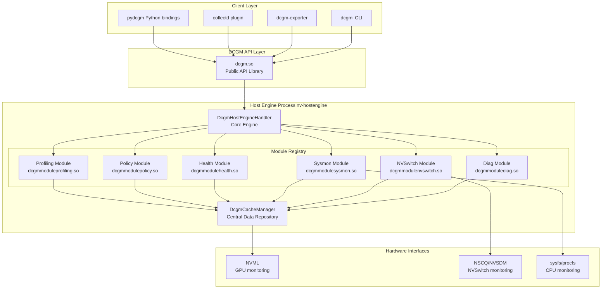
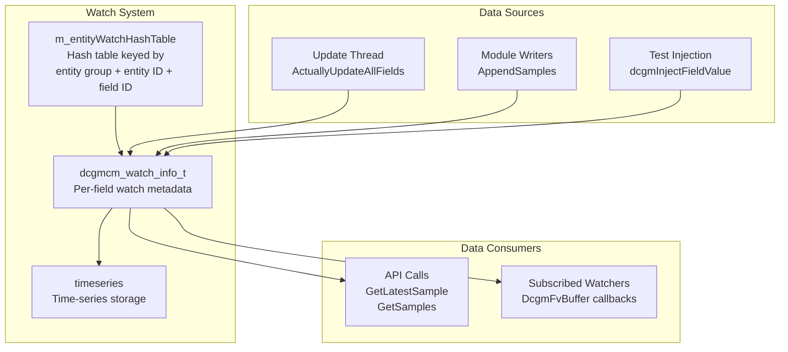
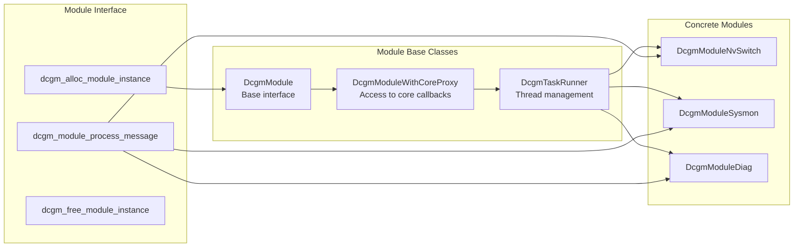
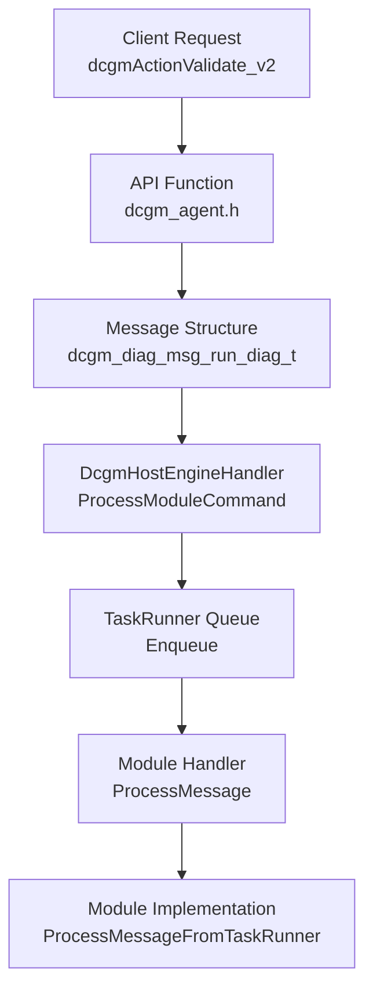
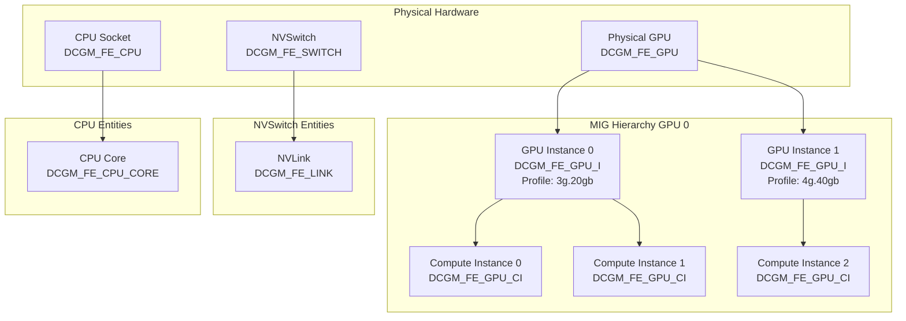
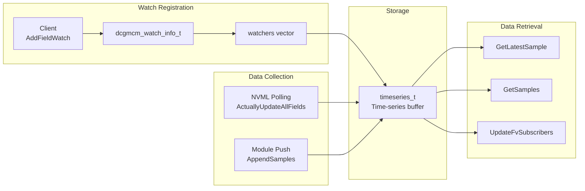
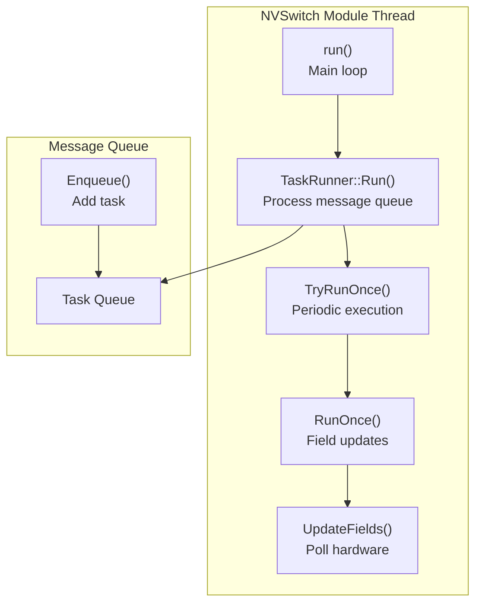
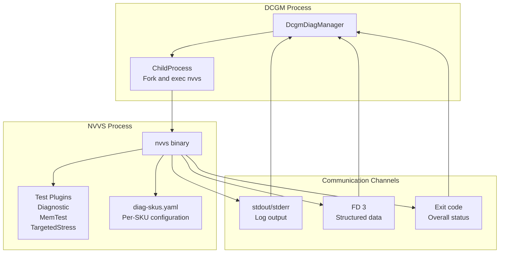
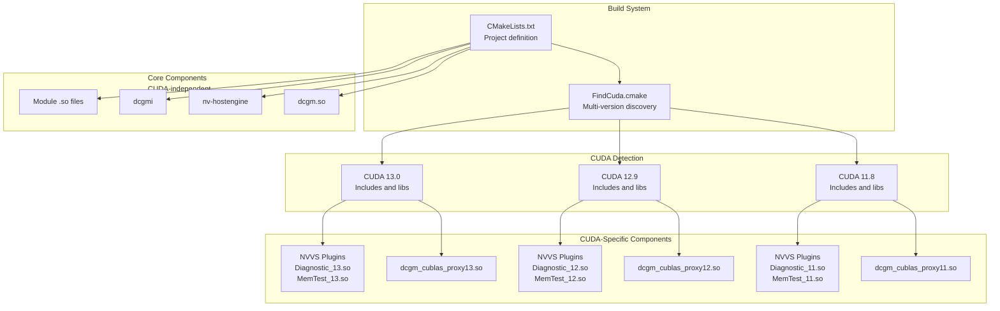

<!-- source: DeepWiki mcp.deepwiki.com · repo NVIDIA/DCGM · page 1.1 Architecture · fetched 2026-10-26 -->

# Architecture

<details>
<summary>Relevant source files</summary>

The following files were used as context for generating this wiki page:

- [README.md](README.md)
- [common/ThreeWayCmpDefault.hpp](common/ThreeWayCmpDefault.hpp)
- [dcgmlib/src/DcgmCacheManager.cpp](dcgmlib/src/DcgmCacheManager.cpp)
- [modules/nvswitch/DcgmModuleNvSwitch.cpp](modules/nvswitch/DcgmModuleNvSwitch.cpp)
- [nvvs/include/NvvsJsonStrings.h](nvvs/include/NvvsJsonStrings.h)
- [testing/python3/tests/test_dcgm_collectd_plugin.py](testing/python3/tests/test_dcgm_collectd_plugin.py)

</details>


## Purpose and Scope

This document describes the high-level architecture of DCGM (Data Center GPU Manager), including its modular design, communication patterns, and core components. It covers how the host engine, cache manager, and modules interact to provide GPU monitoring and management capabilities.

For installation instructions, see [Installation](#1.2). For detailed information about the cache manager internals, see [Cache Manager](#2.1). For information about specific modules, see [Modules](#3). For the build system architecture, see [Building and Development](#5).

---

## System Overview

DCGM is organized as a daemon-based system with a modular architecture. The central component is the **host engine** (`nv-hostengine`), which coordinates multiple specialized modules through a message-passing architecture. External systems interact with DCGM through a unified API library (`dcgm.so`), which can operate in both embedded mode (in-process) and remote mode (connecting to a running daemon).



**Sources:** [README.md:1-147](), [dcgmlib/src/DcgmCacheManager.cpp:16-950]()

---

## Core Components

### Host Engine

The host engine (`nv-hostengine`) is the central daemon process that coordinates all DCGM functionality. It is implemented by `DcgmHostEngineHandler` and provides:

- **Client connection management**: Handles both local (Unix socket) and remote (TCP) connections
- **Module lifecycle management**: Loads and manages dynamically-linked module libraries
- **Message routing**: Routes API calls to appropriate modules via `ProcessModuleCommand()`
- **Group management**: Manages logical groups of GPUs and other entities

The host engine can run in two modes:
1. **Standalone daemon mode**: Runs as a system service, accepting remote connections
2. **Embedded mode**: Runs in-process within the client application

**Sources:** [README.md:1-147](), [dcgmlib/src/DcgmCacheManager.cpp:19]()

### Cache Manager

The `DcgmCacheManager` class serves as the central data hub for all monitoring data in DCGM. It implements a unified field watch system that collects metrics from various sources and stores them in time-series format.



Key responsibilities:

- **Field watch management**: Tracks which fields are being monitored and at what intervals via `AddFieldWatch()` and `RemoveFieldWatch()`
- **Sample storage**: Maintains time-series data for each watched field using `timeseries_*` functions
- **Update coordination**: Runs background threads to poll NVML and other sources
- **Subscription handling**: Notifies subscribers when new data arrives via `UpdateFvSubscribers()`
- **Entity tracking**: Manages GPU, MIG instance, NVSwitch, and CPU entity hierarchies

The watch system uses a hash table (`m_entityWatchHashTable`) where each entry is keyed by `(entityGroupId, entityId, fieldId)` and contains a `dcgmcm_watch_info_t` structure with the time-series buffer and watcher list.

**Sources:** [dcgmlib/src/DcgmCacheManager.cpp:93-129](), [dcgmlib/src/DcgmCacheManager.cpp:887-950]()

### Module System

DCGM uses a plugin-based module architecture where each module is a separate shared library (`.so` file) loaded dynamically by the host engine. Modules communicate with the core and each other via message passing.



Each module:
- Implements the standard module interface: `dcgm_alloc_module_instance()`, `dcgm_module_process_message()`, `dcgm_free_module_instance()`
- Runs in its own thread context via `DcgmTaskRunner`
- Communicates via versioned message structures (e.g., `dcgm_nvswitch_msg_watch_field_t`)
- Has a unique module ID (e.g., `DcgmModuleIdNvSwitch`, `DcgmModuleIdDiag`)

**Key Modules:**
- **Diag**: Orchestrates diagnostic runs via NVVS (see [Diagnostic Module](#3.3))
- **NVSwitch**: Monitors NVSwitch devices and NVLink connections (see [NVSwitch Module](#3.2))
- **Sysmon**: Monitors CPU metrics like utilization, temperature, and power (see [System Monitoring Module](#3.1))
- **Health**: Performs health checks and watches for errors
- **Policy**: Enforces power and clock policies
- **Profiling**: Collects profiling metrics via GPM

**Sources:** [modules/nvswitch/DcgmModuleNvSwitch.cpp:49-90](), [modules/nvswitch/DcgmModuleNvSwitch.cpp:560-578]()

---

## Message-Based Communication

DCGM uses a message-passing architecture where all requests are encapsulated in versioned message structures. This design provides several benefits:

- **Decoupling**: Modules don't directly call each other's methods
- **Thread safety**: Messages can be safely queued and processed asynchronously
- **Versioning**: Message versions allow backward compatibility
- **Testability**: Messages can be easily mocked and tested



**Message Structure:**

All messages inherit from `dcgm_module_command_header_t`:
- `moduleId`: Target module (e.g., `DCGM_MODULE_ID_DIAG`)
- `subCommand`: Specific operation (e.g., `DCGM_DIAG_SR_RUN_DIAG`)
- `version`: Message format version
- `length`: Total message size

**Message Flow Example (NVSwitch field watch):**

1. Client calls `dcgmWatchFields()`
2. API layer creates `dcgm_nvswitch_msg_watch_field_t` message
3. `ProcessModuleCommand()` routes to NVSwitch module based on `moduleId`
4. NVSwitch module enqueues task via `Enqueue(make_task(...))`
5. `DcgmTaskRunner::Run()` executes task in module thread
6. `ProcessWatchField()` adds watch to internal tracking
7. Module's `RunOnce()` loop periodically updates watched fields

**Sources:** [modules/nvswitch/DcgmModuleNvSwitch.cpp:93-153](), [modules/nvswitch/DcgmModuleNvSwitch.cpp:156-343](), [dcgmlib/src/DcgmCacheManager.cpp:131-170]()

---

## Entity Hierarchy and MIG Support

DCGM supports a flexible entity hierarchy that accommodates various hardware configurations, including Multi-Instance GPU (MIG) partitioning.



**Entity Groups:**

| Entity Group | Constant | Description |
|--------------|----------|-------------|
| GPU | `DCGM_FE_GPU` | Physical GPU device |
| GPU Instance | `DCGM_FE_GPU_I` | MIG GPU instance (slice of physical GPU) |
| Compute Instance | `DCGM_FE_GPU_CI` | MIG compute instance (subset of GPU instance) |
| NVSwitch | `DCGM_FE_SWITCH` | NVSwitch device |
| NVLink | `DCGM_FE_LINK` | NVLink connection between devices |
| CPU | `DCGM_FE_CPU` | CPU socket |
| CPU Core | `DCGM_FE_CPU_CORE` | Individual CPU core |

**MIG Management:**

The `DcgmCacheManager` uses several structures to track MIG configurations:

- `dcgmcm_gpu_info_t::instances`: Vector of `DcgmGpuInstance` objects representing GPU instances
- `DcgmGpuInstance`: Contains compute instances and profile information
- `dcgmcm_gpu_compute_instance_t`: Tracks individual compute instances
- `DcgmMigManager`: Maintains bidirectional mappings between DCGM entity IDs and NVML instance IDs

MIG detection occurs in `InitializeGpuInstances()`:
1. Query MIG mode via `nvmlDeviceGetMigMode()`
2. If enabled, enumerate GPU instance profiles via `nvmlDeviceGetGpuInstanceProfileInfo()`
3. For each profile, enumerate instances via `nvmlDeviceGetGpuInstances()`
4. For each GPU instance, enumerate compute instance profiles via `nvmlGpuInstanceGetComputeInstanceProfileInfo()`
5. For each compute profile, enumerate instances via `nvmlGpuInstanceGetComputeInstances()`
6. Store device handles via `FindAndStoreMigDeviceHandles()`

**Sources:** [dcgmlib/src/DcgmCacheManager.cpp:173-196](), [dcgmlib/src/DcgmCacheManager.cpp:620-883]()

---

## Data Flow and Field Watch System

The field watch system is DCGM's core mechanism for collecting and distributing monitoring data. It implements a publish-subscribe pattern where multiple consumers can watch the same fields with different update intervals.



**Field Watch Lifecycle:**

1. **Watch Creation** (`AddFieldWatch()`):
   - Lookup or create `dcgmcm_watch_info_t` in `m_entityWatchHashTable`
   - Add watcher to the watch's `watchers` vector
   - Calculate minimum update interval across all watchers
   - For NVSwitch/CPU fields, delegate to respective modules via `helperNvSwitchAddFieldWatch()` or similar

2. **Data Collection**:
   - **NVML fields (GPUs)**: Background thread calls `ActuallyUpdateAllFields()` which queries NVML via `nvmlDeviceGetFieldValues()`
   - **NVSwitch fields**: `DcgmModuleNvSwitch::UpdateFields()` queries NSCQ/NVSDM and calls `AppendSamples()`
   - **CPU fields**: `DcgmModuleSysmon::UpdateFields()` reads sysfs/procfs and calls `AppendSamples()`

3. **Data Storage** (`AppendEntity*` methods):
   - Data written to `timeseries_t` buffer within `dcgmcm_watch_info_t`
   - Oldest samples evicted based on `maxAgeUsec`
   - Subscribers notified if `hasSubscribedWatchers` is true

4. **Data Retrieval**:
   - **Synchronous**: `GetLatestSample()` or `GetSamples()` query the time-series buffer
   - **Asynchronous**: `UpdateFvSubscribers()` pushes new samples to registered callbacks

**Update Intervals:**

The system calculates the effective update interval as the minimum across all watchers:
```
effectiveInterval = min(watcher[0].interval, watcher[1].interval, ...)
```

This ensures the most demanding watcher gets fresh data without over-polling.

**Sources:** [dcgmlib/src/DcgmCacheManager.cpp:131-154](), [dcgmlib/src/DcgmCacheManager.cpp:1007-1010]()

---

## Module Thread Model

Each module runs in its own thread context managed by `DcgmTaskRunner`, which implements an event loop pattern.



**Module Execution Pattern:**

1. Module constructor calls `Start()` which spawns thread
2. Thread enters `run()` method
3. Main loop:
   - `TaskRunner::Run()`: Process queued messages/tasks
   - `TryRunOnce()`: Check if periodic update is needed
   - `RunOnce()`: Perform field updates and return next interval
   - Sleep until next wake time or new message arrives

**Example: NVSwitch Module RunOnce:**

```cpp
unsigned int DcgmModuleNvSwitch::RunOnce()
{
    timelib64_t now = timelib_usecSince1970();
    
    // Rescan link status every 30 seconds
    if (now - m_lastLinkStatusUpdateUsec > 30000000)
    {
        RescanDevicesState();
        m_lastLinkStatusUpdateUsec = now;
    }
    
    // Update watched fields
    timelib64_t nextUpdateTimeUsec;
    m_nvswitchMgr.UpdateFields(nextUpdateTimeUsec, now);
    
    // Return sleep duration in milliseconds
    return nextUpdateTimeUsec / 1000;
}
```

This pattern ensures:
- **Responsive message handling**: Messages processed immediately via task queue
- **Efficient polling**: Only poll hardware when watches require updates
- **Thread isolation**: Each module has its own thread, preventing blocking

**Sources:** [modules/nvswitch/DcgmModuleNvSwitch.cpp:476-553]()

---

## NVVS Integration

NVVS (NVIDIA Validation Suite) runs as a separate process spawned by the Diag module. This isolation prevents diagnostic failures from affecting the DCGM daemon.



**NVVS Communication:**

- **stdout/stderr**: Human-readable logs and progress updates
- **File descriptor 3**: Structured JSON data with test results
- **Exit code**: Overall diagnostic pass/fail status

The Diag module parses this data and constructs a `dcgmDiagResponse_t` structure containing:
- Per-test results (`DCGM_DIAG_RESULT_PASS`, `DCGM_DIAG_RESULT_FAIL`, etc.)
- Per-GPU/entity status
- Error messages and codes
- Performance metrics

**Sources:** [testing/python3/tests/test_dcgm_collectd_plugin.py:1-200](), [README.md:88-97]()

---

## Build Architecture

DCGM supports multiple CUDA versions simultaneously through a sophisticated build system that compiles CUDA-dependent components separately for each version.



**Key Build Features:**

- **Docker-based builds**: Uses `dcgmbuild` container for reproducible builds with custom GCC toolchains targeting older glibc versions
- **Multi-architecture**: Supports x86_64, aarch64, and ppc64le
- **Component packaging**: Generates separate packages (Core, Cuda11, Cuda12, Cuda13, Development, Tests) allowing users to install only needed CUDA versions

**Build Process:**

1. `build.sh` orchestrates the build using Docker
2. `FindCuda.cmake` discovers installed CUDA toolkits
3. Core components built once (CUDA-independent)
4. CUDA-dependent components built separately for each version:
   - cuBLAS proxy libraries provide version-specific interfaces
   - NVVS plugins compiled against specific CUDA versions
5. `cpack` generates DEB and RPM packages

**Sources:** [README.md:26-86]()

---

## Summary

DCGM's architecture is built around several key principles:

1. **Modularity**: Specialized modules handle different hardware types (GPU, NVSwitch, CPU) and functions (diagnostics, health, policy)
2. **Message-based communication**: Versioned messages provide decoupling and backward compatibility
3. **Central data hub**: `DcgmCacheManager` provides unified access to all monitoring data via the field watch system
4. **Thread isolation**: Each module runs in its own thread via `DcgmTaskRunner`, preventing blocking
5. **Process isolation**: NVVS runs as a separate process to prevent diagnostic failures from affecting the daemon
6. **Flexible entity hierarchy**: Supports complex configurations including MIG, multi-GPU, NVSwitch fabrics, and CPU monitoring
7. **Multi-CUDA support**: Build system accommodates multiple CUDA versions through selective compilation

This architecture enables DCGM to efficiently monitor diverse data center GPU deployments while maintaining extensibility and reliability.

**Sources:** [README.md:1-147](), [dcgmlib/src/DcgmCacheManager.cpp:16-950](), [modules/nvswitch/DcgmModuleNvSwitch.cpp:1-581]()

---

