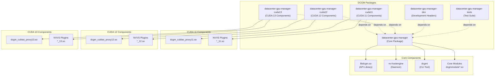
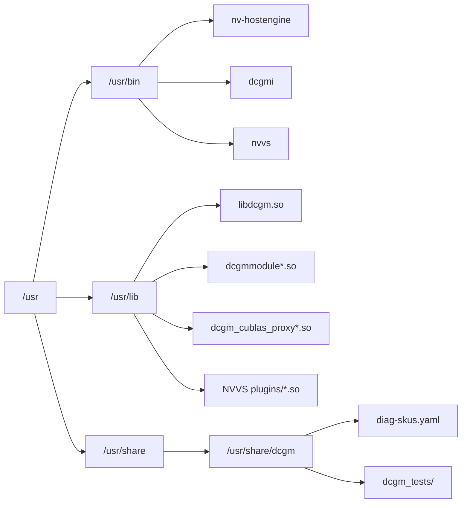
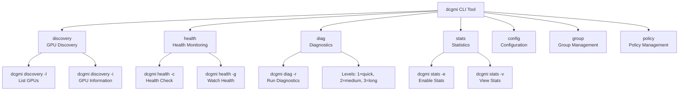

<!-- source: DeepWiki mcp.deepwiki.com · repo NVIDIA/DCGM · page 1.2 Installation · fetched 2026-10-26 -->

# Installation

<details>
<summary>Relevant source files</summary>

The following files were used as context for generating this wiki page:

- [README.md](README.md)
- [common/ThreeWayCmpDefault.hpp](common/ThreeWayCmpDefault.hpp)
- [modules/nvswitch/DcgmModuleNvSwitch.cpp](modules/nvswitch/DcgmModuleNvSwitch.cpp)
- [nvvs/include/NvvsJsonStrings.h](nvvs/include/NvvsJsonStrings.h)
- [testing/python3/tests/test_dcgm_collectd_plugin.py](testing/python3/tests/test_dcgm_collectd_plugin.py)

</details>


This page provides instructions for installing DCGM packages on supported Linux distributions. It covers package types, component-based installation, post-installation configuration, and getting started with the `dcgmi` command-line tool.

For information about building DCGM from source, see [Building and Development](#5). For information about DCGM's architecture and components, see [Architecture](#1.1).

## Prerequisites

DCGM supports the following platforms:
- **Operating Systems**: Linux distributions (Ubuntu, Red Hat Enterprise Linux, CentOS, etc.)
- **Architectures**: x86_64, aarch64 (Arm), ppc64le (POWER)
- **GPU Requirements**: NVIDIA datacenter GPUs
- **Driver Requirements**: NVIDIA GPU driver must be installed

**Sources**: [README.md:16](), [README.md:43-47]()

## Package Types and Structure

DCGM is distributed in multiple package formats to support different Linux distributions and deployment scenarios:

| Package Format | File Extension | Primary Distributions |
|----------------|----------------|----------------------|
| Debian Package | `.deb` | Ubuntu, Debian |
| RPM Package | `.rpm` | RHEL, CentOS, Fedora |
| Tarball | `.tar.gz` | Distribution-agnostic |

### Component-Based Packaging

DCGM uses a component-based packaging system that allows users to install only the CUDA versions they need. The main package categories are:



**Key Components**:
- **Core Package**: Contains CUDA-independent components including `libdcgm.so`, `nv-hostengine`, `dcgmi`, and core modules
- **CUDA-Specific Packages**: Contain version-specific `dcgm_cublas_proxy*.so` libraries and NVVS diagnostic plugins compiled for specific CUDA versions
- **Development Package**: Contains header files and development libraries for building applications with DCGM
- **Tests Package**: Contains the DCGM test suite for validation

**Sources**: [README.md:16](), [README.md:82-86]()

## Installing from DEB Packages

For Debian-based distributions (Ubuntu, Debian):

```bash
# Install the core package
sudo dpkg -i datacenter-gpu-manager_<version>_amd64.deb

# Install CUDA-specific components based on your CUDA driver version
# For CUDA 11.x
sudo dpkg -i datacenter-gpu-manager-cuda11_<version>_amd64.deb

# For CUDA 12.x
sudo dpkg -i datacenter-gpu-manager-cuda12_<version>_amd64.deb

# For CUDA 13.x
sudo dpkg -i datacenter-gpu-manager-cuda13_<version>_amd64.deb

# Optional: Install development headers
sudo dpkg -i datacenter-gpu-manager-dev_<version>_amd64.deb

# Optional: Install test suite
sudo dpkg -i datacenter-gpu-manager-tests_<version>_amd64.deb

# Resolve dependencies
sudo apt-get install -f
```

**Sources**: [README.md:84-86]()

## Installing from RPM Packages

For Red Hat-based distributions (RHEL, CentOS, Fedora):

```bash
# Install the core package
sudo rpm -ivh datacenter-gpu-manager-<version>.x86_64.rpm

# Install CUDA-specific components
sudo rpm -ivh datacenter-gpu-manager-cuda12-<version>.x86_64.rpm

# Optional: Install development and test packages
sudo rpm -ivh datacenter-gpu-manager-dev-<version>.x86_64.rpm
sudo rpm -ivh datacenter-gpu-manager-tests-<version>.x86_64.rpm
```

**Sources**: [README.md:86]()

## Installing from Tarball

For distribution-agnostic installations or when package managers are not available:

```bash
# Extract the tarball
tar -xzf datacenter-gpu-manager_<version>_amd64.tar.gz

# Navigate to the extracted directory
cd datacenter-gpu-manager_<version>_amd64

# Copy binaries to appropriate locations (requires root)
sudo cp usr/bin/* /usr/bin/
sudo cp usr/lib/* /usr/lib/
sudo cp -r usr/share/dcgm /usr/share/

# Set appropriate permissions
sudo chmod +x /usr/bin/nv-hostengine
sudo chmod +x /usr/bin/dcgmi
```

**Sources**: [README.md:82-86]()

## Post-Installation File Layout

After installation, DCGM files are organized in standard Linux directories:



**Sources**: [README.md:16]()

## Starting the Host Engine

DCGM operates as a client-server architecture where `nv-hostengine` is the server daemon that manages GPU monitoring and all client tools communicate with it.

### Manual Start

Start the host engine manually for testing or development:

```bash
# Start with default settings
sudo nv-hostengine

# Start with logging to file
sudo nv-hostengine -f /tmp/hostengine.log --log-level ERROR

# Start in foreground (no daemonization)
sudo nv-hostengine --no-daemon
```

**Common Command-Line Options**:

| Option | Description |
|--------|-------------|
| `-f <path>` | Write log output to specified file |
| `--log-level <level>` | Set logging level (DEBUG, INFO, WARNING, ERROR) |
| `--no-daemon` | Run in foreground without daemonizing |
| `-p <port>` | Listen on specified TCP port (default: 5555) |

### Systemd Service

For production deployments, `nv-hostengine` should be configured as a systemd service:

```bash
# Enable and start the service
sudo systemctl enable dcgm
sudo systemctl start dcgm

# Check service status
sudo systemctl status dcgm

# View logs
sudo journalctl -u dcgm
```

**Sources**: [README.md:108-109]()

## Verifying Installation

After installation and starting the host engine, verify that DCGM is working correctly:

```bash
# Display DCGM version information
dcgmi -v

# List detected GPUs
dcgmi discovery -l

# Check GPU health
dcgmi health -c
```

**Expected Output for `dcgmi -v`**:
```
DCGM version
Version: x.y.z
Build ID: <build-id>
Build Date: <date>
Build Platform: <platform>
Build Type: <release/debug>
```

**Sources**: [README.md:112]()

## Getting Started with dcgmi

The `dcgmi` command-line tool provides access to all DCGM functionality. The tool is organized into subcommands:

### Basic Command Structure

```bash
dcgmi <command> [options]
```

### Common Commands



### Example Workflows

**Discover and Monitor GPUs**:
```bash
# List all GPUs
dcgmi discovery -l

# Create a group of GPUs for monitoring
dcgmi group -c mygroup

# Add GPUs to group
dcgmi group -g mygroup -a 0,1

# Start field watches for the group
dcgmi dmon -g mygroup -e 150,155,203,204
```

**Run Diagnostics**:
```bash
# Run quick diagnostic (level 1) on all GPUs
dcgmi diag -r 1

# Run comprehensive diagnostic (level 3) on specific GPUs
dcgmi diag -r 3 -i 0,1

# Run diagnostic with detailed logging
dcgmi diag -r 2 --debugLogFile /tmp/diag.log -d ERROR
```

**Health Monitoring**:
```bash
# Perform health check on all GPUs
dcgmi health -c

# Set health watches on a group
dcgmi health -g mygroup -s a

# Get health report
dcgmi health -g mygroup -c
```

**Sources**: [README.md:108-112]()

## Configuration

### Environment Variables

DCGM supports several environment variables for configuration:

| Variable | Purpose | Example |
|----------|---------|---------|
| `DCGM_TESTING_FRAMEWORK` | Enable testing mode | `export DCGM_TESTING_FRAMEWORK=True` |
| `DCGMLIBPATH` | Override library search path | `export DCGMLIBPATH=/opt/dcgm/lib` |
| `LD_LIBRARY_PATH` | Standard library path | `export LD_LIBRARY_PATH=/usr/lib/dcgm` |

### Host Engine Configuration

The `nv-hostengine` daemon can be configured via command-line arguments or environment variables:

```bash
# Configure logging
nv-hostengine -f /var/log/dcgm/hostengine.log --log-level INFO

# Configure network listening
nv-hostengine -p 5555 --listen-address 0.0.0.0

# Configure for embedded mode (no network)
nv-hostengine --no-daemon --embedded
```

**Sources**: [testing/python3/tests/test_dcgm_collectd_plugin.py:26-28]()

## Integration Configuration

### Collectd Plugin Configuration

For systems using collectd for metrics collection, DCGM provides a collectd plugin. Configuration example:

```xml
<Plugin "dcgm">
    Interval 2
    FieldIds "(100,memory_clock):5,video_clock:.1"
</Plugin>
```

The `FieldIds` parameter specifies which DCGM fields to monitor and their update intervals:
- Format: `(field_id,field_name):interval_sec`
- Multiple fields can be comma-separated
- Interval can be specified in seconds (e.g., `5`) or fractional seconds (e.g., `.1`)

**Sources**: [testing/python3/tests/test_dcgm_collectd_plugin.py:159-160]()

### Kubernetes Integration

For Kubernetes environments, DCGM integrates via `dcgm-exporter` which exposes GPU metrics as Prometheus metrics. See [Kubernetes Integration](#7.1) for details.

**Sources**: [README.md:18]()

## Troubleshooting

### Common Installation Issues

**Missing Dependencies**:
```bash
# For DEB packages
sudo apt-get install -f

# For RPM packages
sudo yum install <missing-package>
```

**Permission Issues**:
```bash
# Ensure proper permissions for binaries
sudo chmod +x /usr/bin/nv-hostengine
sudo chmod +x /usr/bin/dcgmi

# Host engine typically requires root privileges
sudo nv-hostengine
```

**Driver Compatibility**:
```bash
# Check NVIDIA driver version
nvidia-smi

# Ensure driver supports DCGM
dcgmi discovery -l
```

### Collecting Diagnostic Information

When reporting issues, collect the following information:

```bash
# DCGM version
dcgmi -v

# GPU information
nvidia-smi
nvidia-smi -q

# Host engine logs
sudo nv-hostengine -f /tmp/hostengine.log --log-level ERROR

# Diagnostic logs
dcgmi diag -r 1 --debugLogFile /tmp/diag.log -d ERROR
```

**Sources**: [README.md:101-123]()

## Next Steps

After successful installation:
- Learn about DCGM's modular architecture: [Architecture](#1.1)
- Understand the API for integration: [API Reference](#2.2)
- Explore diagnostic capabilities: [NVVS](#4)
- Integrate with monitoring systems: [Integration](#7)

**Sources**: [README.md:1-147]()

---

