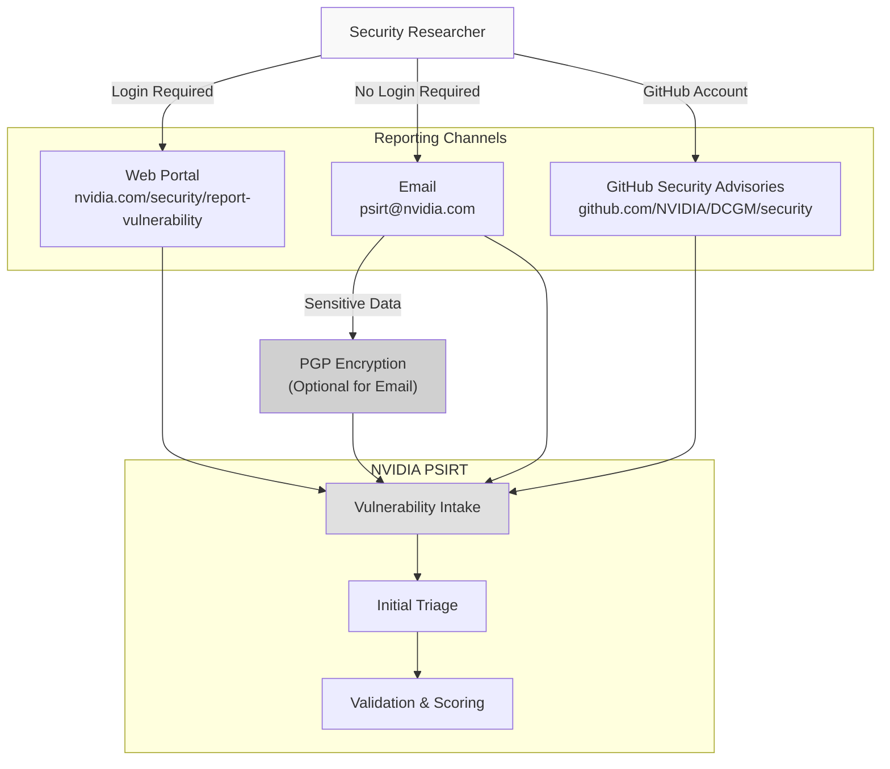
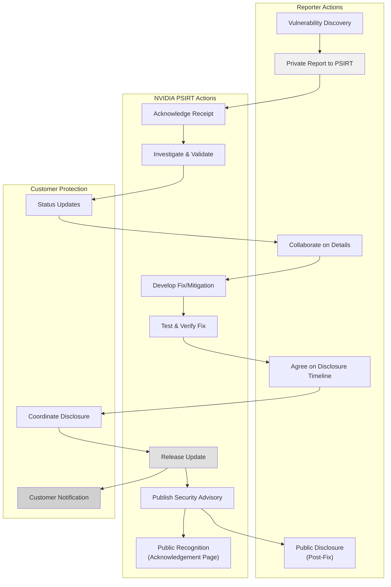
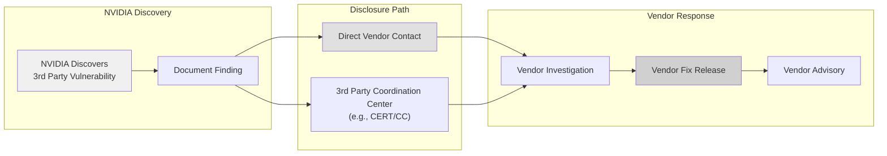

<!-- source: DeepWiki mcp.deepwiki.com · repo NVIDIA/DCGM · page 1.3 Security · fetched 2026-10-26 -->

# Security

Relevant source files

The following files were used as context for generating this wiki page:

- [SECURITY.md](SECURITY.md)

This document describes DCGM's security policies, vulnerability reporting procedures, and coordinated disclosure process. This page focuses on how to report security issues and the responsible disclosure workflow NVIDIA follows. For information about DCGM's architecture and components, see [Architecture](#1.1). For API usage, see [API Reference](#2.2).

## Security Policy Overview

NVIDIA treats security vulnerabilities in DCGM and all NVIDIA-owned repositories seriously. The security program follows industry best practices for responsible disclosure and coordinated vulnerability management through the NVIDIA Product Security Incident Response Team (PSIRT).

Security issues must meet [NVIDIA's definition of a security vulnerability](https://www.nvidia.com/en-us/security/psirt-policies/) to be processed through the PSIRT workflow. Examples include buffer overflows, remote code execution vulnerabilities, privilege escalation flaws, and other security-impacting defects.

**Important**: Security vulnerabilities should not be reported through public GitHub issues to protect users during the investigation and remediation period.

**Sources**: [SECURITY.md:1-42]()

## Reporting Channels

DCGM provides three official channels for reporting security vulnerabilities, each with different workflows and security characteristics:

### Reporting Channel Summary

| Channel | Method | Authentication | Encryption | Best For |
|---------|--------|----------------|------------|----------|
| Web Form | NVIDIA Security Portal | Required (login) | HTTPS | Most users, guided submission |
| Email | psirt@nvidia.com | Optional | PGP encryption available | Reporters preferring email, bulk submissions |
| GitHub | Security Advisories | Required (GitHub account) | GitHub's security infrastructure | GitHub-native workflow, repository maintainers |

### Channel Details

**1. NVIDIA Security Portal (Web Form)**

Submit vulnerability reports through the official web portal at [https://www.nvidia.com/en-us/security/report-vulnerability/](https://www.nvidia.com/en-us/security/report-vulnerability/). This method requires logging in and provides a structured submission form.

**2. Email Submission**

Send reports directly to [psirt@nvidia.com](mailto:psirt@nvidia.com). For sensitive disclosures, encrypt communications using NVIDIA's public PGP key available at [https://www.nvidia.com/en-us/security/pgp-key/](https://www.nvidia.com/en-us/security/pgp-key/).

**3. GitHub Security Advisories**

Use GitHub's private security advisory feature at [https://github.com/NVIDIA/DCGM/security/advisories/new](https://github.com/NVIDIA/DCGM/security/advisories/new). This integrates with GitHub's security workflow and maintains private communication until disclosure.

**Diagram: Security Vulnerability Reporting Channels**

**Sources**: [SECURITY.md:9-17]()

## Required Vulnerability Information

To facilitate rapid triage and investigation, vulnerability reports should include comprehensive technical details. The following information helps NVIDIA PSIRT assess severity, reproduce issues, and develop fixes efficiently.

### Information Checklist

**Issue Classification**
- Vulnerability type (e.g., buffer overflow, SQL injection, remote code execution, privilege escalation)
- Affected DCGM versions
- Affected components (e.g., `nv-hostengine`, `dcgmi`, specific modules, NVVS plugins)

**Source Code References**
- Permanent links to source files exhibiting the vulnerability
- Specific function names, class names, or line numbers
- Git commit hashes if applicable

**Reproduction Information**
- Required system configuration (GPU models, MIG configuration, OS version, CUDA version)
- Step-by-step reproduction instructions
- Environment setup requirements
- Any non-standard configuration parameters

**Proof of Concept**
- Exploit code demonstrating the vulnerability (if available)
- Sample inputs triggering the issue
- Expected vs. actual behavior
- Screenshots or logs

**Impact Assessment**
- Attack vector (local, network, physical access required)
- Privileges required (root, unprivileged user)
- Potential impact (data disclosure, service disruption, privilege escalation)
- Exploitability conditions

**Sources**: [SECURITY.md:19-28]()

## Coordinated Vulnerability Disclosure (CVD)

NVIDIA follows Coordinated Vulnerability Disclosure (CVD), a collaborative process where security researchers privately report vulnerabilities to allow investigation and remediation before public disclosure. This protects users while ensuring researchers receive appropriate recognition.

### CVD Workflow

**Diagram: Coordinated Vulnerability Disclosure Timeline**

### CVD Process Stages

**1. Initial Report Phase**
- Reporter discovers vulnerability in DCGM codebase
- Reporter submits private report through one of the three reporting channels
- NVIDIA PSIRT acknowledges receipt within standard response timeframes

**2. Investigation Phase**
- PSIRT validates the vulnerability and assesses severity
- PSIRT coordinates with reporter for additional technical details
- PSIRT provides progress updates throughout investigation
- Reporter agrees to maintain confidentiality during investigation

**3. Remediation Phase**
- NVIDIA engineering develops security fixes or mitigations
- Testing validates the fix addresses the vulnerability
- PSIRT coordinates disclosure timeline with reporter
- Both parties agree on public disclosure date

**4. Disclosure Phase**
- NVIDIA releases security update or mitigation guidance
- NVIDIA publishes security advisory with vulnerability details
- NVIDIA notifies affected customers through standard channels
- Reporter may publicly discuss vulnerability post-disclosure
- NVIDIA recognizes reporter on acknowledgement page (with agreement)

### Reporter Recognition

With the reporter's consent, NVIDIA PSIRT acknowledges valid vulnerability discoveries on NVIDIA's public security acknowledgement page. Recognition includes:
- Reporter name or handle (as preferred)
- Organization affiliation (optional)
- Vulnerability reference number
- General description of finding

Public discussion by the reporter is welcomed after NVIDIA publishes updates or mitigation information.

**Sources**: [SECURITY.md:34-41]()

## Communication Preferences

All security communications should be conducted in English to ensure efficient processing and reduce translation delays. NVIDIA PSIRT maintains English as the working language for all vulnerability reports, status updates, and coordination activities.

**Sources**: [SECURITY.md:30-32]()

## NVIDIA's Reverse Disclosure Process

NVIDIA follows the same CVD principles when discovering vulnerabilities in third-party vendor products during DCGM development or security audits. 

### Reverse CVD Workflow

**Diagram: NVIDIA Reverse CVD Process for Third-Party Vulnerabilities**

When NVIDIA identifies security issues in dependencies or third-party components used by DCGM (e.g., NVML, CUDA libraries, third-party packages), NVIDIA:
1. Follows standard CVD process in reverse
2. Contacts affected vendor directly when possible
3. Uses third-party coordination centers (e.g., CERT/CC) when direct contact unavailable
4. Maintains confidentiality until vendor releases fixes
5. Coordinates public disclosure appropriately

**Sources**: [SECURITY.md:42]()

## Security Best Practices for DCGM Deployment

While vulnerability reporting follows the processes above, DCGM administrators should follow security best practices during deployment:

### Access Control Recommendations

**DCGM Host Engine (`nv-hostengine`)**
- Runs as a system daemon with elevated privileges
- Access to GPU hardware and system resources requires appropriate permissions
- Default socket/TCP listening configuration should restrict unauthorized access
- Consider firewall rules for remote DCGM connections

**File Permissions**
- DCGM libraries (`dcgm.so`, modules) should have restricted write permissions
- Configuration files should be readable only by authorized users
- Log files may contain sensitive system information

### Network Security
- DCGM supports TCP socket mode for remote monitoring
- Use authentication mechanisms when exposing DCGM over networks
- Consider TLS/SSL for encrypted communication in sensitive environments
- Limit network exposure through firewall rules and network segmentation

**Sources**: Inferred from DCGM architecture and standard security practices

## Related Documentation

- For DCGM installation and configuration, see [Installation](#1.2)
- For DCGM architecture and component design, see [Architecture](#1.1)
- For API security considerations, see [API Reference](#2.2)
- For build system security, see [Building and Development](#5)

---

