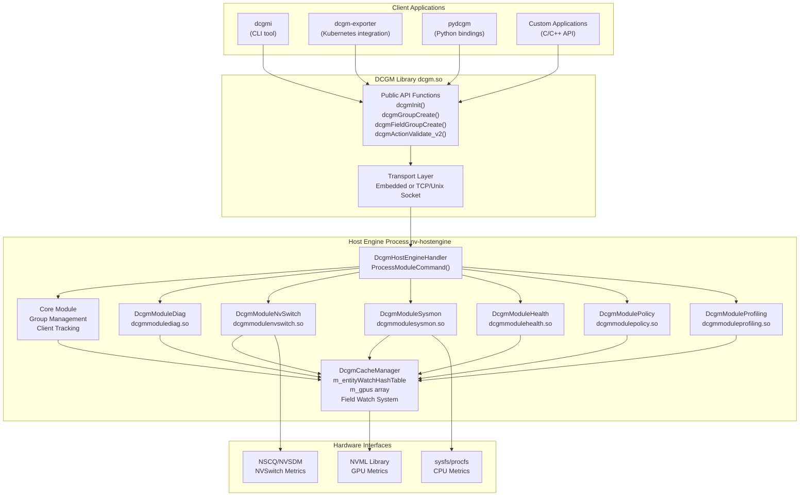
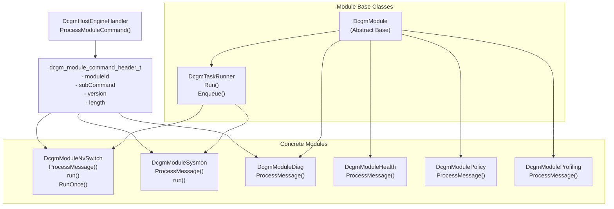
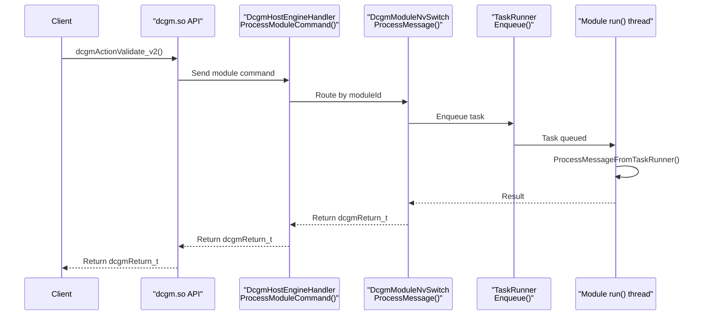
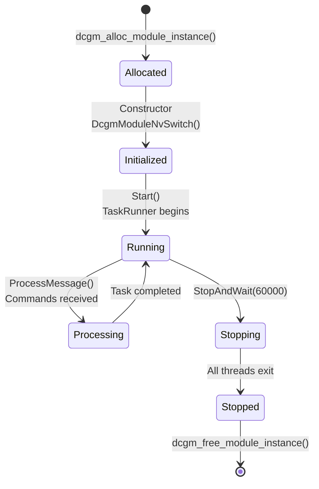
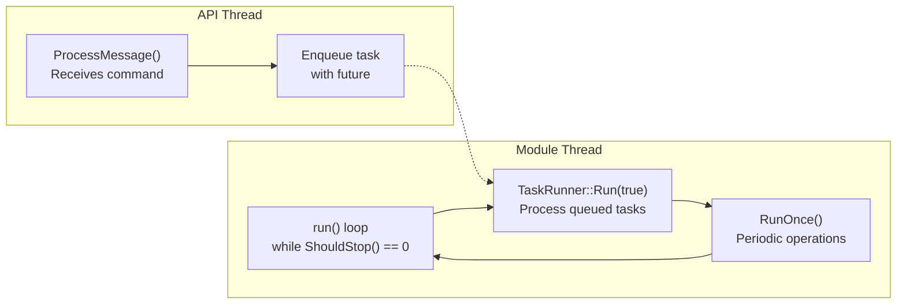
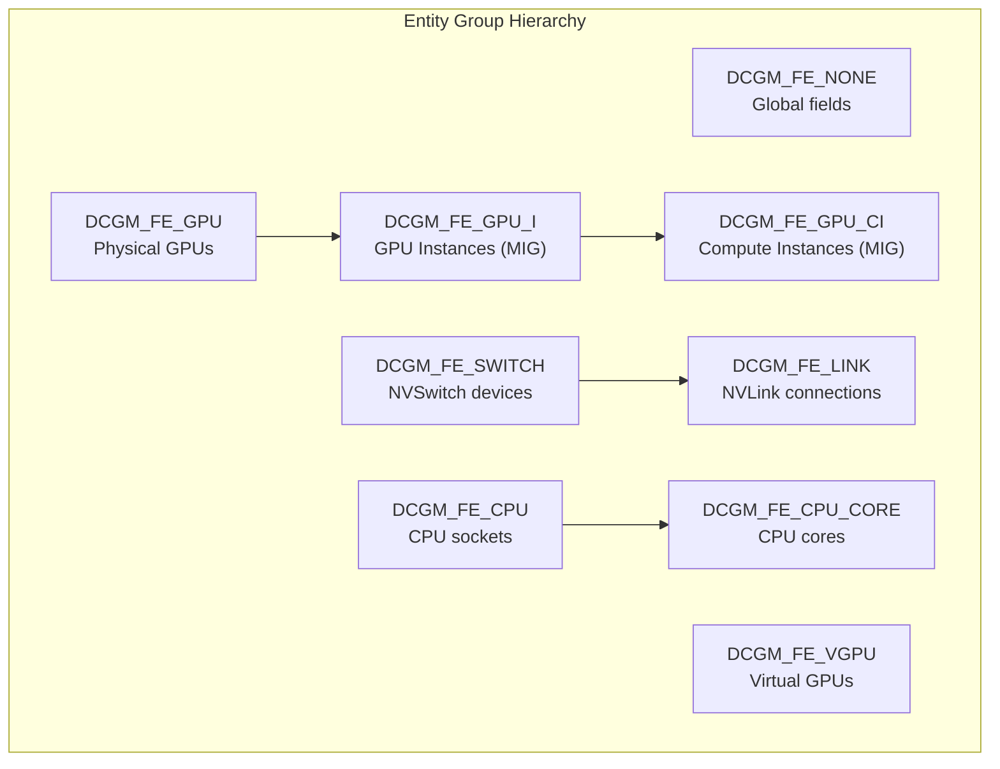
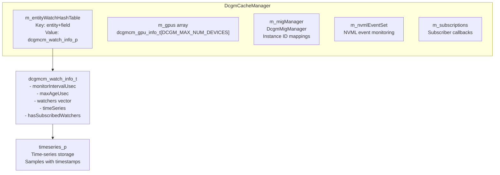
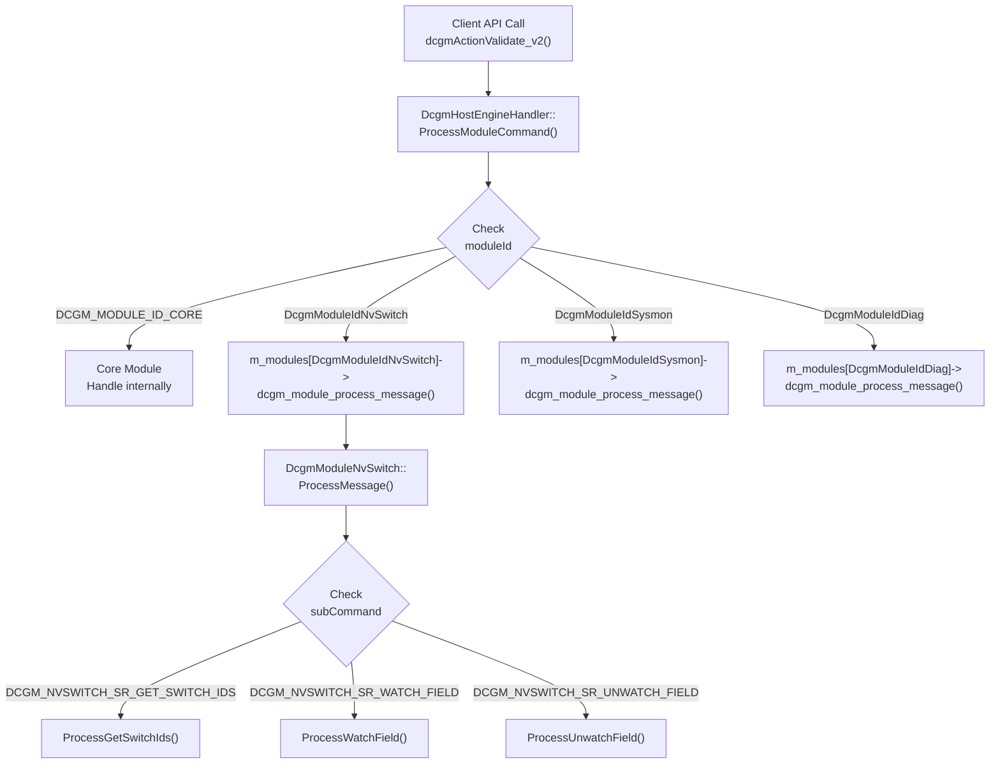
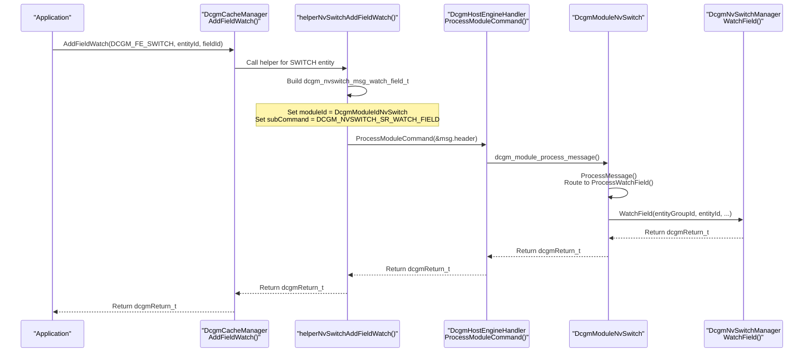
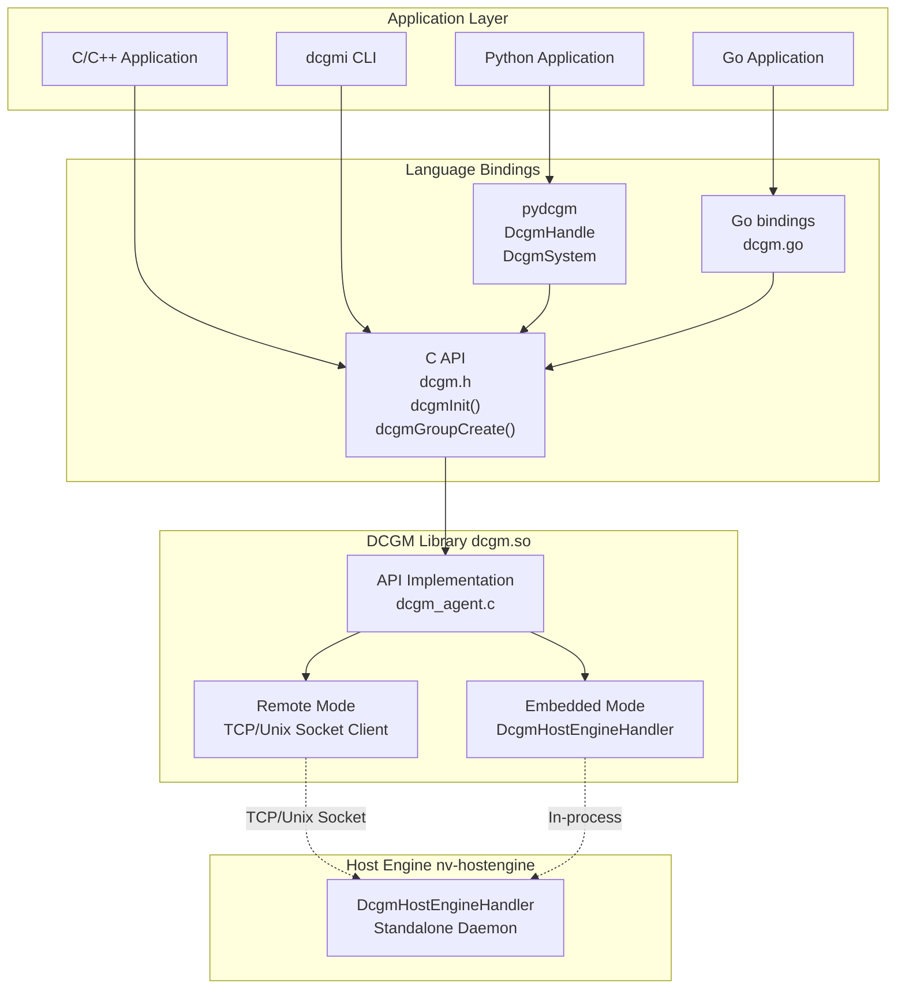

<!-- source: DeepWiki mcp.deepwiki.com · repo NVIDIA/DCGM · page 2 Core Components · fetched 2026-10-26 -->

# Core Components

<details>
<summary>Relevant source files</summary>

The following files were used as context for generating this wiki page:

- [README.md](README.md)
- [common/ThreeWayCmpDefault.hpp](common/ThreeWayCmpDefault.hpp)
- [dcgmlib/src/DcgmCacheManager.cpp](dcgmlib/src/DcgmCacheManager.cpp)
- [modules/nvswitch/DcgmModuleNvSwitch.cpp](modules/nvswitch/DcgmModuleNvSwitch.cpp)
- [nvvs/include/NvvsJsonStrings.h](nvvs/include/NvvsJsonStrings.h)
- [testing/python3/tests/test_dcgm_collectd_plugin.py](testing/python3/tests/test_dcgm_collectd_plugin.py)

</details>


This document provides an overview of DCGM's core architectural components, including the host engine daemon, module system, cache manager, and API layers. It describes how these components interact to provide GPU monitoring and management functionality. For detailed information about the Cache Manager's field watching and data collection mechanisms, see [Cache Manager](#2.1). For API usage and function reference, see [API Reference](#2.2).

## High-Level Architecture

DCGM follows a modular, daemon-based architecture where a central host engine process coordinates specialized modules and maintains a unified cache of telemetry data.

### Component Overview



**Sources:** [README.md:1-147](), [dcgmlib/src/DcgmCacheManager.cpp:16-951](), [modules/nvswitch/DcgmModuleNvSwitch.cpp:1-580]()

### Process Model

DCGM operates in two modes:

| Mode | Description | Process Architecture |
|------|-------------|---------------------|
| **Standalone** | `nv-hostengine` daemon runs as separate process | Client applications connect via TCP or Unix domain socket through `dcgm.so` |
| **Embedded** | DCGM library loaded directly into application | All components run in single process space; `DcgmHostEngineHandler` created in-process |

The `nv-hostengine` daemon is the standalone host engine process that loads all modules and provides the core DCGM functionality. Client applications interact with it through the `dcgm.so` library, which abstracts the communication mechanism.

**Sources:** [README.md:6-24](), [dcgmlib/src/DcgmCacheManager.cpp:886-951]()

## Module System

DCGM's functionality is organized into loadable modules, each providing specialized capabilities. Modules run in their own thread contexts and communicate via asynchronous message passing.

### Module Architecture



**Sources:** [modules/nvswitch/DcgmModuleNvSwitch.cpp:49-90](), [modules/nvswitch/DcgmModuleNvSwitch.cpp:93-153]()

### Module Communication Pattern

Modules communicate through structured messages with a common header format. The `DcgmHostEngineHandler::ProcessModuleCommand()` function routes messages based on the `moduleId` field.

#### Message Structure

```cpp
// From dcgm_structs.h
typedef struct dcgm_module_command_header
{
    unsigned int length;      // Total message size
    unsigned int moduleId;    // Target module (DcgmModuleIdNvSwitch, etc.)
    unsigned int subCommand;  // Operation within module
    unsigned int version;     // Message version for compatibility
} dcgm_module_command_header_t;
```

#### Message Flow



**Sources:** [modules/nvswitch/DcgmModuleNvSwitch.cpp:93-153](), [modules/nvswitch/DcgmModuleNvSwitch.cpp:156-343]()

### Module Identifiers

Modules are identified by numeric constants:

| Module ID | Enum Name | Shared Library | Purpose |
|-----------|-----------|----------------|---------|
| `DcgmModuleIdCore` | Core module | Built into engine | Group management, client tracking |
| `DcgmModuleIdNvSwitch` | NVSwitch module | `dcgmmodulenvswitch.so` | NVSwitch device monitoring |
| `DcgmModuleIdSysmon` | System monitoring | `dcgmmodulesysmon.so` | CPU, power, thermal metrics |
| `DcgmModuleIdDiag` | Diagnostics | `dcgmmodulediag.so` | GPU validation and testing |
| `DcgmModuleIdHealth` | Health monitoring | `dcgmmodulehealth.so` | System health checks |
| `DcgmModuleIdPolicy` | Policy management | `dcgmmodulepolicy.so` | Policy enforcement |
| `DcgmModuleIdProfiling` | Profiling | `dcgmmoduleprofiling.so` | GPU profiling metrics |

**Sources:** [modules/nvswitch/DcgmModuleNvSwitch.cpp:98-106](), [modules/nvswitch/DcgmModuleNvSwitch.cpp:160-168]()

### Module Lifecycle



Each module shared library exports three C functions:

- `dcgm_alloc_module_instance(dcgmCoreCallbacks_t *dcc)` - Allocates and initializes the module
- `dcgm_free_module_instance(DcgmModule *freeMe)` - Cleans up and deallocates the module
- `dcgm_module_process_message(DcgmModule *module, dcgm_module_command_header_t *cmd)` - Handles incoming commands

**Sources:** [modules/nvswitch/DcgmModuleNvSwitch.cpp:560-578](), [modules/nvswitch/DcgmModuleNvSwitch.cpp:49-70]()

### TaskRunner Pattern

Modules like `DcgmModuleNvSwitch` and `DcgmModuleSysmon` inherit from `DcgmTaskRunner`, which provides thread-safe task enqueueing and execution. The `run()` method executes in a dedicated thread and processes tasks from the queue.



The module can enqueue tasks from any thread and wait for results via `std::future`. The `RunOnce()` method is called periodically to perform background operations like updating field watches.

**Sources:** [modules/nvswitch/DcgmModuleNvSwitch.cpp:540-553](), [modules/nvswitch/DcgmModuleNvSwitch.cpp:136-152]()

## Entity System

DCGM tracks multiple types of hardware entities using a unified entity model. Each entity is identified by an entity group ID and entity ID combination.

### Entity Groups



The entity group enumeration defines the following primary types:

| Entity Group | Constant | Description | Entity ID Range |
|--------------|----------|-------------|-----------------|
| None | `DCGM_FE_NONE` | Global/system-level fields | 0 |
| GPU | `DCGM_FE_GPU` | Physical GPU devices | 0 to `m_numGpus-1` |
| vGPU | `DCGM_FE_VGPU` | Virtualized GPU instances | Variable |
| GPU Instance | `DCGM_FE_GPU_I` | MIG GPU instances | `gpuId * maxGpcs + instanceIdx` |
| Compute Instance | `DCGM_FE_GPU_CI` | MIG compute instances | `gpuId * maxGpcs + ciIdx` |
| Switch | `DCGM_FE_SWITCH` | NVSwitch devices | Variable |
| Link | `DCGM_FE_LINK` | NVLink connections | Variable |
| CPU | `DCGM_FE_CPU` | CPU sockets | Variable |
| CPU Core | `DCGM_FE_CPU_CORE` | Individual CPU cores | Variable |

**Sources:** [dcgmlib/src/DcgmCacheManager.cpp:173-196](), [dcgmlib/src/DcgmCacheManager.cpp:620-698]()

### Entity Storage in DcgmCacheManager

The `DcgmCacheManager` maintains entity information in several data structures:

```cpp
// GPU array - indexed by GPU ID
dcgmcm_gpu_info_t m_gpus[DCGM_MAX_NUM_DEVICES];
unsigned int m_numGpus;

// GPU Instance and Compute Instance tracking
unsigned int m_numInstances;
unsigned int m_numComputeInstances;

// Per-GPU instance storage (within dcgmcm_gpu_info_t)
std::vector<DcgmGpuInstance> instances;  // Each GPU has instances
```

The `dcgmcm_gpu_info_t` structure tracks per-GPU information including MIG configuration:

```cpp
typedef struct dcgmcm_gpu_info_t {
    unsigned int gpuId;
    nvmlDevice_t nvmlDevice;
    bool migEnabled;
    unsigned int maxGpcs;      // Maximum GPU partitions
    unsigned int usedGpcs;     // Currently allocated partitions
    unsigned int ciCount;      // Compute instance count
    std::vector<DcgmGpuInstance> instances;
    // ... additional fields
} dcgmcm_gpu_info_t;
```

**Sources:** [dcgmlib/src/DcgmCacheManager.cpp:702-883](), [dcgmlib/src/DcgmCacheManager.cpp:198-209]()

### Entity Key Construction

Entities are uniquely identified in the watch hash table by combining their group ID and entity ID. The key is constructed as a pointer value:

```cpp
// Entity key is (entityGroupId << 32) | entityId encoded as pointer
static unsigned int entityKeyHashCB(const void *key)
{
    unsigned int retVal = 0;
    MurmurHash3_x86_32(&key, sizeof(key), 0, &retVal);
    return retVal;
}

static int entityKeyCmpCB(const void *key1, const void *key2)
{
    if (key1 == key2)
        return 1;  // Keys match
    else
        return 0;  // Keys don't match
}
```

The hash table `m_entityWatchHashTable` uses this key to store watch information for each entity/field combination.

**Sources:** [dcgmlib/src/DcgmCacheManager.cpp:93-130](), [dcgmlib/src/DcgmCacheManager.cpp:1007-1010]()

## Cache Manager Overview

The `DcgmCacheManager` is the central data repository that coordinates field watches, collects metrics from hardware, and distributes data to consumers. It maintains a unified view of all monitored entities and fields.

### Core Data Structures



**Key Components:**

- **`m_entityWatchHashTable`**: Hash table mapping entity+field combinations to watch information
- **`m_gpus[]`**: Array of GPU information structures, indexed by GPU ID
- **`m_migManager`**: Manages MIG instance ID to NVML instance ID mappings
- **`m_nvmlEventSet`**: NVML event set for asynchronous event monitoring
- **`m_subscriptions`**: Manages field value subscribers for real-time notifications

**Sources:** [dcgmlib/src/DcgmCacheManager.cpp:887-951](), [dcgmlib/src/DcgmCacheManager.cpp:1007-1010]()

### Watch Information Structure

Each field watch is represented by a `dcgmcm_watch_info_t` structure:

| Field | Type | Purpose |
|-------|------|---------|
| `monitorIntervalUsec` | `timelib64_t` | Minimum polling interval (calculated from all watchers) |
| `maxAgeUsec` | `timelib64_t` | Maximum sample retention time |
| `watchers` | `std::vector` | List of all watchers with their individual intervals |
| `timeSeries` | `timeseries_p` | Time-series storage for historical samples |
| `hasSubscribedWatchers` | `bool` | Whether any watcher has active subscriptions |

The cache manager calculates the effective `monitorIntervalUsec` as the minimum of all watcher intervals, ensuring data is fresh enough for the most demanding consumer.

**Sources:** [dcgmlib/src/DcgmCacheManager.cpp:112-129]()

For detailed information about field watching mechanisms, data collection pipelines, and sample storage, see [Cache Manager](#2.1).

## Message Routing

The `DcgmHostEngineHandler` acts as the central message router, directing commands to the appropriate module based on the `moduleId` field.

### Routing Implementation



The routing process follows this pattern:

1. **API Layer**: Client calls a public API function (e.g., `dcgmActionValidate_v2()`)
2. **Transport**: Message is serialized and sent to host engine
3. **Router**: `DcgmHostEngineHandler::ProcessModuleCommand()` examines `moduleId`
4. **Module Dispatch**: Message is forwarded to the target module via `dcgm_module_process_message()`
5. **Subcommand Processing**: Module's `ProcessMessage()` examines `subCommand` and calls appropriate handler
6. **Version Checking**: Module validates message version for compatibility
7. **Response**: Result propagates back through the call chain

**Sources:** [modules/nvswitch/DcgmModuleNvSwitch.cpp:93-153](), [modules/nvswitch/DcgmModuleNvSwitch.cpp:156-343]()

### Example: NVSwitch Field Watch Request



**Sources:** [dcgmlib/src/DcgmCacheManager.cpp:131-170](), [modules/nvswitch/DcgmModuleNvSwitch.cpp:372-388]()

### Subcommand Constants

Modules define subcommand constants to identify specific operations:

```cpp
// Example from NVSwitch module
#define DCGM_NVSWITCH_SR_GET_SWITCH_IDS      0x01
#define DCGM_NVSWITCH_SR_CREATE_FAKE_SWITCH  0x02
#define DCGM_NVSWITCH_SR_WATCH_FIELD         0x03
#define DCGM_NVSWITCH_SR_UNWATCH_FIELD       0x04
#define DCGM_NVSWITCH_SR_GET_LINK_STATES     0x05
#define DCGM_NVSWITCH_SR_SET_LINK_STATE      0x06
#define DCGM_NVSWITCH_SR_GET_ENTITY_STATUS   0x07
// ... additional subcommands
```

Each subcommand corresponds to a specific message structure with a versioned header for backward compatibility.

**Sources:** [modules/nvswitch/DcgmModuleNvSwitch.cpp:109-132](), [modules/nvswitch/DcgmModuleNvSwitch.cpp:171-343]()

## API Layers

DCGM provides multiple API layers for different use cases and programming languages.

### API Structure



**Sources:** [README.md:1-147]()

### Embedded vs. Standalone Mode

| Aspect | Embedded Mode | Standalone Mode |
|--------|---------------|-----------------|
| **Process model** | DCGM runs in application process | DCGM runs as separate daemon |
| **Initialization** | `dcgmInit()` creates `DcgmHostEngineHandler` in-process | Application connects to existing `nv-hostengine` |
| **Communication** | Direct function calls | IPC via TCP or Unix domain socket |
| **Isolation** | Application crash affects DCGM | DCGM runs independently |
| **Use case** | Single application, low overhead | Multiple applications, system service |
| **Lifecycle** | DCGM lifetime tied to application | DCGM persists across applications |

### Core API Functions

The public API is defined in `dcgm.h` and includes functions for:

**Initialization and Connection:**
- `dcgmInit()` - Initialize DCGM library
- `dcgmConnect()` - Connect to standalone host engine
- `dcgmShutdown()` - Clean up and disconnect
- `dcgmStartEmbedded()` - Start embedded host engine

**Group Management:**
- `dcgmGroupCreate()` - Create a group of entities
- `dcgmGroupDestroy()` - Delete a group
- `dcgmGroupAddEntity()` - Add entity to group
- `dcgmGroupRemoveEntity()` - Remove entity from group

**Field Management:**
- `dcgmFieldGroupCreate()` - Create a field group
- `dcgmFieldGroupDestroy()` - Delete a field group
- `dcgmWatchFields()` - Start watching fields
- `dcgmUnwatchFields()` - Stop watching fields
- `dcgmGetLatestValues()` - Retrieve latest field values

**Operations:**
- `dcgmActionValidate_v2()` - Run diagnostic validation
- `dcgmHealthCheck()` - Perform health check
- `dcgmPolicySet()` - Configure policy
- `dcgmStatusCreate()` - Create status handle

For detailed API reference and usage examples, see [API Reference](#2.2).

**Sources:** [README.md:1-147]()

### Module Communication from API

When an API function needs module functionality, it constructs a module command message:

```cpp
// Example: Watching NVSwitch fields
static dcgmReturn_t helperNvSwitchAddFieldWatch(
    dcgm_field_entity_group_t entityGroupId,
    unsigned int entityId,
    unsigned short dcgmFieldId,
    long long monitorIntervalUsec,
    DcgmWatcher watcher)
{
    dcgm_nvswitch_msg_watch_field_t msg = {};
    
    msg.header.length     = sizeof(msg);
    msg.header.version    = dcgm_nvswitch_msg_watch_field_version;
    msg.header.moduleId   = DcgmModuleIdNvSwitch;
    msg.header.subCommand = DCGM_NVSWITCH_SR_WATCH_FIELD;
    
    msg.entityGroupId      = entityGroupId;
    msg.entityId           = entityId;
    msg.numFieldIds        = 1;
    msg.fieldIds[0]        = dcgmFieldId;
    msg.updateIntervalUsec = monitorIntervalUsec;
    msg.watcherType        = watcher.watcherType;
    msg.connectionId       = watcher.connectionId;
    
    DcgmHostEngineHandler *pDcgmHandle = DcgmHostEngineHandler::Instance();
    return pDcgmHandle->ProcessModuleCommand(&msg.header);
}
```

This pattern is used throughout the codebase to invoke module functionality from the API layer.

**Sources:** [dcgmlib/src/DcgmCacheManager.cpp:131-154]()

## Summary

DCGM's core components work together to provide a unified monitoring and management framework:

- **Host Engine (`nv-hostengine`)**: Central daemon process that loads modules and coordinates operations
- **Module System**: Pluggable modules (`DcgmModule` implementations) that provide specialized functionality through message passing
- **Cache Manager (`DcgmCacheManager`)**: Central data repository that manages field watches, collects metrics, and distributes data
- **Entity System**: Unified model for tracking GPUs, MIG instances, NVSwitches, CPUs, and other hardware
- **Message Routing**: Structured message passing with `moduleId` and `subCommand` routing through `DcgmHostEngineHandler`
- **API Layers**: Public C API (`dcgm.so`) with support for embedded and standalone modes, plus Python and Go bindings

This modular architecture enables DCGM to efficiently monitor diverse hardware, support multiple clients, and extend functionality through new modules.

**Sources:** [README.md:1-147](), [dcgmlib/src/DcgmCacheManager.cpp:1-951](), [modules/nvswitch/DcgmModuleNvSwitch.cpp:1-580]()

---

