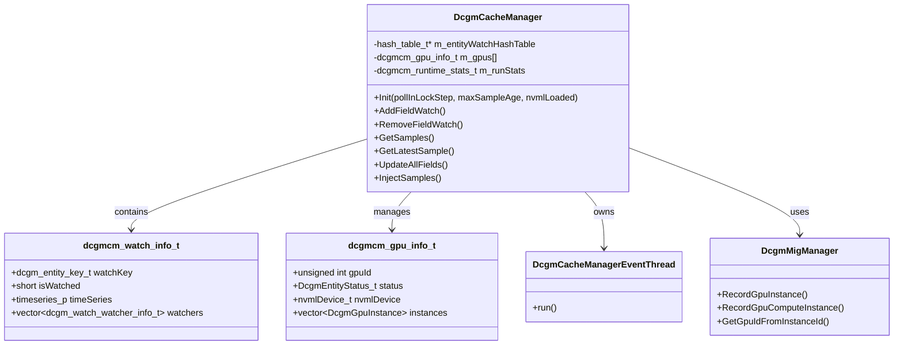
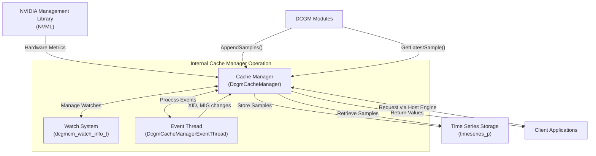
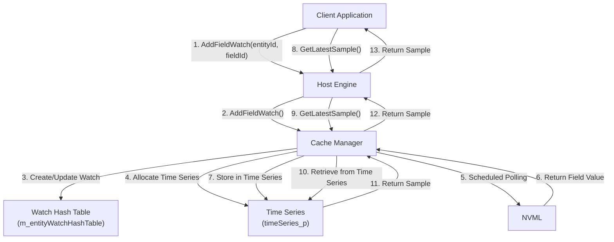
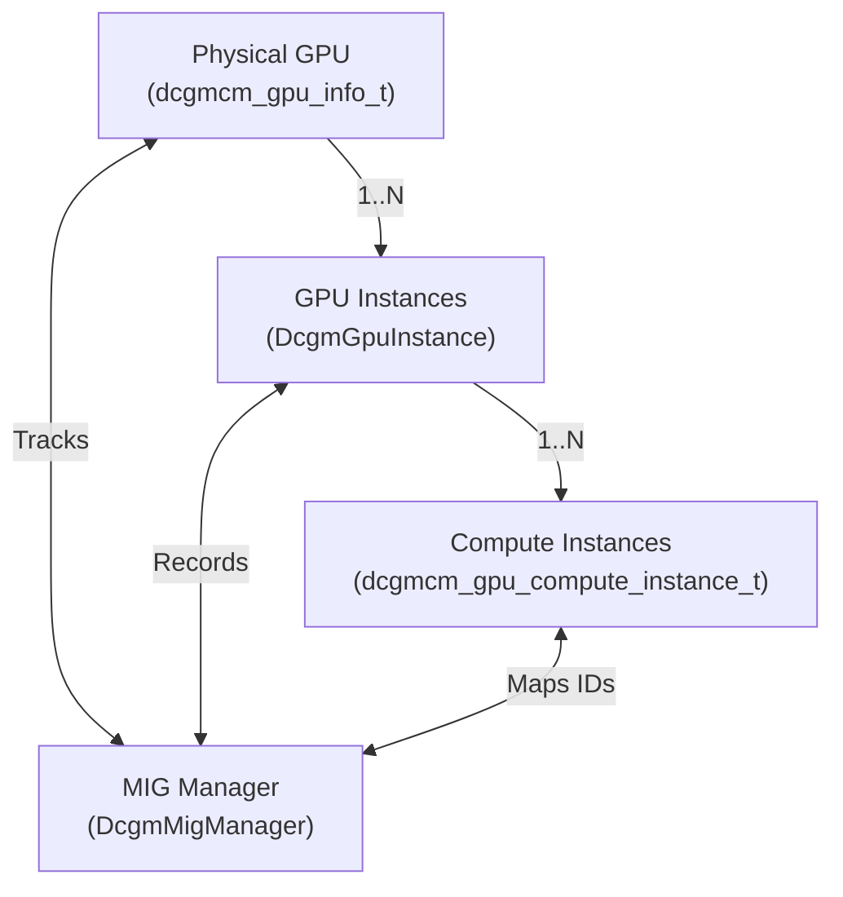

<!-- source: DeepWiki mcp.deepwiki.com · repo NVIDIA/DCGM · page 2.1 Cache Manager · fetched 2026-10-26 -->

# Cache Manager

<details>
<summary>Relevant source files</summary>

The following files were used as context for generating this wiki page:

- [dcgmlib/src/DcgmCacheManager.cpp](dcgmlib/src/DcgmCacheManager.cpp)
- [dcgmlib/src/DcgmCacheManager.h](dcgmlib/src/DcgmCacheManager.h)
- [testing/TestCacheManager.cpp](testing/TestCacheManager.cpp)

</details>


The Cache Manager is a critical core component within the NVIDIA Data Center GPU Manager (DCGM) architecture that serves as the central data storage, collection, and retrieval system. It is responsible for collecting metrics from GPUs, maintaining historical time-series data, and providing efficient access to these metrics for other DCGM components and external clients.

## Purpose and Scope

This document covers the design, architecture, and functionality of the DCGM Cache Manager, including its interaction with other components, data flow patterns, and implementation details. For information about specific field metrics managed by the Cache Manager, see [API Reference](#2.2).

## Architecture Overview



Sources: [dcgmlib/src/DcgmCacheManager.h:484-491](), [dcgmlib/src/DcgmCacheManager.h:119-152](), [dcgmlib/src/DcgmCacheManager.h:166-256](), [dcgmlib/src/DcgmCacheManager.h:464-481]()

## Data Flow



Sources: [dcgmlib/src/DcgmCacheManager.cpp:886-948](), [dcgmlib/src/DcgmCacheManager.cpp:1079-1097](), [dcgmlib/src/DcgmCacheManager.cpp:1022-1047]()

## Core Concepts

### Watch System

The Cache Manager relies on a "watch" system to track which metrics should be monitored and stored. A watch includes:

- Entity identification (GPU ID, instance ID, etc.)
- Field ID (which metric to watch)
- Monitoring frequency
- Data retention policy

Each watch is represented by a `dcgmcm_watch_info_t` structure that maintains the configuration and a time series of collected values.



Sources: [dcgmlib/src/DcgmCacheManager.cpp:767-776](), [dcgmlib/src/DcgmCacheManager.cpp:1022-1026](), [dcgmlib/src/DcgmCacheManager.h:119-152]()

### Time Series Storage

Field values are stored in time series - sequences of timestamp-value pairs. The Cache Manager supports:

- Integer values (64-bit)
- Floating-point values (double precision)
- String values
- Blob data (binary)

Time series storage is managed with configurable retention policies:

- Maximum age (how long to keep samples)
- Maximum number of samples
- Automatic pruning of old data

Sources: [dcgmlib/src/DcgmCacheManager.cpp:1879-1880](), [dcgmlib/src/DcgmCacheManager.cpp:125-126]()

## Key Features

### GPU Management

The Cache Manager maintains a list of all GPUs in the system along with their status and capabilities:

- Discovery of GPUs via NVML
- Tracking GPU state (active, disabled, unsupported)
- Detection of GPU removal or failure
- Support for GPU virtualization

```
Table: GPU States in Cache Manager

| State               | Description                                     |
|---------------------|-------------------------------------------------|
| DcgmEntityStatusOk  | GPU is present and functioning normally         |
| DcgmEntityStatusDisabled | GPU has been paused for monitoring         |
| DcgmEntityStatusUnsupported | GPU is not supported by DCGM (old arch) |
| DcgmEntityStatusDetached | GPU has been detached from monitoring      |
| DcgmEntityStatusInaccessible | GPU cannot be accessed (permissions)   |
| DcgmEntityStatusFake | Injected test GPU                              |
```

Sources: [dcgmlib/src/DcgmCacheManager.cpp:1318-1456](), [dcgmlib/src/DcgmCacheManager.cpp:712-880]()

### Event Handling

The Cache Manager monitors GPU events such as:

- XID errors (critical GPU errors)
- MIG configuration changes
- GPU state changes

It uses a dedicated event thread (`DcgmCacheManagerEventThread`) to continuously poll for events and process them.

Sources: [dcgmlib/src/DcgmCacheManager.cpp:2242-2242](), [dcgmlib/src/DcgmCacheManager.cpp:2619-2642]()

### MIG Support

The Cache Manager provides comprehensive support for NVIDIA Multi-Instance GPU (MIG) technology:

- Discovery and tracking of GPU Instances and Compute Instances
- Mapping between NVML MIG identifiers and DCGM identifiers
- Support for MIG reconfiguration events
- Data collection for MIG entities



Sources: [dcgmlib/src/DcgmCacheManager.cpp:699-695](), [dcgmlib/src/DcgmCacheManager.cpp:770-763](), [dcgmlib/src/DcgmCacheManager.cpp:617-880]()

## Implementation Details

### Data Structure

The Cache Manager uses several key data structures:

1. **Entity Watch Hash Table (`m_entityWatchHashTable`)**: Maps entity+field combinations to watch information
2. **GPU Information Array (`m_gpus`)**: Array of information about all detected GPUs
3. **Time Series**: One per watched field, stores historical values

Sources: [dcgmlib/src/DcgmCacheManager.h:911-912](), [dcgmlib/src/DcgmCacheManager.h:1728-1728]()

### Threading Model

The Cache Manager uses multiple threads to perform its functions:

1. **Main Thread**: Handles requests from clients
2. **Update Thread**: Periodically polls NVML for field values
3. **Event Thread**: Monitors and processes GPU events
4. **KMSG Thread**: Monitors kernel messages for GPU-related events

These threads are synchronized using mutex locks to ensure data consistency.

Sources: [dcgmlib/src/DcgmCacheManager.cpp:940-941](), [dcgmlib/src/DcgmCacheManager.cpp:2166-2170]()

### Synchronization

The Cache Manager uses several mutex locks to protect critical sections:

- `m_mutex`: Main lock for most operations
- `m_nvmlTopoMutex`: Lock for NVML topology operations (not thread-safe)

It also tracks driver API entry to ensure safe attachment/detachment:

- `m_inDriverCount`: Tracks threads currently in driver calls
- `m_waitForDriverClearCount`: Tracks threads waiting for driver to be clear

Sources: [dcgmlib/src/DcgmCacheManager.h:1736-1738](), [dcgmlib/src/DcgmCacheManager.cpp:1139-1144]()

## API Integration

### Adding Watches

To watch a field, clients call `AddFieldWatch()` with parameters:

- Entity group ID and entity ID
- Field ID to watch
- Monitoring frequency
- Data retention policy
- Watcher information (for subscription)

```
Example: Watching GPU temperature on GPU 0
- entityGroupId = DCGM_FE_GPU
- entityId = 0
- fieldId = DCGM_FI_DEV_GPU_TEMP
- monitorIntervalUsec = 1000000 (1 second)
- maxSampleAge = 3600 (1 hour)
- maxKeepSamples = 1000
```

Sources: [dcgmlib/src/DcgmCacheManager.h:767-776]()

### Retrieving Data

Clients can retrieve data using several methods:

- `GetLatestSample()`: Get most recent value of a field
- `GetSamples()`: Get historical values over a time range
- `GetSummaryData()`: Get statistical summaries (min, max, avg)

Data can be returned as individual samples or in a field-value buffer.

Sources: [dcgmlib/src/DcgmCacheManager.h:998-1006](), [dcgmlib/src/DcgmCacheManager.h:1022-1026]()

### Subscription System

Clients can subscribe to receive notifications when field values update:

1. Client calls `AddFieldWatch()` with `subscribeForUpdates = true`
2. Cache Manager flags the watch as having subscribers
3. When the field value updates, subscribers are notified

Sources: [dcgmlib/src/DcgmCacheManager.cpp:1831-1837](), [dcgmlib/src/DcgmCacheManager.cpp:1837-1837]()

## Conclusion

The Cache Manager is a foundational component of DCGM that provides efficient data collection, storage, and retrieval services. It abstracts the complexities of direct NVML interactions, provides historical data storage, and enables monitoring of GPU metrics across the datacenter. Its flexible watch system and time series storage allow clients to customize data collection based on their specific needs, while its event monitoring capabilities ensure timely notification of important GPU-related events.

---

