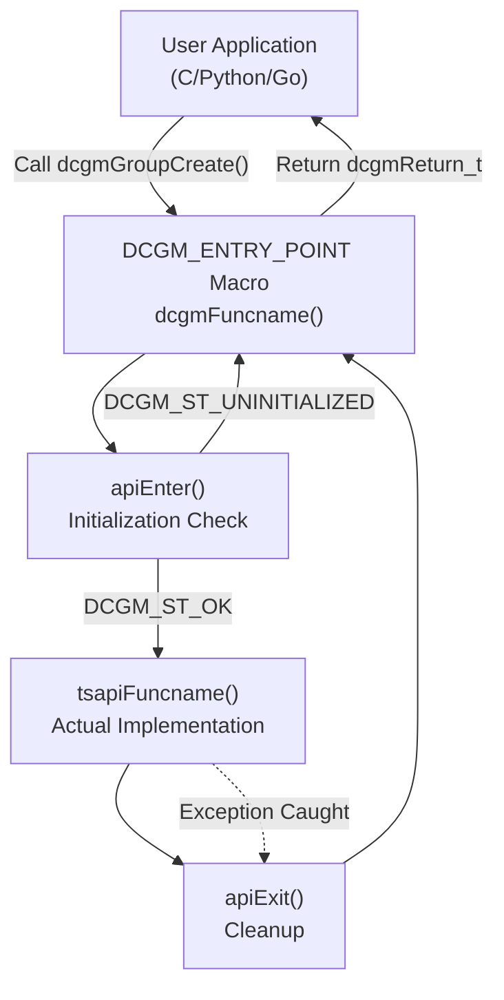
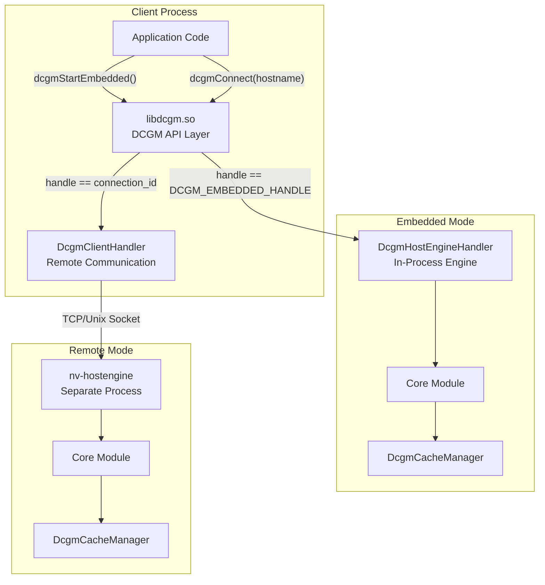
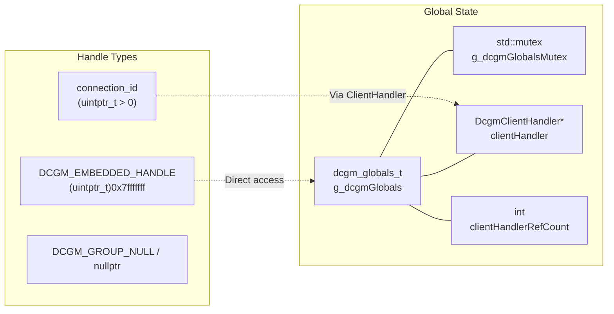
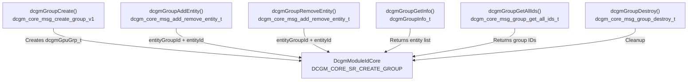
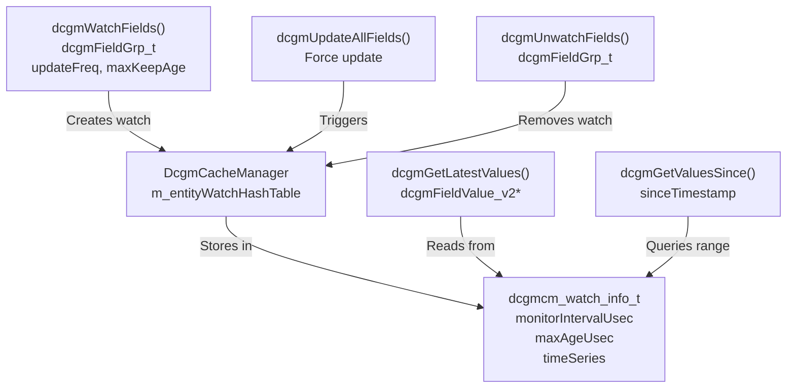
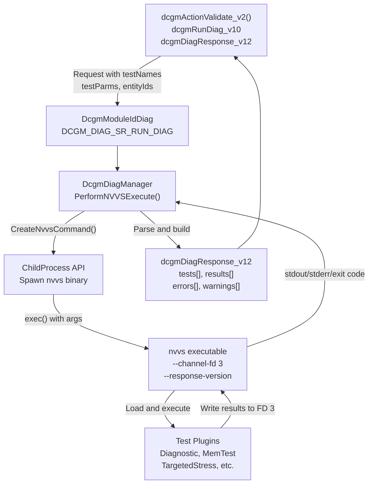
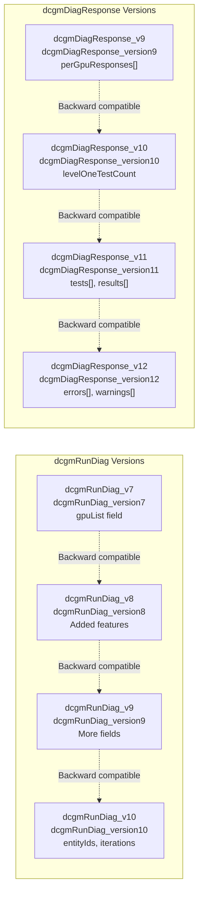
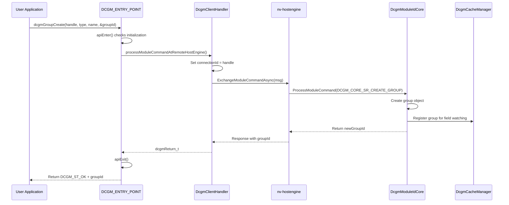
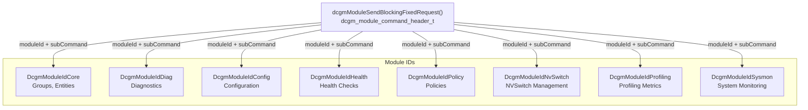

<!-- source: DeepWiki mcp.deepwiki.com · repo NVIDIA/DCGM · page 2.2 API Reference · fetched 2026-10-26 -->

# API Reference

<details>
<summary>Relevant source files</summary>

The following files were used as context for generating this wiki page:

- [README.md](README.md)
- [common/ThreeWayCmpDefault.hpp](common/ThreeWayCmpDefault.hpp)
- [dcgmi/Diag.cpp](dcgmi/Diag.cpp)
- [dcgmlib/src/DcgmApi.cpp](dcgmlib/src/DcgmApi.cpp)
- [modules/diag/DcgmDiagManager.cpp](modules/diag/DcgmDiagManager.cpp)
- [modules/nvswitch/DcgmModuleNvSwitch.cpp](modules/nvswitch/DcgmModuleNvSwitch.cpp)
- [nvvs/include/NvvsJsonStrings.h](nvvs/include/NvvsJsonStrings.h)
- [testing/python3/tests/test_dcgm_collectd_plugin.py](testing/python3/tests/test_dcgm_collectd_plugin.py)
- [testing/python3/tests/test_dcgm_diag.py](testing/python3/tests/test_dcgm_diag.py)

</details>


This page documents the public DCGM API (dcgmlib), which provides programmatic access to DCGM functionality. The API is exposed through `libdcgm.so` and can be used from C, Python (via pydcgm), and Go. For information about DCGM's internal architecture and module system, see [Architecture](#1.1). For details on the cache manager's data storage and field watching system, see [Cache Manager](#2.1).

## Purpose and Scope

The DCGM API provides:
- **Connection management** for embedded and remote host engines
- **Group and entity management** for organizing GPUs, MIG instances, CPUs, and NVSwitches
- **Field watching and data retrieval** for monitoring telemetry and events
- **Diagnostic execution** via `dcgmActionValidate_v2` and related functions
- **Configuration and policy management** for GPU settings
- **Health monitoring and alerting** capabilities

All public APIs are declared in header files under `dcgmlib/` and implemented in [dcgmlib/src/DcgmApi.cpp](). The API uses versioned structures to maintain backward compatibility as DCGM evolves.

---

## API Architecture

### Entry Point Mechanism

All DCGM APIs follow a consistent pattern using the `DCGM_ENTRY_POINT` macro, which wraps each function with initialization checks, exception handling, and logging.



**Sources**: [dcgmlib/src/DcgmApi.cpp:56-84]()

The entry point macro provides:
- Automatic initialization state checking via `apiEnter()`
- Exception handling with conversion to error codes
- Debug logging for all API calls and return values
- Consistent error reporting

### Embedded vs Remote Host Engine

DCGM supports two deployment modes, differentiated by the `dcgmHandle_t` value:



**Sources**: [dcgmlib/src/DcgmApi.cpp:337-354](), [dcgmlib/src/DcgmApi.cpp:165-223]()

The routing logic in `processModuleCommandAtHostEngine()` [dcgmlib/src/DcgmApi.cpp:337-354]() checks if `pDcgmHandle == DCGM_EMBEDDED_HANDLE`:
- **Embedded**: Calls `processModuleCommandAtEmbeddedHostEngine()` which directly invokes `DcgmHostEngineHandler::ProcessModuleCommand()`
- **Remote**: Calls `processModuleCommandAtRemoteHostEngine()` which uses `DcgmClientHandler::ExchangeModuleCommandAsync()` to send requests over the network

---

## Connection Management APIs

### Initialization and Connection

| Function | Purpose | Mode |
|----------|---------|------|
| `dcgmInit()` | Initialize the DCGM library | Both |
| `dcgmStartEmbedded(dcgmStartEmbeddedV2Params_t*)` | Start an embedded host engine in the current process | Embedded |
| `dcgmConnect(char *ipAddress)` | Connect to a remote host engine (returns `dcgmHandle_t`) | Remote |
| `dcgmShutdown()` | Cleanup and shutdown DCGM | Both |
| `dcgmStopEmbedded(dcgmHandle_t)` | Stop the embedded host engine | Embedded |
| `dcgmDisconnect(dcgmHandle_t)` | Disconnect from remote host engine | Remote |

**Sources**: [dcgmlib/src/DcgmApi.cpp:100-136](), [README.md:1-147]()

### Handle Management



**Sources**: [dcgmlib/src/DcgmApi.cpp:99-124](), [dcgmlib/src/DcgmApi.cpp:165-264]()

The global state in [dcgmlib/src/DcgmApi.cpp:99-124]() tracks:
- `isInitialized`: Whether `dcgmInit()` has been called
- `embeddedEngineStarted`: Whether embedded mode is active
- `clientHandler`: Pointer to the `DcgmClientHandler` for remote connections
- `clientHandlerRefCount`: Reference count preventing premature cleanup

---

## Group Management APIs

Groups are collections of entities (GPUs, MIG instances, CPUs, NVSwitches) that can be monitored or configured together.

### Core Group Functions



**Sources**: [dcgmlib/src/DcgmApi.cpp:357-425](), [dcgmlib/src/DcgmApi.cpp:428-514]()

| Function | Description | Versioning |
|----------|-------------|------------|
| `dcgmGroupCreate(dcgmHandle_t, dcgmGroupType_t, const char *groupName, dcgmGpuGrp_t*)` | Create a new group | `dcgm_core_msg_create_group_version` |
| `dcgmGroupAddEntity(dcgmHandle_t, dcgmGpuGrp_t groupId, dcgm_field_entity_group_t, dcgm_field_eid_t)` | Add an entity to a group | `dcgm_core_msg_add_remove_entity_version` |
| `dcgmGroupRemoveEntity(dcgmHandle_t, dcgmGpuGrp_t groupId, dcgm_field_entity_group_t, dcgm_field_eid_t)` | Remove an entity from a group | `dcgm_core_msg_add_remove_entity_version` |
| `dcgmGroupGetInfo(dcgmHandle_t, dcgmGpuGrp_t groupId, dcgmGroupInfo_t*)` | Retrieve group information | Returns entity list and count |
| `dcgmGroupGetAllIds(dcgmHandle_t, dcgmGpuGrp_t *groupIdList, unsigned int *count)` | List all group IDs | `dcgm_core_msg_group_get_all_ids_version` |
| `dcgmGroupDestroy(dcgmHandle_t, dcgmGpuGrp_t groupId)` | Destroy a group | `dcgm_core_msg_group_destroy_version` |

**Sources**: [dcgmlib/src/DcgmApi.cpp:357-555]()

### Entity Types

Groups can contain entities from these entity groups:

| Entity Group | ID | Purpose |
|--------------|-----|---------|
| `DCGM_FE_NONE` | 0 | No entity group |
| `DCGM_FE_GPU` | 1 | Physical GPUs |
| `DCGM_FE_GPU_I` | 6 | GPU Instances (MIG) |
| `DCGM_FE_GPU_CI` | 7 | Compute Instances (MIG) |
| `DCGM_FE_SWITCH` | 8 | NVSwitches |
| `DCGM_FE_LINK` | 9 | NVLinks |
| `DCGM_FE_CPU` | 11 | CPUs |
| `DCGM_FE_CPU_CORE` | 12 | CPU Cores |

**Sources**: [dcgmi/Diag.cpp:404-410](), [dcgmlib/src/DcgmApi.cpp:428-468]()

---

## Field Watching APIs

Field watching enables continuous monitoring of GPU metrics, events, and telemetry. The API interacts with the cache manager's field watch system (see [Cache Manager](#2.1) for internal details).

### Field Watch Lifecycle



**Sources**: [dcgmlib/src/DcgmApi.cpp:1100-1300](), [README.md:1-147]()

### Key Field Watch Functions

| Function | Purpose | Parameters |
|----------|---------|------------|
| `dcgmFieldGroupCreate(dcgmHandle_t, int numFieldIds, unsigned short *fieldIds, char *fieldGroupName, dcgmFieldGrp_t*)` | Create a field group for watching | Field IDs to watch |
| `dcgmWatchFields(dcgmHandle_t, dcgmGpuGrp_t groupId, dcgmFieldGrp_t fieldGroupId, long long updateFreq, double maxKeepAge, int maxKeepSamples)` | Start watching fields for a group | Update interval and retention |
| `dcgmUpdateAllFields(dcgmHandle_t, int waitForUpdate)` | Force immediate field update | Blocking flag |
| `dcgmGetLatestValues(dcgmHandle_t, dcgmGpuGrp_t groupId, dcgmFieldGrp_t fieldGroupId, dcgmFieldValue_v2 *values)` | Get latest field values | Output buffer |
| `dcgmGetValuesSince(dcgmHandle_t, dcgmGpuGrp_t groupId, dcgmFieldGrp_t fieldGroupId, long long sinceTimestamp, dcgmFieldValue_v2 *values, int *numValues)` | Get field values since timestamp | Time range query |
| `dcgmUnwatchFields(dcgmHandle_t, dcgmGpuGrp_t groupId, dcgmFieldGrp_t fieldGroupId)` | Stop watching fields | Cleanup |

**Sources**: [dcgmlib/src/DcgmApi.cpp:1100-1500]()

### Field Value Structure

The `dcgmFieldValue_v2` structure [dcgmlib/src/DcgmApi.cpp]() represents a single field sample:

```c
typedef struct {
    unsigned int version;           // Structure version
    unsigned short fieldId;         // Field identifier
    unsigned short fieldType;       // DCGM_FT_* type
    dcgmReturn_t status;           // Sample status
    long long ts;                  // Timestamp (usec since epoch)
    union {
        long long i64;             // Integer value
        double dbl;                // Floating point value
        char str[DCGM_MAX_STR_LENGTH];  // String value
        dcgmBlob_t blob;          // Binary data
    } value;
} dcgmFieldValue_v2;
```

**Sources**: [dcgmlib/src/DcgmApi.cpp](), [README.md:1-147]()

---

## Diagnostic APIs

Diagnostics are executed via the Diag module, which spawns the NVVS validation suite as a child process. For details on NVVS internals, see [Diagnostic Module](#3.3) and [NVVS](#4).

### Diagnostic Execution Flow



**Sources**: [modules/diag/DcgmDiagManager.cpp:603-646](), [testing/python3/tests/test_dcgm_diag.py:196-220]()

### Primary Diagnostic Function

**`dcgmActionValidate_v2(dcgmHandle_t handle, dcgmRunDiag_v10 *drd, dcgmDiagResponse_v12 *response)`**

This is the main diagnostic API. It accepts:

- **`dcgmRunDiag_v10`** input structure:
  - `version`: Structure version (`dcgmRunDiag_version10`)
  - `validate`: Test level (`DCGM_POLICY_VALID_SV_SHORT`, `_MED`, `_LONG`, `_XLONG`)
  - `groupId`: Group to test (or `DCGM_GROUP_NULL` with `entityIds`)
  - `entityIds`: Comma-separated entity list (GPUs, CPUs)
  - `testNames[DCGM_MAX_TEST_NAMES]`: Specific tests to run (e.g., "diagnostic", "memory")
  - `testParms[DCGM_MAX_TEST_PARMS]`: Test parameters (e.g., "diagnostic.test_duration=10")
  - `configFileContents`: YAML config for tests
  - `debugLogFile`: Path for debug logs
  - `flags`: `DCGM_RUN_FLAGS_VERBOSE`, `DCGM_RUN_FLAGS_STATSONFAIL`, `DCGM_RUN_FLAGS_FAIL_EARLY`
  - `clocksEventMask`: Throttle reasons to ignore
  - `fakeGpuList`: Fake GPU IDs for testing

- **`dcgmDiagResponse_v12`** output structure:
  - `version`: Structure version (`dcgmDiagResponse_version12`)
  - `dcgmVersion[DCGM_MAX_STR_LENGTH]`: DCGM version string
  - `driverVersion[DCGM_MAX_STR_LENGTH]`: Driver version
  - `tests[DCGM_DIAG_RESPONSE_TESTS_MAX]`: Test metadata (`dcgmDiagTest_v2`)
  - `results[DCGM_DIAG_RESPONSE_RESULTS_MAX]`: Per-entity results (`dcgmDiagResult_v4`)
  - `errors[DCGM_DIAG_RESPONSE_ERRORS_MAX]`: Error details (`dcgmDiagError_v1`)
  - `numTests`, `numResults`, `numErrors`: Array counts

**Sources**: [testing/python3/tests/test_dcgm_diag.py:206-243](), [dcgmi/Diag.cpp:196-220]()

### Legacy Diagnostic Function

**`dcgmRunDiagnostic(dcgmHandle_t handle, dcgmGpuGrp_t groupId, dcgmDiagnosticLevel_t diagLevel, dcgmDiagResponse_v12 *response)`**

Simplified diagnostic API that uses predefined test levels:
- `DCGM_DIAG_LVL_SHORT`: Quick validation (~1 minute)
- `DCGM_DIAG_LVL_MED`: Medium validation (~5 minutes)
- `DCGM_DIAG_LVL_LONG`: Long validation (~15 minutes)
- `DCGM_DIAG_LVL_XLONG`: Extended validation (~hours)

**Sources**: [testing/python3/tests/test_dcgm_diag.py:296-342]()

### Stopping a Running Diagnostic

**`dcgmStopDiagnostic(dcgmHandle_t handle)`**

Sends a stop signal to the running diagnostic process. The diagnostic manager [modules/diag/DcgmDiagManager.cpp:122-250]() uses `KillActiveNvvs()` to:
1. Send `SIGTERM` up to 10 times with 4-second delays
2. Escalate to `SIGKILL` if `SIGTERM` fails
3. Clean up the child process handle

**Sources**: [dcgmi/Diag.cpp:467-474](), [modules/diag/DcgmDiagManager.cpp:122-250]()

---

## API Versioning and Backward Compatibility

DCGM uses versioned structures to maintain backward compatibility across releases. Each structure has a `version` field that determines its layout.

### Versioning Pattern



**Sources**: [testing/python3/tests/test_dcgm_diag.py:206-289]()

### Version Checking Example

The `helper_check_dcgm_run_diag_backwards_compatibility()` test [testing/python3/tests/test_dcgm_diag.py:206-289]() demonstrates version compatibility:

```python
# Test dcgmRunDiag_v7 with dcgmDiagResponse_v10
drd = dcgm_structs.c_dcgmRunDiag_v7()
drd.version = dcgm_structs.dcgmRunDiag_version7
drd.gpuList = str(gpuId)
drd.validate = 1
response = dcgm_structs.c_dcgmDiagResponse_v10()
response.version = dcgm_structs.dcgmDiagResponse_version10
ret = dcgmActionValidate_v2(handle, drd, response)
# DCGM accepts the old struct and returns data in the requested response version
```

The API layer [modules/diag/DcgmDiagManager.cpp:603-646]() checks the `version` field and handles structure layout differences internally, allowing older clients to work with newer DCGM versions.

**Sources**: [testing/python3/tests/test_dcgm_diag.py:206-343](), [modules/diag/DcgmDiagManager.cpp:603-646]()

---

## Error Handling

All DCGM APIs return `dcgmReturn_t`, an enumeration of status codes.

### Common Return Codes

| Code | Value | Meaning |
|------|-------|---------|
| `DCGM_ST_OK` | 0 | Success |
| `DCGM_ST_BADPARAM` | -1 | Invalid parameter |
| `DCGM_ST_GENERIC_ERROR` | -3 | Generic error |
| `DCGM_ST_UNINITIALIZED` | -6 | DCGM not initialized |
| `DCGM_ST_TIMEOUT` | -7 | Operation timed out |
| `DCGM_ST_VER_MISMATCH` | -8 | Version mismatch |
| `DCGM_ST_NO_DATA` | -13 | No data available |
| `DCGM_ST_NOT_SUPPORTED` | -20 | Operation not supported |
| `DCGM_ST_GROUP_IS_EMPTY` | -30 | Group contains no entities |
| `DCGM_ST_GROUP_INCOMPATIBLE` | -31 | Heterogeneous group |
| `DCGM_ST_PAUSED` | -46 | DCGM is paused |
| `DCGM_ST_NVVS_ERROR` | -50 | Diagnostic error |
| `DCGM_ST_NVVS_ISOLATE_ERROR` | -51 | Diagnostic isolation error |

**Sources**: [dcgmi/Diag.cpp:254-336](), [dcgmlib/src/DcgmApi.cpp:56-84]()

### Error Checking Pattern

```c
dcgmReturn_t ret = dcgmGroupCreate(handle, DCGM_GROUP_DEFAULT, "mygroup", &groupId);
if (ret != DCGM_ST_OK) {
    fprintf(stderr, "Failed to create group: %s\n", errorString(ret));
    return ret;
}
```

The `errorString()` function converts error codes to human-readable messages.

**Sources**: [dcgmi/Diag.cpp:420-487](), [README.md:99-131]()

---

## Language Bindings

### Python Bindings (pydcgm)

The Python bindings provide a Pythonic interface to DCGM:

```python
import pydcgm
import dcgm_structs
import dcgm_agent

# Initialize and connect
dcgm_agent.dcgmInit()
handle = dcgm_agent.dcgmStartEmbedded(dcgm_structs.DCGM_OPERATION_MODE_AUTO)

# Create a group
dcgmHandle = pydcgm.DcgmHandle(handle=handle)
dcgmSystem = dcgmHandle.GetSystem()
groupObj = dcgmSystem.GetDefaultGroup()
groupId = groupObj.GetId()

# Run diagnostic
runDiagInfo = dcgm_structs.c_dcgmRunDiag_v10()
runDiagInfo.version = dcgm_structs.dcgmRunDiag_version10
runDiagInfo.groupId = groupId
runDiagInfo.validate = dcgm_structs.DCGM_POLICY_VALID_SV_SHORT
response = dcgm_structs.c_dcgmDiagResponse_v12()
response.version = dcgm_structs.dcgmDiagResponse_version12
ret = dcgm_agent.dcgmActionValidate_v2(handle, runDiagInfo, response)
```

**Sources**: [testing/python3/tests/test_dcgm_diag.py:91-106](), [testing/python3/tests/test_dcgm_collectd_plugin.py:14-36]()

### Object-Oriented Helpers

The Python bindings include helper classes:
- `DcgmHandle`: Wrapper around `dcgmHandle_t`
- `DcgmSystem`: System-level operations
- `DcgmGroup`: Group management
- `DcgmFieldGroup`: Field group management

**Sources**: [testing/python3/tests/test_dcgm_diag.py:91-106]()

---

## Complete API Call Example

Here's a complete example showing the flow from API call to internal processing:



**Sources**: [dcgmlib/src/DcgmApi.cpp:267-299](), [dcgmlib/src/DcgmApi.cpp:337-354](), [dcgmlib/src/DcgmApi.cpp:357-394]()

---

## Module Command Routing

DCGM's API layer routes requests to specialized modules using the module command system:



**Sources**: [dcgmlib/src/DcgmApi.cpp:267-299](), [modules/nvswitch/DcgmModuleNvSwitch.cpp:93-153]()

Each module command header contains:
- `moduleId`: Target module
- `subCommand`: Specific operation within the module
- `version`: Structure version
- `connectionId`: Client connection ID (for remote mode)
- `requestId`: Request tracking ID

**Sources**: [dcgmlib/src/DcgmApi.cpp:267-354](), [modules/diag/DcgmDiagManager.cpp:285-322]()

---

