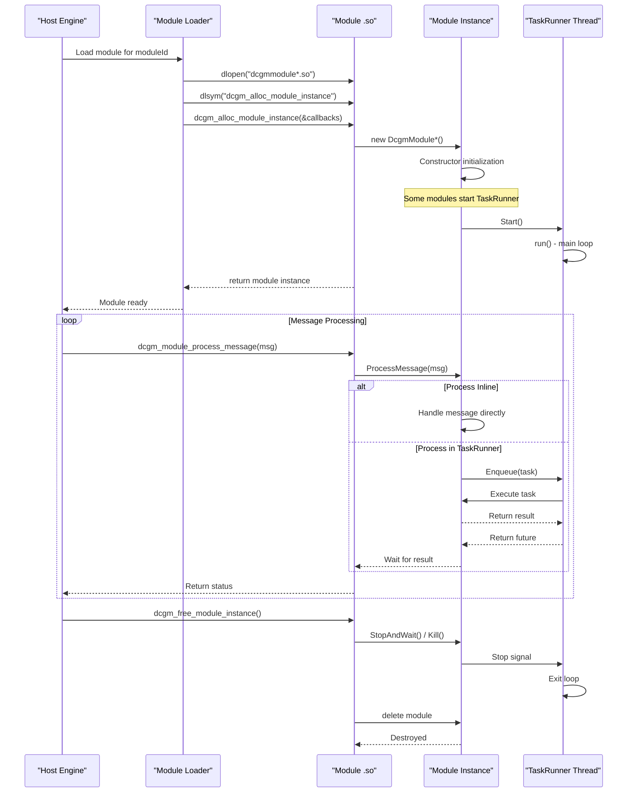
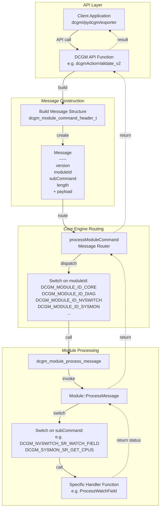
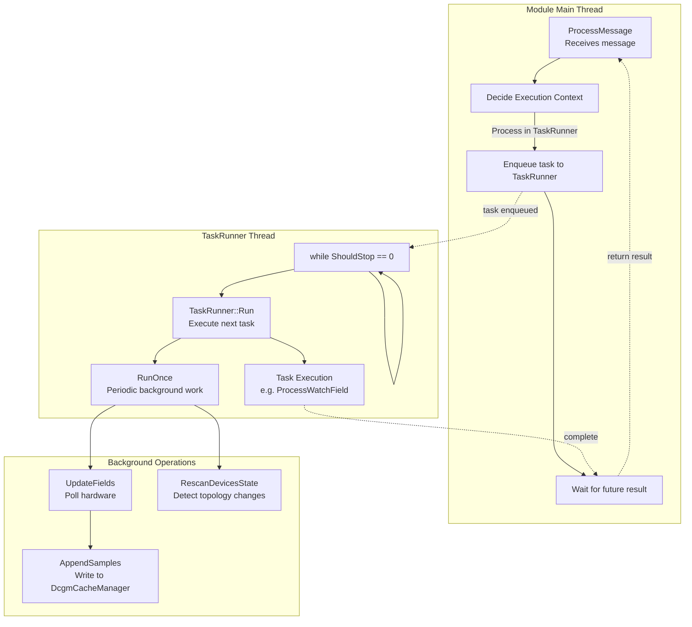
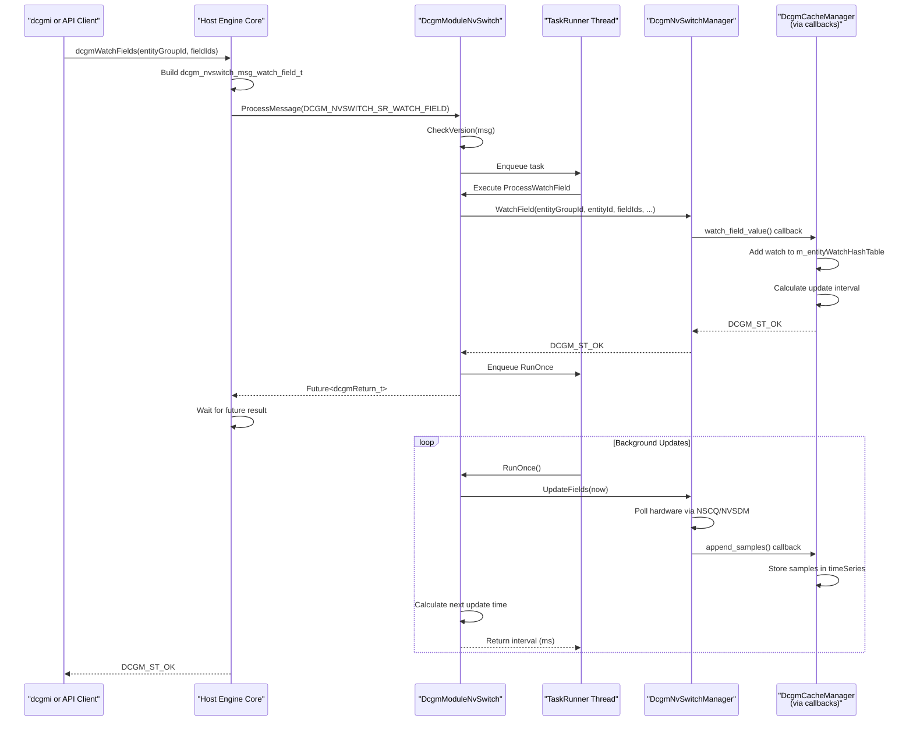

<!-- source: DeepWiki mcp.deepwiki.com · repo NVIDIA/DCGM · page 3 Modules · fetched 2026-10-26 -->

# Modules

<details>
<summary>Relevant source files</summary>

The following files were used as context for generating this wiki page:

- [README.md](README.md)
- [common/ThreeWayCmpDefault.hpp](common/ThreeWayCmpDefault.hpp)
- [modules/nvswitch/DcgmModuleNvSwitch.cpp](modules/nvswitch/DcgmModuleNvSwitch.cpp)
- [nvvs/include/NvvsJsonStrings.h](nvvs/include/NvvsJsonStrings.h)
- [testing/python3/tests/test_dcgm_collectd_plugin.py](testing/python3/tests/test_dcgm_collectd_plugin.py)

</details>


## Purpose and Scope

This page introduces the DCGM module system, explaining how modules provide specialized functionality within the DCGM architecture. Modules are dynamically-loadable components that implement specific features such as diagnostic testing, NVSwitch monitoring, and system telemetry collection. Each module operates independently with its own thread context and communicates with the DCGM core through a message-passing interface.

For details on specific modules, see:
- [System Monitoring Module](#3.1) - CPU metrics and system-level telemetry
- [NVSwitch Module](#3.2) - NVSwitch device management and monitoring
- [Diagnostic Module](#3.3) - NVVS test orchestration and diagnostic execution

For information about the Cache Manager that modules interact with for data storage, see [Cache Manager](#2.1).

## Module Architecture

Modules in DCGM are shared libraries (`.so` files) loaded by the host engine (`nv-hostengine`) at runtime. Each module implements the `DcgmModule` interface and provides three key functions for lifecycle management:

```mermaid
graph TB
    subgraph "Host Engine Process nv-hostengine"
        CORE["Core Engine<br/>Module Management<br/>Message Router"]
        
        LOADER["Module Loader<br/>dlopen/dlsym"]
        
        ROUTER["Message Router<br/>processModuleCommand<br/>Routes by moduleId"]
    end
    
    subgraph "Loaded Module Libraries"
        DIAG_SO["dcgmmodulediag.so<br/>DCGM_MODULE_ID_DIAG"]
        NVSWITCH_SO["dcgmmodulenvswitch.so<br/>DCGM_MODULE_ID_NVSWITCH"]
        SYSMON_SO["dcgmmodulesysmon.so<br/>DCGM_MODULE_ID_SYSMON"]
        HEALTH_SO["dcgmmodulehealth.so<br/>DCGM_MODULE_ID_HEALTH"]
        POLICY_SO["dcgmmodulepolicy.so<br/>DCGM_MODULE_ID_POLICY"]
        PROF_SO["dcgmmoduleprofiling.so<br/>DCGM_MODULE_ID_PROFILING"]
        CONFIG_SO["dcgmmoduleconfig.so<br/>DCGM_MODULE_ID_CONFIG"]
        INTROSPECT_SO["dcgmmoduleintrospect.so<br/>DCGM_MODULE_ID_INTROSPECT"]
    end
    
    subgraph "Module Instance Objects"
        DIAG_INST["DcgmModuleDiag<br/>extends DcgmModule"]
        NVSWITCH_INST["DcgmModuleNvSwitch<br/>extends DcgmModuleWithCoreProxy"]
        SYSMON_INST["DcgmModuleSysmon<br/>extends DcgmModuleWithCoreProxy"]
        HEALTH_INST["DcgmModuleHealth<br/>extends DcgmModule"]
        POLICY_INST["DcgmModulePolicy<br/>extends DcgmModule"]
        PROF_INST["DcgmModuleProfiling<br/>extends DcgmModule"]
    end
    
    CORE -->|"dlopen"| LOADER
    LOADER -->|"load library"| DIAG_SO
    LOADER -->|"load library"| NVSWITCH_SO
    LOADER -->|"load library"| SYSMON_SO
    LOADER -->|"load library"| HEALTH_SO
    LOADER -->|"load library"| POLICY_SO
    LOADER -->|"load library"| PROF_SO
    
    DIAG_SO -->|"dcgm_alloc_module_instance"| DIAG_INST
    NVSWITCH_SO -->|"dcgm_alloc_module_instance"| NVSWITCH_INST
    SYSMON_SO -->|"dcgm_alloc_module_instance"| SYSMON_INST
    HEALTH_SO -->|"dcgm_alloc_module_instance"| HEALTH_INST
    POLICY_SO -->|"dcgm_alloc_module_instance"| POLICY_INST
    PROF_SO -->|"dcgm_alloc_module_instance"| PROF_INST
    
    CORE -->|"route messages"| ROUTER
    
    ROUTER -->|"moduleId=DIAG"| DIAG_INST
    ROUTER -->|"moduleId=NVSWITCH"| NVSWITCH_INST
    ROUTER -->|"moduleId=SYSMON"| SYSMON_INST
    ROUTER -->|"moduleId=HEALTH"| HEALTH_INST
    ROUTER -->|"moduleId=POLICY"| POLICY_INST
    ROUTER -->|"moduleId=PROF"| PROF_INST
```



**Sources**: [modules/nvswitch/DcgmModuleNvSwitch.cpp:560-578]()

## Module Interface and Lifecycle

Each module shared library exports three C functions that define the module interface:

| Function | Purpose | Called When |
|----------|---------|-------------|
| `dcgm_alloc_module_instance()` | Creates and initializes a module instance | Module is loaded |
| `dcgm_free_module_instance()` | Destroys a module instance and cleans up resources | Module is unloaded or host engine shuts down |
| `dcgm_module_process_message()` | Processes incoming command messages | API request targets this module |

The module lifecycle follows this sequence:



**Sources**: [modules/nvswitch/DcgmModuleNvSwitch.cpp:560-578]()

### Base Classes

Modules typically inherit from one of these base classes:

- `DcgmModule` - Basic module interface
- `DcgmModuleWithCoreProxy` - Extends `DcgmModule` with core callback helpers for interacting with `DcgmCacheManager`

**Sources**: [modules/nvswitch/DcgmModuleNvSwitch.cpp:49-70]()

## Message-Based Communication

All communication with modules uses a message-passing architecture. Each message contains a header that identifies the target module and the specific operation to perform:



### Message Structure

The base message header is defined as:

```c
struct dcgm_module_command_header_t {
    unsigned int version;      // Message version for compatibility
    dcgmModuleId_t moduleId;  // Target module identifier
    unsigned int subCommand;   // Module-specific operation
    unsigned int length;       // Total message size
};
```

Each module defines its own message structures that extend this header with operation-specific payloads. For example, the NVSwitch module defines messages like:

- `dcgm_nvswitch_msg_watch_field_t` - Watch fields on NVSwitch entities
- `dcgm_nvswitch_msg_get_switches_v1` - Retrieve list of NVSwitch devices
- `dcgm_nvswitch_msg_get_link_states_t` - Query NVLink state information

**Sources**: [modules/nvswitch/DcgmModuleNvSwitch.cpp:93-153]()

### Message Processing Flow

When a module receives a message, it follows this pattern:

1. **Version Check**: Verify message version matches expected version
2. **Command Dispatch**: Switch on `subCommand` to route to specific handler
3. **Execution Context**: Decide whether to process inline or enqueue to `TaskRunner`
4. **Handler Invocation**: Call the appropriate handler function
5. **Result Return**: Return `dcgmReturn_t` status code

Example from NVSwitch module:

[modules/nvswitch/DcgmModuleNvSwitch.cpp:156-343]()

**Sources**: [modules/nvswitch/DcgmModuleNvSwitch.cpp:93-343]()

## TaskRunner Integration

Many modules use the `TaskRunner` pattern to execute work in a dedicated thread. This provides several benefits:

- **Non-blocking API**: Module operations don't block the main host engine thread
- **Sequential Execution**: Tasks execute one at a time, simplifying synchronization
- **Background Updates**: Modules can poll hardware periodically without blocking API calls



### TaskRunner Pattern

Modules that use `TaskRunner` implement a `run()` method that continuously processes tasks and performs periodic work:

[modules/nvswitch/DcgmModuleNvSwitch.cpp:540-553]()

The `RunOnce()` method performs periodic background operations:

[modules/nvswitch/DcgmModuleNvSwitch.cpp:476-525]()

This pattern allows modules to:
- Execute API requests as tasks in sequence
- Perform periodic hardware polling without blocking API calls
- Calculate optimal polling intervals based on active watches
- Rescan hardware state at regular intervals

**Sources**: [modules/nvswitch/DcgmModuleNvSwitch.cpp:476-553]()

## Module Registry

DCGM provides the following modules, each identified by a unique `dcgmModuleId_t`:

| Module ID | Module Name | Shared Library | Purpose |
|-----------|-------------|----------------|---------|
| `DCGM_MODULE_ID_CORE` | Core | (Built-in) | Group management, field group management, client handling |
| `DCGM_MODULE_ID_NVSWITCH` | NVSwitch | `dcgmmodulenvswitch.so` | NVSwitch device monitoring, NVLink state management |
| `DCGM_MODULE_ID_VGPU` | vGPU | `dcgmmodulevgpu.so` | Virtual GPU management and monitoring |
| `DCGM_MODULE_ID_INTROSPECT` | Introspect | `dcgmmoduleintrospect.so` | DCGM internal telemetry and debugging |
| `DCGM_MODULE_ID_HEALTH` | Health | `dcgmmodulehealth.so` | GPU health monitoring and system checks |
| `DCGM_MODULE_ID_POLICY` | Policy | `dcgmmodulepolicy.so` | Policy violation detection and management |
| `DCGM_MODULE_ID_CONFIG` | Config | `dcgmmoduleconfig.so` | GPU configuration management (clocks, power limits) |
| `DCGM_MODULE_ID_DIAG` | Diagnostic | `dcgmmodulediag.so` | Diagnostic test orchestration, NVVS integration |
| `DCGM_MODULE_ID_PROFILING` | Profiling | `dcgmmoduleprofiling.so` | GPU profiling metrics collection |
| `DCGM_MODULE_ID_SYSMON` | System Monitor | `dcgmmodulesysmon.so` | CPU and system-level telemetry |

### Module Descriptions

#### Core Module (Built-in)
The Core module is not a loadable library but part of the host engine itself. It handles:
- Group creation and management (`dcgmGroupCreate`, `dcgmGroupDestroy`)
- Field group operations (`dcgmFieldGroupCreate`)
- Client connection tracking
- Field watch subscription
- Entity discovery

#### NVSwitch Module
Monitors NVSwitch devices and NVLink connections. Supports two backend implementations (NSCQ and NVSDM) for hardware communication. See [NVSwitch Module](#3.2) for details.

#### System Monitor Module
Collects CPU utilization, temperature, power consumption, and other system metrics by reading from `/proc`, `/sys/class/hwmon`, and `/sys/class/thermal`. See [System Monitoring Module](#3.1) for details.

#### Diagnostic Module
Orchestrates NVVS diagnostic runs by spawning the `nvvs` binary as a child process and managing communication channels. See [Diagnostic Module](#3.3) for details.

#### Health Module
Performs health checks on GPUs including memory, inforom, thermal, power, and NVLink status. Returns overall system health status.

#### Policy Module
Monitors for policy violations such as exceeding power limits, temperature thresholds, or performance degradation. Can trigger callbacks when violations occur.

#### Profiling Module
Collects GPU profiling metrics including instruction throughput, memory bandwidth utilization, tensor core activity, and other performance counters.

#### Config Module
Manages GPU configuration settings including clock frequencies, power limits, and compute mode. Validates and applies configuration changes.

**Sources**: [modules/nvswitch/DcgmModuleNvSwitch.cpp:1-581]()

## Core Callbacks

Modules receive a `dcgmCoreCallbacks_t` structure during initialization that provides function pointers for interacting with the DCGM core:

| Callback | Purpose |
|----------|---------|
| `postfunc` | Send messages to other modules |
| `version` | Check API version compatibility |
| `msg_create_group` | Create entity groups |
| `msg_add_entity_to_group` | Add entities to groups |
| `msg_remove_entity_from_group` | Remove entities from groups |
| `msg_group_destroy` | Destroy groups |
| `msg_create_field_group` | Create field groups |
| `msg_field_group_destroy` | Destroy field groups |
| `msg_get_field_group` | Retrieve field group contents |
| `watch_field_value` | Register field watches |
| `unwatch_field_value` | Remove field watches |
| `get_field_latest_value` | Read latest field value |
| `get_field_multiple_values` | Read time-series field values |
| `append_samples` | Write samples to cache |

These callbacks allow modules to interact with the `DcgmCacheManager` without direct linking, maintaining module independence.

**Sources**: [modules/nvswitch/DcgmModuleNvSwitch.cpp:49-52]()

## Example: NVSwitch Module Message Flow

The following diagram shows a complete message flow for watching NVSwitch fields:



**Sources**: [modules/nvswitch/DcgmModuleNvSwitch.cpp:93-153](), [modules/nvswitch/DcgmModuleNvSwitch.cpp:372-394](), [modules/nvswitch/DcgmModuleNvSwitch.cpp:476-525]()

## Module Development Guidelines

When developing a new DCGM module:

1. **Inherit from Base Class**: Extend `DcgmModule` or `DcgmModuleWithCoreProxy`
2. **Export Required Functions**: Implement `dcgm_alloc_module_instance`, `dcgm_free_module_instance`, `dcgm_module_process_message`
3. **Define Message Structures**: Create versioned message structures for each operation
4. **Implement ProcessMessage**: Route messages to handlers based on `subCommand`
5. **Use TaskRunner for Long Operations**: Enqueue tasks instead of blocking the API thread
6. **Implement RunOnce for Background Work**: Perform periodic updates and return next wake time
7. **Use Core Callbacks**: Interact with `DcgmCacheManager` through provided callbacks
8. **Handle Core Messages**: Process `DCGM_CORE_SR_CLIENT_DISCONNECT`, `DCGM_CORE_SR_LOGGING_CHANGED`, `DCGM_CORE_SR_PAUSE_RESUME`
9. **Thread Safety**: Ensure proper synchronization when accessing shared state
10. **Error Handling**: Return appropriate `dcgmReturn_t` codes for all error conditions

**Sources**: [modules/nvswitch/DcgmModuleNvSwitch.cpp:1-581]()

---

