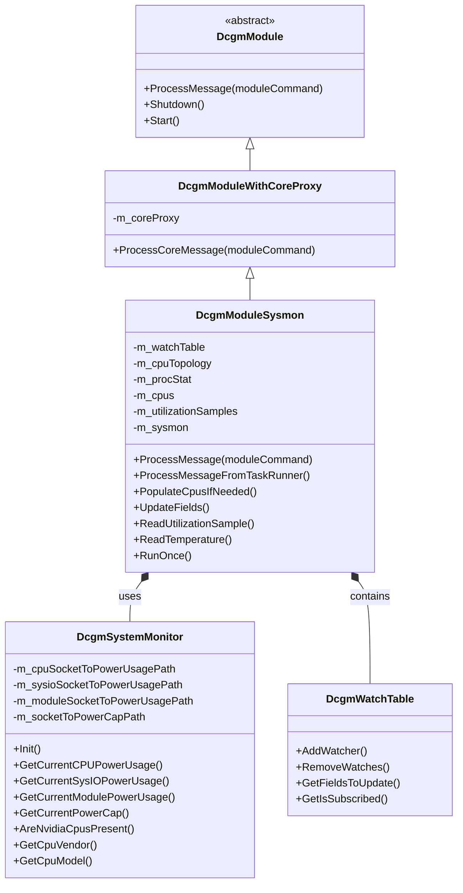
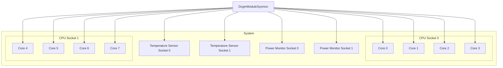
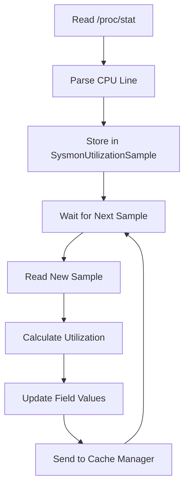
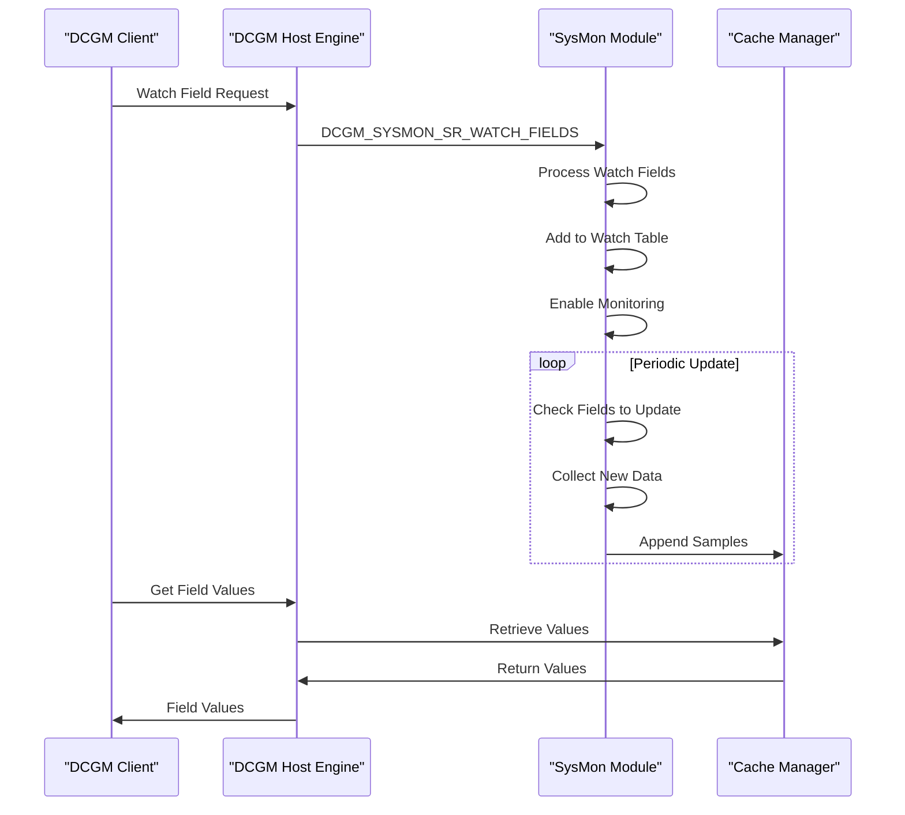
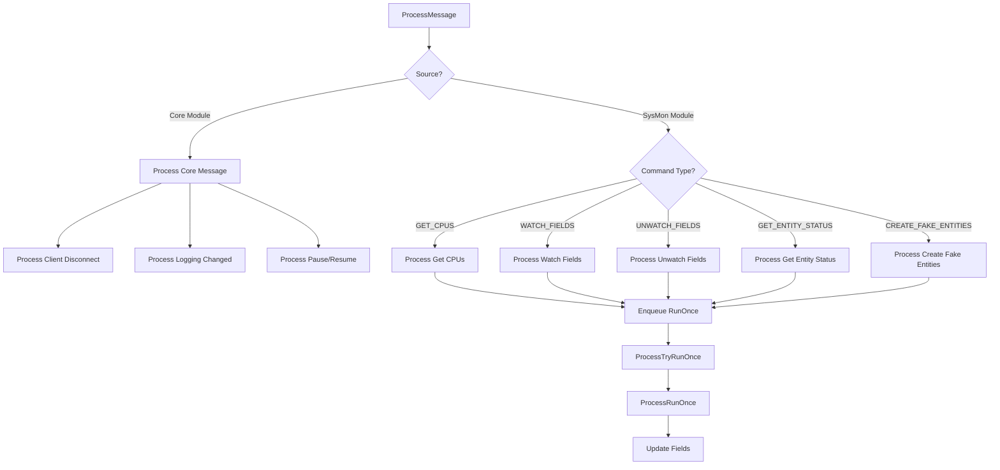
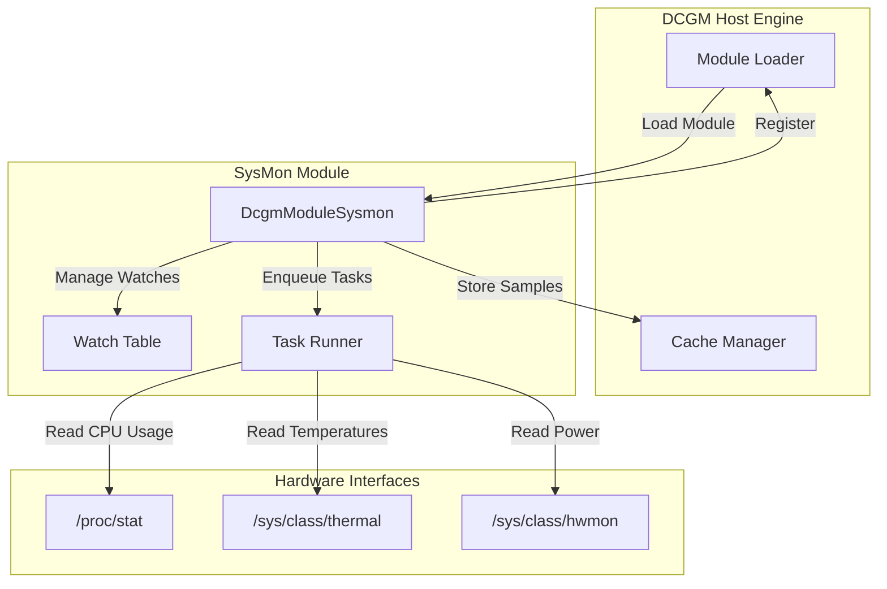

<!-- source: DeepWiki mcp.deepwiki.com · repo NVIDIA/DCGM · page 3.1 System Monitoring Module · fetched 2026-10-26 -->

# System Monitoring Module

Relevant source files

The following files were used as context for generating this wiki page:

- [modules/sysmon/DcgmModuleSysmon.cpp](modules/sysmon/DcgmModuleSysmon.cpp)
- [modules/sysmon/DcgmSystemMonitor.cpp](modules/sysmon/DcgmSystemMonitor.cpp)
- [testing/CMakeLists.txt](testing/CMakeLists.txt)

The System Monitoring Module (SysMon) is a component of the NVIDIA Data Center GPU Manager (DCGM) responsible for monitoring CPU and system-level metrics. This module extends DCGM's capabilities beyond GPU monitoring to provide a comprehensive view of the entire system, with a focus on CPU utilization, temperature, and power consumption metrics. It is particularly designed to support NVIDIA Grace CPU systems, but can work with compatible hardware.

For information about GPU monitoring, see [Core Components](#2) and [Cache Manager](#2.1). For NVSwitch monitoring, see [NVSwitch Module](#3.2).

## 1. Architecture Overview

The System Monitoring Module operates within DCGM's modular framework, implementing the required interfaces to provide system-level monitoring capabilities. The module runs as a separate thread within the DCGM hostengine process, periodically collecting metrics and responding to monitoring requests.

Sources: [modules/sysmon/DcgmModuleSysmon.cpp:16-79](), [modules/sysmon/DcgmSystemMonitor.cpp:16-35]()

## 2. Core Components

### 2.1 DcgmModuleSysmon

The `DcgmModuleSysmon` class is the main component of the System Monitoring Module. It inherits from `DcgmModuleWithCoreProxy` and implements the module's functionality for processing commands, monitoring system resources, and providing data to other DCGM components.

#### Key Responsibilities:

- Process module commands from the DCGM host engine
- Populate CPU information and topology
- Collect and store utilization samples
- Monitor CPU temperatures
- Monitor power usage (for CPU, SysIO, and Module)
- Track field watches and update metrics at the requested intervals

Sources: [modules/sysmon/DcgmModuleSysmon.cpp:50-101]()

### 2.2 DcgmSystemMonitor

The `DcgmSystemMonitor` class provides hardware-specific monitoring capabilities, particularly for NVIDIA Grace CPUs. It handles the low-level interfaces to hardware sensors and exposes methods to retrieve various system metrics.

#### Key Responsibilities:

- Detect whether NVIDIA CPUs are present
- Initialize power monitoring interfaces
- Provide CPU vendor and model information
- Read power usage from hardware sensors
- Retrieve power cap information

Sources: [modules/sysmon/DcgmSystemMonitor.cpp:33-317]()

### 2.3 CPU Topology Management

The module maintains a comprehensive view of the system's CPU topology, identifying:

- CPU nodes (sockets)
- CPU cores
- Relationships between nodes and cores

This information is essential for proper attribution of metrics and to understand the system's physical organization.

Sources: [modules/sysmon/DcgmModuleSysmon.cpp:476-621]()

## 3. Data Collection Mechanisms

### 3.1 CPU Utilization Monitoring

The System Monitoring Module collects CPU utilization metrics by reading and parsing `/proc/stat`. It tracks the following usage categories:

- User time
- Nice time
- System time
- Idle time
- IRQ time
- Other time (including iowait)

The module calculates utilization percentages by comparing consecutive samples over time.

Sources: [modules/sysmon/DcgmModuleSysmon.cpp:627-693](), [modules/sysmon/DcgmModuleSysmon.cpp:871-921]()

### 3.2 Temperature Monitoring

The module collects CPU temperature data from the Linux sysfs thermal zone interfaces:

- Current temperature
- Warning threshold temperature
- Critical threshold temperature

Temperature readings are acquired from files in `/sys/class/thermal/thermal_zone*/` directories.

Sources: [modules/sysmon/DcgmModuleSysmon.cpp:974-1168]()

### 3.3 Power Monitoring

Power monitoring is implemented for NVIDIA Grace CPUs through hardware-specific interfaces in the `/sys/class/hwmon/` directories. The module can track:

- CPU power usage
- SysIO power usage
- Module power usage
- Power caps/limits

Sources: [modules/sysmon/DcgmSystemMonitor.cpp:107-304]()

## 4. Field Management

### 4.1 Supported Metrics

The System Monitoring Module supports the following field IDs:

| Field ID | Description | Type |
|----------|-------------|------|
| `DCGM_FI_DEV_CPU_UTIL_TOTAL` | Total CPU utilization | Double |
| `DCGM_FI_DEV_CPU_UTIL_USER` | User space CPU utilization | Double |
| `DCGM_FI_DEV_CPU_UTIL_NICE` | Nice CPU utilization | Double |
| `DCGM_FI_DEV_CPU_UTIL_SYS` | System CPU utilization | Double |
| `DCGM_FI_DEV_CPU_UTIL_IRQ` | IRQ CPU utilization | Double |
| `DCGM_FI_DEV_CPU_TEMP_CURRENT` | Current CPU temperature | Double |
| `DCGM_FI_DEV_CPU_TEMP_WARNING` | Warning threshold temperature | Double |
| `DCGM_FI_DEV_CPU_TEMP_CRITICAL` | Critical threshold temperature | Double |
| `DCGM_FI_DEV_CPU_POWER_UTIL_CURRENT` | Current CPU power usage | Double |
| `DCGM_FI_DEV_SYSIO_POWER_UTIL_CURRENT` | Current SysIO power usage | Double |
| `DCGM_FI_DEV_MODULE_POWER_UTIL_CURRENT` | Current module power usage | Double |
| `DCGM_FI_DEV_CPU_POWER_LIMIT` | CPU power cap | Double |
| `DCGM_FI_DEV_CPU_CLOCK_CURRENT` | Current CPU clock frequency | Int64 |
| `DCGM_FI_DEV_CPU_VENDOR` | CPU vendor string | String |
| `DCGM_FI_DEV_CPU_MODEL` | CPU model string | String |

Sources: [modules/sysmon/DcgmModuleSysmon.cpp:730-790](), [modules/sysmon/DcgmModuleSysmon.cpp:1207-1380]()

### 4.2 Field Watch Management

The module implements a watch system that allows clients to subscribe to specific metrics:

- Clients specify which fields they want to monitor with desired update intervals
- The module tracks these requests in its watch table
- Fields are updated according to the requested intervals
- Data is stored with timestamps for time series analysis

Sources: [modules/sysmon/DcgmModuleSysmon.cpp:232-345]()

## 5. Message Processing

The System Monitoring Module processes various message types from the DCGM host engine and other components. The message processing follows the command pattern:

Sources: [modules/sysmon/DcgmModuleSysmon.cpp:103-220](), [modules/sysmon/DcgmModuleSysmon.cpp:448-473]()

### 5.1 Main Processing Loop

The module operates on a task runner thread that handles message processing and periodic updates:

1. The thread initializes the monitoring system
2. It enters a loop to process incoming messages
3. It periodically checks if fields need updates
4. It collects and updates the requested metrics
5. It prunes old samples to manage memory

Sources: [modules/sysmon/DcgmModuleSysmon.cpp:1391-1445]()

## 6. Initialization and Hardware Compatibility

The System Monitoring Module is primarily designed for systems with NVIDIA Grace CPUs. On startup, the module:

1. Populates CPU information (unless disabled for testing)
2. Verifies if NVIDIA CPUs are present
3. Maps temperature and power sensors to CPU sockets
4. Initializes the module's task runner

If NVIDIA CPUs are not detected, the module will not start unless the environment variable `__DCGM_SYSMON_SKIP_HARDWARE_CHECK__` is set.

Sources: [modules/sysmon/DcgmModuleSysmon.cpp:50-81](), [modules/sysmon/DcgmSystemMonitor.cpp:314-317]()

## 7. Integration with DCGM

The System Monitoring Module integrates with the DCGM framework through the module interface. It is instantiated by the DCGM host engine and registered as a module with ID `DcgmModuleIdSysmon`.

The module exposes entry points for the DCGM host engine to load, free, and communicate with it:
- `dcgm_alloc_module_instance` - Allocates and initializes the module
- `dcgm_free_module_instance` - Frees the module
- `dcgm_module_process_message` - Processes messages sent to the module

Sources: [modules/sysmon/DcgmModuleSysmon.cpp:1562-1580]()

## 8. Example Usage

To monitor system metrics with DCGM, clients can:

1. Connect to the DCGM host engine
2. Create a group with CPU entities (socket or core)
3. Watch the desired fields with appropriate update intervals
4. Periodically retrieve the field values

For example, to monitor CPU utilization of all cores with a 1-second update interval:
1. Create a group with all CPU cores
2. Watch fields `DCGM_FI_DEV_CPU_UTIL_TOTAL` and `DCGM_FI_DEV_CPU_UTIL_USER`
3. Set update interval to 1 second
4. Retrieve values every 1+ seconds

---

