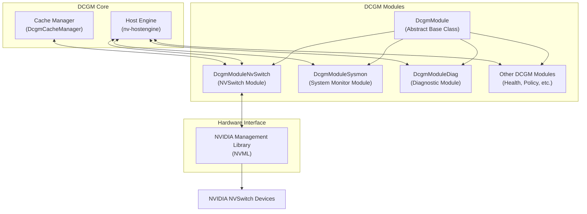
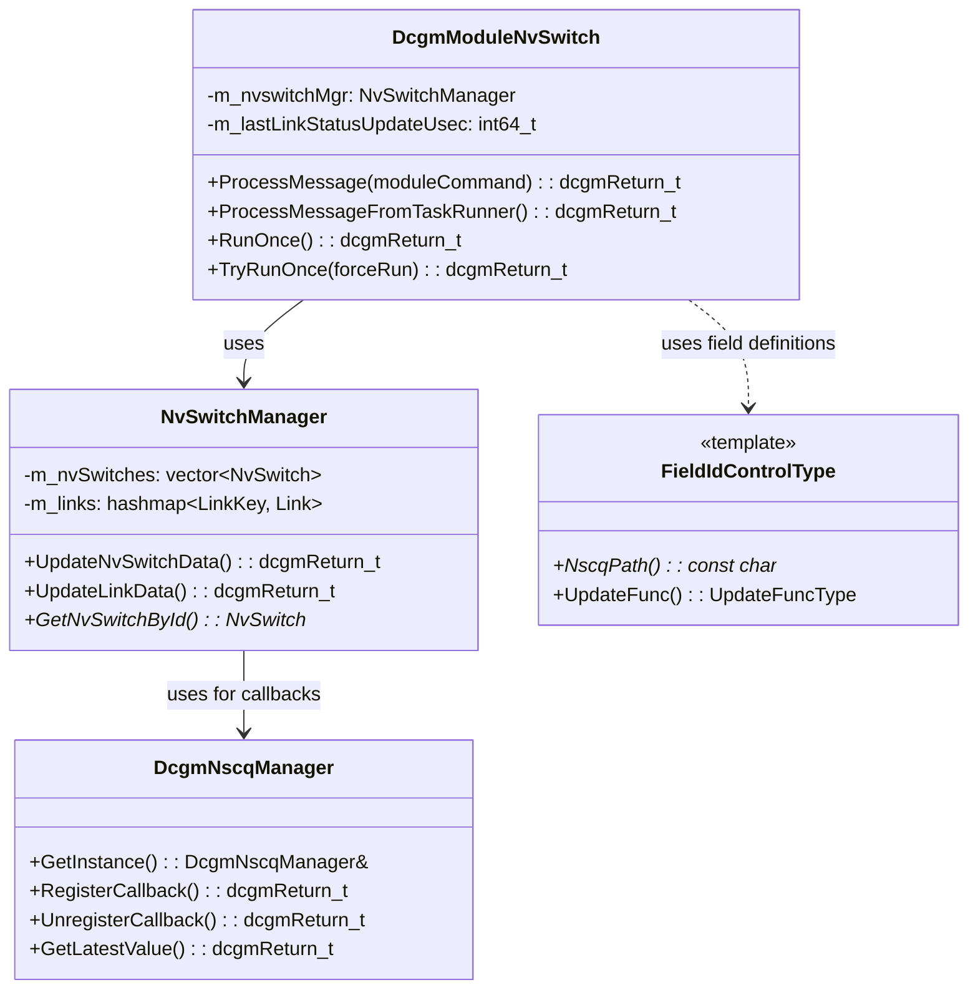
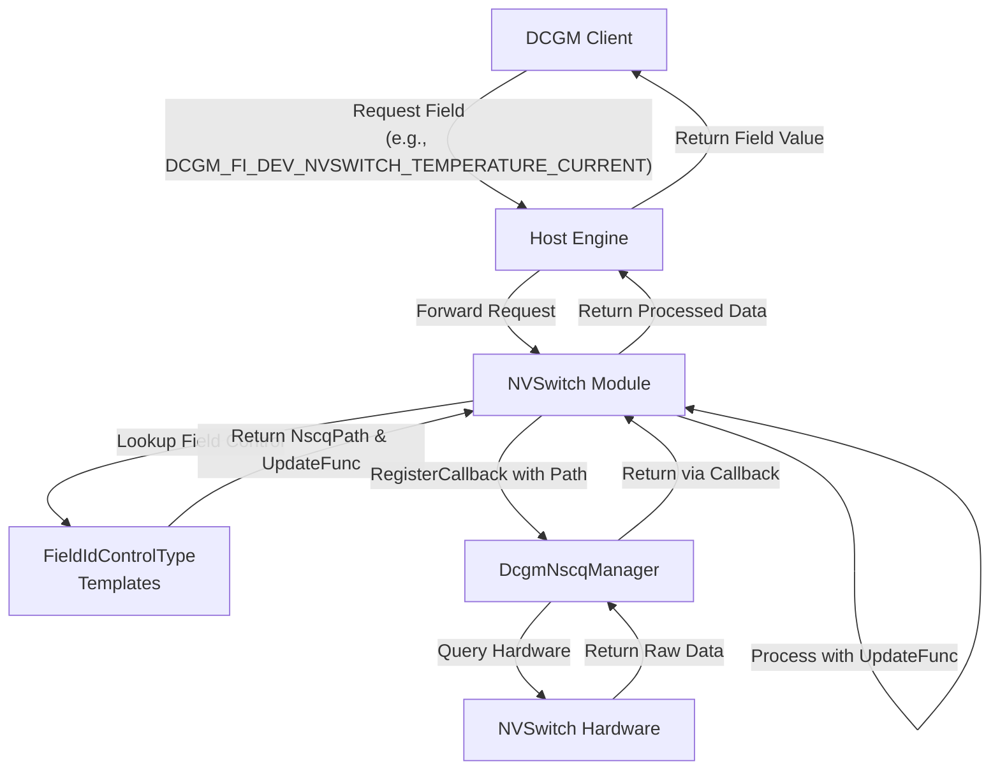
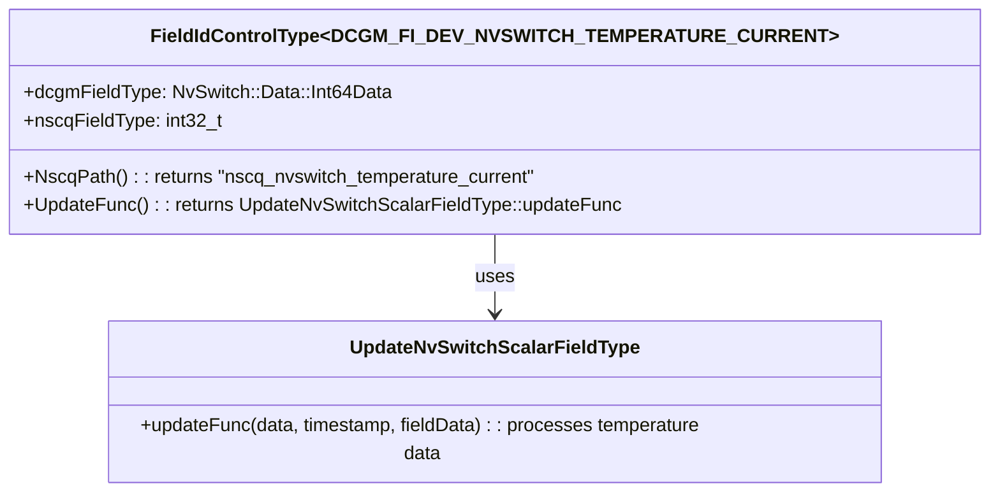
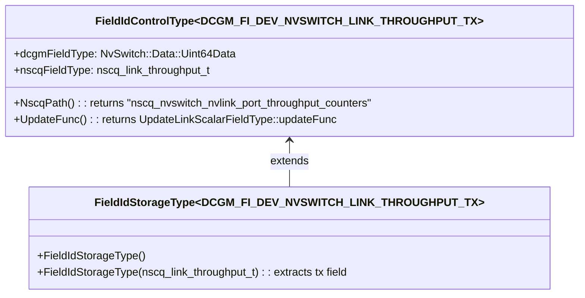

<!-- source: DeepWiki mcp.deepwiki.com · repo NVIDIA/DCGM · page 3.2 NVSwitch Module · fetched 2026-10-26 -->

# NVSwitch Module

Relevant source files

The following files were used as context for generating this wiki page:

- [README.md](README.md)
- [common/ThreeWayCmpDefault.hpp](common/ThreeWayCmpDefault.hpp)
- [intodocker.sh](intodocker.sh)
- [modules/nvswitch/DcgmModuleNvSwitch.cpp](modules/nvswitch/DcgmModuleNvSwitch.cpp)
- [modules/nvswitch/FieldDefinitions.h](modules/nvswitch/FieldDefinitions.h)
- [nvvs/include/NvvsJsonStrings.h](nvvs/include/NvvsJsonStrings.h)
- [testing/python3/tests/test_dcgm_collectd_plugin.py](testing/python3/tests/test_dcgm_collectd_plugin.py)

## Overview

The NVSwitch Module (`dcgmmodulenvswitch`) is responsible for monitoring and managing NVIDIA NVSwitch devices in the DCGM ecosystem. NVSwitches are high-bandwidth interconnect devices that enable direct communication between multiple GPUs, creating a unified memory space for applications requiring multi-GPU performance. This module collects and processes metrics and state information from NVSwitch devices, making them available to DCGM clients through the standard DCGM field monitoring interfaces.

Sources: [modules/nvswitch/FieldDefinitions.h:17-20]()

## Architecture and Integration

The NVSwitch Module is integrated into the DCGM architecture as a specialized module extending the core `DcgmModule` class. It interfaces with the NVIDIA Management Library (NVML) to gather hardware-level metrics from NVSwitch devices and makes this data available to the DCGM Host Engine.

### Position in DCGM Module Hierarchy

Sources: [modules/nvswitch/FieldDefinitions.h:31-32]()

### NVSwitch Module Core Components

Sources: [modules/nvswitch/FieldDefinitions.h:40-59]()

## NVSwitch Metrics and Field Types

The NVSwitch Module collects a diverse range of metrics from NVSwitch devices, organizing them into two main categories:

1. **Device-level metrics** - Data about the entire NVSwitch device
2. **Link-level metrics** - Data about individual NVLink connections

Each metric is uniquely identified by a field ID and has a corresponding data type and update mechanism. The module uses a template-based approach to map field IDs to specific NSCQ (NVIDIA Switch Communication Queue) paths and update functions.

### Monitored Metrics

The following table outlines key metrics collected by the NVSwitch Module:

| Category | Metric Type | Description | Field ID Example |
|----------|-------------|-------------|-----------------|
| **Device-wide** | Temperature | Current temperature and thermal limits | `DCGM_FI_DEV_NVSWITCH_TEMPERATURE_CURRENT` |
| | Throughput | Aggregate data transfer rates | `DCGM_FI_DEV_NVSWITCH_THROUGHPUT_TX` |
| | Error counts | Fatal and non-fatal errors | `DCGM_FI_DEV_NVSWITCH_FATAL_ERRORS` |
| | Power | Power consumption per rail | `DCGM_FI_DEV_NVSWITCH_POWER_VDD` |
| | Voltage | Voltage measurements | `DCGM_FI_DEV_NVSWITCH_VOLTAGE_MVOLT` |
| | Current | Current measurements | `DCGM_FI_DEV_NVSWITCH_CURRENT_IDDQ` |
| | Identity | Device UUID, PCIe location | `DCGM_FI_DEV_UUID` |
| **Link-specific** | Link status | Connection state | `DCGM_FI_DEV_NVSWITCH_LINK_STATUS` |
| | Link errors | Error counts by type | `DCGM_FI_DEV_NVSWITCH_LINK_CRC_ERRORS` |
| | Link throughput | Per-link data transfer rates | `DCGM_FI_DEV_NVSWITCH_LINK_THROUGHPUT_TX` |
| | Link latency | Latency measurements by virtual channel | `DCGM_FI_DEV_NVSWITCH_LINK_LATENCY_LOW_VC0` |
| | Connected device | Remote device type and identity | `DCGM_FI_DEV_NVSWITCH_LINK_TYPE` |

Sources: [modules/nvswitch/FieldDefinitions.h:64-109](), [modules/nvswitch/FieldDefinitions.h:130-171](), [modules/nvswitch/FieldDefinitions.h:218-258]()

### Field ID Control System

The NVSwitch Module defines specialized field control templates for each monitored metric. This system maps each field ID to:

1. The appropriate NSCQ path for data collection
2. The specific update function to process the data
3. Data types for internal storage and external representation

Sources: [modules/nvswitch/FieldDefinitions.h:30-59]()

## Field Type Implementation

Each field ID is implemented as a specialized template that defines:

1. How to access the data through NSCQ (NVIDIA Switch Communication Queue)
2. How to transform raw data into DCGM field values
3. Storage types for complex data structures

### Example: Device Temperature Field

Sources: [modules/nvswitch/FieldDefinitions.h:64-83]()

### Example: Link Throughput Fields

Sources: [modules/nvswitch/FieldDefinitions.h:417-435](), [modules/nvswitch/FieldDefinitions.h:464-479]()

## Data Collection Process

The NVSwitch Module operates by:

1. Registering field watches with the DcgmNscqManager
2. Receiving callback notifications when new data is available
3. Using specialized update functions to process raw data
4. Storing processed data in the DCGM Cache Manager
5. Periodically updating link status information

### Update Function Types

The module uses three main types of update functions:

1. **UpdateNvSwitchScalarFieldType** - For device-wide scalar values
2. **UpdateLinkScalarFieldType** - For link-specific scalar values
3. **UpdateLinkVectorFieldType** - For complex, array-based link data

When the module receives data from the NSCQ callbacks, it applies the appropriate update function to transform raw hardware data into the format expected by DCGM clients.

Sources: [modules/nvswitch/FieldDefinitions.h:80-83](), [modules/nvswitch/FieldDefinitions.h:345-346](), [modules/nvswitch/FieldDefinitions.h:522-523]()

## Usage and Integration

The NVSwitch Module is automatically loaded by the DCGM Host Engine when NVSwitch devices are detected in the system. Applications can access NVSwitch metrics through the standard DCGM field access APIs:

1. Create watches for specific field IDs
2. Poll for updates or receive callbacks
3. Read the latest values or time-series data

This allows unified monitoring of both GPUs and NVSwitches through the same DCGM interface.

## Practical Applications

NVSwitch monitoring through DCGM enables several important use cases:

1. **Health Monitoring** - Track temperatures, error counts, and link statuses to detect potential hardware issues
2. **Performance Analysis** - Measure throughput and latency to identify communication bottlenecks
3. **Topology Mapping** - Determine how GPUs are interconnected through NVSwitches
4. **Power Monitoring** - Track power consumption of NVSwitch devices alongside GPUs

By providing detailed visibility into NVSwitch operation, this module allows system administrators and application developers to optimize multi-GPU workloads and maintain system health.

---

