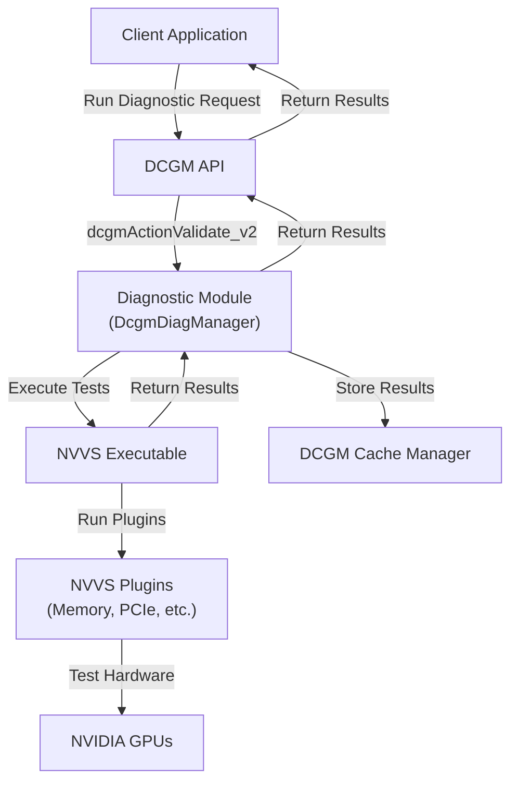
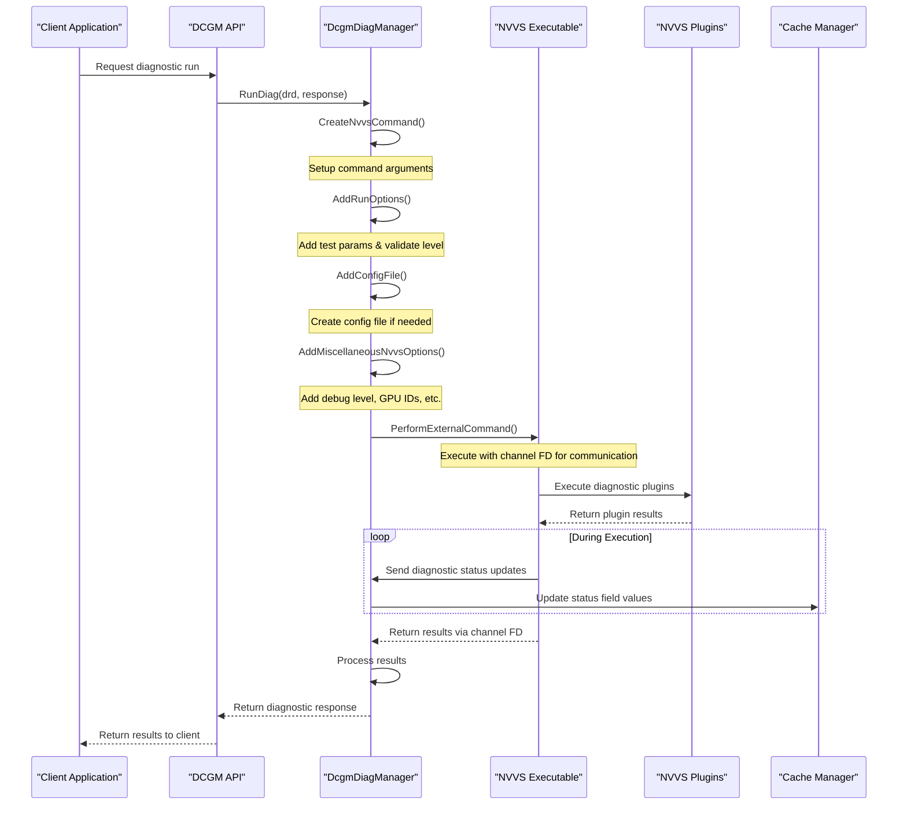
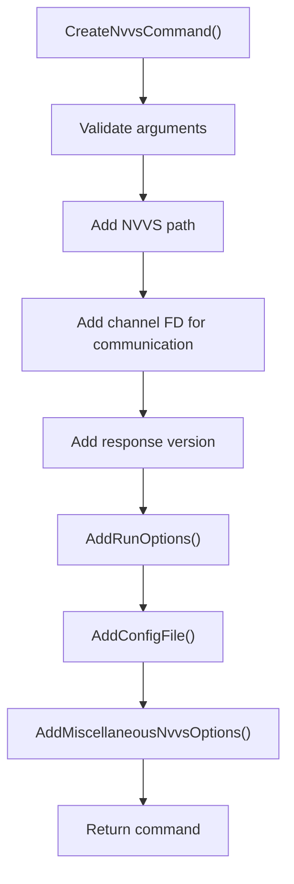
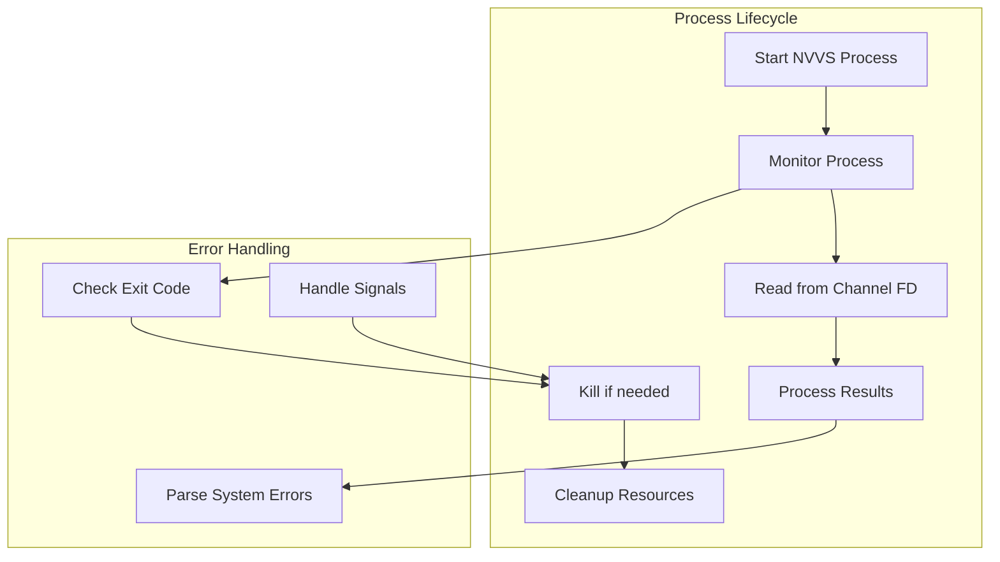
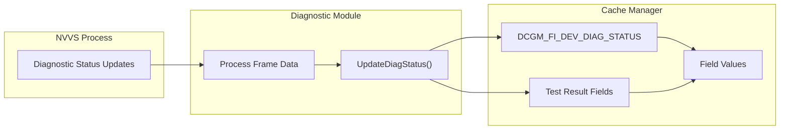
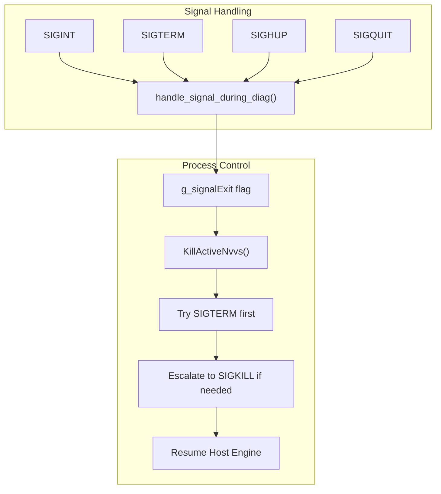
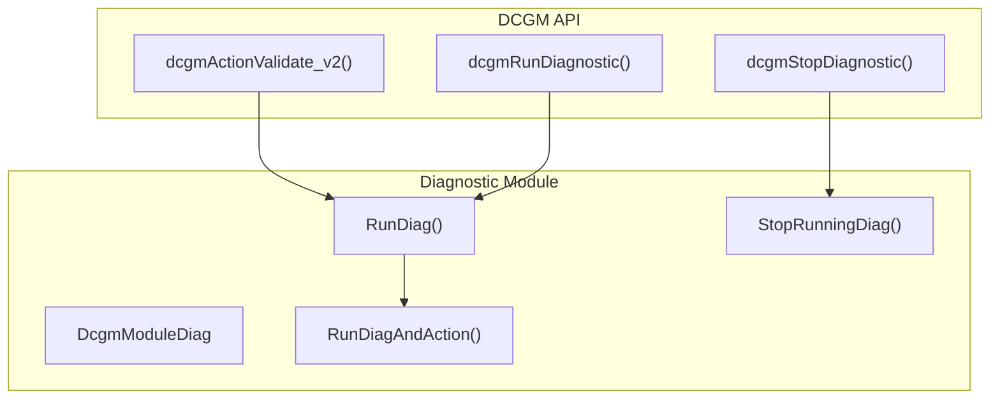

<!-- source: DeepWiki mcp.deepwiki.com · repo NVIDIA/DCGM · page 3.3 Diagnostic Module · fetched 2026-10-26 -->

# Diagnostic Module

<details>
<summary>Relevant source files</summary>

The following files were used as context for generating this wiki page:

- [dcgmi/Diag.cpp](dcgmi/Diag.cpp)
- [dcgmlib/src/DcgmApi.cpp](dcgmlib/src/DcgmApi.cpp)
- [modules/diag/DcgmDiagManager.cpp](modules/diag/DcgmDiagManager.cpp)
- [testing/python3/tests/test_dcgm_diag.py](testing/python3/tests/test_dcgm_diag.py)

</details>


The Diagnostic Module is a key component of the NVIDIA Data Center GPU Manager (DCGM) responsible for executing diagnostic tests on NVIDIA GPUs through the NVIDIA Validation Suite (NVVS). It provides functionality to initiate diagnostic runs, manage test execution, process results, and handle error conditions during diagnostic operations.

For information about specific diagnostic tests and plugins available in NVVS, see [NVVS (NVIDIA Validation Suite)](#4).

## Architecture Overview

The Diagnostic Module serves as an intermediary between the DCGM system and the NVVS executable, managing the lifecycle of diagnostic runs and processing results.

### High-Level Architecture



Sources:
- [modules/diag/DcgmDiagManager.h:46-175]()
- [modules/diag/DcgmDiagManager.cpp:87-95]()

### Core Components

The primary class in the Diagnostic Module is `DcgmDiagManager`, which handles all aspects of diagnostic execution:

```mermaid
classDiagram
    class DcgmDiagManager {
        +RunDiag(drd, response) : dcgmReturn_t
        +RunDiagAndAction(drd, action, response, connectionId) : dcgmReturn_t
        +StopRunningDiag() : dcgmReturn_t
        +EnforceGPUConfiguration(gpuId, connectionId) : dcgmReturn_t
        +PerformNVVSExecute(...) : dcgmReturn_t
        -KillActiveNvvs(maxRetries) : dcgmReturn_t
        -CreateNvvsCommand(...) : dcgmReturn_t
        -PerformExternalCommand(...) : dcgmReturn_t
        -AddRunOptions(cmdArgs, drd) : dcgmReturn_t
        -AddConfigFile(drd, cmdArgs) : dcgmReturn_t
        -UpdateDiagStatus(data) : void
    }

    class DcgmDiagResponseWrapper {
        +SetResult(data) : dcgmReturn_t
        +SetVersion(response) : void
        +GetVersion() : unsigned int
        +GetSystemErr() : string
        +RecordSystemError(msg) : void
    }

    DcgmDiagManager --> DcgmDiagResponseWrapper : uses
    DcgmDiagManager --> "DcgmCoreProxy" : uses for communication
```

Sources:
- [modules/diag/DcgmDiagManager.h:46-245]()
- [modules/diag/DcgmDiagManager.cpp:87-245]()

## Diagnostic Execution Flow

The diagnostic execution follows a well-defined flow from initiation to completion:



Sources:
- [modules/diag/DcgmDiagManager.cpp:553-571]()
- [modules/diag/DcgmDiagManager.cpp:665-852]()
- [modules/diag/DcgmDiagManager.cpp:258-312]()

## NVVS Integration

The Diagnostic Module executes NVVS as an external process to perform the actual diagnostic tests. This section details how this integration works.

### Command Construction

The module builds a command to execute NVVS with appropriate parameters:



Sources:
- [modules/diag/DcgmDiagManager.cpp:508-551]()
- [modules/diag/DcgmDiagManager.cpp:258-408]()

### Process Management

The module manages the NVVS process throughout its lifecycle:



Sources:
- [modules/diag/DcgmDiagManager.cpp:665-852]()
- [modules/diag/DcgmDiagManager.cpp:110-182]()

## Diagnostic Tests and Field Mapping

The Diagnostic Module maps various diagnostic tests to specific DCGM field IDs for result storage and retrieval:

| Test Name | Plugin | Field ID |
|-----------|--------|----------|
| Memory | memory | DCGM_FI_DEV_DIAG_MEMORY_RESULT |
| Diagnostic | diagnostic | DCGM_FI_DEV_DIAG_DIAGNOSTIC_RESULT |
| PCIe | pcie | DCGM_FI_DEV_DIAG_PCIE_RESULT |
| Targeted Stress | targeted stress | DCGM_FI_DEV_DIAG_TARGETED_STRESS_RESULT |
| Targeted Power | targeted power | DCGM_FI_DEV_DIAG_TARGETED_POWER_RESULT |
| Memory Bandwidth | memory bandwidth | DCGM_FI_DEV_DIAG_MEMORY_BANDWIDTH_RESULT |
| Memtest | memtest | DCGM_FI_DEV_DIAG_MEMTEST_RESULT |
| Pulse Test | pulse test | DCGM_FI_DEV_DIAG_PULSE_TEST_RESULT |
| EUD | eud | DCGM_FI_DEV_DIAG_EUD_RESULT |
| CPU EUD | cpu eud | DCGM_FI_DEV_DIAG_CPU_EUD_RESULT |
| Software | software | DCGM_FI_DEV_DIAG_SOFTWARE_RESULT |
| NVBandwidth | nvbandwidth | DCGM_FI_DEV_DIAG_NVBANDWIDTH_RESULT |

Sources:
- [modules/diag/DcgmDiagManager.h:162-175]()
- [testing/python3/tests/test_dcgm_diag.py:51-56]()

## Status Reporting and Monitoring

During diagnostic execution, the module reports status updates to the DCGM Cache Manager:



Sources:
- [modules/diag/DcgmDiagManager.cpp:629-662]()
- [modules/diag/DcgmDiagManager.cpp:804-834]()

## Error Handling

The Diagnostic Module provides comprehensive error handling for various scenarios:

### Process Control and Signal Handling



Sources:
- [modules/diag/DcgmDiagManager.cpp:110-182]()
- [dcgmi/Diag.cpp:91-152]()

### Error Classification

The module classifies and handles various types of errors:

| Error Category | Handling |
|----------------|----------|
| NVVS Process Errors | Kill process, clean up resources |
| Timeouts | Kill process, return DCGM_ST_TIMEOUT |
| Permission Issues | Return appropriate error code |
| System Errors | Capture and include in response |
| Test Failures | Process and include in test results |
| Interruptions | Kill process, return DCGM_ST_NVVS_KILLED |

Sources:
- [modules/diag/DcgmDiagManager.cpp:853-885]()
- [modules/diag/DcgmDiagManager.cpp:947-999]()
- [dcgmi/Diag.cpp:516-539]()

## Key API Methods

### Running Diagnostics

The main method for running diagnostics is `RunDiag`:

```cpp
dcgmReturn_t DcgmDiagManager::RunDiag(dcgmRunDiag_v10 *drd, DcgmDiagResponseWrapper &response)
```

This method:
1. Validates the input parameters
2. Determines which GPUs to test
3. Creates the NVVS command
4. Executes NVVS
5. Processes the results
6. Returns the response

Sources:
- [modules/diag/DcgmDiagManager.h:70-70]()
- [modules/diag/DcgmDiagManager.cpp:1159-1347]()

### Stopping Diagnostics

The module provides a method to stop a running diagnostic:

```cpp
dcgmReturn_t DcgmDiagManager::StopRunningDiag()
```

This method:
1. Checks if a diagnostic is running
2. Sends signals to stop the NVVS process
3. Cleans up resources
4. Returns the result

Sources:
- [modules/diag/DcgmDiagManager.h:84-84]()
- [modules/diag/DcgmDiagManager.cpp:901-915]()

## Integration with DCGM API

The Diagnostic Module is integrated with the DCGM API through several functions:



Sources:
- [dcgmlib/src/DcgmApi.cpp:7500-7700]()
- [testing/python3/tests/test_dcgm_diag.py:212-289]()

## Diagnostic Request Parameters

The diagnostic request is specified through the `dcgmRunDiag_v10` structure, which contains the following key parameters:

| Parameter | Description | Example |
|-----------|-------------|---------|
| `groupId` | Group ID for the GPUs to test | DCGM_GROUP_ALL_GPUS |
| `entityIds` | Entity IDs for specific devices | "0,1,2" or "gpu:0,1,2" |
| `validate` | Validation level | DCGM_POLICY_VALID_SV_SHORT |
| `testNames` | Specific tests to run | {"memory", "diagnostic"} |
| `testParms` | Parameters for tests | {"memory.test_duration=10"} |
| `debugLevel` | Debug logging level | 2 (INFO) |
| `debugLogFile` | Path to debug log file | "/tmp/nvvs.log" |
| `flags` | Control flags | DCGM_RUN_FLAGS_VERBOSE |
| `clocksEventMask` | Mask to ignore clock events | "HW_SLOWDOWN" |

Sources:
- [modules/diag/DcgmDiagManager.cpp:258-312]()
- [testing/python3/tests/test_dcgm_diag.py:169-191]()
- [testing/python3/tests/test_dcgm_diag.py:494-525]()

## Command Line Integration

The Diagnostic Module can be accessed through the `dcgmi` command line tool:

```
dcgmi diag -r <test> -i <gpuIds> [options]
```

Key options include:
- `-r, --run <test>`: Test to run (e.g., memory, pcie, diagnostic)
- `-i, --gpuid <ids>`: GPUs to test
- `-p, --parameters <params>`: Test parameters
- `-v, --verbose`: Enable verbose output
- `-j, --json`: Output in JSON format
- `--debugLogFile <file>`: Path to debug log
- `--statsonfail`: Collect stats on test failure
- `--clocksevent-mask <mask>`: Ignore specific clock events

Sources:
- [dcgmi/Diag.cpp:229-383]()
- [testing/python3/tests/test_dcgm_diag.py:665-742]()

## Use Cases

The Diagnostic Module supports several key use cases:

1. **Hardware Validation**: Verify hardware functionality after deployment
2. **Troubleshooting**: Diagnose issues with GPUs
3. **Regular Health Checks**: Run periodic tests to ensure system health
4. **Automated Monitoring**: Integrate with monitoring systems to run diagnostics when anomalies are detected
5. **Pre-Production Testing**: Validate systems before putting them into production

Sources:
- [testing/python3/tests/test_dcgm_diag.py:194-218]()
- [testing/python3/tests/test_dcgm_diag.py:456-467]()

## Summary

The Diagnostic Module is a critical component of DCGM that provides robust GPU testing capabilities through integration with NVVS. It handles the full lifecycle of diagnostic runs, from parameter processing to result interpretation, with comprehensive error handling. The module enables users to validate GPU health and performance, troubleshoot issues, and maintain system reliability.

---

