<!-- source: DeepWiki mcp.deepwiki.com · repo NVIDIA/DCGM · page 4 NVVS (NVIDIA Validation Suite) · fetched 2026-10-26 -->

# NVVS (NVIDIA Validation Suite)

<details>
<summary>Relevant source files</summary>

The following files were used as context for generating this wiki page:

- [dcgmi/Diag.cpp](dcgmi/Diag.cpp)
- [dcgmlib/src/DcgmApi.cpp](dcgmlib/src/DcgmApi.cpp)
- [modules/diag/DcgmDiagManager.cpp](modules/diag/DcgmDiagManager.cpp)
- [nvvs/diag-skus.yaml.in](nvvs/diag-skus.yaml.in)
- [testing/python3/tests/test_dcgm_diag.py](testing/python3/tests/test_dcgm_diag.py)

</details>


## Purpose and Scope

NVVS (NVIDIA Validation Suite) is a standalone diagnostic and validation tool that performs GPU health checks and stress testing. It is spawned as an external process by DCGM's Diagnostic Module to isolate test execution from the main DCGM daemon. NVVS uses a plugin-based architecture where individual test plugins are compiled against multiple CUDA versions, enabling comprehensive hardware validation without risking the stability of the monitoring system.

For information about the Diagnostic Module that orchestrates NVVS execution, see [Diagnostic Module](#3.3). For details about the diag-skus.yaml configuration system, see [Diagnostic SKUs Configuration](#4.1). For the plugin architecture, see [Plugin System](#4.2).

---

## Architecture Overview

NVVS operates as an isolated subprocess within the DCGM ecosystem, providing a safety barrier between potentially unstable diagnostic tests and the core monitoring functionality.

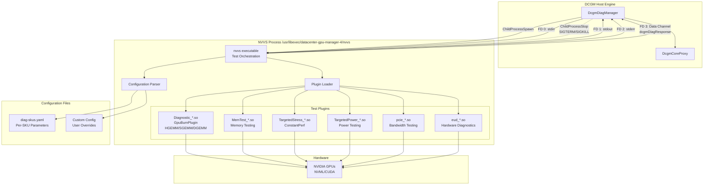

**Sources:** [modules/diag/DcgmDiagManager.cpp:1-1200](), [nvvs/diag-skus.yaml.in:1-100]()

---

## Process Isolation Model

NVVS runs as a completely separate process to ensure that diagnostic test failures, crashes, or hangs cannot affect the DCGM host engine's monitoring capabilities.

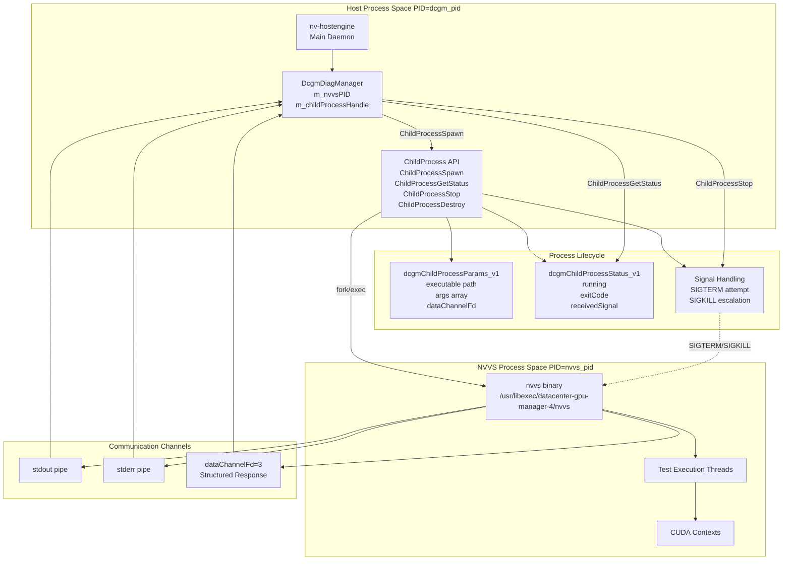

**Sources:** [modules/diag/DcgmDiagManager.cpp:89-120](), [modules/diag/DcgmDiagManager.cpp:860-900](), [modules/diag/DcgmDiagManager.cpp:122-250]()

---

## NVVS Command Construction

The DcgmDiagManager constructs the NVVS command line with various arguments based on the diagnostic request parameters.

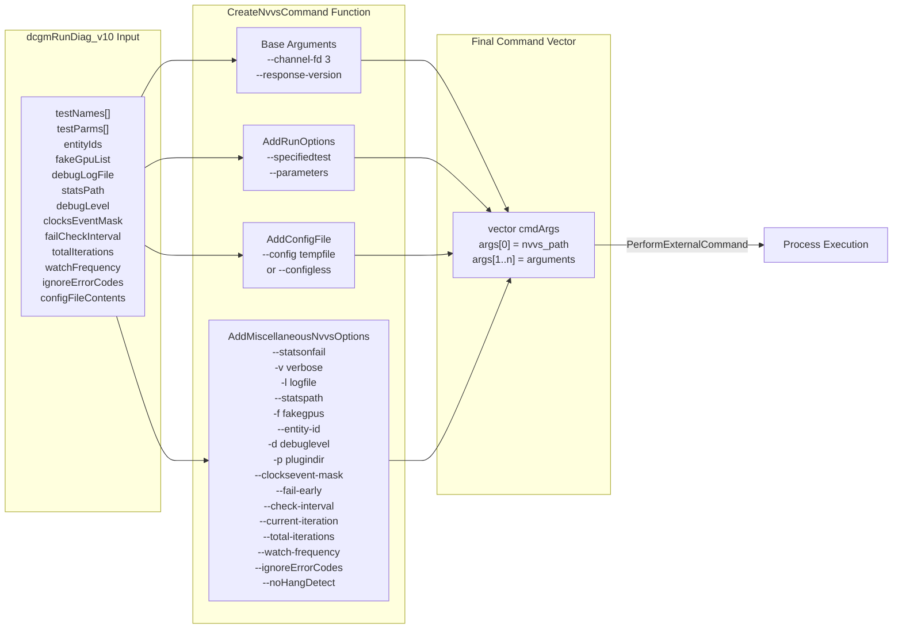

**Sources:** [modules/diag/DcgmDiagManager.cpp:603-646](), [modules/diag/DcgmDiagManager.cpp:325-379](), [modules/diag/DcgmDiagManager.cpp:381-475](), [modules/diag/DcgmDiagManager.cpp:483-600]()

---

## Communication Protocol

NVVS communicates with the DCGM Diag Module through multiple channels, each serving a specific purpose.

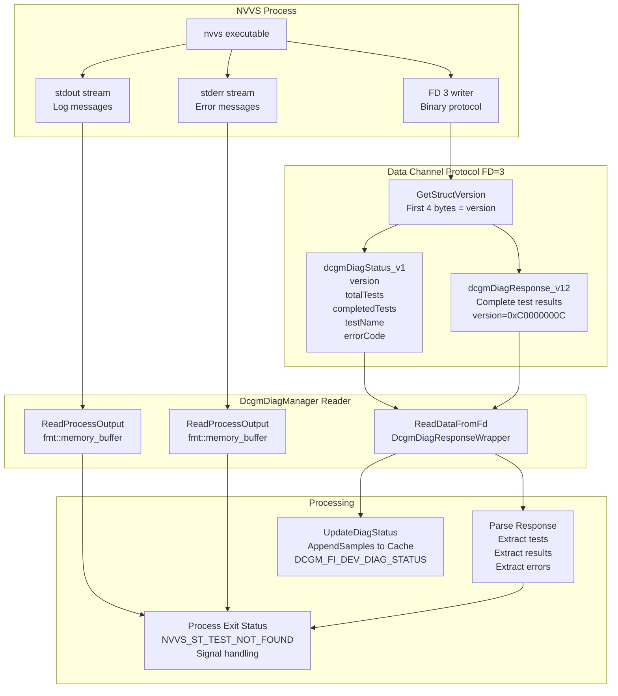

**Key Protocol Details:**

| Channel | FD | Content Type | Purpose |
|---------|-----|--------------|---------|
| stdin | 0 | None | Not used |
| stdout | 1 | Text | Informational logs, progress messages |
| stderr | 2 | Text | Error messages, warnings |
| Data Channel | 3 | Binary | Structured diagnostic status and results |

**Data Channel Message Types:**

| Structure | Version Field | Size | Purpose |
|-----------|---------------|------|---------|
| `dcgmDiagStatus_v1` | `dcgmDiagStatus_version` | Variable | Periodic progress updates during test execution |
| `dcgmDiagResponse_v12` | `dcgmDiagResponse_version12` (0xC0000000C) | Large | Final comprehensive test results |

**Sources:** [modules/diag/DcgmDiagManager.cpp:701-757](), [modules/diag/DcgmDiagManager.cpp:906-972](), [modules/diag/DcgmDiagManager.cpp:50]()

---

## Diagnostic Execution Flow

The complete flow from API call to result reporting involves multiple stages of process management and data exchange.

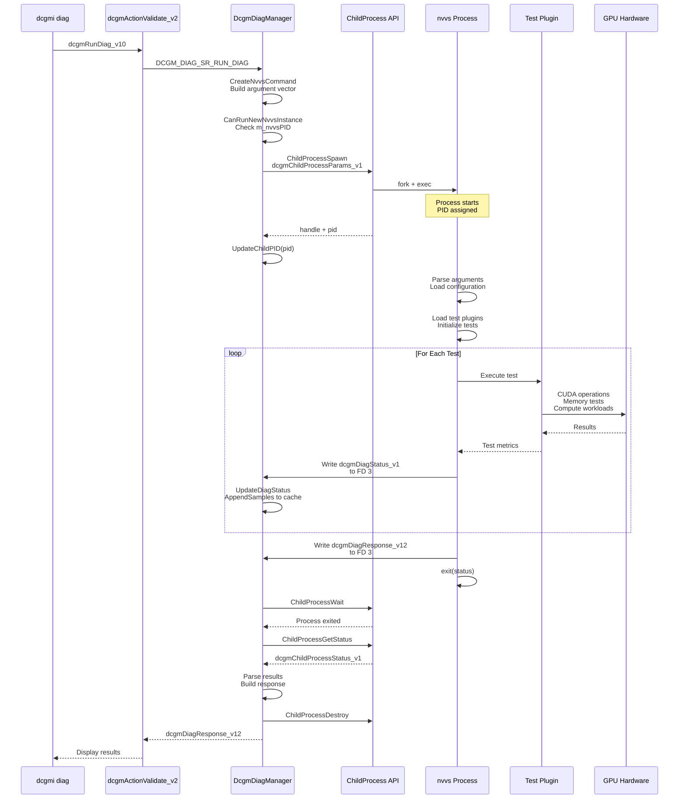

**Sources:** [modules/diag/DcgmDiagManager.cpp:760-1038](), [testing/python3/tests/test_dcgm_diag.py:374-419](), [dcgmi/Diag.cpp:522-574]()

---

## Configuration System

NVVS uses a hierarchical configuration system with default SKU-specific parameters that can be overridden by custom configuration files.

### Configuration File Handling

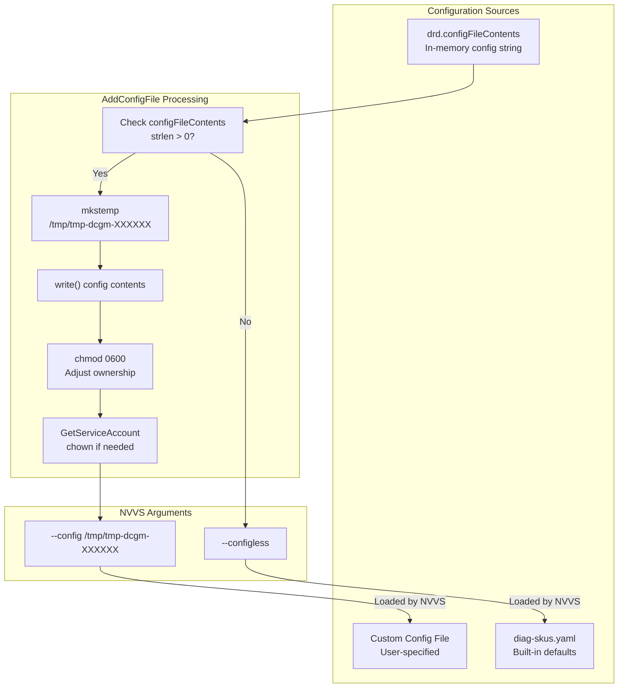

**Configuration File Creation:**

1. **Temporary File Creation** [modules/diag/DcgmDiagManager.cpp:389-402]()
   - Uses `mkstemp()` with template `/tmp/tmp-dcgm-XXXXXX`
   - Retries up to 3 times on failure
   - Sets permissions to 0600 (owner read/write only)

2. **Service Account Handling** [modules/diag/DcgmDiagManager.cpp:420-451]()
   - Retrieves service account via `GetServiceAccount(m_coreProxy)`
   - Calls `GetUserCredentials()` to get uid/gid
   - Uses `chown()` to set file ownership if service account is configured

3. **Content Writing** [modules/diag/DcgmDiagManager.cpp:417-418]()
   - Writes `drd->configFileContents` to temporary file
   - Verifies write succeeded before proceeding

### SKU Configuration Structure

The `diag-skus.yaml` file contains GPU-specific parameters organized by PCI device ID:

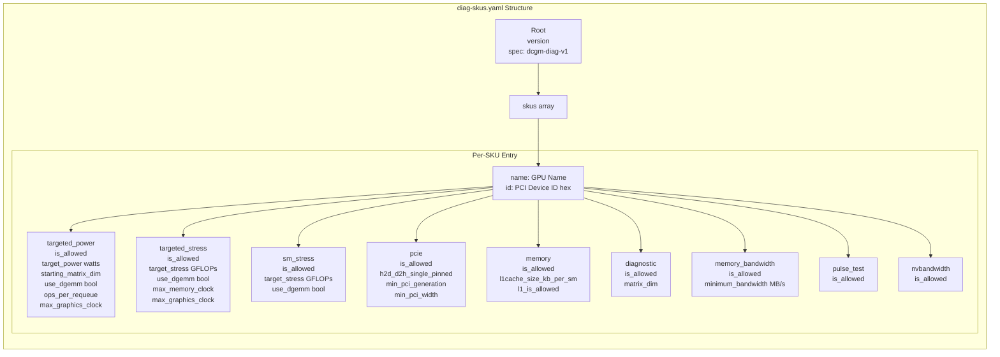

**Example SKU Configuration:**

| Parameter | Example (H100 80GB HBM3, ID: 0x2330) | Purpose |
|-----------|--------------------------------------|---------|
| `target_power` | 700.0 W | Expected power consumption during power test |
| `target_stress` | 29250.0 GFLOPs | Expected performance during stress test (75% of max) |
| `use_dgemm` | false | Use DGEMM (true) or SGEMM/HGEMM (false) |
| `minimum_bandwidth` | 1905000 MB/s | Minimum acceptable memory bandwidth (75% of spec) |
| `matrix_dim` | 8192 | Matrix dimension for GEMM operations |
| `min_pci_generation` | 3.0 | Minimum required PCIe generation |
| `min_pci_width` | 16 | Minimum required PCIe lane width |

**Sources:** [nvvs/diag-skus.yaml.in:1-100](), [nvvs/diag-skus.yaml.in:139-178](), [modules/diag/DcgmDiagManager.cpp:381-475]()

---

## Test Plugin Architecture

NVVS loads test plugins dynamically at runtime. Each plugin is compiled for specific CUDA versions to match the system's CUDA driver.

### Plugin Discovery and Loading

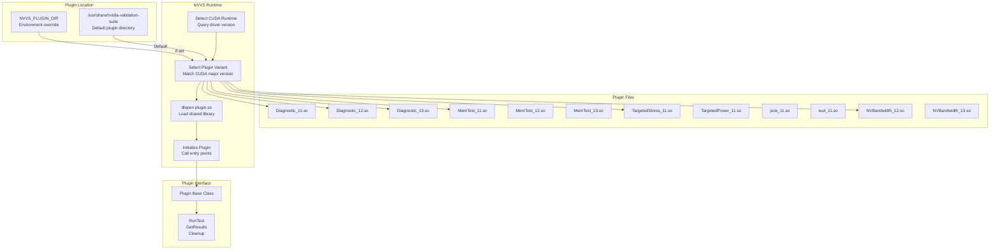

**CUDA Version Mapping:**

| CUDA Driver Version | Plugin Suffix | Example Plugins |
|---------------------|---------------|-----------------|
| CUDA 11.x | `_11.so` | `Diagnostic_11.so`, `MemTest_11.so` |
| CUDA 12.x | `_12.so` | `Diagnostic_12.so`, `NVBandwidth_12.so` |
| CUDA 13.x | `_13.so` | `Diagnostic_13.so`, `NVBandwidth_13.so` |

**Plugin Selection Logic:**
1. Query CUDA driver version via NVML
2. Extract major version number
3. Scan plugin directory for matching `*_<major>.so` files
4. Load plugins in order based on test specification

**Sources:** [modules/diag/DcgmDiagManager.cpp:533-538]()

---

## Test Types and Implementations

NVVS provides multiple test categories, each targeting different aspects of GPU validation.

### Test Categories

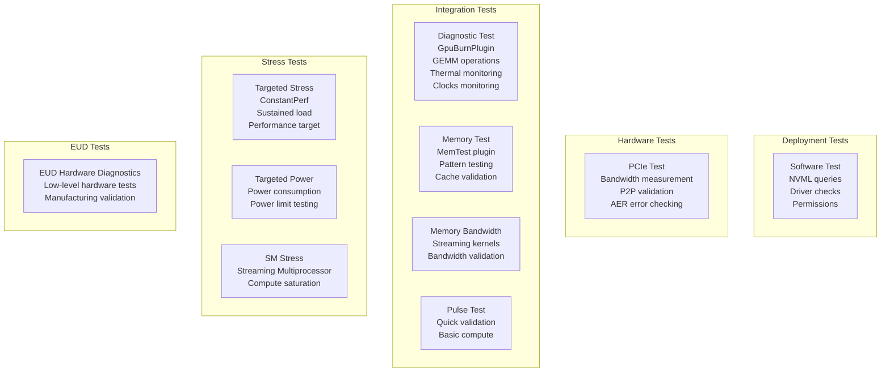

### Test Implementation Details

| Test Name | Plugin | Primary Function | Key Metrics | Configuration Parameters |
|-----------|--------|------------------|-------------|-------------------------|
| **diagnostic** | `Diagnostic_*.so` | GPU burn-in test using GEMM operations | Temperature, clocks, XID errors | `matrix_dim`, `use_dgemm`, `test_duration` |
| **memtest** | `MemTest_*.so` | Memory pattern testing | Memory errors, pattern failures | `test_duration`, `test_patterns` |
| **targeted_stress** | `TargetedStress_*.so` | Constant performance load | GFLOPs, thermal violations | `target_stress`, `use_dgemm` |
| **targeted_power** | `TargetedPower_*.so` | Power consumption testing | Watts, power violations | `target_power`, `starting_matrix_dim` |
| **pcie** | `pcie_*.so` | PCIe bandwidth and integrity | Bandwidth, AER errors, symbol errors | `min_pci_generation`, `min_pci_width` |
| **memory_bandwidth** | Memory bandwidth plugin | Streaming memory access | MB/s throughput | `minimum_bandwidth` |
| **eud** | `eud_*.so` | Extended Hardware diagnostics | Hardware-specific metrics | EUD version-specific |

### Diagnostic Test (GpuBurnPlugin) Details

The diagnostic test is the primary comprehensive validation test:

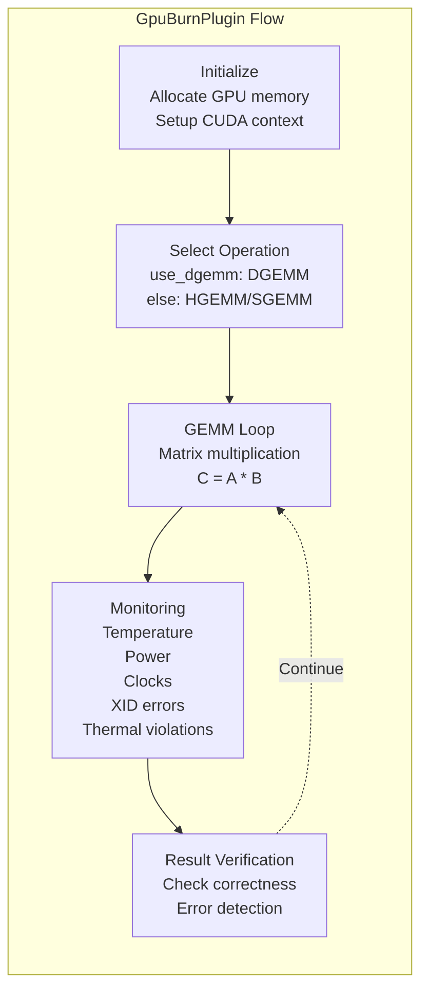

**Matrix Dimensions:**
- Configurable via `matrix_dim` parameter in SKU config
- Typical values: 4096, 8192 for modern GPUs
- Affects memory usage and compute intensity

**Precision Selection:**
- `use_dgemm=true`: Double precision (FP64) operations
- `use_dgemm=false`: Single precision (FP32) or half precision (FP16)
- Choice affects performance characteristics and power consumption

**Error Detection:**
1. **XID Errors**: Monitored via DCGM field `DCGM_FI_DEV_XID_ERRORS`
2. **Thermal Violations**: Monitored via `DCGM_FI_DEV_THERMAL_VIOLATION`
3. **Clock Events**: Monitored via `DCGM_FI_DEV_CLOCKS_EVENT_REASONS`
4. **Temperature**: Monitored via `DCGM_FI_DEV_GPU_TEMP`

**Sources:** [nvvs/diag-skus.yaml.in:93-95](), [nvvs/diag-skus.yaml.in:168-170](), [testing/python3/tests/test_dcgm_diag.py:168-205]()

---

## Result Structures and Handling

NVVS returns comprehensive diagnostic results through structured response objects.

### Response Structure Hierarchy

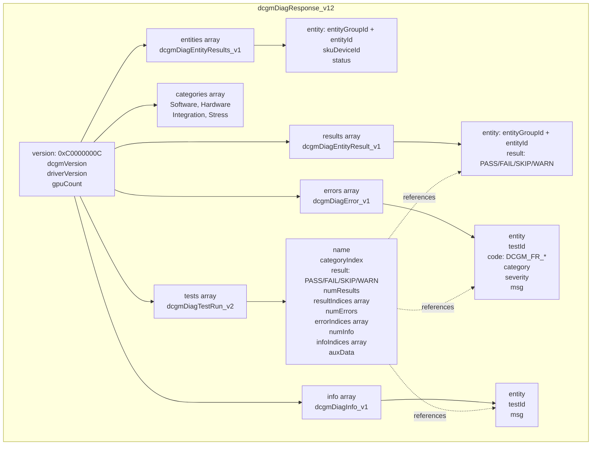

### Result Status Values

| Status Code | C Enum | Meaning | Usage |
|-------------|--------|---------|-------|
| **PASS** | `DCGM_DIAG_RESULT_PASS` | Test passed all validation checks | Normal successful completion |
| **FAIL** | `DCGM_DIAG_RESULT_FAIL` | Test failed validation checks | Errors detected, GPU may be unhealthy |
| **WARN** | `DCGM_DIAG_RESULT_WARN` | Test passed with warnings | Minor issues detected, not critical |
| **SKIP** | `DCGM_DIAG_RESULT_SKIP` | Test was skipped | Not applicable for this GPU or config |
| **NOT_RUN** | `DCGM_DIAG_RESULT_NOT_RUN` | Test was not executed | Test not included in run level |

### Error Code System

Errors are reported using DCGM error codes (`DCGM_FR_*`):

| Error Code | Constant | Category | Description |
|------------|----------|----------|-------------|
| **TEMP_VIOLATION** | `DCGM_FR_TEMP_VIOLATION` | Thermal | GPU temperature exceeded threshold |
| **XID_ERROR** | `DCGM_FR_XID_ERROR` | Hardware | Hardware XID error detected |
| **CLOCKS_THROTTLE** | (various) | Performance | GPU clocks throttled due to thermal/power |
| **NVLINK_ERROR** | `DCGM_FR_NVLINK_ERROR` | Interconnect | NVLink communication error |
| **NVLINK_EFFECTIVE_BER_THRESHOLD** | `DCGM_FR_NVLINK_EFFECTIVE_BER_THRESHOLD` | Interconnect | NVLink bit error rate exceeded |
| **MEMORY_ERROR** | (various) | Memory | Memory subsystem error |

### Result Processing

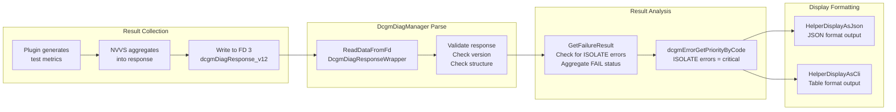

**Sources:** [dcgmi/Diag.cpp:254-336](), [dcgmi/Diag.cpp:661-681](), [testing/python3/tests/test_dcgm_diag.py:60-90]()

---

## Process Management and Termination

NVVS can be stopped gracefully or forcefully depending on the situation.

### Signal Handling

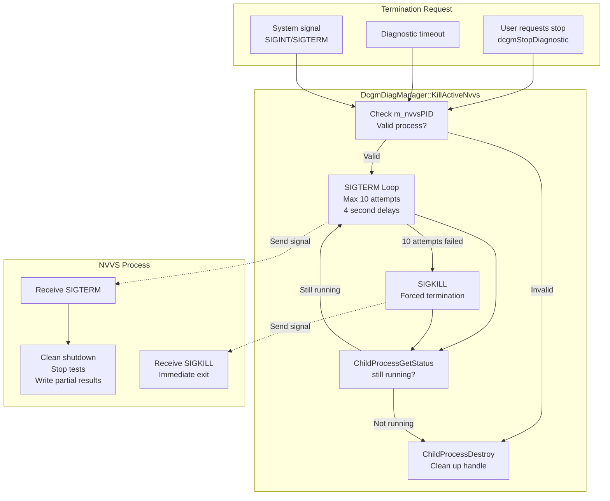

**Termination Strategy:**

1. **Graceful Termination (SIGTERM)**
   - Sent up to 10 times with 4-second intervals
   - Allows NVVS to complete current test iteration
   - Gives time for result writing and cleanup
   - Maximum wait time: 40 seconds

2. **Forced Termination (SIGKILL)**
   - Used after SIGTERM exhaustion
   - Immediate process termination
   - No cleanup opportunity for NVVS
   - Used as last resort

**EUD Test Consideration:**
The 40-second timeout is designed to accommodate the EUD test, which can take up to 20 seconds to stop gracefully. The extra time provides buffer for other overhead.

**Sources:** [modules/diag/DcgmDiagManager.cpp:122-250](), [modules/diag/DcgmDiagManager.cpp:1052-1071]()

---

## Environment Variables and Debugging

NVVS behavior can be modified through environment variables for debugging and testing.

### Environment Variables

| Variable | Purpose | Values | Location |
|----------|---------|--------|----------|
| `NVVS_BIN_PATH` | Override NVVS binary location | Directory path | DcgmDiagManager |
| `NVVS_PLUGIN_DIR` | Override plugin directory | Directory path | NVVS |
| `NVVS_HANGDETECT_DISABLE` | Disable hang detection | Set to any value | NVVS |
| `NVVS_HANGDETECT_EXPIRY_SEC` | Hang detection timeout | Seconds (unsigned int) | NVVS |
| `__DCGM_PCIE_AER_COUNT` | Inject PCIe AER errors (debug) | Error count | Test only |

### Binary Path Discovery

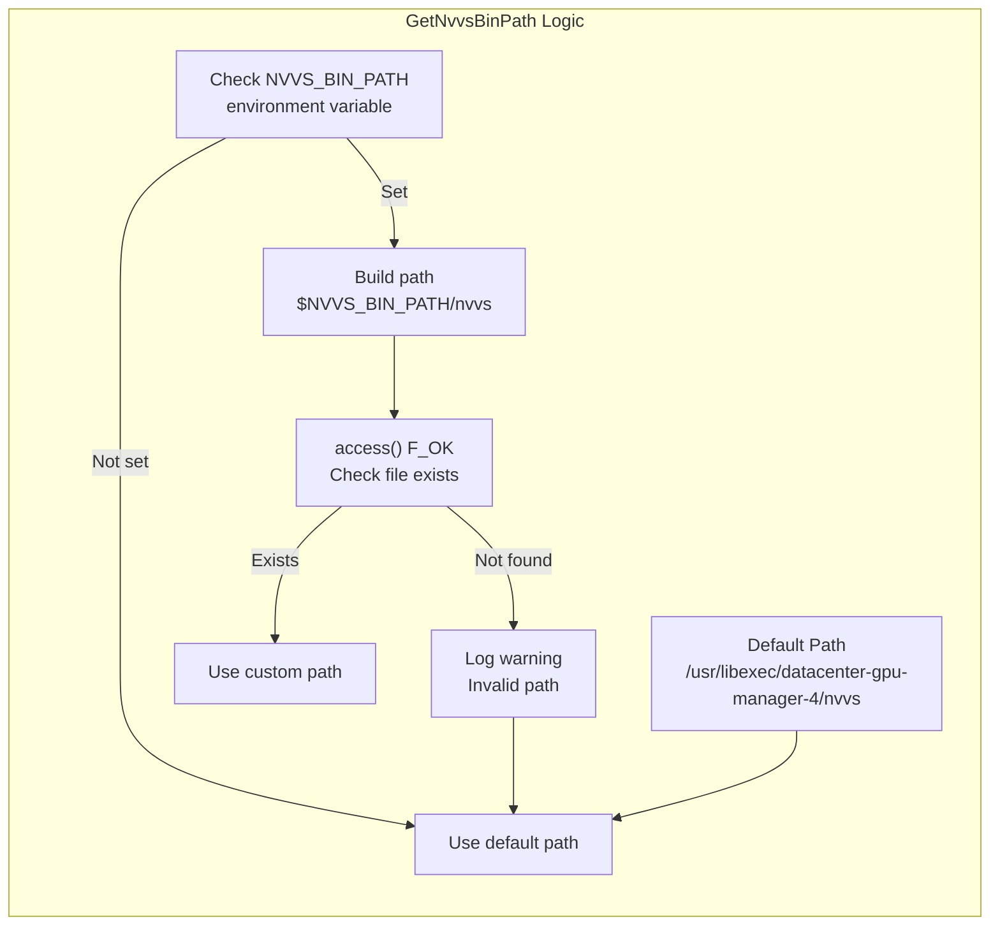

### Hang Detection

NVVS includes hang detection to prevent indefinite test hangs:

- **Default Behavior**: Enabled by default
- **Disable**: Set `NVVS_HANGDETECT_DISABLE` to any value
- **Custom Timeout**: Set `NVVS_HANGDETECT_EXPIRY_SEC` to desired seconds
- **Implementation**: Passed to NVVS via `--noHangDetect` or `--hangDetectExpirySec` arguments

**Sources:** [modules/diag/DcgmDiagManager.cpp:253-282](), [modules/diag/DcgmDiagManager.cpp:478-599]()

---

## Service Account Support

NVVS can be executed under a specific service account for security isolation.

### Service Account Workflow

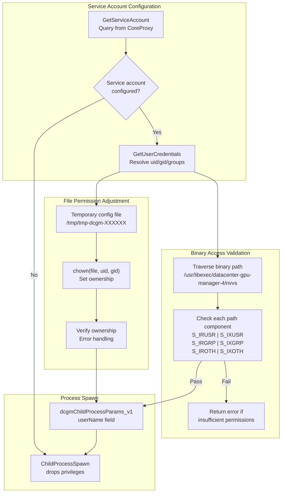

**Permission Validation:**

For each component of the NVVS binary path, the system checks:

1. **User Permissions**: `st_uid == service_uid && (st_mode & S_IRUSR) && (st_mode & S_IXUSR)`
2. **Group Permissions**: `st_gid in groups && (st_mode & S_IRGRP) && (st_mode & S_IXGRP)`
3. **Other Permissions**: `(st_mode & S_IROTH) && (st_mode & S_IXOTH)`

If any component fails all three checks, the diagnostic returns `DCGM_ST_GENERIC_ERROR`.

**Sources:** [modules/diag/DcgmDiagManager.cpp:54-72](), [modules/diag/DcgmDiagManager.cpp:420-457](), [modules/diag/DcgmDiagManager.cpp:799-858](), [modules/diag/DcgmDiagManager.cpp:860-868]()

---

## Iterative Diagnostics

NVVS supports running multiple iterations of diagnostics for extended validation.

### Iteration Control

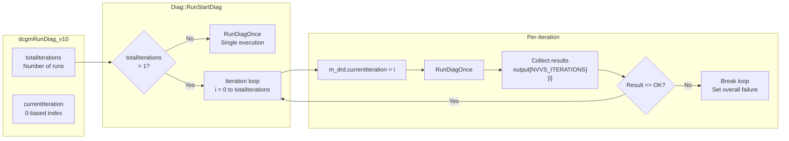

**Iteration Parameters:**

The iteration information is passed to NVVS via command-line arguments:

```
--current-iteration <index>
--total-iterations <count>
```

**Failure Handling:**

- **Early Termination**: If any iteration fails, subsequent iterations are skipped
- **Result Aggregation**: All iteration results are stored in JSON output
- **Overall Status**: `DCGM_ST_OK` only if all iterations pass

**Use Cases:**
- Extended burn-in testing
- Intermittent issue detection  
- Stress testing under varying conditions
- Long-running validation

**Sources:** [modules/diag/DcgmDiagManager.cpp:558-564](), [dcgmi/Diag.cpp:577-633]()

---

## Integration with DCGM API

NVVS is invoked through the DCGM API using the `dcgmActionValidate_v2` function.

### API Call Flow

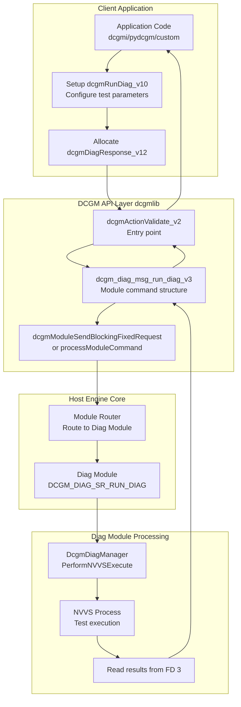

### dcgmRunDiag_v10 Structure

Key fields in the diagnostic request structure:

| Field | Type | Purpose |
|-------|------|---------|
| `version` | uint | Structure version (`dcgmRunDiag_version10`) |
| `groupId` | dcgmGpuGrp_t | Group to test, or `DCGM_GROUP_NULL` if using entityIds |
| `entityIds` | char[1024] | Comma-separated entity list (e.g., "gpu:0,gpu:1" or "0,1") |
| `fakeGpuList` | char[256] | List of fake GPU IDs for testing |
| `validate` | uint | Test level: `DCGM_POLICY_VALID_SV_SHORT/MED/LONG/XLONG` |
| `testNames` | char[DCGM_MAX_TEST_NAMES][MAX_TEST_NAME_LEN] | Specific tests to run |
| `testParms` | char[DCGM_MAX_TEST_PARMS][MAX_TEST_PARMS_LEN] | Test parameters (semicolon-separated) |
| `configFileContents` | char[64KB] | Custom configuration file content |
| `debugLogFile` | char[256] | Path for debug log output |
| `statsPath` | char[256] | Path for statistics output |
| `debugLevel` | uint | Logging level |
| `clocksEventMask` | char[256] | Clocks events to ignore |
| `flags` | uint | `DCGM_RUN_FLAGS_VERBOSE`, `DCGM_RUN_FLAGS_STATSONFAIL`, `DCGM_RUN_FLAGS_FAIL_EARLY` |
| `failCheckInterval` | uint | Interval for fail-early checks (seconds) |
| `totalIterations` | uint | Number of iterations to run |
| `currentIteration` | uint | Current iteration index |
| `watchFrequency` | uint | DCGM field watch frequency (microseconds) |
| `ignoreErrorCodes` | char[256] | Error codes to ignore |

**Test Name Examples:**
- `"diagnostic"` - GpuBurn GEMM test
- `"memtest"` - Memory pattern test
- `"pcie"` - PCIe bandwidth test
- `"1"` (short), `"2"` (medium), `"3"` (long), `"4"` (xlong) - Predefined test suites

**Test Parameter Format:**
```
"diagnostic.test_duration=10;diagnostic.matrix_dim=8192;memtest.test_duration=15"
```

**Sources:** [dcgmlib/src/DcgmApi.cpp:1-50](), [testing/python3/tests/test_dcgm_diag.py:91-107]()

---

## Error Handling and Recovery

NVVS and the Diag Module implement comprehensive error handling to ensure robust operation.

### Error Scenarios

| Error Condition | Detection | Recovery Action | Return Code |
|----------------|-----------|-----------------|-------------|
| NVVS binary not found | `stat()` failure on binary path | Return immediately, no spawn | `DCGM_ST_NVVS_BINARY_NOT_FOUND` |
| NVVS process crash | Exit code ≠ 0 with signal received | Log error, parse partial results | `DCGM_ST_NVVS_KILLED` |
| NVVS timeout | External timeout detection | Call `dcgmStopDiagnostic()` | `DCGM_ST_TIMEOUT` |
| Test not available | NVVS exit code `NVVS_ST_TEST_NOT_FOUND` | Return specific error | `DCGM_ST_NVVS_NO_AVAILABLE_TEST` |
| Empty group | Group has no entities | Immediate error return | `DCGM_ST_GROUP_IS_EMPTY` |
| Group incompatible | Mixed GPU SKUs | Pre-execution validation | `DCGM_ST_GROUP_INCOMPATIBLE` |
| DCGM paused | Host engine in paused state | Cannot run diagnostic | `DCGM_ST_PAUSED` |
| Insufficient permissions | Service account cannot access binary | Permission check failure | `DCGM_ST_GENERIC_ERROR` |
| Config file creation failure | `mkstemp()` failure | Retry up to 3 times | `DCGM_ST_GENERIC_ERROR` |
| Child process spawn failure | `ChildProcessSpawn()` error | Cleanup and return | `DCGM_ST_DIAG_BAD_LAUNCH` |
| Cannot kill NVVS | `KillActiveNvvs()` exhausts retries | Log error, may leave zombie | `DCGM_ST_CHILD_NOT_KILLED` |

### Response Error Codes

System-level errors are reported in the `errors` array with `testId = DCGM_DIAG_RESPONSE_SYSTEM_ERROR`:

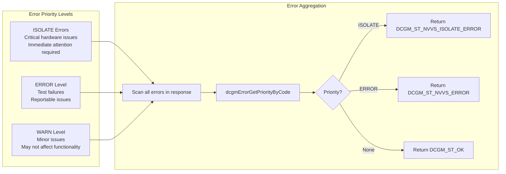

**Error Priority Determination:**

The `GetFailureResult()` function determines overall diagnostic status:

1. Scan all errors associated with GPU entities and software tests
2. For each error, call `dcgmErrorGetPriorityByCode(error.code)`
3. If any error has `DCGM_ERROR_ISOLATE` priority, immediately return `DCGM_ST_NVVS_ISOLATE_ERROR`
4. If any errors exist but none are ISOLATE, return `DCGM_ST_NVVS_ERROR`
5. If no errors, return `DCGM_ST_OK`

**Sources:** [modules/diag/DcgmDiagManager.cpp:783-796](), [modules/diag/DcgmDiagManager.cpp:998-1030](), [dcgmi/Diag.cpp:254-336](), [dcgmi/Diag.cpp:374-519]()

---

## Diagnostic Status Updates

During long-running diagnostics, NVVS provides periodic status updates to track progress.

### Status Update Mechanism

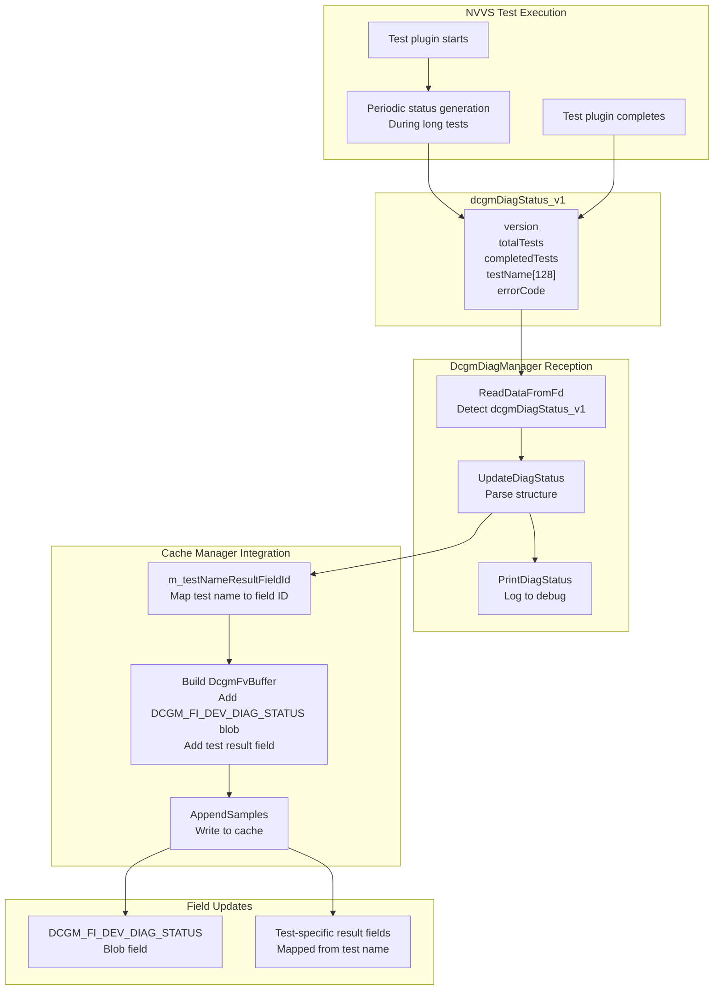

**Status Structure Contents:**

```c
typedef struct {
    unsigned int version;        // dcgmDiagStatus_version
    unsigned int totalTests;     // Total number of tests to run
    unsigned int completedTests; // Number completed so far
    char testName[128];         // Current test name
    unsigned int errorCode;      // Current error code (0 = no error)
} dcgmDiagStatus_v1;
```

**Update Frequency:**
- Updates are written periodically during test execution
- Frequency depends on test implementation
- Typical interval: every few seconds for long tests

**Field Mapping:**
The `m_testNameResultFieldId` map associates test names with DCGM field IDs for result tracking. This allows monitoring systems to watch diagnostic progress via standard DCGM field queries.

**Sources:** [modules/diag/DcgmDiagManager.cpp:715-757](), [modules/diag/DcgmDiagManager.cpp:724-757]()

---

This comprehensive documentation covers NVVS's architecture, process model, communication protocols, test types, configuration system, and integration with DCGM. The system's isolation model ensures that diagnostic failures cannot affect core monitoring, while the rich communication protocol provides detailed test results and progress updates.

---

