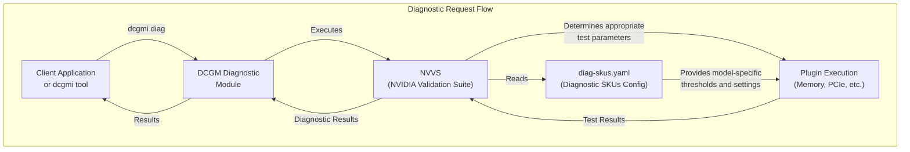
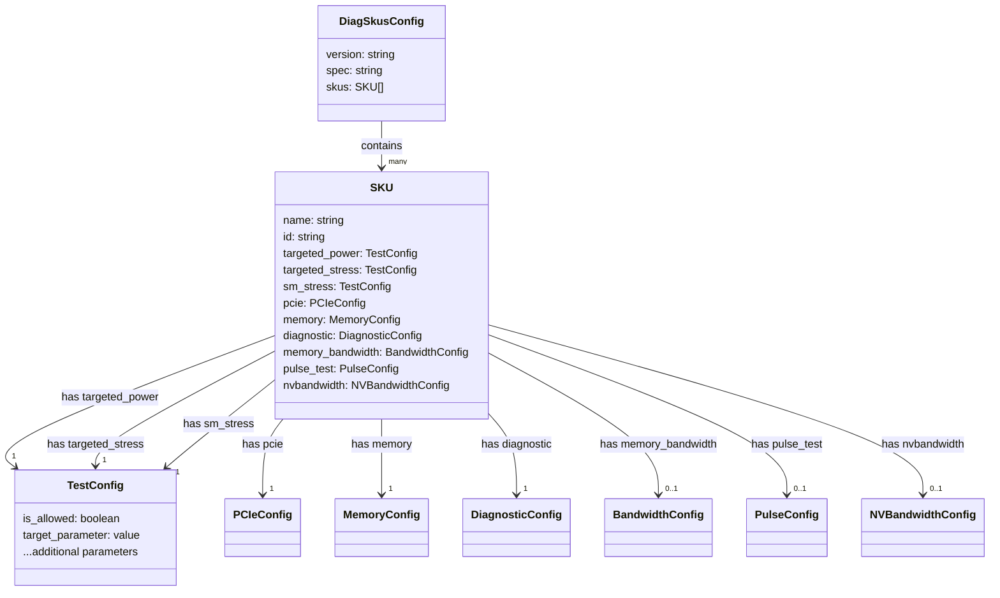
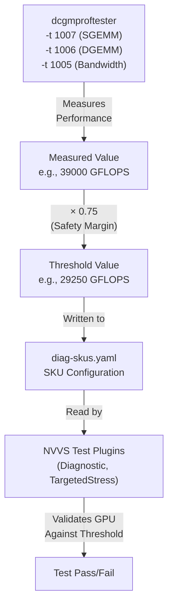
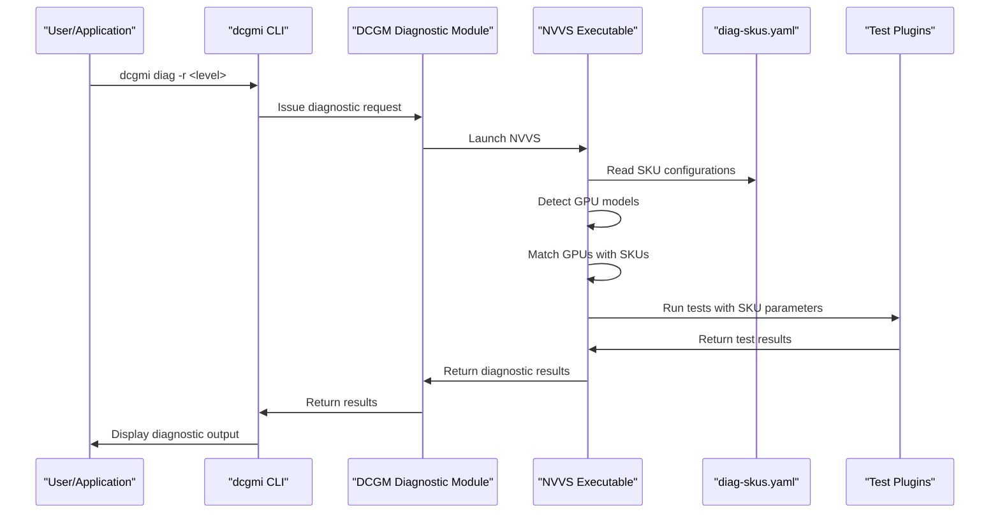

<!-- source: DeepWiki mcp.deepwiki.com · repo NVIDIA/DCGM · page 4.1 Diagnostic SKUs Configuration · fetched 2026-10-26 -->

# Diagnostic SKUs

<details>
<summary>Relevant source files</summary>

The following files were used as context for generating this wiki page:

- [nvvs/diag-skus.yaml.in](nvvs/diag-skus.yaml.in)

</details>


## Purpose and Scope

This document describes the Diagnostic SKUs configuration system used by the NVIDIA Data Center GPU Manager (DCGM) to define test parameters for GPU validation. Diagnostic SKUs provide specific test parameters and thresholds for different NVIDIA GPU models, ensuring that diagnostics run with appropriate settings for each hardware variant. For information about the plugin system that uses these configurations, see [Plugin System](#4.2).

## Overview

The Diagnostic SKUs configuration is a critical component of the NVVS (NVIDIA Validation Suite) subsystem, providing model-specific test parameters that allow DCGM to properly evaluate GPU functionality and performance across NVIDIA's diverse hardware portfolio.



Sources: [nvvs/diag-skus.yaml.in:1-4028]()

## Configuration File Structure

The diagnostic SKUs are defined in a YAML template file located at `nvvs/diag-skus.yaml.in`. The `.in` extension indicates this is a CMake template that gets processed at build time, with variables like `@CMAKE_PROJECT_VERSION@` replaced with actual values to generate the final `diag-skus.yaml` configuration file.

The file follows a structured format with version metadata and a collection of SKU configurations:



Sources: [nvvs/diag-skus.yaml.in:22-24]()

The file begins with metadata:

```yaml
version: "@CMAKE_PROJECT_VERSION@"
spec: dcgm-diag-v1
skus:
  # Individual SKU configurations follow
```

Each SKU entry contains:
- Name and ID of the GPU model
- Test configurations with thresholds and parameters

Sources: [nvvs/diag-skus.yaml.in:22-27]()

## SKU Identification

Each GPU model (SKU) is identified by two key fields:

| Field | Description | Example |
|-------|-------------|---------|
| name  | Human-readable GPU model name | "Tesla V100-SXM2-16GB" |
| id    | PCI device ID (hexadecimal) | "1db0" |

The NVVS system uses these identifiers to match detected GPUs with their appropriate test configurations.

### Device ID Format

Most SKUs use a simple 4-character hexadecimal device ID (e.g., `1db0`, `2330`). However, some configurations use a composite ID that includes both the device ID and subsystem ID to distinguish between variants:

| Example | Format | Purpose |
|---------|--------|---------|
| `20b2147f` | Device ID + Subsystem ID | A100-SXM4-80GB variant |
| `22361482` | Device ID + Subsystem ID | A10c/noc variant to avoid collision |
| `2236149d` | Device ID + Subsystem ID | EGX BF-2 A100 variant |

This composite format allows DCGM to provide different test parameters for GPUs that share the same base device ID but have different configurations or deployment scenarios.

Sources: [nvvs/diag-skus.yaml.in:25-26](), [nvvs/diag-skus.yaml.in:903-904](), [nvvs/diag-skus.yaml.in:1621-1622](), [nvvs/diag-skus.yaml.in:1729-1732](), [nvvs/diag-skus.yaml.in:2017-2019]()

## Test Types and Parameters

The Diagnostic SKUs define parameters for multiple test types. Each test configuration includes an `is_allowed` flag and test-specific parameters.

### Common Test Types

| Test Type | Purpose | Key Parameters |
|-----------|---------|----------------|
| targeted_power | Power consumption testing | target_power, use_dgemm |
| targeted_stress | GPU stress testing | target_stress, use_dgemm |
| sm_stress | Streaming Multiprocessor stress testing | target_stress, use_dgemm |
| pcie | PCIe bus testing | min_pci_generation, min_pci_width |
| memory | Memory validation | l1cache_size_kb_per_sm |
| diagnostic | General diagnostics | matrix_dim |
| memory_bandwidth | Memory bandwidth testing | minimum_bandwidth |
| pulse_test | Short-burst performance testing | is_allowed |
| nvbandwidth | NVLink bandwidth testing | is_allowed |

Sources: [nvvs/diag-skus.yaml.in:27-52](), [nvvs/diag-skus.yaml.in:90-102]()

### Example Parameters in Detail

#### Targeted Power Test

```yaml
targeted_power:
  is_allowed: true
  target_power: 299.0
  starting_matrix_dim: 1024.0
  use_dgemm: true
```

- `target_power`: The power consumption target in watts
- `starting_matrix_dim`: Initial matrix dimension for the power test
- `use_dgemm`: Whether to use double-precision matrix multiplication

Sources: [nvvs/diag-skus.yaml.in:906-910]()

#### PCIe Test

```yaml
pcie:
  is_allowed: true
  h2d_d2h_single_pinned:
    min_pci_generation: 3.0
    min_pci_width: 16.0
  h2d_d2h_single_unpinned:
    min_pci_generation: 3.0
    min_pci_width: 16.0
```

- `min_pci_generation`: Minimum PCIe generation expected
- `min_pci_width`: Minimum PCIe lane width expected
- Separate configurations for pinned and unpinned memory transfers

Sources: [nvvs/diag-skus.yaml.in:918-926]()

#### Memory Bandwidth Test

```yaml
memory_bandwidth:
  is_allowed: true
  minimum_bandwidth: 607500.0
```

- `minimum_bandwidth`: Minimum expected memory bandwidth in MB/s

Sources: [nvvs/diag-skus.yaml.in:927-929]()

## Performance Target Calculation Pattern

Many performance targets in the configuration file follow a consistent calculation pattern:

```
measured_value * 0.75 = target_value
```

This pattern appears throughout the file in comments, showing how performance targets are set at 75% of the measured maximum performance to provide a reasonable threshold that accounts for system variability.

### Using dcgmproftester for Measurements

The `dcgmproftester` tool is used to measure actual GPU performance capabilities, which then inform the threshold values. Comments throughout the configuration file document the measurement process:

```yaml
sm_stress:
  is_allowed: true
  # dcgmproftester -t 1007 measures at ~39000, multiply by .75 to get ~29250
  target_stress: 29250.0
  use_dgemm: false
```

Common `dcgmproftester` test flags used for measurements:

| Test Flag | Measures | Example Comment |
|-----------|----------|-----------------|
| `-t 1005` | Memory bandwidth | "dcgmproftester -t 1005 shows ~2540000. Multiply by .75 to get ~1905000" |
| `-t 1006` | DGEMM performance | "proftester -t 1006 measures at 18300, multiply by .75 to get 13725" |
| `-t 1007` | SGEMM performance | "dcgmproftester -t 1007 measures at ~39000, multiply by .75 to get ~29250" |



The 75% multiplier provides margin for:
- Normal performance variation across different system configurations
- Thermal throttling under sustained load
- Driver version differences
- Background system activity

Sources: [nvvs/diag-skus.yaml.in:79-81](), [nvvs/diag-skus.yaml.in:98-99](), [nvvs/diag-skus.yaml.in:135-136](), [nvvs/diag-skus.yaml.in:153-154](), [nvvs/diag-skus.yaml.in:1489-1490](), [nvvs/diag-skus.yaml.in:1561-1562]()

## SKUs in the Diagnostic Process

The diagnostic SKU configuration plays a critical role in DCGM's diagnostic workflow:



Sources: [nvvs/diag-skus.yaml.in:14-20]()

## Overriding SKU Configurations

The diag-skus.yaml file includes a notice that it should not be directly modified. Instead, users can override the configuration by providing a custom configuration file:

```
# DO NOT MODIFY
# =============
#
# This file is part of the DCGM tools package. If you would like modify the DCGM
# Diagnostic configuration, use `dcgmi diag -c <config_file>` to override the
# contents of this file
```

This allows users to customize test parameters while preserving the default configurations.

Sources: [nvvs/diag-skus.yaml.in:15-20]()

## Example SKU Configuration

Below is an example of a complete SKU configuration for an H100 GPU model:

```yaml
- name: H100 80GB HBM3
  id: 2330
  targeted_power:
    is_allowed: true
    starting_matrix_dim: 1024.0
    target_power: 700.0
    use_dgemm: false
  targeted_stress:
    is_allowed: true
    use_dgemm: false
    target_stress: 29250.0
  sm_stress:
    is_allowed: true
    target_stress: 29250.0
    use_dgemm: false
  pcie:
    is_allowed: true
    target_stress: 29250.0
    h2d_d2h_single_pinned:
      min_pci_generation: 3.0
      min_pci_width: 16.0
    h2d_d2h_single_unpinned:
      min_pci_generation: 3.0
      min_pci_width: 16.0
  memory:
    is_allowed: true
    l1cache_size_kb_per_sm: 192.0
  diagnostic:
    is_allowed: true
    matrix_dim: 8192.0
  memory_bandwidth:
    is_allowed: true
    minimum_bandwidth: 1905000
  pulse_test:
    is_allowed: true
  nvbandwidth:
    is_allowed: true
```

This configuration specifies parameters for all available test types for the H100 80GB HBM3 GPU model.

Sources: [nvvs/diag-skus.yaml.in:139-179]()

## Advanced Configuration Parameters

Some SKUs include advanced parameters for fine-tuning test behavior:

### Concurrency and Workload Parameters

| Parameter | Purpose | Example Usage |
|-----------|---------|---------------|
| `cuda_streams_per_gpu` | Number of concurrent CUDA streams | Used when single stream cannot achieve target power |
| `ops_per_requeue` | Operations to queue before resubmission | Reduces overhead for power tests |
| `readjust_interval` | Interval for readjusting workload | Controls adaptation frequency |
| `target_movavg_min_ratio` | Minimum moving average ratio | Defines acceptable variance |
| `target_movavg_max_ratio` | Maximum moving average ratio | Defines acceptable variance |

Example from Tesla M60 configuration:

```yaml
targeted_power:
  is_allowed: true
  target_power: 161.0
  ops_per_requeue: 4.0
  readjust_interval: 3.0
  target_movavg_min_ratio: 0.9
  target_movavg_max_ratio: 1.1
  use_dgemm: false
```

### Clock Constraint Parameters

Some configurations specify maximum clock rates to ensure stable testing:

| Parameter | Purpose | Example |
|-----------|---------|---------|
| `max_graphics_clock` | Maximum graphics clock in MHz | 1113.0 |
| `max_memory_clock` | Maximum memory clock in MHz | 3301.0 |

Example from GeForce GTX TITAN X:

```yaml
targeted_stress:
  is_allowed: true
  use_dgemm: false
  target_stress: 1000.0
  max_memory_clock: 3301.0
  max_graphics_clock: 0.0  # 0.0 means no limit
```

### Matrix Dimension Constraints

Matrix dimension parameters control the computational workload size:

| Parameter | Purpose | Example |
|-----------|---------|---------|
| `starting_matrix_dim` | Initial matrix size | 1024.0 |
| `max_matrix_dim` | Maximum matrix size | 8192.0 |
| `matrix_dim` | Fixed matrix size for test | 8192.0 |

These parameters ensure tests use appropriate workload sizes for the GPU's computational capabilities.

Sources: [nvvs/diag-skus.yaml.in:686-695](), [nvvs/diag-skus.yaml.in:656-676](), [nvvs/diag-skus.yaml.in:418-419](), [nvvs/diag-skus.yaml.in:3915-3920]()

## Special Configuration Cases

### Multi-Precision Workloads

Some newer architectures like GB300 support mixed-precision workload configurations:

```yaml
targeted_power:
  is_allowed: true
  starting_matrix_dim: 1024
  target_power: 1399.00
  use_dgemv: true
  use_dgemm: false
  enable_fp16_gemm: true
  fp64_gemm_ratio: 0.6
  fp16_gemm_ratio: 0.4
```

This allows testing with mixed FP16 and FP64 operations to match real-world AI/HPC workloads.

### Disabled Tests

Some tests may be explicitly disabled for certain SKUs:

```yaml
pulse_test:
  is_allowed: false  # Disabled until specific bug is fixed
```

This allows DCGM to skip problematic tests while maintaining the overall diagnostic framework.

### Memory Test Chunking

Some configurations specify memory test chunking for large memory GPUs:

```yaml
memtest:
  num_chunks: 8
```

This parameter controls how memory tests partition the GPU memory for validation.

Sources: [nvvs/diag-skus.yaml.in:4233-4243](), [nvvs/diag-skus.yaml.in:4184-4185](), [nvvs/diag-skus.yaml.in:4277-4278]()

## GPU Model Coverage

The diag-skus.yaml file includes configurations for a wide range of NVIDIA GPU models, including:

- Tesla K-series (K8, K10, K20, K40, K80)
- Tesla M-series (M4, M6, M10, M40, M60)
- Tesla P-series (P4, P6, P10, P40, P100)
- Tesla V-series (V100 in various configurations)
- Tesla T-series (T4, T10, T40)
- Ampere architecture (A2, A10, A16, A30, A40, A100)
- Hopper architecture (H100, H200, H800)
- Professional visualization GPUs (RTX series)
- Data center GPUs (L4, L20, L30, L40)
- Next-generation models (B100, B200)

This extensive coverage ensures that DCGM can properly test virtually any NVIDIA data center GPU model.

Sources: [nvvs/diag-skus.yaml.in:25-3943]()

---

