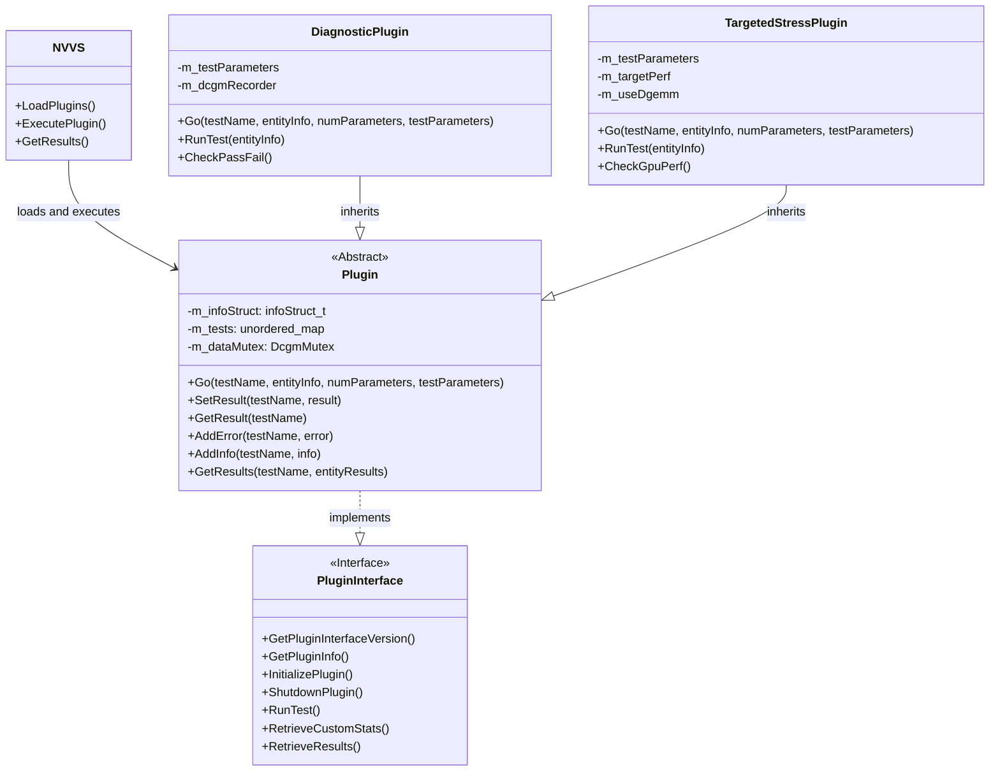
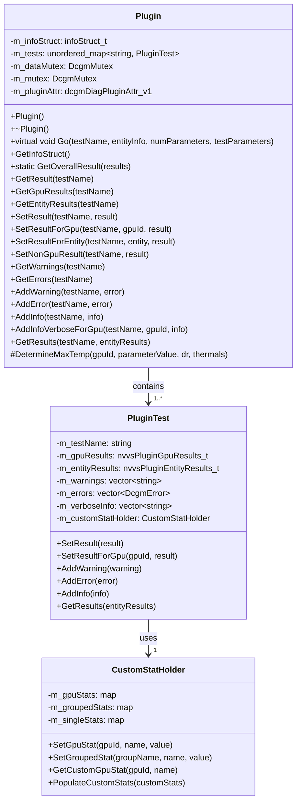
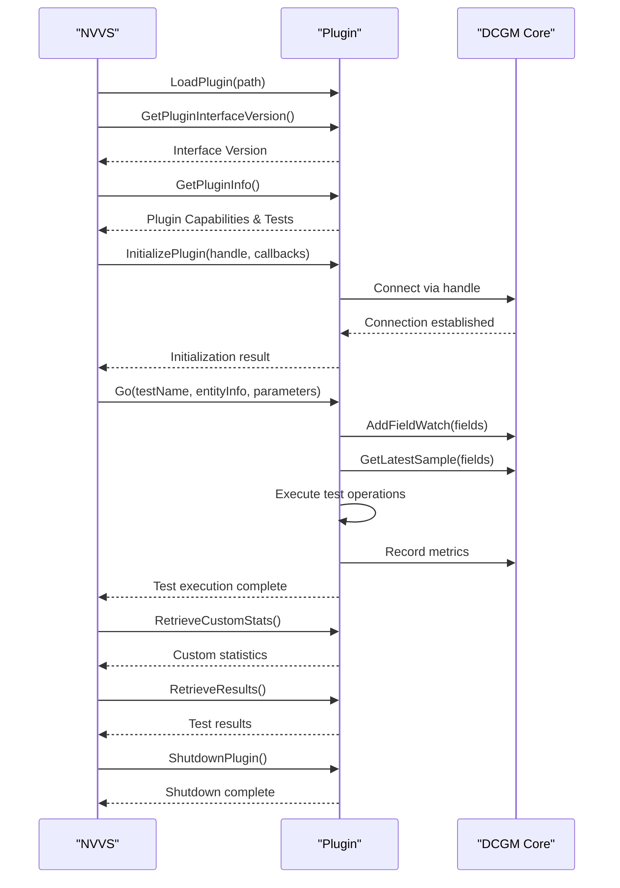
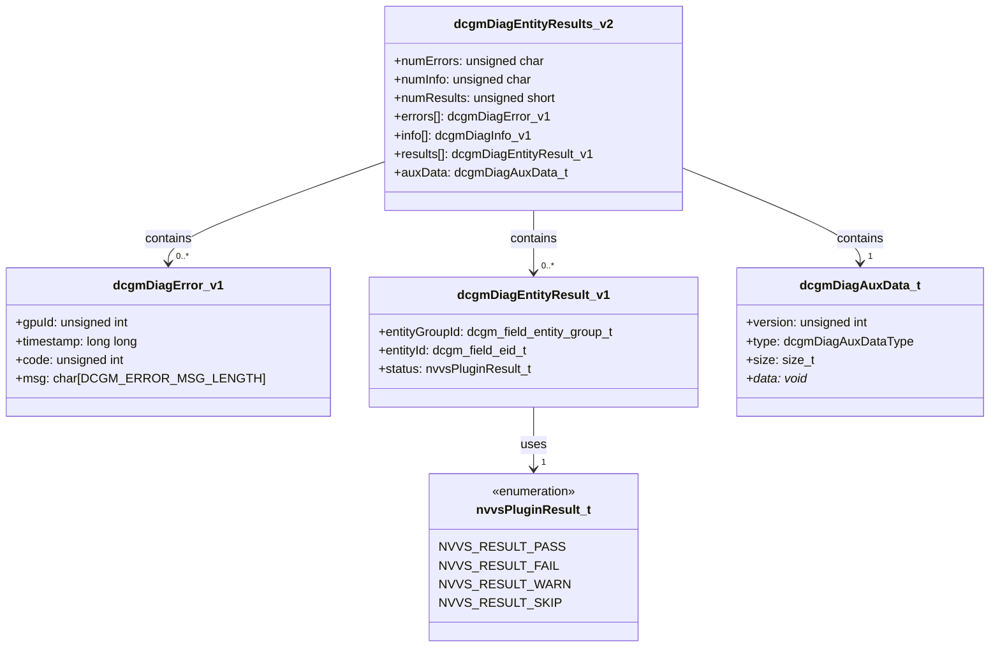
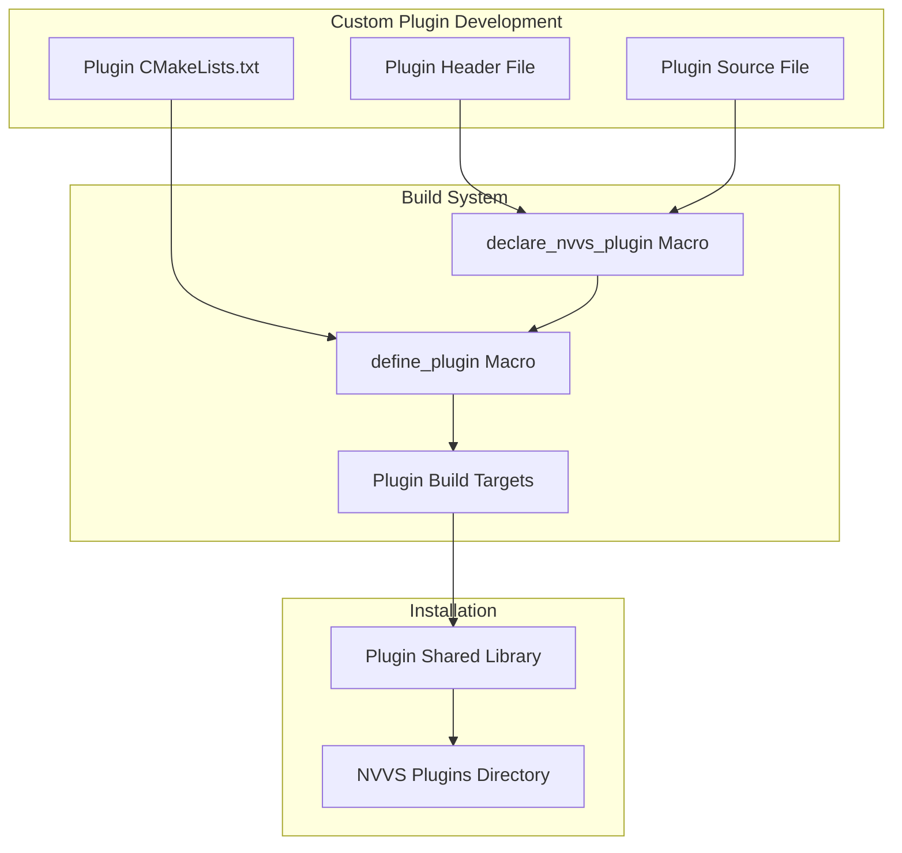

<!-- source: DeepWiki mcp.deepwiki.com · repo NVIDIA/DCGM · page 4.2 Plugin System · fetched 2026-10-26 -->

# Plugin System

<details>
<summary>Relevant source files</summary>

The following files were used as context for generating this wiki page:

- [nvvs/plugin_src/CMakeLists.txt](nvvs/plugin_src/CMakeLists.txt)
- [nvvs/plugin_src/diagnostic/DiagnosticPlugin.cpp](nvvs/plugin_src/diagnostic/DiagnosticPlugin.cpp)
- [nvvs/plugin_src/targetedstress/TargetedStress_wrapper.cpp](nvvs/plugin_src/targetedstress/TargetedStress_wrapper.cpp)

</details>


The DCGM Plugin System provides an extensible architecture for diagnostic tests, monitoring, and validation of NVIDIA GPUs. This page documents the NVVS (NVIDIA Validation Suite) plugin architecture, how plugins are loaded, executed, and how they communicate with the DCGM core. The plugin system allows for a modular approach to GPU validation, enabling the creation of specialized tests that can be executed within the DCGM framework.

For information about diagnostic SKUs configuration, see [Diagnostic SKUs](#4.1). For detailed information about specific plugins like Memory Testing, see [Memory Testing Plugins](#4.3).

## 1. Plugin Architecture

The plugin system is built on a well-defined interface that allows NVVS to dynamically load and communicate with various diagnostic and testing plugins. Each plugin implements a standardized interface, enabling a consistent mechanism for initialization, execution, and result reporting.



Sources: [nvvs/include/PluginInterface.h:35-41](), [nvvs/include/Plugin.h:61-458](), [nvvs/plugin_src/diagnostic/DiagnosticPlugin.cpp:61-696](), [nvvs/plugin_src/targetedstress/TargetedStress_wrapper.h:184-292]()

## 2. Plugin Interface

The plugin interface defines the contract between NVVS and individual plugins. This interface is versioned to support backward compatibility as features are added. The current interface version is defined in `DCGM_DIAG_PLUGIN_INTERFACE_VERSION`.

```mermaid
flowchart TD
    subgraph "Plugin Interface Functions"
        GetVersion["GetPluginInterfaceVersion()"]
        GetInfo["GetPluginInfo()"]
        Init["InitializePlugin()"]
        Shutdown["ShutdownPlugin()"]
        RunTest["RunTest()"]
        Stats["RetrieveCustomStats()"]
        Results["RetrieveResults()"]
    end
    
    subgraph "Plugin Implementation"
        PluginImpl["Specific Plugin\nImplementation"]
    end
    
    subgraph "NVVS Core"
        NVVSCore["NVVS Plugin Loader"]
    end
    
    NVVSCore --> GetVersion: "Check compatibility"
    NVVSCore --> GetInfo: "Get plugin capabilities"
    NVVSCore --> Init: "Initialize plugin"
    PluginImpl -.-> GetVersion: "implements"
    PluginImpl -.-> GetInfo: "implements"
    PluginImpl -.-> Init: "implements"
    PluginImpl -.-> RunTest: "implements"
    PluginImpl -.-> Stats: "implements"
    PluginImpl -.-> Results: "implements"
    PluginImpl -.-> Shutdown: "implements"
    NVVSCore --> RunTest: "Execute test"
    NVVSCore --> Stats: "Collect statistics"
    NVVSCore --> Results: "Get test results"
    NVVSCore --> Shutdown: "Cleanup"
```

The key functions in the plugin interface are:

1. **GetPluginInterfaceVersion** - Returns the interface version the plugin was compiled against
2. **GetPluginInfo** - Returns details about the plugin, including supported tests
3. **InitializePlugin** - Sets up the plugin with DCGM handle and other resources
4. **RunTest** - Executes a specific test on the specified entities
5. **RetrieveCustomStats** - Retrieves custom statistics gathered during test execution
6. **RetrieveResults** - Returns test results for each entity
7. **ShutdownPlugin** - Cleans up plugin resources

Sources: [nvvs/include/PluginInterface.h:247-367]()

## 3. Plugin Base Class

The `Plugin` abstract base class provides common functionality for all plugins. It handles:

- Test result management
- Error and information reporting
- GPU result recording
- Custom statistics collection



The Plugin class maintains a collection of PluginTest objects, one for each test it supports. This design allows a single plugin to implement multiple related tests while sharing common infrastructure.

Sources: [nvvs/include/Plugin.h:61-458](), [nvvs/src/Plugin.cpp:25-342]()

## 4. Plugin Loading and Execution Flow

The plugin system uses dynamic loading to integrate plugins with NVVS. Plugins are built as shared libraries and loaded at runtime.



Sources: [nvvs/include/PluginInterface.h:247-367](), [nvvs/plugin_src/diagnostic/DiagnosticPlugin.cpp:313-427](), [nvvs/plugin_src/targetedstress/TargetedStress_wrapper.cpp:360-428]()

## 5. Plugin Types

DCGM provides several types of diagnostic plugins, each focused on testing different aspects of GPU functionality:

| Plugin Type | Purpose | Key Tests |
|-------------|---------|-----------|
| Diagnostic | GPU computation and stability | GpuBurn test for thermal and computational stability |
| Memory | GPU memory validation | Tests for memory errors, bandwidth, and integrity |
| PCIe | PCIe connectivity testing | Bandwidth tests and error detection |
| Targeted Stress | Specific performance validation | Constant stress level tests |
| Targeted Power | Power management validation | Power consumption and efficiency tests |
| NVBandwidth | Memory bandwidth testing | Tests for memory throughput performance |
| Memtest | Comprehensive memory testing | Advanced memory diagnostic patterns |

Each plugin type implements the common Plugin interface but specializes in a specific area of GPU functionality testing.

Sources: [nvvs/plugin_src/CMakeLists.txt:77-86](), [nvvs/plugin_src/diagnostic/DiagnosticPlugin.cpp:71-89](), [nvvs/plugin_src/targetedstress/TargetedStress_wrapper.cpp:32-69]()

## 6. Plugin Communication with DCGM

Plugins interact with the DCGM system through the DcgmRecorder and field value access mechanisms. The DcgmRecorder provides an abstraction for recording metrics and retrieving field values from DCGM.

```mermaid
flowchart TD
    subgraph "Plugin Implementation"
        RunTest["RunTest()"]
        DcgmRecorder["DcgmRecorder"]
        CustomStats["CustomStatHolder"]
    end
    
    subgraph "DCGM Core"
        CoreAPI["DCGM Core API"]
        FieldValues["Field Values Cache"]
        CacheManager["Cache Manager"]
    end
    
    RunTest --> DcgmRecorder: "Record metrics\nGet field values"
    RunTest --> CustomStats: "Store custom statistics"
    
    DcgmRecorder --> CoreAPI: "AddFieldWatch()\nGetFieldValuesSince()"
    CoreAPI --> FieldValues: "Store/retrieve values"
    CoreAPI --> CacheManager: "Manage field cache"
    
    CacheManager --> RunTest: "Field value updates"
```

Key communication mechanisms:

1. **Field Watching** - Plugins register for notifications on specific field values
2. **Field Value Retrieval** - Plugins can request current and historical values
3. **Custom Statistics** - Plugins can record custom metrics that don't map to standard DCGM fields
4. **Result Reporting** - Plugins report test results back to NVVS

Sources: [nvvs/src/DcgmRecorder.cpp:66-578](), [nvvs/plugin_src/diagnostic/DiagnosticPlugin.cpp:433-605](), [nvvs/plugin_src/targetedstress/TargetedStress_wrapper.cpp:431-543]()

## 7. Plugin Results and Error Handling

Plugins report their results using a standardized structure that allows for:
- Overall pass/fail/warning status
- Per-entity (GPU) detailed results
- Error messages with GPU context
- Informational messages
- Verbose diagnostic information



The plugin base class manages result collection from individual tests and consolidation into the standardized result format.

Sources: [nvvs/include/PluginInterface.h:222-246](), [nvvs/include/Plugin.h:93-214](), [nvvs/src/Plugin.cpp:118-208]()

## 8. Building Custom Plugins

Custom plugins are created by:

1. Implementing a class derived from the Plugin base class
2. Implementing the PluginInterface functions
3. Adding the plugin to the build system

The CMake build system provides macros for declaring and defining plugins:



The DCGM build system supplies helper macros to simplify the process of integrating custom plugins with the existing plugin framework.

Sources: [nvvs/plugin_src/CMakeLists.txt:17-72]()

## 9. Plugin Versioning and Compatibility

The plugin system uses interface versioning to maintain compatibility as the system evolves. The current interface version is defined as `DCGM_DIAG_PLUGIN_INTERFACE_VERSION`.

```
DCGM_DIAG_PLUGIN_INTERFACE_VERSION_1 = 1
DCGM_DIAG_PLUGIN_INTERFACE_VERSION_2 = 2 /* 2.4.0 -> 3.1.7 */
DCGM_DIAG_PLUGIN_INTERFACE_VERSION_3 = 3 /* 3.1.8 -> 3.2.3 */
DCGM_DIAG_PLUGIN_INTERFACE_VERSION_4 = 4 /* 3.2.5 -> 3.3.6 */
DCGM_DIAG_PLUGIN_INTERFACE_VERSION_5 = 5 /* 3.3.7 -> 3.3.8 */
DCGM_DIAG_PLUGIN_INTERFACE_VERSION_6 = 6 /* Current version - 4.0 */
```

When NVVS loads a plugin, it first calls `GetPluginInterfaceVersion()` to check compatibility before proceeding with initialization and execution.

Sources: [nvvs/include/PluginInterface.h:35-41](), [nvvs/include/PluginInterface.h:254-257]()

---

