<!-- source: DeepWiki mcp.deepwiki.com · repo NVIDIA/DCGM · page 4.3 Test Plugins · fetched 2026-10-26 -->

# Test Plugins

<details>
<summary>Relevant source files</summary>

The following files were used as context for generating this wiki page:

- [nvvs/plugin_src/CMakeLists.txt](nvvs/plugin_src/CMakeLists.txt)
- [nvvs/plugin_src/diagnostic/DiagnosticPlugin.cpp](nvvs/plugin_src/diagnostic/DiagnosticPlugin.cpp)
- [nvvs/plugin_src/targetedstress/TargetedStress_wrapper.cpp](nvvs/plugin_src/targetedstress/TargetedStress_wrapper.cpp)

</details>


## Purpose

This page documents the individual test plugins that comprise NVVS (NVIDIA Validation Suite). These plugins perform specific GPU stress tests and health checks, including matrix multiplication workloads, memory tests, power stress, and PCIe bandwidth validation. Each plugin runs as a dynamically loaded library within the NVVS process.

For information about the plugin loading system and lifecycle, see [Plugin System](#4.2). For build instructions and multi-CUDA version support, see [Multi-CUDA Support](#5.2). For bandwidth-specific testing, see [Bandwidth Testing](#4.4).

## Plugin Overview

NVVS includes several test plugins, each targeting different GPU subsystems:

| Plugin Name | Test Index | Primary Purpose | Key Operations |
|-------------|-----------|-----------------|----------------|
| Diagnostic | `DCGM_DIAGNOSTIC_INDEX` | GPU compute correctness | HGEMM, SGEMM, DGEMM matrix multiplication |
| MemTest | `DCGM_MEMTEST_INDEX` | Memory integrity | Memory pattern testing |
| Targeted Stress | `DCGM_TARGETED_STRESS_INDEX` | Sustained performance | Constant GEMM workload at target GFLOPS |
| Targeted Power | `DCGM_TARGETED_POWER_INDEX` | Power delivery validation | Power stress testing |
| PCIe | `DCGM_PCIE_INDEX` | PCIe link health | Bandwidth and latency tests |
| EUD | N/A | Hardware diagnostics | Low-level hardware checks |

All plugins are compiled separately for each supported CUDA version (11, 12, 13) and loaded dynamically based on the system's CUDA driver version.

**Test Plugin Build Structure**

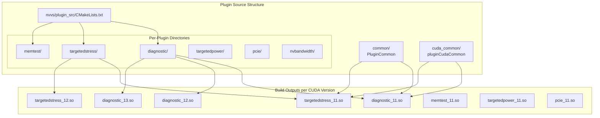

Sources: [nvvs/plugin_src/CMakeLists.txt:1-91]()

## Diagnostic Plugin (GpuBurnPlugin)

The Diagnostic plugin, implemented as `GpuBurnPlugin`, performs GPU compute validation through intensive matrix multiplication operations. It tests GPU arithmetic units by computing GEMM operations with multiple precisions and verifying correctness.

### Plugin Initialization and Configuration

The plugin supports configurable test parameters:

| Parameter | Default | Purpose |
|-----------|---------|---------|
| `DIAGNOSTIC_STR_TEST_DURATION` | 180.0 | Test duration in seconds |
| `DIAGNOSTIC_STR_MATRIX_DIM` | 2048.0 | Matrix dimension for GEMM |
| `DIAGNOSTIC_STR_USE_DOUBLES` | "False" | Enable double precision |
| `DIAGNOSTIC_STR_PRECISION` | Auto | Precision modes: 'h' (half), 's' (single), 'd' (double) |
| `DIAGNOSTIC_STR_GFLOPS_TOLERANCE_PCNT` | 0.0 | Performance variance tolerance |
| `DIAGNOSTIC_STR_SBE_ERROR_THRESHOLD` | `DCGM_FP64_BLANK` | Single-bit error threshold |

The plugin automatically detects hardware capabilities and adjusts precision modes:

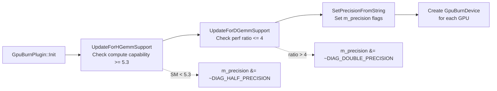

Sources: [nvvs/plugin_src/diagnostic/DiagnosticPlugin.cpp:127-184](), [nvvs/plugin_src/diagnostic/DiagnosticPlugin.cpp:186-262](), [nvvs/plugin_src/diagnostic/DiagnosticPlugin.cpp:265-310]()

### Worker Thread Architecture

The diagnostic plugin uses per-GPU worker threads (`GpuBurnWorker`) to parallelize testing:

**Diagnostic Worker Thread Lifecycle**

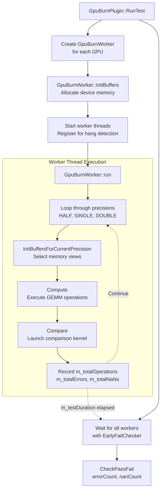

Sources: [nvvs/plugin_src/diagnostic/DiagnosticPlugin.cpp:433-666](), [nvvs/plugin_src/diagnostic/DiagnosticPlugin.cpp:1226-1332]()

### Memory Allocation Strategy

The plugin uses an efficient memory allocation strategy that pre-allocates all matrices and creates views for different precisions:

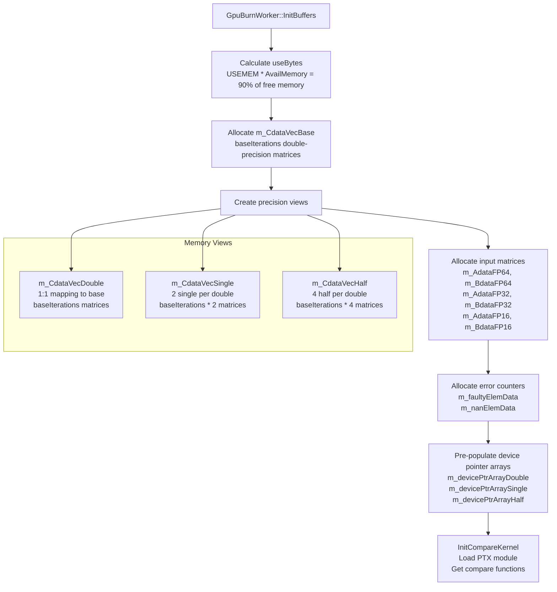

Sources: [nvvs/plugin_src/diagnostic/DiagnosticPlugin.cpp:924-1053](), [nvvs/plugin_src/diagnostic/DiagnosticPlugin.cpp:971-1036]()

### GEMM Computation and Verification

Each worker performs GEMM operations and verifies results using CUDA kernels:

**Compute and Compare Flow**

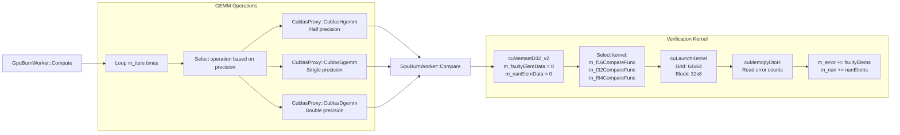

The comparison kernels are loaded from PTX and compare output matrices element-by-element, counting mismatches and NaN values. The kernels use grid-stride loops to process matrices efficiently regardless of size.

Sources: [nvvs/plugin_src/diagnostic/DiagnosticPlugin.cpp:1148-1223](), [nvvs/plugin_src/diagnostic/DiagnosticPlugin.cpp:1090-1145](), [nvvs/plugin_src/diagnostic/DiagnosticPlugin.cpp:1056-1087]()

### Pass/Fail Determination

The plugin evaluates test results based on error counts and performance metrics:

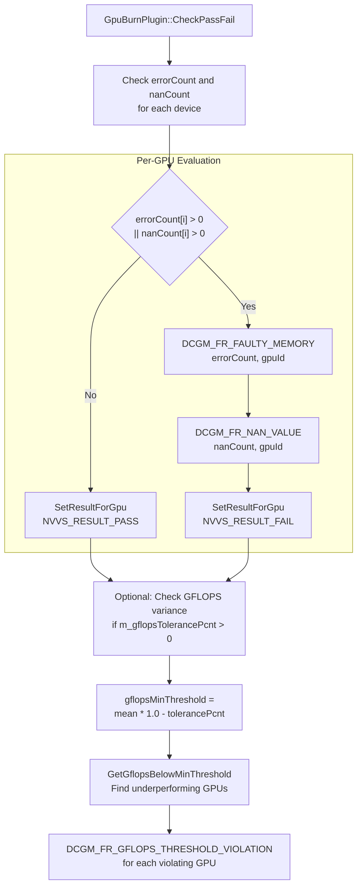

Sources: [nvvs/plugin_src/diagnostic/DiagnosticPlugin.cpp:395-426](), [nvvs/plugin_src/diagnostic/DiagnosticPlugin.cpp:673-713]()

## Targeted Stress Plugin (ConstantPerf)

The Targeted Stress plugin maintains a constant GPU stress level measured in GFLOPS. Unlike the Diagnostic plugin which focuses on correctness, this plugin validates sustained performance under continuous load.

### Configuration and Initialization

**Targeted Stress Parameters**

| Parameter | Default | Purpose |
|-----------|---------|---------|
| `TS_STR_TEST_DURATION` | 30.0 | Test duration in seconds |
| `TS_STR_TARGET_PERF` | 100.0 | Target GFLOPS to maintain |
| `TS_STR_TARGET_PERF_MIN_RATIO` | 0.95 | Minimum acceptable ratio of target |
| `TS_STR_CUDA_STREAMS_PER_GPU` | `TS_MAX_STREAMS_PER_DEVICE` | Number of CUDA streams |
| `TS_STR_CUDA_OPS_PER_STREAM` | 100.0 | Operations queued per stream |
| `TS_STR_USE_DGEMM` | "True" | Use double vs single precision |
| `TS_STR_MAX_PCIE_REPLAYS` | 160.0 | PCIe replay error threshold |
| `TS_STR_SBE_ERROR_THRESHOLD` | `DCGM_FP64_BLANK` | Single-bit error threshold |

The plugin creates multiple CUDA streams per GPU to maintain continuous work submission:

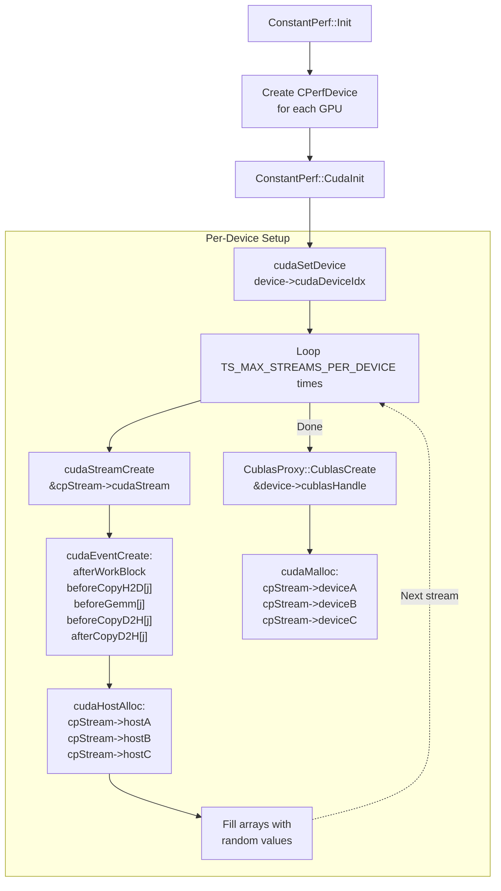

Sources: [nvvs/plugin_src/targetedstress/TargetedStress_wrapper.cpp:107-149](), [nvvs/plugin_src/targetedstress/TargetedStress_wrapper.cpp:152-357]()

### Worker Thread and Stream Management

Each GPU has a dedicated worker thread (`ConstantPerfWorker`) that manages multiple CUDA streams to achieve target performance:

**Constant Performance Work Queue Management**

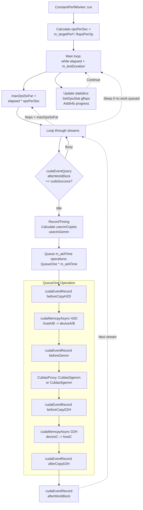

The worker dynamically throttles work submission to match the target GFLOPS, preventing GPU saturation while maintaining steady stress.

Sources: [nvvs/plugin_src/targetedstress/TargetedStress_wrapper.cpp:1009-1186](), [nvvs/plugin_src/targetedstress/TargetedStress_wrapper.cpp:866-1006]()

### Performance Validation

The plugin validates that actual performance meets the target:

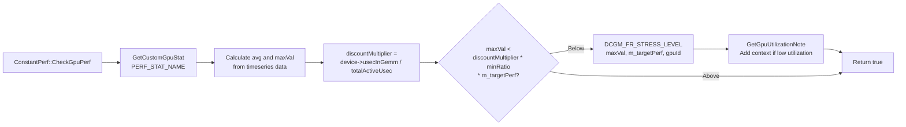

The discount multiplier accounts for time spent in memory copies versus compute, adjusting expectations when transfer-bound.

Sources: [nvvs/plugin_src/targetedstress/TargetedStress_wrapper.cpp:431-497](), [nvvs/plugin_src/targetedstress/TargetedStress_wrapper.cpp:500-520]()

## Other Test Plugins

### MemTest Plugin

The MemTest plugin performs comprehensive memory testing using various patterns to detect memory errors. It tests GPU memory subsystems including DRAM, caches, and memory controllers.

### Targeted Power Plugin

The Targeted Power plugin validates GPU power delivery by maintaining specific power consumption levels. It tests power regulation circuits and thermal management under sustained load.

### PCIe Plugin

The PCIe plugin tests PCIe link integrity through bandwidth measurements and error detection. It validates PCIe link training, data transfer reliability, and protocol handling.

### EUD (Extended Unified Diagnostics) Plugin

The EUD plugin performs low-level hardware diagnostics that go beyond standard CUDA operations, testing GPU microarchitecture features and hardware-specific functionality.

Sources: [nvvs/plugin_src/CMakeLists.txt:78-88]()

## Plugin Integration with DCGM

All plugins interact with DCGM through the `DcgmRecorder` interface for metrics collection and error reporting:

**Plugin-DCGM Communication**

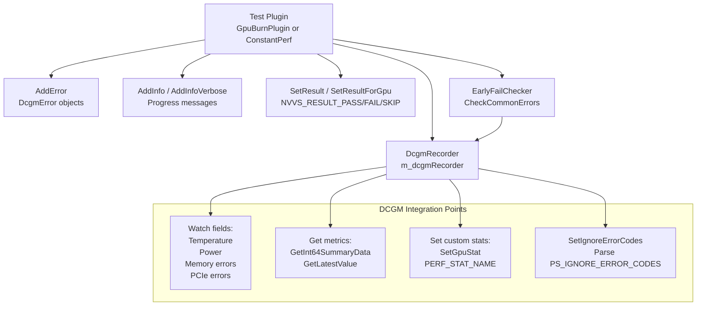

Plugins use the recorder to:
- Watch DCGM fields for hardware metrics
- Record custom performance statistics
- Query error conditions (SBE, DBE, thermal violations)
- Implement early failure detection when `FAIL_EARLY` is enabled

Sources: [nvvs/plugin_src/diagnostic/DiagnosticPlugin.cpp:72-105](), [nvvs/plugin_src/targetedstress/TargetedStress_wrapper.cpp:32-69]()

## Multi-CUDA Version Support

All CUDA-dependent plugins are compiled for multiple CUDA versions to support different GPU generations and driver versions:

**Plugin Build Matrix**

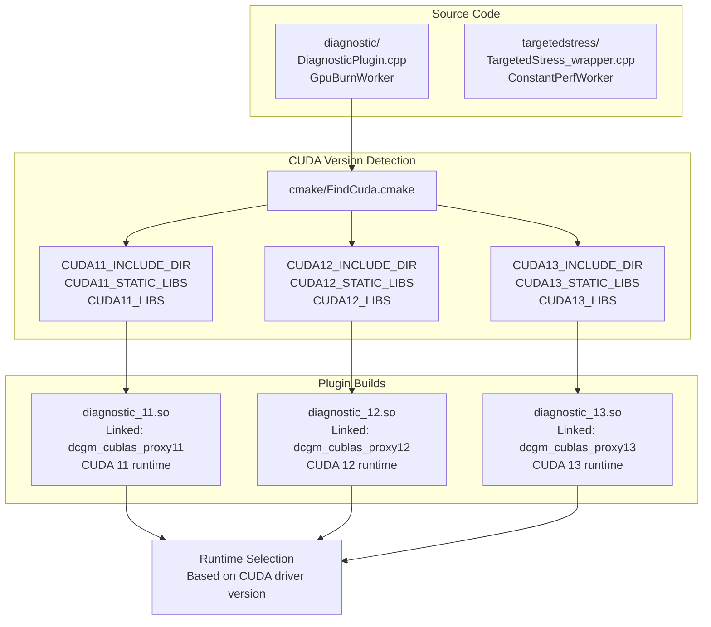

The `define_plugin` macro in [nvvs/plugin_src/CMakeLists.txt:43-74]() handles the multi-version build process:

1. Each plugin is compiled three times with different CUDA toolchains
2. Version-specific cuBLAS proxy libraries (`dcgm_cublas_proxy11/12/13`) provide CUDA runtime isolation
3. NVVS dynamically selects the appropriate plugin version based on the detected CUDA driver

This approach allows a single DCGM installation to support multiple GPU generations without requiring matching CUDA toolkit versions on the target system.

Sources: [nvvs/plugin_src/CMakeLists.txt:43-74](), [nvvs/plugin_src/CMakeLists.txt:76-91]()

## Common Plugin Patterns

### Error Handling and Reporting

Plugins follow a consistent pattern for error handling:

```cpp
// Check CUDA operations
if (cudaSt != cudaSuccess) {
    LOG_CUDA_ERROR(GetPluginName(), "cudaAPICall", cudaSt, gpuId);
    return -1;
}

// Report errors to test framework
DcgmError d { gpuId };
DCGM_ERROR_FORMAT_MESSAGE(DCGM_FR_ERROR_CODE, d, ...params);
AddError(GetPluginName(), d);
SetResultForGpu(GetPluginName(), gpuId, NVVS_RESULT_FAIL);
```

### Hang Detection Integration

Worker threads register with the hang detection system to detect GPU hangs:

```cpp
auto tid = workerThreads[i]->GetCachedTid();
auto ret = HangDetectRegisterTask(getpid(), tid);
// Later...
HangDetectUnregisterTask(getpid(), tid);
```

This allows NVVS to detect and recover from GPU hangs during testing.

Sources: [nvvs/plugin_src/diagnostic/DiagnosticPlugin.cpp:516-528](), [nvvs/plugin_src/targetedstress/TargetedStress_wrapper.cpp:683-694]()

### Early Failure Detection

Plugins support early termination when failures are detected:

```cpp
EarlyFailChecker efc(m_testParameters, failEarly, checkInterval, *entityInfo);

// Periodically check for errors
if (efc.CheckCommonErrors(currentTime, startTime, m_dcgmRecorder) == NVVS_RESULT_FAIL) {
    DCGM_LOG_ERROR << "Stopping execution early";
    failedEarly = true;
}
```

The `EarlyFailChecker` monitors DCGM fields for thermal violations, memory errors, and other hardware issues, allowing tests to abort early rather than continuing when problems are detected.

Sources: [nvvs/plugin_src/diagnostic/DiagnosticPlugin.cpp:456-562](), [nvvs/plugin_src/targetedstress/TargetedStress_wrapper.cpp:671-719]()

---

