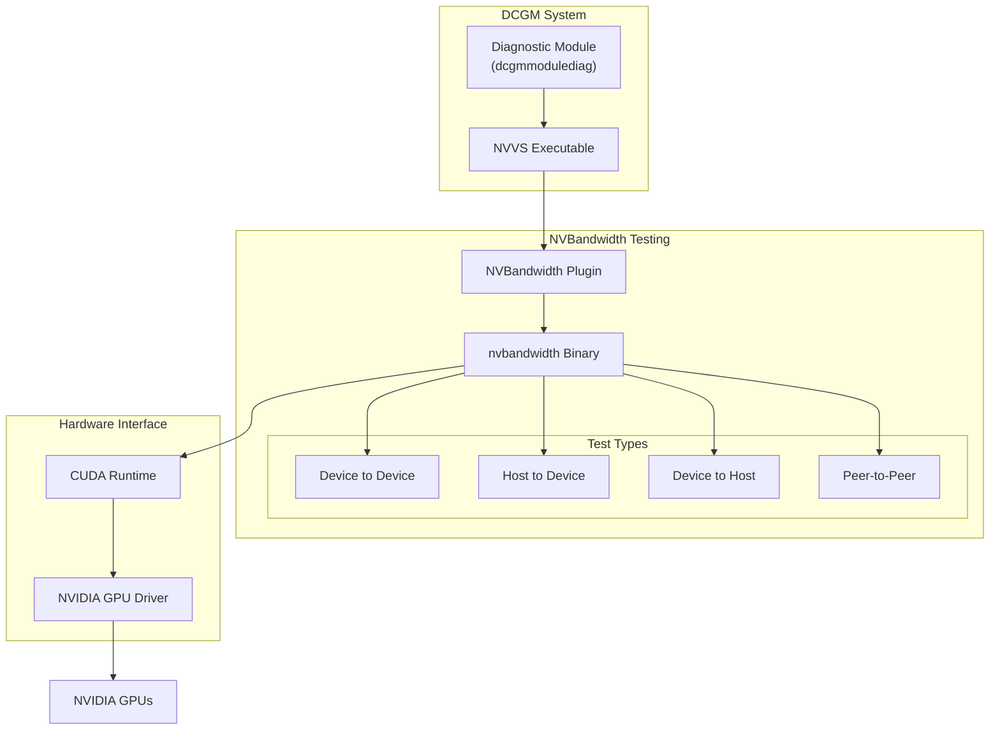
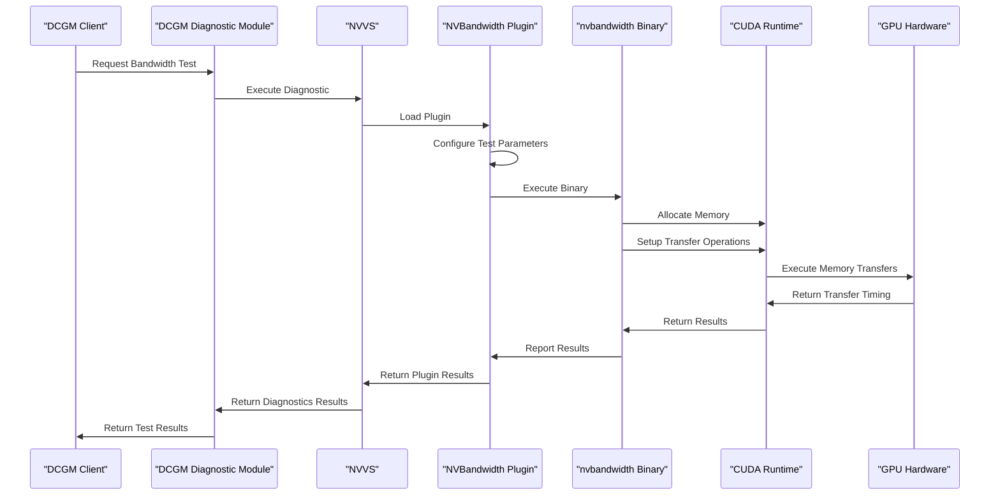
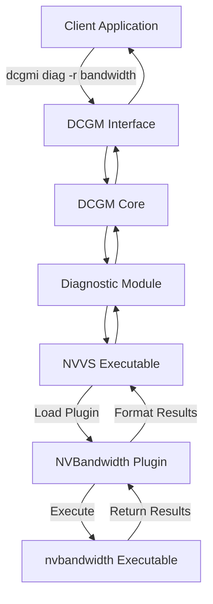
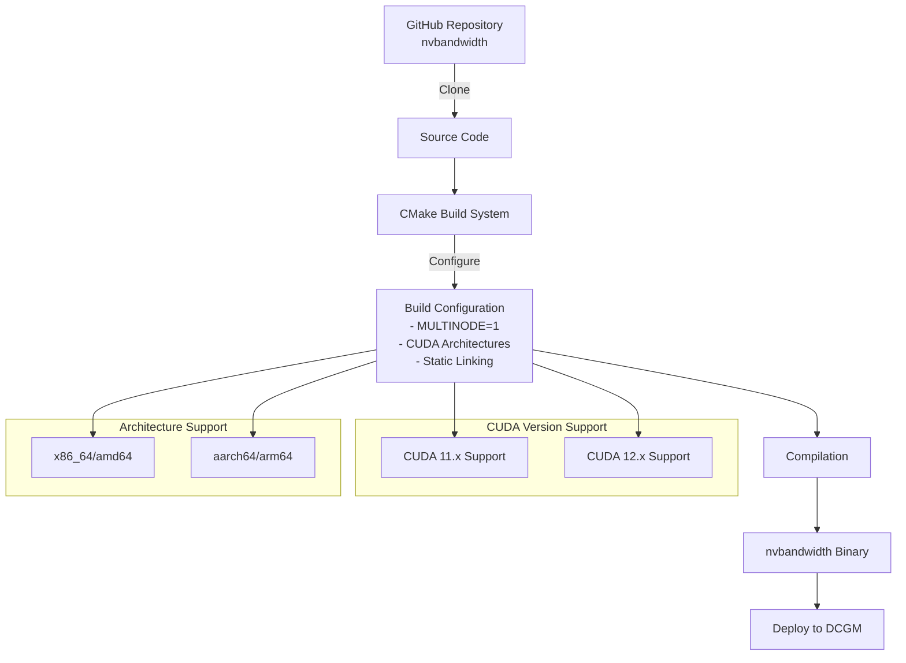
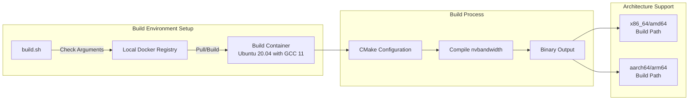

<!-- source: DeepWiki mcp.deepwiki.com · repo NVIDIA/DCGM · page 4.4 Bandwidth Testing · fetched 2026-10-26 -->

# Bandwidth Testing

<details>
<summary>Relevant source files</summary>

The following files were used as context for generating this wiki page:

- [nvvs/plugin_src/nvbandwidth/Cuda12/bin/aarch64/nvbandwidth](nvvs/plugin_src/nvbandwidth/Cuda12/bin/aarch64/nvbandwidth)
- [nvvs/plugin_src/nvbandwidth/Cuda12/bin/x86_64/nvbandwidth](nvvs/plugin_src/nvbandwidth/Cuda12/bin/x86_64/nvbandwidth)
- [nvvs/plugin_src/nvbandwidth/build.sh](nvvs/plugin_src/nvbandwidth/build.sh)

</details>


Bandwidth Testing in DCGM provides a mechanism to measure and validate memory throughput between various components of NVIDIA GPUs. This functionality is implemented through the NVBandwidth plugin, which is part of the NVIDIA Validation Suite (NVVS) diagnostic framework. For information about other diagnostic capabilities, see [NVVS (NVIDIA Validation Suite)](#4) and [Diagnostic Module](#3.3).

## Overview of Bandwidth Testing

Bandwidth testing allows system administrators and developers to quantify and validate memory transfer rates between different GPU components, including:

- Device memory (GPU memory) to device memory
- Host memory (CPU memory) to device memory
- Device memory to host memory
- Peer-to-peer transfers between multiple GPUs

These tests are critical for ensuring expected performance of applications that rely on high-speed data movement, such as deep learning training, inference, and high-performance computing workloads.

Sources: [nvvs/plugin_src/nvbandwidth/build.sh:22-24]()

## NVBandwidth Plugin Architecture

The NVBandwidth plugin is a specialized diagnostic component integrated into the DCGM diagnostic subsystem. It operates as part of the NVVS testing framework, providing standardized bandwidth testing capabilities.

### Plugin Integration



Sources: [nvvs/plugin_src/nvbandwidth/build.sh:1-169]()

### Runtime Architecture

The NVBandwidth plugin operates through a two-tier architecture:

1. **Plugin Layer**: Interfaces with the NVVS system, handling test configuration, execution, and result reporting
2. **Executable Layer**: Underlying `nvbandwidth` binary that performs the actual bandwidth tests



Sources: [nvvs/plugin_src/nvbandwidth/build.sh:157-167]()

## Bandwidth Testing Capabilities

The NVBandwidth plugin provides a comprehensive set of memory bandwidth tests to evaluate GPU performance across different transfer scenarios.

### Test Types

| Test Type | Description | Typical Use Case |
|-----------|-------------|------------------|
| Device to Device | Measures bandwidth of transfers within GPU memory | Evaluating on-board memory performance |
| Host to Device | Measures bandwidth from CPU memory to GPU memory | Evaluating data loading performance |
| Device to Host | Measures bandwidth from GPU memory to CPU memory | Evaluating result retrieval performance |
| Peer-to-Peer | Measures bandwidth between multiple GPUs | Evaluating multi-GPU communication performance |

### Multi-node Testing

The NVBandwidth plugin supports bandwidth testing across multiple nodes in a cluster environment, allowing for comprehensive testing of distributed systems. This capability is enabled through the `MULTINODE=1` build option.

Sources: [nvvs/plugin_src/nvbandwidth/build.sh:162]()

## Integration with DCGM

The bandwidth testing functionality is integrated into the DCGM diagnostic framework, allowing it to be executed through the DCGM interface, either via the command-line tool (dcgmi) or through the API.

### Execution Flow



Sources: [nvvs/plugin_src/nvbandwidth/build.sh:152-167]()

## Build and Deployment

The NVBandwidth plugin is built separately from the main DCGM codebase and then integrated at build time. This allows for different architectures and CUDA versions to be supported.

### Build Process



Sources: [nvvs/plugin_src/nvbandwidth/build.sh:20-24](), [nvvs/plugin_src/nvbandwidth/build.sh:58-60](), [nvvs/plugin_src/nvbandwidth/build.sh:159-167]()

### Docker-based Build Environment

The NVBandwidth plugin utilizes Docker containers for a consistent build environment, supporting both x86_64 (amd64) and ARM64 (aarch64) architectures. The build script automatically sets up the appropriate container environment based on the target architecture.



Sources: [nvvs/plugin_src/nvbandwidth/build.sh:58-146]()

## Usage and Testing Parameters

The NVBandwidth plugin can be executed through the DCGM diagnostic framework with specific parameters to customize the testing behavior. Here is an overview of the typical usage:

### Command-line Execution

To execute bandwidth tests via DCGM, you can use the following command:

```
dcgmi diag -r bandwidth [-p <parameter_file>]
```

### Common Test Parameters

While the exact parameters are configured in the diagnostic SKUs configuration (see [Diagnostic SKUs](#4.1)), common bandwidth testing parameters include:

| Parameter | Description |
|-----------|-------------|
| `iterations` | Number of test iterations to run |
| `transferSize` | Size of data to transfer (in bytes) |
| `transferType` | Type of transfer to test (device-to-device, host-to-device, etc.) |
| `cudaDevices` | Specific GPU devices to include in the test |
| `multiGpu` | Whether to test multi-GPU communication |
| `bidirectional` | Whether to test bidirectional transfers |

Sources: [nvvs/plugin_src/nvbandwidth/build.sh:152-167]()

## Result Interpretation

The NVBandwidth plugin reports results in terms of bandwidth (typically GB/s) for each tested transfer type. The results are compared against expected thresholds defined in the diagnostic SKUs configuration.

### Example Result Format

```
Bandwidth Test Results:
======================
Transfer Type: Device to Device
Device ID: 0
Bandwidth: 742.3 GB/s
Status: Pass

Transfer Type: Host to Device
Device ID: 0
Bandwidth: 12.8 GB/s
Status: Pass

Transfer Type: Device to Host
Device ID: 0
Bandwidth: 13.2 GB/s
Status: Pass

Transfer Type: Peer-to-Peer
Source Device ID: 0
Destination Device ID: 1
Bandwidth: 24.5 GB/s
Status: Pass
```

The results include both the raw bandwidth measurements and a pass/fail status based on comparison against expected performance thresholds.

Sources: [nvvs/plugin_src/nvbandwidth/build.sh:152-167]()

## Troubleshooting

Common issues with bandwidth testing and their solutions:

| Issue | Possible Causes | Solutions |
|-------|----------------|-----------|
| Lower than expected bandwidth | Driver issues, system load, PCIe configuration | Verify driver version, check system load, ensure proper PCIe configuration |
| Test failure | Memory errors, insufficient resources | Check for GPU memory errors, ensure sufficient system memory |
| Inconsistent results | Thermal throttling, power limitations | Monitor GPU temperatures, check power delivery |
| Build failures | Missing dependencies, incompatible CUDA version | Ensure all build dependencies are installed, verify CUDA compatibility |

Sources: [nvvs/plugin_src/nvbandwidth/build.sh:11-55]()

## Summary

The NVBandwidth plugin in DCGM provides comprehensive memory bandwidth testing capabilities for NVIDIA GPUs. It integrates with the NVVS diagnostic framework to deliver standardized testing that can be executed through the DCGM interface. The plugin supports various transfer types, including device-to-device, host-to-device, device-to-host, and peer-to-peer transfers, allowing for thorough evaluation of GPU memory performance in different scenarios. The multi-architecture and multi-CUDA version support ensures compatibility across a wide range of deployment environments.

---

