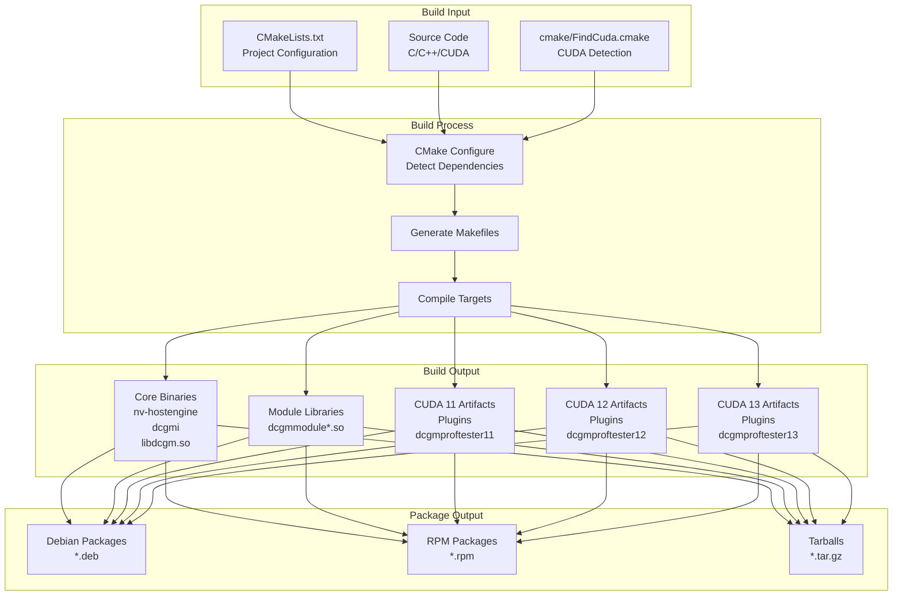
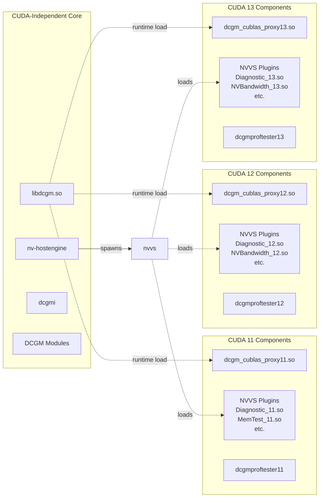
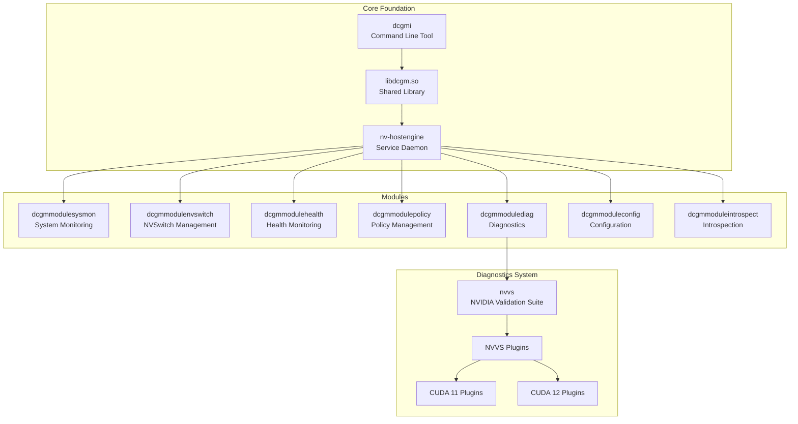

<!-- source: DeepWiki mcp.deepwiki.com · repo NVIDIA/DCGM · page 5 Building and Development · fetched 2026-10-26 -->

# Building and Development

<details>
<summary>Relevant source files</summary>

The following files were used as context for generating this wiki page:

- [CMakeLists.txt](CMakeLists.txt)
- [README.md](README.md)
- [common/ThreeWayCmpDefault.hpp](common/ThreeWayCmpDefault.hpp)
- [modules/nvswitch/DcgmModuleNvSwitch.cpp](modules/nvswitch/DcgmModuleNvSwitch.cpp)
- [nvvs/include/NvvsJsonStrings.h](nvvs/include/NvvsJsonStrings.h)
- [testing/python3/tests/test_dcgm_collectd_plugin.py](testing/python3/tests/test_dcgm_collectd_plugin.py)

</details>


This page provides an overview of building DCGM from source, including prerequisites, the basic build process, and development workflows. For detailed information about specific topics, see the subsections:
- [Build System](#5.1) - CMake configuration and project structure
- [Multi-CUDA Support](#5.2) - Building for multiple CUDA versions
- [Building with Docker](#5.3) - Docker-based build environment
- [Packaging](#5.4) - Creating distributable packages

For information about the DCGM architecture, see [Architecture](#1.1).

## Build Architecture Overview

DCGM's build system is organized around several key concepts:

### Component-Based Architecture

The build produces multiple components that can be installed independently:

| Component | Contents |
|-----------|----------|
| **Core** | `libdcgm.so`, `nv-hostengine`, `dcgmi`, module libraries |
| **Development** | Headers, static libraries, CMake configuration |
| **Cuda11** | CUDA 11-specific plugins and tools |
| **Cuda12** | CUDA 12-specific plugins and tools |
| **Cuda13** | CUDA 13-specific plugins and tools |
| **Tests** | Test executables and data |

### Build Flow from Sources to Packages



Sources: [CMakeLists.txt:1-17](), [CMakeLists.txt:869-904]()

## Prerequisites

DCGM requires several dependencies to build successfully. The build system uses CMake 3.21 or higher and supports multiple CPU architectures (x86_64, aarch64, ppc64le).

### System Requirements

| Dependency | Minimum Version | Purpose |
|------------|----------------|---------|
| CMake | 3.21 | Build system generator |
| Git | Any recent | Source control (with git-lfs for large files) |
| Docker | Recent | For containerized builds (recommended) |
| GCC | System default | C/C++ compiler |
| Python3 | Any recent | Build scripts and testing |

### Build-Time Library Dependencies

The following libraries are required during the build process:

| Library | Purpose |
|---------|---------|
| Boost | filesystem, stacktrace_basic, system libraries |
| Catch2 | C++ testing framework |
| fmt | String formatting |
| Jsoncpp | JSON parsing |
| Libevent | Event notification |
| plog | Logging framework |
| TCLAP | Command-line argument parsing |
| Yaml-cpp | YAML configuration parsing |

### CUDA Dependencies

DCGM supports multiple CUDA versions simultaneously. The build system can detect and build against CUDA 11.8, 12.x, and 13.x. See [Multi-CUDA Support](#5.2) for details on how version-specific components are built.

Sources: [README.md:49-58](), [CMakeLists.txt:32-43]()

## Quick Start

The fastest way to build DCGM is using the provided Docker-based build environment, which handles all dependencies automatically.

### Building with Docker (Recommended)

```bash
# Navigate to dcgmbuild directory
cd dcgmbuild

# Build the Docker image (one-time setup, takes several hours)
./build.sh

# Return to project root
cd ..

# Build DCGM packages (Debian)
./build.sh -r --deb

# Or build RPM packages
./build.sh -r --rpm
```

The resulting packages will be in `_out/Linux-<arch>-release/`. For more details on Docker-based builds, see [Building with Docker](#5.3).

### Building Locally

For local development without Docker:

```bash
# Configure
cmake -B build -S .

# Build
cmake --build build -j$(nproc)

# Install (optional)
sudo cmake --install build --prefix /usr/local
```

For detailed information about the CMake build system, see [Build System](#5.1).

Sources: [README.md:26-86]()

## Multi-Architecture Support

DCGM builds support multiple CPU architectures. The build system automatically detects the target architecture and adjusts compiler flags accordingly:

- **x86_64/amd64**: Primary development architecture
- **aarch64/arm64**: ARM 64-bit architecture  
- **ppc64le**: POWER architecture (legacy support)

Sources: [CMakeLists.txt:164-171]()

## Multi-CUDA Version Support

DCGM supports multiple CUDA versions simultaneously by building CUDA-dependent components separately for each version. This allows a single DCGM installation to work with different CUDA runtimes.

### Architecture Overview



The core DCGM components are CUDA-independent and built once, while CUDA-dependent components like diagnostic plugins and cuBLAS proxies are built separately for each supported CUDA version. At runtime, DCGM loads the appropriate version based on the system's CUDA driver. For implementation details, see [Multi-CUDA Support](#5.2).

Sources: [CMakeLists.txt:277-283](), [CMakeLists.txt:337-342](), [CMakeLists.txt:636-750]()

## Build Configuration Options

DCGM provides several CMake options for development and debugging:

| Option | Description | Usage |
|--------|-------------|-------|
| `CMAKE_BUILD_TYPE` | Build type (Debug/Release) | `-DCMAKE_BUILD_TYPE=Debug` |
| `ENABLE_LTO` | Enable link-time optimization | `-DENABLE_LTO=ON` |
| `ADDRESS_SANITIZER` | Detect memory errors | `-DADDRESS_SANITIZER=ON` |
| `THREAD_SANITIZER` | Detect threading issues | `-DTHREAD_SANITIZER=ON` |
| `UB_SANITIZER` | Detect undefined behavior | `-DUB_SANITIZER=ON` |
| `LEAK_SANITIZER` | Detect memory leaks | `-DLEAK_SANITIZER=ON` |
| `GCC_ANALYZER` | Enable GCC static analysis | `-DGCC_ANALYZER=ON` |
| `VMWARE` | Build for VMware environment | `-DVMWARE=ON` |

**Note:** Sanitizers add runtime overhead and should only be used during development, not for production builds. Do not enable multiple sanitizers simultaneously.

Sources: [CMakeLists.txt:65-96](), [CMakeLists.txt:121-124](), [CMakeLists.txt:136-139]()

## Development Workflow

The recommended workflow for DCGM development:

1. **Setup Development Environment**
   - Clone the repository
   - Install required dependencies
   - Set up Docker environment (optional)

2. **Make Changes**
   - Modify source files
   - Add appropriate tests

3. **Build and Test**
   - Build with the appropriate configuration options
   - Run tests using CTest: `ctest --test-dir build`
   - Use sanitizers for detecting bugs: `-DADDRESS_SANITIZER=ON`

4. **Package and Verify**
   - Create packages
   - Verify installation and functionality

## Advanced Build Configuration

### Component Dependency Diagram



Sources: [CMakeLists.txt:272-385](), [CMakeLists.txt:527-541]()

### Build Output Organization

The build process organizes output files into component-specific directories:

| Directory | Description |
|-----------|-------------|
| `<build>/bin/` | Executable binaries (nv-hostengine, dcgmi) |
| `<build>/lib/` | Shared libraries (libdcgm.so, modules) |
| `<build>/libexec/datacenter-gpu-manager-4/` | NVVS and plugins |
| `<build>/dcgmi/` | DCGMI command-line tool |
| `<build>/nvvs/` | NVVS diagnostic suite |

When installed, files are organized according to the standard Linux directory structure:

| Installation Path | Description |
|-------------------|-------------|
| `<prefix>/bin/` | Executables |
| `<prefix>/lib/` | Libraries |
| `<prefix>/libexec/datacenter-gpu-manager-4/` | NVVS and plugins |
| `<prefix>/share/cmake/DCGM/` | CMake package configuration |
| `<prefix>/share/dcgm_tests/` | Test files |

Sources: [CMakeLists.txt:425-436](), [CMakeLists.txt:527-754]()

---

