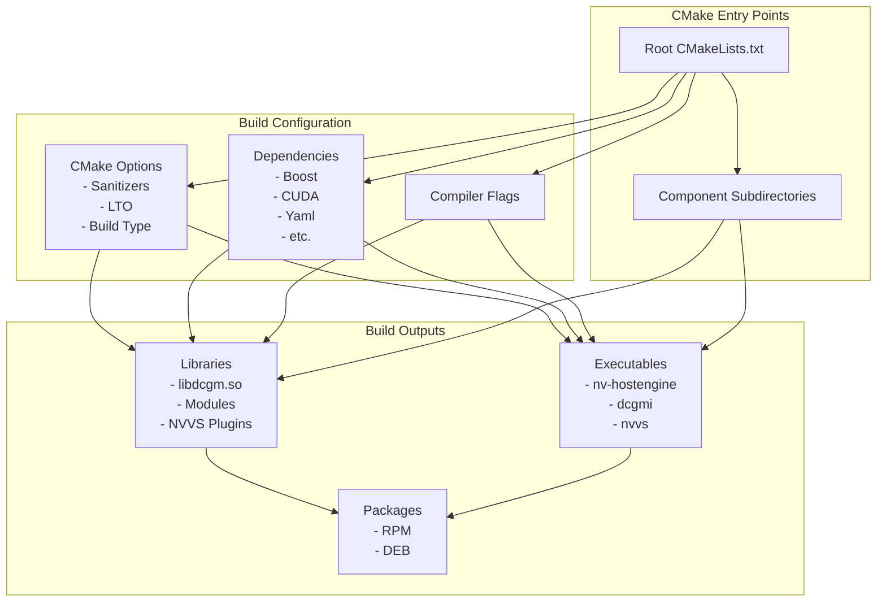
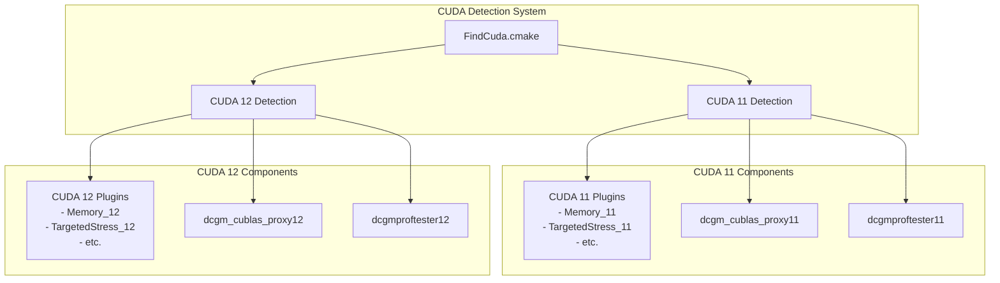
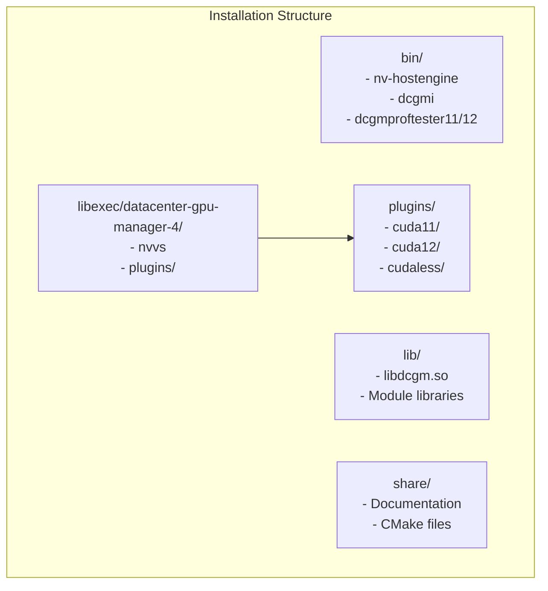

<!-- source: DeepWiki mcp.deepwiki.com · repo NVIDIA/DCGM · page 5.1 Build System · fetched 2026-10-26 -->

# Build System

<details>
<summary>Relevant source files</summary>

The following files were used as context for generating this wiki page:

- [CMakeLists.txt](CMakeLists.txt)

</details>


The DCGM build system is responsible for compiling, testing, and packaging the Data Center GPU Manager components. This document details the CMake-based build infrastructure used in DCGM, including configuration options, dependency management, and package generation. For information about building DCGM using Docker containers, see [Building with Docker](#5.2).

## Overview of the CMake Configuration

DCGM uses CMake (minimum version 3.21.0) as its primary build system. The project configuration defines standard build flags, compiler options, and component organization for both development and distribution.



Sources: [CMakeLists.txt:15-60]()

### Project Structure and Core Configuration

The project is defined as `datacenter-gpu-manager-4` with version information and standard build settings:

```
cmake_minimum_required(VERSION 3.21.0)
project(datacenter-gpu-manager-4 VERSION 4.2.3)
```

Core settings include:
- C++23 standard
- Position-independent code
- Hidden symbol visibility
- Standard installation paths using GNUInstallDirs

These options ensure consistent builds across different environments and platforms.

Sources: [CMakeLists.txt:15-58]()

### Required Dependencies

DCGM relies on several external libraries and tools:

| Dependency | Purpose |
|------------|---------|
| Boost | Filesystem, stacktrace, system components |
| Catch2 | Unit testing framework |
| CUDA | GPU programming and management |
| fmt | String formatting library |
| Git | Version information extraction |
| Jsoncpp | JSON parsing and generation |
| Libevent | Event notification library |
| Python3 | Script execution and utilities |
| Threads | Multi-threading support |
| Yaml | YAML parsing (for config files) |

Sources: [CMakeLists.txt:32-41]()

## Build Options and Customization

DCGM's build system offers several customization options for different build scenarios:

### Build Types

Standard CMake build types (Debug, Release, RelWithDebInfo) are supported, with additional flags for each:

```
set(CMAKE_CXX_FLAGS_RELEASE "${CMAKE_CXX_FLAGS_RELEASE} -s -g")
set(CMAKE_C_FLAGS_RELEASE "${CMAKE_C_FLAGS_RELEASE} -s -g")
```

Debug builds automatically define the `DEBUG` preprocessor macro.

Sources: [CMakeLists.txt:130-138]()

### Sanitizer Options

The build system provides several sanitizer options to help with debugging and code quality:

| Option | Description | CMake Flag |
|--------|-------------|------------|
| Address Sanitizer | Detects memory errors | `-DADDRESS_SANITIZER=ON` |
| Thread Sanitizer | Detects thread safety issues | `-DTHREAD_SANITIZER=ON` |
| Undefined Behavior | Detects undefined behavior | `-DUB_SANITIZER=ON` |
| Leak Sanitizer | Detects memory leaks | `-DLEAK_SANITIZER=ON` |

When any sanitizer is enabled, the `SANITIZERS` preprocessor macro is defined.

Sources: [CMakeLists.txt:68-94]()

### Other Build Options

- `-DENABLE_LTO=ON`: Enables Link Time Optimization
- `-DGCC_ANALYZER=ON`: Enables GCC static analyzer
- `-DVMWARE=ON`: Configures build for VMware environments

Sources: [CMakeLists.txt:63-136]()

## CUDA Version Support

DCGM has specific support for different CUDA versions, primarily CUDA 11 and CUDA 12. This is implemented through a custom `FindCuda.cmake` module.



Sources: [cmake/FindCuda.cmake:17-106](), [CMakeLists.txt:582-663]()

### CUDA Detection System

The CUDA detection logic uses predefined paths to find CUDA 11.8 and CUDA 12.8 installations:

```
set(Cuda11_prefix usr/local/cuda-11.8)
set(Cuda12_prefix usr/local/cuda-12.8)
```

For each CUDA version, the system looks for:
- Include directories (containing cuda.h)
- Static libraries (libcudart_static.a, libculibos.a, libcublas_static.a)
- Shared libraries (libcuda.so)

When a CUDA version is found, variables like `CUDA11_INCLUDE_DIR`, `CUDA11_STATIC_LIBS`, etc. are set for use in the build.

Sources: [cmake/FindCuda.cmake:19-103]()

### CUDA-Specific Targets

The build system creates separate targets for each CUDA version:

1. **NVVS Plugins**:
   - Memory test plugins (Memory_11, Memory_12)
   - PCIe test plugins (Pcie_11, Pcie_12)
   - Stress test plugins (TargetedStress_11, TargetedStress_12)
   - Other diagnostic plugins

2. **CUBLAS Proxies**:
   - dcgm_cublas_proxy11
   - dcgm_cublas_proxy12

These targets are built against their specific CUDA versions and installed in version-specific directories.

Sources: [CMakeLists.txt:366-380](), [cublas_proxy/CMakeLists.txt:17-39]()

## Build Targets Organization

DCGM's build system defines numerous targets organized by function:

### Core Libraries

```
add_library(dcgm SHARED)
add_library(dcgm_static_private STATIC)
add_library(dcgm_entity_types STATIC)
add_library(dcgm_logging STATIC)
add_library(dcgm_mutex STATIC)
add_library(dcgm_thread STATIC)
```

### DCGM Modules

```
add_library(dcgmmoduleconfig SHARED)
add_library(dcgmmodulediag SHARED)
add_library(dcgmmodulehealth SHARED)
add_library(dcgmmoduleintrospect SHARED)
add_library(dcgmmodulenvswitch SHARED)
add_library(dcgmmodulepolicy SHARED)
add_library(dcgmmodulesysmon SHARED)
```

### Key Executables

```
add_executable(dcgmi)
add_executable(nv-hostengine)
add_executable(nvvs)
add_executable(dcgmproftester11)
add_executable(dcgmproftester12)
```

Sources: [CMakeLists.txt:272-307](), [CMakeLists.txt:358-385]()

## Installation and Packaging

The DCGM build system uses a component-based installation approach, which organizes files into logical groups:

### Installation Components

| Component | Contents | Purpose |
|-----------|----------|---------|
| Core | libdcgm.so, modules, nv-hostengine, dcgmi | Base functionality |
| Development | Headers, cmake files, static libraries | For developing against DCGM |
| Cuda11 | CUDA 11 plugins, cublas proxy | CUDA 11 support |
| Cuda12 | CUDA 12 plugins, cublas proxy | CUDA 12 support |
| Tests | Test executables and data | Testing infrastructure |
| Cuda_All | Meta-package (empty) | Dependency management |

Sources: [CMakeLists.txt:518-525](), [CMakeLists.txt:542-664]()

### Installation Structure

Files are installed into standard directories with specific organization:



Sources: [CMakeLists.txt:155-172](), [CMakeLists.txt:542-664]()

### Package Generation

The build system generates several package types with CPack:

1. **RPM packages**: For Red Hat-based systems
2. **DEB packages**: For Debian-based systems
3. **Archive packages**: Generic tar.gz files

Each package type is generated with:
- Component-based organization
- Architecture specificity (x86_64/amd64 or aarch64/arm64)
- Debug info packages
- Epoch versioning

Sources: [CMakeLists.txt:756-791]()

## Build Process

Building DCGM involves several steps handled by the CMake build system:

1. **Configure**: CMake processes configuration options and detects dependencies
2. **Generate**: CMake generates build files (e.g., Makefiles)
3. **Build**: Compiler builds the source code into libraries and executables
4. **Test**: Optional testing step runs unit and integration tests
5. **Package**: CPack generates distribution packages

The build process also captures Git-related information:
- Current commit hash
- Branch information
- Build date and platform
- Uncommitted changes detection

This information is embedded in the build as the `DCGM_BUILD_INFO` variable.

Sources: [CMakeLists.txt:174-247]()

## Build Environment Variables

Several environment variables can influence the build:

| Variable | Purpose |
|----------|---------|
| `BUILD_NUMBER` | Sets the build number |
| `PRINT_UNCOMMITTED_CHANGES` | Controls display of uncommitted Git changes |
| `DCGM_BUILD_INFO` | Additional build information |

Sources: [CMakeLists.txt:60-240]()

## Architecture Support

DCGM officially supports two architectures:

- **x86_64/amd64**: Intel/AMD 64-bit architecture
- **aarch64/arm64**: 64-bit ARM architecture

The build system detects the current architecture and configures appropriate build and packaging settings.

Sources: [CMakeLists.txt:159-172](), [CMakeLists.txt:756-764]()

---

