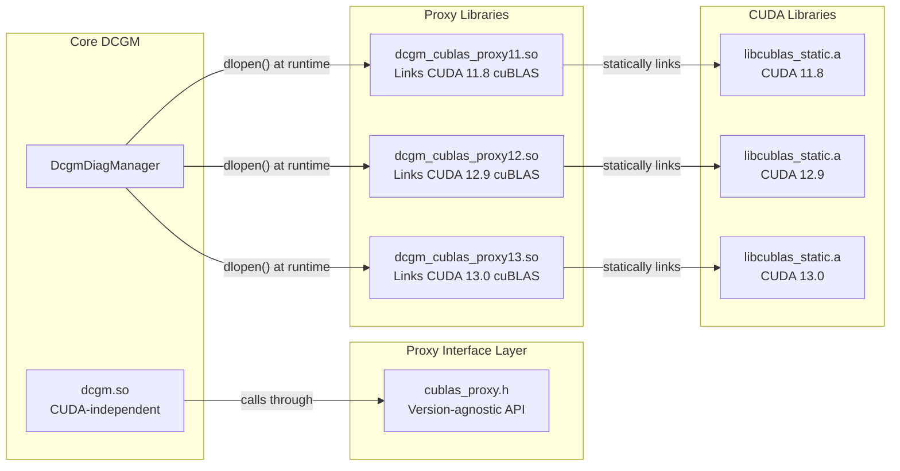
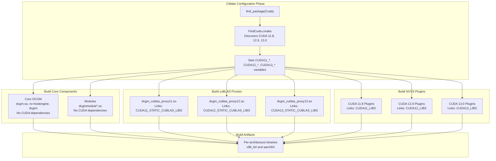
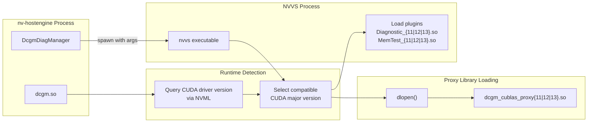

<!-- source: DeepWiki mcp.deepwiki.com · repo NVIDIA/DCGM · page 5.2 Multi-CUDA Support · fetched 2026-10-26 -->

# Multi-CUDA Support

<details>
<summary>Relevant source files</summary>

The following files were used as context for generating this wiki page:

- [cmake/FindCuda.cmake](cmake/FindCuda.cmake)
- [cublas_proxy/CMakeLists.txt](cublas_proxy/CMakeLists.txt)

</details>


## Purpose and Scope

This document describes DCGM's multi-CUDA support architecture, which enables the system to work with multiple CUDA toolkit versions simultaneously on the same host. This capability allows DCGM to support different CUDA-based workloads without requiring users to maintain separate installations for each CUDA version.

The document covers:
- The `FindCuda.cmake` module that discovers installed CUDA toolkits
- Architecture of CUDA-independent vs CUDA-dependent components
- cuBLAS proxy libraries for version-specific cuBLAS access
- NVVS plugin builds for multiple CUDA versions
- Build system integration and component linking

For information about the overall build system structure, see [Build System](#5.1). For details on Docker-based builds, see [Building with Docker](#5.3). For packaging of CUDA-specific components, see [Packaging](#5.4).

---

## CUDA Discovery

DCGM uses a custom CMake find module to locate and configure multiple CUDA toolkit installations on the build system.

### FindCuda.cmake Module

The `FindCuda.cmake` module searches for specific CUDA versions and exposes version-specific CMake variables for use by other components.

**Supported CUDA Versions**

The module searches for three CUDA versions defined at [cmake/FindCuda.cmake:17]():

```cmake
set(_Cuda_VERSIONS 11.8 12.9 13.0)
```

**Architecture-Specific Paths**

The module handles different target architectures by setting appropriate search paths at [cmake/FindCuda.cmake:19-29]():

| Architecture | Target Directory |
|--------------|-----------------|
| `x86_64` | `targets/x86_64-linux` |
| `aarch64` | `targets/sbsa-linux` |

**Search Path Construction**

The module builds a list of potential CUDA installation paths from multiple sources:
- `CMAKE_FIND_ROOT_PATH`, `CMAKE_SYSROOT`, `CMAKE_STAGING_PREFIX` roots
- `Cuda_ROOT` and `CUDA_ROOT` variables (both environment and CMake)
- Standard `/usr/local/cuda-<version>` locations

**Library Discovery**

For each CUDA version, the module searches for required libraries at [cmake/FindCuda.cmake:82-153]():

| Library | Type | Variable Name |
|---------|------|---------------|
| `cuda` | Stub | `Cuda_${MAJOR}_cuda_LIBRARY` |
| `culibos` | Static | `Cuda_${MAJOR}_culibos_LIBRARY` |
| `cudart_static` | Static | `Cuda_${MAJOR}_cudart_LIBRARY` |
| `cublas_static` | Static | `Cuda_${MAJOR}_cublas_LIBRARY` |
| `cublasLt_static` | Static | `Cuda_${MAJOR}_cublasLt_LIBRARY` |

**Exposed Variables**

For each successfully discovered CUDA version, the module sets the following variables:

```cmake
CUDA${MAJOR_VERSION}_INCLUDE_DIR       # Include directory path
CUDA${MAJOR_VERSION}_STATIC_LIBS       # cudart_static, culibos
CUDA${MAJOR_VERSION}_LIBS              # cuda stub library
CUDA${MAJOR_VERSION}_STATIC_CUBLAS_LIBS # cublas_static, cublasLt_static
```

These variables are used throughout the build system to link CUDA-dependent components.

**Sources**: [cmake/FindCuda.cmake:17-173]()

---

## Architecture Overview

DCGM's multi-CUDA architecture separates components into CUDA-independent and CUDA-dependent categories, allowing core functionality to remain version-agnostic while providing version-specific support where needed.

### Component Categories

```mermaid
graph TB
    subgraph CUDA_Independent["CUDA-Independent Components"]
        DCGM_LIB["dcgm.so<br/>Main API library"]
        NV_HOST["nv-hostengine<br/>Daemon process"]
        DCGMI["dcgmi<br/>CLI tool"]
        MODULES["Core Modules<br/>dcgmmodule*.so"]
    end
    
    subgraph CUDA_Dependent["CUDA-Dependent Components"]
        subgraph CUDA11["CUDA 11.8 Components"]
            PROXY11["dcgm_cublas_proxy11.so"]
            DIAG11["Diagnostic_11.so"]
            MEM11["MemTest_11.so"]
            STRESS11["TargetedStress_11.so"]
            POWER11["TargetedPower_11.so"]
            PCIE11["PCIe_11.so"]
        end
        
        subgraph CUDA12["CUDA 12.9 Components"]
            PROXY12["dcgm_cublas_proxy12.so"]
            DIAG12["Diagnostic_12.so"]
            MEM12["MemTest_12.so"]
            STRESS12["TargetedStress_12.so"]
            POWER12["TargetedPower_12.so"]
            PCIE12["PCIe_12.so"]
            NVBW12["NVBandwidth_12.so"]
        end
        
        subgraph CUDA13["CUDA 13.0 Components"]
            PROXY13["dcgm_cublas_proxy13.so"]
            DIAG13["Diagnostic_13.so"]
            MEM13["MemTest_13.so"]
            STRESS13["TargetedStress_13.so"]
            POWER13["TargetedPower_13.so"]
            PCIE13["PCIe_13.so"]
            NVBW13["NVBandwidth_13.so"]
        end
    end
    
    subgraph Runtime["Runtime Selection"]
        CUDA_DRIVER["CUDA Driver<br/>Determines compatible version"]
    end
    
    DCGM_LIB -.->|"dlopen() based on driver"| PROXY11
    DCGM_LIB -.->|"dlopen() based on driver"| PROXY12
    DCGM_LIB -.->|"dlopen() based on driver"| PROXY13
    
    NV_HOST -.->|"spawns nvvs with plugins"| DIAG11
    NV_HOST -.->|"spawns nvvs with plugins"| DIAG12
    NV_HOST -.->|"spawns nvvs with plugins"| DIAG13
    
    CUDA_DRIVER -->|"determines selection"| Runtime
```



**Component Independence**

CUDA-independent components:
- Link only against NVML for GPU management
- Use standard system libraries
- Built once per architecture
- Shared across all CUDA versions

CUDA-dependent components:
- Link against version-specific CUDA libraries
- Compiled with matching CUDA headers
- Built separately for each supported CUDA version
- Selected at runtime based on system CUDA driver

**Sources**: [cmake/FindCuda.cmake:17-173](), [cublas_proxy/CMakeLists.txt:17-43]()

---

## cuBLAS Proxy Libraries

The cuBLAS proxy libraries provide version-specific interfaces to NVIDIA's cuBLAS library, isolating CUDA version dependencies from the core DCGM library.

### Purpose and Design



### Build Configuration

The proxy libraries are defined using a CMake macro at [cublas_proxy/CMakeLists.txt:17-39]():

**Macro Definition**

```cmake
macro(define_proxy_lib CUDA_VER)
    set(lib_name dcgm_cublas_proxy${CUDA_VER})
    
    target_compile_definitions(${lib_name} PRIVATE CUDA_VERSION_USED=${CUDA_VER})
    target_link_options(${lib_name} PRIVATE
        -Wl,--no-undefined
        -Wl,--exclude-libs,ALL
        -Xlinker "--version-script=${CMAKE_CURRENT_SOURCE_DIR}/../cublas_proxy.linux_def")
```

**Key Build Options**

| Option | Purpose |
|--------|---------|
| `CUDA_VERSION_USED=${CUDA_VER}` | Compile-time version identifier |
| `-Wl,--no-undefined` | Ensure all symbols are resolved at link time |
| `-Wl,--exclude-libs,ALL` | Hide symbols from statically linked libraries |
| `--version-script` | Control exported symbol visibility |

**Library Linking**

Each proxy library links against version-specific CUDA components:

```cmake
target_link_libraries(${lib_name} PRIVATE
    ${CUDA${CUDA_VER}_LIBS}              # cuda stub library
    ${CUDA${CUDA_VER}_STATIC_CUBLAS_LIBS} # cublas_static, cublasLt_static
    ${CUDA${CUDA_VER}_STATIC_LIBS}        # cudart_static, culibos
    dcgm dcgm_common dcgm_logging dcgm_mutex
    dl rt)
```

**Subdirectory Structure**

The build instantiates the macro for each CUDA version at [cublas_proxy/CMakeLists.txt:41-43]():

```
cublas_proxy/
├── CMakeLists.txt          # Macro definition
├── cublas_proxy.cpp        # Shared implementation
├── cublas_proxy.linux_def  # Symbol export control
├── Cuda11/                 # add_library(dcgm_cublas_proxy11)
├── Cuda12/                 # add_library(dcgm_cublas_proxy12)
└── Cuda13/                 # add_library(dcgm_cublas_proxy13)
```

**Sources**: [cublas_proxy/CMakeLists.txt:17-43]()

---

## NVVS Plugin Multi-CUDA Support

NVVS diagnostic plugins are compiled separately for each CUDA version to ensure compatibility with the system's CUDA driver.

### Plugin Build Architecture

```mermaid
graph TB
    subgraph Plugin_Source["Plugin Source Code"]
        DIAG_SRC["DiagnosticPlugin.cpp"]
        MEM_SRC["MemTest.cpp"]
        STRESS_SRC["ConstantPerf.cpp"]
        POWER_SRC["TargetedPower.cpp"]
        PCIE_SRC["PCIe.cpp"]
        NVBW_SRC["NVBandwidth.cpp"]
    end
    
    subgraph Build_System["CMake Build System"]
        PLUGIN_CMAKE["nvvs/plugin_src/CMakeLists.txt"]
        
        BUILD11["Build Configuration<br/>CUDA 11.8"]
        BUILD12["Build Configuration<br/>CUDA 12.9"]
        BUILD13["Build Configuration<br/>CUDA 13.0"]
    end
    
    subgraph Output_11["CUDA 11.8 Plugins"]
        DIAG11["Diagnostic_11.so"]
        MEM11["MemTest_11.so"]
        STRESS11["TargetedStress_11.so"]
        POWER11["TargetedPower_11.so"]
        PCIE11["PCIe_11.so"]
    end
    
    subgraph Output_12["CUDA 12.9 Plugins"]
        DIAG12["Diagnostic_12.so"]
        MEM12["MemTest_12.so"]
        STRESS12["TargetedStress_12.so"]
        POWER12["TargetedPower_12.so"]
        PCIE12["PCIe_12.so"]
        NVBW12["NVBandwidth_12.so"]
    end
    
    subgraph Output_13["CUDA 13.0 Plugins"]
        DIAG13["Diagnostic_13.so"]
        MEM13["MemTest_13.so"]
        STRESS13["TargetedStress_13.so"]
        POWER13["TargetedPower_13.so"]
        PCIE13["PCIe_13.so"]
        NVBW13["NVBandwidth_13.so"]
    end
    
    DIAG_SRC --> PLUGIN_CMAKE
    MEM_SRC --> PLUGIN_CMAKE
    STRESS_SRC --> PLUGIN_CMAKE
    POWER_SRC --> PLUGIN_CMAKE
    PCIE_SRC --> PLUGIN_CMAKE
    NVBW_SRC --> PLUGIN_CMAKE
    
    PLUGIN_CMAKE --> BUILD11
    PLUGIN_CMAKE --> BUILD12
    PLUGIN_CMAKE --> BUILD13
    
    BUILD11 --> DIAG11
    BUILD11 --> MEM11
    BUILD11 --> STRESS11
    BUILD11 --> POWER11
    BUILD11 --> PCIE11
    
    BUILD12 --> DIAG12
    BUILD12 --> MEM12
    BUILD12 --> STRESS12
    BUILD12 --> POWER12
    BUILD12 --> PCIE12
    BUILD12 --> NVBW12
    
    BUILD13 --> DIAG13
    BUILD13 --> MEM13
    BUILD13 --> STRESS13
    BUILD13 --> POWER13
    BUILD13 --> PCIE13
    BUILD13 --> NVBW13
```



### Runtime Plugin Selection

When NVVS is launched by the Diag module, it selects the appropriate plugin set based on the system's CUDA driver version:

1. **Driver Version Query**: NVVS queries the CUDA driver version via NVML
2. **Plugin Path Selection**: Determines the plugin directory based on driver compatibility
3. **Plugin Loading**: Uses `dlopen()` to load version-matched plugins
4. **Execution**: Runs tests using CUDA APIs compatible with the driver

**Plugin Naming Convention**

```
<PluginName>_<CudaMajorVersion>.so
```

Examples:
- `Diagnostic_11.so` - Diagnostic plugin for CUDA 11.x
- `MemTest_12.so` - Memory test plugin for CUDA 12.x
- `NVBandwidth_13.so` - Bandwidth test plugin for CUDA 13.x

**Sources**: [cublas_proxy/CMakeLists.txt:17-43]()

---

## Build Process Integration

### Version-Specific Build Flow



### CMake Variable Usage

The build system uses version-specific variables from `FindCuda.cmake` to configure each CUDA-dependent component:

**Include Directories**

```cmake
target_include_directories(${lib_name} PUBLIC
    $<BUILD_INTERFACE:${CUDA${CUDA_VER}_INCLUDE_DIR}>)
```

**Library Linking**

```cmake
target_link_libraries(${lib_name} PRIVATE
    ${CUDA${CUDA_VER}_LIBS}
    ${CUDA${CUDA_VER}_STATIC_CUBLAS_LIBS}
    ${CUDA${CUDA_VER}_STATIC_LIBS})
```

### Conditional Compilation

Components can use the `CUDA_VERSION_USED` preprocessor definition to conditionally compile code based on the target CUDA version:

```c
#if CUDA_VERSION_USED >= 12
    // CUDA 12+ specific code
#else
    // CUDA 11 fallback
#endif
```

**Sources**: [cmake/FindCuda.cmake:17-173](), [cublas_proxy/CMakeLists.txt:17-43]()

---

## Component Interaction at Runtime

### Dynamic Library Loading



**Selection Logic**

The runtime selection ensures compatibility between the CUDA driver and CUDA libraries:

| CUDA Driver Version | Selected Components |
|---------------------|---------------------|
| 11.x - 11.8 | `*_11.so` libraries |
| 12.0 - 12.9 | `*_12.so` libraries |
| 13.0+ | `*_13.so` libraries |

**Backward Compatibility**

DCGM supports backward compatibility: a system with CUDA 13.x driver can use CUDA 11.x or 12.x components if explicitly required by application workloads. The system selects the highest compatible version by default.

**Sources**: [cmake/FindCuda.cmake:17-173](), [cublas_proxy/CMakeLists.txt:17-43]()

---

## Build Requirements

### Prerequisites for Multi-CUDA Builds

To build DCGM with full multi-CUDA support, the build system must have all supported CUDA toolkits installed:

**Required CUDA Installations**

```
/usr/local/cuda-11.8/
├── targets/
│   ├── x86_64-linux/
│   │   ├── include/
│   │   │   └── cuda.h
│   │   └── lib/
│   │       ├── libcuda.so (stub)
│   │       ├── libcudart_static.a
│   │       ├── libcublas_static.a
│   │       ├── libcublasLt_static.a
│   │       └── libculibos.a
│   └── sbsa-linux/
│       └── (same structure for aarch64)

/usr/local/cuda-12.9/
└── (same structure)

/usr/local/cuda-13.0/
└── (same structure)
```

**Partial CUDA Support**

If fewer than all CUDA versions are available, the build will:
1. Generate warnings for missing CUDA versions
2. Skip building components for unavailable versions
3. Successfully build core components and available CUDA-specific components
4. Produce incomplete packages (e.g., only `datacenter-gpu-manager-cuda11`)

**Verification**

After configuration, CMake reports discovered CUDA versions:

```
-- Found Cuda: TRUE
-- CUDA11_INCLUDE_DIR: /usr/local/cuda-11.8/targets/x86_64-linux/include
-- CUDA12_INCLUDE_DIR: /usr/local/cuda-12.9/targets/x86_64-linux/include
-- CUDA13_INCLUDE_DIR: /usr/local/cuda-13.0/targets/x86_64-linux/include
```

**Sources**: [cmake/FindCuda.cmake:17-173]()

---

## Summary

DCGM's multi-CUDA support enables a single installation to work with different CUDA driver versions through:

1. **Discovery**: `FindCuda.cmake` locates and validates multiple CUDA toolkit installations
2. **Separation**: Core components remain CUDA-independent while CUDA-dependent components are isolated
3. **Proxy Pattern**: cuBLAS proxy libraries provide version-specific cuBLAS access with runtime selection
4. **Plugin Variants**: NVVS plugins are built for each CUDA version and loaded dynamically
5. **Runtime Selection**: Components are selected based on the system's CUDA driver version

This architecture allows DCGM packages to support diverse deployment environments without requiring users to manage multiple DCGM installations or rebuild components when CUDA drivers are upgraded.

**Sources**: [cmake/FindCuda.cmake:17-173](), [cublas_proxy/CMakeLists.txt:17-43]()

---

