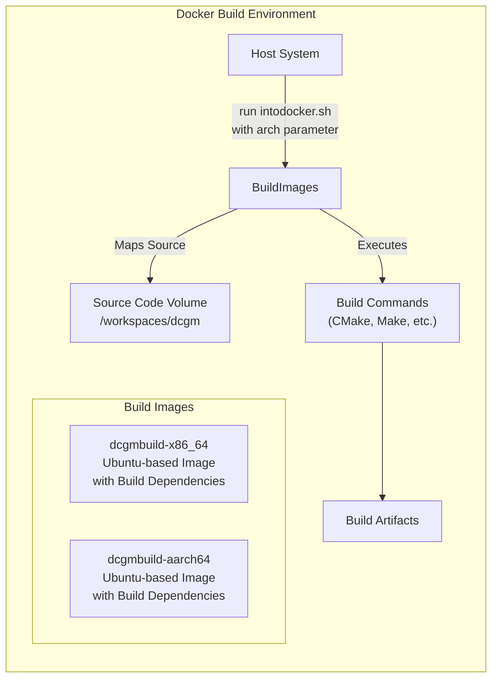
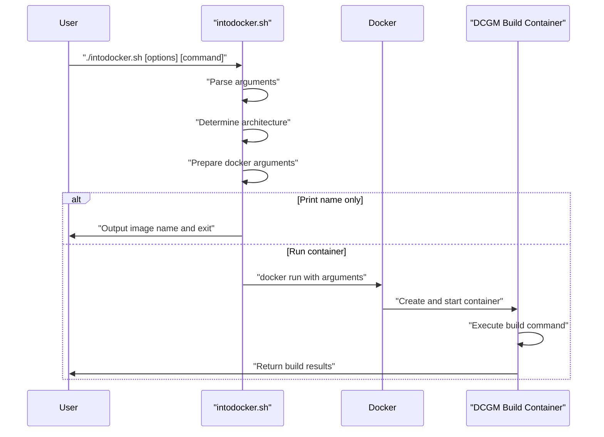
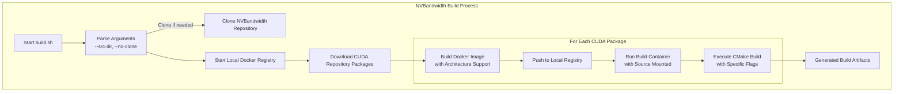

<!-- source: DeepWiki mcp.deepwiki.com · repo NVIDIA/DCGM · page 5.3 Building with Docker · fetched 2026-10-26 -->

# Building with Docker

<details>
<summary>Relevant source files</summary>

The following files were used as context for generating this wiki page:

- [README.md](README.md)
- [common/ThreeWayCmpDefault.hpp](common/ThreeWayCmpDefault.hpp)
- [intodocker.sh](intodocker.sh)
- [modules/nvswitch/DcgmModuleNvSwitch.cpp](modules/nvswitch/DcgmModuleNvSwitch.cpp)
- [modules/nvswitch/FieldDefinitions.h](modules/nvswitch/FieldDefinitions.h)
- [nvvs/include/NvvsJsonStrings.h](nvvs/include/NvvsJsonStrings.h)
- [testing/python3/tests/test_dcgm_collectd_plugin.py](testing/python3/tests/test_dcgm_collectd_plugin.py)

</details>


## Purpose and Scope

This document explains how to build NVIDIA Data Center GPU Manager (DCGM) using Docker containers. Docker provides a consistent and reproducible build environment regardless of the host system configuration. This approach is particularly useful for development, testing, and creating release packages across different architectures.

For information about the overall build system architecture, see [Build System](#5.1). For packaging the built binaries, see [Packaging](#5.3).

## Supported Architectures

DCGM supports building on two primary architectures:

- x86_64 (also referred to as amd64 or x64)
- aarch64 (also referred to as arm64)

Docker images are provided for both architectures with all necessary build dependencies pre-installed.

Sources: [intodocker.sh:91-105]()

## Docker Build Environment

### Build Image Structure

The DCGM build environment uses architecture-specific Docker images to ensure proper compilation across platforms.



Sources: [intodocker.sh:88-105](), [intodocker.sh:122-127]()

### Environment Variables

The Docker build process can be customized using the following environment variables:

| Environment Variable | Description | Default Value |
|----------------------|-------------|---------------|
| `DCGM_DOCKER_IMAGE` | Base name of the Docker image | `dcgmbuild` |
| `DCGM_BUILD_INSIDE_DOCKER` | Flag to prevent recursion when already inside a container | `0` |
| `DEBUG_BUILD_SCRIPT` | Enable debug mode for the build script | `0` |

Sources: [intodocker.sh:19-23](), [intodocker.sh:28](), [intodocker.sh:85-87]()

## Using the intodocker.sh Script

The primary interface for building DCGM with Docker is the `intodocker.sh` script, which manages the Docker container lifecycle and executes build commands inside the container.

### Workflow Diagram



Sources: [intodocker.sh:30-41](), [intodocker.sh:113-137]()

### Command-Line Arguments

The `intodocker.sh` script accepts the following command-line arguments:

| Argument | Description |
|----------|-------------|
| `-a`, `--arch NAME` | Architecture to build for (amd64/x86_64, aarch64/arm64) |
| `-e`, `--env VAR=VALUE` | Environment variables for the launched container |
| `-n`, `--name` | Print docker image name and exit |
| `-h`, `--help` | Print help information and exit |

Any additional arguments passed to the script will be executed as commands inside the Docker container.

Sources: [intodocker.sh:30-41](), [intodocker.sh:43-83]()

### Example Usage

To build DCGM on the host's native architecture:

```bash
./intodocker.sh ./build.sh
```

To build DCGM for aarch64 on an x86_64 host:

```bash
./intodocker.sh --arch aarch64 ./build.sh
```

To run CMake configuration with specific flags:

```bash
./intodocker.sh -e CMAKE_BUILD_TYPE=Release cmake -B _out/build
```

Sources: [intodocker.sh:122-137]()

## Docker Container Behavior

When running the `intodocker.sh` script:

1. The script determines the appropriate Docker image based on the target architecture
2. It mounts the source code directory to `/workspaces/[project_name]` inside the container
3. It sets the appropriate user ID to maintain file ownership
4. It forwards network access to the host
5. It executes the specified command in the container working directory

The container is removed after execution completes, ensuring a clean environment for each build.

Sources: [intodocker.sh:118-137]()

## Building Components with Docker

### NVBandwidth Plugin Build Process

The NVBandwidth plugin, a component of NVVS (NVIDIA Validation Suite), has a specialized build process using Docker. The `build.sh` script in the `nvvs/plugin_src/nvbandwidth` directory handles this process.



Sources: [nvvs/plugin_src/nvbandwidth/build.sh:10-50](), [nvvs/plugin_src/nvbandwidth/build.sh:100-168]()

### Key Features of the NVBandwidth Build

- Supports building for multiple CUDA versions and architectures
- Automatically sets up cross-compilation environment when needed
- Uses Docker Buildx for multi-architecture support
- Configures proper compilation flags for portability
- Builds both shared and static components

Sources: [nvvs/plugin_src/nvbandwidth/build.sh:111-145](), [nvvs/plugin_src/nvbandwidth/build.sh:160-167]()

## Best Practices

1. **Use the provided scripts**: The `intodocker.sh` script handles most of the complexity of Docker-based builds.

2. **Architecture awareness**: Always specify the target architecture explicitly with the `--arch` flag if building for a different architecture than the host.

3. **Environment variables**: Pass build configuration through environment variables using the `-e` flag when needed.

4. **Development workflow**: For iterative development, you can run a persistent shell in the container:
   ```bash
   ./intodocker.sh bash
   ```

5. **File permissions**: The build scripts automatically handle user ID mapping to prevent permission issues with generated files.

Sources: [intodocker.sh:132-135]()

## Troubleshooting

| Issue | Solution |
|-------|----------|
| Docker image not found | Ensure Docker is installed and running. The build script will attempt to use an appropriate image for your architecture. |
| Permission denied errors | If using rootless Docker, permissions are handled automatically. Otherwise, check that the script is correctly setting the user ID. |
| Build fails with architecture mismatch | Explicitly specify the target architecture with `--arch` and ensure QEMU is installed for cross-architecture builds. |
| Recursive container execution | The script checks for `DCGM_BUILD_INSIDE_DOCKER` to prevent recursive execution. If necessary, you can set this manually. |

Sources: [intodocker.sh:85-87](), [intodocker.sh:133-135]()

---

