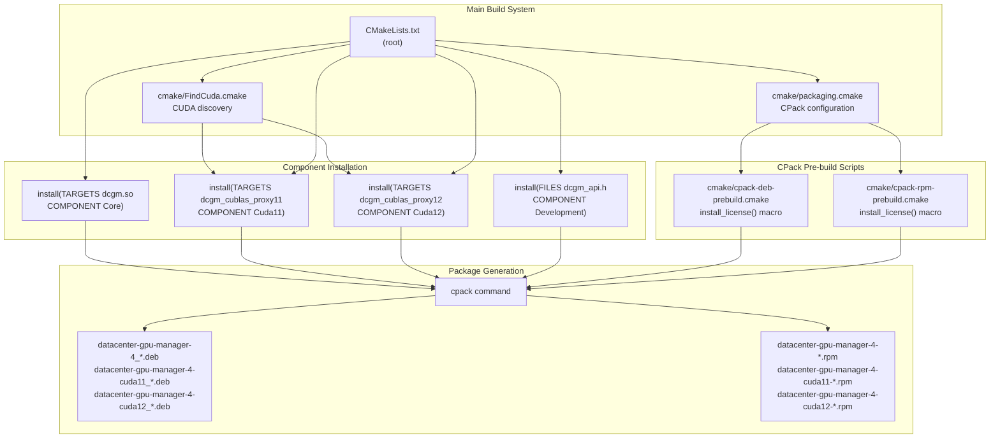
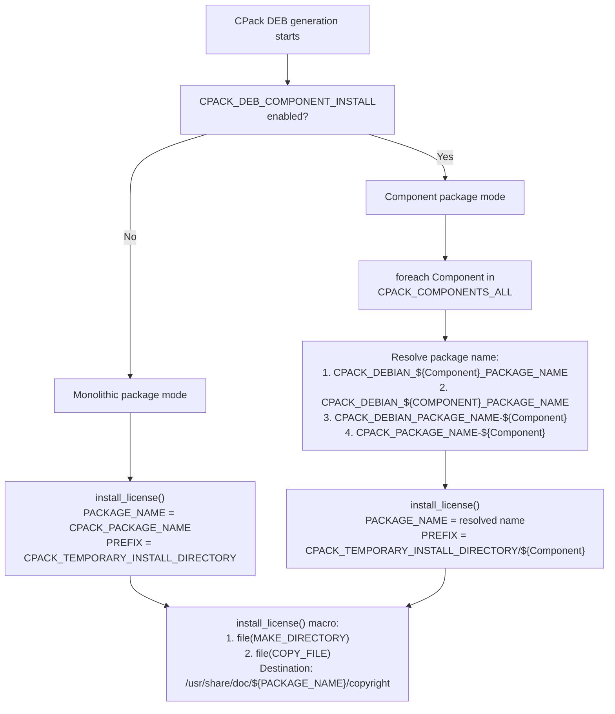
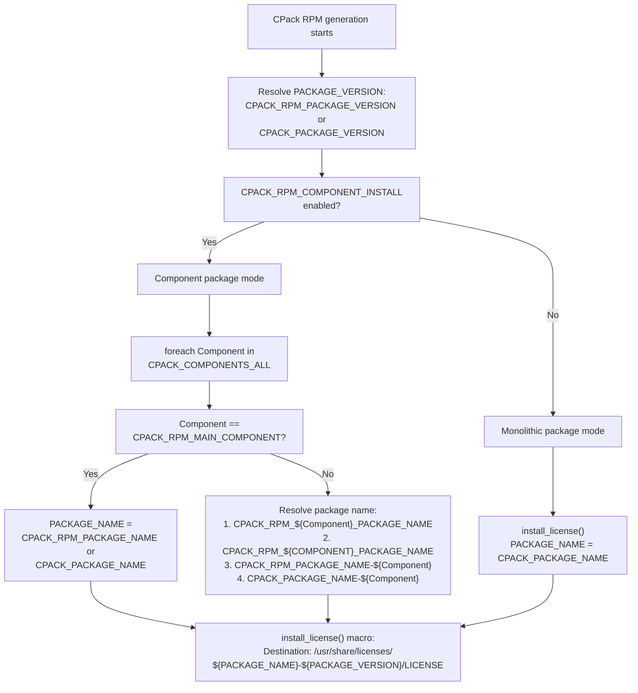
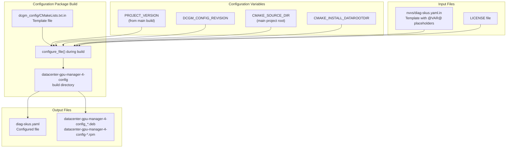

<!-- source: DeepWiki mcp.deepwiki.com · repo NVIDIA/DCGM · page 5.4 Packaging · fetched 2026-10-26 -->

# Packaging

<details>
<summary>Relevant source files</summary>

The following files were used as context for generating this wiki page:

- [cmake/cpack-deb-prebuild.cmake](cmake/cpack-deb-prebuild.cmake)
- [cmake/cpack-rpm-prebuild.cmake](cmake/cpack-rpm-prebuild.cmake)
- [dcgm_config/CMakeLists.txt.in](dcgm_config/CMakeLists.txt.in)

</details>


## Purpose and Scope

This document describes DCGM's packaging system, which generates distributable DEB and RPM packages using CMake's CPack infrastructure. The packaging system creates component-based packages that allow users to install only the components they need (Core, CUDA-specific libraries, Development files, Tests).

For information about the build system that produces the artifacts being packaged, see [Build System](#5.1). For details on multi-CUDA support and how CUDA-specific components are built, see [Multi-CUDA Support](#5.2).

---

## Package Structure Overview

DCGM uses a component-based packaging strategy where the software is divided into logical components, each installable independently:

| Component | Contents | Purpose |
|-----------|----------|---------|
| Core | `dcgm.so`, `nv-hostengine`, `dcgmi`, base modules | Essential DCGM functionality |
| Cuda11 | `dcgm_cublas_proxy11.so`, NVVS plugins for CUDA 11 | CUDA 11.x support |
| Cuda12 | `dcgm_cublas_proxy12.so`, NVVS plugins for CUDA 12 | CUDA 12.x support |
| Cuda13 | `dcgm_cublas_proxy13.so`, NVVS plugins for CUDA 13 | CUDA 13.x support |
| Development | Header files, CMake config files | Building against DCGM |
| Tests | Test executables, test data | Validation and testing |
| Config | `diag-skus.yaml` configuration file | GPU diagnostic configuration |

This structure allows users to install only the Core package with the CUDA versions they need (e.g., `datacenter-gpu-manager-4` + `datacenter-gpu-manager-4-cuda12`), reducing disk space usage.

**Sources:** High-level architecture diagrams (Diagram 5: Build System and Multi-CUDA Support)

---

## CPack Integration

### CPack Configuration Flow



**Diagram: CPack Configuration and Package Generation Flow**

The packaging process integrates with CMake's CPack system. The main `CMakeLists.txt` defines installation targets with `COMPONENT` specifications, while `cmake/packaging.cmake` configures CPack variables. Pre-build scripts execute before package creation to handle platform-specific requirements like license file placement.

**Sources:** High-level architecture diagrams, [cmake/cpack-deb-prebuild.cmake:1-48](), [cmake/cpack-rpm-prebuild.cmake:1-60]()

---

## Pre-build Scripts for License Installation

### DEB Package License Handling

The DEB pre-build script ensures proper license file installation according to Debian packaging standards:



**Diagram: DEB Pre-build Script License Installation Logic**

The script [cmake/cpack-deb-prebuild.cmake:18-24]() defines the `install_license()` macro that creates the directory `/usr/share/doc/${PACKAGE_NAME}/` and copies the license file to `copyright`. When component-based packaging is enabled [cmake/cpack-deb-prebuild.cmake:26-47](), the script iterates through all components, resolves each component's package name using a precedence order, and installs the license file for each component separately.

**Key Variables:**
- `CPACK_DEB_COMPONENT_INSTALL` - Enables component-based packaging
- `CPACK_COMPONENTS_ALL` - List of all defined components
- `CPACK_DEBIAN_${Component}_PACKAGE_NAME` - Component-specific package name override
- `CPACK_RESOURCE_FILE_LICENSE` - Source license file path
- `CPACK_TEMPORARY_INSTALL_DIRECTORY` - Staging directory for package contents

**Sources:** [cmake/cpack-deb-prebuild.cmake:1-48]()

---

### RPM Package License Handling

The RPM pre-build script follows similar logic but adheres to RPM packaging conventions:



**Diagram: RPM Pre-build Script License Installation Logic**

The RPM script [cmake/cpack-rpm-prebuild.cmake:18-24]() installs licenses to `/usr/share/licenses/${PACKAGE_NAME}-${PACKAGE_VERSION}/LICENSE`, following RPM conventions. It includes special handling for the main component [cmake/cpack-rpm-prebuild.cmake:40-45]() where the package name doesn't include a component suffix.

**Key Differences from DEB:**
- License path includes package version: `/usr/share/licenses/${PACKAGE_NAME}-${PACKAGE_VERSION}/`
- License filename is `LICENSE` (not `copyright`)
- Main component receives base package name without suffix
- Resolves `CPACK_RPM_PACKAGE_VERSION` separately

**Sources:** [cmake/cpack-rpm-prebuild.cmake:1-60]()

---

## Configuration Package

### datacenter-gpu-manager-4-config Package

DCGM includes a separate configuration package that provides auxiliary definitions and configuration files:



**Diagram: Configuration Package Build Process**

The configuration package is built from [dcgm_config/CMakeLists.txt.in:1-65](), a CMake template file that is configured during the main build process. This package:

1. **Defines the project:** [dcgm_config/CMakeLists.txt.in:20-23]()
   - Project name: `datacenter-gpu-manager-4-config`
   - Version includes `@PROJECT_VERSION@.@DCGM_CONFIG_REVISION@`
   - Architecture-independent package (`all` for DEB, `noarch` for RPM)

2. **Configures diag-skus.yaml:** [dcgm_config/CMakeLists.txt.in:30]()
   - Processes template `nvvs/diag-skus.yaml.in` 
   - Substitutes CMake variables (e.g., installation paths)
   - See [Diagnostic SKUs Configuration](#4.1) for details on this file

3. **Installs configuration files:** [dcgm_config/CMakeLists.txt.in:32-33]()
   - Destination: `${CMAKE_INSTALL_DATAROOTDIR}/datacenter-gpu-manager-4-config`
   - Typically resolves to `/usr/share/datacenter-gpu-manager-4-config/`

**Sources:** [dcgm_config/CMakeLists.txt.in:1-65]()

---

### Configuration Package Dependencies

The configuration package enforces strict version dependencies on the main DCGM package:

**DEB Dependencies:** [dcgm_config/CMakeLists.txt.in:45-47]()
```cmake
"datacenter-gpu-manager-4 (>= @CPACK_DEBIAN_PACKAGE_EPOCH@:@PROJECT_VERSION@~0-0)"
"datacenter-gpu-manager-4 (<= @CPACK_DEBIAN_PACKAGE_EPOCH@:@PROJECT_VERSION@-99)"
```

**RPM Dependencies:** [dcgm_config/CMakeLists.txt.in:56-58]()
```cmake
"datacenter-gpu-manager-4 >= @CPACK_RPM_PACKAGE_EPOCH@:@PROJECT_VERSION@~0"
"datacenter-gpu-manager-4 <= @CPACK_DEBIAN_PACKAGE_EPOCH@:@PROJECT_VERSION@"
```

These dependencies ensure that:
- The configuration package matches the installed DCGM version
- Pre-release versions (`~0`) can coexist with release versions
- Minor version updates within the same major version are compatible

**Package Properties:**

| Property | DEB | RPM |
|----------|-----|-----|
| Architecture | `all` [dcgm_config/CMakeLists.txt.in:44]() | `noarch` [dcgm_config/CMakeLists.txt.in:55]() |
| Component Install | Disabled [dcgm_config/CMakeLists.txt.in:39-41]() | Disabled [dcgm_config/CMakeLists.txt.in:39-41]() |
| Debug Package | Disabled [dcgm_config/CMakeLists.txt.in:43]() | Disabled [dcgm_config/CMakeLists.txt.in:54]() |
| Version Constraints | Range with epoch | Range with epoch |

**Sources:** [dcgm_config/CMakeLists.txt.in:35-64]()

---

## Package Naming and Versioning

### DEB Package Naming

DEB packages follow the naming convention:
```
<package-name>_<version>_<architecture>.deb
```

Example: [dcgm_config/CMakeLists.txt.in:49-52]()
```cmake
"datacenter-gpu-manager-4-config_3.3.10_all.deb"
```

Component packages append the component name to the base package name when using component-based installation [cmake/cpack-deb-prebuild.cmake:39]().

### RPM Package Naming

RPM packages follow a similar pattern but with different separators and may include epoch information:
```
<package-name>-<version>-<release>.<architecture>.rpm
```

The main component doesn't receive a suffix [cmake/cpack-rpm-prebuild.cmake:40-45](), while subcomponents get names like `datacenter-gpu-manager-4-cuda11`.

**Sources:** [dcgm_config/CMakeLists.txt.in:49-58](), [cmake/cpack-deb-prebuild.cmake:34-42](), [cmake/cpack-rpm-prebuild.cmake:40-54]()

---

## CPack Variables Reference

### Common CPack Variables

| Variable | Description | Source |
|----------|-------------|--------|
| `CPACK_PACKAGE_VERSION` | Full package version | Set from `PROJECT_VERSION` |
| `CPACK_PROJECT_CONFIG_FILE` | Path to packaging.cmake | Main CMakeLists.txt |
| `CPACK_RESOURCE_FILE_LICENSE` | License file path | Main CMakeLists.txt |
| `CPACK_COMPONENTS_ALL` | List of all components | Auto-generated by CPack |
| `CPACK_TEMPORARY_INSTALL_DIRECTORY` | Staging directory | CPack internal |
| `CPACK_OBJDUMP` | Path to objdump tool | CMake toolchain |
| `CPACK_STRIP` | Path to strip tool | CMake toolchain |

### DEB-Specific Variables

| Variable | Description | Usage |
|----------|-------------|-------|
| `CPACK_DEB_COMPONENT_INSTALL` | Enable component packages | [cmake/cpack-deb-prebuild.cmake:26]() |
| `CPACK_DEBIAN_PACKAGE_NAME` | Base package name | [cmake/cpack-deb-prebuild.cmake:38-39]() |
| `CPACK_DEBIAN_${Component}_PACKAGE_NAME` | Component package name override | [cmake/cpack-deb-prebuild.cmake:34-35]() |
| `CPACK_DEBIAN_PACKAGE_ARCHITECTURE` | Package architecture | [dcgm_config/CMakeLists.txt.in:44]() |
| `CPACK_DEBIAN_PACKAGE_DEPENDS` | Package dependencies | [dcgm_config/CMakeLists.txt.in:45-47]() |
| `CPACK_DEBIAN_FILE_NAME` | Output filename pattern | [dcgm_config/CMakeLists.txt.in:49-52]() |
| `CPACK_DEBIAN_PACKAGE_EPOCH` | Package epoch | Version comparison |
| `CPACK_DEBIAN_DEBUGINFO_PACKAGE` | Enable debug package | [dcgm_config/CMakeLists.txt.in:43]() |

### RPM-Specific Variables

| Variable | Description | Usage |
|----------|-------------|-------|
| `CPACK_RPM_COMPONENT_INSTALL` | Enable component packages | [cmake/cpack-rpm-prebuild.cmake:32]() |
| `CPACK_RPM_PACKAGE_NAME` | Base package name | [cmake/cpack-rpm-prebuild.cmake:41-44]() |
| `CPACK_RPM_${Component}_PACKAGE_NAME` | Component package name override | [cmake/cpack-rpm-prebuild.cmake:46-49]() |
| `CPACK_RPM_MAIN_COMPONENT` | Main component identifier | [cmake/cpack-rpm-prebuild.cmake:40]() |
| `CPACK_RPM_PACKAGE_ARCHITECTURE` | Package architecture | [dcgm_config/CMakeLists.txt.in:55]() |
| `CPACK_RPM_PACKAGE_REQUIRES` | Package dependencies | [dcgm_config/CMakeLists.txt.in:56-58]() |
| `CPACK_RPM_PACKAGE_VERSION` | Package version | [cmake/cpack-rpm-prebuild.cmake:26-30]() |
| `CPACK_RPM_PACKAGE_EPOCH` | Package epoch | Version comparison |
| `CPACK_RPM_DEBUGINFO_PACKAGE` | Enable debug package | [dcgm_config/CMakeLists.txt.in:54]() |

**Sources:** [cmake/cpack-deb-prebuild.cmake:1-48](), [cmake/cpack-rpm-prebuild.cmake:1-60](), [dcgm_config/CMakeLists.txt.in:35-64]()

---

## Package Installation Paths

### Standard Installation Paths

DCGM follows Linux Filesystem Hierarchy Standard (FHS) conventions:

| Content Type | DEB Path | RPM Path |
|--------------|----------|----------|
| Executables | `/usr/bin/` | `/usr/bin/` |
| Shared libraries | `/usr/lib/x86_64-linux-gnu/` or `/usr/lib/aarch64-linux-gnu/` | `/usr/lib64/` |
| Modules (.so) | Library path subdirectory | Library path subdirectory |
| Configuration | `/usr/share/datacenter-gpu-manager-4-config/` | `/usr/share/datacenter-gpu-manager-4-config/` |
| Documentation (DEB) | `/usr/share/doc/${PACKAGE_NAME}/` | N/A |
| Licenses (RPM) | N/A | `/usr/share/licenses/${PACKAGE_NAME}-${VERSION}/` |

### Architecture-Specific Paths

The library installation path varies by architecture:
- **x86_64:** `/usr/lib/x86_64-linux-gnu/` (DEB) or `/usr/lib64/` (RPM)
- **aarch64:** `/usr/lib/aarch64-linux-gnu/` (DEB) or `/usr/lib64/` (RPM)

These paths are resolved by CMake variables:
- `CMAKE_INSTALL_LIBDIR` - Base library directory
- `CMAKE_INSTALL_BINDIR` - Binary directory
- `CMAKE_INSTALL_DATAROOTDIR` - Data/configuration directory [dcgm_config/CMakeLists.txt.in:28]()

**Sources:** [dcgm_config/CMakeLists.txt.in:28-33](), [cmake/cpack-deb-prebuild.cmake:19-23](), [cmake/cpack-rpm-prebuild.cmake:19-23]()

---

## Summary

DCGM's packaging system provides:

1. **Component-based architecture** - Install only needed CUDA versions
2. **Dual package format support** - DEB for Debian/Ubuntu, RPM for RHEL/CentOS
3. **Automated license handling** - Pre-build scripts ensure compliance
4. **Separate configuration package** - Architecture-independent configs
5. **Strict version dependencies** - Ensures component compatibility
6. **Multi-architecture support** - x86_64 and aarch64 builds

The system uses CPack with custom pre-build scripts to handle platform-specific requirements while maintaining a unified build configuration. Component packages allow flexible deployment scenarios, from minimal installations (Core only) to full installations with all CUDA version support.

**Sources:** [cmake/cpack-deb-prebuild.cmake:1-48](), [cmake/cpack-rpm-prebuild.cmake:1-60](), [dcgm_config/CMakeLists.txt.in:1-65]()

---

