<!-- source: DeepWiki mcp.deepwiki.com · repo NVIDIA/DCGM · page 6 Testing · fetched 2026-10-26 -->

# Testing

<details>
<summary>Relevant source files</summary>

The following files were used as context for generating this wiki page:

- [testing/TestCacheManager.cpp](testing/TestCacheManager.cpp)
- [testing/TestCacheManager.h](testing/TestCacheManager.h)

</details>


## Purpose and Scope

This document provides an overview of DCGM's testing infrastructure, including unit tests, integration tests, and performance testing tools. DCGM employs a comprehensive testing strategy that validates core functionality (cache manager, field watching, entity management), module behavior (diagnostics, health monitoring, NVSwitch), and system-level performance characteristics.

The testing infrastructure consists of:
- **C++ Test Framework**: Based on the `TestDcgmModule` pattern for unit and integration tests
- **Cache Manager Tests**: Validates the core data collection and storage layer
- **Performance Testing**: The `dcgmproftester` tool for validating GPU metrics (see [dcgmproftester](#6.2))
- **Diagnostic Testing**: The NVVS system for hardware validation (see [NVVS](#4))
- **CUBLAS Proxy Tests**: For validating multi-CUDA version support (see [CUBLAS Proxy](#6.3))

Sources: [testing/TestCacheManager.cpp:1-60](), [testing/TestCacheManager.h:1-40]()

## Test Framework Architecture

### TestDcgmModule Base Class

All DCGM tests inherit from the `TestDcgmModule` base class, which provides a standardized interface for test execution:

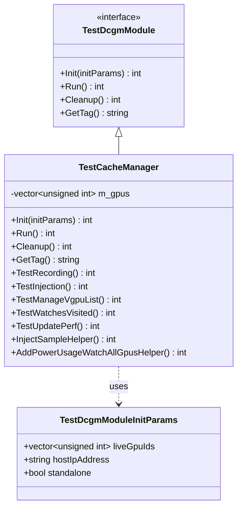

Sources: [testing/TestCacheManager.h:25-40](), [testing/TestCacheManager.cpp:39-63]()

### Test Lifecycle

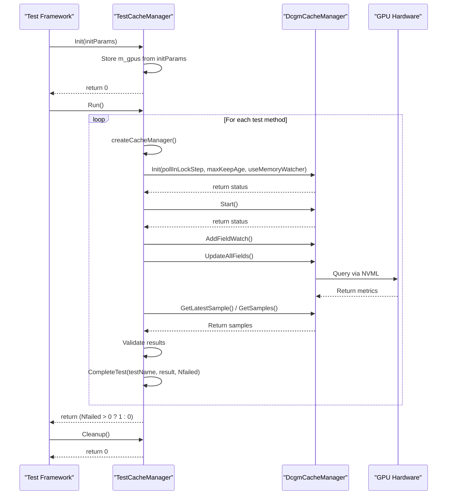

Sources: [testing/TestCacheManager.cpp:53-63](), [testing/TestCacheManager.cpp:66-96](), [testing/TestCacheManager.cpp:2178-2219]()

## Cache Manager Test Suite

The `TestCacheManager` class validates the core `DcgmCacheManager` functionality, which is critical for DCGM's data collection and storage. The test suite covers field watching, sample injection, vGPU management, time-based quotas, and performance characteristics.

### Test Categories

| Test Category | Test Methods | Purpose |
|---------------|-------------|---------|
| **Field Recording** | `TestRecording()`, `TestRecordingGlobal()` | Validates that field values are correctly stored and retrieved |
| **Sample Injection** | `TestInjection()`, `TestEmpty()` | Tests the ability to inject synthetic samples for testing |
| **vGPU Management** | `TestManageVgpuList()` | Validates vGPU instance tracking and lifecycle |
| **Field Watching** | `TestWatchesVisited()` | Ensures all watched fields are updated |
| **Quota Management** | `TestTimeBasedQuota()`, `TestCountBasedQuota()` | Validates sample retention policies |
| **Performance** | `TestUpdatePerf()`, `TestTimedModeAwakeTime()`, `TestLockstepModeAwakeTime()` | Measures cache manager CPU usage and latency |
| **Entity Management** | `TestSimulatedAttachDetach()`, `TestAttachDetachNoWatches()`, `TestAttachDetachWithWatches()` | Tests GPU attach/detach lifecycle |
| **Field Operations** | `TestFieldValueConversion()`, `TestSummary()` | Validates field data type conversions and summary calculations |

Sources: [testing/TestCacheManager.cpp:2178-2219]()

### Example: Field Recording Test

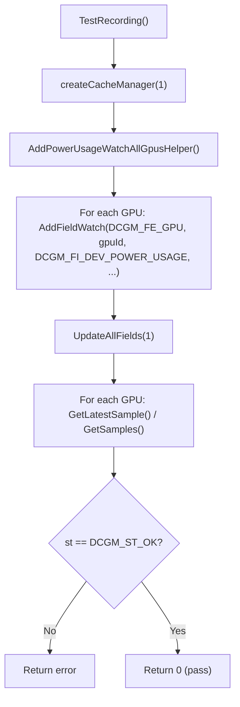

Sources: [testing/TestCacheManager.cpp:128-177]()

The test validates that:
1. Field watches can be added for all GPUs
2. `UpdateAllFields()` triggers data collection
3. `GetLatestSample()` and `GetSamples()` return valid data
4. No errors occur during the watch lifecycle

### Helper Functions

The test suite provides reusable helper functions:

| Helper Function | Purpose | Key Parameters |
|-----------------|---------|----------------|
| `createCacheManager()` | Creates and initializes a `DcgmCacheManager` instance | `pollInLockStep` (0 or 1) |
| `InjectSampleHelper()` | Injects synthetic samples for any field type | `fieldMeta`, `entityGroupId`, `entityId`, `timestamp` |
| `AddPowerUsageWatchAllGpusHelper()` | Adds power usage watches for all GPUs | `cacheManager` |
| `GetAverageSampleFrequency()` | Calculates average time between samples | `samples`, `Nsamples` |
| `CompleteTest()` | Prints test results and tracks failures | `testName`, `testReturn`, `Nfailed` |

Sources: [testing/TestCacheManager.cpp:66-96](), [testing/TestCacheManager.cpp:99-125](), [testing/TestCacheManager.cpp:1003-1061](), [testing/TestCacheManager.cpp:2160-2175]()

### Injection Testing Pattern

The injection testing pattern allows tests to insert controlled data without requiring real hardware:

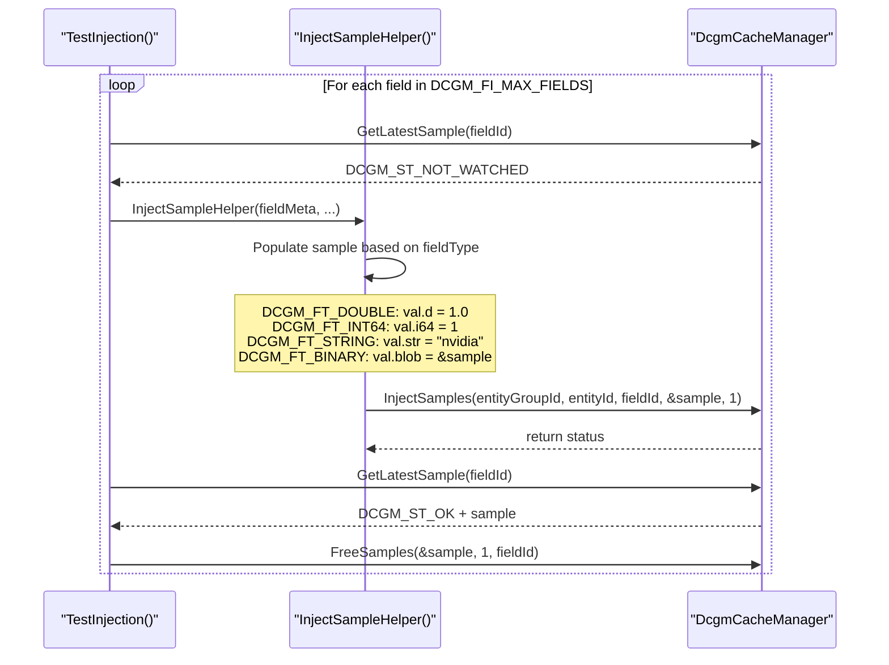

Sources: [testing/TestCacheManager.cpp:792-873](), [testing/TestCacheManager.cpp:1003-1061]()

### Performance Testing Pattern

Performance tests measure the cache manager's CPU usage and update latency:

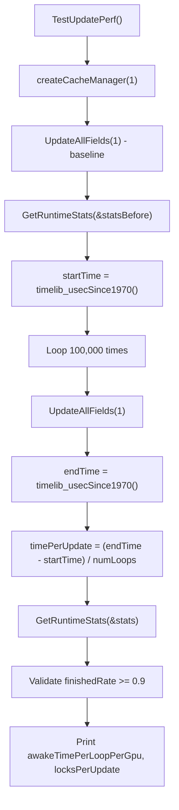

Sources: [testing/TestCacheManager.cpp:1595-1673]()

Key metrics measured:
- **Time per update**: Average latency of `UpdateAllFields()` call
- **Awake time per GPU**: CPU time spent per GPU per update cycle
- **Lock count**: Number of lock acquisitions during the test
- **Finished rate**: Percentage of requested updates that completed

### Attach/Detach Testing

Tests validate that the cache manager correctly handles GPU attach/detach cycles:

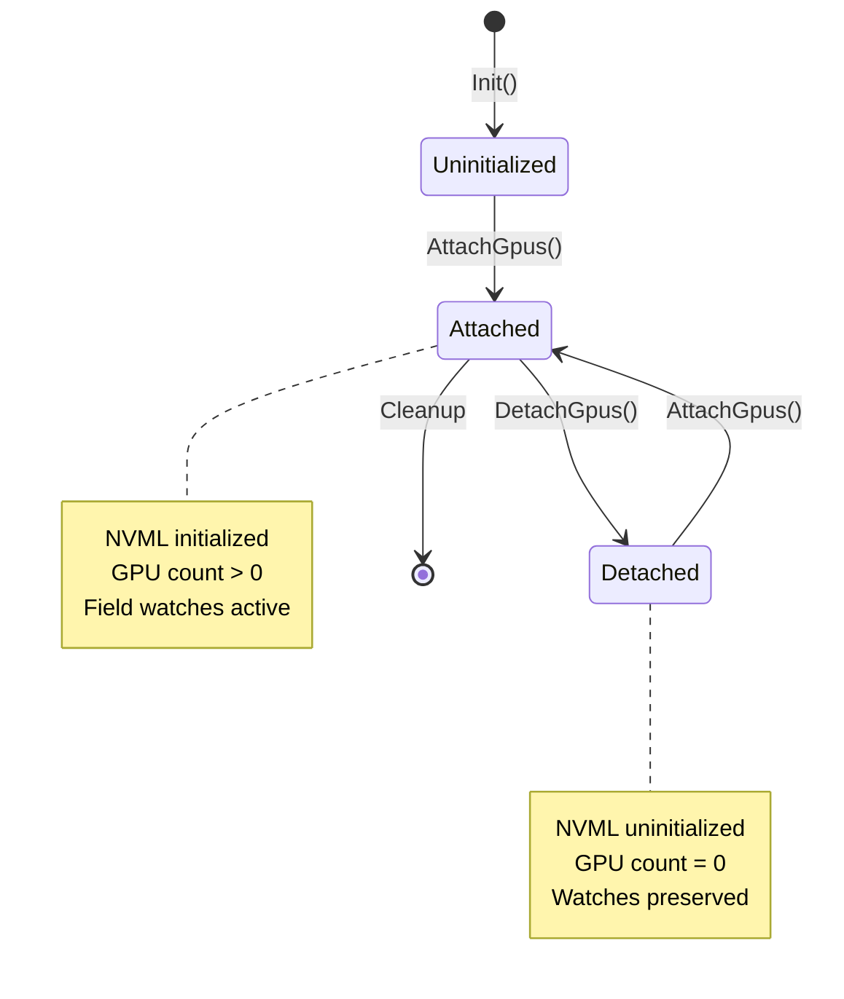

Sources: [testing/TestCacheManager.cpp:1676-1790](), [testing/TestCacheManager.cpp:1873-1899](), [testing/TestCacheManager.cpp:1902-2017]()

Tests validate:
- `AttachGpus()` initializes NVML and detects GPUs
- `DetachGpus()` shuts down NVML (verified by `NVML_ERROR_UNINITIALIZED`)
- Repeated attach/detach cycles maintain consistent GPU count
- Field watches persist across detach/attach cycles (in `TestAttachDetachWithWatches`)
- Performance characteristics remain acceptable (average attach/detach time)

## Overview of Performance Testing Architecture

### High-Level System Architecture

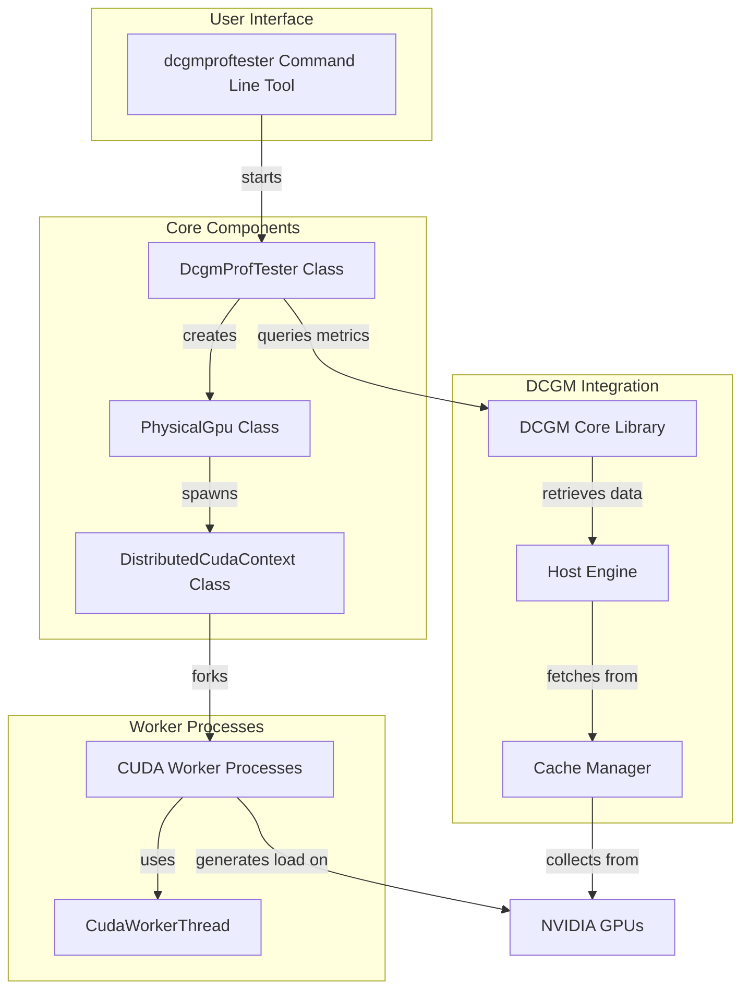

Sources: [dcgmproftester/DcgmProfTester.cpp:64-1068](), [dcgmproftester/PhysicalGpu.h:33-386](), [dcgmproftester/DistributedCudaContext.cpp:46-1691]()

### Parent-Child Process Model

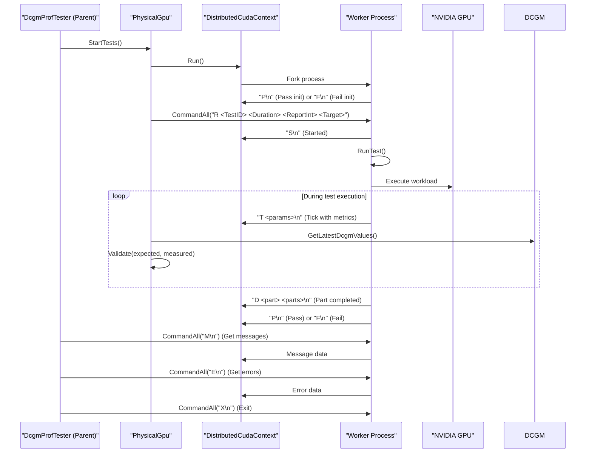

Sources: [dcgmproftester/DistributedCudaContext.cpp:1393-1485](), [dcgmproftester/PhysicalGpu.cpp:824-954](), [dcgmproftester/DcgmProfTester.cpp:864-967]()

## Main Components

### Class Relationship Diagram

```mermaid
classDiagram
    class DcgmProfTester {
        -map<unsigned int, shared_ptr<PhysicalGpu>> m_gpus
        -dcgmHandle_t m_dcgmHandle
        -fd_set m_parentReadFds
        +ParseCommandLine(argc, argv)
        +Init(argc, argv)
        +RunTests(reportingInterval, duration, testFieldId, maxGpusInParallel)
        +ProcessResponses(maxGpusInParallel, runningGpus, readyGpus, duration)
        +CreateWorkers(testFieldId)
    }
    
    class PhysicalGpu {
        -vector<shared_ptr<DistributedCudaContext>> m_dcgmCudaContexts
        -unsigned int m_gpuId
        -dcgmHandle_t m_dcgmHandle
        -Arguments_t::Parameters m_parameters
        +StartTests()
        +RunTests()
        +ProcessResponse(worker)
        +CommandAll(all, format, ...)
        +Validate(expected, current, measured, howFarIn, prevValidate)
        +AddSlice(entities, entity, deviceId)
    }
    
    class DistributedCudaContext {
        -int m_inFd
        -int m_outFd
        -int m_pid
        -CUdevice m_device
        -CudaWorkerThread m_cudaWorker
        -stringstream m_input
        -stringstream m_message
        -stringstream m_error
        +Run()
        +Command(format, ...)
        +ReadLn()
        +RunTest()
        +GetLatestDcgmValues(values)
    }
    
    class Arguments_t {
        +struct Parameters {
            unsigned int m_fieldId
            double m_duration
            double m_reportInterval
            bool m_noDcgmValidation
            bool m_targetMaxValue
        }
        +vector<unsigned int> m_gpuIds
    }
    
    DcgmProfTester "1" *-- "many" PhysicalGpu: contains
    PhysicalGpu "1" *-- "many" DistributedCudaContext: manages
    DcgmProfTester ..> Arguments_t: uses
```

Sources: [dcgmproftester/DcgmProfTester.cpp:64-90](), [dcgmproftester/PhysicalGpu.h:33-386](), [dcgmproftester/DistributedCudaContext.h:120-801]()

## Test Execution Flow

### Test Initialization and Execution Process

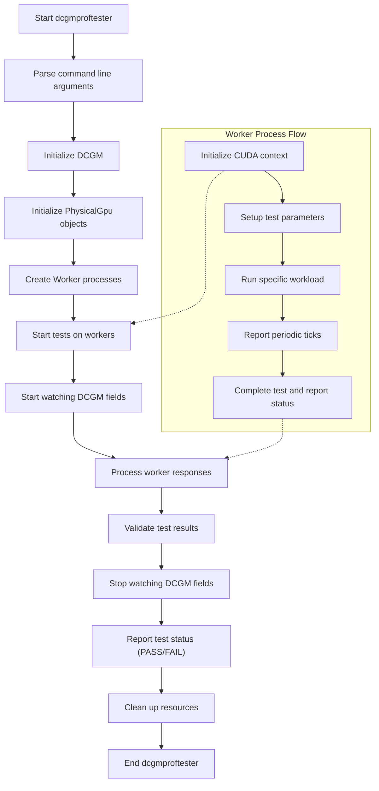

Sources: [dcgmproftester/DcgmProfTester.cpp:1088-1182](), [dcgmproftester/PhysicalGpu.cpp:824-954]()

## Supported Performance Tests

The `dcgmproftester` tool supports testing various GPU performance metrics:

| Field ID | Metric Name | Description | Implementation File |
|----------|-------------|-------------|---------------------|
| `DCGM_FI_PROF_GR_ENGINE_ACTIVE` | Graphics Engine Activity | Tests graphics engine utilization | [dcgmproftester/DistributedCudaContext.cpp:1029-1085]() |
| `DCGM_FI_PROF_SM_ACTIVE` | SM Activity | Tests streaming multiprocessor activity | [dcgmproftester/DistributedCudaContext.cpp:965-1026]() |
| `DCGM_FI_PROF_SM_OCCUPANCY` | SM Occupancy | Tests streaming multiprocessor occupancy | [dcgmproftester/DistributedCudaContext.cpp:890-962]() |
| `DCGM_FI_PROF_PCIE_RX_BYTES` | PCIe Receive Bandwidth | Tests PCIe receive bandwidth | [dcgmproftester/DistributedCudaContext.cpp:1087-1145]() |
| `DCGM_FI_PROF_PCIE_TX_BYTES` | PCIe Transmit Bandwidth | Tests PCIe transmit bandwidth | [dcgmproftester/DistributedCudaContext.cpp:1087-1145]() |
| `DCGM_FI_PROF_DRAM_ACTIVE` | DRAM Utilization | Tests DRAM utilization | [dcgmproftester/DistributedCudaContext.cpp:1224-1278]() |
| `DCGM_FI_PROF_PIPE_FP64_ACTIVE` | FP64 Pipeline Activity | Tests double-precision compute pipeline | [dcgmproftester/DistributedCudaContext.cpp:1331-1390]() |
| `DCGM_FI_PROF_PIPE_FP32_ACTIVE` | FP32 Pipeline Activity | Tests single-precision compute pipeline | [dcgmproftester/DistributedCudaContext.cpp:1331-1390]() |
| `DCGM_FI_PROF_PIPE_FP16_ACTIVE` | FP16 Pipeline Activity | Tests half-precision compute pipeline | [dcgmproftester/DistributedCudaContext.cpp:1331-1390]() |
| `DCGM_FI_PROF_PIPE_TENSOR_ACTIVE` | Tensor Core Activity | Tests tensor core utilization | [dcgmproftester/DistributedCudaContext.cpp:1280-1329]() |
| `DCGM_FI_PROF_NVLINK_RX_BYTES` | NVLink Receive Bandwidth | Tests NVLink receive bandwidth | [dcgmproftester/DistributedCudaContext.cpp:1148-1202]() |
| `DCGM_FI_PROF_NVLINK_TX_BYTES` | NVLink Transmit Bandwidth | Tests NVLink transmit bandwidth | [dcgmproftester/DistributedCudaContext.cpp:1148-1202]() |

Sources: [dcgmproftester/PhysicalGpu.cpp:894-947](), [dcgmproftester/DistributedCudaContext.cpp:1393-1485]()

## Test Protocol Between Parent and Worker

The parent process (DcgmProfTester) and worker processes communicate using a well-defined protocol over pipes:

### Parent to Worker Commands

| Command | Format | Description |
|---------|--------|-------------|
| Run | `R <TestID> <Duration> <ReportInterval> <TargetMaxValue>\n` | Start a specific test |
| Advance | `A\n` | Advance to next part of synchronous test |
| Quit | `Q\n` | Early termination request |
| Exit | `X\n` | Exit worker process |
| Messages | `M\n` | Request accumulated messages |
| Errors | `E\n` | Request accumulated errors |

### Worker to Parent Responses

| Response | Format | Description |
|----------|--------|-------------|
| Initialization | `P\n` or `F\n` | Pass or fail initialization |
| Start | `S\n` | Test started successfully |
| Done | `D <part> <parts>\n` | Part `<part>` of `<parts>` completed |
| Tick | `T <parameters>\n` | Periodic status updates (format varies per test) |
| Messages | `M <length>\n<messages>` | Messages with length prefix |
| Errors | `E <length>\n<errors>` | Errors with length prefix |
| Completion | `P\n` or `F\n` | Test passed or failed |

Sources: [dcgmproftester/DistributedCudaContext.cpp:1593-1672](), [dcgmproftester/PhysicalGpu.cpp:973-1078]()

## MIG Support

The performance testing system supports Multi-Instance GPU (MIG) configurations, allowing tests to be run on individual GPU instances or compute instances:

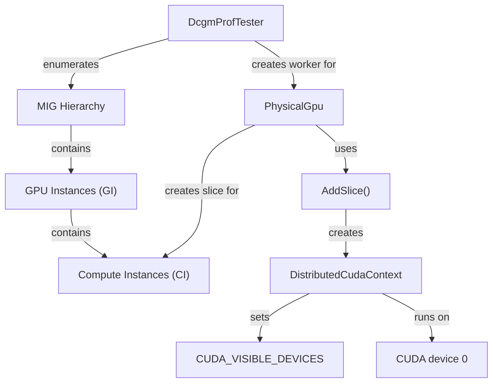

Sources: [dcgmproftester/PhysicalGpu.cpp:266-502](), [dcgmproftester/DcgmProfTester.cpp:976-1035]()

### MIG vs. Non-MIG Testing Differences

- In MIG mode, `CUDA_VISIBLE_DEVICES` is set to target specific MIG instances
- Each compute instance (CI) gets its own CUDA context and worker process
- Some tests (like DRAM utilization) are limited to one CI per GPU instance (GI)
- In non-MIG mode, physical device IDs are used directly

Sources: [dcgmproftester/DistributedCudaContext.cpp:97-119](), [dcgmproftester/PhysicalGpu.cpp:323-379]()

## Validation Methodology

The validation process compares the metrics reported by DCGM with those generated by controlled workloads:

### Validation Process

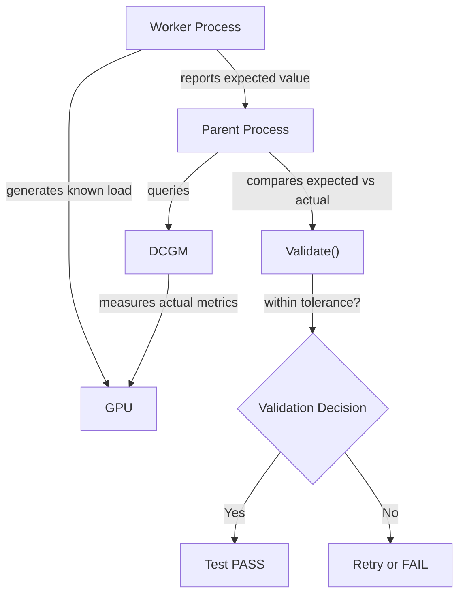

Sources: [dcgmproftester/PhysicalGpu.cpp:659-781]()

The validation method (`Validate()`) has two modes:

1. **Range-based validation**: Checks if the measured value falls within a defined range
   ```
   if (measured < m_parameters.m_minValue || measured > m_parameters.m_maxValue)
       return false;
   ```

2. **Relative validation**: Checks if the measured value is within tolerance of the expected value
   ```
   if (m_parameters.m_percentTolerance)
       // Percentage-based tolerance
       if (measured < lowExpected * (1.0 - m_parameters.m_tolerance / 100.0) ||
           measured > highExpected * (1.0 + m_parameters.m_tolerance / 100.0))
           return false;
   else
       // Absolute tolerance
       if (measured < (lowExpected - m_parameters.m_tolerance) ||
           measured > (highExpected + m_parameters.m_tolerance))
           return false;
   ```

Sources: [dcgmproftester/PhysicalGpu.cpp:659-781]()

## DCGM Integration

The performance testing system integrates with DCGM to watch and retrieve the metrics being tested:

1. **Group Creation**: Creates GPU and field groups to watch
   ```cpp
   dcgmGroupCreate(m_dcgmHandle, DCGM_GROUP_EMPTY, groupName, &m_groupId);
   dcgmGroupAddEntity(m_dcgmHandle, m_groupId, entityGroupId, entityId);
   dcgmFieldGroupCreate(m_dcgmHandle, 1, &fieldId, groupName, &m_fieldGroupId);
   ```

2. **Field Watching**: Sets up DCGM to monitor the specific fields
   ```cpp
   dcgmWatchFields(m_dcgmHandle, m_groupId, m_fieldGroupId, updateIntervalUsec, maxKeepAge, maxKeepSamples);
   ```

3. **Value Retrieval**: Gets the field values from DCGM
   ```cpp
   dcgmGetValuesSince_v2(m_dcgmHandle, m_groupId, m_fieldGroupId, m_sinceTimestamp, &nextSinceTimestamp, callback, data);
   ```

Sources: [dcgmproftester/DcgmProfTester.cpp:109-254](), [dcgmproftester/DistributedCudaContext.cpp:652-697](), [dcgmproftester/DistributedCudaContext.cpp:797-832]()

## Command Line Usage

The `dcgmproftester` tool accepts several command-line parameters to configure test execution:

| Option | Description |
|--------|-------------|
| `-i, --gpuIds` | Comma-separated list of GPUs to test |
| `-t, --testIds` | Comma-separated list of field IDs to test |
| `-d, --duration` | Test duration in seconds |
| `-r, --reportInterval` | Reporting interval in seconds |
| `-v, --validate` | Enable result validation |
| `-n, --noDcgmValidation` | Disable DCGM validation (just generate load) |
| `--targetMaxValue` | Target maximum value for tests |
| `-p, --maxGpusInParallel` | Maximum number of GPUs to test in parallel |
| `--minValue` | Minimum acceptable value for validation |
| `--maxValue` | Maximum acceptable value for validation |
| `--tolerance` | Tolerance value for validation |
| `--percentTolerance` | Use percentage-based tolerance |

Sources: [dcgmproftester/DcgmProfTester.cpp:93-106]()

## Special Considerations

### Hardware-Specific Adjustments

- PCIe bandwidth measurements have chip generation-specific adjustments to account for protocol overhead:
  ```cpp
  if (m_attributes.m_computeCapabilityMajor >= HOPPER_COMPAT)
      perSecond *= 1.08; /* Consistently saw an 8% difference in testing */
  else
      perSecond *= 1.123; /* We've seen a 12.3% overhead in testing */
  ```

- DRAM bandwidth tests account for ECC overhead on specific GPU architectures:
  ```cpp
  bool eccAffectsBandwidth = EccAffectsDramBandwidth() && (m_attributes.m_eccSupport > 0);
  ```

Sources: [dcgmproftester/DistributedCudaContext.cpp:1116-1125](), [dcgmproftester/DistributedCudaContext.cpp:1237-1238](), [dcgmproftester/DistributedCudaContext.cpp:1205-1222]()

### Test Serialization

Some tests that could potentially interfere with each other are serialized:

```cpp
switch (testFieldId)
{
    case DCGM_FI_PROF_PCIE_TX_BYTES:
    case DCGM_FI_PROF_PCIE_RX_BYTES:
    case DCGM_FI_PROF_NVLINK_TX_BYTES:
    case DCGM_FI_PROF_NVLINK_RX_BYTES:
        maxGpusInParallel = 1;
        break;
    default:
        break;
}
```

Sources: [dcgmproftester/DcgmProfTester.cpp:886-897]()

## Additional Documentation

For more details on specific components, refer to:

- [CUBLAS Proxy](#6.2) - Documentation of the CUBLAS proxy used for FP tests
- [dcgmproftester](#6.1) - Detailed documentation on dcgmproftester usage

---

