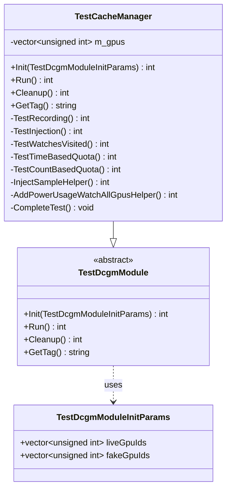
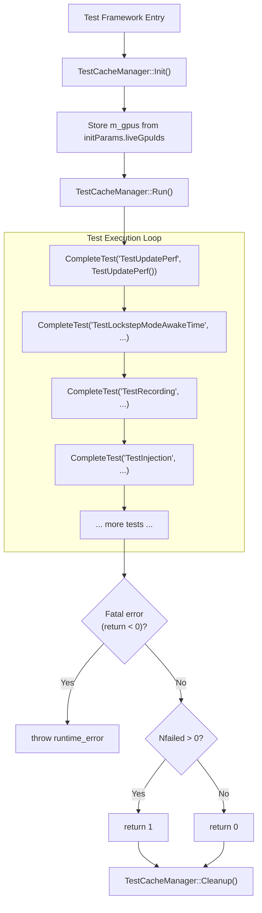
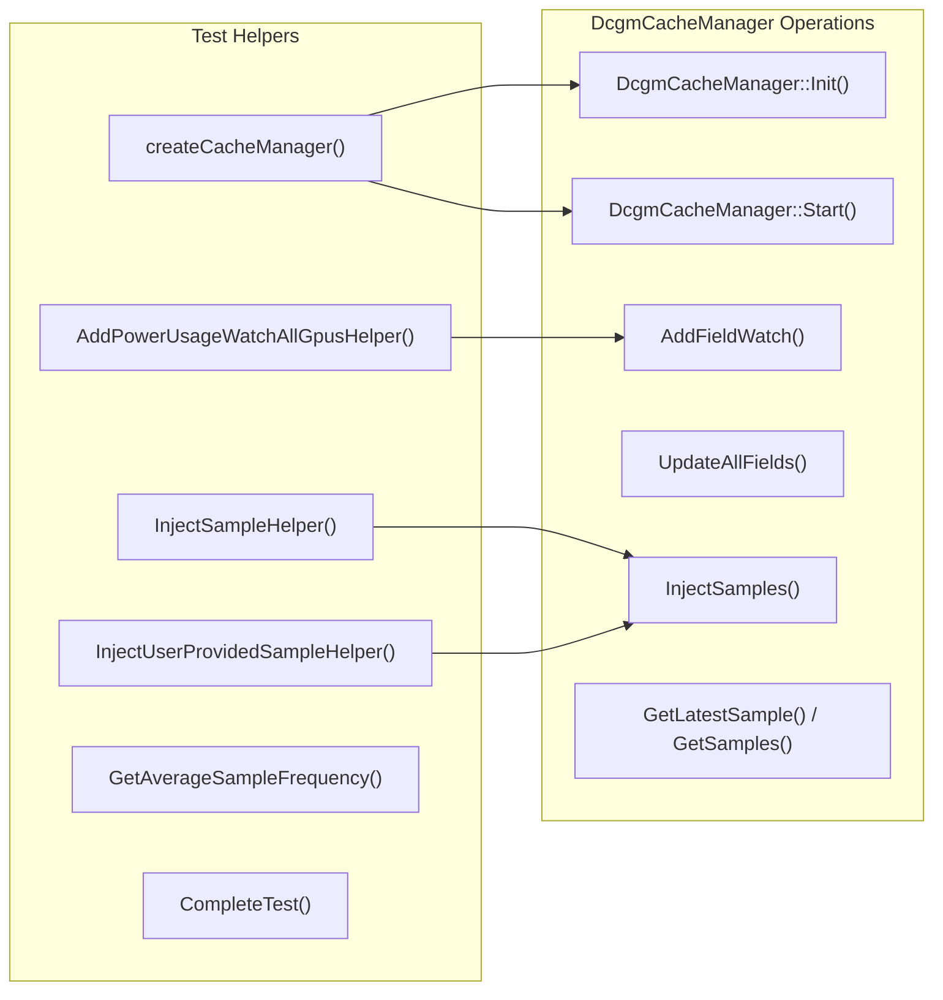
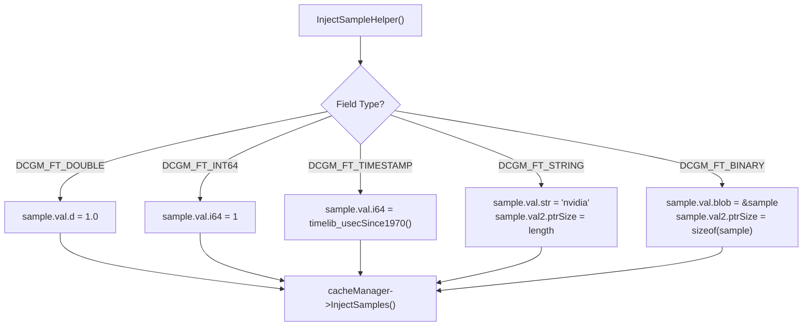
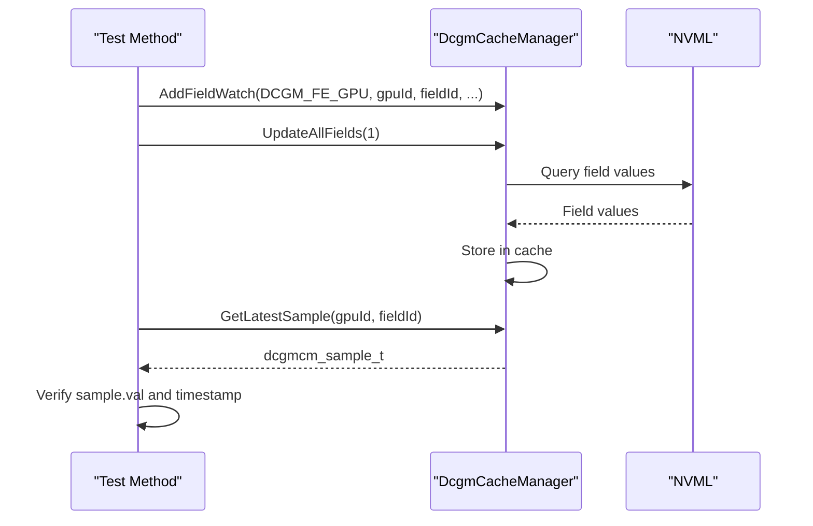
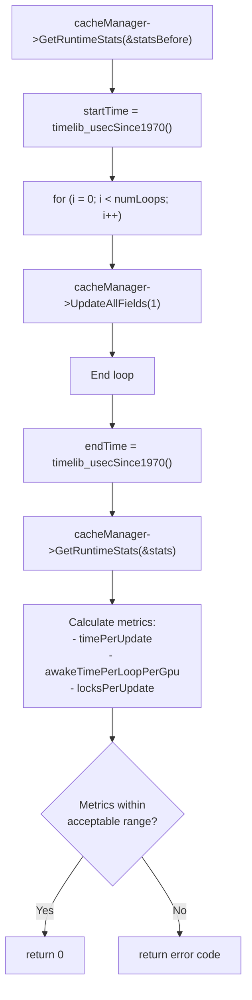
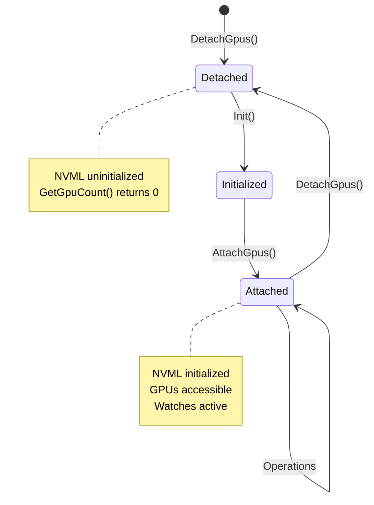
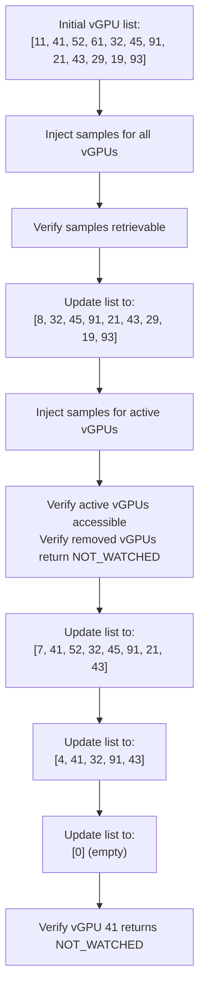

<!-- source: DeepWiki mcp.deepwiki.com · repo NVIDIA/DCGM · page 6.1 Test Framework · fetched 2026-10-26 -->

# Test Framework

<details>
<summary>Relevant source files</summary>

The following files were used as context for generating this wiki page:

- [testing/TestCacheManager.cpp](testing/TestCacheManager.cpp)
- [testing/TestCacheManager.h](testing/TestCacheManager.h)

</details>


## Purpose and Scope

This page documents the C++ test framework used for unit testing DCGM components. The framework provides a structured approach to testing core DCGM functionality, particularly the cache manager and module system. For performance testing and load generation tools, see [dcgmproftester](#6.2).

The test framework is built around the `TestDcgmModule` base class, which provides a standardized interface for test initialization, execution, and cleanup. This page focuses on the testing infrastructure for C++ components; for Python-based integration tests, refer to the `testing/python3/` directory.

## Test Framework Architecture

### Class Hierarchy and Lifecycle



**Sources:** [testing/TestCacheManager.h:25-128](), [testing/TestCacheManager.cpp:39-63]()

The test framework follows a three-phase lifecycle:

1. **Initialization (`Init`)**: Receives system configuration including available GPU IDs
2. **Execution (`Run`)**: Executes all test cases and aggregates results  
3. **Cleanup (`Cleanup`)**: Releases resources and performs teardown

Each test class implements these methods and returns status codes:
- `0`: Success
- `< 0`: Fatal error (aborts test framework)
- `> 0`: Non-fatal error (test continues)

### Test Execution Flow



**Sources:** [testing/TestCacheManager.cpp:2178-2219](), [testing/TestCacheManager.cpp:2160-2175]()

## TestCacheManager Implementation

The `TestCacheManager` class provides comprehensive testing for the `DcgmCacheManager` component. It demonstrates best practices for test structure and includes extensive helper methods.

### Test Suite Overview

| Test Method | Purpose | Key Features |
|------------|---------|--------------|
| `TestRecording` | Validates basic field value recording | Field watches, `UpdateAllFields`, sample retrieval |
| `TestRecordingGlobal` | Tests global field handling | Global scope fields (e.g., driver version) |
| `TestInjection` | Verifies sample injection for all field types | Injection for doubles, int64, strings, binary blobs |
| `TestEmpty` | Tests cache clearing functionality | `EmptyCache()`, watch state verification |
| `TestWatchesVisited` | Ensures all watched fields are updated | Validates update thread visits all watches |
| `TestManageVgpuList` | Tests vGPU list management | Dynamic vGPU addition/removal |
| `TestRecordTiming` | Validates update frequency accuracy | Timing verification within ±10% |
| `TestTimeBasedQuota` | Tests time-based sample retention | `maxAgeUsec` parameter validation |
| `TestCountBasedQuota` | Tests count-based sample retention | `maxKeepSamples` parameter validation |
| `TestUpdatePerf` | Measures cache manager performance | Lock contention, update cycle metrics |
| `TestTimedModeAwakeTime` | Validates idle CPU usage in timed mode | CPU usage < 1% when idle |
| `TestLockstepModeAwakeTime` | Validates idle CPU usage in lockstep mode | CPU usage < 1% when idle |
| `TestAttachDetachNoWatches` | Tests GPU attach/detach without watches | NVML lifecycle management |
| `TestAttachDetachWithWatches` | Tests GPU attach/detach with active watches | Watch preservation across attach/detach |
| `TestAreAllGpuIdsSameSku` | Tests SKU comparison logic | PCI device ID and subsystem ID matching |
| `TestMultipleWatchersMaxAge` | Tests multiple watchers on same field | MaxAge aggregation across watchers |

**Sources:** [testing/TestCacheManager.cpp:128-2157](), [testing/TestCacheManager.h:51-79]()

### Helper Method Pattern



**Sources:** [testing/TestCacheManager.cpp:66-96](), [testing/TestCacheManager.cpp:1003-1061](), [testing/TestCacheManager.cpp:99-125]()

### Cache Manager Creation Pattern

Tests create cache managers using the `createCacheManager()` helper:

```cpp
std::unique_ptr<DcgmCacheManager> createCacheManager(int pollInLockStep)
{
    auto cacheManager = std::make_unique<DcgmCacheManager>();
    cacheManager->Init(pollInLockStep, 86400.0, true);
    cacheManager->Start();
    return cacheManager;
}
```

Parameters:
- `pollInLockStep`: `1` for lockstep mode (manual updates), `0` for timed mode (automatic updates)
- `86400.0`: Max sample age in seconds (24 hours)
- `true`: Enable cache manager

**Sources:** [testing/TestCacheManager.cpp:66-96]()

### Sample Injection Pattern

The framework provides helpers for injecting test data:



**Sources:** [testing/TestCacheManager.cpp:1003-1061]()

The `InjectSampleHelper()` method handles type-specific value assignment for all DCGM field types:
- **Double**: Assigns `1.0`
- **Int64**: Assigns `1`
- **Timestamp**: Uses current time via `timelib_usecSince1970()`
- **String**: Uses static string `"nvidia"` with size tracking
- **Binary**: Injects sample structure itself as blob data

**Sources:** [testing/TestCacheManager.cpp:1020-1048]()

## Writing New Tests

### Basic Test Structure

To create a new test class:

1. **Inherit from TestDcgmModule:**
```cpp
class TestMyComponent : public TestDcgmModule
{
public:
    int Init(const TestDcgmModuleInitParams &initParams) override;
    int Run() override;
    int Cleanup() override;
    std::string GetTag() override;
    
private:
    // Test methods
    int TestBasicFunctionality();
    int TestErrorHandling();
    
    // Member variables
    std::vector<unsigned int> m_gpus;
};
```

2. **Implement lifecycle methods:**
   - `Init()`: Store GPU IDs, allocate resources
   - `Run()`: Execute all test cases using `CompleteTest()` helper
   - `Cleanup()`: Release resources
   - `GetTag()`: Return unique identifier (e.g., "mycomponent")

**Sources:** [testing/TestCacheManager.h:25-37](), [testing/TestCacheManager.cpp:39-63]()

### Test Execution Pattern

The `CompleteTest()` helper standardizes test execution:

```cpp
int TestMyComponent::Run()
{
    int Nfailed = 0;
    
    try
    {
        CompleteTest("TestBasicFunctionality", TestBasicFunctionality(), Nfailed);
        CompleteTest("TestErrorHandling", TestErrorHandling(), Nfailed);
    }
    catch (const std::runtime_error &e)
    {
        return -1;  // Fatal error
    }
    
    if (Nfailed > 0)
    {
        fprintf(stderr, "%d tests FAILED\n", Nfailed);
        return 1;
    }
    
    return 0;
}
```

**Sources:** [testing/TestCacheManager.cpp:2178-2219](), [testing/TestCacheManager.cpp:2160-2175]()

### Return Code Convention

| Return Value | Meaning | Framework Behavior |
|--------------|---------|-------------------|
| `0` | Test passed | Continue to next test |
| `> 0` | Non-fatal failure | Increment failure count, continue |
| `< 0` | Fatal error | Throw exception, abort test suite |

**Sources:** [testing/TestCacheManager.h:43-50]()

## Common Test Patterns

### Field Watch Testing

To test field watching functionality:

1. Create cache manager
2. Add field watches with `AddFieldWatch()`
3. Trigger update with `UpdateAllFields()`
4. Retrieve samples with `GetLatestSample()` or `GetSamples()`
5. Verify sample values and timestamps



**Sources:** [testing/TestCacheManager.cpp:128-177](), [testing/TestCacheManager.cpp:404-603]()

### Performance Testing Pattern

Performance tests measure timing and resource usage:



**Sources:** [testing/TestCacheManager.cpp:1595-1673]()

Key metrics tracked by `dcgmcm_runtime_stats_t`:
- `awakeTimeUsec`: Total time cache manager thread was active
- `sleepTimeUsec`: Total time cache manager thread was sleeping
- `updateCycleFinished`: Number of completed update cycles
- `lockCount`: Total lock acquisitions
- `numSleepsDone`: Number of sleep operations

**Sources:** [testing/TestCacheManager.cpp:1625-1672]()

### GPU Attach/Detach Testing

Testing GPU lifecycle management:



**Sources:** [testing/TestCacheManager.cpp:1873-2017](), [testing/TestCacheManager.cpp:1792-1870]()

The attach/detach tests verify:
- GPU count consistency across attach/detach cycles
- NVML initialization state
- Watch preservation (for `TestAttachDetachWithWatches`)
- Performance of attach/detach operations

**Sources:** [testing/TestCacheManager.cpp:1873-1899](), [testing/TestCacheManager.cpp:1902-2017]()

## Test Infrastructure Details

### Fake GPU Support

The cache manager supports adding fake GPUs for testing without physical hardware:

```cpp
unsigned int gpuId = cacheManager->AddFakeGpu();
if (gpuId == DCGM_GPU_ID_BAD)
{
    // No space for fake GPU (DCGM_MAX_NUM_DEVICES limit reached)
    return 0;  // Skip test
}

// Use fake GPU in tests
cacheManager->AddFieldWatch(DCGM_FE_GPU, gpuId, fieldId, ...);
```

Fake GPUs support:
- Full field watch functionality
- Sample injection
- All cache manager operations
- Configurable PCI device/subsystem IDs

**Sources:** [testing/TestCacheManager.cpp:431-442](), [testing/TestCacheManager.cpp:2032-2035](), [testing/TestCacheManager.cpp:2046-2047](), [testing/TestCacheManager.cpp:2058-2060]()

### vGPU List Management Testing

Tests validate vGPU instance tracking across list changes:



**Sources:** [testing/TestCacheManager.cpp:606-789]()

The test validates:
- Dynamic vGPU instance addition
- Proper removal and cleanup of stale vGPUs
- Sample persistence for active vGPUs
- `DCGM_ST_NOT_WATCHED` returns for removed vGPUs

**Sources:** [testing/TestCacheManager.cpp:621-701](), [testing/TestCacheManager.cpp:749-784]()

### Sample Quota Validation

Two types of sample retention quotas are tested:

**Time-Based Quota:**
- Specified via `maxAgeUsec` parameter
- Older samples automatically pruned
- Validated by injecting historical samples and verifying oldest sample age

**Sources:** [testing/TestCacheManager.cpp:1219-1334]()

**Count-Based Quota:**
- Specified via `maxKeepSamples` parameter
- Only N most recent samples retained
- Internally converted to time-based quota
- May return N-1 samples due to timing variations

**Sources:** [testing/TestCacheManager.cpp:1337-1446]()

Both tests follow similar patterns:
1. Create cache manager with quota parameters
2. Add field watch with specific quota
3. Inject samples (historical for time-based, sequential for count-based)
4. Retrieve samples
5. Verify quota enforcement

**Sources:** [testing/TestCacheManager.cpp:1264-1280](), [testing/TestCacheManager.cpp:1381-1397]()

## Best Practices

### Test Isolation
- Each test should create its own `DcgmCacheManager` instance
- Use `std::unique_ptr` for automatic cleanup
- Avoid state dependencies between tests

### Error Handling
- Always check return codes from DCGM APIs
- Use descriptive error messages with `fprintf(stderr, ...)`
- Include context (field IDs, GPU IDs, expected vs actual values)

### Resource Management
- Call `FreeSamples()` for string and binary field types
- Properly clean up allocated resources in `Cleanup()`
- Use RAII patterns where possible

### Performance Considerations
- Use lockstep mode (`pollInLockStep=1`) for deterministic tests
- Use timed mode (`pollInLockStep=0`) for performance tests
- Skip tests on debug builds where performance requirements are relaxed

**Sources:** [testing/TestCacheManager.cpp:1499-1514](), [testing/TestCacheManager.cpp:222-236](), [testing/TestCacheManager.cpp:694-700]()

### Test Data Generation
- Use deterministic patterns for repeatable results
- The `gpuIdToVgpuList()` helper generates consistent vGPU IDs
- Static strings avoid allocation/deallocation overhead

**Sources:** [testing/TestCacheManager.cpp:344-357](), [testing/TestCacheManager.cpp:1035-1036]()

---

**Primary Sources:** [testing/TestCacheManager.cpp](), [testing/TestCacheManager.h]()

---

