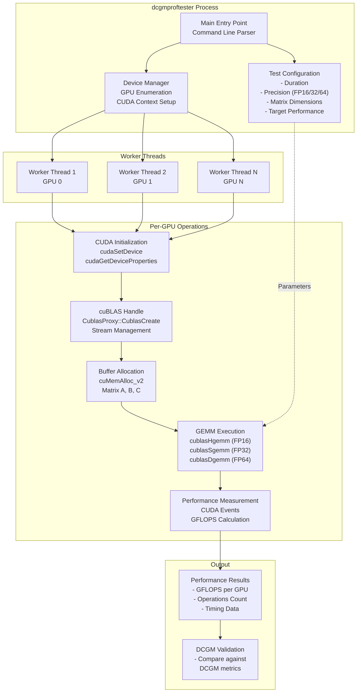
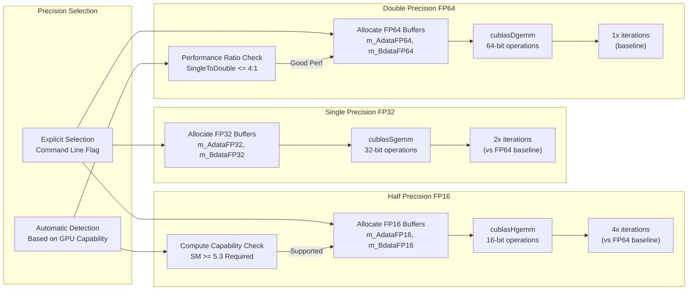
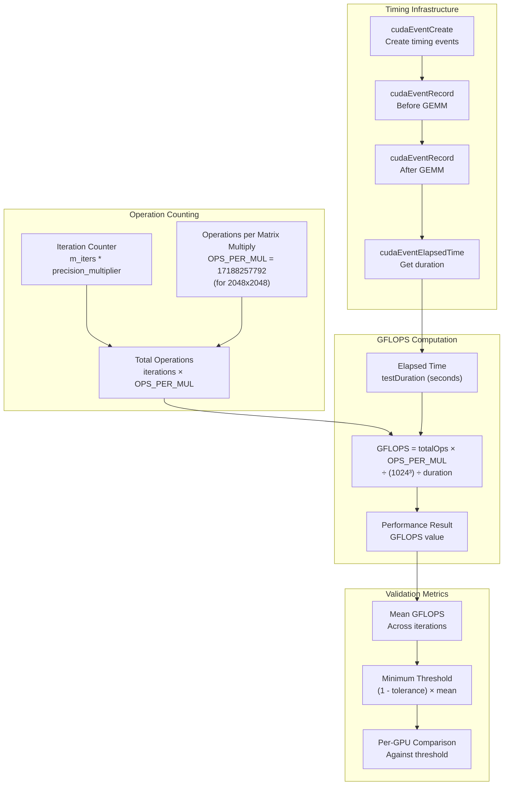
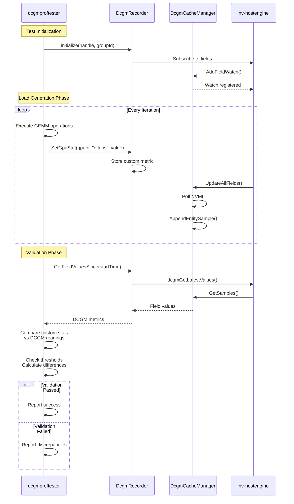
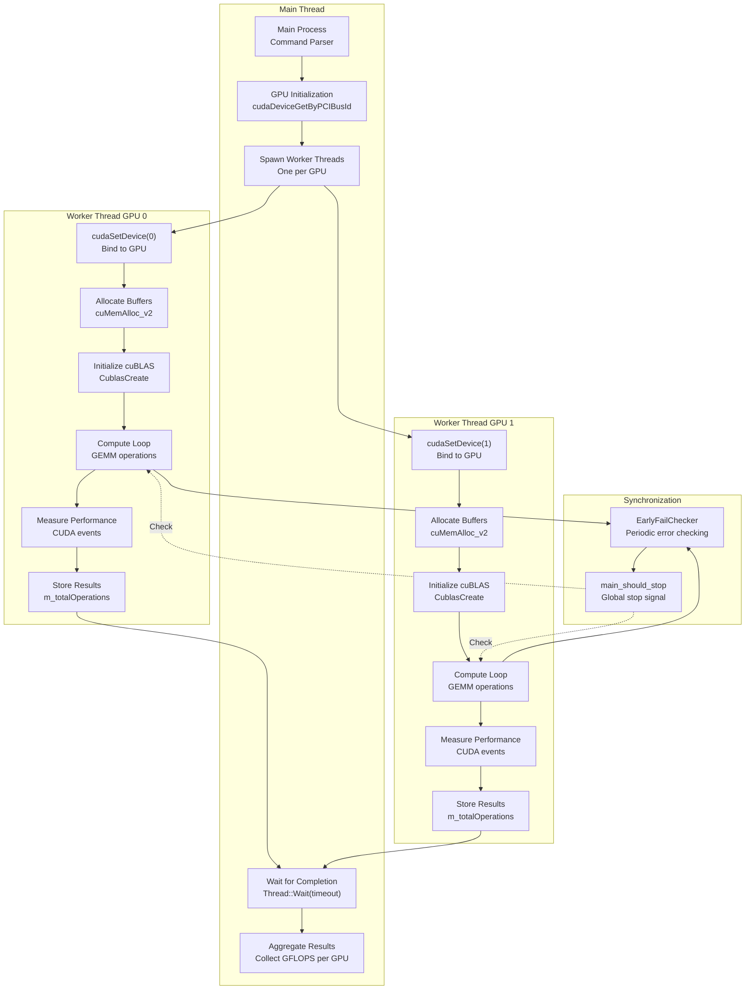
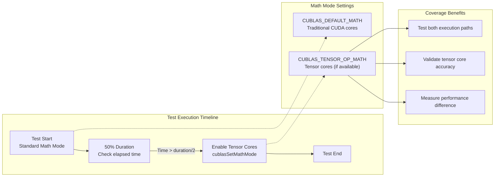
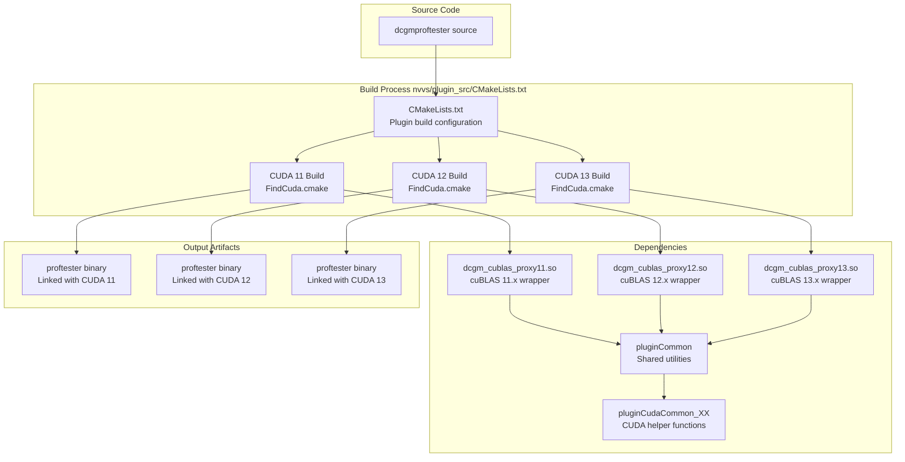

<!-- source: DeepWiki mcp.deepwiki.com · repo NVIDIA/DCGM · page 6.2 dcgmproftester · fetched 2026-10-26 -->

# dcgmproftester

<details>
<summary>Relevant source files</summary>

The following files were used as context for generating this wiki page:

- [nvvs/plugin_src/CMakeLists.txt](nvvs/plugin_src/CMakeLists.txt)
- [nvvs/plugin_src/diagnostic/DiagnosticPlugin.cpp](nvvs/plugin_src/diagnostic/DiagnosticPlugin.cpp)
- [nvvs/plugin_src/targetedstress/TargetedStress_wrapper.cpp](nvvs/plugin_src/targetedstress/TargetedStress_wrapper.cpp)

</details>


## Purpose and Scope

This document describes the `dcgmproftester` tool, a GPU performance testing and validation utility included with DCGM. The tool generates controlled GPU workloads to measure performance and validate DCGM's monitoring capabilities. 

For information about the NVVS diagnostic suite and its test plugins, see [NVVS (NVIDIA Validation Suite)](#4). For details about the cuBLAS proxy libraries used by performance testing tools, see [CUBLAS Proxy](#6.3).

## Overview

`dcgmproftester` is a command-line utility that performs GPU stress testing and performance measurement. It generates synthetic workloads using matrix multiplication operations (GEMM: General Matrix Multiply) to exercise GPU compute capabilities and measure throughput in GFLOPS (Giga Floating-Point Operations Per Second). The tool serves two primary functions:

1. **Performance Measurement**: Determines GPU computational throughput across different precision modes (FP16, FP32, FP64)
2. **DCGM Validation**: Generates known workloads to verify that DCGM correctly monitors GPU metrics such as utilization, power consumption, and temperature

The tool operates similarly to the diagnostic plugins in NVVS but provides more direct control over test parameters and is designed specifically for performance measurement and validation scenarios rather than pass/fail diagnostics.

Sources: [nvvs/plugin_src/diagnostic/DiagnosticPlugin.cpp:1-100](), [nvvs/plugin_src/targetedstress/TargetedStress_wrapper.cpp:1-75]()

## Architecture



Sources: [nvvs/plugin_src/diagnostic/DiagnosticPlugin.cpp:72-105](), [nvvs/plugin_src/targetedstress/TargetedStress_wrapper.cpp:32-69]()

## Load Generation Methodology

### Matrix Multiplication Operations

`dcgmproftester` generates GPU load by repeatedly executing dense matrix multiplication operations. This approach is based on the same principles used by the GpuBurnPlugin in NVVS and provides several advantages:

| Aspect | Implementation | Rationale |
|--------|----------------|-----------|
| **Operation Type** | GEMM (C = α·A·B + β·C) | High arithmetic intensity, industry-standard benchmark |
| **Matrix Size** | Configurable (default 2048×2048) | Adjustable to control memory vs compute pressure |
| **Precision Modes** | FP16, FP32, FP64 | Test different compute capabilities and throughput characteristics |
| **Memory Pattern** | Cyclic buffer reuse | Maintains consistent memory pressure throughout test |
| **Parallelization** | Multiple CUDA streams per GPU | Maximizes GPU utilization |

The tool allocates matrices A and B as inputs and matrix C as output, performing the operation C = A × B iteratively to sustain GPU activity.

Sources: [nvvs/plugin_src/diagnostic/DiagnosticPlugin.cpp:60-66](), [nvvs/plugin_src/diagnostic/DiagnosticPlugin.cpp:924-1053]()

### Multi-Precision Support



The tool automatically determines which precision modes to run based on GPU capabilities:
- **FP16 (Half Precision)**: Only on GPUs with compute capability ≥ 5.3 (Maxwell and newer)
- **FP32 (Single Precision)**: Default mode, supported on all GPUs
- **FP64 (Double Precision)**: Only on GPUs with good double-precision performance (SingleToDoublePrecisionPerfRatio ≤ 4)

Sources: [nvvs/plugin_src/diagnostic/DiagnosticPlugin.cpp:127-155](), [nvvs/plugin_src/diagnostic/DiagnosticPlugin.cpp:157-184](), [nvvs/plugin_src/diagnostic/DiagnosticPlugin.cpp:265-310]()

## Performance Measurement

### GFLOPS Calculation



The tool calculates GFLOPS using CUDA event-based timing with high precision:

**Formula**: `GFLOPS = (iterations × OPS_PER_MUL) / (1024³) / duration_seconds`

Where:
- `OPS_PER_MUL = 17188257792` for a 2048×2048 matrix (dim³ operations for naive multiplication)
- Iterations are scaled by precision: FP16 gets 4×, FP32 gets 2×, FP64 gets 1× (baseline)
- Duration measured via `cudaEventElapsedTime` for GPU-accurate timing

Sources: [nvvs/plugin_src/diagnostic/DiagnosticPlugin.cpp:63-65](), [nvvs/plugin_src/diagnostic/DiagnosticPlugin.cpp:638-658](), [nvvs/plugin_src/diagnostic/DiagnosticPlugin.cpp:1226-1332]()

### Performance Recording

The tool records performance metrics at regular intervals during execution:

| Metric | Type | Purpose |
|--------|------|---------|
| `PERF_STAT_NAME` (gflops) | double | Current throughput per iteration |
| Total operations | long long | Cumulative operation count |
| Timing per phase | double | H2D copy, GEMM, D2H copy durations |
| Utilization | percentage | GPU compute utilization |

These metrics are stored using the `SetGpuStat()` interface and can be queried by DCGM for validation.

Sources: [nvvs/plugin_src/diagnostic/DiagnosticPlugin.cpp:1327-1329](), [nvvs/plugin_src/targetedstress/TargetedStress_wrapper.cpp:1047-1056]()

## DCGM Validation Workflow

### Integration with DCGM Recorder



The validation workflow ensures DCGM accurately monitors GPU activity:

1. **Field Watching**: `dcgmproftester` uses `DcgmRecorder` to watch GPU fields like utilization, power, temperature
2. **Known Load**: Generates controlled workload with known GFLOPS target
3. **Parallel Monitoring**: DCGM independently monitors the same GPU via NVML
4. **Comparison**: Tool compares its calculated metrics against DCGM's readings
5. **Threshold Checking**: Validates that DCGM values fall within acceptable tolerances

Sources: [nvvs/plugin_src/diagnostic/DiagnosticPlugin.cpp:73-76](), [nvvs/plugin_src/targetedstress/TargetedStress_wrapper.cpp:431-497]()

### Error Detection

The tool can detect various failure conditions that indicate either hardware issues or DCGM monitoring problems:

**Memory Errors**:
```c++
// Compare kernel checks for faulty elements
// nvvs/plugin_src/diagnostic/DiagnosticPlugin.cpp:1090-1145
int GpuBurnWorker::Compare(int precisionIndex)
{
    cuMemsetD32_v2(m_faultyElemData, 0, 1);
    cuMemsetD32_v2(m_nanElemData, 0, 1);
    
    cuLaunchKernel(compare_func, ...);
    
    cuMemcpyDtoH_v2(&faultyElems, m_faultyElemData, sizeof(int));
    cuMemcpyDtoH_v2(&nanElems, m_nanElemData, sizeof(int));
    
    if (faultyElems) m_error += faultyElems;
    if (nanElems) m_nan += nanElems;
}
```

**Performance Thresholds**:
- Minimum GFLOPS based on tolerance percentage
- Detection of GPUs performing below expected levels
- Identification of thermal throttling or power capping

Sources: [nvvs/plugin_src/diagnostic/DiagnosticPlugin.cpp:1090-1145](), [nvvs/plugin_src/diagnostic/DiagnosticPlugin.cpp:673-713]()

## Multi-GPU Execution

### Worker Thread Architecture



The tool creates one worker thread per GPU, with each thread:
- Independently binding to its assigned GPU via `cudaSetDevice()`
- Allocating its own buffer space and cuBLAS handle
- Executing compute operations without cross-GPU synchronization
- Measuring performance independently
- Checking for early termination signals

Sources: [nvvs/plugin_src/diagnostic/DiagnosticPlugin.cpp:461-529](), [nvvs/plugin_src/diagnostic/DiagnosticPlugin.cpp:531-565]()

### Buffer Management per GPU

Each GPU maintains separate memory allocations:

| Buffer | Purpose | Size Calculation |
|--------|---------|------------------|
| `m_AdataFP64/32/16` | Input matrix A | `sizeof(type) × dim × dim` |
| `m_BdataFP64/32/16` | Input matrix B | `sizeof(type) × dim × dim` |
| `m_CdataVec*` | Output matrices C | Allocated based on available memory (USEMEM = 90%) |
| `m_faultyElemData` | Error tracking | `sizeof(int)` |
| `m_nanElemData` | NaN tracking | `sizeof(int)` |

The number of output buffers is calculated to use ~90% of available GPU memory:
```
baseIterations = (availMem - 2×FP64 - 2×FP32 - 2×FP16) / sizeof(double) / dim²
```

This maximizes memory pressure while allowing tests to run on GPUs with different memory capacities.

Sources: [nvvs/plugin_src/diagnostic/DiagnosticPlugin.cpp:61](), [nvvs/plugin_src/diagnostic/DiagnosticPlugin.cpp:924-1053]()

## Tensor Core Support

### Dynamic Math Mode Selection



The tool dynamically enables tensor cores mid-test to provide comprehensive coverage:

At 50% test completion:
```c++
if (!hintedTensorCores && (computeTime > m_testDuration / 2.0))
{
    CublasProxy::CublasSetMathMode(m_cublas, CUBLAS_TENSOR_OP_MATH);
    hintedTensorCores = true;
}
```

This approach:
- Tests both traditional CUDA cores and tensor cores in a single run
- Validates that DCGM correctly monitors both execution modes
- Provides performance comparison data between modes
- Exercises hardware and driver transitions between modes

Sources: [nvvs/plugin_src/diagnostic/DiagnosticPlugin.cpp:1312-1319]()

## Build Integration

### Multi-CUDA Version Support

The tool is compiled against multiple CUDA versions to ensure compatibility across different driver installations:



The build system uses the same infrastructure as NVVS plugins:
- `define_plugin()` macro creates version-specific targets
- Each version links against `dcgm_cublas_proxy${CUDA_VER}` for cuBLAS operations
- Static linking of CUDA libraries for deployment flexibility
- Common code shared via `pluginCommon` and `pluginCudaCommon_${CUDA_VER}` libraries

Sources: [nvvs/plugin_src/CMakeLists.txt:43-74](), [nvvs/plugin_src/CMakeLists.txt:76]()

### Linker Configuration

Plugins and tools use version scripts to control symbol visibility:

```
# nvvs/plugin_src/nvvs_plugin.linux_def
{
    global:
        GetPluginInfo;
        GetPluginInterfaceVersion;
        InitializePlugin;
        RunTest;
        RetrieveCustomStats;
        RetrieveResults;
    local:
        *;
};
```

This ensures only necessary symbols are exported, reducing namespace pollution and binary size.

Sources: [nvvs/plugin_src/CMakeLists.txt:70-71]()

## Usage Patterns

### Typical Test Scenarios

**Scenario 1: Basic Performance Measurement**
- Run with default parameters (FP32, 2048×2048, 180 seconds)
- Measure baseline GFLOPS for each GPU
- Compare against manufacturer specifications

**Scenario 2: Multi-Precision Validation**
- Enable all precision modes (FP16, FP32, FP64)
- Verify DCGM correctly captures utilization across modes
- Identify GPUs with degraded double-precision capability

**Scenario 3: Sustained Load Testing**
- Extended duration (e.g., 3600 seconds)
- Monitor for thermal throttling via DCGM
- Validate power consumption accuracy
- Check for memory errors over time

**Scenario 4: DCGM Accuracy Validation**
- Generate known GFLOPS target (e.g., 50% of peak)
- Compare DCGM-reported utilization against expected values
- Verify power readings correlate with compute intensity
- Check field update frequencies

Sources: [nvvs/plugin_src/diagnostic/DiagnosticPlugin.cpp:90-104](), [nvvs/plugin_src/targetedstress/TargetedStress_wrapper.cpp:51-68]()

### Configuration Parameters

The tool accepts parameters similar to NVVS plugins:

| Parameter | Type | Default | Description |
|-----------|------|---------|-------------|
| `test_duration` | double | 180.0 | Test length in seconds |
| `use_doubles` | bool | false | Enable FP64 precision |
| `precision` | string | "hs" | Precision modes (h=FP16, s=FP32, d=FP64) |
| `matrix_dim` | int | 2048 | Matrix dimension (NxN) |
| `target_perf` | double | 100.0 | Target stress level (%) |
| `gflops_tolerance_pcnt` | double | 0.0 | Acceptable performance variation |
| `cuda_streams_per_gpu` | int | varies | Concurrent CUDA streams |
| `cuda_ops_per_stream` | int | 100 | Operations queued per stream |

Sources: [nvvs/plugin_src/diagnostic/DiagnosticPlugin.cpp:90-102](), [nvvs/plugin_src/targetedstress/TargetedStress_wrapper.cpp:51-67]()

## Key Code Entities

### Core Classes and Functions

**Worker Thread Implementation**:
- `GpuBurnWorker`: Thread class for GPU compute operations ([nvvs/plugin_src/diagnostic/DiagnosticPlugin.cpp:725-783]())
- `GpuBurnWorker::run()`: Main execution loop ([nvvs/plugin_src/diagnostic/DiagnosticPlugin.cpp:1226-1332]())
- `GpuBurnWorker::Compute()`: GEMM operation execution ([nvvs/plugin_src/diagnostic/DiagnosticPlugin.cpp:1148-1223]())
- `GpuBurnWorker::Compare()`: Result verification kernel ([nvvs/plugin_src/diagnostic/DiagnosticPlugin.cpp:1090-1145]())

**Buffer Management**:
- `GpuBurnWorker::InitBuffers()`: Memory allocation ([nvvs/plugin_src/diagnostic/DiagnosticPlugin.cpp:924-1053]())
- `GpuBurnWorker::AvailMemory()`: Free memory query ([nvvs/plugin_src/diagnostic/DiagnosticPlugin.cpp:901-921]())
- `GpuBurnWorker::InitBuffersForCurrentPrecision()`: Precision switching ([nvvs/plugin_src/diagnostic/DiagnosticPlugin.cpp:1335-1359]())

**Performance Calculation**:
- `OPS_PER_MUL`: Constant for operation counting ([nvvs/plugin_src/diagnostic/DiagnosticPlugin.cpp:65]())
- `GetGflopsMinThreshold()`: Threshold calculation ([nvvs/plugin_src/diagnostic/DiagnosticPlugin.cpp:673-677]())
- `CheckPassFail()`: Validation logic ([nvvs/plugin_src/diagnostic/DiagnosticPlugin.cpp:395-426]())

**cuBLAS Operations**:
- `CublasProxy::CublasHgemm()`: FP16 matrix multiply
- `CublasProxy::CublasSgemm()`: FP32 matrix multiply
- `CublasProxy::CublasDgemm()`: FP64 matrix multiply
- `CublasProxy::CublasSetMathMode()`: Tensor core control

Sources: [nvvs/plugin_src/diagnostic/DiagnosticPlugin.cpp:725-1359]()

### CUDA Event Timing

**Event Management**:

```mermaid
graph LR
    CREATE["cudaEventCreate<br/>Per-stream events"]
    RECORD_START["cudaEventRecord<br/>beforeCopyH2D"]
    H2D["cudaMemcpyAsync<br/>Host to Device"]
    RECORD_GEMM["cudaEventRecord<br/>beforeGemm"]
    GEMM["cuBLAS GEMM"]
    RECORD_D2H["cudaEventRecord<br/>beforeCopyD2H"]
    D2H["cudaMemcpyAsync<br/>Device to Host"]
    RECORD_END["cudaEventRecord<br/>afterCopyD2H"]
    ELAPSED["cudaEventElapsedTime<br/>Calculate durations"]
    
    CREATE --> RECORD_START
    RECORD_START --> H2D
    H2D --> RECORD_GEMM
    RECORD_GEMM --> GEMM
    GEMM --> RECORD_D2H
    RECORD_D2H --> D2H
    D2H --> RECORD_END
    RECORD_END --> ELAPSED
```


Events are created per stream and per operation to precisely measure:
- Host-to-device copy time (`usecInCopies`)
- GEMM execution time (`usecInGemm`)
- Device-to-host copy time (`usecInCopies`)

This granular timing allows the tool to discount transfer overhead when comparing performance results.

Sources: [nvvs/plugin_src/targetedstress/TargetedStress_wrapper.cpp:230-262](), [nvvs/plugin_src/targetedstress/TargetedStress_wrapper.cpp:820-862]()

---

