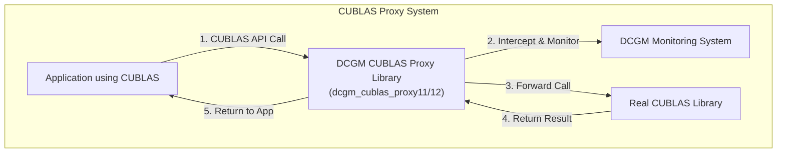
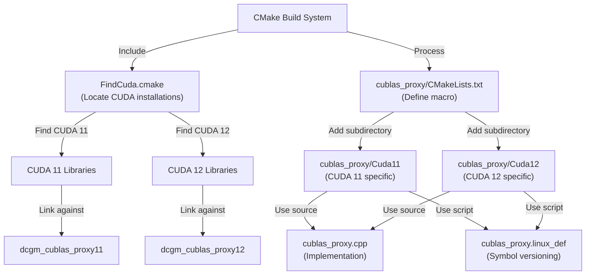
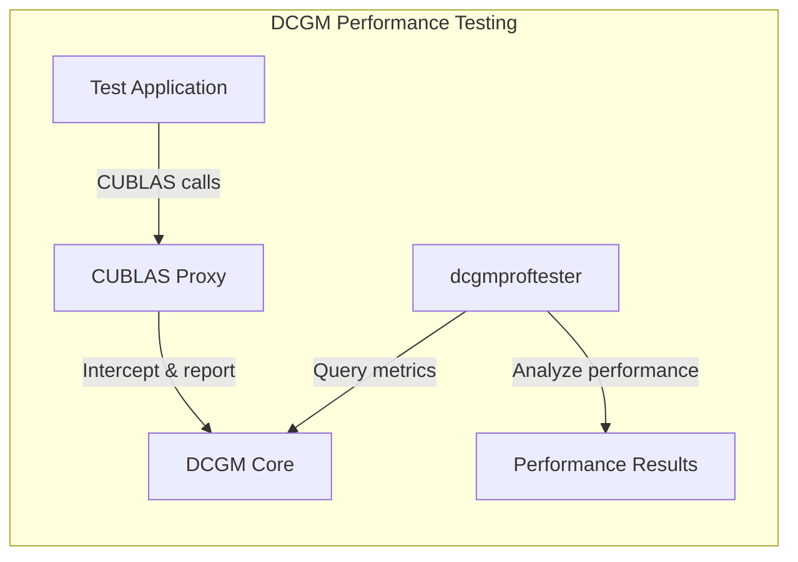

<!-- source: DeepWiki mcp.deepwiki.com · repo NVIDIA/DCGM · page 6.3 CUBLAS Proxy · fetched 2026-10-26 -->

# CUBLAS Proxy

<details>
<summary>Relevant source files</summary>

The following files were used as context for generating this wiki page:

- [cmake/FindCuda.cmake](cmake/FindCuda.cmake)
- [cublas_proxy/CMakeLists.txt](cublas_proxy/CMakeLists.txt)

</details>


## Purpose and Overview

The CUBLAS Proxy is a specialized library within the NVIDIA Data Center GPU Manager (DCGM) ecosystem designed to intercept calls to the NVIDIA CUBLAS library. This component is primarily used for monitoring and analyzing CUBLAS API calls during performance testing and diagnostics. It provides visibility into CUBLAS operations without requiring modifications to the original application code.

For information about performance testing using the profiling tester tool, see [dcgmproftester](#6.1).

Sources: [cublas_proxy/CMakeLists.txt:1-43]()

## Architecture and Design

The CUBLAS Proxy is implemented as a shared library that can be preloaded using the `LD_PRELOAD` mechanism on Linux systems. When preloaded, it intercepts calls to CUBLAS functions, allowing DCGM to monitor or log these operations before passing them to the actual CUBLAS implementation.



The proxy is built for multiple CUDA versions to ensure compatibility across different environments. Currently, the system supports CUDA 11 and CUDA 12 versions, with separate libraries for each.

Sources: [cublas_proxy/CMakeLists.txt:15-39]()

## Version-Specific Implementation

The CUBLAS Proxy is compiled and linked against specific CUDA versions to ensure compatibility. The system maintains separate proxy libraries for each supported CUDA version:

1. **dcgm_cublas_proxy11** - Compatible with CUDA 11.x
2. **dcgm_cublas_proxy12** - Compatible with CUDA 12.x

This version-specific approach ensures that the proxy can accurately intercept and forward calls regardless of which CUDA version is being used by the application.

```mermaid
classDiagram
    class "CUBLAS Proxy Base" {
        +Intercept CUBLAS calls
        +Log call information
        +Forward to real implementation
    }
    
    class "dcgm_cublas_proxy11" {
        +CUDA_VERSION_USED=11
        +Compatible with CUDA 11.x
    }
    
    class "dcgm_cublas_proxy12" {
        +CUDA_VERSION_USED=12
        +Compatible with CUDA 12.x
    }
    
    "CUBLAS Proxy Base" <|-- "dcgm_cublas_proxy11"
    "CUBLAS Proxy Base" <|-- "dcgm_cublas_proxy12"
```

Sources: [cublas_proxy/CMakeLists.txt:17-39](), [cmake/FindCuda.cmake:17-103]()

## Build System Integration

The CUBLAS Proxy is built using CMake, with specific configuration to handle different CUDA versions. The build system:

1. Locates the appropriate CUDA installation using the `FindCuda.cmake` module
2. Defines proxy libraries for each supported CUDA version
3. Links against the corresponding CUDA and CUBLAS libraries
4. Applies version-specific compile definitions
5. Uses a version script to control symbol visibility

The build process uses a macro called `define_proxy_lib` to create consistent builds for each CUDA version while maintaining separate libraries.



Sources: [cublas_proxy/CMakeLists.txt:17-39](), [cmake/FindCuda.cmake:22-95]()

## Implementation Details

The CUBLAS Proxy implements symbol interception through the use of shared library preloading. Key implementation aspects include:

1. **Symbol Visibility Control**: The proxy uses a version script (`cublas_proxy.linux_def`) to control which symbols are exported and intercepted.

2. **Version-Specific Compilation**: Each proxy library is compiled with a specific `CUDA_VERSION_USED` definition to ensure it correctly handles the API for that CUDA version.

3. **DCGM Integration**: The proxy links against DCGM libraries (`dcgm`, `dcgm_common`, `dcgm_logging`, `dcgm_mutex`) to integrate with the broader monitoring system.

4. **Dynamic Loading**: The proxy uses dynamic linking (`dl` library) to load and interact with the real CUBLAS implementation.

The proxy builds against both static CUBLAS libraries and dynamic CUDA libraries:

| Library Component | Description |
|-------------------|-------------|
| CUDA_LIBS | Dynamic CUDA libraries (e.g., libcuda.so) |
| CUDA_STATIC_CUBLAS_LIBS | Static CUBLAS libraries (libcublas_static.a, libcublasLt_static.a) |
| CUDA_STATIC_LIBS | Other static CUDA libraries (libcudart_static.a, libculibos.a) |

Sources: [cublas_proxy/CMakeLists.txt:20-38](), [cmake/FindCuda.cmake:33-63]()

## Usage

To use the CUBLAS Proxy for monitoring CUBLAS operations:

1. Identify the correct proxy library for your CUDA version (dcgm_cublas_proxy11 or dcgm_cublas_proxy12)
2. Use the Linux `LD_PRELOAD` mechanism to preload the library:

```bash
LD_PRELOAD=/path/to/libdcgm_cublas_proxy11.so your_cuda_application
```

This will cause all CUBLAS calls made by the application to be intercepted by the proxy library, allowing DCGM to monitor and analyze these operations.

The CUBLAS Proxy is particularly useful when used in conjunction with the dcgmproftester tool for comprehensive performance testing and analysis of CUDA applications.

Sources: [cublas_proxy/CMakeLists.txt:17-26]()

## Integration with DCGM Performance Testing

The CUBLAS Proxy is a key component in the DCGM performance testing framework. It provides visibility into CUBLAS operations, which is essential for comprehensive performance analysis of applications that utilize CUDA's linear algebra capabilities.



By intercepting CUBLAS calls, the proxy allows DCGM to correlate linear algebra operations with GPU performance metrics, providing deeper insights into application behavior and potential optimization opportunities.

Sources: [cublas_proxy/CMakeLists.txt:32-38]()

## Supported CUDA Versions

The CUBLAS Proxy supports multiple CUDA versions to ensure compatibility with different environments. The current implementation specifically targets:

| CUDA Version | Proxy Library | Target CUDA Path |
|--------------|---------------|------------------|
| CUDA 11.x    | dcgm_cublas_proxy11 | /usr/local/cuda-11.8 |
| CUDA 12.x    | dcgm_cublas_proxy12 | /usr/local/cuda-12.8 |

The build system automatically detects the appropriate CUDA installations and builds the proxy libraries accordingly.

Sources: [cmake/FindCuda.cmake:19-20](), [cmake/FindCuda.cmake:97-103]()

---

