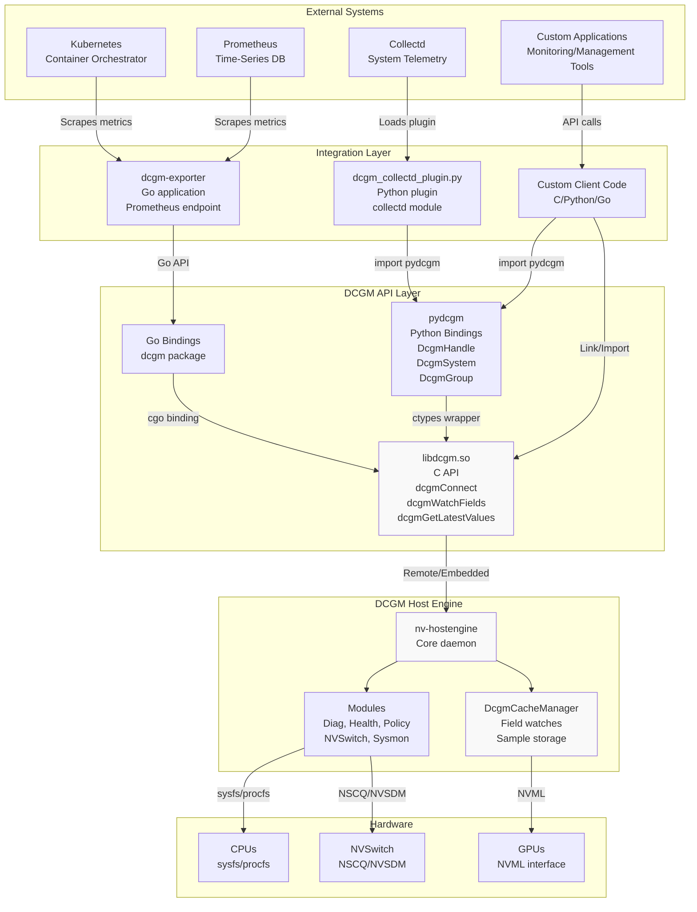
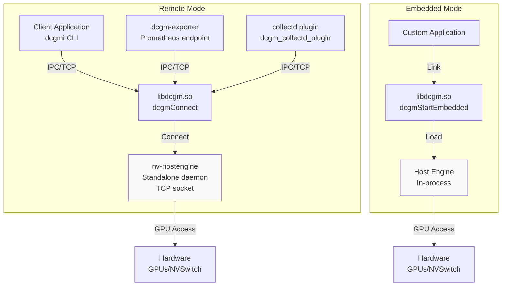
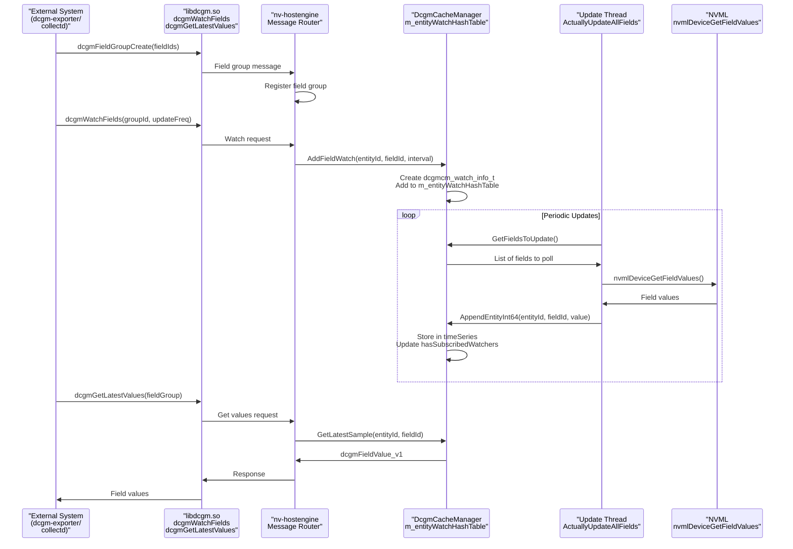

<!-- source: DeepWiki mcp.deepwiki.com · repo NVIDIA/DCGM · page 7 Integration · fetched 2026-10-26 -->

# Integration

<details>
<summary>Relevant source files</summary>

The following files were used as context for generating this wiki page:

- [README.md](README.md)
- [common/ThreeWayCmpDefault.hpp](common/ThreeWayCmpDefault.hpp)
- [modules/nvswitch/DcgmModuleNvSwitch.cpp](modules/nvswitch/DcgmModuleNvSwitch.cpp)
- [nvvs/include/NvvsJsonStrings.h](nvvs/include/NvvsJsonStrings.h)
- [testing/python3/tests/test_dcgm_collectd_plugin.py](testing/python3/tests/test_dcgm_collectd_plugin.py)

</details>


## Purpose and Scope

This document provides an overview of how DCGM integrates with external systems in data center environments. It covers the integration mechanisms, API layers, and architectural patterns that enable DCGM to work with monitoring platforms, orchestration systems, and custom applications.

For detailed information about specific integrations:
- Kubernetes and Prometheus integration via dcgm-exporter: see [Kubernetes Integration](#7.1)
- Collectd telemetry integration: see [Collectd Plugin](#7.2)

For information about DCGM's internal API: see [API Reference](#2.2)

## Integration Philosophy

DCGM is designed as a centralized GPU monitoring daemon that exposes telemetry and management capabilities to external systems through multiple integration layers. The architecture supports both local and remote access patterns, allowing DCGM to run as a standalone service or be embedded within applications.

The integration model follows a publish-subscribe pattern where:
- External systems register field watches for GPU metrics
- DCGM collects and caches data at specified intervals
- Consumers retrieve data via synchronous API calls or asynchronous callbacks

Sources: [README.md:1-25]()

## Integration Mechanisms

### Native C API

The core integration layer is `libdcgm.so` (or `dcgm.dll` on Windows), which provides the complete DCGM C API. This library handles:
- Connection management to `nv-hostengine` daemon (remote) or embedded mode (in-process)
- Group and field management
- Data retrieval and subscription
- Diagnostic invocation
- Policy and health monitoring

External applications link against `dcgm.so` and call functions like:
- `dcgmInit()` - Initialize the library
- `dcgmConnect()` - Connect to host engine
- `dcgmGroupCreate()` - Create GPU groups
- `dcgmFieldGroupCreate()` - Define field sets
- `dcgmWatchFields()` - Start field collection
- `dcgmGetLatestValues()` - Retrieve current metrics

Sources: [README.md:14-17]()

### Language Bindings

#### Python Bindings (pydcgm)

The `pydcgm` module provides Python wrappers around the C API, exposing classes like:
- `DcgmHandle` - Connection handle
- `DcgmSystem` - System-level operations
- `DcgmGroup` - GPU group management
- Field metadata access via `dcgm_fields`

Python integrations import modules:
- `pydcgm` - Main API
- `dcgm_structs` - Data structures
- `dcgm_fields` - Field definitions
- `dcgm_agent` / `dcgm_agent_internal` - Low-level API access

Sources: [testing/python3/tests/test_dcgm_collectd_plugin.py:14-23]()

#### Go Bindings

DCGM provides Go bindings for cloud-native integrations, commonly used in Kubernetes environments via `dcgm-exporter`.

Sources: [README.md:16]()

### External System Integrations

DCGM includes pre-built integrations for common monitoring and orchestration platforms:

#### dcgm-exporter (Kubernetes/Prometheus)

A sidecar container that exposes DCGM metrics as Prometheus endpoints for scraping by monitoring systems. This is the primary integration path for Kubernetes environments.

See [Kubernetes Integration](#7.1) for details.

Sources: [README.md:18]()

#### Collectd Plugin (dcgm_collectd_plugin)

A Python-based collectd plugin that bridges DCGM with the collectd telemetry framework. The plugin:
- Loads as a collectd Python module
- Connects to DCGM via `pydcgm`
- Registers field watches based on collectd configuration
- Periodically reads values and dispatches to collectd

The plugin lifecycle follows collectd's model:
1. `config()` - Parse collectd configuration (field IDs, intervals)
2. `init()` - Initialize DCGM connection
3. `read()` - Retrieve and dispatch metrics (called periodically)
4. `shutdown()` - Cleanup

Configuration example:
```python
Config('Interval', ['2'])
Config('FieldIds', ['(100,memory_clock):5,video_clock:.1'])
```

See [Collectd Plugin](#7.2) for implementation details.

Sources: [testing/python3/tests/test_dcgm_collectd_plugin.py:38-106]()

## Integration Architecture

### Overall Integration Stack



**Integration Stack Layers**: External systems integrate with DCGM through language-specific bindings that wrap the native C API (`libdcgm.so`). The API library communicates with `nv-hostengine` either via inter-process communication (remote mode) or by embedding the engine in-process (embedded mode). The host engine coordinates data collection through `DcgmCacheManager` and specialized modules, ultimately interfacing with hardware via NVML (GPUs), NSCQ/NVSDM (NVSwitch), and system interfaces (CPUs).

Sources: [README.md:1-25](), [testing/python3/tests/test_dcgm_collectd_plugin.py:14-35]()

### Connection and Deployment Modes



**Deployment Patterns**: 
- **Remote Mode**: Clients connect to a standalone `nv-hostengine` daemon running as a system service. This is the typical production deployment where multiple clients (CLI tools, exporters, monitoring plugins) share a single DCGM instance. Connection is established via `dcgmConnect()` with a hostname/port.
- **Embedded Mode**: The host engine is loaded in-process via `dcgmStartEmbedded()`, giving the application exclusive access. This mode is suitable for single-purpose monitoring applications or testing scenarios.

Sources: [README.md:1-25]()

### Data Collection Flow



**Data Collection Sequence**: Integration follows a watch-then-poll pattern. External systems first establish field watches specifying which metrics to collect and at what frequency. The `DcgmCacheManager` maintains these watches in `m_entityWatchHashTable`, calculating optimal polling intervals. Background threads query hardware (via NVML for GPUs) and store samples in time-series buffers. Clients retrieve data synchronously via `dcgmGetLatestValues()` or receive asynchronous updates through callbacks if subscribed.

Sources: [testing/python3/tests/test_dcgm_collectd_plugin.py:48-106](), [README.md:1-25]()

## Field Configuration and Mapping

Integration systems specify which metrics to collect using field IDs or field tags. DCGM provides:

### Field Identification

- **Numeric Field IDs**: Integer identifiers (e.g., `DCGM_FI_DEV_GPU_TEMP = 150`)
- **Field Tags**: String names (e.g., `"gpu_temp"`, `"memory_clock"`, `"power_usage"`)
- **Field Groups**: Named collections of related fields

### Configuration Examples

**Collectd Plugin Configuration**:
```python
# Collectd config with field tags and update intervals
Config('FieldIds', ['(100,memory_clock):5,video_clock:.1'])
# Format: (fieldId,tag):interval or tag:interval
```

The plugin parses this configuration and translates field tags to numeric IDs using `dcgm_fields.DCGM_FI_*` constants.

**Field Injection for Testing**:
```python
# Test data injection via dcgm_agent_internal
field = dcgmInjectFieldValue_v1()
field.fieldId = dcgm_fields.DCGM_FI_DEV_RETIRED_DBE
field.fieldType = ord(dcgm_fields.DCGM_FT_INT64)
field.value.i64 = 1
dcgm_agent_internal.dcgmInjectFieldValue(handle, gpuId, field)
```

Sources: [testing/python3/tests/test_dcgm_collectd_plugin.py:57-77](), [testing/python3/tests/test_dcgm_collectd_plugin.py:159-161]()

## Integration Testing

DCGM includes integration tests for external system plugins:

### Collectd Plugin Tests

Test modules in [testing/python3/tests/test_dcgm_collectd_plugin.py:1-200]() verify:

| Test Function | Purpose |
|---------------|---------|
| `test_collectd_basic_integration` | Validates field injection and retrieval through collectd plugin |
| `test_collectd_config_integration` | Verifies configuration parsing and field watching |
| `test_collectd_config_bad_alpha_field` | Tests resilience to invalid field tags |
| `test_collectd_config_bad_numeric_field` | Tests resilience to invalid field IDs |
| `test_collectd_config_no_fields` | Tests plugin behavior with empty configuration |

**Test Infrastructure**:
- Uses `test_utils.run_with_standalone_host_engine` decorator for test isolation
- Requires `test_utils.run_only_with_live_gpus` for GPU availability
- Employs stub modules in `testing/python3/tests/stubs/` for collectd emulation
- `collectd_tester_globals.gvars` dictionary tracks plugin lifecycle callbacks

**Test Pattern**:
```python
@test_utils.run_with_standalone_host_engine(20)
@test_utils.run_only_with_live_gpus()
def test_collectd_basic_integration(handle, gpuIds):
    # 1. Set up DCGM connection
    dcgmHandle = pydcgm.DcgmHandle(handle)
    
    # 2. Inject test data
    dcgm_agent_internal.dcgmInjectFieldValue(handle, gpuId, field)
    
    # 3. Execute plugin lifecycle
    gvars['config']()
    gvars['init']()
    gvars['read']()
    
    # 4. Verify collected data
    assert fieldTag in outDict[str(gpuId)]
```

Sources: [testing/python3/tests/test_dcgm_collectd_plugin.py:48-106]()

## Environment Configuration

Integration modules require specific environment configuration:

### Python Integration Environment

```python
# Required for collectd plugin testing
os.environ['DCGM_TESTING_FRAMEWORK'] = 'True'
os.environ['DCGMLIBPATH'] = os.environ['LD_LIBRARY_PATH']

# Add stubs directory for collectd emulation
stubspath = os.path.dirname(os.path.realpath(__file__)) + '/stubs/'
sys.path.insert(0, stubspath)
```

### Library Path Configuration

DCGM libraries must be discoverable via:
- `LD_LIBRARY_PATH` (Linux)
- `DCGMLIBPATH` environment variable (testing)
- System library directories (`/usr/lib`, `/usr/local/lib`)

Sources: [testing/python3/tests/test_dcgm_collectd_plugin.py:25-32]()

## Integration Best Practices

### Field Selection

- Watch only required fields to minimize overhead
- Use appropriate update intervals (longer for infrequent changes)
- Batch related fields into field groups for efficient retrieval

### Connection Management

- Reuse DCGM connections across multiple queries
- Handle connection failures gracefully with reconnection logic
- Use embedded mode only when exclusive access is required

### Error Handling

- Check return codes from all DCGM API calls
- Handle `DCGM_ST_*` status codes appropriately
- Implement timeouts for remote connections
- Validate field data status before using values

### Performance Considerations

- Remote mode shares data collection across clients (more efficient)
- Embedded mode provides lower latency but higher resource usage
- Configure watch intervals based on metric volatility
- Use field groups to reduce API call overhead

Sources: [README.md:99-113](), [testing/python3/tests/test_dcgm_collectd_plugin.py:1-200]()

---

