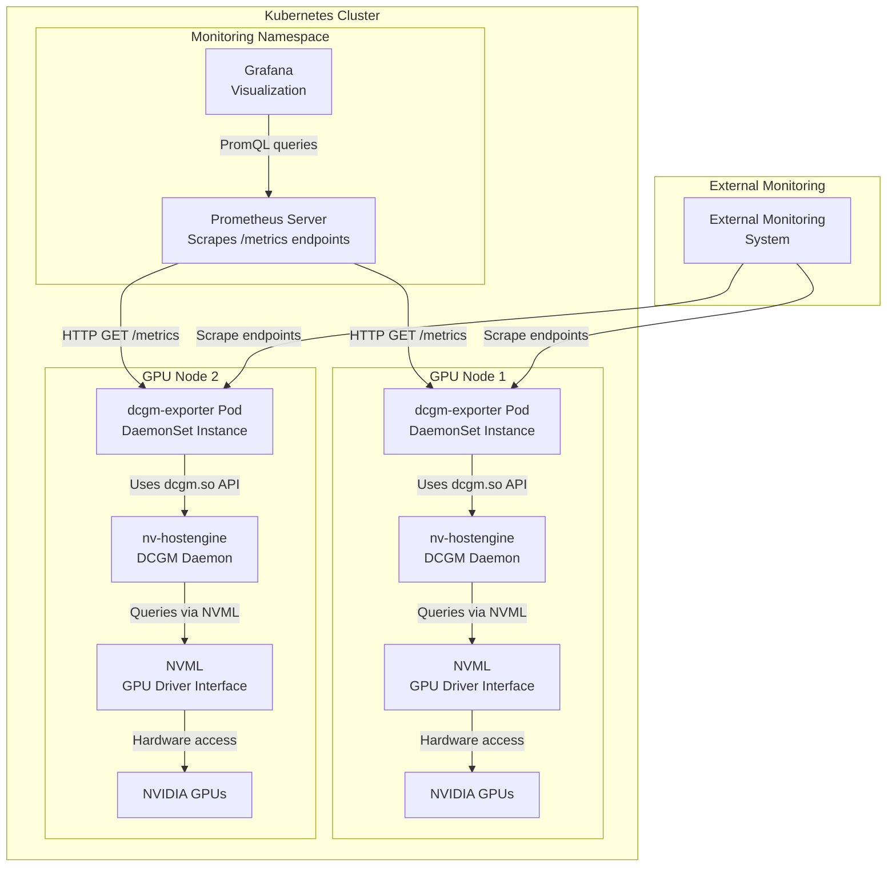
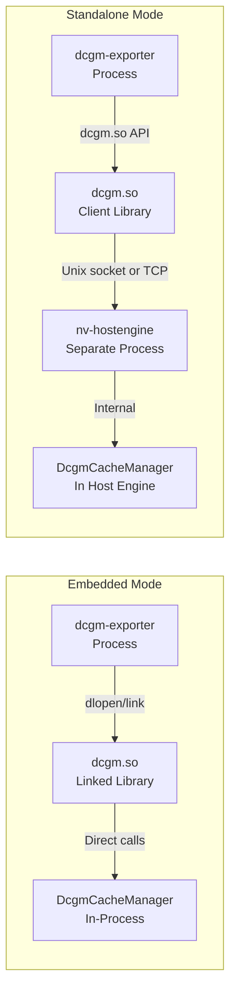
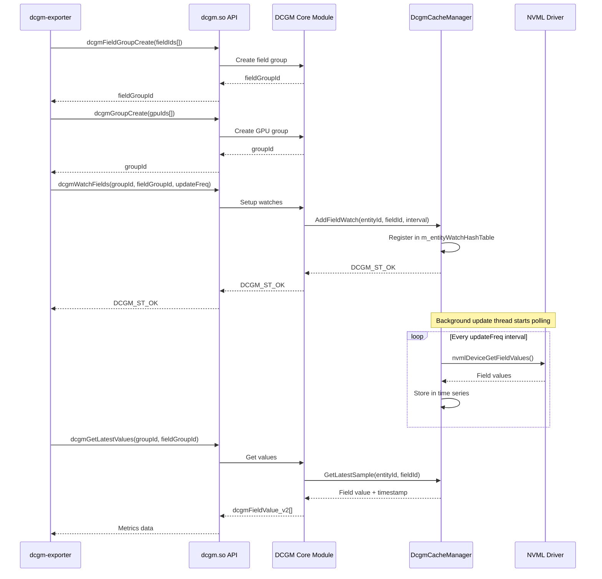
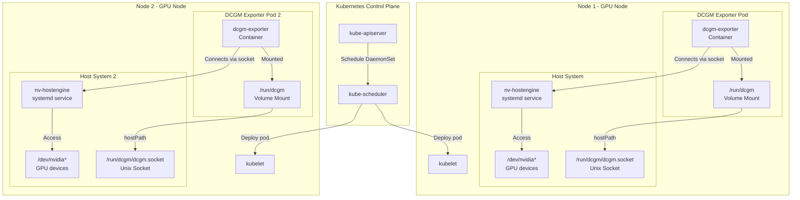
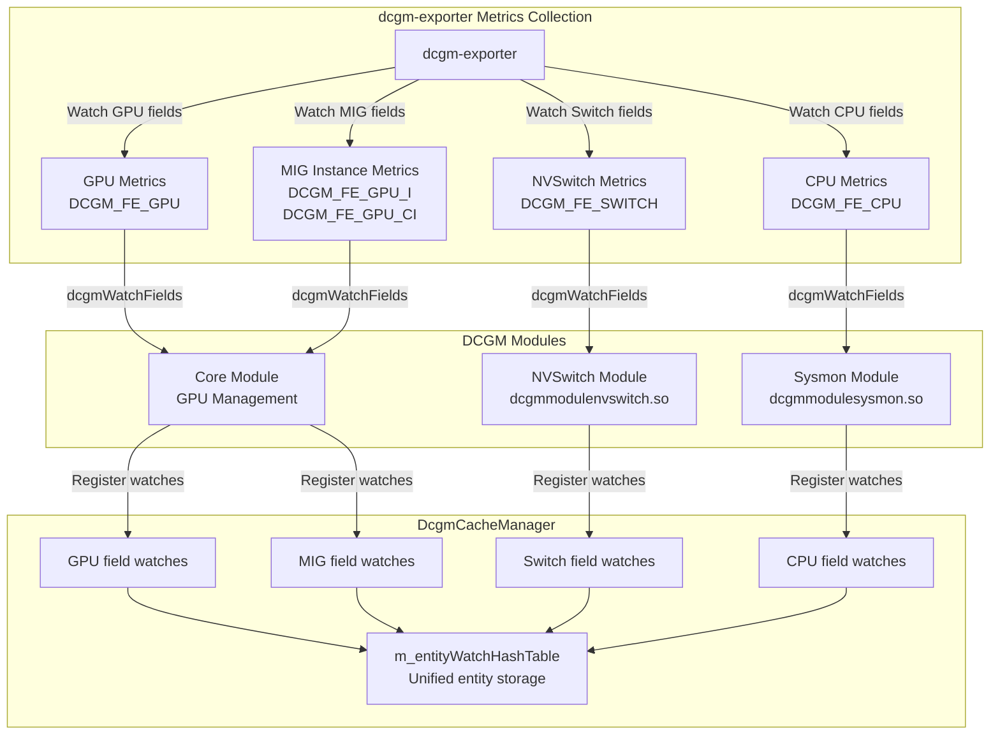

<!-- source: DeepWiki mcp.deepwiki.com · repo NVIDIA/DCGM · page 7.1 Kubernetes Integration · fetched 2026-10-26 -->

# Kubernetes Integration

<details>
<summary>Relevant source files</summary>

The following files were used as context for generating this wiki page:

- [README.md](README.md)
- [common/ThreeWayCmpDefault.hpp](common/ThreeWayCmpDefault.hpp)
- [modules/nvswitch/DcgmModuleNvSwitch.cpp](modules/nvswitch/DcgmModuleNvSwitch.cpp)
- [nvvs/include/NvvsJsonStrings.h](nvvs/include/NvvsJsonStrings.h)
- [testing/python3/tests/test_dcgm_collectd_plugin.py](testing/python3/tests/test_dcgm_collectd_plugin.py)

</details>


## Purpose and Scope

This page documents how DCGM integrates with Kubernetes environments to provide GPU telemetry and monitoring. DCGM enables Kubernetes integration primarily through the **dcgm-exporter** component, which exposes GPU metrics in Prometheus format for consumption by Kubernetes monitoring stacks. This page covers the architecture, deployment patterns, and how dcgm-exporter leverages DCGM's API and field watching system.

For information about other integration methods, see [Collectd Plugin](#7.2). For details about the underlying DCGM API that dcgm-exporter uses, see [API Reference](#2.2). For information about the field watching and data collection mechanisms, see [Cache Manager](#2.1).

---

## Overview

DCGM provides Kubernetes integration through **dcgm-exporter**, a separate component hosted at [https://github.com/NVIDIA/dcgm-exporter](https://github.com/NVIDIA/dcgm-exporter). The exporter runs as a Kubernetes DaemonSet, deploying one pod per GPU-enabled node to collect and expose GPU metrics.

**Sources:** [README.md:18]()

### Key Integration Components

| Component | Role | Location |
|-----------|------|----------|
| `dcgm-exporter` | Kubernetes DaemonSet that collects GPU metrics and exposes them in Prometheus format | External repository |
| `dcgm.so` | DCGM API library used by dcgm-exporter to access GPU telemetry | DCGM core library |
| `nv-hostengine` | DCGM daemon that manages GPU monitoring and data collection | DCGM host engine |
| Prometheus | Monitoring system that scrapes metrics from dcgm-exporter endpoints | Kubernetes ecosystem |

**Sources:** [README.md:1-24]()

---

## Architecture

### Kubernetes Deployment Model



**Architecture Description:**

The dcgm-exporter runs as a Kubernetes DaemonSet, ensuring one pod per GPU-enabled node. Each exporter pod:

1. **Connects to DCGM:** Uses the `dcgm.so` API library to communicate with the local `nv-hostengine` daemon
2. **Watches GPU Fields:** Registers field watches for metrics like GPU utilization, temperature, power, memory usage
3. **Exposes Metrics:** Serves an HTTP endpoint (typically `:9400/metrics`) in Prometheus exposition format
4. **Updates Continuously:** Polls DCGM at configured intervals (e.g., every 30 seconds) to retrieve latest values

Prometheus servers scrape these endpoints at regular intervals to collect and store time-series GPU metrics.

**Sources:** [README.md:14-18](), Diagram 1 from system architecture overview

---

## DCGM API Usage by dcgm-exporter

### Connection Modes



**Connection Mode Details:**

| Mode | Description | Use Case |
|------|-------------|----------|
| **Embedded Mode** | dcgm-exporter directly links `dcgm.so` and runs DCGM engine within its process | Simple deployments, single application accessing DCGM |
| **Standalone Mode** | dcgm-exporter connects to separate `nv-hostengine` daemon via socket | Multiple applications sharing DCGM, persistent monitoring daemon |

In Kubernetes environments, **standalone mode** is typically preferred because:
- The `nv-hostengine` daemon can persist across dcgm-exporter pod restarts
- Multiple monitoring applications can share the same DCGM instance
- Better isolation between DCGM daemon and exporter processes

**Sources:** [README.md:6-8](), Diagram 1 from system architecture overview

---

## Field Watching and Metrics Collection

### Field Watch Registration



**Field Watch Flow:**

1. **Field Group Creation:** dcgm-exporter defines which metrics to collect by creating a field group containing specific field IDs (e.g., `DCGM_FI_DEV_GPU_UTIL`, `DCGM_FI_DEV_GPU_TEMP`)

2. **GPU Group Creation:** Specifies which GPUs to monitor (typically all GPUs on the node)

3. **Watch Registration:** Calls `dcgmWatchFields()` to register watches with specified update frequency. This creates entries in the `DcgmCacheManager`'s `m_entityWatchHashTable`

4. **Background Polling:** DCGM's cache update thread polls NVML at the requested interval, storing samples in time-series buffers

5. **Metric Retrieval:** dcgm-exporter periodically calls `dcgmGetLatestValues()` to fetch current metric values

6. **Prometheus Export:** Converts DCGM field values to Prometheus metric format and serves via HTTP endpoint

**Sources:** [dcgmlib/src/DcgmCacheManager.cpp](), [dcgmlib/src/DcgmCacheManager.h](), Diagram 3 from system architecture overview

---

## Common Exported Metrics

### Field IDs Commonly Used by dcgm-exporter

The dcgm-exporter typically monitors these DCGM fields and exposes them as Prometheus metrics:

| DCGM Field ID | Field Name | Prometheus Metric | Description |
|---------------|------------|-------------------|-------------|
| `DCGM_FI_DEV_GPU_UTIL` | GPU Utilization | `DCGM_FI_DEV_GPU_UTIL` | Percentage of time GPU was active |
| `DCGM_FI_DEV_MEM_COPY_UTIL` | Memory Utilization | `DCGM_FI_DEV_MEM_COPY_UTIL` | Memory bandwidth utilization |
| `DCGM_FI_DEV_GPU_TEMP` | GPU Temperature | `DCGM_FI_DEV_GPU_TEMP` | Current GPU temperature in Celsius |
| `DCGM_FI_DEV_POWER_USAGE` | Power Usage | `DCGM_FI_DEV_POWER_USAGE` | Current power draw in Watts |
| `DCGM_FI_DEV_TOTAL_ENERGY_CONSUMPTION` | Total Energy | `DCGM_FI_DEV_TOTAL_ENERGY_CONSUMPTION` | Cumulative energy consumption |
| `DCGM_FI_DEV_PCIE_TX_THROUGHPUT` | PCIe TX | `DCGM_FI_DEV_PCIE_TX_THROUGHPUT` | PCIe transmit throughput |
| `DCGM_FI_DEV_PCIE_RX_THROUGHPUT` | PCIe RX | `DCGM_FI_DEV_PCIE_RX_THROUGHPUT` | PCIe receive throughput |
| `DCGM_FI_DEV_SM_CLOCK` | SM Clock | `DCGM_FI_DEV_SM_CLOCK` | Streaming multiprocessor clock frequency |
| `DCGM_FI_DEV_MEM_CLOCK` | Memory Clock | `DCGM_FI_DEV_MEM_CLOCK` | Memory clock frequency |
| `DCGM_FI_DEV_XID_ERRORS` | XID Errors | `DCGM_FI_DEV_XID_ERRORS` | Hardware error events |

The exporter's field configuration is customizable via CSV files that map DCGM field IDs to Prometheus metric names and labels.

**Sources:** [dcgm_structs.h](), [dcgm_fields.h]() (field definitions)

---

## Deployment Configuration

### DaemonSet Deployment Pattern



**Deployment Considerations:**

1. **DaemonSet Configuration:**
   - Ensures one dcgm-exporter pod per GPU node
   - Uses node selector or node affinity to target GPU nodes
   - Typically runs in privileged mode or with specific capabilities

2. **Volume Mounts:**
   - `/run/dcgm` - Unix socket path for communicating with nv-hostengine
   - `/var/lib/kubelet/pod-resources` - Optional, for pod-to-GPU mapping

3. **Host Engine Deployment:**
   - `nv-hostengine` typically runs as systemd service on host
   - Can also run as sidecar container in same pod (embedded mode)
   - Socket path must be consistent between host and container

4. **Service Discovery:**
   - Service or ServiceMonitor resources for Prometheus auto-discovery
   - Annotations for scrape configuration
   - Port exposed (default: 9400)

**Sources:** [README.md:82-86]() (build and deployment context)

---

## Integration with DCGM Modules

### Module Interaction for Multi-Entity Monitoring



**Multi-Entity Support:**

dcgm-exporter can monitor heterogeneous data center resources through DCGM's unified entity system:

- **Physical GPUs:** Standard GPU metrics via Core Module
- **MIG Instances:** GPU instances and compute instances for multi-tenant workloads (see [Cache Manager](#2.1) for entity hierarchy)
- **NVSwitch:** Interconnect bandwidth and link state metrics via [NVSwitch Module](#3.2)
- **CPUs:** System-level metrics like CPU utilization and temperature via [System Monitoring Module](#3.1)

All entities use the same field watching mechanism through `DcgmCacheManager`'s `m_entityWatchHashTable`, allowing dcgm-exporter to collect diverse metrics through a single unified API.

**Sources:** [modules/nvswitch/DcgmModuleNvSwitch.cpp:108-133](), [modules/sysmon/DcgmModuleSysmon.cpp](), Diagram 6 from system architecture overview

---

## Performance and Scalability

### Update Frequency Considerations

| Aspect | Configuration | Impact |
|--------|--------------|---------|
| **DCGM Update Frequency** | Set via `dcgmWatchFields()` (e.g., 10 seconds) | Controls how often DCGM polls hardware. Lower values increase CPU overhead |
| **Prometheus Scrape Interval** | Configured in Prometheus (e.g., 30 seconds) | Controls metric resolution in time-series database |
| **Field Watch Aggregation** | Multiple watchers share same underlying poll | DCGM optimizes by using minimum required frequency |
| **Cache Buffer Size** | Configured in DcgmCacheManager | Determines how much historical data is retained |

**Best Practices:**

1. **Align Intervals:** Set DCGM update frequency equal to or faster than Prometheus scrape interval to avoid missing data points

2. **Watch Aggregation:** Multiple dcgm-exporter instances (or other DCGM clients) watching the same fields will share the same polling, minimizing overhead

3. **Field Selectivity:** Only watch fields needed for monitoring to reduce NVML query overhead. The `DcgmCacheManager` calculates minimum required polling frequency across all watchers

4. **Connection Pooling:** In standalone mode, multiple exporters can connect to the same `nv-hostengine` instance efficiently

**Sources:** [dcgmlib/src/DcgmCacheManager.cpp]() (watch aggregation logic), Diagram 3 from system architecture overview

---

## Troubleshooting

### Common Integration Issues

| Issue | Symptom | Resolution |
|-------|---------|-----------|
| **Socket Connection Failed** | dcgm-exporter cannot reach nv-hostengine | Verify `/run/dcgm/dcgm.socket` exists and is mounted, check hostPath volume configuration |
| **No Metrics Exposed** | `/metrics` endpoint returns empty or errors | Check field watch registration, verify GPU visibility in container, ensure NVML works |
| **Stale Metrics** | Prometheus shows old timestamps | Check DCGM update frequency, verify nv-hostengine is running, check for NVML errors in logs |
| **Permission Denied** | Cannot access GPU devices | Run container in privileged mode or grant specific capabilities (CAP_SYS_ADMIN) |
| **Missing MIG Metrics** | MIG instances not appearing | Ensure MIG mode is enabled, verify DCGM version supports MIG, check entity discovery |

### Debug Steps

1. **Verify nv-hostengine Status:**
   ```bash
   systemctl status nv-hostengine
   ```

2. **Test DCGM API Access:**
   ```bash
   dcgmi discovery -l  # List GPUs
   dcgmi dmon -e 150,155,203  # Monitor specific fields
   ```

3. **Check dcgm-exporter Logs:**
   ```bash
   kubectl logs -n <namespace> <dcgm-exporter-pod>
   ```

4. **Verify Prometheus Scraping:**
   ```bash
   curl http://<dcgm-exporter-service>:9400/metrics
   ```

**Sources:** [README.md:108-112]() (logging configuration), [README.md:99-112]() (issue reporting guidelines)

---

## Related Components

- **[Collectd Plugin](#7.2):** Alternative integration for Collectd-based monitoring systems
- **[API Reference](#2.2):** Detailed documentation of DCGM API functions used by dcgm-exporter
- **[Cache Manager](#2.1):** Underlying data collection and field watching infrastructure
- **[System Monitoring Module](#3.1):** Provides CPU and system-level metrics also exposed via exporter
- **[NVSwitch Module](#3.2):** Provides NVSwitch metrics for multi-GPU systems

**Sources:** [README.md:1-147]()

---

