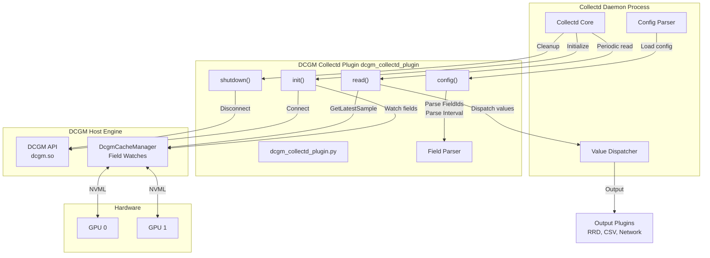
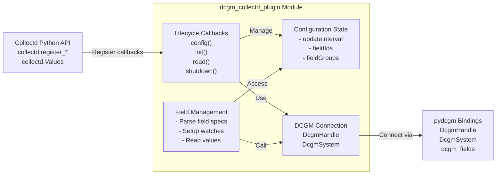
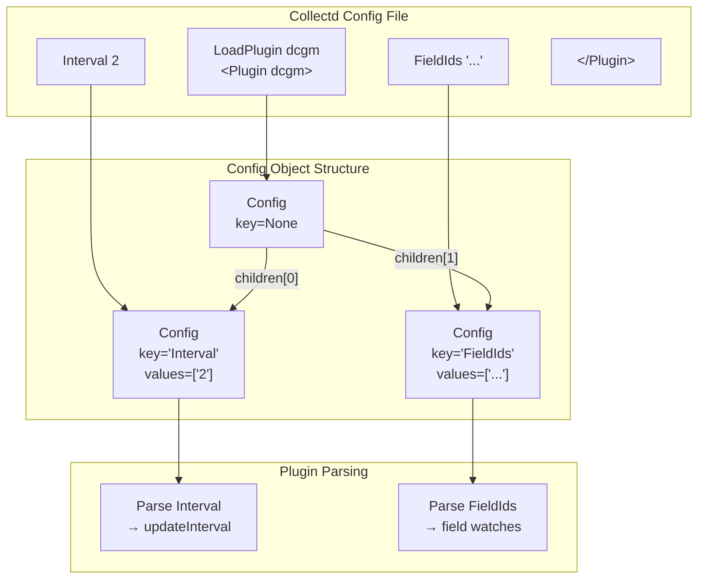
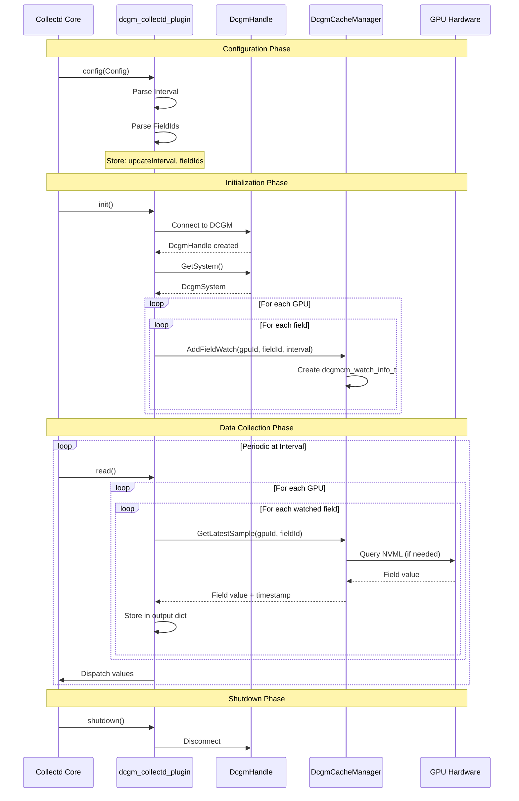
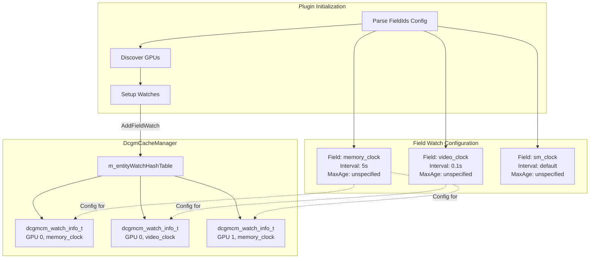
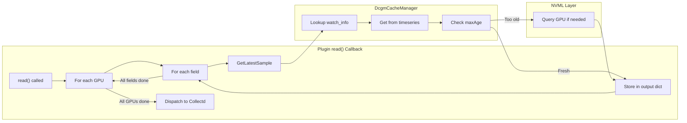
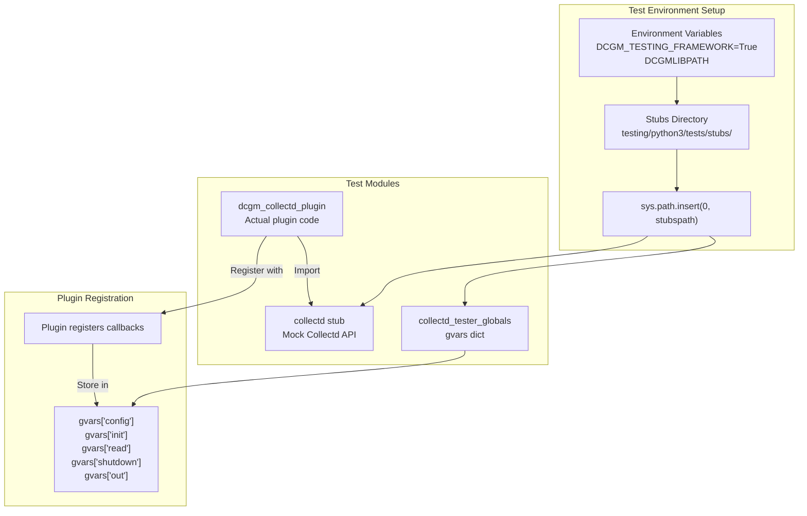
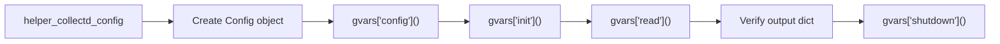
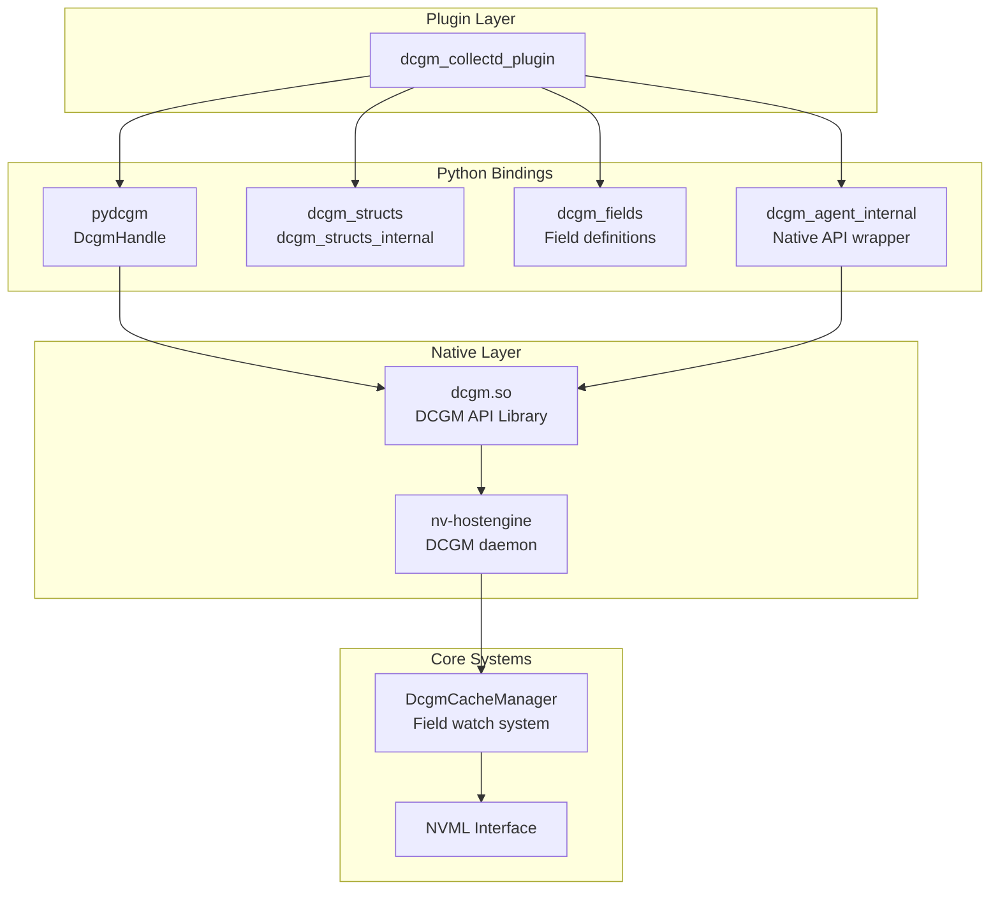

<!-- source: DeepWiki mcp.deepwiki.com · repo NVIDIA/DCGM · page 7.2 Collectd Plugin · fetched 2026-10-26 -->

# Collectd Plugin

<details>
<summary>Relevant source files</summary>

The following files were used as context for generating this wiki page:

- [README.md](README.md)
- [common/ThreeWayCmpDefault.hpp](common/ThreeWayCmpDefault.hpp)
- [modules/nvswitch/DcgmModuleNvSwitch.cpp](modules/nvswitch/DcgmModuleNvSwitch.cpp)
- [nvvs/include/NvvsJsonStrings.h](nvvs/include/NvvsJsonStrings.h)
- [testing/python3/tests/test_dcgm_collectd_plugin.py](testing/python3/tests/test_dcgm_collectd_plugin.py)

</details>


## Purpose and Scope

The DCGM Collectd Plugin (`dcgm_collectd_plugin`) integrates DCGM with the Collectd monitoring daemon, enabling GPU telemetry data to be collected and published through Collectd's metrics pipeline. This plugin acts as a bridge that watches DCGM fields and exports them in a format compatible with Collectd's plugin architecture.

For information about other DCGM integrations, see [Kubernetes Integration](#7.1). For details about the underlying field watching mechanism, see [Cache Manager](#2.1).

## Overview

The Collectd plugin is implemented in Python and follows Collectd's standard plugin lifecycle. It connects to the DCGM host engine, configures field watches based on user configuration, and periodically reads GPU metrics to publish them through Collectd's dispatch mechanism.



**Sources:** [testing/python3/tests/test_dcgm_collectd_plugin.py:1-200]()

## Plugin Architecture

### Module Structure

The plugin is implemented as a Python module that exposes callbacks conforming to Collectd's plugin API. The module integrates with DCGM through the `pydcgm` Python bindings.



**Sources:** [testing/python3/tests/test_dcgm_collectd_plugin.py:34-36]()

### Lifecycle Callbacks

The plugin implements four standard Collectd callbacks stored in `collectd_tester_globals.gvars` during testing:

| Callback | Purpose | When Called |
|----------|---------|-------------|
| `config()` | Parse configuration from Collectd config file | During Collectd initialization |
| `init()` | Connect to DCGM and setup field watches | After configuration, before data collection |
| `read()` | Read current field values and dispatch to Collectd | Periodically at configured interval |
| `shutdown()` | Cleanup resources and disconnect from DCGM | During Collectd shutdown |

**Sources:** [testing/python3/tests/test_dcgm_collectd_plugin.py:82-94]()

## Configuration

### Configuration Format

The plugin accepts configuration through Collectd's nested configuration syntax. Configuration is represented by a `Config` object with a hierarchical parent-child structure.



**Sources:** [testing/python3/tests/test_dcgm_collectd_plugin.py:38-46]()

### Configuration Parameters

#### Interval

Specifies the polling interval in seconds for reading GPU metrics.

```python
Config('Interval', ['2'])  # Poll every 2 seconds
```

**Sources:** [testing/python3/tests/test_dcgm_collectd_plugin.py:159]()

#### FieldIds

Defines which DCGM fields to monitor and their individual update intervals. The format supports multiple field specifications separated by commas.

**Field Specification Formats:**

| Format | Example | Description |
|--------|---------|-------------|
| `field_tag:interval` | `memory_clock:5` | Field by tag name with 5-second interval |
| `field_tag:interval.fraction` | `video_clock:.1` | Field with sub-second interval (100ms) |
| `(numeric_id,tag):interval` | `(100,memory_clock):5` | Field by numeric ID and tag |
| Multiple fields | `field1:5,field2:.1,field3:1` | Comma-separated list |

**Configuration Examples:**

```python
# Basic field configuration
Config('FieldIds', ['memory_clock:5,video_clock:.1'])

# Mixed numeric and tag-based fields
Config('FieldIds', ['(100,memory_clock):5,video_clock:.1'])

# Configuration with invalid field (gracefully handled)
Config('FieldIds', ['memory_clock:5,video_clock:.1,foo_clock:1'])
```

**Sources:** [testing/python3/tests/test_dcgm_collectd_plugin.py:159-172]()

### Field Tag Resolution

The plugin resolves field tags to DCGM field IDs using the `DcgmSystem.fields.GetFieldById()` interface. Common field tags include:

| Field Tag | DCGM Field ID | Description |
|-----------|---------------|-------------|
| `sm_clock` | `DCGM_FI_DEV_SM_CLOCK` | SM clock frequency |
| `memory_clock` | `DCGM_FI_DEV_MEM_CLOCK` | Memory clock frequency |
| `video_clock` | `DCGM_FI_DEV_VIDEO_CLOCK` | Video engine clock frequency |
| `retired_dbe` | `DCGM_FI_DEV_RETIRED_DBE` | Retired double-bit ECC pages |
| `retired_sbe` | `DCGM_FI_DEV_RETIRED_SBE` | Retired single-bit ECC pages |
| `power_violation` | `DCGM_FI_DEV_POWER_VIOLATION` | Power violation duration |
| `thermal_violation` | `DCGM_FI_DEV_THERMAL_VIOLATION` | Thermal violation duration |

**Sources:** [testing/python3/tests/test_dcgm_collectd_plugin.py:57-65](), [testing/python3/tests/test_dcgm_collectd_plugin.py:132]()

## Plugin Lifecycle Flow



**Sources:** [testing/python3/tests/test_dcgm_collectd_plugin.py:82-94]()

## Data Flow and Field Watching

### Field Watch Setup

During initialization, the plugin sets up field watches for all monitored fields across all discovered GPUs.



**Sources:** [testing/python3/tests/test_dcgm_collectd_plugin.py:108-149]()

### Data Reading and Output

During each read cycle, the plugin retrieves the latest values for all watched fields and organizes them in a nested dictionary structure.

**Output Structure:**

```python
# gvars['out'] structure:
{
    "0": {  # GPU ID
        "memory_clock": 1215,
        "video_clock": 1410,
        "sm_clock": 1530,
        "retired_dbe": 1,
        "retired_sbe": 5
    },
    "1": {  # GPU ID
        "memory_clock": 1200,
        "video_clock": 1400,
        "sm_clock": 1500
    }
}
```

**Sources:** [testing/python3/tests/test_dcgm_collectd_plugin.py:90-105]()

### Value Retrieval Flow



**Sources:** [testing/python3/tests/test_dcgm_collectd_plugin.py:87-91]()

## Testing Infrastructure

### Test Setup

The testing framework uses stubs to simulate Collectd's Python API without requiring an actual Collectd installation.



**Sources:** [testing/python3/tests/test_dcgm_collectd_plugin.py:25-35]()

### Test Cases

The test suite validates the plugin's ability to configure, initialize, watch fields, and retrieve data.

#### Basic Integration Test

Tests end-to-end functionality by injecting known values and verifying they can be read back.

```python
@test_utils.run_with_standalone_host_engine(20)
@test_utils.run_only_with_live_gpus()
def test_collectd_basic_integration(handle, gpuIds):
    """
    1. Inject specific field values into DCGM
    2. Run plugin lifecycle (config, init, read)
    3. Verify injected values are read back correctly
    """
```

**Injected Test Data:**

| Field | Value | Purpose |
|-------|-------|---------|
| `DCGM_FI_DEV_RETIRED_DBE` | 1 | ECC error tracking |
| `DCGM_FI_DEV_RETIRED_SBE` | 5 | ECC error tracking |
| `DCGM_FI_DEV_POWER_VIOLATION` | 1000 | Power throttling duration |
| `DCGM_FI_DEV_THERMAL_VIOLATION` | 9000 | Thermal throttling duration |

**Sources:** [testing/python3/tests/test_dcgm_collectd_plugin.py:48-106]()

#### Configuration Tests

| Test | Configuration | Expected Behavior |
|------|---------------|-------------------|
| `test_collectd_config_integration` | Valid fields with intervals | Fields parsed and watched successfully |
| `test_collectd_config_bad_alpha_field` | Invalid field name `foo_clock` | Invalid field skipped, valid fields processed |
| `test_collectd_config_bad_numeric_field` | Invalid field ID `1010` | Invalid field skipped, valid fields processed |
| `test_collectd_config_no_fields` | Only Interval specified | Plugin initializes without field watches |

**Sources:** [testing/python3/tests/test_dcgm_collectd_plugin.py:151-199]()

### Test Helper Function



**Sources:** [testing/python3/tests/test_dcgm_collectd_plugin.py:108-149]()

## Error Handling

The plugin handles various error conditions gracefully:

### Invalid Field Specifications

When an invalid field tag or ID is encountered during configuration parsing, the plugin:
1. Logs a warning about the invalid field
2. Skips the invalid field
3. Continues processing remaining valid fields

This ensures that configuration errors for individual fields don't prevent the plugin from monitoring other valid fields.

**Sources:** [testing/python3/tests/test_dcgm_collectd_plugin.py:165-187]()

### Missing Configuration

The plugin can operate with minimal configuration:
- If `FieldIds` is not specified, the plugin initializes without setting up field watches
- If `Interval` is not specified, a default interval is used

**Sources:** [testing/python3/tests/test_dcgm_collectd_plugin.py:191-199]()

## Integration with DCGM

The plugin integrates with DCGM through several layers:



**Sources:** [testing/python3/tests/test_dcgm_collectd_plugin.py:14-19]()

## Deployment Considerations

### Environment Variables

When running in a test or development environment:

| Variable | Purpose |
|----------|---------|
| `DCGM_TESTING_FRAMEWORK` | Set to `'True'` to enable test mode |
| `DCGMLIBPATH` | Path to DCGM shared libraries (can be copied from `LD_LIBRARY_PATH`) |

**Sources:** [testing/python3/tests/test_dcgm_collectd_plugin.py:26-28]()

### Collectd Configuration File Location

The plugin configuration is typically placed in:
- `/etc/collectd/collectd.conf` (main configuration)
- `/etc/collectd/collectd.conf.d/dcgm.conf` (plugin-specific configuration)

### Resource Considerations

The plugin creates field watches in DCGM's cache manager, which:
- Allocates memory for time-series storage per watched field
- Triggers periodic NVML queries based on configured intervals
- May impact overall system monitoring overhead if many fields are watched at high frequencies

For optimal performance:
- Use appropriate update intervals (avoid sub-second intervals unless necessary)
- Watch only the fields needed for your monitoring use case
- Consider the total number of watched fields across all plugins and clients

**Sources:** [testing/python3/tests/test_dcgm_collectd_plugin.py:159-172]()